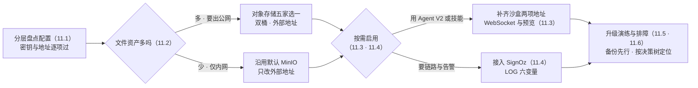
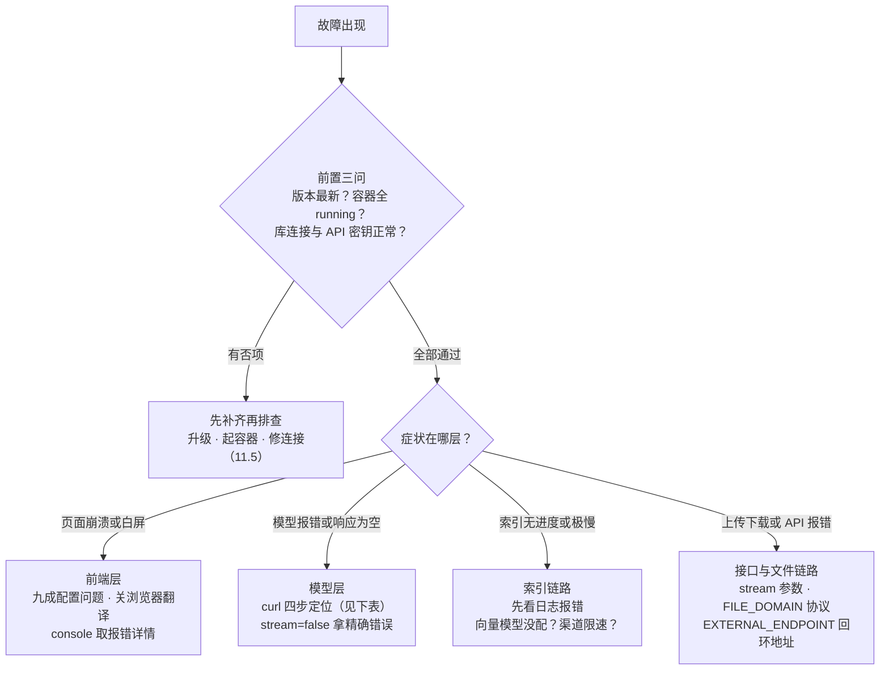

# 第 11 章 生产运维

> 本章导读：第 2 章把「售后客服」的底座立起来时，有几处配置按下了暂停键——沙盒的 WebSocket 与预览地址先留空，可观测变量只挂了个名字，升级与迁移只留了一句「见第 11 章」。现在到兑现的时候了。本章先给生产配置一个分层全景，补齐密钥治理与反向代理的真实 IP 校验；再按需启用对象存储、沙盒与可观测，然后是升级迁移与排障决策树。读完本章，你能：把一套「能跑」的部署治理成「敢上生产」的部署，补齐第 2 章留空的两项沙盒配置，并在下一次故障时按层定位、不靠重启碰运气。



*本章操作流程图*

## 你什么时候需要它

三种典型处境，对应本章三种用法。

**部署要从测试环境转正，给「售后客服」立生产规矩**——按 11.1 到 11.4 的顺序走一遍：配置分层盘点、密钥复核、反代真实 IP 校验，然后按需启用存储、沙盒与可观测。不需要的层保持留空，这也是纪律的一部分。

**客服团队用上了 Agent V2 虚拟机或技能（第 6 章、第 8 章），功能却提示沙盒不可用**——直接看 11.3：把第 2 章留空的两项地址补上、放行 3006 端口，功能即可解锁；沙盒专属的七类报错速查表也在那一节。

**要升级版本、换服务器，或者线上已经出了故障**——11.5 给升级四步与三条迁移路线；11.6 是排障入口，先用决策树定位到层，再进层内速查表。第 2 章 2.6 的部署决策树管「刚部署跑不通」，本节的树管「跑起来之后坏了」。

前置：第 2 章部署完成且首问验证通过；本章命令均在部署目录（`docker-compose.yml` 所在目录）执行；外部事实依据 v4.17.3 官方文档（核实日期 2026-11-01）。

## 11.1 生产配置全景：分层、密钥与真实 IP

### 配置分层：一层必填，五层按需

第 2 章立过规矩：社区版唯一的配置入口是 `docker-compose.yml` 里 `fastgpt-app` 的 `environment`（4.15.0 起 `config.json` 退出），改完 `docker compose up -d` 重建容器生效。生产环境的差异不在入口，而在「配什么、何时配」。第 2 章配齐的只是必填层，其余各层都按需启用：

| 层 | 代表变量组 | 何时配置 | 展开位置 |
|----|-----------|---------|---------|
| 基础必填层 | `FE_DOMAIN`、AI Proxy 两项、三类密钥、数据库连接 | 部署时一次配齐 | 第 2 章 |
| 存储层 | `STORAGE_*` 一组 | 文件资产要出内网或换云存储 | 11.2 |
| 沙盒层 | `AGENT_SANDBOX_*` 一组 | 启用虚拟机、技能或工作流辅助生成 | 11.3 |
| 可观测层 | `LOG_*` 一组 | 接入监控，要看链路与日志 | 11.4 |
| 安全层 | `TRUSTED_PROXY_*`、`AUTH_COOKIE_SECURE`、`ALLOWED_ORIGINS` | 有反向代理或对公网提供服务 | 本节 |
| 商业版层 | Admin 侧变量、插件远程调试套件 `CONNECTION_GATEWAY_*` | 仅商业版可用 | 第 1 章差异表 |

第 2 章埋的那句「代码沙箱与 Volume Manager 各有独立变量组，均只在启用对应功能时配置」，指的就是沙盒层；第 6、8、9 章反复出现的「生产配置见第 11 章」，落到本表就是按需层各行。**按需层的纪律是：启用哪个功能，才配哪一层；没启用的层保持留空，排查时也少一类嫌疑**（本书立场）。

### 密钥治理：三件事

生产环境的密钥治理归结为三件事，都有官方依据：

1. **长度与来源**——官方对生产密钥的统一口径是至少 32 位，不要使用示例值、默认值或弱口令（依据 v4.17.3 远程调试套件文档）；本节稍后的沙盒密钥与 11.3 的 `AGENT_SANDBOX_PROXY_SECRET` 都适用，第 2 章 2.3 各项密钥的长度下限在复核时按同一精神从紧掌握；
2. **不落散落介质**——连接密钥、Token 与凭证属于敏感信息，禁止写入日志、截图或公开文档；第 2 章的结论（`docker-compose.yml` 就是凭证库）在这里升级为纪律：该文件的访问权限按密钥管理；
3. **知晓重跑的代价**——在已部署目录重新运行一键脚本，会重新生成数据库密码与 `AES256_SECRET_KEY` 并覆盖 `docker-compose.yml`；要保留数据，先备份原文件，并选择不自动生成密码（或设置 `FASTGPT_AUTO_GENERATE_CREDENTIALS=false`），再把原密码与密钥拷回去（依据 v4.17.3 通用排查文档）。调试类连接密钥（connectionKey）只在开启或刷新调试通道时明文返回，泄露后应立即刷新或关闭通道。

### 反向代理与客户端 IP：防伪造三件套

IP 限流、分享链接 IP 白名单、对话日志 IP 记录、IP 属地展示——这些功能都读取客户端 IP。FastGPT 前面若有 Nginx、负载均衡、Ingress 或 CDN，就要防客户端伪造 `X-Forwarded-For` 与 `X-Real-IP` 转发头（Forwarding Header）。官方推荐同时完成三件事：

| 动作 | 做法 |
|------|------|
| 反代覆盖 IP 头 | 最后一层反向代理不透传用户原始 `X-Forwarded-For`，用真实连接来源覆盖 |
| 开启可信代理校验 | FastGPT 只信任来自反代、负载均衡或 Ingress 的转发头，不信任直连请求里的 IP 头 |
| 限制端口暴露 | 防火墙或安全组只允许反向代理访问 FastGPT 服务端口，避免绕过 Nginx 直连 |

FastGPT 侧两个变量：

```dotenv
TRUSTED_PROXY_ENABLE=true
TRUSTED_PROXY_IPS=172.18.0.0/16
```

`TRUSTED_PROXY_IPS` 填 FastGPT 直接看到的上一跳代理 IP 或 CIDR——例如 Nginx 容器所在 Docker 网段、Ingress Controller 内网地址或负载均衡回源地址；不要填 `0.0.0.0/0`，也不要把普通客户端网段加入可信列表。单层 Nginx 直接对外时，参考官方示例的关键行：

```nginx
location / {
    proxy_pass http://fastgpt:3000;
    proxy_set_header X-Real-IP $remote_addr;
    proxy_set_header X-Forwarded-For $remote_addr;
}
```

注意 `X-Forwarded-For` 被显式覆盖为 `$remote_addr`——这正是「不透传用户原始头」的落点。Nginx 前面还有 CDN 或负载均衡时，先用 `set_real_ip_from` 只信任这些上游的出口 IP 段，再把还原后的真实 IP 转发；CDN 用专用头（如 `CF-Connecting-IP`）时把 `real_ip_header` 改成对应头名。改完 `nginx -t && nginx -s reload`，并用伪造头验证效果：

```bash
curl -H 'X-Forwarded-For: 6.6.6.6' -H 'X-Real-IP: 6.6.6.6' https://fastgpt.example.com
```

配置正确时，FastGPT 记录与校验的仍应是真实客户端 IP，而不是 `6.6.6.6`。

### 边界与坑

- `TRUSTED_PROXY_IPS` 的锚点是「FastGPT 直接看到的上一跳」，不是链路里随便哪个代理的地址；没有反代直连的部署不需要 IP 头配置，但「限制端口暴露」仍然成立；
- 改完任何环境变量都要 `docker compose up -d` 重建容器——第 2 章的头号坑在生产环境依然是头号坑。

## 11.2 对象存储：双桶、短链与五家选型

### 先记住三件通用事

对象存储（Object Storage）承载文件与图片类资产——第 2 章组件表里那个 9000 端口的角色。官方支持五家：MinIO（默认）、AWS S3、阿里云 OSS、腾讯云 COS、Cloudflare R2；理论上任何对 S3 协议支持程度不低于 MinIO 的服务（如 SeaweedFS、RustFS）也可以使用。接入任何一家之前，先记住三件通用事：

1. **双桶提前建**——公共桶 `STORAGE_PUBLIC_BUCKET` 与私有桶 `STORAGE_PRIVATE_BUCKET`：除 MinIO 本地开发外建议提前创建，并确保 Access Key 对两个桶都有读写权限；R2 一节进一步明确，FastGPT 启动时只检查桶是否存在，不会自动创建生产桶；
2. **上传固定走 FastGPT 后端代理**——无论哪家厂商，上传都不从浏览器直连对象存储；
3. **下载走短链**——文件下载短链由 FastGPT 提供，不再直接返回对象存储预签名（Presigned）长链接；短链落到哪里由 `STORAGE_DOWNLOAD_URL_MODE` 控制，默认 `short-proxy`：

| 模式 | 行为 | 适用 |
|------|------|------|
| `short-proxy`（默认） | FastGPT 校验短链并代理文件流，下载无需配置公网对象存储地址 | 内网友好，默认选它 |
| `short-redirect` | 校验后 302 到短时效对象存储/CDN 地址 | 文件流量不经过 FastGPT，但要求该地址对访问方可达 |

自部署 MinIO 使用 `short-redirect` 时必须配置 `STORAGE_EXTERNAL_ENDPOINT`；插件 Logo 接口始终重定向到公开桶地址，若 `STORAGE_S3_ENDPOINT` 不能被浏览器访问，也需要配置该变量。`/api/system/img/` 下的对象存储图片在 `short-proxy` 时由 FastGPT 代理，`short-redirect` 时才重定向到公开桶地址。

### 两个地址变量：一个对内，一个对外

S3 兼容变量里最容易出事故的是两个「地址」的分工：

| 变量 | 填什么 | 常见错 |
|------|--------|--------|
| `STORAGE_S3_ENDPOINT` | 内网连接地址，可以是容器名，如 `http://fastgpt-minio:9000` | —— |
| `STORAGE_EXTERNAL_ENDPOINT` | **服务器与客户端（浏览器）均可访问**的地址，固定宿主机 IP 或域名 | 填成 `127.0.0.1` 或 `localhost` |

第 2 章 2.3 的「S3 连不上、签名报 403」正是后者填了回环地址：该变量用于签发对象存储的访问 URL，回环地址会让签发与上传的 URL 不一致（机制解释为本书推断，官方源文仅注明容器内无法使用回环地址）。其余可选项：`STORAGE_S3_CDN_ENDPOINT`（`short-redirect` 临时下载地址用的 CDN，不改变默认下载模式，配置时必须同时配 `STORAGE_EXTERNAL_ENDPOINT`；上传仍走后端代理，不会用 CDN）；`STORAGE_S3_FORCE_PATH_STYLE`（厂商填 `minio` 时固定为 `true`）；`STORAGE_S3_MAX_RETRIES`（默认 3 次）。

### 五家差异速查

| 厂商 | `STORAGE_VENDOR` | 关键差异与坑 |
|------|-----------------|-------------|
| MinIO | `minio` | 默认选项，适合本地开发与自部署；Sealos 对象存储也填 `minio`；K8s NodePort 暴露时须同时暴露 S3 API 的 9000 端口 |
| AWS S3 | `aws-s3` | 与 MinIO 同一套 S3 兼容变量；生产建议为 public 桶配置公开读取策略或 CloudFront/自定义域名 |
| 阿里云 OSS | `oss` | public 桶设公开读、private 桶保持私有，两桶可用同一组 Key 但不可同名；自定义域名填 `STORAGE_OSS_ENDPOINT` 并开 `STORAGE_OSS_CNAME`；无证书关 `STORAGE_OSS_SECURE`；服务同在阿里云可开 `STORAGE_OSS_INTERNAL` 省流量 |
| 腾讯云 COS | `cos` | 桶名必须含账号 App ID 后缀（如 `fastgpt-public-1250000000`）；`STORAGE_COS_PROTOCOL` 取值带冒号（`https:`/`http:`），无证书别设 `https:`；public 桶配匿名读；可选全球加速、自定义域名与代理 |
| Cloudflare R2 | `r2` | `STORAGE_REGION` 固定填 `auto`；`STORAGE_R2_PUBLIC_ENDPOINT` 必配（公开桶绑定的公开 HTTPS 域名，不是 S3 API endpoint，不带查询参数）；不支持经 `STORAGE_S3_CDN_ENDPOINT` 重写预签名 URL，私有对象建议保持 `short-proxy`；受速率限制的 `r2.dev` 开发 URL 不建议生产使用 |

MinIO 示例（节选；其余厂商的完整 dotenv 见官方文档同页）：

```dotenv
STORAGE_VENDOR=minio
STORAGE_ACCESS_KEY_ID=your_access_key
STORAGE_SECRET_ACCESS_KEY=your_secret_key
STORAGE_PUBLIC_BUCKET=fastgpt-public
STORAGE_PRIVATE_BUCKET=fastgpt-private
STORAGE_S3_ENDPOINT=http://127.0.0.1:9000
STORAGE_S3_FORCE_PATH_STYLE=true
```

选型一句话：**业务上推荐自部署起步沿用默认 MinIO；上云时优先选团队已在用的云厂商——同厂商的内网直连与加速域名是现成红利，跨云搬桶的成本远高于存储费差价**（后半句为本书工程判断）。

### 边界与坑

- `STORAGE_EXTERNAL_ENDPOINT` 的判据是「浏览器能否访问」，Docker 与 K8s 部署同理——集群内地址或服务器本机的 `localhost` 形式地址不能用于浏览器访问公开桶资源；`short-redirect` 把文件流量交给存储或 CDN 的前提，也是该地址对访问方可达；
- 上传报 `s3 upload network error` 多为混合内容拦截（页面 HTTPS 而文件地址是 http），处置见 11.6 速查表。

## 11.3 代码沙箱：OpenSandbox 与两项地址的兑现

### 组件与适用：第 6、7、8 章共同的前置

OpenSandbox 是自托管 Agent/Skill 沙盒运行环境的方案：FastGPT 经 OpenSandbox Server 创建沙盒，经 Agent Sandbox Proxy 为浏览器提供文件、终端和预览访问。四个部件——OpenSandbox Server、Volume Manager（持久卷）、Agent Sandbox Proxy、沙盒运行时镜像——最新版 Docker Compose 已全部内置，无需再单独合并其他 YAML；第 2 章 `prepull` 预拉取的沙盒运行时镜像在这里派上用场。

谁需要它：第 6 章 Agent V2 的虚拟机、第 8 章技能的开发与运行、第 7 章的工作流辅助生成（管理员需启用虚拟机能力）——三章共同的前置就是本节。官方警示：**OpenSandbox 方案默认未做网络隔离，有安全隔离要求需自行补充策略**。

### 兑现第 2 章的伏笔：两项地址加一把密钥

第 2 章 2.2 留空、第 6 章 6.5 与第 8 章两度引用的「沙盒的 WebSocket 与预览地址两项」，在 compose 的 `x-agent-sandbox-config` 中补齐：

```dotenv
AGENT_SANDBOX_PROXY_SECRET=replace_with_32_chars_random_secret
AGENT_SANDBOX_PROXY_URL=wss://sandbox-proxy.example.com
AGENT_SANDBOX_PREVIEW_PROXY_URL=https://sandbox-proxy.example.com
```

三项要求：

| 变量 | 要求 |
|------|------|
| `AGENT_SANDBOX_PROXY_SECRET` | 与 Agent Sandbox Proxy 服务中的同名变量完全一致，长度不少于 32 位 |
| `AGENT_SANDBOX_PROXY_URL` | 浏览器可访问的 `ws://` 或 `wss://` 地址；FastGPT 用 HTTPS 时必须用 `wss://` |
| `AGENT_SANDBOX_PREVIEW_PROXY_URL` | 预览代理地址；`fastgpt-app` 与 `fastgpt-pro` 都必须配置 |

配套动作：放行宿主机 3006 端口（Proxy 容器 `PORT` 默认 1006，映射宿主机 3006——第 6 章 6.5 提过的那个端口），并确认反向代理支持 WebSocket Upgrade。补齐后回到第 6 章开启虚拟机、或第 8 章打开技能详情页，沙盒能拉起即兑现完成。

### 三对一致性：沙盒排障的主线

沙盒链路的报错大多收敛为「两边不一致」，三对必须一致的配置先记住：

| fastgpt-app 侧 | 对端 | 一致性要求 |
|----------------|------|-----------|
| `AGENT_SANDBOX_OPENSANDBOX_API_KEY` | OpenSandbox Server 配置的 `[server].api_key` | 完全一致 |
| `AGENT_SANDBOX_OPENSANDBOX_VOLUME_MANAGER_TOKEN` | compose 的 `x-volume-manager-auth-token` | 完全一致 |
| `AGENT_SANDBOX_PROXY_SECRET` | Agent Sandbox Proxy 的同名变量 | 完全一致且不少于 32 位 |

### 安全两条：同源与链接

- **预览代理必须与 FastGPT 主站不同源**（协议、域名、端口至少一项不同）——沙盒里的 HTML 可能包含用户生成的脚本，若预览地址与主站同源，这些脚本可能访问主站凭证或接口；
- **预览链接是短期只读凭证（bearer capability）**——拿到链接的人可以在有效期内通过修改 URL 路径读取同一 Workspace 中的其他文件，不要把它分享给无权访问该 Workspace 的用户。

### 端口、网关与资源生命周期

4.16 起默认用同一个端口同时承载 WebSocket 与 HTTP 预览；网关不支持同端口转发时，把 Proxy 的 `PREVIEW_PORT` 设为其他容器端口（如 1007），端口映射改为 `3007:1007`，并把 `AGENT_SANDBOX_PREVIEW_PROXY_URL` 指向新的 3007 端口。

单沙盒资源与生命周期（默认值即官方默认）：

| 变量 | 默认值 | 含义 |
|------|--------|------|
| `AGENT_SANDBOX_CPU_COUNT` / `MEMORY_MIB` / `STORAGE_SIZE_GI` | 1 / 2048 / 1 | 单沙盒 CPU（核）、内存（MiB）、存储（Gi）上限 |
| `AGENT_SANDBOX_SUSPEND_MINUTES` | 60 | 运行中的沙盒持续未活跃多少分钟后自动暂停 |
| `AGENT_SANDBOX_ARCHIVE_INACTIVE_DAYS` | 7 | 已暂停的沙盒持续未活跃多少天后自动归档 |
| `AGENT_SANDBOX_WS_MAX_MESSAGE_BYTES` / `_FRAME_BYTES` | 67108864 / 16777216 | IDE WebSocket 单消息/单帧上限（64/16 MiB） |

第 8 章讲的「自动休眠与无感唤醒」，底座就是 `SUSPEND_MINUTES` 与 `ARCHIVE_INACTIVE_DAYS` 这两行——调大可减少冷启动等待，代价是常驻资源占用（Kubernetes 运行态另有 CPU/内存超卖（Overcommit）倍数变量，仅 OpenSandbox provider 且 Server 不低于 v0.2.1 时生效）。

### 依赖源与镜像

沙盒内安装依赖的三个源变量：`AGENT_SANDBOX_NPM_REGISTRY` 与 `AGENT_SANDBOX_PYPI_INDEX_URL` 适用于所有运行态镜像；`AGENT_SANDBOX_APT_MIRROR` 仅对 root 权限沙箱镜像生效，且必须填 apt 仓库根地址（不要带 `dists` 或具体版本目录），arm64 架构要用 ubuntu-ports 路径——FastGPT 会读取沙盒的 `/etc/os-release` 生成并覆盖 apt 源文件。这与第 8 章「依赖要在 `entrypoint.sh` 里装」互补：那里管装在哪，本节管从哪装。运行态镜像同一 tag 同时包含 `amd64` 与 `arm64`，需要安装 apt 依赖时改用 `fastgpt-agent-sandbox-root` 镜像并配套 `AGENT_SANDBOX_APT_MIRROR`。

### 沙盒故障速查表

| 报错或症状 | 检查点 |
|-----------|--------|
| Sandbox provider apiKey is required | `AGENT_SANDBOX_OPENSANDBOX_API_KEY` 已配置且与 `[server].api_key` 一致 |
| VOLUME_MANAGER_URL is required | `AGENT_SANDBOX_OPENSANDBOX_VOLUME_MANAGER_URL` 与 Token 已配置，Volume Manager 正常运行 |
| PROXY_URL 或 PREVIEW_PROXY_URL is required | `fastgpt-app` 三项齐配；`fastgpt-pro` 至少配 `PREVIEW_PROXY_URL` |
| 浏览器 WebSocket 连接失败 | Proxy 可从浏览器访问；反向代理支持 WebSocket Upgrade；HTTPS 站点用 `wss://` |
| Proxy 校验失败或返回 401 | 主服务与 Proxy 的 `AGENT_SANDBOX_PROXY_SECRET` 完全一致且不少于 32 位 |
| 沙盒创建成功，但文件树或终端连接失败 | `AGENT_SANDBOX_PROXY_URL` 是浏览器可访问的 `ws(s)://` 地址，宿主机 3006 端口已放行 |
| Proxy 无法连接沙盒 endpoint | `[docker].host_ip` 不能是 `localhost` 或 `127.0.0.1`，改为宿主机内网 IP 或 `host.docker.internal` |

### 边界与坑

- `fastgpt-pro` 不提供 Sandbox Editor 与 WebSocket Proxy 链路，因此不要求密钥与 WebSocket 地址两项，但预览地址必配；
- 服务器配置了 `HTTP_PROXY` / `HTTPS_PROXY` 时，给 OpenSandbox Server 与 Volume Manager 显式配置 `NO_PROXY`（至少含 `localhost`、`127.0.0.1`、各内部服务容器名与 `host.docker.internal`），避免内部调用绕道代理；
- 从旧版 Volume Manager 升级时，把原 `VM_VOLUME_NAME_PREFIX` 的值配到 `AGENT_SANDBOX_OPENSANDBOX_VOLUME_NAME_PREFIX`，否则历史持久卷无法按原名称清理；
- 技能与虚拟机「整组不可用」时先查本节底座、再查应用配置——第 8 章的排障顺序在这里再次成立。

## 11.4 可观测：SignOz 与三层日志

### SignOz 是系统层的眼睛

SignOz 是开源的应用性能监控（APM，Application Performance Monitoring）与可观测性（Observability）平台，基于 OpenTelemetry 标准（OTEL）收集、处理并可视化分布式系统的遥测数据。五项能力与运维用途对号入座：

| 能力 | 运维用途 |
|------|---------|
| 链路追踪（Tracing） | 跟踪用户请求在 FastGPT 各服务间的完整调用链路 |
| 性能监控（Metrics） | 监控 API 响应时间、吞吐量等关键指标 |
| 错误追踪 | 自动捕获并记录系统异常 |
| 日志聚合（Logging） | 集中收集应用日志，支持结构化查询 |
| 实时告警 | 按指标阈值设置告警规则，及时发现异常 |

部署二选一：SignOz 官方云服务或私有部署；官方文档给了 Sealos 一键部署模板，部署后开启 OTLP 收集器 4318 端口的访问地址（走内网服务可忽略公网暴露）。

### FastGPT 侧：六个 LOG 变量

```dotenv
LOG_ENABLE_CONSOLE=true                  # 是否开启控制台打印
LOG_CONSOLE_LEVEL=debug                  # 控制台打印最低日志等级
LOG_ENABLE_OTEL=true                     # 是否开启 OTEL 日志收集
LOG_OTEL_LEVEL=info                      # OTEL 日志收集的最低日志等级
LOG_OTEL_SERVICE_NAME=fastgpt-client     # 传给 OTLP 收集器的服务名称
LOG_OTEL_URL=http://localhost:4318/v1/logs # OTLP 收集器地址，不要遗漏 /v1/logs
```

日志等级枚举：`trace`、`debug`、`info`、`warning`、`error`、`fatal`。改完重启 FastGPT，进 SignOz 管理台（首次访问需注册一个账号，数据存本地数据库），COMPLETED 步骤条中 logs 与 traces 亮起即接入成功。运营注意（官方文档的运维化转述）：SignOz 非常占用磁盘——不要把 FastGPT 的 debug 日志也收集进来；把日志存储时长调整为 7 天；如果数据突然不再增长、内存持续上涨，就是磁盘满了，需要扩容。

### 三层可观测：各看各的

| 层 | 工具 | 回答的问题 | 出处 |
|----|------|-----------|------|
| 系统层 | SignOz | 服务健康吗——链路、指标、异常、告警 | 本节 |
| 模型层 | 渠道状态探测与调用日志 | 模型稳吗——48 小时稳定性图、tokens、耗时、错误入参 | 第 2 章 2.4 |
| 应用层 | 对话日志推送（`CHAT_LOG_URL`） | 答得好吗——对话数据外送做质检与对账 | （→ langfuse 书）；巡检见第 13 章 |

第 2 章埋的「`LOG_ENABLE_OTEL`、`CHAT_LOG_URL`（第 11 章，→ langfuse 书）」在此归位：前者进本节的 OTEL 日志收集，后者是应用层外送的口子。**业务上推荐：系统层与模型层在生产上线前接好，应用层等对话量起来后再接**（本书立场）。

### 边界与坑

- `LOG_OTEL_URL` 别漏 `/v1/logs` 路径——这是官方文档专门标注的一处；告警规则则在 SignOz 侧按指标阈值配置；
- 系统层看见「服务不健康」，模型层看见「模型不稳」，应用层才看见「答得不好」，三层互不替代；对话日志外送的具体协议与 langfuse 侧的消费方式不在本章展开（→ langfuse 书）。

## 11.5 版本升级与数据迁移

### 升级路径：四步走

官方排查注意事项把「先升级再排查」排在第一位：很多已知问题已在最新版本修复，反馈问题前先检查版本并参考更新指南升级。结合第 2 章 2.2 的升级提示，生产升级固定四步：

| 步骤 | 动作 | 要点 |
|------|------|------|
| 1 读更新日志 | 确认目标版本与当前版本的差异、有无初始化脚本 | 不跨版本，小步升级（第 2 章原则） |
| 2 备份 | 按路线 A 复制数据目录，另存当前 `docker-compose.yml` | 一键脚本重跑会重新生成密码并覆盖该文件（11.1） |
| 3 换镜像启动 | 改镜像 tag 后 `docker compose up -d` | 如有初始化脚本则执行 |
| 4 验证 | 首问验证（第 2 章 2.6）+ 核对知识库检索与应用行为 | 迁移未完成前，检索可能查不到旧数据 |

版本相关的启动报错有两条（「模板与版本不配套」一类）：

| 报错 | 版本与原因 | 处置 |
|------|-----------|------|
| 启动报 index not found（collection=modeldata_v2） | 4.16.2 起向量检索与全文检索共用 `modeldata_v2` 表，该表已存在却缺全文索引时启动报错退出；要求 Milvus 不低于 2.5.16 | 升级前先按 Milvus BM25 迁移文档备份并升级 Milvus（见第 4 章）；已报错的需删除并重建该表（会删数据，先备份并联系技术支持） |
| 报 `AGENT_SANDBOX_OPENSANDBOX_IMAGE` 没配置或 `AGENT_SANDBOX_PREVIEW_PROXY_URL` 不对 | 4.16.0 起沙箱镜像只用单变量且必配预览地址；4.15 或更早的 compose 模板配新版镜像即报错 | 用一键脚本重新部署，或手动下载与镜像同版本的 compose 模板（重跑一键脚本前先备份原文件，见 11.1 密钥治理） |

### 数据迁移：三条路线

| 路线 | 做法 | 适用场景 |
|------|------|---------|
| A 卷目录整体复制 | `down` 后复制 `pg/data` 与 `mongo/data` | 同版本搬家、升级前备份——官方称「无脑操作」 |
| B Mongo dump 模式 | `mongodump` 导出、传输、`mongorestore` 恢复 | 跨环境、跨云迁移（如云上迁 NAS，目标机 Mongo 需用 4.2/4.4 等旧版本） |
| C 向量库切换 | 改数据库连接配置，逐知识库重建索引 | 换向量库（如 Milvus 切 pgvector），向量不自动迁移 |

**路线 A**——Docker 部署的数据库都经 volume 挂载本地目录，官方文档全文就两步：

```bash
docker-compose down
# 复制部署目录下的 pg/data 与 mongo/data 到新位置
```

**路线 B** 八步（A 环境为旧环境，B 为新环境，C 为本地过渡机）：

| 步骤 | 环境 | 操作 |
|------|------|------|
| 1 建导出目录 | A | 容器与宿主机各建 backup 目录（数据目录已持久化时会自动同步到宿主机） |
| 2 导出 | A | `docker exec mongo` 执行 `mongodump --db fastgpt --out /data/backup` |
| 3 压缩传输 | A→C→B | `tar` 打包后 `scp` 到过渡机留存（官方提醒跨环境 scp 可能丢数据），再转新环境 |
| 4 核对 | C | 解压后比对 bson 文件数量，不一致就重新导出 |
| 5 上传入位 | B | 解压到新机自建目录，`docker cp` 进 mongo 容器的 `/tmp/backup`（不要放 data 目录——下一步要清空它） |
| 6 初始化新库 | B | 清空并重新初始化 mongo 的 data 持久化目录，避免 `mongorestore` 报错 |
| 7 恢复 | B | `mongorestore --authenticationDatabase admin /tmp/backup/ --db fastgpt` |
| 8 验证 | B | 先 `docker logs -f mongo` 确认启动正常，再登录核对数据完整显示 |

三个「导入没成功」的信号：文件数量量级明显偏少；新环境能登录但内容一片空白；容器状态反复 `mongo is restarting`（正常应稳定运行——先看 mongo 日志，再决定要不要动 Web）。

**路线 C**（Milvus 切换为 pgvector，适用于 4.16.2 及以后）：

1. 在 compose 里增加 pgvector 服务，`fastgpt-app` 配置 `PG_URL`、去掉 `MILVUS_ADDRESS` 后重启——表和索引自动创建；若同时配了 SeekDB 或 OceanBase，它们的优先级高于 pgvector，需一并去掉；
2. 进入每个知识库的「配置」页，把索引模型切换为另一个模型（不能选当前正在使用的）并确认重建索引——重建完成前，检索只能找到已重新生成向量的数据；重建会调用所选模型并按模型价格计费，正在处理数据或重建索引的知识库要等任务结束再切；
3. 所有知识库重建完成且搜索测试正常后，再停用旧 Milvus；停用前先备份数据。

关键预期：原向量不会自动迁移，需要重新生成；知识库、文件与文本分块不受影响。第 2 章「真到亿级再迁 Milvus」的反向路径就是这条路线；第 4 章的 BM25 全文检索迁移是它在 Milvus 侧的特例。

### 边界与坑

- **升级前必有可回滚的备份，并在测试环境演练一遍再动生产**（本书立场）——路线 A 的目录复制就是回滚的底气；
- 路线 B 的 C 环境不是可选项而是保险：留一份、核数量，出问题能重来；
- 路线 A 与 B 都要停服务，路线 C 期间检索结果不完整——三类窗口都挑低峰执行并提前通知使用者。

## 11.6 故障排查：先分层，再动手

### 方法论三原则

| 原则 | 内容 | 出处 |
|------|------|------|
| 先版本后排查 | 很多已知问题已在最新版本修复；反馈问题前先检查版本，按 11.5 升级 | 官方排查注意文档 |
| 证据先行 | 先 `docker ps -a` 确认容器全 running，再看后端 `docker logs` 与浏览器 console（报错超链接可定位到具体文件）；反馈时附完整版本号、复现步骤、日志与截图 | 官方错误排查方式文档 |
| 先分层再动手 | 症状先定位到层，再进层内检查点——不要一上来就重建容器 | 本书方法论，延续第 2 章 2.6 |

### 排障决策树

生产环境高频故障收敛成一棵树——四个分支对应四个故障层，每个终点的检查点都出自官方排查文档或本章小节：



### 模型层：curl 四步定位

「对话报错、模型异常」类故障，按距离从远到近四步排查（官方模型排查文档）：

| 步骤 | 测什么 | 说明 |
|------|--------|------|
| 1 | 私有部署模型本身是否正常 | 先确认部署的模型服务健康 |
| 2 | curl 直测上游模型 | 五类模型（语言、索引、重排、语音合成、语音识别）官方均给了 curl 模板 |
| 3 | curl 测中转（AI Proxy） | 模型请求统一经代理（第 2 章 2.4） |
| 4 | FastGPT 内实测 | 渠道测试与模型测试（第 2 章 2.4 的四步走） |

「模型响应为空」的四个可能原因：国内模型命中风控；不支持的模型参数（只保留 messages 与必要参数再测）；参数不符合模型要求（有的模型不支持 temperature 为 0、不支持两位小数，max_tokens 超限或上下文超长）；模型部署的 stream 模式不兼容。定位技巧：4.8.10 版本起报错日志会打印实际发送的请求体，复制出来直接 curl 重放；stream 模式拿不到精确错误时改用 `stream=false`。工具调用支持度另有一个专项测试——向中转发一次带 `tools` 的请求，响应出现 `tool_calls` 即支持，模型提供商与中转必须同时支持（对应第 2 章 2.4 模型配置里的 `toolChoice` / `functionCall` 字段，均不支持时走提示词模式）。

### 高频症状速查表

| 症状 | 原因与处置 |
|------|-----------|
| 页面崩溃 | 九成是模型配置不正确（每类模型至少启用一个，空的对象参数给空数组或空对象）；关闭浏览器翻译功能；配置文件未正常加载会缺系统信息导致空指针 |
| Connection error | 服务器连不上模型（国内服务器访问海外 API 需中转或反代）；或 FastGPT 与代理服务不在同一网络 |
| 页面正常、API 报错 | 页面走 `stream=true`，API 测试也要带 `stream=true`（部分国产模型非 Stream 兼容差） |
| 知识库索引无进度或极慢 | 能对话但无进度＝没配向量模型；都不能＝上游 API 调用失败；有进度但极慢＝渠道限速（如免费号每分钟仅 3～60 次、一天 200 次） |
| 上传报 s3 upload network error | 浏览器上传地址取自 `FILE_DOMAIN`（未设则 `FE_DOMAIN`），页面是 HTTPS 而该地址是 http 时被浏览器按混合内容拦截；改成可访问的 https 地址后重启 |
| 多模态图片读不到或下载超时 | 4.15.3 起 `MULTIPLE_DATA_TO_BASE64` 默认 false，`http(s)` 短链交给模型服务商下载，内网地址不可达即超时；改 `true` 转 base64（请求体变大），或把 `FILE_DOMAIN` 配成模型服务商可达的公网地址（不要改 `FE_DOMAIN`，那是用户访问地址） |
| 当前分组上游负载已饱和 | 中转渠道的问题，换个模型或换一家渠道 |
| 向量检索得分大于 1 | 索引模型输出未归一化，仅支持归一化模型（选型见第 4 章） |
| 开启图片索引报 400 | 未在管理员系统配置中正确配置 OCR 模型 |
| 改了向量模型没生效 | 管理员模型配置中启用后刷新页面；已有知识库不会自动切换，须在其「配置」页切换索引模型并确认重建（即 11.5 路线 C，重建计费） |

### 边界与坑

- 决策树管「定位到层」，速查表管「层内处置」；两步走完仍无解，再带全量证据提 Issue；
- 判断「改了没生效」之前，先确认容器真的重建了（`docker compose up -d`）；反馈问题的最小证据集是完整版本号、复现步骤、错误日志或截图。

## 本章小结

1. **生产配置是「一层必填加五层按需」**：存储、沙盒、可观测、安全各成一列，启用哪个功能才配哪一层；安全层的可信代理校验（`TRUSTED_PROXY_*`）是公网部署的标配，IP 头由最后一层反代覆盖。
2. **对象存储三件通用事**：双桶提前建、上传固定走后端代理、下载短链两模式（默认 `short-proxy`）；`STORAGE_S3_ENDPOINT` 对内、`STORAGE_EXTERNAL_ENDPOINT` 对外——第 2 章的 403 坑就是后者填了回环地址。
3. **沙盒伏笔兑现**：第 2 章留空的两项地址就是 `AGENT_SANDBOX_PROXY_URL`（WebSocket）与 `AGENT_SANDBOX_PREVIEW_PROXY_URL`（预览），加上不少于 32 位的共享密钥；三对一致性配置是沙盒排障主线，预览代理必须与主站不同源。
4. **可观测分三层**：SignOz 看服务（OTEL 六变量）、渠道探测与调用日志看模型、`CHAT_LOG_URL` 外送对话数据（→ langfuse 书）——三层互不替代，各答一个「吗」。
5. **升级四步、迁移三路线**：读更新日志、备份、换镜像、验证；卷目录复制、dump 迁移、向量库切换各有适用场景，升级前必有可回滚备份并在测试环境演练。
6. **排障三原则一棵树**：先版本后排查、证据先行、先分层再动手；决策树四个分支对应前端、模型、索引、接口文件四层，层内进速查表。

下一步：「售后客服」的平台底座至此齐装。但一套系统要服务整个客服团队，就得回答「谁能改应用、谁能看对话、谁能管知识库」——第 12 章进入团队协作与权限治理：团队空间、角色权限、邀请链接与 SSO，给客服、运营、开发三种角色分好地盘。

## 验收清单

读到这里，你应该能：

- ☐ 画出六层配置全景表，说出每层解决什么问题、何时才需要配置；
- ☐ 解释 `STORAGE_S3_ENDPOINT` 与 `STORAGE_EXTERNAL_ENDPOINT` 的分工，并指出回环地址会导致哪类故障；
- ☐ 在测试环境补齐沙盒两项地址与密钥、放行 3006 端口，让第 6 章的虚拟机真实跑通一次；
- ☐ 完成 SignOz 接入并看到 logs 与 traces 亮起，说出系统、模型、应用三层可观测各自的边界；
- ☐ 在测试环境演练一次路线 A 备份与路线 B 恢复，核对 bson 文件数量并说出三个「导入没成功」的信号；
- ☐ 用决策树定位一次人为制造的故障（如临时改错 `STORAGE_EXTERNAL_ENDPOINT`），说出它在哪一层、走哪个检查点。

### 复核清单（发布前）

以下各项均未实测，发布前逐条补验：

- [ ] 全章配置项与行为对照官方文档 v4.17.3（self-host/config/object-storage、self-host/config/sandbox/opensandbox、self-host/config/signoz、self-host/config/remote-debug-suite、self-host/migration/docker_db、self-host/migration/docker_mongo、self-host/troubleshooting/attention、self-host/troubleshooting/faq、self-host/troubleshooting/methods、self-host/troubleshooting/model-errors），核实日期 2026-11-01；素材拉取 10/10 有效，无 404 剔除项；
- [ ] 沙盒两项地址实测：配齐后第 6 章虚拟机可用；故意不放行 3006，复现「文件树或终端连接失败」；
- [ ] SignOz 实测：六变量接入、COMPLETED 步骤条 logs/traces 亮起、日志存储时长调 7 天、磁盘满时的「数据不涨内存涨」症状；
- [ ] 下载模式实测：`short-proxy` 与 `short-redirect` 各走一次上传下载；自部署 MinIO 在 `short-redirect` 下不配 `STORAGE_EXTERNAL_ENDPOINT` 复现失败；
- [ ] 路线 A 与路线 B 各实测一次（含文件数量核对与 `mongo is restarting` 信号复现），路线 C 在测试库实测重建索引期间的检索行为、计费提示与 SeekDB/OceanBase 优先级；
- [ ] `TRUSTED_PROXY` 两变量实测：伪造 `X-Forwarded-For` 后日志记录真实 IP；
- [ ] 章首操作流程图与 11.6 决策树的 GitHub 网页端渲染检查。

## 延伸阅读

- **第 2 章（部署与模型通道）**——本章的地基：端口、密钥与 `docker-compose.yml` 凭证库的来龙去脉，2.3 的 env 分类表是 11.1 分层表的底稿。
- **第 6 章、第 8 章（应用与 Agent、工具与技能）**——沙盒的三个消费方：虚拟机、技能与工作流辅助生成在功能侧的表现，与本章的服务侧配置互为正反面。
- **第 4 章（检索方案与调优）**——11.5 路线 C 的前传：Milvus 的 BM25 全文检索与 `modeldata_v2` 单表为什么值得迁，迁完去哪验证。
- **第 13 章（对话运营与评测）**——可观测应用层的延伸：调用日志之外的对话质检、评测与坏例治理，把「答得好吗」变成可持续的巡检。
- **（→ langfuse 书）**——`CHAT_LOG_URL` 外送的对话数据在 langfuse 侧的消费：trace 级观测与评估数据集的组织方式。
