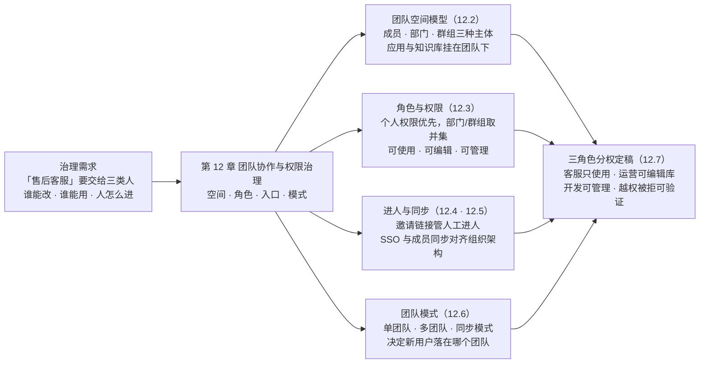
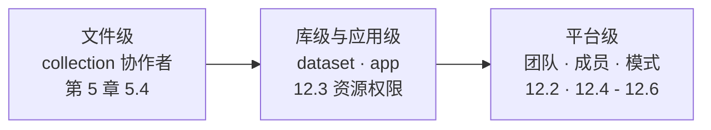
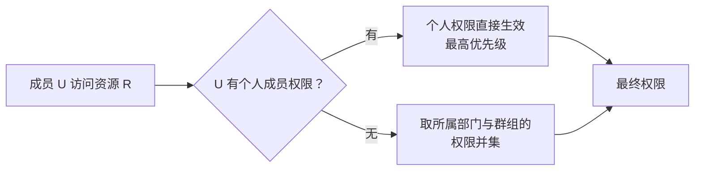
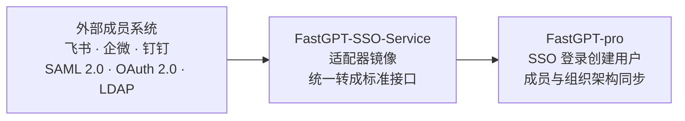

# 第 12 章 团队协作与权限治理

> 本章导读：第 5 章把 `after-sales-kb` 的更新问题机械化，并在 5.4 留下一句伏笔——「团队空间、角色与库级协作者的完整体系在第 12 章」。现在兑现它：「售后客服」要交给三类人——客服只用，运营养库，开发管平台；人怎么进团队、账号怎么跟组织架构对齐、新用户落在哪个团队，都要有个说法。本章从第 5 章的文件级权限往上走两层：库级与应用级的协作者（Collaborator）权限（判定链与资源权限表），平台级的进人入口（邀请链接）、组织架构对接（单点登录与成员同步）与团队模式。最后把三角色分权落成一张矩阵和一组验证动作。读完本章，你能：说清一次权限判定的完整链路，为售后域配置客服/运营/开发三角色分权，并为自己的部署选定团队模式与进人方式。



*本章导览图*

## 你什么时候需要它

三种典型处境，对应本章三种用法。

**应用要开放给更多人，但「人人可改」显然不对**——看 12.2 与 12.3。资源挂在团队空间下，协作者与「可使用/可编辑/可管理」三档权限决定谁能做什么；第 5 章的文件级权限只是这条链上最细的一环。

**成员进进出出，手动加减账号与配权限成了负担**——12.4 的邀请链接管人工进人，12.5 的 SSO 与成员同步把组织架构对齐；离职即失权这类事，靠同步机制而不是靠人的记性。

**自部署实例用着用着长成了「人人一个团队」，资源互相看不见**——看 12.6：团队模式决定新用户落在哪，单团队与同步模式是面向统一治理的形态，多团队模式另有其位。

前置提醒：第 1 章功能差异表把「团队空间与权限、SSO 登录、管理后台」整体列在商业版/云服务一侧，本章是全书里与第 5 章并列的形态前提最重的章之一，动手前先对表。

## 12.1 概述：从文件级权限到平台级治理

第 5 章在知识库内部把权限做到了文件一级；但「谁能建库」「谁能进团队」「新同事落在哪」这些问题的答案不在知识库里，在平台层。FastGPT 的权限体系把几层接在一起，官方的概括是：权限系统融合了基于**属性**和基于**角色**的权限管理范式——即基于属性的访问控制（Attribute-Based Access Control，ABAC）与基于角色的访问控制（Role-Based Access Control，RBAC）两种思路的组合，通过**成员、部门和群组**三种管理模式，配置对团队、应用和知识库等资源的访问权限（转录自官方文档，核实日期 2026-11-01）。

放在治理的三层上看，本章的位置一目了然：



*治理三层：本章把第 5 章的文件级权限扩展到平台级（自绘）*

四块能力与素材、形态前提的对应关系先行列清，后文逐节展开：

| 能力 | 素材（官方文档路径） | 形态前提 |
|------|----------------------|----------|
| 团队空间与资源权限 | guide/workspace/team/team_roles_permissions | 第 1 章差异表将「团队空间与权限」列在商业版/云服务一侧；素材本身未逐项标注（挂复核清单） |
| 邀请链接 | guide/workspace/team/invitation_link（v4.9.1 起） | 同上 |
| SSO 与外部成员同步 | guide/admin/sso | 素材明确属 FastGPT-pro（商业版） |
| 团队模式 | guide/admin/teamMode | 配置入口在管理后台（差异表中「管理后台」列商业版一侧）；素材未另标注（挂复核清单） |

**本书立场：贯穿案例从社区版起步的决策（第 1 章）在治理需求出现时迎来真正的考验——建库、编排、发布不被形态卡住，而权限治理恰是社区版让渡给商业版的地带；本章按商业版形态叙述，社区版读者先对差异表，再决定是否为此升级。**

## 12.2 团队空间模型：成员、部门、群组

### 团队：资源的容器

团队（Team）是权限体系的第一层容器，官方对它的描述有三句：每位用户可以同时归属于多个团队；系统默认为每位用户创建一个初始团队；目前暂不支持用户手动创建额外团队。

回看前十章：第 3 章建 `after-sales-kb`，第 6、7 章编排「售后客服」，这些资源其实一直挂在你所在团队的空间里——单人使用阶段感知不到它的存在，多人协作时它就是权限的第一道边界。

一处素材间的表述差异要提前挂号：「初始团队」的默认行为，团队模式素材给出了另一套说法（12.6 展开）——两篇文档并存，以实测为准（挂复核清单）。

### 三种管理主体

| 主体 | 权限主体标识 | 是什么 | 在判定中的地位 |
|------|--------------|--------|----------------|
| 成员（Team Member） | tmbId | 团队里的具体个人 | 个人权限，最高优先级 |
| 群组（Group） | groupId | 团队内圈选的成员集合，含「全员群组」 | 与部门取并集，优先级低于个人 |
| 部门（组织，Organization） | orgId | 组织架构单元 | 与群组取并集，优先级低于个人 |

第三行需要一句溯源：素材里「部门」与「组织」混用——权限表的主体字段是 tmbId、groupId、orgId 三选一（12.3 末尾的 Schema），SSO 文档里成员同步的对象也叫「组织架构」。两个名字，同一个维度。

### 全员群组：默认权限的抓手

官方「使用技巧」给了两条可直接落地的做法：

- **设置团队默认权限**——利用全员群组快速为整个团队设置基础权限，例如为应用设置全员可访问；
- **批量权限管理**——先把用户加进群组或部门，再对群组整体授权，避免逐人配置。

注意官方同时给的红字：个人成员权限会覆盖全员组权限。这条规则的完整语义在 12.3 展开，12.7 的分权实例会正面用到它。

## 12.3 成员角色与权限：判定链与资源权限表

### 一次权限判定怎么走

官方把判定顺序写成三句：首先检查用户的个人成员权限；其次检查用户所属部门和群组的权限（取并集）；最终权限为上述结果的组合。画成链：



*权限判定链（自绘，规则与覆盖示例转录自官方文档）*

「个人权限覆盖群组」不是推论，官方给了原例：应用 A 设置了全员编辑权限，而用户 M 被单独设置为使用权限，则用户 M 只能使用而无法编辑该应用。

### 资源与权限项

动手前提：必须先添加**协作者**，才能对其进行权限管理。入口分两类——应用和知识库等资源可直接修改成员权限；团队权限在专门的权限页面设置，且需先选择成员/组织/群组，再进行权限配置。资源与可管理权限的完整对照（转录自官方文档）：

| 资源 | 可管理权限 | 说明 |
|------|------------|------|
| 团队 | 创建应用 | 创建、删除等基础操作 |
| 团队 | 创建知识库 | 创建、删除等基础操作 |
| 团队 | 创建团队 APIKey | 创建、删除等基础操作（鉴权用法见第 10 章） |
| 团队 | 管理成员 | 邀请、移除用户，创建群组等 |
| 应用 | 可使用 | 允许进行对话交互 |
| 应用 | 可编辑 | 修改基本信息，进行流程编排等 |
| 应用 | 可管理 | 添加或删除协作者 |
| 知识库 | 可使用 | 可以在应用中调用该知识库 |
| 知识库 | 可编辑 | 修改知识库的内容 |
| 知识库 | 可管理 | 添加或删除协作者 |
| 文件/文件夹（集合） | 读权限 | 可查看该文件/文件夹内容；需知识库已开启文件级权限（第 5 章） |
| 文件/文件夹（集合） | 写权限 | 修改内容、更新、同步、调整训练参数 |
| 文件/文件夹（集合） | 管理员 | 添加或删除协作者；删除仅限创建者 |

最后一组与第 5 章 5.4 的四种角色（读/写/管理员/创建者）对上了——文件级权限就是 collection 资源上这套权限的细化，本章把它放回整条权限链里看。

### 三类特殊身份

| 身份 | 权限 | 边界 |
|------|------|------|
| 管理员 | 管理资源的协作关系 | 不能修改或移除自身权限；不能修改或移除其他管理员权限；不能将管理员权限赋予其他协作者 |
| Owner（所有者） | 每个资源唯一，拥有该资源的最高权限 | 可转移所有权；转移后原 Owner 失去对该资源的权限 |
| Root | 系统唯一的超级管理员账号 | 对所有团队的所有资源拥有完全访问和管理权限（第 2 章修改初始密码改的就是它） |

管理员的三条限制合起来的效果是：**管理员名单不会被管理员自己扩大**——提权通道收敛在 Owner 与 Root 手里。另外两条第 5 章已验过的特殊行为在此归位：团队所有者拥有团队内全部资源，视为全量权限；而**团队管理员不绕过文件级权限**——团队级管理权限覆盖的是成员、群组、部门这些团队自身资源，不是某个具体文件。

### 开发者视角：权限就是位

官方专门给了一段面向二次开发者的说明：权限设计参考 Linux 的权限设计，用二进制方式存储权限位——为 1 表示拥有该权限，为 0 表示无权限，Owner 特殊标记为全 1。权限数据存储在 MongoDB 的 resource_permissions 集合中，Schema 定义（摘录自官方文档，注释为本书所加）：

```typescript
export const ResourcePermissionSchema = new Schema({
  teamId: { type: Schema.Types.ObjectId, ref: TeamCollectionName },
  tmbId: { type: Schema.Types.ObjectId, ref: TeamMemberCollectionName },  // 权限主体：tmbId/groupId/orgId 三选一
  groupId: { type: Schema.Types.ObjectId, ref: MemberGroupCollectionName },
  orgId: { type: Schema.Types.ObjectId, ref: OrgCollectionName },
  resourceType: { type: String, enum: Object.values(PerResourceTypeEnum) }, // team/app/dataset/agentSkill/collection
  permission: { type: Number, required: true },                              // 二进制权限位；Owner 为全 1
  resourceId: { type: Schema.Types.ObjectId }                                // 资源 ID；团队资源为 null
});
```

这张表解释了两件事：为什么部门与群组取并集（同一个人可以挂多条主体记录），为什么权限能精细化到位（每个资源 × 每个主体一行权限位）。不涉及二次开发的读者，读到这里即可跳过。

## 12.4 邀请链接：进人的标准入口

### 从「输入用户名」到「邀请链接」

v4.9.1 起，团队邀请成员改用「邀请链接」模式，弃用之前输入用户名进行添加的形式。升级注意事项一并转录：版本升级后，原收到邀请还未加入团队的成员将被自动清除，需用邀请链接重新邀请。

### 五步发出一份邀请

| 步骤 | 操作 |
|------|------|
| 1 | 在团队管理页面，管理员点击「邀请成员」按钮打开弹窗 |
| 2 | 在弹窗中点击「创建邀请链接」 |
| 3 | 填写链接描述、有效期、有效人数 |
| 4 | 点击复制链接，发给被邀请人 |
| 5 | 对方访问链接：未登录/未注册先跳登录页，登录后进入团队页处理邀请——点击接受则加入团队；点击忽略则关闭弹窗，下次访问该链接仍可选择加入 |

链接形态：

```text
fastgpt.cn/account/team?invitelinkid=xxxx
```

### 参数与生命周期

| 项 | 取值 | 备注 |
|----|------|------|
| 链接描述 | 自定义文本 | 建议描述为使用场景或用途；**链接创建后不支持修改** |
| 有效期 | 30 分钟 / 7 天 / 1 年 | 到期自动停用 |
| 有效人数 | 1 人 / 无限制 | 有效人数为 1 的链接，已有 1 人加入即失效 |

失效的三种原因：手动停用；到达有效期自动停用；1 人链接已被 1 人使用。两条清理规则要记住：**停用的链接无法访问，也无法再次启用**；失效链接将在 30 天后自动清理。容量上限：一个用户最多可以同时存在 10 个**有效的**邀请链接。

**本书立场：把邀请链接当审计凭据管——一人一链接、描述写明用途与批次、有效期就短不就长；「无限制」人数档只留给长期开放的内部入职场景。**素材没有「审计」这个词，这是本书给出的管理纪律，素材提供的是支持它的机制：描述不可改、停用不可复活、失效自动清理。

## 12.5 SSO 与外部成员同步：组织架构怎么对齐

### 适用边界与形态归属

官方第一句就划了边界：如果你不需要 SSO/成员同步功能，或者只需要 Github、Google、Microsoft、公众号的快速登录，可以跳过本章节——它面向需要接入**自己的成员系统或主流办公 IM** 的用户。形态归属同样明确：这套标准接口在 FastGPT-pro 中。**单点登录（Single Sign-On，SSO）与成员同步（Member Sync）是商业版能力**——第 1 章差异表中「SSO 登录」在社区版一侧为 ❌。

### 架构：一个适配器镜像

FastGPT 提供一套接入外部系统的标准接口，以及 FastGPT-SSO-Service 镜像作为**适配器**——把不同来源的 SSO 与成员同步接口，转成 fastgpt-pro 可识别的接口。它带来两个能力：SSO 登录（从外部系统回调后，在 FastGPT 中创建一个用户）与成员和组织架构同步（官方简称成员同步）。



*SSO 与成员同步的适配器架构（自绘，据官方文档原理图）*

### 提供方对照

| 协议/提供方 | SSO 登录 | 成员同步 |
|-------------|----------|----------|
| 飞书 | 是 | 是 |
| 企业微信 | 是 | 是 |
| 钉钉 | 是 | 否 |
| SAML 2.0（安全断言标记语言，Security Assertion Markup Language） | 是 | 否 |
| OAuth 2.0 | 是 | 否 |
| LDAP（轻量级目录访问协议，Lightweight Directory Access Protocol） | 否 | 是 |

两行值得圈出来。钉钉只覆盖登录一列——选它做 SSO，成员同步要另配来源或走 12.4 的手动邀请；LDAP 只覆盖同步一列——官方明确「LDAP 不提供登录接口」，推荐把登录 provider 与同步 provider 分开配置。

### 部署与配置三步

第一步，部署 SSO-Service 容器（compose 摘录，转录自官方文档，以飞书为例）：

```yaml
fastgpt-sso:
  image: registry.cn-hangzhou.aliyuncs.com/fastgpt/fastgpt-sso-service:latest
  container_name: fastgpt-sso
  restart: always
  networks:
    - fastgpt
  environment:
    - SSO_PROVIDER=feishu      # 提供方：feishu / wecom / dingtalk / oauth2 / saml2
    - AUTH_TOKEN=xxxxx         # 鉴权信息，fastgpt-pro 侧配置需一致
    # 其余为该提供方的接口地址与应用凭据（各提供方环境变量见官方文档）
```

第二步，配置 fastgpt-pro 侧环境变量（内网地址直连适配器）：

```yaml
env:
  - EXTERNAL_USER_SYSTEM_BASE_URL=http://fastgpt-sso:3000
  - EXTERNAL_USER_SYSTEM_AUTH_TOKEN=xxxxx
  - SYNC_MEMBER_CRON=0 4 * * *   # 定时成员同步（可选）；Cron 按 UTC 计，UTC 4 点即北京时间 12 点
```

第三步，前台路径 `管理员` → `系统配置` → `用户配置`：在这里配置登录按钮的文字与图标，并开启成员同步。官方的两条注解值得转录：该地址由部署方通过环境变量配置，属于可信内部端点而非用户可控输入，SSO 授权、OAuth 回调与成员同步据此直连，**不受 `CHECK_INTERNAL_IP` 影响**（开了内网检查也不会中断 SSO）；`SYNC_MEMBER_CRON` 留空表示不执行定时同步。

各提供方的凭据获取路径（飞书 App ID/Secret、钉钉 Client ID/Secret、企微 CorpID/AgentID/双 Secret）官方文档有逐步截图指引，本书不重复转录，动手时对照原文；企微有一条专项提醒：**成员同步逻辑更新后，必须重新部署 `fastgpt-sso-service` 并使用已发布的 `latest` 镜像**——且企微 SSO 登录用应用的 Secret，成员同步用「通讯录同步助手」的 Secret，两者不是同一个。

### LDAP：只同步不登录

LDAP 是六类提供方中唯一「只同步」的。配置上是两个变量的分工：SSO_PROVIDER 继续负责登录，SSO_SYNC_PROVIDER=ldap 让成员与组织列表接口走 LDAP：

```yaml
environment:
  - SSO_PROVIDER=oauth2       # 登录仍走 OAuth 2.0
  - SSO_SYNC_PROVIDER=ldap    # 成员与组织同步走 LDAP
  # 必填四项：LDAP_URL / LDAP_BASE_DN / LDAP_BIND_DN / LDAP_BIND_PASSWORD
```

用户和组织的关系有四种模式（转录自官方对照表）：

| 模式 | 用户和组织的关系 |
|------|------------------|
| user_attribute | 用户属性（默认 ou）指向组织 |
| group_member_dn | 组属性（默认 member）记录用户 DN |
| user_member_of | 用户属性（默认 memberOf）记录组 DN |
| posix_member_uid | 组属性（默认 memberUid）记录用户标识 |

三条限制直接决定它适不适合你：组织 ID 使用规范化后的 LDAP DN，最终存在多个无父级组织时会自动插入名为 ROOT 的虚拟根；同步用户名默认加 `ldap-` 前缀，**登录 provider 返回的用户名必须使用相同的前缀与标识规则**，否则登录与同步对不上人；当前不递归展开嵌套组，也不解析动态组。

### 标准接口与非标准对接

适配器对外的标准接口四个：getAuthURL（获取鉴权重定向地址）、getUserInfo（消费 code 换取用户信息）、org/list（获取组织列表）、user/list（获取成员列表）。org/list 有一条硬约束：**只能存在一个根部门**，你的系统里有多个根部门时，要先加一个虚拟根部门再对接。要接非标准系统，官方给两条路：自己按标准接口开发（官方提供 fastgpt-sso-template 模板库），或由 FastGPT 团队定制开发（提供文档与测试地址，官方在 sso-service 中增加 provider）。

## 12.6 团队模式：新用户落在哪

### 三种模式与行为对照

官方目前支持三种团队模式：单团队模式（默认模式，全局只有一个团队）、多团队模式、成员同步模式（所有成员自外部同步）。三种注册方式下新用户的落点（转录自官方文档）：

| 团队模式 | 短信/邮箱注册 | 管理员直接添加 | SSO 注册 |
|----------|----------------|------------------|------------|
| 单团队 | 不创建默认团队，加入 Root 团队 | 不创建默认团队，加入 Root 团队 | 不创建默认团队，加入 Root 团队 |
| 多团队 | 创建默认团队，不加入 Root 团队 | 创建默认团队，不加入 Root 团队 | 创建默认团队，不加入 Root 团队 |
| 同步模式 | 不创建，不加入 | 不创建，不加入 | 不创建默认团队，加入 Root 团队 |

三行补充说明：单团队模式是 v4.9 推出的新功能，为了简化企业进行人员和资源的管理，开启后所有新增用户不再创建自己的默认团队，而是加入 root 用户所在的团队；多团队模式下，每个用户创建时默认创建**以自己为所有者**的默认团队——「人人一个团队、资源互相看不见」的体验多半源于此；同步模式是 12.5 成员同步在团队维度上的落地形态，完成系统配置并开启后，外部成员系统的成员自动同步进来。

### 配置与选型

配置入口在前台 `管理员` → `系统配置` → `用户配置`——与 12.5 的 SSO 配置同处一页。

一处素材间的版本差要当面说清：12.2 引权限素材「系统默认为每位用户创建一个初始团队」，而团队模式素材把「单团队」标为默认模式且新用户**不**创建默认团队——两篇文档对默认行为的表述不一致，大概率是版本演进所致，以当前版本实测为准（挂复核清单）。

**本书立场：对内统一治理的部署（一台 FastGPT 服务一家公司）选单团队模式，接了成员同步就直接用同步模式；多团队模式留给平台型场景——多个互不信任的团队共用一套 FastGPT 时，它才值得付出资源与权限隔离的复杂度。**

## 12.7 售后域治理实例：客服、运营、开发三角色分权

### 先说清「角色」是什么

FastGPT 没有预置「客服」「运营」这类岗位角色——**角色是用 12.2 的主体（成员/群组/部门）乘以 12.3 的权限项组合出来的**（本书立场；素材提供的是权限项这层积木，组合方式是你的治理设计）。售后域三角色对应本书的目标读者画像：客服（用应用的人）、运营（养知识库的人）、开发（管平台的人）。

### 分权矩阵与落地三步

| 对象 | 客服（全员群组） | 运营（「运营组」群组） | 开发（个人，管理员） |
|------|------------------|------------------------|----------------------|
| 应用「售后客服」 | 可使用 | 可使用 | 可管理 |
| 知识库 `after-sales-kb` | —— | 可编辑 | 可管理 |
| 团队级 | —— | —— | 创建应用、创建知识库、创建团队 APIKey、管理成员 |

| 步骤 | 动作 | 用到的机制 |
|------|------|------------|
| 1 | 全员群组对「售后客服」配「可使用」——全体成员默认能对话 | 全员群组默认权限（12.2） |
| 2 | 建「运营组」群组，对 `after-sales-kb` 配「可编辑」 | 群组批量授权（12.2 · 12.3） |
| 3 | 开发个人对应用与库配「可管理」，团队级四项权限随其身份配置 | 资源管理员 + 团队权限（12.3） |

进人方式配合 12.4 与 12.5：客服与运营经邀请链接入队（客服链接 7 天期、描述写明批次；运营同）；已接飞书 SSO 的部署，部门架构同步进来后，可对「客服部」这类部门直接整体授权，替代手工维护群组——部门与群组在判定链中同层取并集。

两处细化补齐矩阵没覆盖的分支：

- **个人权限覆盖的正确用法**——某天为方便共创，把全员组对应用提升为「可编辑」，实习客服 M 仍需只读：单独把 M 配为「可使用」，个人权限覆盖群组权限，正是 12.3 官方示例的同款操作；
- **文件级权限的衔接**——库内出现「仅资深客服可见」的内容（如内部赔付授权额度），按第 5 章 5.4 开启文件级权限对相应文件单独授权；并确认调用链路按成员身份鉴权，否则检索层过滤不生效。

### 验证动作

| 验证 | 预期 |
|------|------|
| 用客服账号登录，打开「售后客服」应用 | 能对话；无编排入口（待实测） |
| 用运营账号打开 `after-sales-kb` | 能增改文档；对应用无管理权（待实测） |
| 用开发账号打开团队权限页 | 可见全部协作者与群组、部门配置（待实测） |
| 用 M 的账号尝试编辑应用 | 被个人「可使用」覆盖，编辑不可用（待实测） |

四条预期都标注「待实测」——界面结果没有实测前不写成事实，逐条进本章复核清单。

### 与 ragflow 书的治理方法论对齐

ragflow 书第 13 章把知识库治理拆成两半：「系统管权限、SOP 管秩序」——权限回答「谁能做什么」，流程回答「内容该不该信」（→ ragflow 书）。FastGPT 侧的分工与之同构：本章的团队空间、角色权限、SSO 与团队模式是前一半；第 13 章的对话记录查阅、应用评测与质量巡检 SOP 是后一半。两本书方法论互通，工具与界面各自随官方。

## 本章小结

1. **权限判定一条链**：个人成员权限最高优先级，部门与群组取并集、优先级居次；全员群组是默认权限的抓手，个人配置可覆盖它（官方原例：全员可编辑、个人可使用，则个人只能使用）。
2. **资源权限四张面孔**：团队（创建应用/创建知识库/创建团队 APIKey/管理成员）、应用与知识库（可使用/可编辑/可管理）、文件/文件夹（读/写/管理员）——文件级权限是最后一组的细化（第 5 章）。
3. **三类特殊身份相互制衡**：管理员不能扩大管理员名单，Owner 每资源唯一且转移即失权，Root 全局唯一超管；团队管理员不绕过文件级权限。
4. **邀请链接是进人的标准入口**（v4.9.1 起）：描述创建后不可改，有效期三档、人数两档，停用不可复活，同时最多 10 个有效链接，失效 30 天后自动清理。
5. **SSO 与成员同步是商业版能力**：标准接口 + SSO-Service 适配器镜像；六类提供方中飞书/企微两者兼备，钉钉只有登录，LDAP 只有同步；定时同步的 Cron 按 UTC 计。
6. **团队模式决定新用户落点**：单团队（默认，入 Root 团队——默认行为存版本差，见 12.2/12.6）、多团队（各建默认团队、自为所有者）、同步模式（随外部成员系统）；统一治理选单团队/同步模式，平台型场景才用多团队。
7. **售后域分权落定**：全员组只读用应用、运营组可编辑知识库、开发可管理并持团队级权限；四条验证动作的预期结果全部挂账复核清单。

下一步：权限管住了「谁能做什么」，还剩「内容该不该信」。第 13 章进入对话记录查阅、引用阅读器、应用评测与质量巡检 SOP，给「售后客服」补上运营的另一半。

## 验收清单

读到这里，你应该能：

- ☐ 对任意「用户 × 资源」画出一次权限判定链，并解释为什么个人「可使用」能覆盖全员组的「可编辑」；
- ☐ 说出团队、应用、知识库、文件/文件夹四类资源各自的权限项，并指出文件级权限的开启前提在知识库侧（第 5 章 5.4）；
- ☐ 创建一个邀请链接：有效期 7 天、限 1 人、描述写明用途，并说出它的三种失效原因与「停用不可复活」规则；
- ☐ 为售后域写出三角色分权矩阵，并用一个客服账号验证「能对话、不能编排」；
- ☐ 说出六类 SSO 提供方在登录与同步两列的对照，并指出钉钉只有登录、LDAP 只有同步的选型含义；
- ☐ 为自己的部署选定团队模式，并说出三种注册方式下新用户落点的差异。

### 复核清单（发布前）

- [ ] 界面操作未实测：团队权限页、协作者添加、邀请链接创建弹窗（描述/有效期/人数三参数）——对照官方文档 v4.17.3（guide/workspace/team 两篇、guide/admin 两篇），核实日期 2026-11-01；
- [ ] 形态前提核实：第 1 章差异表把「团队空间与权限、SSO 登录、管理后台」列在商业版/云服务一侧，而 team_roles_permissions 与 invitation_link 素材未逐项标注形态——社区版环境实测确认团队权限页与邀请链接入口的可用性；
- [ ] 「默认团队」行为版本差：权限素材「系统默认为每位用户创建一个初始团队」与团队模式素材「单团队（默认）下不创建默认团队、加入 Root 团队」并存——以 v4.17.3 实测行为为准，据此修订 12.2 与 12.6 的表述；
- [ ] SSO 各提供方配置未实测：飞书/企微/钉钉凭据获取路径、OAuth 2.0 三地址流转、LDAP 四种成员关系模式、SYNC_MEMBER_CRON 的 UTC 换算与定时触发行为；
- [ ] 12.7 分权矩阵与四条验证动作为预期结果，待商业版环境逐条实测后摘掉「待实测」标注；
- [ ] 章首导览图与 12.1/12.3/12.5 三处文内图在 GitHub 网页端的渲染检查。

## 延伸阅读

- **第 5 章 5.4（文件级权限）**——本章权限链的最细一环：开启前提、继承语义、「删除仅限创建者」，以及「按成员身份鉴权才生效」的调用链路限定。
- **第 10 章（对外集成：OpenAPI）**——团队 APIKey 的创建与鉴权消费：人走协作者权限，程序走 API Key，两套身份在平台侧对接时别混用。
- **第 13 章（对话运营与评测）**——治理的另一半：对话质检、应用评测与质量巡检 SOP，把「内容该不该信」流程化。
- **(→ ragflow 书)第 13 章（团队协作与知识库运营）**——同域方法论对照：ragflow 的权限三层模型与「系统管权限、SOP 管秩序」，与本章互为镜像，治理思路可跨平台复用。
- **官方文档原文四篇**（guide/workspace/team/team_roles_permissions、guide/workspace/team/invitation_link、guide/admin/sso、guide/admin/teamMode）——术语与行为争议时以官方原文为准。
