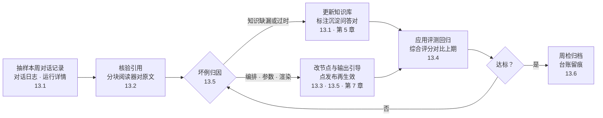
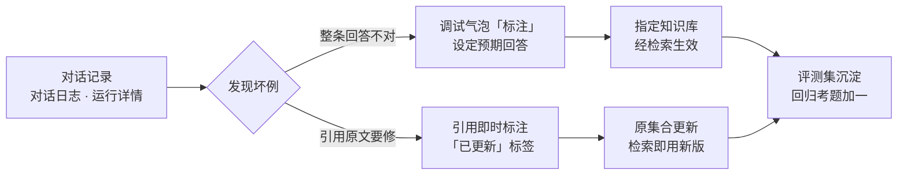
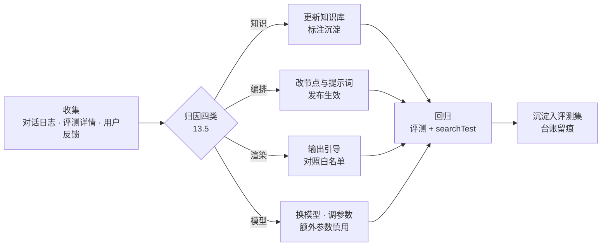

# 第 13 章 对话运营与评测

> 本章导读：「售后客服」上线了——渠道、API、平台与权限都就位（第 9～12 章），真实用户来了，运营每周要回答同一个问题：它答得对吗？本章补上运营的另一半：对话记录查阅与标注留原材料（13.1），引用分块阅读器让引用可核验（13.2），对话框 HTML 渲染划清输出形态边界（13.3），应用评测把「改完是变好还是变坏」变成评分题（13.4），常见问题汇成坏例地图与治理闭环（13.5），最后落成周检 SOP（13.6）。读完本章，你能：按三条路径查阅对话记录并用标注沉淀纠错，用引用阅读器核验回答出处，为应用搭一条评测回归线，按周检清单走完一次质量巡检。



*本章操作流程图*

## 你什么时候需要它

三种典型处境，对应本章三种用法。

**渠道放开后，真实对话量上来了，没人说得上答得好不好**——看 13.1 与 13.6。对话日志是原材料，周检清单是制度；第 9 章把流量放进来，这两节把质量关接住。

**有人质疑一条回答不对，要给出证据**——看 13.2。点开引用，浮窗里是完整原文与高亮，引用是否成立、出处是否现行有效，当场核验；外部用户能看到多少原文，由可见度控制决定。

**改了提示词、换了模型、更新了知识库，不知道是变好还是变坏**——看 13.4。评测集是巡检的仪表盘（→ ragflow 书），传一组问答对，拿综合评分与上期对比；检索层的回归断言走第 10 章 10.4 的 searchTest。

前置提醒：应用评测在本书成稿时为 Beta 形态（官方文档标注「当前测试版」），且第 1 章功能差异表把它列在付费形态一侧——动手前先对表确认自己的形态覆盖（见第 1 章）。

## 13.1 对话记录查阅与标注：运营的原材料

### 质检的第一手材料

官方 FAQ 给了对话记录的标准用法：应用在调试、发布与 API 调用时效果不一致，通常是上下文不一致导致——「可以在对话日志中，找到对应的记录，并查看运行详情来进行比对」（素材：guide/build/faq，核实日期 2026-11-01）。对话日志保存真实记录，运行详情展开一次回答的决策链路；这两个入口在第 6 章的调试语境里出现过，本章把它们转正为运营工具——运行详情从调试的「透视镜」变成巡检的证据链。

查阅路径按「人看还是程序看」分成三条，各管一段：

| 路径 | 看什么 | 适用 | 出处 |
|------|--------|------|------|
| 对话日志 + 运行详情 | 单条记录的完整决策链路 | 人工抽检、坏例归因 | 本节 |
| 对话相关 API | 程序侧拉取记录与统计（如 getChartData 的对话次数、错误次数、好评/差评数） | 平台侧对账、批量导出 | 第 10 章 10.2、10.5 |
| 对话日志推送 `CHAT_LOG_URL` | 对话数据外送 | 接入外部质检与可观测 | 第 11 章（→ langfuse 书） |

界面对话日志的具体入口位置与筛选能力，素材未细载——按工作台方向实测确认，挂本章复核清单。

### 标注：两个入口，一个去处

标注（Annotation）是把「答错的题」变成「知识库资产」的动作。素材与第 6 章合起来看，入口有两个、去向各不同：

| 入口 | 操作 | 去处 |
|------|------|------|
| 调试气泡「标注」按钮 | 把该条问答标注保存到指定知识库，设定预期回答纠错（第 6 章） | 指定知识库 |
| 引用分块阅读器「即时标注」 | 授权用户直接对引用内容标注修正，不打断当前对话 | 原集合，「已更新」标签标识（13.2） |

前者管「这条回答整体不对，给出正确答案」，后者管「引用的原文本身要修」。两个入口共同构成第 6 章埋下的「质量巡检的地基」：坏例经标注沉淀进知识库与评测集，而不是散落在聊天记录里。



*标注的两个入口与去处（自绘，据第 6 章与 quoteList 素材整理）*

### 边界与坑

- 标注写入的是知识库，不是应用记忆——标注后要经检索才影响后续回答，别指望「标注完立刻变对」；
- 「已更新」修的是知识库原文，对话历史里的旧回答不会被改写（据素材语义推断，未实测——挂复核清单）；
- 抽样要有代表性：按渠道（分享链接/钉钉）与问题类型（政策/FAQ/物流）分层抽，只抽满意的抽样等于没检（本书立场）。

## 13.2 引用分块阅读器：让引用可核验

### 从「黑盒」到浮窗

v4.9.1 起（官方文档，核实日期 2026-11-01），FastGPT 把知识库引用从「只展示被引用的分块」升级为分块阅读器：点击回答下方的引用链接，浮窗呈现完整原文，并以醒目的高亮精确标记被引用的片段。传统引用方式只给残句、看不到上下文，验证内容要自己去知识库翻；分块阅读器让「可溯源性」成为可当场核验的属性——回答能不能对回原文，一条引用链接见分晓。

### 功能与巡检用途

| 功能 | 行为 | 巡检用途 |
|------|------|---------|
| 全文展示与定位 | 点击引用开浮窗，完整原文 + 高亮引用片段 | 核对「引用是否支撑回答」 |
| 便捷引用导航 | 右上角按钮在多条引用间切换，显示「7/10」式序号与总数 | 逐条核验多条引用不遗漏 |
| 引用质量评分 | 评分标签展示该引用的相关性排名，悬停查看评分详情 | 看懂「这段引用为何被选中」 |
| 一键导出 | 引用涉及的全文保存到本地 | 坏例取证归档 |
| 可见度控制 | 管理员可设外部访问者「仅引用内容可见」 | 分享链接场景的信息范围收敛 |
| 即时标注 | 授权用户修正引用内容，「已更新」标签标识 | 边查边修，知识库持续进化 |
| 按需渲染 | 按引用相关性排序与数据 id 按需加载 | 超长文档（如 50 页政策手册）流畅查阅 |

### 可见度：免登录链接的边界

以免登录链接为例，管理员可精确控制外部访问者能看到的信息范围：设置为「仅引用内容可见」时，外部用户点击引用链接只能查看被引用的文本片段，而非完整原文档。「售后客服」的分享链接面向外部客户（第 9 章），这一项决定客户能看到多少知识库原文——内部巡检要全文核验，外部呈现按需收敛，两种模式对应两套预期。

### 边界与坑

- iOS 已知问题：截至 4.17.0，点引用「打开原文」可能没反应——iOS Safari（含企业微信内置浏览器）会静默拦截「先请求地址、拿到后再开新窗口」的写法；临时办法是从右上角「…」用系统浏览器打开，或在浏览器设置里允许弹出窗口（官方 FAQ，修复待后续版本）；
- 导出与即时标注都要求相应知识库权限——外部客户即使看得到浮窗，也没有导出与修正能力；
- 质量评分是「为何被选中」的解释，不是正确性背书——评分高只说明相关，内容对不对仍要人对原文。

## 13.3 对话框 HTML 渲染：输出形态的边界

### 从 iframe 沙箱到原生受控流水线

对话框 HTML 渲染有两代形态，边界要分清。旧方案（官方文档已标注 deprecated）把 Markdown 里的 HTML 代码块装进 iframe 沙箱渲染：高度无法自适应只能给固定值，外部音视频要前端下载全量数据转 Blob，常遇跨域（CORS）拦截或内存溢出。**v4.17.3 起正式支持原生受控 HTML 渲染与多媒体流式增强**（官方文档，核实日期 2026-11-01）：HTML 标签直接在主 DOM 树中受控解析，自适应容器与暗黑模式；多媒体回归 HTML5 原生播放，支持 HTTP Range 分段请求，大体积音视频边缓冲边播放；流式打字输出时内置未闭合标签拦截（Streaming Guard），防止半截 HTML 造成界面突变或提前触发无效请求。本书基线即 v4.17.3，下文均以新流水线为准。

### 安全白名单：渲染为什么「缺胳膊少腿」

开放 HTML 渲染的首要原则是安全。服务端 CSRF 防护防御不了同源跨站脚本（XSS），FastGPT 依托 AST 语法树层级的白名单机制（基于 `rehype-sanitize`）做深度清洗，五条规则：

| 安全机制 | 规则 | 拦掉的风险 |
|---------|------|-----------|
| 脚本剔除 | 禁止 `<script>` 标签与任何外部脚本加载 | 脚本注入 |
| 事件过滤 | 全部 `on*` 行内事件（onclick/onerror/onload 等）禁用 | 事件注入 |
| 样式收敛 | 不开放通用 `style` 属性注入 | 全屏欺诈遮罩、样式污染 |
| 协议白名单 | URL 仅允许 http、https、mailto、tel、cite、quote；`javascript:` 等高危伪协议与 `data:text/html`、`file:` 全部封锁 | 伪协议跳转 |
| 表单受限 | 表单组件仅只读与交互状态展示，禁 `type="file"` 与 `type="password"` | 文件窃取、密码收集 |

运营要读出的含义：模型输出的 HTML「缺了」某些标签与属性，多数不是坏例，而是在语法树解析阶段被白名单剔除——剔除不影响正文阅读。对话框不支持运行任何自定义 JavaScript；白名单外的标签非法内容同样被剔除；复杂独立网页的展示需求，官方推荐走专用应用发布或外链接入（第 9 章）。

### 受控标签与增强组件

六类受控标签覆盖模型输出的主要排版需求，每类对号一个售后场景：

| 分类 | 标签 | 售后场景 |
|------|------|---------|
| 多媒体播放 | `<video>` `<audio>` `<source>` `<track>` | 退换货操作演示视频 |
| 折叠交互 | `<details>` `<summary>`（`data-think` 用于思维链折叠） | 长答案分层呈现 |
| 文本排版与高亮 | `<mark>` `<kbd>` `<font>` `<sub>` `<sup>` `<abbr>` 等 | 高亮关键条款、缩写浮层 |
| 数据指标展示 | `<progress>` `<meter>` `<figure>` `<figcaption>` | 工单进度、时效匹配度 |
| 复杂表格扩展 | `<table>` 系列，支持 `rowspan`/`colspan`/`align`，可导出 CSV | 政策手册的赔付矩阵 |
| 静态交互控件 | `<button>` `<input>` `<textarea>` `<label>`（只读） | 任务清单、选项展示 |

代码块层面另有内置增强组件，用 Markdown 语法直接触发：`echarts` 代码块原地渲染交互图表（悬停提示、图例筛选、骨架屏占位与语法容错），`mermaid` 代码块画流程图与时序图，KaTeX 渲染行内与块级公式，外加语法高亮代码块与图片画廊（PhotoView）。

### 边界与坑

- 公式显示不出来，先查提示词而不是急着换模型——官方 FAQ 的解法是在提示词里引导输出格式：

```bash
Latex inline: \(x^2\)
Latex block: $$e=mc^2$$
```

- 反过来，不想要 Markdown 输出时，改知识库默认提示词——标准模板默认要求按 Markdown 输出，去掉该要求即可（官方 FAQ）；
- 复杂表格在对话框里能跨行跨列，但外部渠道（钉钉等）的展示由渠道客户端决定——重要表格类回答按渠道实测（挂复核清单）。

## 13.4 应用评测（Beta）：回归的仪表盘

### 能做什么、不能做什么

v4.11.0 起，FastGPT 支持应用批量评测：传入多组问答对，系统对应用执行结果自动打分，实现运行效果的定量评估（官方文档，核实日期 2026-11-01）。三句话划清边界：

- **形态是 Beta**：官方规划三种评估指标——回答准确性、问题相关性、语义准确性；当前测试版仅「回答准确性」可用，其余待后续版本补充；
- **规模有上限**：单任务最多 1000 组问答对，按官方 CSV 模板填写；
- **对象是应用整体**：检索层「目标 chunk 在不在 top k」的回归断言走第 10 章 10.4 的 searchTest，两层各管一段，合起来才是完整回归。

形态归属：第 1 章功能差异表把应用评测列在付费形态一侧；素材正文未再标注形态细节——动手前对表（见第 1 章），并挂本章复核清单。

### 创建一次评测

入口在工作台的应用评测目录，右上角「创建任务」，三要素填齐：

| 配置项 | 说明 |
|--------|------|
| 评测任务名 | 任务标识；建议带日期与变更原因，如「售后客服-1102-FAQ 更新后回归」（命名法为本书立场） |
| 评测模型 | 用于本次任务打分的模型——独立于被评测应用配置 |
| 评测应用 | 需要被打分的应用 |

选定评测应用后，系统提供 CSV 模板下载，四个字段：全局变量、q（问题）、a（标准答案）、历史记录。按模板填好上传，点「开始评测」，任务即创建。评测集从哪来（本书立场，按可得性排序）：标注沉淀的问答对（13.1）、`product-faq.xlsx` 的高频条目（Title 作 q、Content 作 a）、历史坏例归档（13.5）。

### 读评测：列表与详情

评测列表五列——进度、执行人、评测应用、开始/结束时间、综合评分——回答「这次跑完怎么样」；「查看详情」进入任务页：上层任务概览给出评测配置与统计结果，下层详细结果逐条展示每条问答对的用户问题、标准输出与应用输出。

**巡检语境下的读法：综合评分只用来与上期对比，逐条结果才是工作面——退步条目逐条归因，结论写进台账，而不是只记一个分数。**这是 ragflow 书第 13 章「测试集是巡检的仪表盘」「回退逐条归因」的同款方法论（→ ragflow 书）。

### 回归线：什么改动之后必须跑

| 变更 | 回归手段 | 判定 |
|------|---------|------|
| 提示词/开场白/对话输入引导 | 应用评测 | 综合评分不低于上期，退步条目归因 |
| 知识库文档更新与同步 | 应用评测 + searchTest 断言（第 10 章 10.4） | 评分不降；目标 chunk 仍在 top k |
| 模型与参数（检索参数等） | 应用评测 | 变更前后各跑一次，评分不降 |
| 应用编排改动（节点增删） | 应用评测 + 调试预览走查 | 评分不降；关键分支人工走一遍（第 7 章） |

### 边界与坑

- 评分用的是「评测模型」，它的能力上限就是评分上限——换评测模型后，历史评分不可直接横比；
- 「历史记录」字段用于多轮语境输入，它如何影响打分素材未载——建议评测集按「带历史/不带历史」分组设计，别混在一张表里比（本书立场，挂复核清单）；
- 1000 组上限意味着评测集要做配比：按坏例类型与高频意图分配名额，而不是有什么传什么（本书立场）。

## 13.5 常见问题与坏例治理

### 官方 FAQ 的坏例地图

两篇官方常见问题（应用构建常见问题与聊天框问题）覆盖的坏例，按归因分成四类，每类对号一个处置出口：

| 归因 | 坏例 | 官方解法 | 关联 |
|------|------|---------|------|
| 发布链 | 工作台改了应用，聊天与渠道没更新 | 应用变更后必须点「发布」，聊天和发布渠道的使用才会更新 | 13.6 第 6 项 |
| 上下文 | 调试、发布、API 三处效果不一致 | 多为上下文不一致：对话日志找到对应记录，看运行详情比对 | 13.1 |
| 分类 | 多轮对话分类不准；后续问题误入分类 | 关联弱时用全局变量记录分类结果，先查再用；历史记录非 0 时用判断器跳过分类节点 | 第 7 章 |
| 渲染 | 公式不显示；Markdown 输出不合预期 | 提示词引导公式格式；改知识库默认提示词 | 13.3 |
| 环境 | 语音输入不可用 | 麦克风权限开启；浏览器允许站点用麦克风并选对来源；站点需 SSL 证书 | 第 6 章 |
| 版本 | 思考过程不显示（适用 4.9.1～4.14.x） | 模型配置开「支持输出思考」，「额外 Body 参数」补中转要求的开关；注意参数会带到该模型所有调用，可能变慢、更耗 token | 第 2 章 |

两处版本注记：思考过程 FAQ 适用 4.9.1～4.14.x，本书基线 v4.17.3 下仅作存量排障参考；iOS 引用打不开原文，官方确认截至 4.17.0、修复在后续版本（13.2 已述）。

### 坏例治理闭环

单个坏例的处置是一条四步闭环：收集、归因、处置、回归。归因四类的出口不同，但都要回到同一条回归线上：



*坏例治理闭环（自绘，归因四类对应上表）*

闭环里最容易断的一环是「沉淀」：坏例处置完不进评测集，下个版本改提示词时它就会以同样的姿势坏回来。ragflow 书第 13 章把这件事叫「工单反哺测试集——测试集随业务生长，而不是建完即静止」；FastGPT 侧的对应物是评测集与标注知识库，两者都是坏例的合法去处（→ ragflow 书）。

### 边界与坑

- 「定时执行」在应用发布后生效、于后台运行，与用户是否停留在分享页无关——巡检时别把「页面开着才触发」当前提（官方 FAQ 语义，自部署环境复现验证挂复核清单）；
- 判断器跳过分类的写法（历史记录为 0 才走分类）依赖「历史记录」变量——API 侧自建会话时注意传参一致性（第 10 章）；
- 官方 FAQ 是坏例地图的底稿，不是全集——渠道形态、模型通道带来的坏例，要靠 13.1 的抽样自己长出来。

## 13.6 贯穿案例：售后客服质量巡检 SOP（周检清单）

### 分工的接缝

先划清与相邻章的边界，免得巡检清单越写越像平台运维：服务健康（系统层 SignOz）与模型稳定性（渠道状态）是第 11 章的日检；人能不能用（权限）是第 12 章的治理；本章的周检只管一件事——**答得对不对**。这一分工与 ragflow 书「第 12 章管平台稳定、第 13 章管内容质量」的结构互为镜像（→ ragflow 书）。

角色沿用第 12 章三角色分权：客服发现并上报坏例，运营执行周检、标注与知识库更新，开发修编排并操作发布。

### 周检清单

频率与责任人为建议值（本书立场），团队按对话量裁剪；「触发式」条目不待周期，变更即检：

| # | 频率 | 检查项 | 操作与入口 | 判定 | 责任人 |
|---|------|--------|-----------|------|--------|
| 1 | 周 | 对话抽样核验 | 对话日志按渠道 × 问题类型分层抽样，逐条展开运行详情 | 答错即立坏例，记录编号 | 运营 |
| 2 | 周 | 引用抽检 | 分块阅读器核对高亮与原文；物流时效类回答逐条核 | 引用成立且出处现行有效 | 运营 |
| 3 | 周 | 知识库节奏核查 | 《商品 FAQ》每周更新已同步；《物流时效公告》失效条目下架；《售后政策手册》改版窗口期专项核对 | 三类文档与源一致（第 3、5 章） | 运营 |
| 4 | 周 | 评测回归 | 跑一次应用评测，综合评分与上期并排；退步条目逐条归因 | 评分不低于上期，退步全归因 | 运营 |
| 5 | 触发式 | 知识库变更后检索断言 | searchTest 按 10.4 断言目标 chunk 在 top k | 断言全过 | 运营 |
| 6 | 触发式 | 配置变更后发布确认 | 提示词/节点/参数改动后确认已点发布，聊天与渠道已更新 | 线上版本与工作台一致（13.5） | 开发 |
| 7 | 触发式 | 渲染走查 | 表格/公式/图表类回答在目标渠道实测渲染 | 白名单内正常呈现（13.3） | 开发 |
| 8 | 周 | 坏例闭环盘点 | 本周坏例全部归因处置；新条目沉淀评测集；标注知识库有条目增长 | 无悬置坏例，评测集持续生长 | 客服 + 运营 |

八项之外的两条地基：第 11 章的 `CHAT_LOG_URL` 外送与 SignOz 告警保持在线，周检才有全量对话可抽；第 12 章的权限矩阵保证「客服能上报、运营能改库、开发能发布」各就各位——清单跑不动时，先查这两条。

### 一次周检走查（示例）

以某周为例走一遍主线（数字为示例设定，非实测）：抽样 20 条，坏例 2 条——一条物流时效回答引用了已失效的旧公告，归因知识，处置是下架旧公告加标注纠错；一条赔付表格在钉钉端错位，归因渲染，处置是提示词改为分栏列点输出。处置后跑评测：综合评分与上期持平，退步 1 条归因为新入库 FAQ 尚未被稳定召回，searchTest 断言确认目标 chunk 排名偏低，按第 4 章调参后复跑通过。台账四行，周五归档。

### 边界与坑

- 周检不追绝对分数：素材没有给出任何「合格线」阈值，判定一律用「与上期对比 + 退步条目归因」——自造达标率只会逼出好看的数字；
- 标注沉淀用的知识库要与业务知识库分开建（本书立场）：混在一起，纠错条目会被当作正式知识检索出来；
- 台账不必精美，必须存在——它是评测集生长与责任追溯的原始凭证（→ ragflow 书同款立场）。

## 本章小结

1. **对话运营的原材料是对话记录**：三条查阅路径分工——人工抽检走对话日志与运行详情（13.1），程序对账走 API（第 10 章 10.2），外部质检走 `CHAT_LOG_URL` 外送（第 11 章）。
2. **标注有两个入口、一个去处**：调试气泡的「标注」管整条回答纠错，引用阅读器的「即时标注」管原文修正，去处都是知识库——坏例沉淀成资产，而不是散在聊天记录里。
3. **引用可核验是运营的底气**：v4.9.1 起的分块阅读器让每条引用能对回完整原文与高亮，质量评分解释「为何选它」，可见度控制收敛外部呈现。
4. **HTML 渲染有边界**：v4.17.3 起原生受控流水线替代 iframe 沙箱；安全白名单剔除脚本、事件、内联样式与高危协议——「缺胳膊少腿」多数是安全剔除，不是坏例。
5. **评测是回归的仪表盘**：v4.11.0 起（Beta，当前仅「回答准确性」指标），CSV 问答对驱动，单任务最多 1000 组；综合评分与上期比，逐条结果做归因；检索层回归走 searchTest。
6. **坏例治理是闭环不是清单**：收集→归因四类（知识/编排/渲染/模型）→处置→回归→沉淀；断在「沉淀」，坏例就会坏回来。
7. **周检清单管「答得对不对」**：八项检查、三类角色、周期式与触发式并存，台账是凭证。

全书至此收束：从第 1 章的三形态选型，到部署（第 2 章）、知识库（第 3～5 章）、应用与工作流（第 6、7 章）、工具与技能（第 8 章）、发布与集成（第 9、10 章）、运维与治理（第 11、12 章），「售后客服」走完了从建到用的全程；本章把最后一环——运营——补上。下一步不在书里：把 13.6 的周检清单改成你们团队的版本，填上真实的人名与频率。延伸去向：平台 Agent 经 MCP 消费「售后客服」的完整链路（→ mcp 书第 8 章），对话数据的深度分析（→ langfuse 书），知识库切片与巡检方法论的同源对照（→ ragflow 书）。

## 验收清单

读到这里，你应该能：

- ☐ 按三条路径查阅对话记录，并说出人工抽检、程序对账、外部质检各走哪条；
- ☐ 用调试气泡与引用阅读器各完成一次标注，说出两者分别修什么、沉淀到哪；
- ☐ 点开一条回答的引用，核验高亮与原文一致，并说出免登录链接下「仅引用内容可见」的效果；
- ☐ 说出 HTML 渲染安全白名单剔除的五类内容，并解释为什么模型输出的表格「缺样式」不是坏例；
- ☐ 创建一个应用评测任务：下载 CSV 模板、填入不超过 1000 组问答对、选定评测模型与应用，跑出综合评分；
- ☐ 为一次知识库更新写出回归组合（应用评测 + searchTest 断言），并说出「沉淀」在坏例闭环里的位置；
- ☐ 按 13.6 清单走完一次周检，产出一份含坏例归因与台账的巡检记录。

### 复核清单（发布前）

- [ ] 全章界面操作未实测：对话日志入口与筛选、标注两入口、引用阅读器浮窗/导航/评分/导出、评测创建与详情页——对照官方文档 v4.17.3（guide/chat/quoteList、guide/chat/html、guide/chat/htmlRendering、guide/build/evaluation、guide/build/faq、faq/chat），核实日期 2026-11-01；
- [ ] 应用评测形态归属：第 1 章差异表列付费形态一侧，素材正文未再标注——社区版环境实测入口可用性；「当前测试版仅回答准确性指标」以评测时点官方文档为准；
- [ ] 「已更新」标签是否回写对话历史中的旧回答、一键导出的具体范围——素材未载，实测后修订 13.1 与 13.2；
- [ ] HTML 渲染跨渠道表现：复杂表格/公式在钉钉渠道与免登录链接端的实际渲染、复杂表格 CSV 导出行为，按渠道实测（13.3 边界）；
- [ ] 「历史记录」字段对评测打分的影响（13.4 边界）、判断器跳分类对 API 传参的依赖（13.5 边界）——素材未载，实测后修订；
- [ ] 「定时执行」FAQ 的官方语义（发布后后台生效）在自部署环境复现验证；
- [ ] 13.6 周检清单的频率、抽样量、责任人为本书立场建议值；走查示例中的数字为示例设定，非实测数据；
- [ ] 章首操作流程图、13.1 标注流程图与 13.5 治理闭环图在 GitHub 网页端的渲染检查。

## 延伸阅读

- **第 10 章 10.4 与 10.2（知识库 API 与应用日志接口）**——检索层回归断言与程序侧对账的工具箱：searchTest 断言目标 chunk 在 top k，getChartData 拉对话量、错误数与好评/差评，是周检数字的两个程序侧来源。
- **第 11 章 11.4（SignOz 与三层日志）**——「答得好吗」的应用层出口：周检抽样依赖 `CHAT_LOG_URL` 外送在线，系统层告警是质量退化的前置信号。
- **第 7 章（工作流编排）**——坏例归因里「编排」一类的修改现场：分类、兜底、工单分支都落在画布上，13.5 的判断器跳分类写法是第 7 章知识的直接复用。
- **第 12 章（团队协作与权限治理）**——巡检的角色地基：客服能上报、运营能改库、开发能发布，分权矩阵跑通，周检清单才跑得动。
- **（→ ragflow 书）第 13 章（团队协作与知识库运营）**——方法论同源：测试集是巡检的仪表盘、工单反哺测试集、台账必须存在——工具不同，运营的骨架相同。
