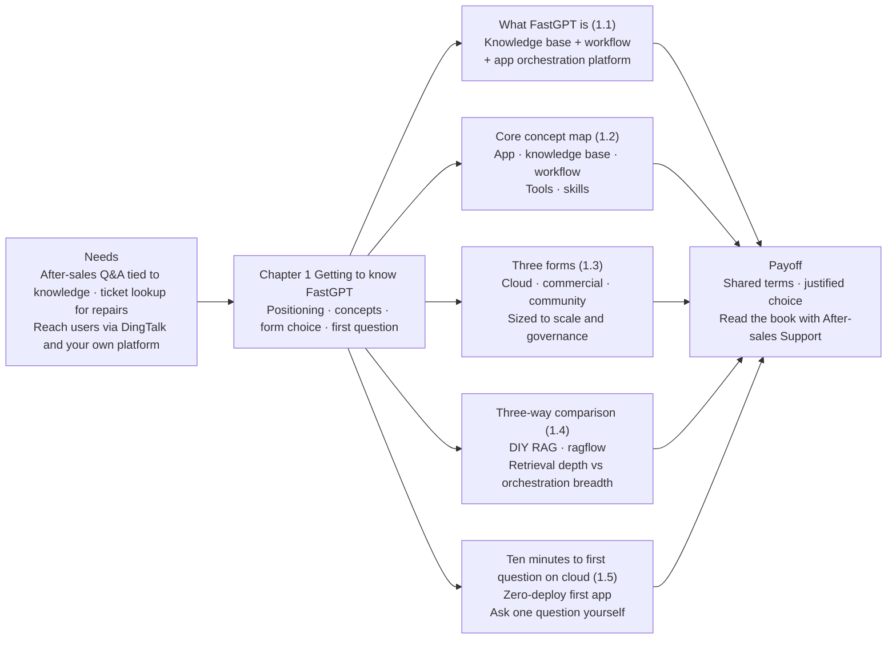
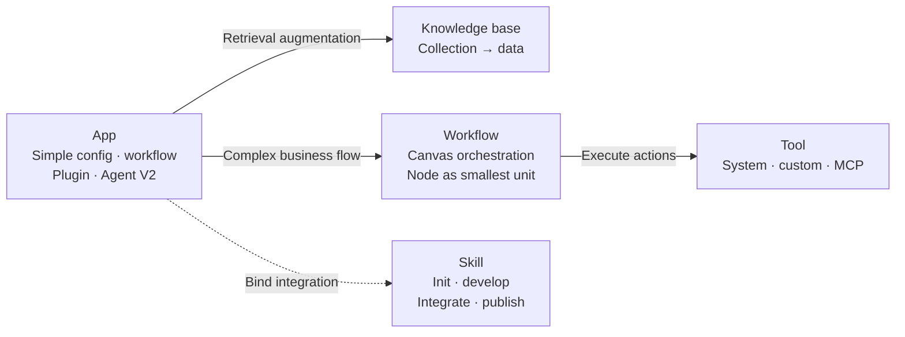
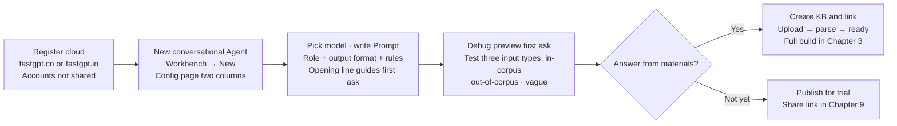

# Chapter 1 Getting to know FastGPT

> Chapter guide: A cross-border e-commerce support team wants a bot that can handle after-sales questions—answers grounded in the policy manual and FAQ, ticket lookup when users report repairs, and delivery through DingTalk and their own platform. Building in-house means stitching together a vector store, an orchestration framework, and channel integration as three separate engineering tracks; FastGPT packs that whole chain into one out-of-the-box platform. This chapter is the cognitive foundation: where FastGPT sits and its capability map; a concept map of apps, knowledge bases, workflows, tools, and skills; choosing among the three deployment forms; a three-way comparison with DIY RAG and ragflow; and finishing with a ten-minute first question on the cloud. When you finish this chapter, you can: state clearly what FastGPT is and is not; pick a form for the "售后客服" ("After-sales Support") case and justify it; and circle a reading route with shared terminology.



*Chapter overview figure*

## When you need it

Three typical situations, and three ways to use this chapter.

**The boss asks "should we use FastGPT?" and you need reasons for the meeting**—read Sections 1.1 and 1.4. Start with the capability map, then the three-way table against DIY and ragflow; most "yes or no" answers sit in that table.

**The project chose FastGPT but you do not know cloud, commercial, or community**—go straight to the comparison table and stance in Section 1.3. Feature gaps, pricing shape, and fit for each team type each have a row; you can decide in ten minutes.

**You want to click through once before committing to the book**—jump to Section 1.5, register for cloud, finish a first question in ten minutes; if it feels right, come back to the concept map in Section 1.2 to plan reading.

This chapter has no prerequisites: Section 1.5 only needs a browser (cloud is ready to use; self-hosted deploy and model channels are in Chapter 2).

## 1.1 What FastGPT is: knowledge base, workflow, and app orchestration in one platform

The official one-liner (v4.17.3 user guide "Quick look at FastGPT", verified 2026-11-01): FastGPT is **an AI Agent application development platform based on large language models (LLM), integrating knowledge-base Q&A, visual workflows, Agent orchestration, tool calling, and skill extension**, so developers and business users can quickly build dedicated AI applications.

Split the definition and you get a capability map:

| Capability block | Official one-liner | Plain reading | Chapters |
|--------|-----------|---------|---------|
| Knowledge-base Q&A | All-round knowledge base: import varied documents with automatic knowledge structuring; smart Q&A with multi-turn context | Documents in, answers with evidence out | Chapters 3–5 |
| Visual workflow | Drag-and-drop UI to build complex business flows with rich functional nodes | Business flows on a canvas | Chapter 7 |
| App orchestration | Agent orchestration: four forms—conversational Agent, workflow, plugin, Agent V2 | Different task complexity on different carriers | Chapter 6 |
| Tool calling | System tools, custom tools, and MCP tools | Apps answer and also "act" | Chapter 8 |
| Skill extension | Versioned "document + code" capability packs, bound to agents, sandbox execution | Turn tuned playbooks into reusable team assets | Chapter 8 |
| Publish and integrate | Fully aligned with the official OpenAI API; one-click enterprise WeChat, official account, Feishu, DingTalk | Ship orchestrated capability outward | Chapters 9–10 |

### What matters most for the our running example: intelligent data parsing

The official knowledge-base section on data processing deserves attention: intelligently handle complex PDF structure—keep images, tables, and LaTeX formulas; recognize scans; structure content as clear Markdown; support automatic image captioning and indexing so visual content can be understood and retrieved. That is exactly what the After-sales Policy Manual (`after-sales-policy.pdf`, 50 pages with tables) needs—whether compensation tables keep row/column structure shows up in Chapter 3 at ingest time; the HTML form of the Shipping Time Notice and the spreadsheet form of the Product FAQ (`product-faq.xlsx`) also fall under "all kinds of documents."

### Strength in the chain, not a single point

Look at each piece alone—vector retrieval, workflow engine, channel access—and there are standalone open-source options. **FastGPT's strength is not any single technology; it is packing "build knowledge base, orchestrate flow, publish app" into one product**: developers and business users collaborate on one UI, config page equals debug page—the hardest gap on the DIY path (Section 1.4). The official three advantages point the same way: simple and flexible like building blocks (drag to implement complex flows), smarter data (import, preprocess, match knowledge, full Q&A automation), open and easy to integrate (standard API without changing source; supports ChatGPT, Claude, DeepSeek, ERNIE Bot, and other mainstream models).

## 1.2 Core concept map: app, knowledge base, workflow, tool, skill

Five concepts recur in the next twelve chapters. This table gives each a one-line definition and the object in the our running example—skim now, expand in later chapters:

| Concept | English | One-line definition | Object in the our running example | Chapters |
|------|------|-----------|----------------|---------|
| App | App | User-facing dialog and flow carrier; four forms: simple configuration, workflow, plugin, Agent V2 | "售后客服" ("After-sales Support") app: simple configuration in Chapter 6, workflow as main line in Chapter 7 | Chapters 6, 7 |
| Knowledge base | Knowledge Base | RAG carrier; hierarchy knowledge base → collection → data (Chunk) | `after-sales-kb`: three after-sales document types | Chapters 3–5 |
| Workflow | Workflow | Canvas node orchestration; node is the smallest execution unit | Classify question → knowledge search → ticket lookup → reply | Chapter 7 |
| Tool | Tool | External capability the model can call: system, custom, MCP | HTTP tool node to middle-platform ticket API `GET /api/after-sale/tickets?phone={phone}` | Chapters 7, 8 |
| Skill | Skill | Versioned "document + code" pack, bound to agent, sandbox execution; init, develop, integrate, publish | Turn after-sales support playbooks into a reusable team capability pack | Chapter 8 |

How concepts connect, in one figure:



*How core concepts reference each other: apps consume knowledge bases and workflows; workflows drive tools; apps can bind skills*

### Peripheral concepts quick reference

Beyond the five main concepts, later chapters introduce more "sub-concepts." You do not need them now, but knowing where they belong keeps you oriented:

| Peripheral concept | Belongs to | One-line note | Chapters |
|----------|------|-----------|---------|
| Collection | Knowledge base | Organizational layer under a knowledge base; usually one file or one source | Chapter 3 |
| Data (Chunk) | Knowledge base | Smallest knowledge unit; direct object of retrieval and citation | Chapters 3, 4 |
| Node | Workflow | Smallest execution unit on the canvas; edges set order | Chapter 7 |
| MCP tool | Tool | External tool set via Model Context Protocol (MCP) | Chapter 8 |
| Channel | Publish | How apps reach end users: share link, DingTalk, Feishu, WeCom, official account | Chapter 9 |
| OpenAPI | Publish | Platform APIs: apps, chat, knowledge bases consumed via API | Chapter 10 |
| SignOz / call logs | Operations | Observability entry in production | Chapter 11 |

### Four app forms: from dialog to autonomous planning

The official quick start shows four cases of increasing capability—enterprise email assistant (conversational Agent), civil code Q&A (knowledge base + conversational Agent), content review and rewrite (workflow), smart data analysis (Agent V2)—plus a selection recap table:

| App type (quick start) | Fit | Core capability |
|---------------------|---------|---------|
| Conversational Agent | Light Q&A, copy generation, standardized output | Prompt, model config, tool calling |
| Knowledge base + conversational Agent | Q&A on materials, policies, statutes, product manuals | File import, knowledge retrieval, cite source |
| Workflow | Fixed steps, branches, review flows, automation | Node orchestration, deciders, human confirm |
| Agent V2 | Data analysis, complex tasks, multi-step reasoning, dynamic planning | Autonomous planning, tools, VM execution |

(Transcribed from v4.17.3 quick start "Four types selection recap", verified 2026-11-01.)

Four selection sentences from the same source: light dialog or standardized copy → conversational Agent first; answers must be grounded in existing materials → knowledge base + conversational Agent; fixed flow with branches, human confirm, or automation → workflow; open task, non-fixed steps, autonomous analysis or code execution → Agent V2. The official text also stresses **capabilities can be combined**—a support assistant answers product questions from the knowledge base, then queries orders via tools. The our running example "售后客服" ("After-sales Support") is the full combo: knowledge base + workflow + ticket tool, landed in Chapter 7.

Two extra judgments reused in Chapters 6 and 7: a task fits workflow when it has "stable steps, clear rules, repeatable execution" (quick start wording); Agent V2 code runs in a VM, isolated from the local environment.

## 1.3 Three forms compared and how to choose: cloud, commercial, community

Same FastGPT, three ways to consume it. Quick view:

| Form | Positioning (official) | Who it fits | How to start |
|------|-------------|--------|---------|
| Cloud | Official hosted; register and use | Quick try and light use; small teams that do not want ops | Register mainland fastgpt.cn or international fastgpt.io (accounts not shared) |
| Commercial | Enhanced build on community; exclusive features | Teams offering commercial service; enterprise governance | Community image + commercial image (License boot); Sealos fully managed or own servers |
| Community | Free; all core features (Agent build, workflow, knowledge base) | Individual developers or small delivery teams | Self-deploy (Chapter 2); follow open-source license |

### Feature gaps: what community lacks

Official feature-diff table between community and paid forms; rows relevant to later chapters (transcribed commercial docs, verified 2026-11-01):

| Capability | Community | Commercial / cloud |
|------|--------|------------------|
| Workflow orchestration, share link and API, knowledge base, multi-model config, model log dashboard | ✅ | ✅ |
| App publish security config, third-party publish (Feishu, official account) | ❌ | ✅ |
| Run log dashboard, app evaluation, workflow/Agent/Skill assisted generation | ❌ | ✅ |
| Web site sync, third-party KB scheduled sync, file-level KB permission, image KB, index enhancement | ❌ | ✅ |
| Team space and permissions, multi-tenant and billing, SSO login, admin console | ❌ | ✅ |

Cloud vs commercial differ on some enterprise details: custom copyright and SSO are "in design"; admin console "not required"—full matrix in official commercial docs. This table previews form prerequisites: app evaluation (Chapter 13) and web sync, file-level permissions (Chapter 5) sit on paid forms; community readers should check this table before those sections.

### Pricing and delivery shape

Pricing transcribed (official commercial docs, verified 2026-11-01, re-check before publish): Sealos fully managed from ¥10,000/month (8C32G, 3-month minimum) or ¥120,000/year; multi-node from ¥22,000/month (32C128G); own-server deploy within 14 days, price on inquiry; professional services (custom dev, maintenance, migration, third-party integration) ¥2,000–3,000/person/day. Official deploy hints: fully managed for teams short on engineers who only care about business; own-server for full control on your hardware; single-node for internal SMB use; HA for external online service (visual monitoring, replicas, load balance, DB auto backup).

Worth knowing for secondary development: you may modify some community code, not commercial images; after customization, version upgrades need your own merge (official FAQ).

### Three common misreadings

- **"Commercial is another product"**—No. Official FAQ is blunt: full app = community image + commercial image; commercial adds a licensed image and internal address; upgrades and data continue.
- **"Community is a trial"**—No. Official wording: "all core FastGPT features: Agent build, workflow, knowledge base"; it lacks publish security, evaluation, site sync, permission governance—not core build and orchestrate.
- **"Cloud and self-hosted are two products"**—Same concepts and main-line operations; Chapters 3, 4, 6, 7 apply to both; gaps are governance and integration (this section's table) and who holds the data.

### Form choice for After-sales Support and one open item

**Our recommendation: the our running example "售后客服" ("After-sales Support") starts on community**—knowledge base, workflow, share link, and API are in community core; Chapter 2 deploy and Chapter 3 build are not blocked by form. Two exceptions upfront: publish to official account/Feishu channels, app evaluation and run log dashboard need commercial or cloud; **DingTalk is not listed with "third-party publish (Feishu, official account)" in the official diff table—community availability to be confirmed hands-on in Chapter 9** (on this chapter's review list).

**In business terms: personal learning and small internal teams start on community (deploy in Chapter 2); for multi-tenant external service, SSO/team governance/evaluation dashboard, evaluate commercial and cloud; to try only, register cloud and follow Section 1.5 for ten-minute first question.**

## 1.4 Three-way comparison: DIY RAG, ragflow, and FastGPT

After-sales support needs are three beats: documents to knowledge, knowledge to process, process to service. The three paths differ in where they invest:

| Dimension | DIY (vector store + orchestration + glue) | ragflow | FastGPT |
|------|--------------------------------------|---------|---------|
| Main focus | Full-chain DIY, every link replaceable | Document parsing and retrieval engineering: deep understanding, hybrid retrieval, chunk governance | App orchestration out of the box: workflow, four app forms, channels and API |
| Starting point | Code: vector DB and retrieval scripts | Dataset: parsing and chunk tuning | App: config pages and canvas |
| Business collaboration | All via engineering backlog | Richer ops UI, canvas orchestration | Developers and business on one platform; config equals debug |
| External delivery | Custom API and channels | API and MCP Server | Share link, IM channels, OpenAPI, publish as MCP Server |
| Best when | Deep custom retrieval chain, existing platform, strong compliance self-host | Main pain is "complex documents → reliable answers" | Main pain is "wire knowledge, flow, channels into a shippable app fast" |

**In business terms: if retrieval and parsing quality is the main pain, choose ragflow; if app orchestration and delivery speed is the main pain, choose FastGPT; if retrieval must be deeply custom or infra fully self-held, go DIY.** They are not exclusive—same after-sales domain can split knowledge base and app layer; Chapter 13 of this book and the RAGFlow book share the methods of chunk governance and quality inspection.

### When FastGPT is faster

Our recommendation—any one of three reasons warrants serious consideration: **business and engineering build apps on one platform** (support ops can change prompt and opening line without a dev ticket); **flows must hit business systems** (after-sales support checks tickets before reply—HTTP tool to middle-platform ticket API); **multi-channel delivery** (login-free share for the team, DingTalk for users, OpenAPI for the platform, Chapter 9 MCP Server publish). Conversely, if the pain is only retrieval quality, see (→ ragflow book); if every link must be fully self-held, DIY—engineering detail (vector DB choice, retrieval assembly, Agent consumption) is outside this book (→ agentscope-java book).

### Same domain, different names: a terminology crosswalk

FastGPT and ragflow are both knowledge-base platforms; same domain, different names—do not trip when cross-reading (compiled for this book; terms follow each official docs):

| Concept domain | FastGPT | ragflow |
|--------|-------------|-------------|
| Knowledge carrier | Knowledge base | Dataset |
| Knowledge unit | Data (Chunk) | Chunk |
| Orchestration carrier | App / workflow | Chat assistant / canvas Agent / ingestion pipeline |
| External exposure | OpenAPI / MCP Server | API / MCP Server |

### One chain, three divisions

```text
User asks "How is damage in transit compensated?"
  → Classify as after-sales inquiry
  → Retrieve after-sales-kb (policy manual + product FAQ)
  → HTTP tool queries ticket status for this user
  → AI dialog summarizes policy and ticket status
  → Publish as login-free share link and DingTalk channel
```

In FastGPT this is "one knowledge base + one workflow app + two channels"; DIY strings vector DB, orchestration framework, API service, channel SDK; ragflow does retrieval well, but channels and business-flow orchestration are not its home court. **Selection sentence: see which segment of the chain holds your main pain.**

## 1.5 Quick start: ten minutes to first question on the cloud

Prerequisite: a browser and email—cloud includes model config, no own model channel (self-hosted channels in Chapter 2). All in the browser:



*Cloud ten-minute main line: register to first question; optional branch link knowledge base*

### Six actions from register to first question

1. **Register**: open fastgpt.cn (mainland) or fastgpt.io (international). Accounts are not shared (cloud docs)—team must register same region and edition;
2. **New app**: workbench "New", choose conversational Agent. Name for testing is fine—the formal "售后客服" ("After-sales Support") app is Chapter 6; do not occupy the name here;
3. **Know the config page**: left AI config, right debug preview—change and test; this rhythm is basic FastGPT app development;
4. **Pick model**: official cases note Chinese expression and stable format adherence; low-risk tasks like email need not use the strongest model (quick start case 1);
5. **Write Prompt**: organize as "role + output format + rules"—role fixes identity, format constrains structure, rules bound risk; this triple repeats in all book prompts;
6. **Opening line and first ask**: opening tells users what the app does; put `[问题内容]` in the opening so users can one-click ask (official tip). Then ask the first question in debug preview.

Do not validate first ask only by "does it sound right"—official knowledge-base Q&A advice applies to no-KB play too: test three input types—**in-corpus** should answer with evidence, **out-of-corpus** should say cannot confirm, **vague** should ask for facts. An app that only agrees is not worth shipping.

### After first ask: link a knowledge base

For grounded answers, follow quick start case 2: left sidebar knowledge base → new → text dataset → upload local file → parse settings (chunk storage; chunk condition controls tokens per chunk—defaults for quick test; index enhancement for plain text check first two) → data preview check chunk quality → status "ready" → back to app config link KB. After link, the chain becomes **user question → knowledge retrieval → model summary**—Chapter 1 touches the RAG door here.

Test file suggestion: one or two pages from the After-sales Policy Manual—feel parsing and citation first. Preview chunk quality for three points—abnormal paragraph breaks, title and body in same semantic span, tables and clauses still readable (quick start). Formal `after-sales-kb` and three document update rhythms are Chapter 3; parse and retrieval tuning Chapter 4.

Effect difference between the two configs is the key split between official case 1 and case 2 (compiled for this book):

| Dimension | No knowledge base (case 1) | Linked knowledge base (case 2) |
|------|--------------------------|--------------------------|
| Answer basis | Model memory | Knowledge retrieval |
| Strong at | Generation, formatted output | Policy, manual, statute Q&A |
| Key config | Prompt triple + tools | Parse params + citation and disclaimer |
| Main risk | Private fact hallucination | Chunk quality drives evidence quality |

### Limits and common mistakes

- **Conversational Agent is not knowledge-base Q&A**: without KB, app answers from model memory—private facts will be wrong; link first, then judge quality;
- **Chunks too large → verbose answers; too small → shattered evidence**: defaults in quick start; tune after enterprise materials (Chapter 4 params);
- **High-risk prompts need boundaries**: compensation, legal questions should follow the civil code case—rules say answer from materials, state uncertainty, suggest professionals;
- **External credential tools need permission thinking**: official email tool test uses SMTP app password—minimal permission test accounts, not production secrets.

## Chapter summary

1. **FastGPT is an LLM-based AI Agent app development platform**: knowledge Q&A, visual workflow, Agent orchestration, tools, skills in one product; strength is the full chain in one product, not a single tech point.
2. **Five core concepts** (app, knowledge base, workflow, tool, skill) and **four app forms** (conversational Agent → knowledge base + conversational Agent → workflow → Agent V2); choose by task complexity; capabilities combine.
3. **Three forms**: cloud register-and-use; commercial = community image + commercial image, enterprise extras; community free with all core features, self-deploy. Thread-through case starts community; DingTalk community availability pending Chapter 9 hands-on check.
4. **Three-way comparison**: retrieval/parsing main pain → ragflow; app orchestration and delivery speed → FastGPT; deep custom or strong compliance self-host → DIY—judgment is which chain segment holds the main pain.
5. **Next**: Section 1.5 cloud first question for feel; self-hosted → Chapter 2 community deploy and model channels; Chapter 3 formal `after-sales-kb`.

## Acceptance checklist

You should be able to:

- ☐ Explain FastGPT positioning in one sentence to a colleague and map each capability block to book chapters;
- ☐ State roles of app, knowledge base, workflow, tool, skill and point to objects in the our running example;
- ☐ Use the official four-form table to pick an app type for three needs: policy Q&A, reply after ticket lookup, open-ended data analysis;
- ☐ Write form choice (cloud/commercial/community) for after-sales support with at least two reasons;
- ☐ Answer "FastGPT or ragflow" in one stance sentence and which chain segment holds the main pain;
- ☐ Complete one first question on cloud: model and opening, one in-corpus question with evidenced answer.

### Review list (before publish)

- [ ] Section 1.5 cloud ten-minute path not verified hands-on: register, new conversational Agent, prompt and opening, KB link—verify against v4.17.3 UI when environment ready
- [ ] Section 1.3 feature table and pricing from official commercial docs (verified 2026-11-01): Sealos pricing, custom copyright and SSO "in design"—re-check official docs before publish
- [ ] DingTalk on community: official diff only lists "third-party publish (Feishu, official account)", not DingTalk alone—verify before Chapter 9
- [ ] Four app forms (simple config/workflow/plugin/Agent V2) vs quick start four cases mapping is book compilation—verify with Chapter 6 materials
- [ ] Chapter-opening overview and two in-chapter mermaid figures drawn for this book, not official; official guide screenshots not included
- [ ] Quick start four case details (Email tool SMTP, Agent V2 VM switch) not reproduced—verify when Chapters 6–8 materials ready

## Further reading

- **Chapter 2 (Deployment and model channels)**—first action after choosing community: Docker deploy, env vars, model channels, self-hosted base for After-sales Support.
- **Chapter 3 (Knowledge bases: from documents to knowledge)**—full version of Section 1.5 "link knowledge base": three after-sales document types in, update rhythms.
- **Chapters 6, 7 (Apps and workflow)**—two ends of Section 1.2 four-form progression: simple-config and workflow After-sales Support.
- **(→ ragflow book)**—retrieval/parsing engineering on the other side: after Section 1.4 choice, read what to deepen when main pain is retrieval.
- **Official "Quick look at FastGPT" and "Quick start"**—chapter source material (`guide/getting-started`); capabilities and UI per v4.17.3 official docs.