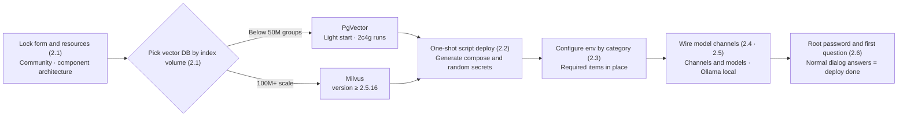
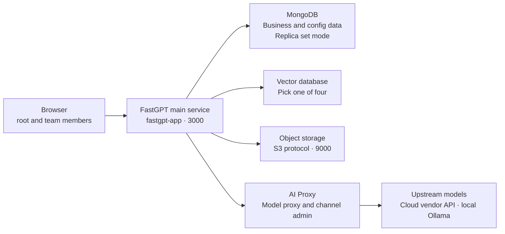
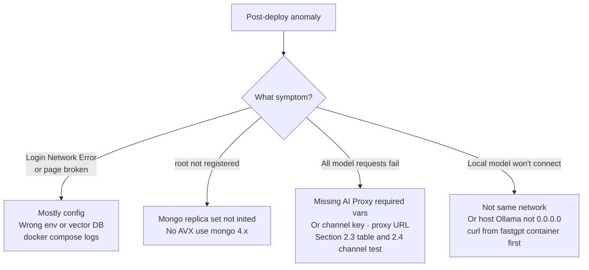

# Chapter 2 Deployment and model channels

> Chapter guide: Chapter 1 chose community edition—now put the real base under "售后客服" ("After-sales Support"). This chapter follows one operation line end to end: pick vector store and machine sizing by knowledge-base index volume, then official one-shot script for Docker Compose deploy; enter the config system—env vars grouped in place, model channels through AI Proxy, and when data must stay inside the network add an Ollama local channel; finally activate the root account, change the initial password, and verify deploy quality with one real Q&amp;A exchange. Deploy pain is never "does it start" but configs in the right buckets, model channel wired once, and knowing mistakes before you hit them. After this chapter you can: deploy community FastGPT for the support team, configure at least one language model and one index model, complete root password activation, and declare the base ready with one first question—leave knowledge-base work to Chapter 3.



*Chapter operation flowchart*

## When you need it

Three typical situations, three ways to use this chapter.

**The team needs private FastGPT with data staying inside the network**—follow Sections 2.1 through 2.2 in order: sizing, deploy, config in one pass. The After-sales Support base is built this way: policy manual and product FAQ are internal corpora; community self-host is the prerequisite for them to enter.

**Deploy is done but models misconfigured or dialog errors**—go straight to Section 2.4 (channels and models) and the troubleshooting tree in Section 2.6. Most faults concentrate on two places: AI Proxy's two required env vars, and channel proxy URL and keys.

**You want local models to try effects before buying compute**—see Section 2.5 (Ollama). Language and index models can both run locally; Section 2.1's resource table helps judge if the machine can carry the load.

Prerequisite: a Linux server (or WSL2) with Docker and Docker Compose (version 2.17+ recommended); test tier starts at 2c4g (per v4.17.3 official deploy docs, verified 2026-11-01).

## 2.1 Deploy form and resources: vector DB first, then machine

### What is inside community edition

Official Docker Compose deploy is one main service plus four supporting components (per v4.17.3 deploy docs). Panorama first, then duties:



| Component | Duty | Facts for this chapter |
|------|------|-------------|
| FastGPT main service | App itself: UI, API, workflow, knowledge base | Container `fastgpt-app`, default port 3000 |
| MongoDB | Non-vector data: users, apps, chat, config | Template runs replica set mode and auto-inits |
| Vector database | Stores vectors | One of four: PostgreSQL (pgvector), Milvus, OceanBase, SeekDB; Zilliz Cloud is managed Milvus |
| AI Proxy | Required model service: request proxy and admin channel management | Required from V4.17.0; missing fails startup validation |
| Object storage | Files and images | S3 protocol, default MinIO, port 9000 |

### Choosing a vector DB: index volume is the main variable

Official one-liner by knowledge-base index volume: **PgVector is very light, suited below 50 million groups; Milvus performs better at 100-million+ scale**. Four-option table:

| Option | Fits | Key fact |
|------|------|---------|
| PgVector | Most teams starting out | Test tier 2c4g single node; enough below 100M scale |
| Milvus | 100M+ vectors | **Version must be ≥ 2.5.16—below that FastGPT startup errors and exits**; test tier from 2c8g |
| Zilliz Cloud | Do not want to operate vector DB | Milvus vendor managed SaaS; vectors in cloud, little local resource |
| OceanBase / SeekDB | Already in OceanBase ecosystem | SeekDB uses MySQL protocol, fully OceanBase compatible; same resource tiers as PgVector |

PgVector official resource tiers (single node):

| Environment | Minimum | Recommended |
|------|---------|---------|
| Test | 2c4g | 2c8g |
| 1M vector groups | 4c8g 50GB | 4c16g 50GB |
| 5M vector groups | 8c32g 200GB | 16c64g 200GB |

One difference that does not bite until Chapter 4: **only the Milvus option ships BM25 full-text search** (via `modeldata_v2` single table); other vector stores use MongoDB `$text` for full text. That resurfaces when you pick a retrieval plan in Chapter 4.

### Base sizing for After-sales Support

The thread-through case `after-sales-kb` has three document types—50-page policy manual, ~200-row product FAQ, several logistics notices—index volume is orders of magnitude below 50 million groups. **In business terms, start on PgVector**: light, stable, enough; test tier 2c4g covers this chapter; at 100M scale or when you need BM25 hybrid retrieval, migrate to Milvus (vector DB migration is Chapter 11).

### Limits and common mistakes

- Milvus below 2.5.16 does not degrade—it **errors on startup**; confirm version before deploy;
- Old CPUs may lack AVX; Mongo 5.x won't start—use 4.x image (troubleshooting tree in Section 2.6);
- Interactive script random passwords and keys live in `docker-compose.yml`—**this file is your credential vault; keep it on upgrades**.

## 2.2 Docker Compose deploy: one-shot script and four steps

### Three deploy routes

Official gives three routes by "who makes config decisions":

| Route | Method | Fits |
|------|------|------|
| AI Agent deploy | Hand official `SKILL.md` to a coding agent | Want the agent to run the full flow |
| **Interactive script (chapter main line)** | One command starts guided setup; script writes config | Regular server deploy |
| Manual download + local compose mode | Download compose and `install.sh`, use `FASTGPT_LOCAL_COMPOSE_PATH` | Fixed compose file, fully offline, custom registry (Harbor) |

Interactive script on Linux, macOS, and Windows WSL:

```bash
FASTGPT_DEPLOY_BASE_URL=https://doc.fastgpt.cn bash <(curl -fsSL https://doc.fastgpt.cn/deploy/install.sh)
```

The script does four things: download `docker-compose.yml`; guide S3 and MCP external URLs into config; randomly generate root login password, inter-service token, app secret, component passwords into compose; detect host Docker socket path and fix mount. In short: **where random is needed, it randomizes for you**. After run, terminal prints this root password—save it; non-interactive mode must set `FASTGPT_FE_DOMAIN`.

### Four steps from deploy to opening the UI

| Step | Action | Points |
|------|------|------|
| 1 Edit env | Edit `fastgpt-app` `environment` in `docker-compose.yml` | `FE_DOMAIN` required; other required items script-generated (check Section 2.3) |
| 2 Open ports | Firewall or security group for table below | Reverse proxy may own public ports |
| 3 Start containers | Prepull, then start | Compose 2.17+ recommended |
| 4 Visit | Browser open `FE_DOMAIN` | User `root`, first-login flow in Section 2.6 |

Required `FE_DOMAIN` is the full URL users actually use (protocol + host + optional port, e.g. `https://fastgpt.example.com`) to complete file and image paths—do not leave empty or use internal container address. Agent/Skill sandbox needs two extra sandbox WebSocket and preview URLs; After-sales Support base skips sandbox for now (production in Chapter 11).

Ports to open:

| Port | Service | Note |
|------|------|------|
| 3000 | FastGPT main | Host port via `FASTGPT_PORT` |
| 9000 | S3 object storage | File service |
| 3006 | Agent Sandbox Proxy | Only when sandbox enabled |
| 3003 | SSE MCP Server | Only when publishing SSE MCP apps (Chapter 9); can stay closed |

Start commands:

```bash
# Prepull all services and sandbox runtime images
docker compose --profile prepull pull
# Start
docker compose up -d
```

### Limits and common mistakes

- **Whole browser tab unresponsive after login** is known: delete tab and reopen once;
- System plugins no longer prebundled from V4.14.0; `fastgpt-plugin` image is runtime only—install from marketplace or `.pkg` (Chapter 8);
- Do not skip versions on upgrade: read update docs, change image tag, `docker compose up -d`, run init scripts if any (Chapter 11);
- Inter-container access uses compose bridge network (default name `fastgpt`)—external containers need same network; prerequisite for Ollama in Section 2.5.

## 2.3 Environment variables: the only config entry

### One change in the config system

From 4.15.0, open source no longer reads `config.json`—historical options (custom PDF parse, retrieval params, etc.) moved to env vars. Today's rule: **change config in `docker-compose.yml` `fastgpt-app` `environment`, then `docker compose up -d`**. Boolean convention: `true`, `1`, `yes`, `y` mean on; others off.

### Env categories

Many env vars; official groups by consumer and duty. Remember by category, troubleshoot by category:

| Category | Representative vars | Governs |
|------|---------|--------|
| Required secrets | `AIPROXY_API_ENDPOINT`, `AIPROXY_API_TOKEN`, `FILE_TOKEN_KEY`, `AES256_SECRET_KEY`, `INVOKE_TOKEN_SECRET` | Model channel and file auth, encryption, invoke credentials—missing fails startup |
| Site and frontend | `FE_DOMAIN`, `FILE_DOMAIN`, `SYSTEM_NAME` | Public URL, file domain, site name |
| DB and vector | `MONGODB_URI`, `PG_URL`, `MILVUS_ADDRESS`, `REDIS_URL` | Main DB and cache fixed; vector address per Section 2.1 choice |
| Service integration | `PLUGIN_BASE_URL`, `CODE_SANDBOX_URL`, `MARKETPLACE_URL` | Plugin service, code sandbox, marketplace URL |
| Object storage | `STORAGE_VENDOR`, `STORAGE_EXTERNAL_ENDPOINT` | Vendor (minio, aws-s3, r2, cos, oss) and external endpoint |
| Security | `AUTH_COOKIE_SECURE`, `ALLOWED_ORIGINS`, `CHECK_INTERNAL_IP` | HTTPS cookie, CORS allowlist, SSRF internal IP check |
| Limits | `WORKFLOW_MAX_RUN_TIMES`, `CHAT_MAX_QPM`, `UPLOAD_FILE_MAX_SIZE` | Workflow runs (default 500), chat QPM, upload MB |
| Observability | `LOG_ENABLE_OTEL`, `CHAT_LOG_URL` | Logs, metrics, traces, chat log push (Chapter 11, → langfuse book) |

Commercial has extra Admin vars (billing, crawler, SMS proxy, etc.)—community does not need them; sandbox and Volume Manager have their own groups, only when those features are on (Chapter 11).

### Required checklist

Interactive script randomizes secret classes; you really verify six items:

| Variable | Constraint | Source on script deploy |
|------|------|-----------------|
| `FE_DOMAIN` | Full URL, not internal container address | You fill manually |
| `AIPROXY_API_ENDPOINT` | AI Proxy root (e.g. `http://aiproxy:3000`), no `/v1` suffix | Template preset |
| `AIPROXY_API_TOKEN` | Matches AI Proxy admin credential, non-empty | Template preset |
| `FILE_TOKEN_KEY` | Length at least 6 | Script random |
| `AES256_SECRET_KEY` | Length at least 6 | Script random |
| `INVOKE_TOKEN_SECRET` | Length at least 32 | Script random |

### Verify load and two frequent mistakes

Verify env inside the container:

```bash
docker exec -it fastgpt sh
env
```

Two FAQ repeats:

1. **S3 won't connect, signature 403**—`STORAGE_EXTERNAL_ENDPOINT` set to `127.0.0.1` or `localhost`. That URL signs object access; loopback makes sign vs upload URLs inconsistent; use host static IP or fixed domain;
2. **Env change not effective**—vars inject at container start; after edit you must `docker compose up -d` recreate; refresh alone does nothing.

Foreshadowing: open source can plug enhanced PDF parse (custom, SoMark, TextIn, Doc2x—priority left to right). If the 50-page table-heavy After-sales Policy Manual struggles with built-in parse, `CUSTOM_PDF_PARSE_URL` etc. are the enhancement entry—decide at import in Chapter 3.

## 2.4 Model channels: channels and models

### AI Proxy: the only model entry

From V4.17.0, all FastGPT model requests go through AI Proxy—load balancing, model logs, dashboards. Old `OPENAI_BASE_URL`, `CHAT_API_KEY` cannot replace it; even per-model custom URLs still need AI Proxy. All model config starts at **Admin → Model provider**.

### Five model types: two required, three optional

| Model type | Role | Needed for After-sales Support? |
|---------|--------|---------------|
| Language model | Text chat; multimodal models support images | **Required, at least one** |
| Index model | Indexes text chunks for retrieval | **Required, at least one** |
| Rerank model | Reranks retrieval results | Optional (Chapter 4 tuning) |
| Text-to-speech | TTS | Optional |
| Speech recognition | STT | Optional; only one active—one is enough |

### Channels and models: two objects, four steps

Two objects: **model channel** is one vendor protocol endpoint (OpenAI, Anthropic, Google, etc.; most vendors OpenAI-compatible); **model** is the capability declaration. Same model can sit in multiple channels for load balance; channel priority 1–100, higher preferred. Request `model` field is **model ID** (globally unique); UI **model name** is display alias. Official discourages bypassing channels (custom URL/Key) for unified admin.

Standard four steps to wire models:

| Step | Entry and action | Points |
|------|-----------|------|
| 1 Create channel | Model channels tab → add channel | Name is label; pick protocol; proxy URL is BaseUrl watch `/v1`; API keys from vendor, some need multiple |
| 2 Channel test | Channel list → model test → start | Per-model result and latency; fix channel if fail |
| 3 Enable model | Model config → enable on right | Built-in mainstream models; **model ID must match channel** |
| 4 Model test | Test entry on model | Live request from template |

This book's base channel was built this way. Confirmed in testing, after wiring Zhipu's OpenAI-compatible endpoint, the channel list shows one row:


One channel carries this chapter's minimum: language model glm-5.3-flash and index model embedding-3 on one OpenAI-protocol channel (model count 2), enable on serves traffic; after real calls work, Section 2.6 first-question check has something to answer.

Useful mechanism—**model mapping**: FastGPT and AI Proxy use your model ID; AI Proxy upstream sends mapped real model:

```json
{
  "gpt-4o-test": "gpt-4o"
}
```

Good for internal uniform names, hiding upstream names, or gray release.

### Model config structure: fields as capability declaration

Add custom model via form or config file (copy between systems). Duplicate model ID with built-in means modify built-in, not add. Language model core fields (v4.17.3 model config docs):

| Field | Example | Meaning |
|------|--------|------|
| `model` | `gpt-5` | Model ID, matches channel model name |
| `name` | `gpt-5` | Display alias in app list |
| `maxContext` / `maxResponse` | 125000 / 16000 | Max context / max reply |
| `quoteMaxToken` | 120000 | Max quoted content—KB quote cap, Chapter 4 tuning |
| `maxTemperature` | 1.2 | Temperature ceiling |
| `vision` | `true` | Image input support |
| `toolChoice` / `functionCall` | `true` / `false` | Tool choice and function call; if neither, prompt mode (Chapter 7 tool dependency) |
| `defaultSystemChatPrompt` | —— | Default system prompt on chat |
| `defaultConfig` / `fieldMap` | `{}` | Default request params / field map (e.g. o1 maps `max_tokens` → `max_completion_tokens`) |
| `pricing` | `{"tiers": [...]}` | Pricing (commercial credits): language model `tiers` (`inputPrice`, `outputPrice`, optional `maxInputTokens`), per M tokens |

Index model fields are fewer but critical: `defaultToken` (default 512, default split granularity) and `maxToken` (default 3000, model cap)—these feed directly into Chapter 3 chunking; pricing uses `pricing.unitPrice` (per million tokens). Rerank adds `requestUrl` and `requestAuth`. Billing applies to system models only; team custom models free.

### Channel health: probe and call logs

Admin can enable **model status probe**: interval 5–60 minutes, all enabled models, 48-hour stability chart, Webhook on state edge changes. Three health states:

| State | Rule |
|------|------|
| Normal | Test success and latency ≤ 30s |
| High latency | Success but latency > 30s |
| Abnormal | One round four attempts (first fail auto-retry up to 3) all fail |

Call logs show input/output tokens, time, error payload—first stop for model issues; default retention 1 hour (env adjustable). Chapter 11 systematizes alerts and logs (→ langfuse book).

### Limits and common mistakes

- **Channel attach has prerequisite**: channel can only add models already in model config—built-ins are mainstream; for models not in channel (e.g. Section 2.5 Ollama), add in model config first (v4.17.3 model provider docs);
- **Model ID mismatch is top error**: enabled ID must match channel or "model does not exist"—channel test and probe surface this;
- Only one speech recognition model active; multiple useless;
- Channels can enable/disable; disabled channel stops serving—use disable as switch when rotating keys or vendors.

## 2.5 Local models: connect Ollama

### When you need local models

**This book's stance: run the chain on cloud API first, then decide on localization.** Local models save call cost and data egress concerns; you pay machine, VRAM, and ops. For after-sales support, policy corpus is sensitive; common start is **index model local first**—only vectorizes, much lighter than language model (engineering judgment; final word is Chapter 4 recall quality).

[Ollama](https://ollama.com/) is open-source one-click model deploy. Official recommends Docker—host install adds container-to-host access hassle.

### Install: Docker first, same network as FastGPT

```bash
docker pull ollama/ollama
# Key: join FastGPT network (compose default network name fastgpt)
docker run --rm -d --name ollama --network fastgpt -p 11434:11434 ollama/ollama
```

If you insist on host install, Ollama must listen on `0.0.0.0` for container access:

| OS | Install | Listen 0.0.0.0 |
|------|------|--------------------|
| Linux | Official script, `ollama serve` | `systemctl edit ollama.service`, add `Environment="OLLAMA_HOST=0.0.0.0"` under `[Service]`, restart |
| macOS | `brew install ollama` | `launchctl setenv ollama_host "0.0.0.0"` then restart app |
| Windows | Official installer | System env `OLLAMA_HOST=0.0.0.0`, restart from Start menu |

### Pull models and connectivity check

```bash
# For Docker deploy, enter container then pull
docker exec -it ollama /bin/sh
ollama pull [模型名]
ollama ls
```

Then **the most skipped step that saves half an hour of troubleshooting**—from FastGPT container verify both sides:

```bash
docker exec -it fastgpt sh
# Container Ollama uses container name; host install uses host IP, never localhost
curl http://ollama:11434
```

Ollama service info means OK. If not: same network? Host install listening on `0.0.0.0`?

### Wire channel and enable

After verify, same Section 2.4 flow, two value differences:

1. Model config → add model: **model ID must exactly match `ollama ls` name**;
2. Model channel → add channel: protocol Ollama (or OpenAI compatible), proxy URL—container `http://[container]:[port]`, host `http://[host IP]:[port]`; OpenAI compatible `http://address:port/v1`. Ollama default no auth unless you enabled auth.

Then workbench apps can pick the model—list shows alias from model config. Details: **same model cannot be added twice**—latest alias wins; legacy OneAPI users can add as OpenAI channel (OneAPI URL + `/v1`, OneAPI token); official migration script exists.

### Limits and common mistakes

- **curl before channel**—reversed order, channel errors hide network vs config;
- Host Ollama URL cannot be `localhost` inside FastGPT container—localhost is the container itself;
- `docker-compose.yml` bridge network `fastgpt` isolates—external images not on network cannot resolve container names.

## 2.6 Root password and first-question verification

### root: from 123456 to your password

From v4.17.3, account activation and built-in CLI password reset; removed "rewrite password from `DEFAULT_ROOT_PSW` every container restart." Four cases:

| Case | Action |
|------|------|
| First deploy login | Initial password fixed `123456`, account pending activation; after login **non-dismissable** "Activate account" window—set new password to use system |
| Daily change | Avatar top-right → Personal info → Security → change password, immediate |
| Forgot password | In deploy dir run container reset script, no service restart, all old sessions invalid |
| v4.17.2 and earlier | Change `DEFAULT_ROOT_PSW` in compose (or YAML anchor) then `down`/`up`—historical behavior |

Forgot-password reset:

```bash
docker compose exec fastgpt-app node /app/scripts/reset-root-password.cjs '你的新密码'
# On success prints: root password reset
```

If new password has `$`, `!`, `#`, etc., **wrap in single quotes** so host shell does not expand. First login prompts missing language and index models and jumps to model config—good time for Section 2.4; whole page unresponsive, close tab and reopen.

"Non-dismissable" was confirmed in testing—screenshot from local FastGPT community v4.17.3 (2026-11-03, models glm-5.3-flash + embedding-3):


After initial password login, activate window immediately—no close, no progress without new password, matches table; password rules under inputs; background is system model config before activation completes.

### First-question verification: deploy done signal

Base quality is not "containers up" but "Q&amp;A works." Five steps:

1. Browser `FE_DOMAIN`, `root` and new password login OK;
2. Admin → Model provider: at least one language and one index model enabled and model test pass;
3. Workbench new simple-configuration app (form in Chapter 6), pick enabled language model;
4. Send real question in chat, streaming answer returns;
5. You are verifying **model channel**, not knowledge base—after-sales policy questions fail until `after-sales-kb` is built and retrieval works (Chapters 3 and 4).

### Deploy troubleshooting decision tree

When first question fails, branch by symptom. FAQ high-frequency faults in four directions:



Two supplements: Mongo replica set auto-init works in mainstream envs; if still fail, official FAQ manual key and `rs.initiate`; without SSL cert, knowledge export and voice input/output unavailable (browser security).

### Limits and common mistakes

- Deploy done criterion: **root password changed, both model types online, first question answered**—all three required;
- `relation "modeldata" does not exist` means PG vector DB not connected or init failed—check PG container and fastgpt logs;
- Troubleshoot in layers (page → login → model → local model)—do not rebuild containers first; most faults are config.

## Chapter summary

1. **Community is five components**: main service, MongoDB (replica set), vector DB (one of four), AI Proxy (required from V4.17.0), object storage; index volume picks vector DB—**start PgVector**; at 100M or BM25 full text add Milvus (≥ 2.5.16).
2. **Main deploy line is interactive script**: download compose, write S3/MCP URLs, randomize all credentials; keep `docker-compose.yml` and printed root password safe.
3. **Env vars only entry** (4.15.0 ends `config.json`); eight categories; `FE_DOMAIN` and AI Proxy required; after edit `up -d` recreate, `env` inside container to verify.
4. **Model channel two layers**: channel to vendor, model declares capability; four steps through; language and index at least one each; global model ID consistency is law.
5. **Ollama three essentials**: same network, listen `0.0.0.0`, curl from FastGPT container; count machine and ops before localizing.
6. **v4.17.3 root password**: first login `123456` forced activation; forgot password one CLI command no restart; deploy done is first-question pass.

Next: base is up; "售后客服" ("After-sales Support") still needs knowledge. Chapter 3 builds `after-sales-kb`—50-page After-sales Policy Manual, ~200-row Product FAQ, Shipping Time Notice—how they enter and chunk; index model `defaultToken` and `maxToken` become chunk parameters there.

## Acceptance checklist

You should be able to:

- ☐ Draw community deploy component diagram, five duties, and four-way vector DB choice rationale;
- ☐ Complete interactive script deploy and list credentials randomized in `docker-compose.yml`;
- ☐ State `FE_DOMAIN` rules and why internal container address is wrong;
- ☐ Verify env inside container and show correct way to apply env change;
- ☐ Complete model channel: create channel, channel test, enable model, model test;
- ☐ Connect one Ollama local model and curl-verify from FastGPT container before channel config;
- ☐ Complete root activation and one CLI reset, login and first-question verification with new password.

### Review list (before publish)

Items verified in testing are checked with environment; rest verify before publish:

- [ ] Full chapter commands and behavior vs official v4.17.3 docs paths listed, verified 2026-11-01;
- [ ] Interactive script full flow: credential randomization, S3/MCP URL write, non-interactive `FASTGPT_FE_DOMAIN` required;
- [x] First-login activation dialog verified in testing (2026-11-03, community v4.17.3 local)—non-dismissable activate after `123456`, enter after password change (Section 2.6 figure);
- [ ] PgVector and Milvus composes each start once; port table and "unresponsive tab reopen" (activation part verified with figure);
- [ ] AI Proxy startup check: remove `AIPROXY_API_TOKEN` verify fail message;
- [x] Model channel config and real calls verified in testing (2026-11-03, community v4.17.3)—Zhipu OpenAI endpoint glm-5.3-flash + embedding-3, channel enabled, calls succeed (Section 2.4 figure);
- [ ] Channel test, model test, model probe: 48h chart, three states, Webhook payload;
- [ ] Ollama three connectivity cases: same network, host `0.0.0.0`, localhost unusable;
- [ ] `reset-root-password.cjs`: normal and special-char password (single quotes), old sessions invalid;
- [ ] Chapter flowchart and Section 2.6 tree GitHub render check.

## Further reading

- **Chapter 3 (Knowledge bases: from documents to knowledge)**—after first question: `after-sales-kb` and three after-sales doc types; index `defaultToken`/`maxToken` become chunk params.
- **Chapter 4 (Retrieval plans and tuning)**—aftermath of vector choice: only Milvus has built-in BM25; rerank and `quoteMaxToken` appear there.
- **Chapter 6 (Apps and conversational agents)**—full simple-configuration app from first-question check: AI params, opening line, input guide.
- **Chapter 11 (Production operations)**—env governance, object storage, model probe alerts, upgrade migration; this chapter's ports, keys, credential file are its foundation.
- **(→ ragflow book) Chapter 2**—same topic deploy and model channels; compare RAGFlow deploy and model config when sizing.