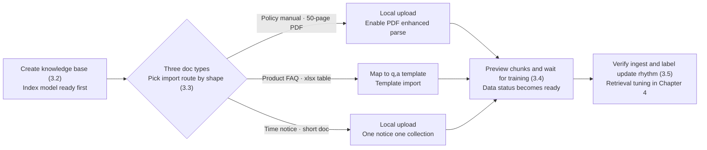

# Chapter 3 Knowledge bases: from documents to knowledge

> Chapter guide: Chapter 2 deploy is done and model channels work—how does after-sales knowledge get in? This chapter creates knowledge base `after-sales-kb` for the thread-through case: After-sales Policy Manual (quarterly revisions), Product FAQ (weekly updates), Shipping Time Notice (time-sensitive). In order: RAG principles and library → collection → data structure; index model and file-processing model; import routes and formats; data (Chunk) training and management; three document types ingested with update rhythms labeled. After this chapter you can: build a well-configured knowledge base, pick the right import route per document shape, complete upload → parse → ready, and explain update rhythms for all three types.



*Chapter operation flowchart*

## When you need it

Three typical situations, three ways to use this chapter.

**You have documents to turn into a Q&amp;A knowledge base and do not know where to start**—follow Sections 3.2 → 3.3 → 3.4: create KB and confirm index model, pick import route by document shape, wait for training. Skip any step and you will take the long way when content is not found.

**Many file formats—which can upload, how**—see Section 3.3 format table and template import; three frequent issues "abnormal file format", "garbled Chinese", "parse failed" are there too.

**Documents are in but the app cannot find or answer correctly**—check Section 3.4 training status: data not "ready" means no retrieval yet; if ready but still wrong, that is retrieval plan (Chapter 4).

Prerequisite: Chapter 2 deploy complete and at least one index model available (Chapter 2 for models).

## 3.1 Overview: gates from document to knowledge

FastGPT knowledge bases rest on retrieval-augmented generation (RAG)—retrieval plus generation: a retriever pulls relevant fragments from an external knowledge base, then a generator answers using those fragments. Official value summary: pull real-time information from external knowledge into generation so output stays coherent and factually grounded. Compared to ragflow's "dataset (Dataset)", same technical domain, different product names—this book follows FastGPT official terms.

Two modules map to two objects:

| Module | Duty (official docs) | FastGPT placement |
|------|---------------------|---------------------|
| Retriever | Fetch most relevant fragments from external KB or corpus; vector and classic retrieval (e.g. BM25) | Knowledge base and search (plan and params Chapter 4) |
| Generator | Use retrieved fragments as context with the user question to produce natural language answers | Apps and workflow AI chat (Chapters 6, 7) |

Full Q&amp;A is four steps: query in → document retrieval → generate answer → output. This chapter fixes prerequisites for retrieval—documents become searchable data; generation side from Chapter 6.

Official also lists "knowledge base update and maintenance" as a major RAG limitation: stale content undermines trust; manual updates are slow and error-prone. That foreshadows update rhythm labeling here and sync routes in Chapter 5—getting in is only start; keeping up is operations.

### Three-layer structure: library, collection, data

FastGPT knowledge bases have three parts: a library holds multiple collections; a collection holds multiple data groups; a collection is roughly a "file"; **the smallest search unit is the library**—search runs over the whole library; collections only classify data and do not change search scope.


*Knowledge base → collection → data (Chunk) → indexes*

Mapped to the thread-through case:

| Layer | Official meaning | `after-sales-kb` instance |
|----|---------|------------------------|
| Knowledge base | Smallest search unit; search whole library | `after-sales-kb`, sole after-sales library |
| Collection | Classification unit; ~one file | Policy manual / product FAQ / shipping notices—three collections |
| Data (Chunk) | Smallest unit; one data row can have many indexes | Policy clauses / FAQ pairs / single notice rows |

Why three collections if search is library-wide?—for management, not retrieval: view data by collection, control update boundaries (re-import one collection on revision), carry tags and permissions (Chapter 5). "Retire an expired notice" stays clean because notices are their own collection.

### Shared foundation: index model

Data must be embedded before semantic search. The **index model** embeds text; query and library data share vector space. Official: vector search is the most important step in KB Q&amp;A; precision depends on embedding model quality, data quality (length, completeness, diversity), and retriever precision—data quality is what Sections 3.3–3.4 cultivate (retriever and query quality in Chapter 4).

## 3.2 Create knowledge base: index model ready first

### Create entry and general config

Official quick path: left sidebar knowledge base → New, name, create; inside library New → text dataset for local documents. For the case study, defaults except name—`after-sales-kb` built this way; wire the pipeline first, tune later.

Create dialog as confirmed in testing—screenshot from local FastGPT community v4.17.3 (2026-11-03, glm-5.3-flash + embedding-3):


Three model slots: index and text understanding required—Section 3.2's two model types; image understanding default unset—after-sales domain is text-only. "Index model before create" becomes UI action.

### Two model types: index model and file-processing model

Easy to confuse; official FAQ separates them:

| Model | Official definition | When used | Missing signal |
|------|---------|-------------|-----------|
| Index model | Vectorizes text to build fast-query structures | All data entering the KB | Knowledge base page flickers—FAQ fix is configure index model |
| File-processing model | "Enhanced processing" and "Q&amp;A split" on ingest: related questions/summary, Q&amp;A pair generation | Only when enhanced processing or Q&amp;A split selected on import | Does not affect normal chunk import |

**Index model is mandatory—confirm available in Chapter 2 model channels before create; file-processing model only when enhanced processing or Q&amp;A split is used.**

One metering rule: FastGPT tokens use gpt3.5 standard. Section 3.3 chunk conditions and Chapter 4 quote limits use this standard—do not use another model's tokenizer mentally.

### Limits and common mistakes

Index model fixes vector space—different model, different space. **This book's stance: treat index model as one-time choice at create; switching means re-embedding the whole library**; materials do not describe "hot switch with checks"—do not assume RAGFlow behavior (→ ragflow book Chapter 3 compatibility is RAGFlow-specific). Another mistake is order: models before create and import—page flicker often means reversed order.

## 3.3 File import: routes, formats, parse parameters

### Four import routes

| Route | Entry | Fits | `after-sales-kb` |
|------|------|---------|------------------------|
| Local upload | New text dataset in library → upload files (multi-select) | Finished documents, low-frequency updates | Policy PDF, time notices |
| Template import | Import menu → template import | Tabular Q&amp;A or content batch write | Product FAQ xlsx |
| Web sync | Web sync config | Site content keeps updating | Chapter 5 |
| API write | Knowledge base API | Programmatic batch, system integration | Chapter 10 |

This chapter uses the first two; the others in site sync and external integration chapters.

### Supported formats and ingest notes

| Format | Source | Ingest notes |
|------|---------|---------|
| PDF | Quick start: enable parse enhancement for PDF | Enhanced parse needs Admin OCR module configured or parse fails (FAQ) |
| Word, Markdown, TXT | Quick start: defaults OK | Garbled Chinese—re-save UTF-8 (FAQ) |
| xlsx | FAQ: not only CSV, xlsx supported | Extension must be `.xlsx` (not `.xls`), one sheet, no merged cells |
| csv | Template import docs | UTF-8; comma, newline, quote escaping per CSV rules |
| html, eml | Source not confirmed | html local upload verified in testing (2026-11-03, notice sample ready); eml pending (review list) |

### Parse parameters: four settings

After upload, parameter page—official guidance:

| Parameter | Official suggestion | `after-sales-kb` |
|------|---------|------------------------|
| File parse settings | Enable for PDF; Word/Markdown/TXT default | Policy manual on, rest default |
| Processing mode | Most cases "chunk storage", lower cost, faster retrieval | All chunk storage |
| Chunk condition | Tokens per chunk; default for quick test | Default first, tune after Section 3.4 preview |
| Index enhancement | Plain text usually first two; images if doc has images | Policy has tables—decide by preview |

Alternate path **Q&amp;A split**—file-processing model turns doc into Q&amp;A pairs (Section 3.2). **This book's stance: FAQ already structured in a table—template import is more controllable and does not spend file-processing model calls**; reserve Q&amp;A split for unstructured long text wanting Q&amp;A-shaped data.

### Template import: q, a, index, metadata

Template import for prepared content or Q&amp;A batch; `.csv` and `.xlsx`. First row must be headers:

| Header | Required | Count | Note |
|------|------|------|------|
| `q` | Yes | 1 column | Content or question |
| `a` | Yes | 1 column | Answer; can be empty for plain content |
| `index` | No | Repeatable | Custom index, multiple per row |
| `metadata` | No | At most 1 column | JSON object for source, category, etc. |

Rules: header order free; no extra headers; each row is one data row; `q` and `a` must not both be empty. Official CSV sample:

```csv
q,a,index,index,metadata
"FastGPT 是什么？","FastGPT 是一个 AI Agent 构建平台。","FastGPT 简介","AI Agent 平台","{""source"":""product-doc"",""category"":""overview""}"
"如何导入知识库数据？","可以使用 CSV 或 Excel 模板导入。","知识库导入","模板导入","{""source"":""help-center""}"
```

The English gloss for the sample rows: first row asks what FastGPT is and answers that it is an AI Agent build platform; second row asks how to import knowledge-base data and answers that CSV or Excel template import can be used.

`metadata` cells must be valid JSON objects—not arrays, plain text, or broken JSON—foundation for Chapter 4 filter and Chapter 5 tags; write cleanly at import.

Import steps and format troubleshooting:

| Step | Action |
|------|------|
| 1 | Open target KB, import menu → template import |
| 2 | Download CSV template or prepare `.xlsx` with same structure |
| 3 | Fill data; check headers, cells, format |
| 4 | Select file, confirm import—one file per import |
| 5 | After import, collection page check data and training status |

On "abnormal file format": `.csv` or `.xlsx`; headers only supported columns; `q` and `a` one column each, `metadata` at most one; CSV escaping correct; Excel single sheet, no merged cells. Official: test small batch first, then bulk.

### Limits and common mistakes

Three FAQ hits: garbled Chinese → UTF-8; PDF parse fail → enable enhanced parse and Admin OCR; one file per import—bulk is more rows, not more files.

## 3.4 Data (Chunk) management and training status

### Training: from import to "ready"

Import is not the end. Data must train (embed) before retrieval: quick start—when status is "ready", apps can reference the KB; retrieval tuning FAQ lists "confirm training completed" first for "cannot find content." **Ask right after import with no answer—often training, not retrieval.**

Intermediate states between import and ready are not fully listed in chapter materials; testing observed "ready" (below); middle state names pending (review list)—but "not ready means no retrieval" is ops common sense.

Three sample files after import—training visible in testing:


Three formats, three collections, chunk storage, all "ready"—only then apps can reference; if search fails right after import, check this column before retrieval params.

### Chunk quality: preview three checks

Data preview—official three checks: abnormal paragraph breaks; title and body in same semantic span; tables, clauses, numbering still readable. For 50-page policy manual with tables, the third is critical—if compensation tables shard, "damage in transit compensation" loses full basis. Chunks too large → verbose irrelevant hits; too small → shattered context—return to chunk condition if preview fails.

### One data row, multiple indexes

Official storage: `indexes` field is an array of vector IDs—**one data row can map to multiple vectors**, solving length vs richness. Multiple indexes on long text—hit any index, recall the row; official suggests annotating chunks to improve precision. Beyond default text index, image caption or image vector indexes when model supports (notice images).

In testing UI:


Product FAQ sample is one data block as Markdown table—preview three checks for table readability; "1 data row, 2 indexes" is multi-vector count.

"Lean index for precision" vs "rich index for recall" is retrieval tuning—Chapter 4.

## 3.5 Hands-on: three after-sales document types

### Collection plan

Three documents, three collections—Section 3.1: collections for management, not retrieval:

| Collection | Content | Why separate |
|------|------|-----------------|
| After-sales policy manual | Full `after-sales-policy.pdf` chunks | Quarterly revision = full re-import; clear boundary |
| Product FAQ | All `product-faq.xlsx` Q&amp;A pairs | Weekly updates visible in one collection |
| Shipping time notices | Per-notice rows | Time-sensitive; smallest grain to retire expired |

### Per-type ingest

**After-sales Policy Manual—local upload.** New text dataset in `after-sales-kb`, upload `after-sales-policy.pdf`; PDF enhancement on (Admin OCR configured); chunk storage; preview tables and clause numbers; wait for "ready." Manual is citation source—wrong policy in KB means wrong customer answers.

**Product FAQ—template import.** `product-faq.xlsx` four columns need mapping:

| xlsx column | Template header | Handling |
|----------|---------|---------|
| Title | `q` | Question column |
| Content | `a` | Answer column |
| Category | Inside `metadata` JSON | `{"category":"…"}` |
| Year | Inside `metadata` JSON | `{"year":2026}` |

Only one `metadata` column—merge Category and Year into one JSON object. Each FAQ carries category and year for Chapter 4 filters and Chapter 5 tags. ~200 rows: test 10 rows first per official advice.

**Shipping time notices—local upload.** One notice one data row, one collection per notice type; short text, default chunks. Time-sensitive: pair every import with retiring old data or support sees conflicting timelines. `shipping-notice.eml` direct upload undocumented—convert to PDF or TXT if unsupported (review list).

### Update rhythm and sync routes

Label update rhythm immediately after ingest—input for Chapter 5 sync:

| Document | Update rhythm | Ingest this chapter | Sync route (Chapter 5) |
|------|---------|-------------|------------------------|
| After-sales Policy Manual | Quarterly | Local upload, review then full re-import | Low frequency—manual, humans in the loop |
| Product FAQ | Weekly | Template import start | High—third-party KB or API sync |
| Shipping time notices | When carrier changes; time-sensitive | Local upload, new in old out | Medium—manual; API push if needed |

Section 3.1 cited official RAG limitation on maintenance. This chapter does not solve it—only FAQ high-frequency updates deserve automation; that judgment matters. Sync capabilities in Chapter 5; governance of who updates when in Chapter 13.

## Chapter summary

1. **RAG two modules, four steps**: retriever fetches, generator answers; this chapter fixes retriever path—documents become searchable.
2. **Three layers**: library → collection → data (Chunk), multiple indexes under data; smallest search unit is library; collections for management only.
3. **Two models**: index mandatory (flicker = missing index); file-processing only for enhanced processing and Q&amp;A split; tokens on gpt3.5 standard.
4. **Four import routes, two this chapter**: local upload and template; headers `q`, `a`, `index`, `metadata` are hard rules; valid JSON `metadata`.
5. **Import ≠ retrievable**: train to "ready"; preview three checks; one data row, multiple indexes.
6. **Three rhythms**: policy quarterly, FAQ weekly, notices time-sensitive—label rhythm now, sync in Chapter 5.

Next: knowledge is in; answer quality is retrieval. Chapter 4 opens search plans and parameters—semantic, full-text, hybrid, rerank, quote limits, similarity thresholds—tune on ready `after-sales-kb`; policy and FAQ may need different params.

## Acceptance checklist

You should be able to:

- ☐ Explain three-layer structure and smallest search unit;
- ☐ Create KB and text dataset, confirm index model, one local upload;
- ☐ Explain index vs file-processing models and "page flicker" cause;
- ☐ Map four-column table (Q/A/category/year) to template and template-import once;
- ☐ Point to "ready" on collection page and explain why not-ready is not searchable;
- ☐ Ingest three types into `after-sales-kb` with rhythm and Chapter 5 sync route each;
- ☐ List three "abnormal file format" checks and why small test before bulk.

### Review list (before publish)

- [ ] UI vs official v4.17.3 (guide/dataset, guide/getting-started/quick-start), verified 2026-11-01;
- [x] Create KB and text dataset entry verified in testing (2026-11-03, community v4.17.3)—dialog matches quick-start (Section 3.2 figure);
- [x] Local PDF upload verified (2026-11-03)—`after-sales-policy.pdf` to ready (Section 3.4 figure);
- [ ] PDF enhancement and Admin OCR path hands-on;
- [ ] Template import CSV and xlsx, abnormal format triggers (xlsx via upload ready, template route not separately tested);
- [ ] Full training state machine—middle states undocumented ("ready" observed 2026-11-03);
- [x] `shipping-notice.html` upload verified (2026-11-03);
- [ ] `shipping-notice.eml` support;
- [ ] `metadata` JSON filter effect Chapter 4 joint verify;
- [ ] Chapter flowcharts GitHub render.

## Further reading

- **Chapter 2 (Deployment and model channels)**—where index and file-processing models come from.
- **Chapter 4 (Retrieval plans and tuning)**—after "ready": semantic/full-text/hybrid, rerank, quote limits on `after-sales-kb`.
- **Chapter 5 (Knowledge bases, further: sync, tags, and permissions)**—rhythm labels mechanized: web sync, tags, file permissions, third-party sync.
- **Chapter 6 (Apps and conversational agents)**—how apps reference KB: retrieve → generate on app side.
- **(→ ragflow book) Chapter 3**—same domain: ragflow "dataset", FastGPT "knowledge base"; chunk governance transfers between books.