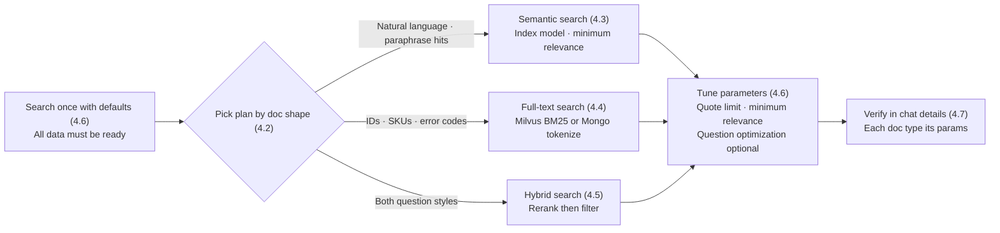
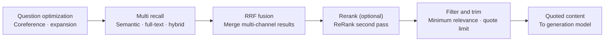
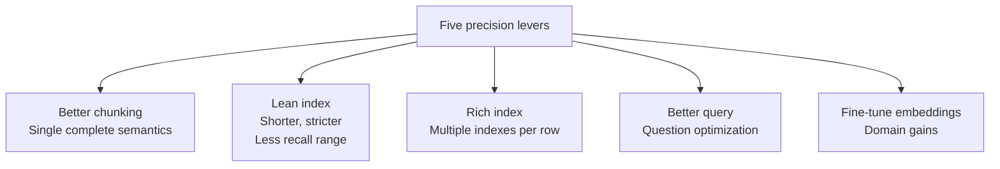

# Chapter 4 Retrieval plans and tuning

> Chapter guide: Chapter 3 left all three document types "ready"—but "findable" and "accurate" differ. This chapter picks a retrieval plan for `after-sales-kb` and tunes it: understand the full retrieval chain; choose semantic, full-text, or hybrid by document shape—full-text backend follows vector DB, Milvus users also BM25 migration; hybrid usually needs rerank; close parameters with quote limits, minimum relevance, and question optimization—policy manual and product FAQ each get their own set. After this chapter you can: pick a plan per document type, tune until cited content is reproducible, and verify tuning via chat details.



*Chapter operation flowchart*

## When you need it

Three typical situations, three ways to use this chapter.

**Data ready but answers are off**—follow Section 4.6 symptom-first (not found, too broad, wrong order), then Section 4.2 plan switch. First discipline: locate by phenomenon; do not tune everything at once.

**Users ask with ticket numbers, error codes, SKUs—semantic search misses**—Section 4.4: keyword full-text fits exact queries; backend follows vector DB; Milvus needs BM25 migration step.

**Library mixes Q&A pairs and long docs—sometimes miss, sometimes flood**—Section 4.5 hybrid plus rerank for precision; quote limits by tokens for stability—official avoids topk for quotes because chunk lengths vary wildly in mixed libraries.

Prerequisite: Chapter 3 three types "ready", index model available (not ready → Section 3.4).

## 4.1 Overview: six-step retrieval chain

One KB search is not "question → vector DB → results." Official overall plan: FastGPT combines text, images, semantic recall, full-text recall, question optimization, rerank, then fuses into quoted content. Six steps:



*Six-step KB search (official overall plan; rerank optional; image recall when model and indexes support)*

After-sales domain is text-only—image chain omitted unless visual model, image-capable embeddings, and image indexes at ingest (official matrix for combinations—see source).

### What drives precision

Official vector search emphasis (Chapter 3 partial quote): precision depends on **embedding model quality, data quality (length, completeness, diversity), retriever precision (speed vs accuracy tradeoff)**; plus query quality. Embedding model fixed in Chapter 2; data quality Chapters 3.3–3.4; retriever and query quality Sections 4.3–4.6.

### Storage and merge: why multi-hit ranks higher

Storage example: PG Vector HNSW (replaceable engine—Chapter 2 four-way choice); MongoDB for other data. `dataset.datas` holds vectors; `indexes` is array of vector IDs—one data row, multiple vectors.

Recall: vectors first, then Mongo lookup by vector ID; if multiple channels hit same data, merge, **vector score = max score**. Explains Section 4.5: multi-channel hit tends to rank higher.

## 4.2 Retrieval plan panorama: semantic, full-text, hybrid

Three search modes plus rerank toggle. Comparison:

| Plan | Principle | Fits | Weakness | Depends on |
|------|------|------|------|------|
| Semantic search | Vector distance → mathematical similarity | Natural language, semantic neighbors, cross-language | Model-dependent, unstable, keywords and sentence completeness | Index model (Chapter 2) |
| Full-text search | Classic keyword hit | IDs, SKUs, proper nouns, error codes, key subject-verb | Paraphrase misses | Vector DB backend (Section 4.4) |
| Hybrid search | Vector + full-text, RRF merge | Libraries with both styles; usually richer | Large scope, hard similarity filter—usually needs rerank | Full-text backend + rerank recommended |

UI is the KB search test "search config" dialog—local community v4.17.3 (2026-11-03, glm-5.3-flash + embedding-3):


Three options map to Sections 4.3–4.5; rerank is separate switch, not a fourth mode.

RRF (Reciprocal Rank Fusion) merges paths—final quotes **not strictly single-channel vector order**—multi-hit rows tend up.

### Pick plan by document shape

Official: semantic for natural language; full-text for IDs and codes; both → hybrid. Thread-through: policy manual natural language plus "article N" citations; FAQ is Q&A shaped. **Our recommendation: `after-sales-kb` default hybrid—half colloquial half coded; semantic alone for light FAQ-only libraries.**

## 4.3 Semantic search: embedding model and similarity filter

### Pros and cons

Similarity is mathematical, not literary. Still topk recall then LLM judgment.

| Pros | Cons |
|------|------|
| Near-semantic understanding | Model training dependent |
| Cross-language | Unstable precision |
| Multimodal (model-dependent) | Keywords and completeness sensitive |

### Similarity filter: minimum relevance

**Minimum relevance** 0–1 filters low hits. Official: **only effective in semantic search or when rerank used**; filter threshold, not final sort—optimization, hybrid, image, rerank change ordering.

### Five ways to improve semantic precision

Official five methods; two opposing directions:



*Five methods (official; M4 = Section 4.6 optimization; M1 echoes Chapter 3 chunk conditions)*

Chapter 3 tradeoff: **lean index** raises precision, shrinks recall; **rich index** adds indexes—any hit recalls row; annotate chunks. Choose by missing precision vs recall.

### Limits and common mistakes

- Missing subject/coreference hurts—reason for question optimization (Section 4.6).
- Fine-tune costly—book case stops at data and free params.

## 4.4 Full-text search and BM25: backend follows vector DB

### What full-text solves

Classic keyword retrieval—IDs, codes, SKUs more reliable than semantic alone.

Chapter 2 foreshadow: **full-text backend follows vector DB, no separate switch.**

| Vector DB | Full-text backend | Note |
|--------|---------|------|
| Milvus (≥ 2.5.16) | Milvus BM25 | Vectors + full text in `modeldata_v2`; no Mongo full-text table; default language `lingua`, `MILVUS_LANGUAGE_IDENTIFIER=whatlang` for speed |
| PG / OceanBase / SeekDB / openGauss | MongoDB `$text` + jieba | Default path (openGauss extra in docs; Chapter 2 four-way may exclude) |

Thread-through on PgVector uses Mongo `$text` + jieba—BM25 migration below for large scale or stronger full-text.

### Milvus BM25: upgrade and migration

Milvus upgrade to BM25 needs ≥ 2.5.16—**below, FastGPT startup errors, no degrade**. Official eight steps:

| Step | Action | Points |
|------|------|------|
| 1 Backup | Milvus volumes, etcd, MinIO, Mongo business data | Rollback |
| 2 Pause writes | Low traffic or stop app writes | No concurrent dataset writes |
| 3 Upgrade Milvus | Image `milvusdb/milvus:v2.5.16` | Keep volumes and legacy `modeldata` |
| 4 Verify version | FastGPT `getVersion()`; milvus-cli/attu/SDK | Wrong version stops boot |
| 5 Migrate | dry-run then real | Copy only, no re-embed; resume, idempotent |
| 6 Verify | `status: done`, `targetCount >= processedCount`; smoke full-text/hybrid | Empty `modeldata_v2` → no full-text hits |
| 7 Drop old | `removeOld=1` or manual drop `modeldata` | Not auto-deleted |
| 8 Rollback | Before drop: downgrade + restore; after drop: restore Milvus volume | Step 7 not rushed |

Migration API (`rootkey` = your ROOT_KEY):

```bash
# 1. dry-run stats first
curl 'http://host/api/admin/4162/milvus?dryRun=1' \
  -H 'rootkey: 你的ROOT_KEY'

# 2. formal migration
curl 'http://host/api/admin/4162/milvus?batchSize=500' \
  -H 'rootkey: 你的ROOT_KEY'

# 3. gateway timeout—resume with migrationId
curl 'http://host/api/admin/4162/milvus?resumeMigrationId=<uuid>' \
  -H 'rootkey: 你的ROOT_KEY'
```

Migrates old `modeldata`, Mongo `dataset_datas.indexes` text, writes `modeldata_v2`; `imageEmbedding` copies vector only, BM25 text empty; verifies row count.

### Limits and common mistakes

- `Milvus version ... is not supported` → upgrade Milvus.
- Old `modeldata` missing → wrong instance/volume; restore backup.
- `failed` and `targetCount < processedCount` → Milvus health, `resumeMigrationId`.
- Full-text empty after migration → confirm `done`, check `modeldata_v2`.

## 4.5 Hybrid search and rerank

### Hybrid: two channels, RRF

Vector + full-text via RRF—usually richer. Cost in same doc: large scope, cannot similarity-filter directly—**usually rerank then filter by rerank score**.

### Rerank: more trustworthy score

ReRank second sort—usually improves accuracy.

| Point | Official |
|------|---------|
| Rerank score more precise than vector | 0–1 filterable |
| Needs complete questions | Often optimize question before search |
| Multi-channel still RRF after rerank | Rerank + vector + full-text fused |

Rerank wired in Chapter 2 model channels; optional fifth type with `requestUrl`, `requestAuth`. FAQ "cannot check rerank" mentioned config.json—4.15.0+ uses env (Section 2.3); actual checkbox path pending review.

### Limits and common mistakes

- Extra model call adds latency—small libraries may get by with semantic + minimum relevance.
- Rerank not magic—"still wrong order" row says check question completeness and candidate pool first.

## 4.6 Search parameter tuning: quote limit, minimum relevance, question optimization

### Two filters and one switch

Mode (Sections 4.2–4.5) plus filter layer:

| Parameter | Mechanism | Constraints |
|------|------|----------|
| Quote limit | Max n tokens quoted per search | No topk—mixed chunk lengths; tokens steadier |
| Minimum relevance | 0–1 filter | Semantic or rerank only; filter not sort |
| Question optimization | Coreference and expansion before search | Extra model call; optional for clear questions or speed |

**Quote limit** has two layers: search-side max tokens per search vs model-side `quoteMaxToken` (Chapter 2)—do not confuse when tuning.

### Question optimization: complete questions for multi-turn

KB search uses only current question—e.g. user asks "what is the second point," search gets six characters. Optimization before retrieve; view complement in **chat details** after each turn—main tuning verification window; extra call—official says trade off; avoid over-optimization on exact ID questions per tuning table.

### Tuning route: phenomenon first

Official discipline: do not tune all params at once. Phenomenon table (image rows for reference; after-sales text-only):

| Phenomenon | Check and adjust first |
|------|---------------|
| Cannot find content | Training done; lower minimum relevance; raise quote limit; short or incomplete question |
| Too broad, off-topic | Raise minimum relevance; lower quote limit; better chunks; irrelevant fragments |
| IDs, SKUs, codes miss | Full-text or hybrid; lower semantic weight; avoid over-optimization on exact IDs |
| Natural language misses | Semantic or hybrid; optimization on; better indexes |
| Slow after optimization | Faster optimization model or only multi-turn/short questions |
| Still wrong after rerank | Question complete; enough candidates; relevance and quote limit |
| Weak image search | Image-capable model; image indexes at ingest; clarity |
| Unstable text+image | Prioritize text vs image; reduce extra text for image-only |

Steering wheel: change one param, same question, chat details; or KB search test tab.

Search test screenshot—query "运输破损怎么赔偿" in testing requires English gloss in prose: the Chinese test query means "How is damage in transit compensated?"


Notice top semantic hit is logistics notice not policy—math similarity nature; Section 4.7 differential tuning addresses this.

### Limits and common mistakes

- Only minimum relevance and quote limit documented for filters; `metadata` filter behavior undocumented—review with Chapter 3.
- Search test works in testing (2026-11-03, figure above); param persistence per library undocumented—app chat details remain full loop.

## 4.7 Hands-on: differential tuning for three document types

No universal defaults—stance table by document shape (**book stance**, verify on your library):

| Document | Dominant questions | Plan | Parameter lean | Rationale |
|------|---------|------|---------|---------|
| After-sales Policy Manual | Natural language clauses + "article N" cites | Hybrid + rerank | Strict minimum relevance; optimization on | Official: hybrid richer; rerank usually helps |
| Product FAQ | Colloquial near Q&A text | Semantic start | Optimization as needed; quote limit low impact | Semantic fits natural language |
| Shipping time notices | Carrier names, day counts | Hybrid, full-text lean | Looser minimum relevance; quote limit caps duplicates | Full-text for proper nouns |

Three shared rules from official table:
1. **One param at a time**—retest same question;
2. **Not found → training first** (Chapter 3 "ready");
3. **Params follow data**—Chapter 3 index lean/rich and preview cap what params cannot fix.

Tune order: three plan sets, fixed test questions per type, verify quotes in chat details. Chapter 7 moves params into workflow search node for "售后客服" ("After-sales Support").

## Chapter summary

1. **Six steps**: optimize → multi recall → RRF → rerank (optional) → filter → quotes; fused order not pure vector.
2. **Pick by shape**: semantic / full-text / hybrid—**hybrid default for `after-sales-kb` in business terms**.
3. **Full-text follows vector DB**: Milvus BM25 vs Mongo `$text`; eight-step migration; old table not auto-deleted.
4. **Minimum relevance is filter not sort**: semantic or rerank; rerank 0–1 often better filter.
5. **Quote by tokens not topk**; distinguish from `quoteMaxToken`.
6. **Phenomenon table steers**; optimization costs a call; chat details verify.

Next: build and search done—operations is "keep current." Chapter 5 sync, tags, permissions; Chapter 3 three sync routes land there.

## Acceptance checklist

You should be able to:

- ☐ Draw six-step chain, optional steps, model-dependent steps;
- ☐ Match three modes to question styles and justify plan for new doc;
- ☐ Explain full-text backend vs vector DB and Milvus BM25 prerequisites;
- ☐ State minimum relevance two constraints;
- ☐ Separate search quote limit vs `quoteMaxToken` and why no topk;
- ☐ Two phenomena → two adjustments each;
- ☐ Three doc types: plan + lean, verify in chat details.

### Review list (before publish)

- [ ] UI vs v4.17.3 docs listed, verified 2026-11-01;
- [x] Search UI names verified (2026-11-03)—five controls in config and test (Sections 4.2, 4.6 figures);
- [ ] Param ranges exhaustive;
- [x] Search test behavior (2026-11-03)—returned scores in figure; save per library not checked;
- [ ] Rerank checkbox path post-env migration;
- [ ] `metadata` filter with Chapter 3;
- [ ] Section 4.7 leans hands-on;
- [ ] BM25 migration four API steps on Milvus env;
- [ ] `MILVUS_LANGUAGE_IDENTIFIER` lingua vs whatlang;
- [ ] Mermaid GitHub render.

## Further reading

- **Chapter 3**—chunk quality, index lean/rich, metadata are tuning ceilings.
- **Chapter 5**—sync and tag dimensions on FAQ categories.
- **Chapter 7**—workflow search node applies this chapter's params.
- **Chapter 11**—migration methodology; BM25 one path.
- **(→ ragflow book) Chapter 7**—parallel retrieval test methodology.