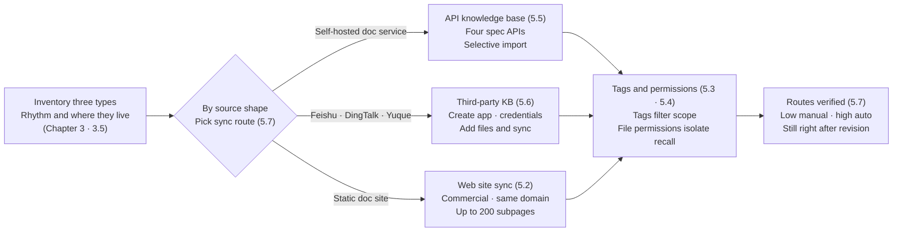
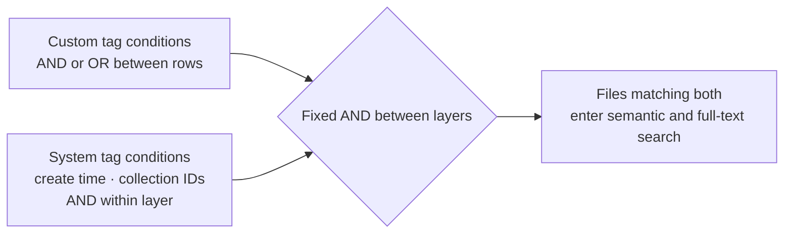

# Chapter 5 Knowledge bases, further: sync, tags, and permissions

> Chapter guide: Chapter 3 labeled update rhythms for three after-sales types—this chapter delivers: keep `after-sales-kb` current. Three sync routes: web site sync from one entry URL for static doc sites; API knowledge base to your document service spec; third-party KB direct to Feishu, DingTalk, Yuque. Two governance tools: collection tags narrow files before search; file-level permissions block unauthorized recall. A decision table picks the best sync route per type—low frequency manual, high frequency third-party. After this chapter you can: land a sync route per type, filter by tags, and state file-level permission rules and limits.



*Chapter operation flowchart*

## When you need it

Three typical situations, three ways to use this chapter.

**Docs live in Feishu, DingTalk, Yuque and change weekly—tired of manual copy**—Section 5.6; per-vendor credential and permission paths; who auto-syncs vs manual.

**Company has doc system or site—no second storage**—API KB Section 5.5; static site Section 5.2, one URL, same domain up to 200 pages.

**Retrieval pulls expired policy or content users should not see**—Section 5.3 tags to scope files; Section 5.4 file permissions. Scope (tags) and identity (permissions) often together.

Prerequisite: Chapter 3 built library, data "ready"; web sync, tags, file permissions are commercial capabilities (Chapter 1 diff table)—community readers check table first.

## 5.1 Overview: ingest is start; staying current is operations

Chapter 3 foreshadow: KB maintenance is a major RAG limit—stale content breaks trust; manual update is slow and error-prone. This chapter mechanizes what can be mechanized in "update" and draws human boundaries. Five capabilities:

| Capability | Problem | Form prerequisite (official, verified 2026-11-01) |
|------|-------------|---------------------------------------------|
| Web site sync | Whole doc site in without page-by-page | Commercial only |
| Collection tags | Scope files before search; suppress stale/overreach | Commercial; typed multi-dim tags from v4.17.1 |
| File-level permissions | Per-file collaborators; unauthorized not recalled | Commercial |
| API knowledge base | Connect existing library, no duplicate storage | Form not stated in materials (review) |
| Third-party KB | Feishu, DingTalk, Yuque direct | Feishu/Yuque v4.8.16+ commercial; DingTalk not stated (review) |

Chapter 1 table puts web sync, third-party scheduled sync, file permissions on commercial side—heaviest form chapter. **Our recommendation: capability list may force form choice earlier than expected—Chapter 1 community start still holds for core build and orchestrate; when sync and governance appear, re-check diff table before scheduling.**

Link to Chapter 3: three rhythms (policy quarterly, FAQ weekly, notices time-sensitive) are inputs; Section 5.7 decision table turns 3.5 labels into routes.

## 5.2 Web site sync: whole static doc sites

### What it is, boundaries

Crawler from one entry captures **same-domain** sites, **up to 200** subpages—doc sites to KB fast. Hard limits: **static sites only** for compliance; domestic media sites largely unusable—WeChat official account, CSDN, Zhihu, etc.

Check static with terminal `curl` for full HTML:

```bash
curl https://doc.fastgpt.io/guide/getting-started
```

### Three setup steps

| Step | Action |
|------|------|
| 1 | New KB, type "Web site sync" |
| 2 | Configure site info |
| 3 | URL and selector, start sync, wait for crawl |

After sync, create app, bind KB (Chapter 6). **Sync schedule/frequency not in source**—only "start sync and wait"; confirm in UI (review).

### Selectors: body not chrome

Selector (CSS) targets content not whole page—browser devtools, attribute/class/id. Common patterns (official examples):

| Style | Example | Meaning |
|------|------|------|
| Attribute | `div[data-prismjs-copy]` | `div` with attribute |
| Class | `.docs-content` | class `docs-content` |
| Multi | `.docs-content .mb-0.d-flex, .docs-content div[data-prismjs-copy]` | comma OR groups |

Official FastGPT docs site uses two groups—title area and code blocks.

### Limits and common mistakes

Media sites and official account content largely fail; over 200 pages split entry; selector too wide pulls nav/footer noise—preview small scope before full crawl.

## 5.3 Collection tags: metadata gate on retrieval scope

### Why tags

Commercial feature: structured multi-dimensional tags on collections—filter in library and **at knowledge base search** in apps/workflows via manual input or variable reference. Three problems without tags:

| Problem | Symptom |
|------|------|
| Cross-department bleed | Engineering asks process, gets marketing event policy |
| Stale docs | Old and new policy both recalled |
| Classification and scope | Shared assistant must vary by role or external user |

Mechanism: **metadata filter** to target files, then semantic/full-text inside. Supported except web-sync KB—general, third-party, API libraries support tags.

### Step 1: plan tags

Knowledge base detail → collections → "Tag management" (write permission). Three attribute types:

| Attribute | Use | Limits |
|---------|---------|---------|
| Option | Fixed categories | Max 64 options per file, option max 256 chars |
| Number | Quantitative compare | One value per file, int or decimal |
| Date | Time boundaries | One value, `YYYY-MM-DD HH:mm` precision |

Rules: tag name max 20 chars; **attribute immutable after create** (name renamable); delete tag removes all bindings. Option tags support option management—standard vocabulary; rename option updates all files; delete option removes value.

### Step 2: tag files

| Path | Action | Notes |
|------|------|------|
| Single file | Tag settings dialog | Type missing option, enter and confirm to create |
| Batch | Select files, bottom bar batch edit | Option append/overwrite; number/date overwrite on batch |
| API | `tags` on collection create/update | Auto-create tag by value shape if missing |

API body (official example):

```json
{
  "datasetId": "69ddb01e2d241386ca47adbe",
  "name": "员工考勤与休假管理制度（2026版）.pdf",
  "tags": [
    { "tag": "适用部门", "value": ["全员", "人力资源部"] },
    { "tag": "保密等级", "value": 1 },
    { "tag": "生效日期", "value": 1767229200000 }
  ]
}
```

The English gloss: sample tags department applicability, confidentiality level, and effective date on an attendance and leave policy PDF filename.

Batch remove: dialog summarizes tags; option tags can drop whole tag or subset of option values.

### Steps 3–4: list filter to search filter

List: tag header filter—same tag OR, across tags AND.

Search side:

| App form | Tag filter entry |
|---------|-------------|
| Workflow | Knowledge base search node → enable tag filter |
| Conversational Agent / simple app | App config → knowledge base → parameters → search config → tag filter tab |

Two condition layers:



*Tag filter two layers (book figure, rules from official docs)*

Custom operators by attribute; system: create time ≥/≤, collection ID in (recursive children).

Empty binding rules: **positive match** (equals, contains, in, greater, not empty)—untagged file fails, not recalled; **negative/empty** (is empty, not equals, not in)—untagged passes. **Our recommendation: positive match dominates—tag on import becomes discipline or tagged-out files vanish from answers.**

### Advanced: variable JSON

Switch tag filter input to variable reference for dynamic JSON from upstream code:

```json
{
  "tags": {
    "$and": [
      { "适用部门": { "$in": ["全员", "研发部"] } },
      { "保密等级": { "$lte": 2 } },
      { "生效日期": { "$gt": "2026-01-01 00:00" } }
    ]
  },
  "createTime": {
    "$gte": "2026-01-01 00:00",
    "$lte": "2026-12-31 23:59"
  },
  "collectionIds": ["6593e137231a2be9c5603ba9"]
}
```

The English gloss: example filters by department in list, confidentiality at most 2, effective date after 2026-01-01, create time window, and collection ID list.

Top-level `tags`, `createTime`, `collectionIds` AND; `$and`/`$or` inside `tags`; operator table matches official option/number/date sets.

### FAQ and limits

| Issue | Official answer |
|------|---------|
| Tag missing in dropdown multi-KB | Only tags with same name and attribute in all linked KBs (option values union) |
| Legacy string tags | Migrated to `default_tag` option tag |
| Rename tag/option | Filter conditions match by **name text**—update configured filters after rename |

Rename without updating references breaks apps and workflows—search references before rename.

## 5.4 File-level permissions: unauthorized files not recalled

### Terminology alignment

Commercial file/folder collaborator control. Default: whole KB shares KB permissions; optional per file/folder collaborators. UI naming (official):

| Concept | UI wording | Note |
|------|--------------|------|
| dataset | Knowledge base | Resource type `dataset` |
| collection | File / folder / collection | Resource type `collection` |
| File-level permission | "Dataset permission" in UI | Collection-level permission |

UI "dataset" here is historical label for one file/folder—not ragflow Dataset (→ ragflow book).

### Enable and disable: one-way feel

**Enable**: KB detail → file row `···` → `Permission`; needs KB admin. Sync materialize all permission snapshots first—slow for many files; failure leaves off, retry idempotent. Ops slower after enable.

**Disable**: info bar "click to close." **Deletes all per-file collaborators**, revert to KB inheritance, **irreversible**—confirm twice. Re-enable like first time.

### Roles, inheritance, overwrite

Four roles: read, write, admin, creator (unique per file).

Rules:
1. **KB permission is threshold**—collection grant needs KB read;
2. **Creator not grantable via collaborator list**—submitted list must include creator or whole submit rejected;
3. **Collaborator list is full replace**—incremental submit can drop creator (hence rule 2).

Inheritance vs independent; auto-independent when editing inherited collaborator; restore inheritance keeps delta and syncs subtree.

### Permission vs operations

| Operation | Requirement |
|------|------|
| View list/detail | KB read + file read; list filtered per member |
| Edit file info | File write |
| Move | Admin on source and destination; team KB create for root/folder moves |
| Configure collaborators | File admin + file permissions on |
| Delete | **Creator only**—admin cannot delete; batch filters non-creator |
| Transfer ownership | Creator only |

Delete-only-creator surprises teams—need creator or transfer first.

### Retrieval and special principals

When on, search filters to member-readable files—workflow/agent search and KB search test. **Only when authenticated as current member**—preselected KB without member auth does not file-filter.

root and team owner bypass file-level; **team admin does not**.

### Thread-through placement

`after-sales-kb` open to whole support team—no file permissions until internal-only content (e.g. internal compensation authority). Then enable and confirm member-auth call path; full team model Chapter 12.

## 5.5 API knowledge base: connect existing library

### Problem

Official: users already have a doc library—duplicate import is double storage and hard ops. API file library: implement FastGPT file APIs, set `baseURL` and token, selective import on UI.

Three params at create:

| Param | Meaning |
|------|------|
| `baseURL` | File service base URL |
| `authorization` | `Authorization: Bearer <token>` |
| `basePath` | Optional root for file tree |

### Four APIs

Response `{ success, message, data }`.

| API | Method/path | Role | Key rules |
|------|-----------|------|---------|
| File tree | `POST {{baseURL}}/v1/file/list` | List files/folders | `parentId`, optional `searchKey` |
| Content | `GET {{baseURL}}/v1/file/content?id=xx` | Title and body | `content` or `previewUrl` required one; `content` wins if both |
| Read link | `GET {{baseURL}}/v1/file/read?id=xx` | `url` for original view | |
| Detail | `GET {{baseURL}}/v1/file/detail?id=xx` | Metadata | |

List item type:

```ts
type FileListItem = {
  id: string;
  parentId: string | null;
  name: string;
  type: 'file' | 'folder';
  updateTime: Date;
  createTime: Date;
  hasChild?: boolean; // optional; default true for folder
}
```

`content` indexes directly; `previewUrl` downloaded and parsed (PDF, Word, etc.) with cache.

### vs platform push API

This section is **FastGPT pulls** your service; Chapter 10 KB API is **platform push** including `tags` (Section 5.3). Product FAQ from a self-built system: pull if source exposes spec; push if scheduled jobs on platform side.

### Extend other doc systems

Built-in Feishu/Yuque/DingTalk extend API file library; custom sources via five hooks and registration—DEV path in `packages/service/core/dataset/apiDataset/yuqueDataset/api.ts`—book does not expand (review).

## 5.6 Third-party knowledge base: Feishu, DingTalk, Yuque

### Three-way compare

| Dimension | DingTalk | Feishu | Yuque |
|------|-----------|-----------|-----------|
| Version/form | Not stated (review) | v4.8.16+ commercial | v4.8.16+ commercial |
| Credentials | `App Key` + `App Secret` + `User ID` | `appId` + `appSecret` + Folder Token | `token` + `uid` |
| Scope | Operator-visible wiki, online docs, folders recursive | **Shared space folders only**; not personal or wiki space | Yuque library |
| Content | DingTalk online doc text only; not PDF/Office binaries | Cloud doc types only | Not stated (review) |
| Sync | Manual "Sync" on imported file | Not stated (review) | Daily scan + manual |
| Maturity | — | Testing | Testing |

Rhythm: platform app/credentials → permissions → FastGPT new KB type → add files.

### DingTalk: permissions and sync account

Enterprise app: `App Key`/`App Secret` from app credentials; `User ID` from admin contact export—not phone/name/`unionId`. Four scopes: member read, wiki read, node read, file read. Publish after grant; fix `requiredScopes` errors. **Dedicated read-only sync user with only target wiki scope**—invisible libraries do not list.

### Feishu: shared space and folder token

Three permissions for cloud doc list and file access; add app to group with folder permission; folder token from URL without `?`. Only shared space; cloud doc type only—HTML/EML on Feishu path feasibility (review).

### Yuque: token + uid, daily scan

Personal/enterprise token and UID from settings; daily scan syncs changes; manual sync too—best automation for weekly FAQ among three.

### Limits

Secrets not public; scope determines visible imports; Feishu/Yuque testing—pilot first.

## 5.7 After-sales domain choice: best sync route per type

Two questions in order: **update frequency** (low manual, high automate), **source shape**.

| Document | Rhythm (Ch 3) | Source | Best route | Reason |
|------|------------------------|---------|-------------|-----------|
| After-sales Policy Manual | Quarterly low | 50-page PDF | **Manual** re-import after review | Humans in loop; wrong policy is catastrophic |
| Product FAQ | Weekly high | ~200-row xlsx | **Third-party scheduled** Yuque etc.; API if self-built | DingTalk online-only, not xlsx; push side Chapter 10 |
| Shipping time notices | Medium, time-sensitive | HTML + email | **Manual** pair in/out; API if volume grows | Automation ROI still low |

Also: help center static sites → web sync (commercial); cross-dept/version issues → tags (not web-sync KB); per-person isolation → file permissions with member auth.

> **Our recommendation**: sync automates "moving bytes"; who approves when to update is process—add owners and triggers per type; SOP and quality inspection Chapter 13.

## Chapter summary

1. **Five capabilities, form first**: commercial for web sync, tags, file permissions; Feishu/Yuque third-party commercial.
2. **Routes by source**: web same-domain 200 pages; API four interfaces; third-party per vendor rhythm.
3. **Tags before search**: three attribute types; positive match excludes untagged—**tag on import**.
4. **File permissions on recall**: enable materializes; disable wipes; delete creator-only; filter only with member auth.
5. **Decision table**: frequency then shape; policy manual manual+review; FAQ scheduled; notices paired manual.
6. **After sync, govern**: tags scope, permissions identity; process Chapter 13; workflow tags Chapter 7.

Next: Chapter 6 app four forms; simple "售后客服" ("After-sales Support") with KB, prompt, opening, three input tests.

## Acceptance checklist

You should be able to:

- ☐ Match three sync routes to source shapes; frequency-then-shape for new doc;
- ☐ `curl` static-site prerequisite; same domain and 200-page limits;
- ☐ Create three tag attribute types; single and batch tag;
- ☐ Enable tag filter in agent or workflow; explain untagged on positive match;
- ☐ Enable file permissions; inheritance vs independent; why admin cannot delete;
- ☐ API KB three params and four APIs; `content` vs `previewUrl`;
- ☐ Finalize three-type sync: route, trigger, owner each.

### Review list (before publish)

- [ ] UI vs v4.17.3 five source paths, verified 2026-11-01;
- [ ] Web sync trigger/frequency UI;
- [ ] API KB community availability;
- [ ] DingTalk commercial and sync button;
- [ ] Feishu sync mode and HTML/EML;
- [ ] Yuque scan timing and content limits;
- [ ] Tags batch, empty match, multi-KB common tags, `default_tag`;
- [ ] File permission materialize, disable, delete rules, search auth branches;
- [ ] API KB minimal server four APIs;
- [ ] Mermaid render.

## Further reading

- **Chapter 4**—after tag scope, retrieval params inside scope.
- **Chapter 7**—workflow search node tag filter.
- **Chapter 10**—push API and `tags` vs pull API KB.
- **Chapter 12**—KB-level collaborators and team roles.
- **(→ ragflow book) Chapter 3**—connector refresh vs third-party KB sync.