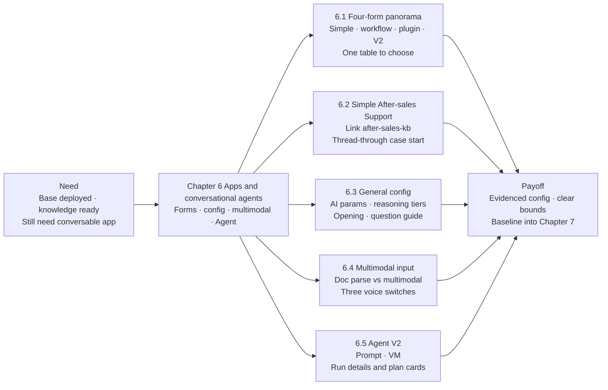
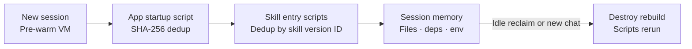

# Chapter 6 Apps and conversational agents

> Chapter guide: Chapter 2 base is up, Chapter 3 left `after-sales-kb` ready—how does knowledge become a conversable app? This chapter gives four app forms and a selection table, then lands "售后客服" ("After-sales Support") in simple configuration: link KB, triple-section prompt, quick-question opening, three input tests; then general config (AI parameters, reasoning tiers, question guide) and multimodal input, then Agent V2 VM and debug. Simple version is the baseline against Chapter 7 workflow—what it can and cannot answer. After this chapter you can: pick app form, configure evidenced support app, read one answer in run details.



*Chapter overview figure*

## When you need it

Three typical situations, three ways to use this chapter.

**Demand in hand, unsure which app type**—read Section 6.1. Four-form table: fit, orchestration, complexity; most hesitation comes from treating form height as quality—table puts it back on task fit.

**Form chosen (simple config)—make it usable**—Sections 6.2 → 6.3 → 6.4: land After-sales Support on `after-sales-kb`, then AI params and reasoning, then file upload and voice as needed.

**Open-ended tasks—simple config and fixed flow both wrong**—Section 6.5 Agent V2 with planning and VM; VM needs Chapter 2 sandbox URLs filled.

Prerequisite: Chapter 2 deploy and language model; `after-sales-kb` "ready" (Chapter 3); Agent V2 VM needs sandbox (Section 6.5).

## 6.1 Overview: four app forms panorama

### Four forms in one table

Chapter 1 listed four forms: simple configuration, workflow, plugin, Agent V2. Same table compares fit, orchestration, complexity:

| Form | Fit | Orchestration | Complexity | Book coverage |
|------|---------|---------|--------|---------|
| Simple configuration (conversational Agent) | Light Q&A, generation, standardized output; KB-linked grounded Q&A | Form config: left AI, right debug | Low | Sections 6.2–6.4 |
| Workflow | Fixed steps, branches, review, automation | Canvas nodes | Medium to high | Chapter 7 |
| Plugin | Reusable unit: run alone or from workflow | Input/output declaration (UI detail not in materials) | Medium | Chapter 8 |
| Agent V2 | Open tasks, multi-step reasoning, planning, code | Panel sets persona/capability; model plans; VM runs | High | Section 6.5 |

Complexity is maintenance cost preview, not capability score. **Choose by task, not form prestige—ask if flow is fixed: workflow; need autonomous planning and code: Agent V2; else simple configuration.**

### Mapping to quick start four cases

Official quick start four cases; Chapter 1 left four-case vs four-form mapping open—this chapter closes it per materials:

| Quick start case | Form (book mapping) | Basis |
|-------------|---------------------|---------|
| Case 1: conversational Agent—email assistant | Simple configuration | New "conversational Agent" is Section 6.2 form page |
| Case 2: KB + conversational Agent—civil code Q&A | Simple + KB link | Same form plus KB, not separate form |
| Case 3: workflow—content review and rewrite | Workflow | New workflow canvas |
| Case 4: Agent V2—smart data analysis | Agent V2 | New conversational Agent V2 with VM |

Plugin not in quick start—it is reused capability, Chapter 8. Official: combine capabilities—support answers from KB plus order tool; our running example "售后客服" ("After-sales Support") is full combo in Chapter 7.

### After-sales Support form path

**In business terms: support apps start simple configuration—ship in a day, expose flow gaps, inform workflow upgrade.** This chapter creates "售后客服" in simple configuration (Chapter 1 reserved name); Chapter 7 workflow reuses same prompt and KB in nodes.

## 6.2 Simple-configuration After-sales Support: the start of our running example

### Six steps to create app

Official quick start case 2 path as six steps:

| Step | Action | Points |
|------|------|------|
| 1 Create app | Workbench → New → conversational Agent, name "售后客服" | Left AI, right debug |
| 2 Link KB | Link `after-sales-kb` in app config | Chapter 3 data "ready"; chain becomes retrieve then summarize |
| 3 Write prompt | Role + format + rules triple | Rules bound risk—below and Section 6.3 |
| 4 Opening | Welcome plus `[快捷问题]` | Button sends preset question |
| 5 Pick model | Chinese expression and instruction following | Low-risk tasks need not use strongest model; lower temperature (6.3) |
| 6 Verify | Real questions in debug | Three input types at section end |

Config page in testing—local community v4.17.3 (2026-11-03, glm-5.3-flash + embedding-3):


KB bound shows search params (semantic, quote 3000, relevance 0.2)—Chapter 4 tuning lives here; figure uses shortened test prompt—production should use full triple below.

### Prompt: triple applied to after-sales domain

Role, format, rules—triple from Chapter 1, first full landing here:

```md
你是跨境电商平台的售后客服，基于售后知识库回答用户问题。

输出格式：
- 先给结论，再给依据，依据注明来源（售后政策 / 商品 FAQ / 物流公告）
- 涉及操作步骤时用编号列表

规则：
- 严格基于知识库检索结果回答，不臆造政策条款与时限
- 赔偿标准、退换货时限类问题逐条引用依据；知识库没有的，如实说明并建议提交工单
- 物流时效以最新公告为准，注意公告的发布时间
- 与售后无关的问题礼貌说明范围后拒答
```

The English gloss: you are cross-border e-commerce after-sales support grounded on the KB; lead with conclusion then evidence citing policy, FAQ, or logistics notice; numbered steps when needed; answer only from retrieval, no invented policy or deadlines; compensation and return windows need line-by-line citations or admit gap and suggest ticket; logistics use latest notice time; refuse off-topic politely.

Three rules sourced: first two mirror official civil-code "answer from materials, admit gaps"; third matches Chapter 3 notice rhythm; fourth is scope guard. Treat prompt like code—review before ship.

### Opening: welcome and quick questions

Opening is auto-sent welcome Markdown; `[快捷问题]` renders clickable buttons that send that question:

```md
你好，我是售后客服，可以解答退换货、赔偿标准与物流时效问题。

[运输破损怎么赔偿？]
[退换货的时限是多久？]
[我的包裹多久能到？]
```

The English gloss: hello, I am after-sales support for returns, compensation, and logistics timing; quick buttons ask how damage in transit is compensated, return windows, and package arrival time.

Three quick questions map to three `after-sales-kb` collections. Official opening tips: short, state what app solves; quick questions cover high frequency, not too many; show format examples when needed.

### Verification: three input types

Before publish—official KB Q&A validation—all three:

| Input type | After-sales test | Expected |
|---------|-------------|---------|
| In-corpus | "运输破损怎么赔偿？" | Evidenced answer citing policy |
| Out-of-corpus | "你们公司的 CEO 是谁？" | Cannot confirm, no fabrication |
| Vague | "我的件有问题" | Ask what problem, which order, ship date |

The English gloss for test strings: damage compensation; company CEO; vague "something wrong with my item."

An app that only agrees is not shippable—still true with KB: out-of-corpus filled from model memory is worse than silence.

In-corpus example in debug—return window question with two citations:


"2 citations" shows policy and FAQ sources; Annotation and Run details lead to Chapters 13 and evidence chain.

### Limits and common mistakes

- No KB → model memory, private facts wrong—link `after-sales-kb` first (Chapter 1 Section 1.5 repeat);
- KB not "ready" → empty retrieval (Chapter 3);
- Too many conflicting rules destabilize model—keep hard constraints to about three.

**Simple version is Chapter 7 baseline: answers "what policy says", not "where is my ticket"—ticket needs tools and workflow; workflow must not regress on three tests and adds ticket lookup.**

## 6.3 General config: AI parameters, opening, question guide

### Config entry: shown per model capability

AI config adjusts model, reply length, multimodal, format, reasoning display. Same dialog from app AI area (model setting button) or workflow AI chat node (Chapter 7). Fields appear only if model supports them. **Default: pick model, leave rest default unless needed.**

### Basic parameters table

| Parameter | Governs | Official note and After-sales Support |
|------|--------|--------------------------|
| AI model | Base model; shows price, context, tools, multimodal | Stable Chinese and format |
| Memory turns | Prior chat turns referenced | Default; KB Q&A needs few turns |
| Reply cap | Max length toggle + slider | Lower for brevity; too low truncates |
| Temperature | Randomness | Lower for support/KB |
| Top_p | Overlaps temperature | Do not tune both; default Top_p if temperature set |
| Stop sequences | Stop on token, `\|` separated | Usually unset |
| Reply format | Default; `json_schema` for structured downstream | Default for support |
| Multimodal recognition | Read image/audio/video in user input (6.4) | Per model and need |
| Hide AI output | Hidden from user, for downstream nodes | Multi-node (Chapter 7) |
| Hide AI thinking | User sees final only | Off while debugging, on for launch |

### Reasoning config: seven tiers

Models that think before answer get reasoning config. Tiers map OpenAI `reasoning_effort` via ai-proxy:

| FastGPT tier | OpenAI value | Default budget |
|-------------|--------------|-------------|
| Default | No explicit `reasoning_effort` | Model default |
| No reasoning | `none` | `0` |
| Minimal | `minimal` | `1024` |
| Light | `low` | `2048` |
| Standard | `medium` | `8192` |
| Deep | `high` | `16384` |
| Extreme | `xhigh` | `32768` |

Token-budget-only upstream maps tiers to budget and back (e.g. `1025~4096` → `low`). Not all models support all tiers—revert to default on error. Daily support: default or no reasoning—tiers amplify cost and latency.

### Dialog opening

Section 6.2 case opening; general rules: Markdown welcome; `[快捷问题]` as buttons; edit via "Dialog opening" on app page.

### Question guide: lexicon and custom API

Opening handles first question; Question Guide handles every question—preset lexicon searched as user types (max 5). In-app config or custom HTTP API—browser-reachable, CORS aware:

```bash
curl --location --request GET 'http://localhost:3000/api/core/chat/inputGuide/query?appId=663c75302caf8315b1c00194&searchKey=你'
```

Response `data` is string array:

```json
{
  "code": 200,
  "statusText": "",
  "message": "",
  "data": ["你是谁", "你是谁呀", "你好呀", "运输破损怎么赔偿", "退换货时限"]
}
```

| Parameter | Meaning |
|------|------|
| `appId` | App ID |
| `searchKey` | Search key, max 50 characters |

The English gloss for sample `data` entries: who are you variants, hello, damage compensation, return window.

After-sales use: high-frequency subset of ~200 FAQ questions—typing "运输" surfaces damage compensation—guides double as query hints for Chapter 4.

### Constraint wording: where "限定词" went

Some tutorials mention "限定词." v4.17.3 materials do not document this field—constraints live in prompt rules (Section 6.2 four rules), plus lower temperature and format. Which UI field old "限定词" maps to is unverified—review list; book does not guess undocumented params.

## 6.4 Multimodal input: files and voice

### Two processing lines

"App reads files" is two different lines—common beginner mistake:

| Line | Files | How it works | Switch |
|--------|---------|---------|---------|
| Document parsing | PDF, Word, Excel, Markdown, HTML | Doc to text in prompt—LLM cannot parse raw office docs directly | File upload (from 4.8.9) |
| Multimodal recognition | Image, audio, video | Model-readable input from capable model | AI config dialog |

### File upload in simple mode

Simple configuration ("simple mode" in materials) with upload shows file icon in debug. Version note: 4.8.9 tool-call mode model decides read; **4.8.13+ forces parse into system prompt** every turn.

Files stored as URLs in chat record, not parsed content at rest:

```ts
type UserChatItemValueItemType = {
  type: 'text' | 'file';
  text?: { content: string };
  file?: {
    type: 'image' | 'audio' | 'video' | 'file';
    name?: string;
    key?: string;
    url: string;
  };
};
```

Parse at request time—4.8.13: document parse node this turn only; tool call and explicit doc reference in AI chat can parse history.

### Workflow document parsing (preview)

Chapter 7 owns full workflow file handling—three facts: parse node in/out `array<string>`/`string` by URL suffix, docs only; 4.8.13+ current turn only in workflow; multi-doc template with `\n******\n` separators; AI chat can reference doc URLs into system prompt.

### Seven 4.8.13 changes

| Item | Change | Impact |
|------|---------|------|
| 1 | Simple mode forced file parse | Every turn can use docs |
| 2 | Doc parse skips history files | This turn only |
| 3 | Tool call doc reference parses history | No extra tool |
| 4 | AI chat doc reference | No parse node needed |
| 5 | Plugin run no global file; plugin input file types | Replaces global upload |
| 6 | Workflow→plugin files manual variable | Explicit |
| 7 | Workflow→workflow files manual links | Explicit |

Simple users: remember 1–2; 5–7 are Chapters 7–8 param discipline.

### Voice input: three switches

Speech-to-text in chat—mobile/support/field. App page "Voice input" three toggles:

| Switch | Behavior | Suggestion |
|------|------|---------|
| Voice input | Mic entry, STT; browser unsupported warning | Mobile/field on |
| Auto send | Send after STT | Off when accuracy matters |
| Auto voice reply | Reply spoken when question was voice | Needs TTS; else text only |

Depends on Chapter 2: STT model; no SSL → voice I/O blocked by browser—not misconfig on local HTTP.

### Limits and common mistakes

- Mixed doc + image: parse line ignores multimodal—use multimodal config for images;
- Multimodal filtered by model capability; link extraction needs toggle, under 500 chars in question, max 4 links;
- Plain docs never sent raw as multimodal—parse line only;
- 4.8.13 no history parse; no implicit file through plugin/sub-workflow—use doc reference.

## 6.5 Agent V2: dedicated config, VM, and debug

### Three dedicated config blocks

New "conversational Agent V2"—open tasks from Section 6.1. Extra panel:

| Block | Content | Points |
|--------|------|------|
| Prompt | Persona, goals, rules | Rich text, `@` binds tools etc. |
| Virtual machine | Per-session Linux sandbox | Code, files, startup script |
| Skills | Published skill versions | Entry scripts on VM boot; skill without VM shows "VM not ready" |

Model params still in Section 6.3 dialog. Skills development Chapter 8—here VM line only.

### VM: per-session sandbox

Per-session isolated lightweight Linux sandbox. Deploy prerequisite: Chapter 2 sandbox WebSocket and preview URLs, port 3006 Agent Sandbox Proxy—else unavailable (Chapter 11 production). Enables think and do: Python/Node/Shell, `/workspace` files, skills/scripts. Design:

| Design | Content |
|------|------|
| Session isolation | Bound to session; keepalive; idle minutes reclaim (future user-level isolation noted) |
| Session persistence | Dependencies, temp files, env vars survive turns in same session |
| Safety | Quota + firewall; commands base64 in container against injection |
| Fast rebuild | "New chat" destroys instance; clean next request |

### Startup scripts and dedup

Before AI runs: app startup script in `/workspace`, then skill entry scripts in skill deploy dirs. Skill unpack atomic via temp dir rename.

Hot start dedup in `~/.fastgpt/agent-skill-entrypoints/state.json`:



App script hash skip if unchanged; skill by immutable version ID—cold start only when version changes. Rebuild reruns all scripts on first cold start.

### Execution limits table

| Limit | Value | Over limit |
|------|------|---------|
| Script length | 16384 chars (~16KB) | Truncated on save—split to skill entry or remote fetch |
| Timeout | `AGENT_SANDBOX_ENTRYPOINT_TIMEOUT_SECONDS` default 30s (1–600) | Kill process |
| Failure impact | Non-blocking main chat | Errors do not block dialog; missing deps fail at runtime—logs/VM file manager |
| Log cap | ~8KB stdout+stderr, truncate 4000 chars each | Drop overflow |

VM file manager live; test uploads to `user_files/` before chat; errors stream to model for self-fix; bubble shows VM create/start streaming.

### Debug preview: bubble bar and plan cards

Debug is live test pre-publish. "New chat" clears history. Per AI message bar:

| Button | Role |
|------|------|
| Copy | Copy reply text |
| Read aloud | TTS |
| Annotate | Save Q&A to KB with expected answer (Chapter 13 quality base) |
| Retry | Regenerate last user input |
| Run details | Tree: thinking, internal actions, tool logs, request id, model, credits |
| Response time | Seconds to complete |

Plan cards stream for complex tasks—colors for in progress, done, pending, blocked—fix prompt/tools from block reason. Run details is the X-ray—Chapter 13 turns it into inspection tooling.

### Assisted generation: commercial only

"Assisted generation" tab—Agent V2 AI helper reads model/KB/tools, drafts structured prompt, recommends tools/KB. **Commercial only**—matches Chapter 1 diff row; community skip without blocking main line.

## Chapter summary

1. **Four forms by task**: simple dialog+KB, workflow fixed flow, plugin reusable unit, Agent V2 open tasks—complexity is maintenance cost.
2. **Simple After-sales Support landed**: six steps, triple prompt, quick opening, three input tests—Chapter 7 workflow baseline.
3. **AI config dialog shared** app and workflow AI node; defaults OK; low temperature for support; reasoning tiers cost latency.
4. **Constraints in prompt rules**—no documented "限定词"; opening first question, guide every question.
5. **Two input lines**: doc parse to text; multimodal to capable model; 4.8.13 forces this-turn parse; voice needs STT and SSL.
6. **Agent V2 triad**: prompt `@`, VM, skills; session sandbox with dedup and non-blocking script timeout; run details for transparency.

Next: simple answers policy; "classify, search, ticket, reply" needs nodes. Chapter 7 same name, KB, prompt on canvas; validate with Section 6.2 three tests.

## Acceptance checklist

You should be able to:

- ☐ Explain four forms with Section 6.1 table and justify new demand;
- ☐ Create simple "售后客服" with `after-sales-kb`, triple prompt, `[快捷问题]` opening;
- ☐ Three input types and expected behavior each;
- ☐ Open AI dialog; temperature, memory, reply cap roles; support parameter picks;
- ☐ Enable file upload; one sentence doc parse vs multimodal;
- ☐ VM session isolation, dedup, 30s script timeout; why new chat is clean;
- ☐ Expand run details once; point to tool calls and credits.

### Review list (before publish)

Items verified in testing checked with environment; rest before publish:

- [ ] Full chapter vs v4.17.3 guide/build/general and agentv2 + quick-start cross-check, verified 2026-11-01;
- [x] Simple app create, KB link, debug verified (2026-11-03)—citations hit policy and FAQ (Section 6.2 figures);
- [ ] Full triple prompt and opening walkthrough; out-of-corpus and vague inputs—figure used shortened prompt;
- [ ] Four forms vs new menu names—"simple configuration", "conversational Agent", "simple mode" (app name suffix "（简易）" in figure);
- [ ] Chapter 1 four-case vs four-form reconfirm on UI;
- [ ] AI dialog conditional fields for multimodal and reasoning;
- [ ] Reasoning tier budget mapping on own channel;
- [ ] "限定词" UI mapping unverified—materials silent;
- [ ] File upload 4.8.13: forced system parse, no history, multimodal ignored in parse line;
- [ ] Voice three switches and no-SSL behavior;
- [ ] Agent V2 VM timeout, 16K truncate, `user_files/`, new chat, `state.json` dedup;
- [ ] Assisted generation community entry (commercial only per materials);
- [ ] Chapter mermaid GitHub render.

## Further reading

- **Chapter 7 (Workflow orchestration)**—upgrade path from baseline: classify, KB search, HTTP ticket, reply on canvas.
- **Chapter 4 (Retrieval plans and tuning)**—when simple retrieval disappoints: modes and quote limits on `after-sales-kb`.
- **Chapter 8 (Tools and skills)**—plugin form and Agent V2 skill packaging.
- **Chapter 13 (Conversation operations and evaluation)**—formalize Annotate and run details into inspection.
- **Chapter 2 (Deployment and model channels)**—STT, SSL, sandbox URLs and port 3006 for VM.