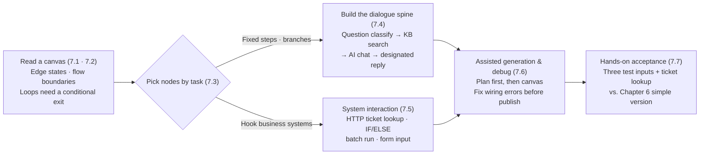
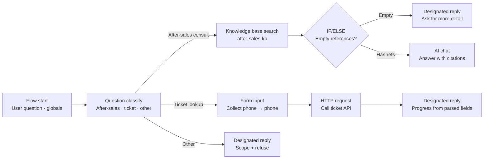

# Chapter 7 Workflow orchestration

> Chapter guide: The simple-configuration "售后客服" ("After-sales Support") from Chapter 6 can answer “what does the policy say,” but not “where is my ticket in the pipeline”—once a process appears beyond Q&A, form-style configuration hits its ceiling. This chapter opens that black box: first the canvas execution model and wiring rules, then a panorama of node families, then six backbone nodes in depth; finally a hands-on upgrade from the simple version to a workflow version—question classification → knowledge base search → HTTP ticket lookup → designated reply—with acceptance against Chapter 6’s three test inputs. After this chapter you can: read any workflow canvas, orchestrate an After-sales Support workflow on your own, and explain what the workflow version solves beyond the simple version.



*Chapter 7 flow overview*

## When you need it

Three typical situations map to three ways of using this chapter.

**The app must follow fixed steps and branch by case**—classify first then retrieve, empty retrieval gets a fallback, different question types get different replies. In simple configuration you can only hope the model follows the prompt; in a workflow these are explicit nodes and edges. Use Section 7.4 for the dialogue spine and Section 7.7 for our running example.

**Before replying you must query a business system**—ticket progress, order status, shipping trace—nothing the knowledge base has; you ask the mid-platform API on the spot. The HTTP request node in Section 7.5 is the workflow’s outlet; Section 7.7 wires the after-sales domain ticket API (→ MCP book tool layer).

**You inherit someone else’s canvas, or a target inlet never appears when you drag a wire**—read the execution model in Section 7.1, then wiring rules in Section 7.2: invalid targets are hidden while dragging, not “connect first, error later.” Commercial users can also use assisted generation in Section 7.6 to reshape the canvas.

Prerequisites: Chapter 2 deployment done with at least one language model available; `after-sales-kb` data ready with retrieval tuned (Chapters 3–4); Chapter 6 simple-configuration "售后客服" ("After-sales Support") built—that is the baseline for this upgrade.

## 7.1 Overview: canvas, nodes, and execution model

The official starting description (v4.17.3 docs “Workflow & plugins,” verified as of 2026-11-01): From FastGPT V4.0, new interaction builds AI apps with Flow node orchestration—workflow—for complex flows, more flexible and extensible, but a higher learning curve; users with some development background find it easier.

The smallest unit on the canvas is a node: officially likened to a Function or API in code—a **step**; chain nodes to reach the final AI output. The simplest AI chat workflow has only two nodes—flow start and AI chat: after the user asks, flow start runs and stores the question; AI chat needs two required inputs—chat history (default 6 messages, this module’s context length) and user question (reference flow start’s stored value).

### Two node kinds and three elements

By function, nodes split into **system nodes** (user guide—dialog config; user question—flow entry) and **functional nodes** (knowledge base search, AI chat, and the rest—all have inputs and outputs and combine freely).

Each node has three core parts:

| Element | Contents | Key points |
|------|------|------|
| Input | AI model, prompt, chat history, user question, knowledge base references, etc. | Manual entry or variable reference; scope includes global variables and any prior node output |
| Output | New context, AI reply text, etc. | Any later node may reference as a variable |
| Triggers | Four connection points (top, bottom, left, right) | Connected nodes run in order; left and top are upstream handles, right and bottom downstream |

### Execution model without a fixed exit

Officially marked “important”: the workflow runs from the flow start node (user question in), **no fixed exit—the run ends when nodes stop**—if no node runs further in one invocation, the workflow ends. Edges advance by state:

| Edge state | Meaning |
|---------|------|
| `waiting` | Target node waits to run |
| `active` | Target node may run |
| `skip` | Target node is skipped |

Four principles for node execution (from official material):

1. If any upstream edge is `waiting`, wait;
2. If any upstream edge is `active`, run;
3. If no upstream edge is `waiting` or `active`, skip;
4. After the node finishes, set downstream edges to `active` or `skip` as appropriate, and reset upstream edges to `waiting` for the next round.

Example: flow start → knowledge base search → AI chat. Flow start finishes, downstream goes `active`; search sees upstream `active`, runs, downstream `active`; AI chat runs; flow ends.

### How to read a canvas

Official advice: read left to right; start at user question (flow start)—user text triggers the task; focus on AI chat and designated reply—those output answers.

A frequent FAQ: how to merge multiple outputs? Three paths—text processing (text concat) for strings; knowledge base search’s own merge for multi-path search; otherwise pass into HTTP and merge in your service.

## 7.2 Orchestration rules: wiring, flow boundaries, and loops

When you orchestrate, the system checks whether nodes can connect. This section compresses rules into four groups: edge types, basic limits, flow boundaries, loop control—when unsure about one connection, check these four.

### Two edge types

Handles are endpoints on the canvas; two edge kinds:

| Type | Connection | Purpose |
|------|---------|------|
| Normal edge | Normal outlet, branch outlet, or error-capture outlet → another node’s normal inlet | Execution steps |
| Tool edge | Tool-call node bottom diamond outlet → tool node top diamond inlet | Mount a node as a tool entry |

Normal outlets are usually on the right, inlets on the left; do not mix: normal outlet cannot hit tool inlet, tool outlet cannot hit normal inlet; only tool-capable nodes have tool inlets. Delete an edge via the x on the wire or select and delete.

### Basic limits

- A node cannot connect to itself;
- Duplicate edges with the same start node, start handle, end node, and end handle are not allowed;
- Branch edges must use branches/options present in config; output-field edges must use valid exits; error-capture edges require error capture enabled;
- Otherwise, one outlet may fan out to multiple nodes, multiple nodes may share one normal inlet; different branch outlets of one node may join the same downstream node.

### Main flow vs. tool flow boundary

The tool-call node belongs to its outer flow; nodes on the diamond tool edge are **tool entries**; nodes downstream on normal edges from a tool entry belong to that entry’s **tool flow**. Each tool entry has its own tool flow—even two entries under one tool-call node cannot connect via normal edges:

| Direction | Allowed |
|---------|---------|
| Main-flow node → other nodes in the same main flow | Yes |
| Tool-flow node → other nodes in the same tool flow | Yes (still obey loop rules; cannot wire back to tool entry) |
| Main flow ↔ tool flow (either way) | No |
| One tool flow → another tool flow | No, not even two flows under one tool-call |
| Tool-flow node → its tool-call or outer layers | No |

Three mount rules: one tool-call may mount multiple tool entries; one tool entry mounts under only one tool-call, not shared; a node with a normal incoming edge must delete it before mount, and cannot accept normal inlets after mount. To move tool entry ownership, delete old edge and wire new one—the system does not auto-replace.

Container boundary: nodes inside loop and parallel containers also obey container boundaries—connect inside the container per rules; inner nodes cannot directly connect outside or into another container; the outer flow should connect to the container’s external handles and let the container run inside.

### Loops: no pure serial loops; conditional backflow allowed

**Pure serial loops are forbidden; backflow through conditional outlets is allowed.** The system checks outlets actually used and every cycle the new edge creates—not a blanket ban on all upstream links. Outlets that can control backflow:

| Outlet | Rule |
|------|------|
| IF/ELSE IF/ELSE on the IF/ELSE node | Configured branches may control backflow |
| Classify outlets on question classification | Configured categories may control backflow |
| Manual and dynamic option outlets on user choice | Configured options may control backflow |
| Node with error capture enabled | Success and error-capture outlets may control backflow; success and failure use different outlets |

Four representative examples from official material:

| Structure and candidate edge | Allowed | Reason |
|-------------------|---------|------|
| `A → B`, then `B → A` | No | Pure serial loop |
| `A → IF/ELSE B → C`, then `C → A` | Yes | Loop passes B’s valid branch outlet |
| `A → B → D`, also `A → C`, then `D → C` | Yes | Branch merge, no loop |
| `A → B → C` serial, conditional branch outside loop, then `C → A` | No | Outside branch cannot control this pure serial loop |

Two engineering rules: when building backflow keep a sane exit condition—persistent loops still hit runtime execution caps; loop permission does not relax other limits—no self-links, no crossing flow boundaries; variable references are not execution edges and do not affect loop checks.

### Validation timing and edge deletion

| Action | Effect on wiring validation |
|------|---------------|
| Open or edit flow | Show existing issues; when creating edges only show connectable target inlets |
| Save draft | May keep unfixed wiring issues; does not block save |
| Run, debug, or test chat on edit page | Validate current workflow; wiring errors must be fixed first |
| Save and publish | Validate current workflow; wiring errors must be fixed first |

Published versions running via formal chat, share links, or API still execute per backend logic—client orchestration validation does not change the published graph.

Four ways edges delete: manual delete; delete a connected node; delete a branch, option, or output field with an edge outlet (handle removed); disable error capture (error outlet removed). Two “will not delete”: hidden handles or collapsed nodes are display only; disabling error capture only removes error outlet edges—if remaining edges form a pure serial loop, the system prompts adjustment.

## 7.3 Node family panorama

Official nodes are numerous; this book’s approach: go deep on six backbone nodes for dialogue and system interaction (Sections 7.4, 7.5), summarize the rest by family. Common tags in official docs—“repeatable add” (keeps complex layouts tidy), “external input,” “trigger execution,” “manual configuration”; some nodes have dedicated markers: question classification is “function_call module,” HTTP request “core-of-core module,” knowledge base search and AI chat “core modules.”

| Family | Nodes | Positioning (source text) | This book |
|--------|------|-----------------|---------|
| Dialogue generation | AI chat | Core module; where answers are produced | 7.4 |
| Knowledge retrieval | Knowledge base search | Core module; may link multiple knowledge bases | 7.4 |
| Classification & branch | Question classification, IF/ELSE | function_call module; IF/ELSE logic | 7.4 · 7.5 |
| Reply output | Designated reply | Outputs results to the client | 7.4 |
| System interaction | HTTP request, batch run, form input, variable update | Core-of-core; added V4.8.11; user interaction | 7.5 |
| Text processing | Text concat | Fixed processing on input text | 7.5 |
| Tools & containers | Tool call (and tool-call stop), loop, parallel run, user choice | This material only covers boundaries and wiring | 7.2 · Chapter 8 |

Also, official batch-run examples mention code run and search thesaurus nodes (cited as examples only; no dedicated pages pulled this round—not expanded).

**Our recommendation: build the dialogue spine first, add system interaction as needed—the canvas is not better when busier; every extra node adds wiring and troubleshooting cost; whether a task belongs in a workflow still follows Chapter 1’s three traits—stable steps, explicit rules, repeatable execution.**

## 7.4 Dialogue spine: four core nodes

### 7.4.1 Question classification: routing for the flow

Traits: repeatable add, external input, manual configuration, trigger execution, function_call module.

One-line function: classify the user question and run different actions per class. Four parameters:

| Parameter | Description | After-sales Support values |
|------|------|-------------------|
| System prompt | At the front of the dialogue; defines categories | Emphasize “ticket lookup”: progress or outcome of a submitted ticket; product-only questions are not this class |
| Chat history | More history helps context for classification | Start from node default (default count not in source)—resolves “what about mine” |
| User question | User input | Reference flow start’s stored user question |
| Categories | One outlet per category | After-sales consult / ticket lookup / other |

Mechanism: categories become a function call; return value is a system-generated enum field; the model must return one value for classification. Official billing FAQ system prompt format is worth copying:

```
计费常见问题包括套餐价格、余额、积分消耗、续费、发票、退款等问题
当用户询问为什么扣费、如何充值、如何查看账单时，应归类为计费常见问题
当用户只是在询问产品功能或打招呼时，不应归类为计费常见问题
```

The prompt is kept in Chinese because the corpus is Chinese. English gloss: Billing FAQs cover plan pricing, balance, points usage, renewal, invoices, refunds, etc. When the user asks why they were charged, how to top up, or how to view bills, classify as billing FAQ. When the user only asks about product features or says hello, do not classify as billing FAQ.

Boundary after the first sentence of the feature section: in fuzzy scenarios classification is weak—do not hang high-risk actions on a single category outlet (Section 7.7 refuse branch only explains scope, no destructive actions).

### 7.4.2 Knowledge base search: where references come from

Traits: repeatable add (tidier complex layouts), external input, static configuration, trigger execution, core module.

| Input / output | Contents | Key points |
|------------|------|------|
| Input · Linked knowledge bases | One or more knowledge bases | Only knowledge bases with the **same embedding model**—the index model from Chapter 3 is a hard constraint here |
| Input · Search parameters | Retrieval plan and parameters | Same source as Chapter 4: semantic / full-text / hybrid, citation cap, minimum relevance |
| Output · Reference content | Array format | **Length may be 0**—even with no hits, this output path still runs |

“Length may be 0” is double-edged: the chain does not break, but without an IF/ELSE for empty references, empty citations still reach AI chat—the model answers without evidence, the accident Chapter 6 guards against. `after-sales-kb` search parameters reuse Chapter 4 tuning, not re-tuned in the node.

### 7.4.3 AI chat: where answers are generated

Traits: repeatable add, trigger execution, core module. Two required inputs—chat history (default 6) and user question (reference flow start output). AI model is configured on the “Model configuration” page (model channel in Chapter 2; official workflow docs still mention config.json—since 4.15.0 configuration uses environment variables, see Section 2.3); the dialog opened from the gear next to the model is the same AI configuration dialog as Chapter 6 Section 6.3—configure once, reuse in both places; temperature, memory rounds, reply cap, thinking tier advice carries over, not repeated here.

A switch for multi-node chaining: hide AI output (the item in Chapter 6 Section 6.3 parameter table marked “for multi-node chaining”)—generated content is not shown to the user but can go to later nodes. Section 7.7 After-sales Support canvas does not need it: policy answers go straight to the user from AI chat; only when you process AI output before exposing it on the canvas.

### 7.4.4 Designated reply: hand results back to the user

Traits: repeatable add (tidier complex layouts), manual input, external input, outputs to client. Reply from fixed manual text or variable reference. Often used for special-state replies—refusal copy, fallback hints, turning HTTP-parsed ticket status into a paragraph—all exit the canvas here.

### Boundaries and pitfalls

- Classification is unreliable on vague phrasing—“my item has a problem” may land in after-sales consult or elsewhere; Section 7.7 uses form input for deterministic collection;
- Knowledge base search empty reference does not break the chain—you must make empty checks explicit;
- AI chat default 6 messages of history—not bigger is better—longer context raises cost and drift risk; Chapter 6 Section 6.3 memory-round advice applies to the node too.

## 7.5 System interaction: HTTP, IF/ELSE, and batch processing

### 7.5.1 HTTP request: the workflow outlet

Traits: repeatable add, manual configuration, trigger execution, core-of-core module. Sends a request to a URL, much like Postman or ApiFox:

| Block | Purpose | Key points |
|--------|------|------|
| Params | Path/query parameters | Common on GET |
| Body | Request body | Common on POST/PUT; only for applicable request types |
| Headers | Request headers | Auth and special headers |
| Custom variables | Prior node outputs as variables | Referenced in the three blocks above |

Variable reference is central: `{{}}` works in Params, Body, Headers, and URL; variables come from globals, system variables, and upstream node outputs. Official example: Headers `Authorization` = `Bearer {{token}}`, Params `appId` = `{{appId}}`. For string variables in Body use `"{{string}}"`; numbers and booleans unquoted—you own JSON typing:

```json
{
  "string": "{{string}}",
  "number": {{number}},
  "boolean": {{boolean}}
}
```

System variables (same tooltip as the question mark next to “Request parameters”):

| Variable | Meaning |
|------|------|
| `appId` | Application ID |
| `chatId` | Current chat ID; absent in test mode |
| `responseChatItemId` | Response message ID in this chat; absent in test mode |
| `variables` | Global variables for this chat |
| `cTime` | Current time |
| `histories` | History, default max 10 entries, length not configurable |

Return value parsing is often misunderstood: “return values” added in the node are **how to parse the response**, not the raw API body—JSON path extracts values; keys follow JS object rules; multiple keys allowed. Example response:

```json
{
  "message": "测试",
  "data": {
    "user": { "name": "xxx" },
    "list": [[{ "test": 22 }]]
  }
}
```

Extraction examples (key → content):

| Parse key | Result |
|---------|------|
| `message` | `测试` |
| `data.user.name` | `xxx` |
| `data.list[0][0].test` | `22` (nested arrays work) |

Auto-format output (from v4.6.8): when output type is string, the value for that key is emitted as a JSON string—official usage chains HTTP output into text processing, concat prompts, then AI chat.

Scope: official calls this module “unlimited extension”—databases, external data, web search, email; Section 7.7 ticket lookup is the minimal “call external data source” case.

### 7.5.2 IF/ELSE: deterministic branches

Traits: repeatable add, external input, trigger execution. IF any variable; match runs IF branch, else ELSE; more conditions and branches like programming IF. Official example judges knowledge base reference length 0 → IF, else ELSE—the standard fix for Section 7.4.2 empty reference. Scenarios (source): model judges then fixed output; judge model reply to trigger later modules.

**Division of labor with question classification (our recommendation): classification is model judgment with uncertainty; IF/ELSE is deterministic—same input always same branch—if IF/ELSE can express it, do not let the model judge again.**

### 7.5.3 Batch run: iteration over arrays

Added in V4.8.11: iterate array input—each element runs downstream until the array is done. Two required inputs: **array** (string, number, boolean, or object arrays) and **loop body** (loop start + loop end). Inside the loop you may add AI chat, HTTP, content extract, text processing, etc.; loop end picks an output variable via dropdown; all iterations form a new array output. Features: order preserved, optional parallel processing, conditional stop and loop count.

Scenarios (three from source): bulk data—translate, summarize, generate; pipelines—per-item on search results, KB hits, HTTP arrays; recursive/iterative—long text chunks, multi-round polish. Section 7.7 leaves a hook: if the ticket API returns multiple tickets, summarize per item in batch run then merge (design reserve, not verified hands-on).

### 7.5.4 Form input, variable update, and text concat

| Node | After trigger | Typical use |
|------|-----------|---------|
| Form input | User interaction: chat enters “interactive” state, workflow state saved; after required fields submitted, form data goes downstream | Collect phone, order ID—instead of model follow-up |
| Variable update | Update a node’s output or a global variable | Set custom global variables without user input; downstream sees new values |
| Text concat | Fixed text processing; inputs only string and number as variables in the editor | Custom formatted text for any module; process system prompts for AI modules |

## 7.6 Assisted generation and canvas debugging

### Assisted generation: commercial and cloud only

Workflow assisted generation creates a workflow from natural language or adjusts nodes, edges, and config on an existing workflow. Three prerequisites: app edit permission; admin enabled assisted generation and VM (sandbox); community edition shows commercial feature intro at the entry—aligns with Chapter 1 feature table row “workflow/Agent/Skill assisted generation.”

Entry: toolbar “AI generate workflow” on the orchestration page; four steps:

| Step | Action | Key points |
|------|------|------|
| 1 Describe need | Goals, inputs, steps, expected output | More specific → better plan; mention specific knowledge bases or tools |
| 2 Confirm plan | AI shows flowchart and plan | Check steps, branches, output; revise and confirm |
| 3 Generate version | AI builds workflow and validates config | Result not yet on canvas—review first |
| 4 Apply to canvas | Replace current canvas and auto-layout | Still editable manually; **apply is not save or publish** |

Two pitfalls: if generated version shows “expired,” regenerate then apply; after apply still check model, knowledge base, tools, debug, then save and publish.

### Canvas debugging: validation timing

Debug rules are in Section 7.2 validation table: before run/debug/test chat on the edit page, fix wiring errors; save draft is looser. Two UI facts: while dragging, only valid target handles show—official wording: invalid targets are not “connect first, error later”; opening old flows keeps edges and shows rule violations—old flows are not exempt; fix before re-debug or publish.

On the books: workflow-specific Debug (single-node trial, breakpoints) is not in this round’s material—not expanded; Chapter 6 Agent V2 debug preview is a different shape—do not extrapolate to workflow canvas—on the review checklist.

## 7.7 Hands-on: After-sales Support workflow

### From form to canvas

Upgrade principles from Chapter 6: same app name "售后客服" ("After-sales Support"), same `after-sales-kb`, same three-part prompt—move from config form to canvas and add what the simple version cannot: ticket lookup. Canvas structure:



The “form collects phone → HTTP ticket lookup” combo is this book’s design, not an official template—each node behavior has source basis; the full chain was not verified hands-on (on review checklist).

Confirmed in testing from official template: creating a workflow app from “question classification + knowledge base” first yields a dialogue spine isomorphic to this design—screenshots from local FastGPT community v4.17.3 (2026-11-03, model glm-5.3-flash + embedding-3):


The template canvas verified Section 7.4 skeleton is draggable: multi-outlet classify, reference pass-through search → AI chat; but template ≠ final—`after-sales-kb` not bound, form input and HTTP ticket branch not added, four-case debug runs not done—three steps remain on review checklist.

### Node configuration checklist

| Node | Key config | Basis |
|------|---------|------|
| Question classify | System prompt defines three branches, emphasize “ticket lookup”: progress/outcome of submitted ticket; three categories, one outlet each | 7.4.1 |
| Knowledge base search | Link `after-sales-kb`; search params from Chapter 4 (plan, citation cap, min relevance) | 7.4.2 · Chapter 4 |
| IF/ELSE | Variable: search reference content, length = 0; IF → fallback, ELSE → AI chat | 7.5.2 |
| AI chat | Chat history default 6; user question from flow start; system prompt = Chapter 6 three-part, keep “cite sources”; hide AI output off—policy answers from this node, not designated reply | 7.4.3 |
| Form input | Required phone → `phone` for HTTP | 7.5.4 |
| HTTP request | GET, URL below with `{{phone}}`; JSON path parse keys into designated reply | 7.5.1 |
| Designated reply ×3 | Refusal and fallback manual; ticket reply from HTTP fields; policy not via designated reply—AI chat direct | 7.4.4 |

HTTP URL per our running example ticket API (mid-platform after-sales, → MCP book tool layer):

```
GET https://{mid-platform-host}/api/after-sale/tickets?phone={{phone}}
```

Source: URL may use `{{}}`; path param phone from form input; host placeholder—use real deployment; parse keys must match mid-platform JSON—this material has no response schema, this book does not invent field names; wire to real response (review checklist).

### Line-by-line vs. Chapter 6 simple version

| Test input | Simple config (Chapter 6) | Workflow (this chapter) |
|--------|---------------------|-----------------|
| “运输破损怎么赔偿？” | Grounded answer citing policy | No regression: classify → search → AI chat, citations in prompt |
| “你们公司的 CEO 是谁？” | Refuse via prompt rules; model may bypass | Classify “other” → refuse branch, no generator; classification still model-based, vague inputs may stray |
| “我的件有问题” | Model follow-up, unstable | On ticket branch, form forces phone, no follow-up gamble |
| “我的工单到哪一步了？” | **Cannot answer**—black box has no tool | Form phone → HTTP → designated reply with progress |

Cost side: simple version is one form page; workflow is a canvas—seven nodes, three reply texts, one external API—any change needs canvas and debug. **Our recommendation: keep dialogue-spine needs in simple config; upgrade when “different flows per category” or “call external system before reply”—upgrade for process and integration, not wording.**

### Acceptance path

Chapter 6’s three inputs plus ticket lookup—four total—in workflow edit test chat: first two must not regress vs. Chapter 6; third watch classify target and form; fourth confirm ticket status in designated reply from HTTP parse. If any fails, trace the run path to the node, then fix per section—that “trace answer back to node” path is workflow’s biggest ops win over the black box.

## Chapter summary

1. **Execution model**: runs from flow start, no fixed exit, ends when nodes stop; edges use `waiting` / `active` / `skip`; skip when no upstream `active` or `waiting`.
2. **Orchestration rules**: normal vs. tool edges do not mix; main/tool and in/out container boundaries; no pure serial loops; conditional outlets on IF/ELSE, question classify, user choice, error capture may backflow—with exit conditions.
3. **Node families**: six backbone nodes in depth (AI chat, knowledge base search, question classification, IF/ELSE, HTTP request, designated reply), rest by family; dialogue spine first, system interaction as needed.
4. **Four core facts**: question classify is function_call routing, weak in fuzzy scenarios; KB search needs same embedding model, reference length may be 0; AI chat default 6 messages, same param dialog as Chapter 6, policy can output direct; designated reply for fixed copy and ticket results.
5. **System interaction trio**: HTTP `{{}}` and JSON path; IF/ELSE deterministic; batch run on arrays.
6. **Assisted generation**: commercial/cloud only; plan before canvas; apply ≠ save/publish.
7. **Hands-on contrast**: workflow adds ticket lookup the simple version cannot; category routing explicit vs. prompt bet; cost is form → canvas maintenance.

Next: HTTP ticket lookup is still one-off wiring. Chapter 8 wraps it as a reusable tool—same capability via tool nodes in workflow or Agent calls (→ MCP book tool layer), canvas spine unchanged.

## Acceptance checklist

By now you should be able to:

- ☐ On a canvas, point out input, output, triggers, four handles, and why the workflow has no fixed exit;
- ☐ For “flow start → knowledge base search → AI chat,” explain the three edges’ state changes in one run;
- ☐ Use IF/ELSE for “empty references → fallback” and explain why empty KB output does not break the chain;
- ☐ Configure HTTP: URL with `{{phone}}`, at least one JSON path key, three variable sources, two system vars absent in test mode;
- ☐ Finish After-sales Support workflow: three-branch classify, search, empty fallback, ticket lookup, three designated replies;
- ☐ Accept with Chapter 6 three inputs plus ticket—four total—and state what workflow adds and costs vs. simple version.

### Review checklist (before publish)

None of the following verified hands-on; verify before publish:

- [ ] All UI items vs. official v4.17.3 (guide/build/workflow), verified as of 2026-11-01;
- [ ] After-sales Support workflow full-path: create app (2026-11-03 template “question classification + knowledge base” done, Section 7.7 figure), seven node types, edit-page test chat four inputs;
- [ ] KB bind and HTTP ticket branch debug incomplete (Ch. 07, 2026-11-03: template canvas built, dataset bind, HTTP node, debug runs pending);
- [ ] HTTP `GET /api/after-sale/tickets`: mid-platform auth and response per real service, JSON path per response (→ MCP book tool layer);
- [ ] Question classify on four inputs—source says fuzzy weak; watch “我的件有问题”;
- [ ] Form input interactive state: dialog hidden, required validation, phone to HTTP;
- [ ] Batch run: array input, loop-end output var, multi-ticket summarize reserve;
- [ ] Assisted generation (commercial/cloud): four steps, “expired” hint, auto-layout after apply; community entry commercial intro;
- [ ] Workflow-specific Debug in v4.17.3 UI (not in this material, not expanded here);
- [ ] Chapter opener flow and Section 7.7 canvas mermaid on GitHub web render.

## Further reading

- **Chapter 6 (Apps and conversational Agent)**—baseline: three-part prompt, three test inputs, AI config dialog (same as this chapter’s AI chat node).
- **Chapter 4 (Retrieval plans and tuning)**—KB search params from there; bad retrieval, good canvas still wrong.
- **Chapter 8 (Tools and skills)**—wrap Section 7.7 HTTP as reusable tool; swap tool node on canvas; workflow and Agent reuse.
- **Chapter 9 (Publishing apps and channels)**—after tuning: share link for support team, DingTalk channel.
- **Chapter 13 (Conversation ops and evaluation)**—classification, fallback, ticket answers become daily inspection items.