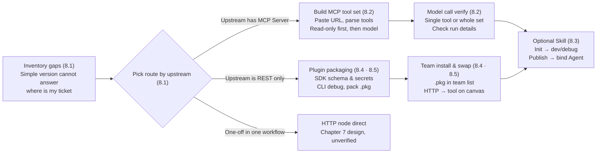
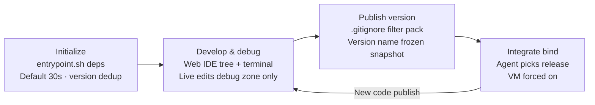
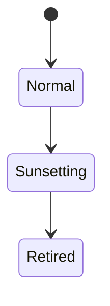
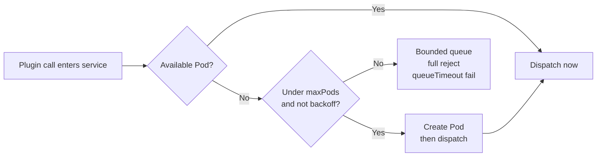

# Chapter 8 Tools and skills

> Chapter guide: Chapter 7 writes ticket lookup on the workflow canvas as an HTTP node—that is a designed connection, and the full chain is unverified (Chapter 7 review list). Even on that canvas, the config belongs to one canvas only; a second app that needs tickets must configure again. This chapter solves capability reuse: a three-way tool taxonomy and selection stance; MCP tool set URL onboarding; Skill’s four lifecycle stages; the plugin system and team install. The hands-on section writes the ticket API as a reusable-tool design for Chapter 7’s workflow to swap in; that packaging is also unverified. After this chapter you can: pick a tool shape for an external call; complete MCP onboarding and plugin packaging; develop and publish a Skill; explain what happens to existing workflows when a plugin is deleted.



*Chapter 8 flow overview*

## When you need it

Three typical situations map to three ways of using this chapter.

**The app answers well but cannot “act”**—the knowledge base covers “what does policy say,” not “query the business system” for ticket status. Read Section 8.1 for shape: upstream MCP → Section 8.2, REST only → Section 8.5 packaging, one-off stays on Chapter 7 HTTP node.

**The same API is needed a second time**—HTTP is per-canvas; Agents outside workflow also need tickets—Section 8.4 install plus Section 8.5 packaging converges config from “per canvas” to “per team.”

**The Agent must be re-taught every time**—fixed accounting steps, fixed report templates—prompts cannot hold it all. Section 8.3 Skill: develop once, versioned publish, bind and use.

Prerequisites: Chapter 7 already writes the HTTP ticket-lookup connection as a design (full chain unverified); plugin dev needs Node.js and pnpm; Skill needs sandbox ready (Chapter 2 deploy and Chapter 6 Section 6.5 VM; production Chapter 11).

## 8.1 Overview: three-way tool taxonomy

Chapter 1 defines Tool as external capability the model can call. In v4.17.3 docs the toolbox is fed by three supply lines—different delivery and reuse (official facts from pulled material, verified as of 2026-11-01):

| Shape | One-line | Source | Reuse | This chapter |
|------|-----------|--------|--------|---------|
| System tools | Official or community plugins for general capability | Marketplace or root uploads `.pkg` (system install, system-wide visible) | System-wide | 8.4 |
| Custom tools | Team-built plugins for business APIs | Same pipeline (CLI + SDK, `.pkg`), team or own deploy | This team (or system) | 8.4 · 8.5 |
| MCP tools | Remote MCP Server tools, URL batch import | New MCP tool set, paste URL, one-click parse | Apps and workflows that connect it | 8.2 |

Three-way taxonomy maps to workbench nav—screenshot from local FastGPT community v4.17.3 (2026-11-03 confirmed in testing, glm-5.3-flash + embedding-3):


System tools and My tools are two columns—system vs. team install; Skills and MCP are separate entries—“tools are not Skills, MCP is its own door” is clearest on the empty My tools page.

Two neighbors need clear boundaries. **Workflow HTTP node is not a tool asset**—one-off direct action on canvas (Chapter 7), config stays in the node, not team tool list; rule: will a second app use this call? **Skill is not a tool**—tool is an action interface (one request, run code); Skill is know-how (docs + logic as a package); Section 8.3 expands.

MCP has a “bidirectional” story: Section 8.2 is FastGPT as client consuming others’ MCP; “publish” is FastGPT app as MCP Server for platform Agents—Chapter 9 (→ MCP book Chapter 8).

**Our recommendation: wrap each external API once—one workflow one-off → HTTP (Chapter 7); second app → plugin (Section 8.5); upstream MCP ecosystem → MCP tool set (Section 8.2), maintenance on the provider.**

## 8.2 MCP tools: one URL, a batch of capabilities

MCP (Model Context Protocol, Chapter 1) standardizes how tools are exposed and discovered. For FastGPT, batch external capability without per-tool dev—from v4.9.6 “MCP tool set” app type (source text): paste remote MCP URL and batch-create MCP tools. Such apps are not end-user chat—they carry capability; this book groups them with plugins as reusable capability assets (our stance; Chapter 1 four shapes are user-facing carriers—no conflict).

### Create an MCP tool set

Source uses Amap MCP Server, four steps:

| Step | Action | Key points |
|------|------|------|
| 1 Get URL | From provider | Amap example: `https://mcp.amap.com/sse?key=xxx` (SSE) |
| 2 Create | “New MCP tool set” | Paste MCP URL in dialog |
| 3 Parse | Click “Parse” after URL | Lists tools exposed |
| 4 Create | Click “Create” | Tools and set created together |

### Auth: Bearer or custom header, pick one

For protected services, client supports Streamable HTTP. Source uses Baizhiyun browser:

| Item | Value |
|--------|---------|
| MCP URL | Provider MCP address |
| Header auth type | `Bearer` |
| Auth value | Raw API Key, no `Bearer ` prefix |

Three rules: Bearer auto-builds `Authorization: Bearer <API_KEY>`; custom header name `Authorization`, value full `Bearer <API_KEY>`—pick one, avoid double prefix; Key only in auth config, not URL, chat, or public workflow.

### Read-only verification before the model

Created ≠ production-ready; team norm from source: **read-only first**—tool set debug, run read-only query tools to check identity (example: credential check with empty input, inspect `isError` and `content`); success only proves that tool, not full task; **beware write tools**—lifecycle writes may burn Key permissions—do not share full set with untrusted apps/users; confirm task, price, permissions before create; **build your own confirmation**—examples lack auto step confirm; high-risk writes need prompt rules or IF/ELSE in app (Chapter 7).

### Test and model invocation

Per-tool debug in set (example: `maps_weather` for a city). Two granularities for the model:

| Granularity | Action | Model behavior |
|------|------|---------|
| Single tool | Check specific tools in app (example: weather + place search, separate questions) | Picks tool per question |
| Whole set | Add MCP tool set node, connect via tool-call node | Picks from set automatically |

### Boundaries and pitfalls

- Prerequisite: **upstream MCP Server**—our running example mid-platform is REST only, tickets go Section 8.5; if mid-platform adds MCP (→ MCP book), same capability via MCP set;
- SSE and Streamable HTTP both supported—match provider URL shape;
- Double Bearer prefix is common 401 cause;
- Many tools, few used → check singles; tools work as a set → whole set.

## 8.3 Skills: versioned professional know-how packages

### What is a Skill

Official definition: **persisted, reusable modular professional flow and capability package.** Three layers in the Agent ecosystem:

| Layer | Role | Source metaphor |
|----|------|-----------|
| Brain | Planning and reasoning—the LLM | —— |
| Tools | Pure action interfaces: one HTTP, one-off code | AI “hands and feet,” screwdriver in the box |
| Skills | Full know-how and professional logic | “Furniture assembly manual” |

One Skill = **instruction doc (how) + logic code (execute)** as a module: AI pulls the manual for the task and runs code in sandbox. Terminology: versioned “doc + code,” bind Agent, sandbox run, versioned publish—Chapter 1 map and book README aligned (2026-11-02, old “app template asset” retired).

FastGPT gives Skills a dedicated code space; four designs:

| Design | Content |
|------|------|
| Isolated sandbox | Each Skill edits in isolated sandbox (Sealos Devbox, OpenSandbox, etc.) |
| Live debug | File tree, editor, terminal; Agent debug panel left; hot reload |
| Prod vs. debug isolation | Edits only in debug zone; “Publish” applies to production Agents. Only Agents can bind a Skill, so publish does not attach the Skill to a workflow |
| Auto sleep & wake | Idle Skills cleaned and cold-archived; edit or call wakes backend; no billing while asleep |

Four lifecycle stages pipeline:



*Skill four lifecycle: dev and versions loop; production updates only on Publish*

### Initialize: entrypoint.sh and version dedup

Init script runs before AI task in VM after Skill deploy/unpack—install deps or preprocess. Five rules:

- **Location**: `entrypoint.sh` at package root;
- **Timing**: unpack to `./projects/<versionId>/` then run (VM order Chapter 6 Section 6.5);
- **Version dedup**: state in VM `~/.fastgpt/agent-skill-entrypoints/state.json`—published `versionId` immutable; if already ran on this VM instance, skip for fast hot start; new version redeploys and runs script;
- **Limits**: default 30s timeout, non-blocking, ~8KB log truncate—same as app start script (Chapter 6 Section 6.5 table);
- **Debug preview**: VM does not auto-run `entrypoint.sh` in edit mode—run manually in Workspace Terminal.

### Develop and debug: Web IDE trio

New Skill two paths: “New” card with name, icon, intro, **requirements**—keep default goal/flow/requirements template, built-in structure and sample (no model, no points); concrete request (example: “extract all emails from text”) → **AI-assisted generation**, default LLM writes `SKILL.md` and code (points). Import ZIP via “Import Skill.”

Detail page starts sandbox; file tree loads right. Trio:

| Part | Capability | Key points |
|------|------|------|
| File tree | Create, delete, rename, move | Live refresh on save, deps, background files |
| Code editor | Online edit, auto-save to sandbox | **Isolated changes**: debug only, not production |
| Terminal | Shell in sandbox | Install deps, custom tests; errors inline |

Left Agent debug panel: **live effect**—save, next message runs latest; **conversational workspace edits**—Agent edits files, tree syncs; **export**—ZIP current workspace.

### Version and publish: outside debug is versioned

Why publish: editor changes stay in the debug zone; to use the Skill on an Agent you must click “Publish” for a deployment version—debug and production stay isolated, so edits do not touch Agents already running. Only Agent apps can bind a Skill (next section); a published Skill is not for workflows. Three steps: Publish top-right; version name (default time, e.g. `v1.0.0`); confirm freezes release.

`.gitignore`: auto on publish (create default `node_modules`, `.venv`, `dist`, etc.); only non-ignored packed—**oversize pack may fail**. Rollback: Version history clock icon, hover “Switch,” workspace and prod **together**; ignored files not restored (reinstall deps).

### Integrate bind: Agent apps only

Binding (source boundary: **only Agent apps bind Skills directly; simple apps and workflow not yet**):

1. Open target Agent edit page;
2. Left panel “关联 Skill” / Link Skill;
3. Choose published release.

Three rules: binding **auto-enables VM**, cannot disable while linked; **multiple Skills** per Agent, all injected, independent; **auto invoke** needs capable model—no manual command; debug via “VM” on message bubble for sandbox state.

### Boundaries and pitfalls

- Skill needs sandbox (Chapter 2 empty addresses)—not a Skill config bug, check base;
- Auto invoke needs strong model;
- Deps in `entrypoint.sh`, not only debug terminal—new VM won’t have terminal-only installs;
- Sleep saves cost, adds latency—keep warm if latency-sensitive.

## 8.4 Plugin system: tools as team assets

### Why a plugin system

Capabilities lived in main service monorepo as subrepos. Old pain: plugins ship with main, slow iteration; community needs full app + PR; custom plugins need fork merge; Next.js/webpack not ideal for runtime mount. Split to FastGPT Plugin (`labring/fastgpt-plugin`), v1.0.0 systematic install, versions, isolation, ops. Chapter 2 note “system plugins not preinstalled from V4.14.0”—`fastgpt-plugin` image is runtime only, install tools yourself.

### Core concepts

| Name | Description |
|------|------|
| Plugin | Independent reusable module—tool, model preset, KB source, etc. |
| Package (`.pkg`) | Build artifact for install, update, distribute, version |
| Tool | Plugin type wrapping third-party, internal API, or local logic—for workflow and Agent |
| Tool suite | One plugin, multiple related sub-tools, shared meta and secrets |
| Marketplace | Official and community plugin catalog |
| Runtime | Backend running plugin code, default `local-pool` |
| Pod | One plugin child process in local pool; one service may have many |

“Tool set” dual meaning: MCP tool set (Section 8.2) is an app type; plugin tool-suite is one plugin, many sub-tools—read by context. Source repos: official `fastgpt-official-plugins`, community `fastgpt-community-plugins`, private `fastgpt-business-plugins`; `fastgpt-plugin` is dev, build, check, pack, serve.

### Two install tiers and plugin states

| Tier | Who installs | Visibility | Independence |
|------|--------|---------|--------|
| System | root uploads `.pkg` or marketplace | System-wide | Optional “system secrets” hosted by plugin service |
| Team | Team admin | This team only | No inherit same-ID system secrets, billing, status, version—configure separately |

Three states:



| State | Behavior |
|------|------|
| Normal | Normal use |
| Sunsetting | Existing workflows still run; cannot add to new workflows |
| Retired | Plugin unusable |

Source note: **team plugins support update and delete, no “sunsetting”**—three states are system plugin lifecycle.

### Team install and management

Four prerequisites: team admin or owner; admin enabled “team upload plugins”—off blocks marketplace, upload, confirm; marketplace needs network (SaaS only, **no private marketplace**, intranet → `.pkg` upload); local `.pkg` or `.zip` of `.pkg` files.

| Action | Entry and notes |
|------|-----------|
| Marketplace | Workbench Tools → Add plugin → Marketplace → search/filter → permissions → version install |
| Upload | Add plugin → Upload → `.pkg` or `.zip` → parse → confirm (failures per item, retry) |
| Update | Card update when new version → notes and permissions → version → **retest workflows and Agents** |
| Delete | Card or detail, confirm name |

**Delete semantics is the top pitfall**: removes team install, revokes future runs, drops from pickers—but **existing workflow/Agent nodes are not rewritten—they fail on next run**; restore by reinstall. Team delete does not affect same-ID system plugin or other teams. Same plugin system + team → two list rows (team first, system labeled “system”); workflows reference by source—avoid mixing plugins with the same display name. Upgrade discipline: I/O, secrets, behavior may change—**validate in test app before prod upgrade.**

### Runtime and concurrency: local-pool

Default `local-pool` per plugin service—one scheduling path:



*local-pool schedule: reuse, scale, then queue (per plugin docs)*

Per tool plugin four runtime params:

| Parameter | Default | Description |
|------|--------|------|
| Min workers | `0` | >0 prewarms Pods |
| Max workers | `5` | Scale cap when none free |
| Node timeout | `120000ms` | Per call timeout in Pod |
| Max concurrency per node | `10` | Concurrent requests per Pod |

Global `POOL_*` env vars (Pod total, queue, idle recycle, startup backoff—full list in plugin docs). Protections: startup fail streak → **circuit breaker**; startup timeout → busy, exponential backoff retry.

## 8.5 Hands-on ticket query tool: HTTP node to reusable tool

### Need and packaging motive

Chapter 7 HTTP on canvas to mid-platform `GET /api/after-sale/tickets` with `phone`. That is a designed connection, and the full chain is unverified: Chapter 7 records that the form-input and HTTP ticket branch were not added and debug did not finish. There is no pass record. A second consumer still appears in the design: an Agent assistant, and apps published in Chapter 9, would also look up tickets. HTTP is per canvas—timeout and errors per canvas. Plugin tool: one implementation per team—change once, everywhere; secret hosting; workflow and Agent share. This packaging is still a design; the Section 8.5 chain is unverified.

### Before coding

Per official guide. Paths from our running example; mid-platform auth not in source—this example uses `apiKey` + `baseUrl` in secrets—**follow real mid-platform**—case assumption, review checklist:

| Info | This example |
|------|---------|
| Plugin type | `tool` (`tool-suite` only if multiple related capabilities share auth) |
| Plugin ID | `after-sale-ticket-query` (stable global, immutable after publish) |
| Name & description | EN + zh-CN (`name`, `description`) |
| Input | `phone`: string, required |
| Output | `result`: ticket list text summary for model |
| Secrets | `apiKey`, `baseUrl` via `secretSchema` |
| External API | `GET /api/after-sale/tickets?phone={phone}`, timeout/rate/errors per mid-platform |
| Test cases | Success, bad params, auth fail, upstream fail |

### Skeleton and implementation

```bash
pnpx @fastgpt-plugin/cli create ticket-query --type tool --cwd packages/tools
```

CLI generates entry `index.ts` (`defineTool()`), `package.json` (`build`, `pack`, `test`), `tsconfig.json`, `vitest.config.ts`, `README.md`, `logo.svg`. Implementation per SDK for ticket query (**not verified hands-on**):

```ts
import {
  createToolHandler,
  defineTool,
  type InputSchemaMetaType,
  type OutputSchemaMetaType,
  type SecretSchemaMetaType
} from '@fastgpt-plugin/sdk-factory';
import z from 'zod';

const handler = createToolHandler({
  inputSchema: z.object({
    phone: z.string().min(1).meta({
      title: '手机号',
      description: '用户注册手机号，用于查询名下售后工单'
    } satisfies InputSchemaMetaType)
  }),
  outputSchema: z.object({
    result: z.string().meta({
      title: '查询结果',
      description: '工单列表文本摘要，供模型引用作答'
    } satisfies OutputSchemaMetaType)
  }),
  secretSchema: z.object({
    apiKey: z.string().min(1).meta({
      title: '中台 API Key',
      isSecret: true
    } satisfies SecretSchemaMetaType),
    baseUrl: z.string().min(1).meta({
      title: '中台地址'
    } satisfies SecretSchemaMetaType)
  }),
  handler: async (input, ctx) => {
    const { apiKey, baseUrl } = ctx.secrets;
    const url =
      `${baseUrl}/api/after-sale/tickets?phone=${encodeURIComponent(input.phone)}`;
    const resp = await fetch(url, {
      headers: { Authorization: `Bearer ${apiKey}` }
    });
    if (!resp.ok) {
      // Map external errors to locatable messages; do not leak secrets or full response
      throw new Error(`工单查询失败：HTTP ${resp.status}`);
    }
    const data = await resp.json();
    // Parse response per mid-platform contract; illustrative here
    return { result: JSON.stringify(data) };
  }
});

export default defineTool({
  manifest: {
    pluginId: 'after-sale-ticket-query',
    version: '1.0.0',
    name: { en: 'After-sale Ticket Query', 'zh-CN': '售后工单查询' },
    description: {
      en: 'Query after-sale tickets by phone number',
      'zh-CN': '按手机号查询名下售后工单'
    },
    versionDescription: { en: 'Initial version', 'zh-CN': '初始版本' },
    tags: ['tools']
  },
  handler
});
```

Six rules (source): stable `pluginId`, sub-tool `id`, I/O field names after publish; names/descriptions `{ en, 'zh-CN' }`; Zod schemas with meta types; `isSecret: true` on secrets—no real secrets in code, snapshots, logs, README; handler output matches `outputSchema`; external errors locatable, not raw dump.

### Debug, pack, install

```bash
cd packages/tools/ticket-query
pnpm install
pnpx @fastgpt-plugin/cli debug . --run \
  --input '{"phone":"13800000000"}' \
  --secrets '{"apiKey":"test","baseUrl":"https://mid.example.com"}'
```

Local debug limits: no prod pool, real network, server timeout/queue; uploads are virtual—**local pass ≠ prod**. Remote: System tools → Local debug link, `fastgpt-plugin dev` WSS—call from test app/workflow (visible only to debugger). Then:

```bash
pnpm run test
pnpm run build
pnpx @fastgpt-plugin/cli check --entry . --output ./dist
pnpm run pack
```

`.pkg` with `dist/index.js`, `dist/manifest.json`, icon, optional README/assets. Section 8.4 team upload path.

### Swap in workflow

Chapter 7 canvas: add “售后工单查询” / After-sale ticket query in tool picker, same phone variable—URL, auth, errors in plugin—**wiring unchanged, execution carrier swapped**. Agent side Chapter 6 Section 6.5 `@` bind tool. Chapter 1 capability map “tool call” closed loop.

| Dimension | HTTP node (Ch. 7) | Plugin tool (this section) |
|------|---------------------|-----------------|
| Config location | Per canvas | Develop once, install everywhere |
| Reuse | One workflow | All team workflows and Agents |
| Secrets | Per node | `secretSchema`, hosted, caller no plaintext |
| Upgrade | Canvas edit instant | Versioned; test app first |
| Fit | One-off single canvas | Cross-app business capability |

### Boundaries and pitfalls

- **Semver**: patch fix, minor compatible feature, **major if I/O fields, sub-tool ID, or config UX change**—new required field hits Chapter 7 workflow first;
- **Delete breaks runs**: delete team plugin → Ch. 7 workflow and bound Agents fail—check references (Section 8.4) first;
- Error hygiene: no full upstream body or secrets in thrown errors.

## Chapter summary

1. **Three-way taxonomy**: system tools (market + `.pkg`), custom tools (same line, team), MCP tools (URL); workflow HTTP is one-off, not asset—“second app?” is the test.
2. **MCP set four steps**: get URL, create, parse, create; Bearer vs custom header, no double prefix; read-only before prod, mind write permissions.
3. **Skill is doc + code in sandbox**: `entrypoint.sh` (dedup, 30s, non-blocking), Web IDE live debug, publish/rollback (`.gitignore`), Agent-only bind (VM forced).
4. **Plugins as assets**: system/team tiers, three states, `local-pool` Pods; delete does not rewrite nodes—next run fails—top pitfall.
5. **Ticket-query packaging is the Section 8.5 design**: from Chapter 7’s designed HTTP connection to a reusable plugin. Chapter 7’s full chain is unverified, and so is the Section 8.5 chain (review list).

Next: tools and Skills ready—the app ships. Chapter 9: "售后客服" ("After-sales Support") share link and DingTalk, plus publish as MCP Server—the other half of bidirectional tools (→ MCP book Ch. 8).

## Acceptance checklist

By now you should be able to:

- ☐ Three-way pick: weather (upstream MCP), tickets (REST), one-off callback (single canvas);
- ☐ MCP set: URL parse, single-tool debug, attach to app; single vs whole set;
- ☐ Skill lifecycle: new (template vs AI points), live code, publish `v1.0.0`, bind Agent, VM on;
- ☐ `entrypoint.sh` timing and `versionId` dedup—why hot start is seconds;
- ☐ Section 8.5 chain: CLI, three schemas, local debug, `.pkg`, team install;
- ☐ Ch. 7 workflow: HTTP → after-sale ticket tool, one real query;
- ☐ After team plugin delete: existing workflow behavior; standard before upgrade.

### Review checklist (before publish)

Already checked, and kept out of the unverified list:

- [x] Terminology aligned 2026-11-02 Ch. 1 README—Skill = versioned doc+code, sandbox, publish;

The following items are not yet verified hands-on; verify before publish:

- [ ] UI vs official v4.17.3 (tools, skill, plugin), verified 2026-11-01;
- [ ] MCP set: create, parse, debug, single vs set model calls; Bearer vs custom header double-prefix errors;
- [ ] Skill: new (template vs AI points), `entrypoint.sh`, publish/rollback, bind boundary (Agent only);
- [ ] Plugin three states UI; team no sunsetting;
- [ ] Section 8.5 full chain; mid-platform auth/response real contract;
- [ ] Tool node on canvas wiring (source: picker only);
- [ ] `local-pool` four params + `POOL_*` on self-host; Marketplace reachability;
- [ ] Chapter opener and three mermaid on GitHub render.

## Further reading

- **Chapter 7 (Workflow orchestration)**—HTTP node and canvas after tool swap.
- **Chapter 9 (Publishing apps and channels)**—publish as MCP Server (→ MCP book Ch. 8).
- **Chapter 6 (Apps and conversational Agent)**—Skill VM base: start script, limits, dedup.
- **Chapter 11 (Production operations)**—plugin runtime and sandbox prod config, observability.
- **(→ MCP book)**—after-sales tool layer opposite: mid-platform converging APIs; this chapter wraps one.