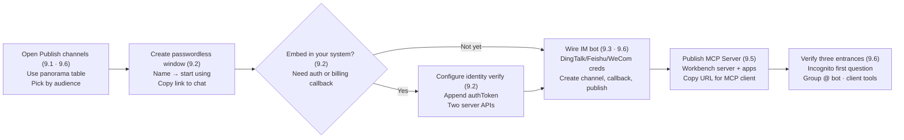
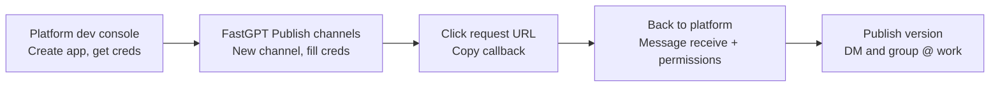

# Chapter 9 Publishing apps and channels

> Chapter guide: Chapter 7’s workflow "售后客服" ("After-sales Support") ran classify, retrieval, ticket lookup, and replies in debug preview—but the capability still sits behind a FastGPT team login. This chapter covers delivery to users: a panorama table for channel choice; passwordless share links (iframe embed and commercial identity verification); DingTalk/Feishu/WeCom bots’ shared onboarding pattern; official account and WeChat personal account; publishing as MCP Server for platform Agents (→ MCP book Chapter 8); hands-on share link for the support team and DingTalk inside the enterprise, closing Chapter 1’s DingTalk shape note. After this chapter you can: pick the right channel for three audience types, publish, and verify independently.



*Chapter 9 flow overview*

## When you need it

Three typical situations map to three ways of using this chapter.

**The app is tuned—let outsiders use it first**—Section 9.2. Passwordless window in three steps; community edition works; to embed with identity and billing callbacks read identity verification (commercial).

**Users live in DingTalk, Feishu, WeCom, or official accounts, not FastGPT**—read the shape table at Section 9.3: those IM channels are commercial; community readers need to upgrade; then follow the subsection—three channels share one pattern.

**Consumers are platform Agents or programs, not people**—Section 9.5 packs one or more apps as MCP Server (→ MCP book Chapter 8); finer dialogue control and streaming → OpenAPI (Chapter 10).

Prerequisites: Chapter 6 or 7 app passed three input tests (in-corpus, out-of-corpus, vague); IM channels need commercial or cloud; self-hosted MCP Server needs v4.9.6+.

## 9.1 Overview: publish channel panorama

One app, many exits. FastGPT publish splits two kinds: **human-facing channels on the app detail “Publish channels” tab**, one per app; **MCP Server on Workbench by app group**, one server many apps; OpenAPI is platform program API (Chapter 10). Panorama:

| Channel | Entry | What end users see | Shape prerequisite (official) | This book |
|------|---------|----------------|--------------------|---------|
| Passwordless window | App detail → Publish channels | A URL, open and chat | Community OK; some params commercial only | 9.2 |
| DingTalk bot | Publish channels | Enterprise DM, group @ | Commercial, from 4.8.16 | 9.3 |
| Feishu bot | Publish channels | DM, group @, topic groups | Commercial, from 4.8.10 | 9.3 |
| WeCom bot | Publish channels | Bot in WeCom directory | Commercial 4.12.4+; cloud 4.14.4+ custom domain | 9.3 |
| WeChat official account | Publish channels | Official account chat | Commercial 4.8.10+; verified accounts only | 9.4 |
| WeChat personal | Publish channels | “WeChat ClawBot” in friend list | Source not tagged; iOS latest WeChat only | 9.4 |
| MCP Server | Workbench → MCP server | Tools in MCP client | Self-host v4.9.6+ | 9.5 |
| OpenAPI | —— (Chapter 10) | Program API | Community OK (Ch. 1 table “share link and API”) | Chapter 10 |

The “shape prerequisite” column—UI confirmed in testing—screenshot from local community v4.17.3 (2026-11-03, glm-5.3-flash + embedding-3):


The community channel list matches the panorama table only on the channels this screenshot actually shows. Passwordless window and API access are untagged (community OK); Feishu, DingTalk, and the official account are marked commercial; the portal is commercial too; WeChat personal is untagged, matching the table’s “source not tagged” blank. The WeCom bot in the panorama table does not appear in this screenshot’s comparison.

Two reading tips. Community boundary aligns Chapter 1: share link and API in community list; third-party publish and publish security on commercial side; **DingTalk and WeCom not listed separately in Ch. 1 table—this chapter gives per-channel prerequisites**—DingTalk closes Ch. 1 carried item in Section 9.3. Channels without shape tags (WeChat personal) stay “source not tagged,” no inference.

**Our recommendation: users not on platform → passwordless first—three steps, community OK; IM where users gather—but align shape first; programs or platform Agents → MCP Server or OpenAPI.**

## 9.2 Passwordless share link and iframe embed

### Three steps to a link

Passwordless window (share channel name) creates a temporarily reachable URL anyone on the internet can use. Three steps:

1. App detail → Publish channels → Passwordless window, create link;
2. Fill name—for records only;
3. Click “Start using,” open link, copy for distribution.

After three steps, one row in the list. Share link created in testing:


Name is for records (“客服团队入口” (“Support team entry”) in the screenshot); distribution uses the address from Start using; “Last used” monitors leakage.

### Nine parameters

| Parameter | Role | Pre-publish checks (our recommendation) |
|------|------|------------------------------|
| Name | Record label for this link | Recognize channel purpose |
| Expiry | Link invalid after time | Set for external distribution |
| QPM | Max requests per user per minute | Rate limit abuse |
| Points cap | Max billing for this link | Fallback—costs bill to app’s team |
| Identity verification | Third-party auth and chat callbacks | Commercial; below |
| Live run status | Show current running node | On for internal debug, off external |
| View citation snippets | User sees answer citations | After-sales: on for traceability |
| View full citation | User sees full citation | Same |
| Download/open source | User can open source document | Per external exposure policy |

Official: “some parameters commercial only”; identity verification “commercial only” explicit; other limits not itemized in source—confirm in UI (Chapter 9 review checklist).

### Records and boundaries: localId

Each user gets a `localId` for identity and cloud history. Three boundaries for users: **history continues only on this device and browser**—new device or clear cache loses it; official allows ~30 days, 20 records; **link costs bill to the app’s team**—do not share casually; that is a cost guardrail.

### Identity verification: embed in existing systems (commercial)

Official one-liner: securely embed FastGPT chat in an existing system with two APIs (optional third for reporting). Commercial only. Three config steps:

1. Passwordless link “Identity verification” field: `POST` root URL only, not full paths;
2. Append `authToken` on share URL—usually your user credential;
3. Implement verification APIs on your server.

Link shape (source example):

```text
Original: https://share.fastgpt.io/chat/share?shareId=<shareId>
Full: https://share.fastgpt.io/chat/share?shareId=<shareId>&authToken=userid12345
```

FastGPT calls specific paths on that root—init (`/shareAuth/init`), before each turn (`/shareAuth/start`), optional end report (`/shareAuth/finish`). Init example:

```bash
curl --location --request POST '{{host}}/shareAuth/init' \
  --header 'Content-Type: application/json' \
  --data-raw '{
      "token": "[authToken]"
  }'
```

Unified response—return success and unique `uid`:

```jsonc
// Auth OK: system loads this uid’s history for this share link
{ "success": true, "data": { "uid": "user1" } }
// Auth fail: when success is not true, message is shown to user
{ "success": false, "message": "身份错误" }
```

`uid` constraints in protocol: no `|`, `/`, `\`; max 255 **bytes** or `Invalid UID`; used for load and save. `/shareAuth/start` adds `question`—content intercept; official practice rejects questions containing “你”. Optional `/shareAuth/finish` reports result, same as chat plus `token`; watch `totalPoints` and token totals.

Two uses: embed in your app with `authToken` prefilled; balance system—`/shareAuth/start` check balance, `/shareAuth/finish` deduct.

### iframe embed

Share URL is a normal web page—identity verification helps “embed share link in your app.” Minimal embed (standard HTML, book example, not verified hands-on):

```html
<iframe
  src="https://<你的域名>/chat/share?shareId=<shareId>&authToken=<token>"
  width="100%"
  height="640"
  frameborder="0">
</iframe>
```

### Boundaries and pitfalls

- Passwordless means outsiders can open—set expiry, QPM, points cap before external send;
- Identity verification commercial only—community embed relies on link access control alone;
- History follows `localId` not account—fine for internal support; do not promise cross-device history.

## 9.3 DingTalk, Feishu, and WeCom bot onboarding

### Shape prerequisites: align first

| Channel | From version | Shape | Credentials |
|------|---------|---------|-----------|
| DingTalk bot | 4.8.16+ | Commercial | Client ID + Client Secret |
| Feishu bot | 4.8.10+ | Commercial | App ID + App Secret (optional Encrypt Key) |
| WeCom bot | 4.12.4+ | Commercial; cloud 4.14.4+ custom domain | Token + Encoding-AESKey |

**Chapter 1 carried item closes here**: official DingTalk doc states from 4.8.16 commercial supports DingTalk bot directly without extra API—DingTalk is commercial, community cannot use. Ch. 1 table did not list DingTalk separately—channel doc is authoritative; UI/version re-check stays on review checklist.

### Shared pattern: five steps

Same skeleton across three channels—credentials and callback placement differ:



### DingTalk bot

1. DingTalk dev console (open-dev.dingtalk.com/fe/app) internal app, **Client ID** and **Client Secret**;
2. FastGPT app → Publish channels → new DingTalk bot, fill creds; “Request URL” → copy callback;
3. DingTalk dev console “Add app capability” → **Bot**;
4. Bot config: **HTTP** message mode, callback = FastGPT URL; debug then publish;
5. Version management: new version, save publish.

After publish: DM bot or group @. Reset chat: send `Reset` (case-sensitive).

### Feishu bot

1. Feishu open platform (open.feishu.cn/app) self-built app + bot—free test tenant recommended;
2. FastGPT new Feishu bot, **App ID** and **App Secret**;
3. (Optional) Events & callbacks encryption **Encrypt Key**—HTTPS may skip, HTTP recommended; ignore Verification Token (alternate secure validation);
4. Copy FastGPT request URL to Feishu “Events & callbacks → subscription”;
5. Add “Receive message” (`im.message.receive_v1`, v2.0), grant prompted permissions—do not enable legacy history permissions;
6. Permissions: send as app; read single and group chat messages;
7. Version management publish; find bot on workbench, add to group or DM.

Message permission boundaries:

| Permission | Effect |
|------|------|
| Read user DMs to bot | DMs enter FastGPT |
| Receive group @ bot events | Group @ enters FastGPT |
| Read all group messages | All group messages enter (not recommended) |

No response—official four steps: callback and permissions; FastGPT chat log; log exists but Feishu silent → bot send permission; no log → app error—try simplest app. Hard limit: **Feishu bot cannot send global variables, files, or images**. Reset: `Reset`; chatId differs for DM, topic thread, or group id + user id.

### WeCom bot

1. (Cloud required) custom domain—WeCom requires corp domain for push URL; commercial uses own domain;
2. WeCom admin (work.weixin.qq.com) super admin → Security & management → Smart bot—only creator/super admin sees entry;
3. “API mode,” generate or enter **Token** and **Encoding-AESKey**;
4. FastGPT “WeCom bot,” enter Token and AES key;
5. Pick custom domain, copy callback to WeCom bot config.

Then find bot in Contacts. Troubleshooting same pattern as Feishu: trusted domain, Token/AES, FastGPT logs, simplest app.

### Boundaries and pitfalls

- All three commercial—community readers stop here; Section 9.6 gives community alternatives;
- Callback must be reachable from platform—self-host domain/ports Ch. 2, prod Ch. 11;
- DingTalk and Feishu need **version publish** after config—“no response” check publish first.

## 9.4 Official account and WeChat personal

### WeChat official account

Prerequisite: 4.8.10+, commercial; **verified official accounts only** (service or subscription). Official test account works but no AES Key. Six steps:

1. FastGPT new WeChat official channel;
2. WeChat platform (mp.weixin.qq.com) **AppID, Secret, Token** into FastGPT;
3. IP whitelist includes FastGPT IP—self-host your IP; cloud doc lists per region;
4. Random AES Key in FastGPT, safe mode encryption;
5. FastGPT confirm, get URL, save on WeChat platform;
6. Enable server config if not auto.

User messages → FastGPT → reply via account; `Reset` clears chat.

### WeChat personal

Source does not tag version or shape—stated as-is. Flow: Publish channels → WeChat personal (form arbitrary) → confirm → “Scan login” → friend list adds “WeChat ClawBot” → chat. Boundaries: iOS latest WeChat only; `Reset` or `/reset` clears history.

**Our recommendation: source does not explain mechanism or stability—treat as trial channel, not production.**

## 9.5 Publish as MCP Server

### What MCP Server is

Model Context Protocol (MCP), Anthropic Nov 2024—unify AI and external systems. Client uses models; Server exposes systems. FastGPT MCP Server lets you pick **multiple** built apps and expose them via MCP; Streamable HTTP; self-host can add separate MCP service for SSE.

Mirror of Chapter 8: Ch. 8 FastGPT MCP client consumes external tools; this section FastGPT Server consumed externally (→ MCP book Ch. 8).

### Three steps to publish

1. Workbench → `MCP server`—list servers and app counts;
2. Name server, select apps (multiple OK);
3. “Start using” for URL and onboarding script.

URL like `https://<your-domain>/api/mcp/app/<MCP_KEY>/mcp`—key is credential; do not commit publicly or share widely.

### Call from MCP client

Official Cursor example (Cherry Studio etc.):

```json
{
  "mcpServers": {
    "fastgpt": {
      "url": "https://fastgpt.example.com/api/mcp/app/<MCP_KEY>/mcp"
    }
  }
}
```

1. Cursor MCP config, paste JSON;
2. MCP page, enable server;
3. Agent mode only—official stresses only Agent calls MCP;
4. Ask a question—tool like “query FastGPT knowledge base” means app ran.

### Identity proxy: execute as whom

Proxy lets one MCP client act for different team members: caller specifies member; FastGPT checks read permission on target app; chat and runs bill to that member. Without proxy header, tools run as MCP publisher.

Three prerequisites: only team owner enables proxy; proxied user in team with app read permission; protect URL key. Enable on create/edit MCP server, turn on “Identity proxy,” save.

Identity in MCP transport headers—not tool params; provide one of two, both must match same member:

| Header | Value | Notes |
|--------|-----|------|
| `x-fastgpt-auth-proxy-username` | Member login username | Recommended, often email |
| `x-fastgpt-auth-proxy-tmb-id` | FastGPT team member ID | When ID already stored |

Protocol note: SSE saves proxy on connect—reconnect after header change; Streamable HTTP reads headers per request. Tool list is metadata only; **each execution** re-checks member and app permission. Tools visible but forbidden—check five items: proxy enabled; username/ID correct; both headers same member; member still in team; member has app read.

### Self-hosted MCP Server

Self-host v4.9.6+, add service. In `docker-compose.yml`:

```yml
fastgpt-mcp-server:
  container_name: fastgpt-mcp-server
  image: ghcr.io/labring/fastgpt-mcp_server:latest
  ports:
    - 3005:3000
  networks:
    - fastgpt
  restart: always
  environment:
    - FASTGPT_ENDPOINT=http://fastgpt:3000
```

In FastGPT container set `SSE_MCP_SERVER_PROXY_ENDPOINT` to client-reachable `fastgpt-mcp-server` URL (e.g. `https://mcp.fastgpt.cn`), no trailing `/`; `docker-compose down` then `up -d`; Workbench shows MCP server. Base deploy Ch. 2; prod layering Ch. 11.

## 9.6 Hands-on After-sales Support: share link + DingTalk

Prerequisite: Ch. 7 workflow passed three input tests. Two channel shapes—share link community OK, DingTalk needs commercial or cloud; first real upgrade point from Ch. 1 “start on community.”

### Step 1: Passwordless window for support team (community)

Section 9.2 three steps; example values (case, not official defaults):

| Parameter | Example | Rationale |
|------|---------|------|
| Name | After-sales support–support team (case value) | The case name is for telling channels apart. The link name built on this machine is “客服团队入口” (“Support team entry”, Section 9.2); it is not the same name as the case value |
| Expiry | Quarterly policy review rhythm | Old links die with policy refresh |
| QPM | Tighten by team size | Anti-script abuse |
| Points cap | Safety ceiling | Team billed, stop when exceeded |
| Live run status | On | Align “which node ran” on tickets |
| View citation snippet/full | On | Trace to policy manual or product FAQ |

Verify: incognito first question; Ch. 6 three inputs; send link to support group with “history does not follow device/cache clear.”

### Step 2: DingTalk inside enterprise (commercial)

Section 9.3 five steps on DingTalk:

| Step | Where | Action |
|------|---------|------|
| 1 | DingTalk dev console | Internal app, Client ID and Secret |
| 2 | FastGPT Publish channels | New DingTalk bot, creds |
| 3 | FastGPT Publish channels | Request URL → copy callback |
| 4 | DingTalk dev console | Bot capability, HTTP mode, callback, debug publish |
| 5 | DingTalk version management | New version publish |

Verify: DM “运输破损怎么赔偿？” (“How is shipping damage compensated?”) with policy cites; group @ bot; `Reset` new session.

### Step 3 (optional): MCP Server for platform consumption

Workbench MCP server, link "售后客服" ("After-sales Support"), hand URL/script to platform Agent team (→ MCP book Ch. 8); unified gateway with identity proxy for per-member billing. Ops logs Ch. 11; programmatic OpenAPI Ch. 10.

### Boundaries and pitfalls

- Leaked link = strangers spend team points—three gates before external send;
- DingTalk needs version publish—“no response” check that;
- Images/files in groups may not reach IM bots (Feishu explicit; do not assume others)—multimodal → FastGPT client;
- Volume up → quality inspection Ch. 13.

## Chapter summary

1. **Channels by audience**: human channels per app on Publish channels tab; MCP Server per group on Workbench; programs OpenAPI—panorama is the map.
2. **Passwordless fastest in community**: three steps; expiry/QPM/points are cost gates; localId → device/browser only, 30 days 20 records; identity verify (commercial) init/start + optional finish embeds in existing apps.
3. **IM bots five-step pattern**: platform creds → FastGPT channel → callback copy → platform permissions → publish version; DingTalk 4.8.16+, Feishu 4.8.10+, WeCom 4.12.4+ (cloud 4.14.4+ domain)—all commercial.
4. **Official account verified only**, IP whitelist, safe mode; WeChat personal untagged, iOS only—trial channel.
5. **MCP Server = apps as tools**: multi-app, Streamable HTTP (self-host SSE service v4.9.6+), identity proxy (→ MCP book Ch. 8).
6. **Ch. 1 DingTalk item closed**: DingTalk bot commercial per channel doc; running example is share (community) + DingTalk (commercial).

Next: channels cover humans; Chapter 10 covers programs—OpenAPI API Key, chat API, streaming—the other half of platform consumption; MCP depth (→ MCP book Ch. 8).

## Acceptance checklist

By now you should be able to:

- ☐ Panorama pick for support team internal, DingTalk enterprise users, platform Agent—each shape prerequisite;
- ☐ Three-step passwordless + incognito first question; localId, 30 days, 20 records;
- ☐ Set expiry, QPM, points cap for external send and what each prevents;
- ☐ Draw IM five-step pattern; DingTalk/Feishu/WeCom creds and version floors;
- ☐ Publish MCP Server, one client tool call, what identity proxy changes for billing/execution identity;
- ☐ Explain DingTalk needs commercial; Ch. 1 close per channel doc;
- ☐ Feishu cannot send globals/files/images; multimodal alternative path.

### Review checklist (before publish)

Verified items checked with environment; rest before publish:

- [ ] UI vs official v4.17.3 publish docs seven articles, verified 2026-11-01;
- [x] Passwordless link created (2026-11-03 community v4.17.3)—Section 9.2 figure;
- [ ] Incognito first question, localId loss on browser change, 30d/20 cap;
- [ ] Nine params community/commercial per param—source only identity commercial explicit;
- [ ] Identity three APIs: authToken, init/start, finish/totalPoints, invalid uid;
- [ ] iframe embed book example (standard HTML), not verified hands-on;
- [ ] DingTalk five steps commercial: creds, channel, callback, HTTP mode, publish, @ and Reset;
- [ ] Feishu/WeCom/official account commercial flows; Encrypt Key optional; official IP whitelist; test account no AES;
- [ ] WeChat personal shape—source untagged; iOS limit source text;
- [ ] MCP Server: multi-app, Cursor Agent mode, proxy headers, SSE reconnect, self-host v4.9.6 service;
- [x] Commercial labels on channel list (2026-11-03 community)—Section 9.1 figure;
- [ ] Ch. 1 DingTalk version note second pass;
- [ ] Chapter opener and Section 9.3 mermaid GitHub render.

## Further reading

- **Chapter 8 (Tools and skills)**—MCP other direction: client consuming external MCP; Server here completes loop.
- **Chapter 10 (External integration: OpenAPI)**—programmatic half: API keys, chat API, streaming beyond channels.
- **Chapter 12 (Team collaboration and permission governance)**—identity proxy permissions base.
- **Chapter 13 (Conversation ops and evaluation)**—after channels open: logs, labels, quality patrol.
- **(→ MCP book Chapter 8)**—FastGPT app as MCP Server consumed by platform Agents in after-sales domain.