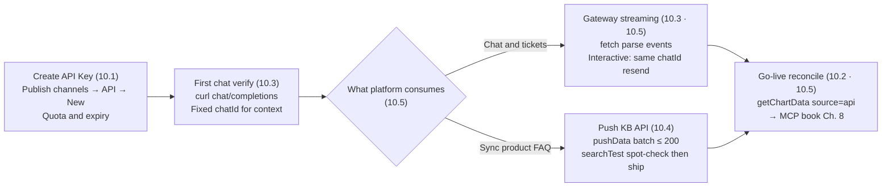
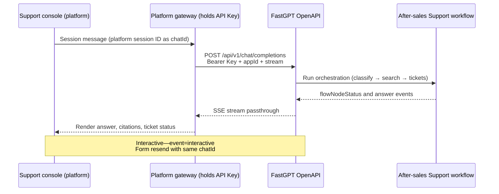

# Chapter 10 External integration: OpenAPI

> Chapter guide: Chapter 9 put "售后客服" ("After-sales Support") in human hands—support team on passwordless links, enterprise users on DingTalk bots; the last consumer type is programs. The platform’s own support console wants dialogue, streaming answers, and citation traceability on the same app; if the《商品 FAQ》("Product FAQ") corpus sources live in a self-built system instead of DingTalk sheets, content must be written into `after-sales-kb` programmatically. This chapter clarifies the API system and auth—two doc sets, member-scoped API Key boundaries; three API families: chat API (OpenAI-compatible format, streaming events, interactive nodes), app log API, knowledge base API (collections and data); finally a runnable platform consumption chain—curl and fetch. After this chapter you can: use one API Key for streaming contextual chat on "售后客服" ("After-sales Support") and handle one form interaction.



*Chapter 10 flow overview*

## When you need it

Three typical situations map to three ways of using this chapter.

**The platform must embed "售后客服" ("After-sales Support") in its own product**—support console, ticket system, mobile app reusing Chapter 7 workflow without FastGPT UI—Section 10.1 key, 10.3 chat, 10.5 full chain. Main line of this chapter.

**External content must land in the knowledge base programmatically**—Chapter 5 API knowledge base is “FastGPT pull”; when the source cannot expose a spec, your cron pushes in—Section 10.4 collection and data APIs are the “push” path.

**Billing, volume, errors**—after channels and API open, how much the platform called, how many failures, points spent—Section 10.2 log APIs split by `source`; single bad chat → Section 10.3 record API for node-level detail.

Prerequisites: Chapter 7 workflow "售后客服" ("After-sales Support") published (publish itself Chapter 9); your account has permission on target app and knowledge base—API Key is member credential, not per-app key (Section 10.1).

## 10.1 API system and authentication

### Two doc sets: Dev API and System OpenAPI

From v4.15.0, official API docs auto-generated via zod-openapi; legacy left-nav manual pages no longer updated—use generated docs. Two sets:

| Doc set | Scope | Callable with API Key | URL |
|------|---------|--------------------|------|
| Dev API | All in-development endpoints | Not always | `{endpoint}/apidoc/devapi` |
| System OpenAPI | All system-open endpoints | Yes | `{endpoint}/apidoc/systemopenapi` |

Cloud: `{endpoint}` = `https://cloud.fastgpt.cn` (mainland) or `https://cloud.fastgpt.io` (international); self-host = Chapter 2 deploy URL. This chapter’s endpoints from System OpenAPI material—confirm target is in that set before integration.

### Get API Key: two entries and member scope

Two places: Account → “API keys”; App → Publish channels → “API access.” Latter has “New” to create.

Key change (source): Publish channels API entry shows the logged-in member’s **API Key**—**team member credential for open API calls, no longer per-app dedicated keys.** Boundary: key equals “this account in this team”—any permitted resource (apps, knowledge bases) can be operated—**whoever gets the key gets your team identity.** Official tips: quota or expiry against abuse; copy again from API list.

Account entry UI in testing—local community v4.17.3 (2026-11-03, glm-5.3-flash + embedding-3):


API root is above the key list (self-host = Ch. 2 URL); besides alias and tags, “Identity proxy” toggle—proxy config at end of this section.

### Auth config and appId three-level priority

All OpenAPI via `Header.Authorization`, base two lines (source):

```bash
baseUrl: "http://localhost:3000/api"
headers: {
    Authorization: "Bearer {{apikey}}"
}
```

For `chat/completions`, pass `appId` in body; for OpenAI ecosystems, append to key: `Authorization: Bearer <apiKey>-<appId>`. Priority:

| Priority | appId source | Notes |
|--------|-----------|------|
| 1 | Body `body.appId` | Explicit, recommended |
| 2 | `<apiKey>-<appId>` in Authorization | Third-party apps with one secret string |
| 3 | appId bound to API Key | Legacy |

Three IDs from UI: appId in app detail browser URL; datasetId and collectionId on KB/collection detail pages (source screenshots).

Platform note: `authProxy` to act for team members—gateway represents different members—team owner enables on key create/edit; proxy identity still needs app/session access (from FastGPT v4.15.0). Same shape as Chapter 9 MCP Server identity proxy—“who executes and who is billed.”

### Boundaries and pitfalls

- SDK 404: some SDKs need `/v1` on BaseURL—source says retry with `v1`;
- Key is member-level, server config only—not front-end or Git (our recommendation);
- Dev API endpoints may not accept API Key—confirm in System OpenAPI first.

## 10.2 App management API: two log endpoints

Prerequisites: API Key and appId (global key OK). Two app log APIs (source):

| API | Method & path | Input | Output |
|------|-----------|------|------|
| App aggregate stats | GET `/api/proApi/core/app/logs/getTotalData` | `appId` | totalUsers, totalChats, totalPoints |
| App chart data | POST `/api/proApi/core/app/logs/getChartData` | `appId`; `dateStart`/`dateEnd`; `source` array; `offset`; `userTimespan`/`chatTimespan`/`appTimespan` | userData; chatData; appData |

Timespans day|week|month|quarter; `source` ten values: test, online, share, api, cronJob, team, feishu, official_account, wecom, mcp—Ch. 9 share and IM channels, this chapter OpenAPI, MCP Server meet here for split reconciliation.

Boundary: `/proApi/` prefix—source does not tag community/commercial—no conclusion here, verify on your deploy (review checklist).

## 10.3 Chat API: one endpoint, four response shapes

### Request parameters: five extensions

`POST /api/v1/chat/completions` is the OpenAPI centerpiece. Request matches OpenAI chat (`messages`, source); FastGPT adds five parameters—native and extended:

| Parameter | Description |
|------|------|
| `appId` | App ID, recommended in body (priority Section 10.1) |
| `chatId` | Session ID. Omit: no platform context, full `messages` history; non-empty: use session history, only last message in `messages` is the user turn, rest ignored. You ensure uniqueness, length < 250, often your UI session ID |
| `messages` | OpenAI chat format |
| `responseChatItemId` | Optional response message ID stored by platform; unique per `chatId` |
| `detail` | Return intermediates (node status, full results); in stream via events, in non-stream in `responseData` |
| `variables` | Module variable object replacing `[key]` in orchestration inputs |

### Four quadrants: detail × stream

| Combo | Response | Typical use |
|------|---------|---------|
| detail=false, stream=false | OpenAI JSON: `choices[0].message.content` + `usage` | Backend one-shot answer |
| detail=false, stream=true | SSE text: `data` lines `choices[0].delta.content` | Typing UI |
| detail=true, stream=false | Above + `responseData`: per-node model, tokens, `quoteList`, `completeMessages` | Server QA and trace |
| detail=true, stream=true | Event stream: status, answer, detail separated | Live progress, citations, telemetry |

curl base request (structure from source, content from running example):

```bash
curl --location --request POST 'http://localhost:3000/api/v1/chat/completions' \
  --header 'Authorization: Bearer fastgpt-xxxxxx' \
  --header 'Content-Type: application/json' \
  --data-raw '{
    "appId": "your_app_id",
    "chatId": "support-20261102-0001",
    "stream": false,
    "detail": false,
    "variables": { "uid": "u_10086" },
    "messages": [
      { "role": "user", "content": "运输破损怎么赔偿？" }
    ]
  }'
```

`choices[0].message.content` is user-facing answer; `usage` has prompt_tokens, completion_tokens, total_tokens.

### Streaming events: full event set

With stream=true, Server-Sent Events (SSE) text stream; each event has `event` and `data` lines; `[DONE]` ends; with detail=true, `event` separates progress, body, detail. Full set per source:

| event | Meaning |
|-------|------|
| answer | Text to client (counts as answer) |
| fastAnswer | Designated reply node text (counts as answer) |
| flowNodeStatus | Current node status |
| flowResponses | Full node response incl. citations |
| chatTitle | Title from user turn |
| toolCall / toolParams / toolResponse | Tool three-phase: call, params, return |
| updateVariables | Variable update |
| interactive | Interactive node config (below) |
| error | Error |

Example order (detail=true, stream=true): flowNodeStatus (KB search) → flowNodeStatus (AI chat) → answer chunks → `[DONE]` → flowResponses. For Ch. 7 workflow "售后客服" ("After-sales Support"), platform can show “searching knowledge base… querying ticket…”; `toolResponse` is HTTP ticket data; citations (Ch. 13 chunk reader) in `flowResponses` after answer completes.

### Three OpenAI compatibility boundaries

- `model`, `temperature`, etc. **invalid**—orchestration decides, not API; change prompt/model on canvas (Ch. 7);
- Response **does not return actual token usage**; use detail=true and sum node tokens in `responseData`;
- “OpenAI compatible” means structure—SDK 404 add `/v1` (Section 10.1).

**Our recommendation: treat `chat/completions` as “trigger orchestration once,” not “call one model”—sampling params familiar from the OpenAI SDK are all ineffective here; behavior tuning is on the app canvas, not the caller.**

### Interactive nodes: pause and resume

Chapter 7 phone form is an interactive node. Workflow stops at interactive when detail=true: stream=true read `event=interactive` → `data.interactive`; stream=false from `choices[].message.content` elements with `interactive`. Caller gets display config with `type` and `params` only—userSelect (options) or userInput (`inputForm`); nested children/loop/tool wrappers return innermost user-facing node.

Resume same endpoint, two rules: userSelect → selected value as `messages`; form input → serialize “form key → user value” object string as `messages`. **`chatId` must match the paused call**—platform resumes workflow state.

### Sessions and chat records: CRUD cheat sheet

Three IDs (source “important fields”): appId → app; chatId → session under app; dataId → one chat record under session.

| API | Method & path | Purpose & notes |
|------|-----------|-----------|
| List sessions | POST `/api/core/chat/history/getHistories` | appId, offset, pageSize; `source` api = API-created only, not mixed with UI |
| Rename or pin | PUT `/api/core/chat/history/updateHistory` | customTitle or top |
| Delete one session | DELETE `/api/core/chat/history/delHistory` | query chatId + appId |
| Clear app sessions | DELETE `/api/core/chat/history/clearHistories` | **Only API Key sessions**, not online/share/etc. |
| List chat records | POST `/api/core/chat/record/getPaginationRecords` | Per session; loadCustomFeedbacks |
| Single run detail | GET `/api/core/chat/record/getResData` | dataId → node-level detail |
| Delete record | DELETE `/api/core/chat/record/delete` | contentId, chatId, appId |
| Like/dislike | POST `/api/core/chat/feedback/updateUserFeedback` | userGoodFeedback or userBadFeedback; omit to cancel |
| Question guide | POST `/api/core/ai/agent/v2/createQuestionGuide` | 4.8.16+; appId + chatId, last 6 turns |

`clearHistories` scope: platform “logout deletes data” only hits API sessions—share-link user chats excluded (Ch. 9 localId).

### Plugin app call differences

Plugin-type apps, same endpoint, four extra rules (source): default detail mode; no chatId—single round; no messages—`variables` are plugin input; output from `responseData` element `moduleType=pluginOutput` field `pluginOutput`, or stream `event=flowResponses` after deserialize. Running example workflow app not affected—listed for reference.

### Boundaries and pitfalls

- detail=false → no citations or node detail—platform trace needs detail=true;
- Interactive without detail=true → no interactive event; resume without same chatId → new session;
- chatId > 250 or duplicate responseChatItemId are explicit constraints—define at session creation.

## 10.4 Knowledge base API: collections and data management

### Three-layer overview

Chapter 3 layers map to API: Knowledge Base → Collection → Data (Chunk), plus searchTest from Chapter 4 tuning:

| Layer | Operations | Path prefix |
|----|------|---------|
| Knowledge base | create, list, detail, delete | `/api/core/dataset` |
| Collection | create (six kinds), listV2, detail, update, delete | `/api/core/dataset/collection` |
| Data | pushData, list (v2), detail, update, delete | `/api/core/dataset/data` |
| Search test | searchTest | `/api/core/dataset/searchTest` |

### Collection create: six entry types and shared params

| Method | Endpoint (POST) | Input | Notes |
|---------|-----------------|------|------|
| Empty collection or folder | `…/collection/create` | name; type folder or virtual | Virtual for manual data |
| Plain text | `…/collection/create/text` | text | Split incoming text |
| Web link | `…/collection/create/link` | link; optional metadata.webPageSelector | Fetch then split |
| Local file | `…/collection/create/localFile` | form-data file + data JSON | pdf, docx, md, txt, html, csv; encode Chinese filenames |
| API file | `…/collection/create/apiCollection` | apiFileId | From API file library |
| External file | `…/collection/create/externalFileUrl` | externalFileUrl etc. | Commercial |

Shared create params (excerpt, full table in source):

| Parameter | Description |
|------|------|
| `datasetId` | Knowledge base ID, required |
| `trainingType` | chunk or qa, required |
| `chunkSettingMode` | auto system default; custom manual |
| `chunkSize` | Default 1500 (ignored in auto) |
| `indexSize` | Default 512, must be < index model max tokens |
| `chunkSplitter` | Custom split delimiter, highest priority |
| `qaPrompt` | QA split prompt |
| `tags` | Collection tags (commercial): structured array, legacy string array (Ch. 5) |
| `customPdfParse` | Enhanced PDF parse, default false |

Response: collectionId and insertLen (chunks queued)—split/train async in queue; insertLen is enqueue count. chunk/index semantics Ch. 3–4; API exposes same knobs.

### Data push and incremental update

POST `/api/core/dataset/data/pushData`, three hard rules: max 200 rows per call; billing auto-created, no billId; each row q required, a optional, indexes optional—default index from q+a.

Key fields (excerpt):

| Field | Description |
|------|------|
| q / a | Primary / auxiliary, q required |
| indexes | Vector index array, max 5 custom per row |
| indexes[].type | default, custom, summary, question, image; default custom |
| indexes[].dataId | Linked vector ID—on update **incremental**, not full rebuild |
| indexes[].text | Index text, required |

```bash
curl --location --request POST 'http://localhost:3000/api/core/dataset/data/pushData' \
  --header 'Authorization: Bearer fastgpt-xxxxxx' \
  --header 'Content-Type: application/json' \
  --data-raw '{
    "collectionId": "your_collection_id",
    "trainingType": "chunk",
    "data": [
      { "q": "问题主体文本", "a": "答案补充文本（可省略）" },
      { "q": "第二条数据", "indexes": [ { "text": "自定义索引文本" } ] }
    ]
  }'
```

Maintain: list (offset, pageSize max 30, collectionId, searchText), detail, update (dataId + new q, a, indexes; dataId on index item = incremental, without = new), delete by data ID. Ch. 4 retrieval uses indexes not raw text—whether update auto-rebuilds indexes with q, source silent—verify hands-on (review checklist).

### searchTest: Chapter 4 in code

POST `/api/core/dataset/searchTest` = UI “search test” API equivalent:

| Parameter | Description |
|------|------|
| datasetId & text | KB and query text |
| limit | Max tokens, cap 20000 |
| similarity | Min relevance 0~1, optional |
| searchMode | embedding, fullTextRecall, mixedRecall (Ch. 4) |
| usingReRank | Use rerank |
| datasetSearchUsingExtensionQuery trio | Query optimization switches, model, background |

Response: top-k with q, a, datasetId, collectionId, sourceName, sourceId, score. **Our recommendation: tune in UI (Ch. 4), regress in code—copy tuned params into searchTest, assert target chunk in top-k after each KB change—raw material for Ch. 13 evaluation.**

### Boundaries and pitfalls

- Collection params interact: chunkSettingMode=auto → chunkSize, indexSize, chunkSplitter, qaPrompt ignored—per source, don’t tune in vain;
- pushData 200 cap hard—《商品 FAQ》~200 rows fits one batch; two batches safer;
- Delete APIs (KB, collectionIds, single data) no second confirm in source—add “disable then delete” in your jobs;
- tags structured array and listV2 tagFilters commercial—community uses legacy string array (Ch. 5).

## 10.5 Hands-on: platform consumption chain for After-sales Support

### Overview: gateway holds Key

Platform consumption roles and flow:



One line: **API Key only on platform gateway**, workbench front-end never holds it—Section 10.1 member boundary in topology. Workflow HTTP calls mid-platform `GET /api/after-sale/tickets?phone={phone}` (Ch. 7); platform sees return via `toolResponse`.

### Chat calls: curl and fetch

curl is Section 10.3 base; gateway fetch (Node.js, book example—no JS in source, standard SSE parse, not verified hands-on):

```js
// Platform gateway — POST /api/v1/chat/completions (Node 18+)
const res = await fetch("http://localhost:3000/api/v1/chat/completions", {
  method: "POST",
  headers: {
    Authorization: `Bearer ${process.env.FASTGPT_API_KEY}`,
    "Content-Type": "application/json"
  },
  body: JSON.stringify({
    appId: process.env.FASTGPT_APP_ID,      // After-sales Support app
    chatId: platformSessionId,              // Reuse platform session ID
    stream: true,
    detail: true,
    variables: { uid: platformUserId },
    messages: [{ role: "user", content: userText }]
  })
});

const reader = res.body.getReader(), decoder = new TextDecoder();
let buffer = "";
for (;;) {
  const { done, value } = await reader.read();
  if (done) break;
  buffer += decoder.decode(value, { stream: true });
  const lines = buffer.split("\n");
  buffer = lines.pop();
  for (const line of lines) {
    if (!line.startsWith("data:")) continue;   // dispatch event lines separately
    const payload = line.slice(5).trim();
    if (payload === "[DONE]") continue;
    const text = JSON.parse(payload).choices?.[0]?.delta?.content;
    if (text) pushToWorkbench(platformSessionId, text);   // stream to UI
  }
}
```

Three implementation notes. Line buffer—TCP may split `event`/`data`; partial lines carry over; dispatch `event` lines for flowNodeStatus, interactive form UI, flowResponses citations; on interactive pause stream, user submits, **same chatId** resend—serialize form string (example: Ch. 7 form key `phone`):

```bash
curl --location --request POST 'http://localhost:3000/api/v1/chat/completions' \
  --header 'Authorization: Bearer fastgpt-xxxxxx' \
  --header 'Content-Type: application/json' \
  --data-raw '{
    "appId": "your_app_id",
    "chatId": "support-20261102-0001",
    "stream": true,
    "detail": true,
    "messages": [
      { "role": "user", "content": "{\"phone\":\"13800000000\"}" }
    ]
  }'
```

### Weekly push for Product FAQ

Chapter 5 alternate path: API KB is “pull,” this section is “platform push”—when FAQ source is self-built without a spec API. Weekly cron three steps:

| Step | Action | Basis |
|------|------|------|
| 1 Fetch | Pull this week’s FAQ (~200 rows) from product system | Running example convention |
| 2 Write | Changed rows PUT data/update with dataId incremental; new pushData (batch ≤ 200); retired DELETE data/delete | 10.4 |
| 3 Ship | searchTest three representative queries, confirm recall | 10.4 & Ch. 4 |

Example pipeline is book design (source gives endpoints only, not orchestration), not verified hands-on, review checklist; when FAQ lives in DingTalk AI sheet, Ch. 5 third-party sync still preferred—push is fallback.

### Post go-live reconciliation

- Volume and errors: getChartData `source: ["api"]`, chatCount, errorCount, points (10.2);
- Drill-down: bad session → getResData by chatId/dataId to node (10.3);
- Heavier observability—SignOz and call logs—Chapter 11 (→ langfuse book).

### OpenAPI vs MCP Server

| Route | Interaction | Fit |
|------|---------|------|
| OpenAPI (this chapter) | Chat-as-a-service: platform owns session, UI, UX | Embed in own console, multi-turn, streaming UI |
| MCP Server (Ch. 9) | App-as-tool: platform Agent calls by tool protocol | Agent treats "售后客服" ("After-sales Support") as one tool in a larger plan |

Same app both ways: console OpenAPI for dialogue UX, platform Agent MCP for tool use—consumer full chain (→ MCP book Ch. 8) meets in after-sales domain.

### Boundaries and pitfalls

- `variables` uid etc. are business vars, not auth—auth is Bearer Key and (if on) authProxy;
- Source example: flowResponses may arrive after `data: [DONE]`—do not close parser on `[DONE]` alone, use connection end;
- Interactive form keys from `inputForm` in interactive payload, not hard-coded—orchestration key change breaks client;
- Clear/delete APIs scope API-origin only—do not use to wipe share-link user chats.

## Chapter summary

1. **API Key is member credential, not app secret**: two entries; quota/expiry abuse gates; appId three priorities; SDK 404 add `/v1`.
2. **chat/completions four shapes**: detail×stream for one-shot, typing, QA trace, live progress; chatId drives platform vs self-managed history.
3. **OpenAI compatibility three boundaries**: model/temperature ineffective, tokens not returned, structure not params—tune on canvas.
4. **Stream protocol**: answer/flowNodeStatus body and progress, toolResponse tickets, interactive pause–render–same chatId loop.
5. **KB API three-layer CRUD + searchTest**: six collection entry types, shared chunk params; pushData 200 cap, dataId incremental; searchTest carries Ch. 4 params into code regression.
6. **Platform chain**: gateway holds key, fetch line-buffer SSE, weekly FAQ three steps; reconcile source=api; OpenAPI vs MCP “chat vs tool” (→ MCP book Ch. 8).

Next: programmatic consumption works and traffic and billing grow—Chapter 11 covers production config, object storage, sandbox, SignOz observability, and upgrade migration; dialogue quality labeling and patrol in Chapter 13.

## Acceptance checklist

By now you should be able to:

- ☐ New API Key on publish channels with quota/expiry, curl first question on "售后客服" ("After-sales Support");
- ☐ State appId three priorities and `<apiKey>-<appId>` in OpenAI-style client;
- ☐ Fixed chatId two turns then new chatId isolation;
- ☐ detail=true stream=true, count events flowNodeStatus, answer, flowResponses order;
- ☐ Handle interactive: read inputForm from event=interactive, serialize form, same chatId, final answer;
- ☐ pushData two rows one with custom index, confirm in UI list;
- ☐ getChartData source=api for last day volume, errors, points.

### Review checklist (before publish)

None verified hands-on; verify before publish:

- [ ] Endpoints vs official v4.17.3 (openapi intro/app/chat/dataset, publish/openapi), verified 2026-11-01;
- [ ] Chat API four quadrants, event set per actual returns (source: version variance); fetch example book-only, line buffer and [DONE];
- [ ] Interactive: type/params, same chatId resume, deepest interactive rule;
- [ ] pushData 200 cap, insertLen, dataId incremental, data/update index rebuild default (source silent), full FAQ push (book design incl. delete retired);
- [ ] Collection tags structured + listV2 tagFilters commercial; community behavior;
- [ ] App log `/proApi/` availability and shape—source untagged, no conclusion;
- [ ] searchTest limit 20000 tokens, three searchModes vs Ch. 4 UI;
- [ ] Chapter opener and Section 10.5 sequence diagram GitHub render.

## Further reading

- **(→ MCP book Chapter 8)**—Platform Agent MCP consumption meets OpenAPI chat-as-a-service in after-sales domain; division Table 10.5.
- **Chapter 9 (Publishing apps and channels)**—MCP Server publish side; share link localId explains clear API scope.
- **Chapter 4 (Retrieval plans and tuning)**—searchTest searchModes and rerank; tune UI first, code regression second.
- **Chapter 5 (Advanced knowledge bases)**—API KB pull vs pushData push; collection tags commercial in Ch. 5.