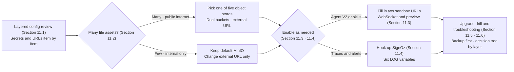
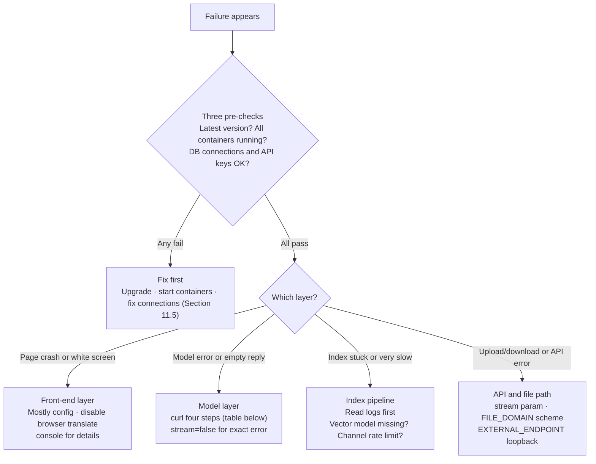

# Chapter 11 Production operations

> Chapter guide: In Chapter 2, when we stood up the foundation for "After-sales Support" ("售后客服"), a few settings were deliberately left blank—the sandbox WebSocket and preview URLs, observability variables were named only in passing, and upgrade and migration were deferred with a pointer to Chapter 11. Now we deliver on that. This chapter opens with a layered map of production configuration, then secret governance and real client IP validation behind a reverse proxy; next, object storage, the sandbox, and observability as needed, followed by upgrade, migration, and a troubleshooting decision tree. After this chapter, you can: turn a deployment that merely runs into one you dare put in production, fill in the two sandbox settings left blank in Chapter 2, and layer failures on the next incident instead of restarting and hoping.



*Operations flow for this chapter*

## When you need it

Three typical situations, and three ways to use this chapter.

**The deployment is moving from test to production, and you need production rules for "After-sales Support" ("售后客服")**—Follow Sections 11.1 through 11.4 in order: layered config review, secret checks, reverse-proxy real IP validation, then enable storage, sandbox, and observability as needed. Layers you do not need stay blank—that discipline is part of the job.

**Support is on Agent V2 VMs or skills (Chapters 6 and 8), but the UI says the sandbox is unavailable**—Go straight to Section 11.3: fill in the two URLs left blank in Chapter 2, open port 3006, and the feature unlocks; Section 11.3 also has a quick table for seven sandbox error classes.

**You need to upgrade, move servers, or production is already failing**—Section 11.5 gives a four-step upgrade and three migration routes; Section 11.6 is the troubleshooting entry—use the decision tree to pick a layer, then the layer’s quick table. Chapter 2 Section 2.6’s tree is for “just deployed and won’t run”; this section’s tree is for “was running and broke.”

Prerequisites: Chapter 2 deployment done and first-question check passed; commands in this chapter run from the deploy directory (where `docker-compose.yml` lives); external facts follow v4.17.3 official docs (verified 2026-11-01).

## 11.1 Production configuration map: layers, secrets, and real IP

### Configuration layers: one mandatory, five on demand

Chapter 2 set the rule: the community edition’s only config entry is `environment` on `fastgpt-app` in `docker-compose.yml` (from 4.15.0, `config.json` is retired); after changes, `docker compose up -d` rebuilds containers. Production differs not in where you configure, but what and when. Chapter 2 only covers the mandatory layer; the rest are on demand:

| Layer | Representative variables | When to configure | Where expanded |
|----|-----------|---------|---------|
| Mandatory base | `FE_DOMAIN`, two AI Proxy items, three secret types, DB connections | Once at deploy | Chapter 2 |
| Storage | `STORAGE_*` group | File assets must leave the LAN or use cloud storage | Section 11.2 |
| Sandbox | `AGENT_SANDBOX_*` group | VMs, skills, or workflow assisted generation | Section 11.3 |
| Observability | `LOG_*` group | Monitoring, traces, and logs | Section 11.4 |
| Security | `TRUSTED_PROXY_*`, `AUTH_COOKIE_SECURE`, `ALLOWED_ORIGINS` | Reverse proxy or public service | This section |
| Commercial | Admin variables, plugin remote-debug `CONNECTION_GATEWAY_*` | Commercial edition only | Chapter 1 comparison table |

Chapter 2’s note that the code sandbox and Volume Manager each have their own variable groups, configured only when the feature is on, is the sandbox layer; Chapters 6, 8, and 9’s “production config in Chapter 11” maps to the on-demand rows in this table. **Our recommendation for on-demand layers: configure a layer only when you enable that feature; leave unused layers blank so troubleshooting has fewer suspects.**

### Secret governance: three jobs

Production secret governance boils down to three items, all with official backing:

1. **Length and source**—Official guidance for production secrets is at least 32 characters; do not use sample, default, or weak values (per v4.17.3 remote-debug suite docs). On this section’s existing wording, that length requirement points only at Section 11.3’s proxy secret `AGENT_SANDBOX_PROXY_SECRET`. Do not read it as a second sandbox secret later in this section that you must also set. When reviewing Chapter 2 Section 2.3 secret minimums, apply the same spirit strictly;
2. **No scattered copies**—Connection keys, tokens, and credentials are sensitive; do not put them in logs, screenshots, or public docs. Chapter 2’s conclusion (`docker-compose.yml` is the credential store) upgrades here to discipline: treat file access like key management;
3. **Know the cost of re-running**—Re-running the one-click script in an already deployed directory regenerates DB passwords and `AES256_SECRET_KEY` and overwrites `docker-compose.yml`. To keep data, back up the original file, disable auto-generated passwords (or set `FASTGPT_AUTO_GENERATE_CREDENTIALS=false`), then copy passwords and keys back (per v4.17.3 general troubleshooting docs). Debug connection keys (connectionKey) return in plain text only when opening or refreshing a debug channel; refresh or close the channel immediately after leakage.

### Reverse proxy and client IP: three anti-spoofing pieces

IP rate limits, share-link IP allowlists, chat log IP fields, and IP region display all read client IP. If Nginx, a load balancer, Ingress, or a CDN sits in front of FastGPT, clients can forge `X-Forwarded-For` and `X-Real-IP` forwarding headers. Official guidance is to do all three:

| Action | Practice |
|------|------|
| Proxy overwrites IP headers | The last reverse proxy does not pass through the user’s original `X-Forwarded-For`; overwrite with the real connection source |
| Enable trusted-proxy validation | FastGPT trusts forwarding headers only from the proxy, load balancer, or Ingress—not from direct connections |
| Restrict port exposure | Firewall or security groups allow only the reverse proxy to reach FastGPT service ports, so Nginx cannot be bypassed |

Two FastGPT variables:

```dotenv
TRUSTED_PROXY_ENABLE=true
TRUSTED_PROXY_IPS=172.18.0.0/16
```

`TRUSTED_PROXY_IPS` is the previous hop FastGPT sees directly—e.g. the Docker network of the Nginx container, Ingress controller internal addresses, or load-balancer back-end addresses; do not use `0.0.0.0/0`, and do not put ordinary client networks on the trust list. For a single Nginx tier facing the public, the important lines in the official sample are:

```nginx
location / {
    proxy_pass http://fastgpt:3000;
    proxy_set_header X-Real-IP $remote_addr;
    proxy_set_header X-Forwarded-For $remote_addr;
}
```

Note `X-Forwarded-For` is explicitly set to `$remote_addr`—that is “do not pass the user’s original header.” When CDN or load balancer sits in front of Nginx, use `set_real_ip_from` to trust only those upstream egress ranges, then forward the restored real IP; when the CDN uses a dedicated header (e.g. `CF-Connecting-IP`), set `real_ip_header` accordingly. After changes, `nginx -t && nginx -s reload`, and verify with forged headers:

```bash
curl -H 'X-Forwarded-For: 6.6.6.6' -H 'X-Real-IP: 6.6.6.6' https://fastgpt.example.com
```

When configured correctly, FastGPT should still record and validate the real client IP, not `6.6.6.6`.

### Boundaries and pitfalls

- The anchor for `TRUSTED_PROXY_IPS` is “the hop FastGPT sees directly,” not any random proxy in the chain; direct access without a reverse proxy needs no IP header setup, but “restrict port exposure” still applies;
- After any environment variable change, `docker compose up -d` must rebuild containers—Chapter 2’s top pitfall is still the top pitfall in production.

## 11.2 Object storage: dual buckets, short links, five vendors

### Three universal rules first

Object storage holds files and images—the port-9000 role in Chapter 2’s component table. Official support covers five backends: MinIO (default), AWS S3, Alibaba Cloud OSS, Tencent Cloud COS, and Cloudflare R2; in theory any S3-compatible service at least as capable as MinIO (e.g. SeaweedFS, RustFS) can work. Before wiring any vendor, remember three universals:

1. **Create both buckets ahead of time**—Public bucket `STORAGE_PUBLIC_BUCKET` and private bucket `STORAGE_PRIVATE_BUCKET`: except MinIO local dev, create both in advance and ensure the access key can read/write both; the R2 section adds that FastGPT only checks bucket existence at startup and does not auto-create production buckets;
2. **Upload always goes through the FastGPT backend proxy**—Regardless of vendor, browsers never upload straight to object storage;
3. **Download uses short links**—File download short links are served by FastGPT, not long presigned object-storage URLs; where the short link resolves is controlled by `STORAGE_DOWNLOAD_URL_MODE`, default `short-proxy`:

| Mode | Behavior | When to use |
|------|------|------|
| `short-proxy` (default) | FastGPT validates the short link and proxies the file stream; download needs no public object-storage URL | Internal-friendly; default choice |
| `short-redirect` | After validation, 302 to a short-lived object-storage/CDN URL | File traffic bypasses FastGPT; URL must be reachable for clients |

Self-hosted MinIO with `short-redirect` requires `STORAGE_EXTERNAL_ENDPOINT`; the plugin logo API always redirects to the public bucket—if `STORAGE_S3_ENDPOINT` is not browser-reachable, set that variable too. Images under `/api/system/img/` are proxied by FastGPT under `short-proxy`; under `short-redirect` they redirect to the public bucket.

### Two URL variables: internal vs external

The easiest mistakes in S3-compatible config are the two “address” roles:

| Variable | What to set | Common mistake |
|------|--------|--------|
| `STORAGE_S3_ENDPOINT` | Internal connection URL; can be a container name, e.g. `http://fastgpt-minio:9000` | —— |
| `STORAGE_EXTERNAL_ENDPOINT` | URL reachable by **both server and client (browser)**; fixed host IP or domain | Using `127.0.0.1` or `localhost` |

Chapter 2 Section 2.3 “S3 won’t connect, signature 403” is often the loopback mistake: that variable signs object-storage access URLs; loopback makes signed URLs inconsistent with upload URLs (mechanism explained as book inference; official text only notes loopback unusable inside the container). Optional extras: `STORAGE_S3_CDN_ENDPOINT` (CDN for temporary download under `short-redirect`; does not change default download mode; must set `STORAGE_EXTERNAL_ENDPOINT` together; upload still via backend proxy, not CDN); `STORAGE_S3_FORCE_PATH_STYLE` (`true` when vendor is `minio`); `STORAGE_S3_MAX_RETRIES` (default 3).

### Five-vendor quick reference

| Vendor | `STORAGE_VENDOR` | Key differences and pitfalls |
|------|-----------------|-------------|
| MinIO | `minio` | Default; local and self-hosted; Sealos object storage also uses `minio`; with K8s NodePort, expose S3 API port 9000 |
| AWS S3 | `aws-s3` | Same S3-compatible variables as MinIO; production: public read on public bucket or CloudFront/custom domain |
| Alibaba Cloud OSS | `oss` | Public bucket public read, private bucket private; same keys, different bucket names; custom domain → `STORAGE_OSS_ENDPOINT` + `STORAGE_OSS_CNAME`; no cert → turn off `STORAGE_OSS_SECURE`; same cloud → `STORAGE_OSS_INTERNAL` for internal traffic |
| Tencent Cloud COS | `cos` | Bucket name must include account App ID suffix (e.g. `fastgpt-public-1250000000`); `STORAGE_COS_PROTOCOL` uses colon form (`https:`/`http:`); without cert do not set `https:`; anonymous read on public bucket; optional global acceleration, custom domain, proxy |
| Cloudflare R2 | `r2` | `STORAGE_REGION` fixed `auto`; `STORAGE_R2_PUBLIC_ENDPOINT` required (public HTTPS domain bound to public bucket, not S3 API endpoint, no query string); no rewrite of presigned URL via `STORAGE_S3_CDN_ENDPOINT`; private objects should stay `short-proxy`; rate-limited `r2.dev` dev URLs not for production |

MinIO sample (excerpt; full dotenv for other vendors on the same official doc page). `STORAGE_S3_ENDPOINT` in the excerpt is a loopback address, and this excerpt is a host-side example. The chapter says loopback cannot be used inside a container; inside a container use a container name (the table above gives `http://fastgpt-minio:9000`):

```dotenv
STORAGE_VENDOR=minio
STORAGE_ACCESS_KEY_ID=your_access_key
STORAGE_SECRET_ACCESS_KEY=your_secret_key
STORAGE_PUBLIC_BUCKET=fastgpt-public
STORAGE_PRIVATE_BUCKET=fastgpt-private
STORAGE_S3_ENDPOINT=http://127.0.0.1:9000
STORAGE_S3_FORCE_PATH_STYLE=true
```

One-line selection: **Our recommendation: self-hosted start with default MinIO; on cloud, prefer the vendor the team already uses—same-vendor internal endpoints and acceleration domains are free wins; cross-cloud bucket moves cost far more than storage price gaps** (latter half is engineering judgment in this book).

### Boundaries and pitfalls

- The test for `STORAGE_EXTERNAL_ENDPOINT` is “can the browser reach it”—same for Docker and K8s; in-cluster or server-local `localhost` URLs cannot serve public bucket assets in the browser; `short-redirect` also requires that URL to be reachable for clients;
- `s3 upload network error` on upload is often mixed-content blocking (HTTPS page, HTTP file URL); see Section 11.6 quick table.

## 11.3 Code sandbox: OpenSandbox and the two URLs

### Components and fit: shared prerequisite for Chapters 6, 7, 8

OpenSandbox is the self-hosted sandbox runtime for Agents/skills: FastGPT creates sandboxes via OpenSandbox Server and reaches files, terminal, and preview in the browser via Agent Sandbox Proxy. Four parts—OpenSandbox Server, Volume Manager (persistent volumes), Agent Sandbox Proxy, sandbox runtime image—are built into current Docker Compose; no extra YAML merge; Chapter 2 `prepull` images are used here.

Who needs it: Chapter 6 Agent V2 VMs, Chapter 8 skill dev/run, Chapter 7 workflow assisted generation (admin enables VM capability)—shared prerequisite is this section. Official warning: **OpenSandbox defaults include no network isolation; add your own policy if you need isolation.**

### Delivering on Chapter 2: two URLs plus one secret

The two “sandbox WebSocket and preview URLs” left blank in Chapter 2 Section 2.2 and referenced in Chapters 6 and 8 go in compose `x-agent-sandbox-config`:

```dotenv
AGENT_SANDBOX_PROXY_SECRET=replace_with_32_chars_random_secret
AGENT_SANDBOX_PROXY_URL=wss://sandbox-proxy.example.com
AGENT_SANDBOX_PREVIEW_PROXY_URL=https://sandbox-proxy.example.com
```

Three requirements:

| Variable | Requirement |
|------|------|
| `AGENT_SANDBOX_PROXY_SECRET` | Must match the same variable on Agent Sandbox Proxy exactly; length at least 32 |
| `AGENT_SANDBOX_PROXY_URL` | Browser-reachable `ws://` or `wss://`; when FastGPT is HTTPS, must use `wss://` |
| `AGENT_SANDBOX_PREVIEW_PROXY_URL` | Preview proxy URL; required on both `fastgpt-app` and `fastgpt-pro` |

Also: open host port 3006 (Proxy container `PORT` default 1006, mapped to host 3006—port mentioned in Chapter 6 Section 6.5), and confirm the reverse proxy supports WebSocket Upgrade. After filling in, enable VMs in Chapter 6 or open skill details in Chapter 8; sandbox starts successfully means you are done.

### Three consistency pairs: main sandbox troubleshooting thread

Most sandbox errors converge on “mismatch between two sides”—remember these three pairs:

| fastgpt-app side | Peer | Must match |
|----------------|------|-----------|
| `AGENT_SANDBOX_OPENSANDBOX_API_KEY` | OpenSandbox Server `[server].api_key` | Exact match |
| `AGENT_SANDBOX_OPENSANDBOX_VOLUME_MANAGER_TOKEN` | compose `x-volume-manager-auth-token` | Exact match |
| `AGENT_SANDBOX_PROXY_SECRET` | Agent Sandbox Proxy same variable | Exact match, at least 32 chars |

### Two security rules: origin and links

- **Preview proxy must be a different origin from the FastGPT main site** (scheme, host, or port)—sandbox HTML may contain user scripts; same origin as the main site could reach main-site credentials or APIs;
- **Preview links are short-lived read-only bearer capabilities**—anyone with the link can read other files in the same Workspace by changing the URL path within validity; do not share with users who should not access that Workspace.

### Ports, gateway, and resource lifecycle

From 4.16, one port carries WebSocket and HTTP preview by default; if the gateway cannot forward both on one port, set Proxy `PREVIEW_PORT` to another container port (e.g. 1007), map `3007:1007`, and point `AGENT_SANDBOX_PREVIEW_PROXY_URL` at port 3007.

Per-sandbox resources and lifecycle (defaults are official defaults):

| Variable | Default | Meaning |
|------|--------|------|
| `AGENT_SANDBOX_CPU_COUNT` / `MEMORY_MIB` / `STORAGE_SIZE_GI` | 1 / 2048 / 1 | Per-sandbox CPU (cores), memory (MiB), storage (Gi) caps |
| `AGENT_SANDBOX_SUSPEND_MINUTES` | 60 | Running sandbox auto-suspends after this many idle minutes |
| `AGENT_SANDBOX_ARCHIVE_INACTIVE_DAYS` | 7 | Suspended sandbox auto-archives after this many inactive days |
| `AGENT_SANDBOX_WS_MAX_MESSAGE_BYTES` / `_FRAME_BYTES` | 67108864 / 16777216 | IDE WebSocket per-message/per-frame cap (64/16 MiB) |

Chapter 8 “auto sleep and seamless wake” rests on `SUSPEND_MINUTES` and `ARCHIVE_INACTIVE_DAYS`—raise them to cut cold-start wait, at the cost of resident resources (Kubernetes runtime also has CPU/memory overcommit multipliers; OpenSandbox provider only, Server ≥ v0.2.1).

### Dependency sources and images

Three dependency mirror variables: `AGENT_SANDBOX_NPM_REGISTRY` and `AGENT_SANDBOX_PYPI_INDEX_URL` for all runtime images; `AGENT_SANDBOX_APT_MIRROR` only for root-privilege sandbox images, must be apt repo root (no `dists` or version path); arm64 needs ubuntu-ports paths—FastGPT reads `/etc/os-release` in the sandbox and rewrites apt sources. Complements Chapter 8 “install deps in `entrypoint.sh`”: that is where to install, this section is where to install from. Runtime image tags bundle `amd64` and `arm64`; for apt deps use `fastgpt-agent-sandbox-root` with `AGENT_SANDBOX_APT_MIRROR`.

### Sandbox fault quick table

| Error or symptom | Check |
|-----------|--------|
| Sandbox provider apiKey is required | `AGENT_SANDBOX_OPENSANDBOX_API_KEY` set and matches `[server].api_key` |
| VOLUME_MANAGER_URL is required | `AGENT_SANDBOX_OPENSANDBOX_VOLUME_MANAGER_URL` and token set; Volume Manager healthy |
| PROXY_URL or PREVIEW_PROXY_URL is required | All three on `fastgpt-app`; `fastgpt-pro` at least `PREVIEW_PROXY_URL` |
| Browser WebSocket fails | Proxy reachable from browser; reverse proxy WebSocket Upgrade; HTTPS site uses `wss://` |
| Proxy validation fails or 401 | `AGENT_SANDBOX_PROXY_SECRET` identical on main service and Proxy, ≥ 32 chars |
| Sandbox created but file tree or terminal fails | `AGENT_SANDBOX_PROXY_URL` is browser `ws(s)://`; host 3006 open |
| Proxy cannot reach sandbox endpoint | `[docker].host_ip` not `localhost` or `127.0.0.1`; use host LAN IP or `host.docker.internal` |

### Boundaries and pitfalls

- `fastgpt-pro` has no Sandbox Editor or WebSocket Proxy chain, so no secret or WebSocket URL required there, but preview URL is mandatory;
- When the server sets `HTTP_PROXY` / `HTTPS_PROXY`, set explicit `NO_PROXY` on OpenSandbox Server and Volume Manager (at least `localhost`, `127.0.0.1`, internal service container names, `host.docker.internal`) so internal calls do not go through the proxy;
- Upgrading from older Volume Manager: copy old `VM_VOLUME_NAME_PREFIX` to `AGENT_SANDBOX_OPENSANDBOX_VOLUME_NAME_PREFIX` or historical volumes cannot be cleaned by original names;
- When skills and VMs are “all broken,” check this section’s foundation before app config—Chapter 8 troubleshooting order applies again here.

## 11.4 Observability: SignOz and three log layers

### SignOz as system-layer eyes

SignOz is an open-source APM (Application Performance Monitoring) and observability platform using OpenTelemetry (OTEL) to collect, process, and visualize distributed telemetry. Five capabilities mapped to ops:

| Capability | Ops use |
|------|---------|
| Tracing | Full request path across FastGPT services |
| Metrics | API latency, throughput, and key indicators |
| Error tracking | Capture and record exceptions |
| Logging | Central app logs, structured queries |
| Real-time alerts | Threshold rules on metrics |

Deploy either SignOz cloud or self-hosted; official docs include a Sealos one-click template—after deploy, expose OTLP collector port 4318 (skip public exposure if only internal).

### FastGPT side: six LOG variables

```dotenv
LOG_ENABLE_CONSOLE=true                  # Enable console logging
LOG_CONSOLE_LEVEL=debug                  # Minimum level for console
LOG_ENABLE_OTEL=true                     # Enable OTEL log export
LOG_OTEL_LEVEL=info                      # Minimum level for OTEL
LOG_OTEL_SERVICE_NAME=fastgpt-client     # Service name sent to OTLP collector
LOG_OTEL_URL=http://localhost:4318/v1/logs # OTLP collector URL; do not omit /v1/logs
```

Log levels: `trace`, `debug`, `info`, `warning`, `error`, `fatal`. Restart FastGPT, open SignOz (first visit registers a local account), COMPLETED step bar shows logs and traces lit means success. Ops notes (from official docs): SignOz is disk-heavy—do not ship FastGPT debug logs; keep retention around 7 days; if data stops growing while memory climbs, disk is full and needs expansion.

### Three observability layers: each answers its own question

| Layer | Tool | Question | Source |
|----|------|-----------|------|
| System | SignOz | Is the service healthy—traces, metrics, exceptions, alerts | This section |
| Model | Channel probe and call logs | Is the model stable—48h stability chart, tokens, latency, bad inputs | Chapter 2 Section 2.4 |
| Application | Chat log push (`CHAT_LOG_URL`) | Are answers good—export chats for QA and reconciliation | (→ langfuse book); inspection in Chapter 13 |

Chapter 2’s deferred `LOG_ENABLE_OTEL` and `CHAT_LOG_URL` (Chapter 11, → langfuse book) land here: former in OTEL logging, latter is application export. **Our recommendation: wire system and model layers before production launch; add application layer once conversation volume justifies it.**

### Boundaries and pitfalls

- Do not drop the `/v1/logs` path on `LOG_OTEL_URL`—official docs call this out; alert rules live on SignOz by metric thresholds;
- System layer “unhealthy,” model layer “unstable,” application layer “bad answers”—three layers do not replace each other; chat export protocol and langfuse consumption are not in this chapter (→ langfuse book).

## 11.5 Version upgrade and data migration

### Upgrade path: four steps

Official troubleshooting puts “upgrade before troubleshoot” first: many known issues are fixed in newer releases—check version and update guide before reporting. With Chapter 2 Section 2.2 upgrade notes, production upgrade is four fixed steps:

| Step | Action | Points |
|------|------|------|
| 1 Read changelog | Diff target vs current; note init scripts | No big jumps; small steps (Chapter 2 principle) |
| 2 Backup | Route A: copy data dirs; save current `docker-compose.yml` | One-click re-run overwrites passwords (Section 11.1) |
| 3 Swap image | Change image tag, `docker compose up -d` | Run init scripts if any |
| 4 Verify | First-question check (Chapter 2 Section 2.6) + KB retrieval and app behavior | Retrieval may miss old data until migration finishes |

Two version-related startup errors (“template/version mismatch” class):

| Error | Version and cause | Fix |
|------|-----------|------|
| Startup index not found (collection=modeldata_v2) | From 4.16.2 vector and full-text share `modeldata_v2`; table exists without full-text index → exit; Milvus ≥ 2.5.16 | Before upgrade, backup and upgrade Milvus per BM25 migration doc (Chapter 4); if already failing, drop and recreate table (data loss—backup and contact support) |
| `AGENT_SANDBOX_OPENSANDBOX_IMAGE` missing or `AGENT_SANDBOX_PREVIEW_PROXY_URL` wrong | From 4.16.0 single sandbox image variable and mandatory preview URL; 4.15 or older compose with new image fails | Re-deploy with one-click script, or download compose template matching image version (backup before re-run, Section 11.1 secrets) |

### Data migration: three routes

| Route | Method | Scenario |
|------|------|---------|
| A Volume copy | `down`, copy `pg/data` and `mongo/data` | Same-version move, pre-upgrade backup—official “no-brainer” |
| B Mongo dump | `mongodump`, transfer, `mongorestore` | Cross-env/cloud (e.g. cloud to NAS; target Mongo may need 4.2/4.4) |
| C Vector DB switch | Change DB config, rebuild index per KB | Switch vector store (e.g. Milvus to pgvector); vectors do not auto-migrate |

**Route A**—Docker DBs use volume-mounted local dirs; official doc is two steps:

```bash
docker-compose down
# Copy pg/data and mongo/data under deploy dir to new location
```

**Route B** eight steps (A old, B new, C local staging):

| Step | Env | Action |
|------|------|------|
| 1 Create export dir | A | Backup dirs on container and host (persisted data syncs to host) |
| 2 Export | A | `docker exec mongo` → `mongodump --db fastgpt --out /data/backup` |
| 3 Compress transfer | A→C→B | `tar`, `scp` to staging (official warns scp cross-env may lose data), then to new env |
| 4 Verify count | C | Compare bson file counts; re-export if mismatch |
| 5 Upload | B | Extract to host dir, `docker cp` into mongo `/tmp/backup` (not data dir—next step wipes it) |
| 6 Init new DB | B | Clear/reinit mongo data dir so `mongorestore` succeeds |
| 7 Restore | B | `mongorestore --authenticationDatabase admin /tmp/backup/ --db fastgpt` |
| 8 Verify | B | `docker logs -f mongo` healthy, login and check data |

Three “import failed” signals: far fewer bson files; login works but blank content; container loop `mongo is restarting` (should be stable—read mongo logs before touching the Web UI).

**Route C** (Milvus to pgvector, 4.16.2+):

1. Add pgvector service in compose, set `PG_URL` on `fastgpt-app`, remove `MILVUS_ADDRESS`, restart—tables/index auto-create; if SeekDB or OceanBase are also set, they outrank pgvector—remove them too;
2. Per KB “Configuration,” switch index model to a different one (not the current) and confirm rebuild—until done, search only finds re-embedded data; rebuild bills the chosen model; wait for in-flight jobs before switching again;
3. After all KBs rebuilt and search OK, decommission old Milvus; backup first.

Key expectation: old vectors do not migrate automatically; must regenerate; KBs, files, and text chunks are unaffected. Chapter 2 “move to Milvus at billion scale” reverse path is Route C; Chapter 4 BM25 on Milvus is the Milvus-side special case.

### Boundaries and pitfalls

- **Our recommendation: rollback backup before upgrade, drill once in test before production**—Route A directory copy is your rollback anchor;
- Route B staging host C is insurance: keep a copy, count files, retry if needed;
- Routes A and B require downtime; Route C gives incomplete search mid-flight—schedule low-traffic windows and notify users.

## 11.6 Troubleshooting: layer first, then act

### Three methodology principles

| Principle | Content | Source |
|------|------|------|
| Version before troubleshoot | Many fixes are in latest release; check version, upgrade per Section 11.5 | Official attention doc |
| Evidence first | `docker ps -a` all running; then `docker logs` and browser console (links may point to files); reports need full version, steps, logs, screenshots | Official methods doc |
| Layer before action | Map symptom to layer, then layer checklist—do not rebuild containers first | Book methodology, Chapter 2 Section 2.6 |

### Troubleshooting decision tree

High-frequency production failures as one tree—four branches by failure layer; each leaf checkpoint from official docs or this chapter:



### Model layer: curl in four steps

“Chat error / model anomaly” failures—four steps far to near (official model troubleshooting):

| Step | What to test | Notes |
|------|--------|------|
| 1 | Is private-deployed model healthy | Confirm model service health |
| 2 | curl upstream model directly | Five model types (LLM, index, rerank, TTS, ASR)—official curl templates |
| 3 | curl AI Proxy | Model requests go through proxy (Chapter 2 Section 2.4) |
| 4 | Hands-on in FastGPT | Channel test and model test (Chapter 2 Section 2.4 four steps) |

Four causes of “empty model response”: domestic model content policy; unsupported params (keep messages and essentials); param mismatch (some models reject temperature 0, two-decimal temps, max_tokens over limit, context too long); stream mode incompatible with deployment. Tip: from 4.8.10 error logs print the request body—replay with curl; use `stream=false` when stream hides the error. Tool-calling support: POST with `tools` to proxy—`tool_calls` in response means supported; provider and proxy must both support (Chapter 2 Section 2.4 `toolChoice` / `functionCall`; otherwise prompt-only mode).

### High-frequency symptom quick table

| Symptom | Cause and fix |
|------|-----------|
| Page crash | Often bad model config (enable at least one per type; empty object params → `[]` or `{}`); disable browser translate; config not loaded → missing system info NPE |
| Connection error | Server cannot reach model (CN server to overseas API needs proxy); or FastGPT and proxy not same network |
| Page OK, API fails | Page uses `stream=true`; API tests need `stream=true` too (some domestic models weak on non-stream) |
| KB index stuck or slow | Chat works, no progress → no vector model; neither works → upstream API fail; slow progress → channel rate limit (e.g. free tier 3–60/min, 200/day) |
| Upload s3 upload network error | Browser upload URL from `FILE_DOMAIN` (else `FE_DOMAIN`); HTTPS page + HTTP upload URL → mixed content; fix to reachable https and restart |
| Multimodal image missing or download timeout | From 4.15.3 `MULTIPLE_DATA_TO_BASE64` default false—model vendor fetches http(s) short links; internal URL times out; set `true` for base64 (larger body) or public `FILE_DOMAIN` reachable by vendor (do not change `FE_DOMAIN`—that is user-facing) |
| Current group upstream saturated | Proxy channel issue—switch model or channel |
| Vector score > 1 | Index model output not normalized—use normalized models only (Chapter 4) |
| Image index 400 | OCR model not configured in admin system config |
| Vector model change no effect | Enable in admin model config and refresh; existing KBs need “Configuration” index switch and rebuild (Route C, rebuild billing) |

### Boundaries and pitfalls

- Decision tree finds the layer; quick table fixes inside the layer; if still stuck, open an Issue with full evidence;
- Before “change had no effect,” confirm containers actually rebuilt (`docker compose up -d`); minimum report: full version, steps, logs or screenshots.

## Chapter summary

1. **Production config is “one mandatory plus five on demand”**: storage, sandbox, observability, security each a column—enable a layer only with its feature; trusted proxy (`TRUSTED_PROXY_*`) is standard for public deploy; last reverse proxy overwrites IP headers.
2. **Object storage three universals**: create both buckets early; upload always via backend; download short-link modes (default `short-proxy`); `STORAGE_S3_ENDPOINT` internal, `STORAGE_EXTERNAL_ENDPOINT` external—Chapter 2 403 pitfall is loopback on the latter.
3. **Sandbox payoff**: Chapter 2 blank URLs are `AGENT_SANDBOX_PROXY_URL` (WebSocket) and `AGENT_SANDBOX_PREVIEW_PROXY_URL` (preview), plus shared secret ≥ 32 chars; three consistency pairs are the main sandbox debug line; preview proxy must differ in origin from main site.
4. **Observability in three layers**: SignOz for service (six LOG vars), channel probe and call logs for models, `CHAT_LOG_URL` for chats (→ langfuse book)—layers do not substitute for each other.
5. **Upgrade four steps, migration three routes**: changelog, backup, image, verify; volume copy, dump, vector switch each has its scenario; backup and test drill before production upgrade.
6. **Troubleshoot: three principles, one tree**: version first, evidence first, layer first; four branches—front-end, model, index, API/file—with per-layer quick tables.

Next: the platform foundation for "After-sales Support" ("售后客服") is complete. To serve the whole support team you must answer who can edit apps, who can read chats, who governs knowledge bases—Chapter 12 is team collaboration and permission governance: team space, roles, invite links, SSO, and a landing place for support, ops, and engineering.

## Acceptance checklist

By now you should be able to:

- ☐ Draw the six-layer config map and say what each layer solves and when it is needed;
- ☐ Explain `STORAGE_S3_ENDPOINT` vs `STORAGE_EXTERNAL_ENDPOINT` and which failure loopback causes;
- ☐ In test, fill sandbox two URLs and secret, open 3006, and run Chapter 6 VM once for real;
- ☐ Connect SignOz and see logs and traces lit; state system, model, and application observability boundaries;
- ☐ Drill Route A backup and Route B restore in test, verify bson counts and three “import failed” signals;
- ☐ Use the decision tree on an injected fault (e.g. wrong `STORAGE_EXTERNAL_ENDPOINT`) and name layer and checkpoint.

### Review checklist (before publish)

The following were not verified hands-on in full; confirm each before publish:

- [ ] All chapter config vs behavior against official v4.17.3 docs (self-host/config/object-storage, self-host/config/sandbox/opensandbox, self-host/config/signoz, self-host/config/remote-debug-suite, self-host/migration/docker_db, self-host/migration/docker_mongo, self-host/troubleshooting/attention, self-host/troubleshooting/faq, self-host/troubleshooting/methods, self-host/troubleshooting/model-errors), verified 2026-11-01; assets fetch 10/10 valid, no 404 drops;
- [ ] Sandbox two URLs hands-on: after fill, Chapter 6 VM works; block 3006 on purpose and reproduce “file tree or terminal fails”;
- [ ] SignOz hands-on: six variables, COMPLETED logs/traces, 7-day retention, “data flat, memory up” when disk full;
- [ ] Download modes hands-on: `short-proxy` and `short-redirect` upload/download once each; self-hosted MinIO `short-redirect` without `STORAGE_EXTERNAL_ENDPOINT` fails as expected;
- [ ] Route A and B each once (file counts and `mongo is restarting`); Route C on test KB for partial search, billing, SeekDB/OceanBase priority;
- [ ] `TRUSTED_PROXY` pair hands-on: forged `X-Forwarded-For`, logs still show real IP;
- [ ] Chapter opening flowchart and Section 11.6 decision tree render on GitHub.

## Further reading

- **Chapter 2 (deployment and model channels)**—foundation for this chapter: ports, secrets, and `docker-compose.yml` as credential store; Section 2.3 env table is the draft of Section 11.1 layers.
- **Chapters 6 and 8 (apps and Agent, tools and skills)**—three sandbox consumers: VM, skills, workflow assist on the feature side vs service config in this chapter.
- **Chapter 4 (retrieval and tuning)**—prequel to Section 11.5 Route C: why Milvus BM25 and `modeldata_v2` single table matter and where to verify after move.
- **Chapter 13 (conversation operations and evaluation)**—application observability extension: beyond call logs to chat QA, evaluation, and bad-case governance—turning “are answers good?” into sustainable inspection.
- **(→ langfuse book)**—`CHAT_LOG_URL` export consumed in langfuse: trace-level observation and eval dataset organization.