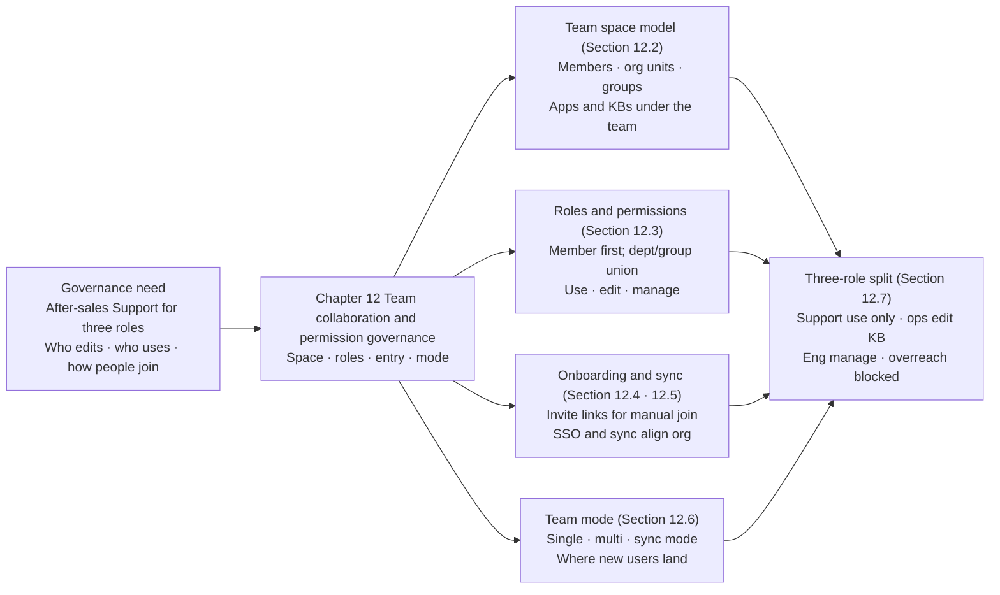
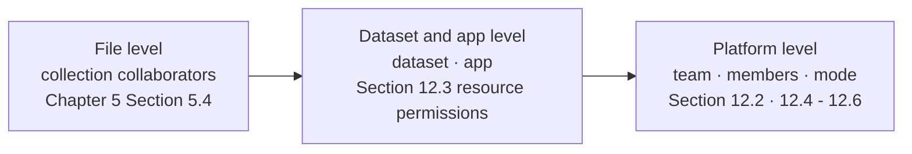
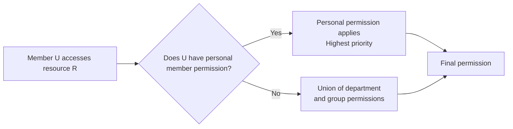
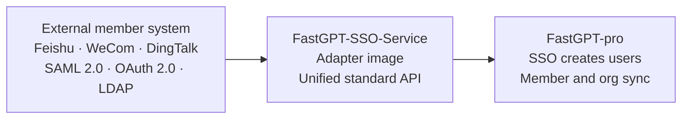

# Chapter 12 Team collaboration and permission governance

> Chapter guide: Chapter 5 mechanized updates for `after-sales-kb` and left a hook in Section 5.4—“the full team-space, role, and KB collaborator model is in Chapter 12.” Now we deliver: "After-sales Support" ("售后客服") must land with three kinds of people—support only chats, ops tends the KB, engineering runs the platform; how people join the team, how accounts align with org structure, and where new users land all need answers. This chapter goes two levels above Chapter 5 file-level permissions: dataset- and app-level collaborators (Collaborator) with the judgment chain and resource permission table; platform entry (invite links), org integration (SSO and member sync), and team mode. It closes with a three-role matrix and verification steps. After this chapter, you can: explain one full permission judgment, configure support/ops/engineering splits for the after-sales domain, and pick team mode and onboarding for your deployment.



*Chapter map*

## When you need it

Three typical situations, and three ways to use this chapter.

**The app opens to more people, but “everyone can edit” is wrong**—See Sections 12.2 and 12.3. Resources live under team space; collaborators and use/edit/manage tiers decide who can do what; Chapter 5 file permissions are the finest link on that chain.

**People churn, and manual accounts plus permissions are painful**—Section 12.4 invite links for manual join; Section 12.5 SSO and member sync align org structure; offboarding should revoke via sync, not memory.

**The self-hosted instance became “one team per person” and resources are invisible to each other**—Section 12.6: team mode decides where new users land; single-team and sync mode suit unified governance; multi-team has its place.

Prerequisite: Chapter 1 feature table lists “team space and permissions, SSO login, admin console” on the commercial/cloud side—this chapter is one of the heaviest shape prerequisites in the book; check the table before you act.

## 12.1 Overview: from file-level permissions to platform governance

Chapter 5 took permissions inside the knowledge base to file level; “who can create a KB,” “who joins the team,” and “where new colleagues land” are platform questions. FastGPT’s permission model joins layers—official summary: it blends attribute-based access control (ABAC) and role-based access control (RBAC), using **members, departments, and groups** to configure access to teams, apps, knowledge bases, and other resources (from official docs, verified 2026-11-01).

On three governance tiers, this chapter’s position is clear:



*Three governance tiers: this chapter extends Chapter 5 file permissions to platform level (original diagram)*

Four capability blocks and their material shape prerequisites, expanded in later sections:

| Capability | Material (official path) | Shape prerequisite |
|------|----------------------|----------|
| Team space and resource permissions | guide/workspace/team/team_roles_permissions | Chapter 1 table puts “team space and permissions” on commercial/cloud; material not itemized (on review checklist) |
| Invite links | guide/workspace/team/invitation_link (from v4.9.1) | Same as above |
| SSO and external member sync | guide/admin/sso | Material states FastGPT-pro (commercial) |
| Team mode | guide/admin/teamMode | Admin console entry (table “admin console” commercial); material not further labeled (on review checklist) |

**Our recommendation: the book’s community-edition start (Chapter 1) meets its real test when governance appears—create KB, orchestrate, publish without shape lock, while permission governance is what community defers to commercial; this chapter assumes commercial shape; community readers check the table first, then decide whether to upgrade.**

## 12.2 Team space model: members, departments, groups

### Team: container for resources

Team is the first container in the permission model. The permissions material says: each user may belong to multiple teams; the system creates one initial team per user; users cannot manually create extra teams yet. “One initial team per user” is that document’s wording, not this chapter’s current default.

Looking back: Chapter 3 created `after-sales-kb`, Chapters 6 and 7 built "After-sales Support" ("售后客服")—those resources always hung in your team space; solo use hides it, multi-person collaboration makes it the first boundary.

Both wordings stay until measured: this section’s permissions material says the system creates one initial team per user; Section 12.6’s team-mode material calls single-team the default mode and says new users do not get a default team—they join the Root team. Do not treat either sentence as the current default. The chapter review item is the authority; decide after a hands-on check.

### Three management subjects

| Subject | Permission ID | What it is | In judgment |
|------|--------------|--------|----------------|
| Member (Team Member) | tmbId | An individual in the team | Personal permission, highest priority |
| Group | groupId | Selected members in the team, including “all members” group | Union with department, below personal |
| Department (Organization) | orgId | Org structure unit | Union with group, below personal |

Provenance for the third row: materials mix “department” and “organization”—permission schema uses tmbId, groupId, orgId; SSO sync also calls the object “org structure.” Two names, one dimension.

### All-members group: default-permission lever

Official “tips” with two practical moves:

- **Team default permissions**—Use the all-members group to set baseline access, e.g. all members can use an app;
- **Batch permission management**—Add users to groups or departments, then authorize the group, instead of per-user setup.

Official red line: individual member permission overrides all-members group. Full semantics in Section 12.3; Section 12.7 uses it in the split example.

## 12.3 Member roles and permissions: judgment chain and resource table

### How one permission judgment runs

Official order: first check the user’s personal member permission; then departments and groups (union); final permission combines both. As a chain:



*Permission judgment chain (original diagram; rules and override example from official docs)*

“Personal overrides group” is official, with example: app A has all-members edit; user M is set to use only—M can use but not edit.

### Resources and permission items

Prerequisite: you must add **collaborators** before managing permissions. Two entry types—apps and knowledge bases allow direct member permission edits; team permissions use a dedicated page and require picking member/org/group first. Full resource permission table (from official docs):

| Resource | Manageable permissions | Notes |
|------|------------|------|
| Team | Create app | Create, delete, and similar base ops |
| Team | Create knowledge base | Create, delete, and similar base ops |
| Team | Create team APIKey | Create, delete (auth usage Chapter 10) |
| Team | Manage members | Invite, remove, create groups |
| App | Can use | Chat interaction |
| App | Can edit | Change basics, workflow orchestration |
| App | Can manage | Add/remove collaborators |
| Knowledge base | Can use | Invoke KB in apps |
| Knowledge base | Can edit | Change KB content |
| Knowledge base | Can manage | Add/remove collaborators |
| File/folder (collection) | Read | View content; requires KB file-level permissions on (Chapter 5) |
| File/folder (collection) | Write | Edit, update, sync, training params |
| File/folder (collection) | Admin | Add/remove collaborators; delete creator-only |
| File/folder (collection) | — | Aligns with Chapter 5 Section 5.4 read/write/admin/creator—file level is this set on collection, placed on the full chain here |

### Three special identities

| Identity | Permission | Boundary |
|------|------|------|
| Admin | Manage collaborator relationships on a resource | Cannot change own admin rights; cannot change other admins; cannot grant admin to others |
| Owner | One per resource, highest on that resource | Can transfer; former Owner loses access |
| Root | Single system super-admin | Full access to all teams and resources (Chapter 2 initial password change targets this) |

Admin limits mean **admins cannot expand the admin list**—escalation paths narrow to Owner and Root. Two Chapter 5 behaviors here: team Owner owns all team resources (full effective permission); **team admin does not bypass file-level permissions**—team manage covers members, groups, departments, not arbitrary files.

### Developer view: permissions as bits

Official note for integrators: permission design follows Linux-style bit storage—1 means granted, 0 means not; Owner marked all 1s. Stored in MongoDB `resource_permissions`, schema excerpt (comments added in this book):

```typescript
export const ResourcePermissionSchema = new Schema({
  teamId: { type: Schema.Types.ObjectId, ref: TeamCollectionName },
  tmbId: { type: Schema.Types.ObjectId, ref: TeamMemberCollectionName },  // Subject: one of tmbId/groupId/orgId
  groupId: { type: Schema.Types.ObjectId, ref: MemberGroupCollectionName },
  orgId: { type: Schema.Types.ObjectId, ref: OrgCollectionName },
  resourceType: { type: String, enum: Object.values(PerResourceTypeEnum) }, // team/app/dataset/agentSkill/collection
  permission: { type: Number, required: true },                              // Bit field; Owner all 1
  resourceId: { type: Schema.Types.ObjectId }                                // Resource id; null for team resources
});
```

This explains department/group union (multiple subject rows per person) and per-resource granularity (one row per resource × subject). Non-developers can stop here.

## 12.4 Invite links: standard onboarding entry

### From “type a username” to invite links

From v4.9.1, team invites use invite links instead of typing usernames. Upgrade note: pending invites not yet joined are cleared—re-invite with links.

### Five steps to issue an invite

| Step | Action |
|------|------|
| 1 | On team management, admin clicks “Invite members” |
| 2 | In the dialog, click “Create invite link” |
| 3 | Fill description, validity, max uses |
| 4 | Copy link and send |
| 5 | Recipient opens link: login/register if needed, then team page—Accept joins; Ignore closes; same link can join later |

Link shape:

```text
fastgpt.cn/account/team?invitelinkid=xxxx
```

### Parameters and lifecycle

| Item | Values | Notes |
|----|------|------|
| Description | Free text | Describe use; **cannot edit after creation** |
| Validity | 30 min / 7 days / 1 year | Auto-disable when expired |
| Max uses | 1 person / unlimited | Single-use link dies after one join |

Three disable reasons: manual; expiry; single-use consumed. Rules: **disabled links cannot reopen**; dead links purge after 30 days. Cap: at most 10 **active** invite links per user.

**Our recommendation: treat invite links as audit artifacts—one person one link, description states purpose and batch, prefer short validity; “unlimited” only for standing internal onboarding.** Official material does not say “audit”; this book’s discipline; mechanism supports it: description immutable, disable irreversible, auto cleanup.

## 12.5 SSO and external member sync: aligning org structure

### Scope and edition

Official first line: skip if you do not need SSO/member sync, or only need Github, Google, Microsoft, or Official Account quick login—this is for **your own member system or mainstream office IM**. Standard interfaces live in FastGPT-pro. **SSO and member sync are commercial capabilities**—Chapter 1 table shows ❌ for community SSO.

### Architecture: one adapter image

FastGPT exposes standard external interfaces and the FastGPT-SSO-Service image as **adapter**—different SSO/sync sources become interfaces fastgpt-pro understands. Two capabilities: SSO login (callback creates FastGPT user) and member and org sync (short “member sync”).



*SSO and member sync adapter architecture (original diagram from official principle)*

### Provider matrix

| Protocol/provider | SSO login | Member sync |
|-------------|----------|----------|
| Feishu | Yes | Yes |
| WeCom | Yes | Yes |
| DingTalk | Yes | No |
| SAML 2.0 (Security Assertion Markup Language) | Yes | No |
| OAuth 2.0 | Yes | No |
| LDAP (Lightweight Directory Access Protocol) | No | Yes |

Two highlights: DingTalk only login—pick another sync source or Section 12.4 manual invites; LDAP only sync—official “LDAP has no login API”; split login provider and sync provider.

### Deploy and configure in three steps

Step one, deploy SSO-Service container (compose excerpt, Feishu example from official docs):

```yaml
fastgpt-sso:
  image: registry.cn-hangzhou.aliyuncs.com/fastgpt/fastgpt-sso-service:latest
  container_name: fastgpt-sso
  restart: always
  networks:
    - fastgpt
  environment:
    - SSO_PROVIDER=feishu      # feishu / wecom / dingtalk / oauth2 / saml2
    - AUTH_TOKEN=xxxxx         # Must match fastgpt-pro side
    # Other env per provider (see official docs)
```

Step two, fastgpt-pro environment (internal URL to adapter):

```yaml
env:
  - EXTERNAL_USER_SYSTEM_BASE_URL=http://fastgpt-sso:3000
  - EXTERNAL_USER_SYSTEM_AUTH_TOKEN=xxxxx
  - SYNC_MEMBER_CRON=0 4 * * *   # Optional scheduled sync; Cron UTC—UTC 4:00 is Beijing 12:00
```

Step three, UI path `Admin` → `System config` → `User config`: login button text/icon and enable member sync. Notes: deployer-configured internal endpoint, trusted not user-controlled—SSO, OAuth callback, and sync bypass **`CHECK_INTERNAL_IP`**; empty `SYNC_MEMBER_CRON` means no scheduled sync.

Per-provider credential paths (Feishu App ID/Secret, DingTalk Client ID/Secret, WeCom CorpID/AgentID/two secrets) have step screenshots in official docs—follow there; WeCom reminder: after member-sync logic updates, **redeploy `fastgpt-sso-service` on published `latest`**—WeCom SSO uses app Secret, sync uses “contacts sync assistant” Secret, not the same.

### LDAP: sync only, not login

LDAP is the only “sync-only” among six providers. Split: `SSO_PROVIDER` for login, `SSO_SYNC_PROVIDER=ldap` for org/member list via LDAP:

```yaml
environment:
  - SSO_PROVIDER=oauth2       # Login still OAuth 2.0
  - SSO_SYNC_PROVIDER=ldap    # Member and org sync via LDAP
  # Required: LDAP_URL / LDAP_BASE_DN / LDAP_BIND_DN / LDAP_BIND_PASSWORD
```

Four user–org relationship modes (from official table):

| Mode | User–org relationship |
|------|------------------|
| user_attribute | User attribute (default ou) points to org |
| group_member_dn | Group attribute (default member) lists user DN |
| user_member_of | User attribute (default memberOf) lists group DN |
| posix_member_uid | Group attribute (default memberUid) lists user id |

Three limits shape fit: org IDs are normalized LDAP DNs; multiple root orgs get virtual ROOT parent; synced usernames default `ldap-` prefix—**login provider must use same prefix and id rules** or login and sync mismatch; no nested or dynamic group expansion today.

### Standard API and non-standard integrations

Adapter exposes four standard APIs: getAuthURL, getUserInfo, org/list, user/list. Hard rule on org/list: **only one root department**—multiple roots need a virtual root first. Non-standard systems: implement standard API (official fastgpt-sso-template) or FastGPT team custom provider in sso-service.

## 12.6 Team mode: where new users land

### Three modes and behavior

The team-mode material lists three modes and calls single-team that document’s default (one global team), plus multi-team and member-sync mode (members from an external system). “Single-team is the default” is that document’s wording and sits beside Section 12.2’s “initial team” wording; do not rewrite either into the current default before a hands-on check (end of this section and the review list). Where new users land by registration path (from official docs):

| Team mode | SMS/email signup | Admin adds directly | SSO signup |
|----------|----------------|------------------|------------|
| Single-team | No default team; join Root team | No default team; join Root team | No default team; join Root team |
| Multi-team | Creates default team; not in Root | Creates default team; not in Root | Creates default team; not in Root |
| Sync mode | No create, no join | No create, no join | No default team; join Root team |

Notes: single-team (v4.9+) stops per-user default teams—new users join Root’s team; multi-team each user gets **self-owned** default team—“one team per person, invisible resources” often comes from here; sync mode is Section 12.5 at team dimension—external members auto-sync in.

### Configuration and selection

Entry: `Admin` → `System config` → `User config`—same page as Section 12.5 SSO.

Version tension, stated as two coexisting wordings: Section 12.2 cites the permissions material, “the system creates one initial team per user”; the team-mode material marks single-team as its default and says new users do **not** get a default team. Likely version drift. Do not write either sentence as the current default before a hands-on check. The chapter review item is the authority; decide after that check.

**Our recommendation: one company on one FastGPT—single-team; with member sync use sync mode; multi-team for platform scenarios—untrusted teams sharing one FastGPT—only then worth isolation complexity.**

## 12.7 After-sales domain example: support, ops, engineering three-way split

### What “role” means here

FastGPT has no preset “support” or “ops” job titles—**roles are Section 12.2 subjects (member/group/department) × Section 12.3 permission items** (book stance; official provides permission items, you design combinations). Three roles map to readers: support (use apps), ops (tend KB), engineering (run platform).

### Split matrix and three setup steps

| Object | Support (all-members group) | Ops (“Ops” group) | Engineering (individual, admin) |
|------|------------------|------------------------|----------------------|
| App "After-sales Support" ("售后客服") | Can use | Can use | Can manage |
| Knowledge base `after-sales-kb` | —— | Can edit | Can manage |
| Team-level | —— | —— | Create app, create KB, create team APIKey, manage members |

| Step | Action | Mechanism |
|------|------|------------|
| 1 | All-members “can use” on "After-sales Support" ("售后客服")—default chat for everyone | All-members default (Section 12.2) |
| 2 | Create “Ops” group, “can edit” on `after-sales-kb` | Group batch auth (Sections 12.2 · 12.3) |
| 3 | Engineering individual “can manage” on app and KB; team four permissions with admin identity | Resource admin + team permissions (Section 12.3) |

Onboarding via Sections 12.4 and 12.5: support and ops via invite links (7-day, batch in description); with Feishu SSO, sync departments and authorize “Support dept” wholesale instead of manual groups—departments and groups union at same tier in the chain.

Two branches the matrix does not spell out:

- **Personal override done right**—temporarily bump all-members to “can edit” for co-building; intern M stays read-only: set M to “can use” only; personal beats group, same as Section 12.3 official example;
- **File-level bridge**—“senior support only” content (e.g. internal payout limits): Chapter 5 Section 5.4 file permissions on those files; confirm call chain authenticates by member identity or retrieval filter won’t apply.

### Verification steps

| Check | Expected |
|------|------|
| Support account opens "After-sales Support" ("售后客服") | Can chat; no orchestration entry (pending hands-on verification) |
| Ops account opens `after-sales-kb` | Can add/edit docs; no app manage (pending hands-on verification) |
| Engineering account opens team permissions | Sees all collaborators, groups, departments (pending hands-on verification) |
| M’s account tries to edit app | Blocked by personal “can use” override (pending hands-on verification) |

All four expected results marked pending hands-on verification—not stated as fact until Chapter review checklist.

### Alignment with ragflow book governance method

ragflow book Chapter 13 splits KB governance: “system owns permissions, SOP owns order”—permissions answer who can do what, process answers whether content is trustworthy (→ ragflow book). FastGPT: this chapter is the first half; Chapter 13 chat review, app evaluation, and quality inspection SOP is the second half. Methods transfer; tools follow official UI.

## Chapter summary

1. **One permission chain**: personal member highest; department and group union below; all-members group for defaults; personal can override (official: all edit, one user use-only → user can only use).
2. **Four resource faces**: team (create app/KB/APIKey/manage members); app and KB (use/edit/manage); file/folder (read/write/admin)—file level is last group refined (Chapter 5).
3. **Three special identities balance**: admin cannot grow admin list; Owner unique per resource, transfer removes old; Root sole super-admin; team admin does not skip file permissions.
4. **Invite links standard entry** (v4.9.1+): description immutable; validity three tiers, uses two tiers; disable irreversible; max 10 active links; dead links purge in 30 days.
5. **SSO and sync commercial**: standard API + SSO-Service adapter; Feishu/WeCom both columns; DingTalk login-only; LDAP sync-only; Cron UTC.
6. **Team mode sets landing**: the permissions wording “one initial team per user” and the team-mode wording “single-team default, new users join Root” both stand. Neither is the current default; the chapter review item decides after a hands-on check (Sections 12.2/12.6). Multi-team gives each user an owned default team; sync follows the external member system. Unified governance → single/sync; platform → multi.
7. **After-sales split fixed**: all-members use app; ops group edit KB; engineering manage + team powers; four verification rows on review checklist.

Next: permissions settled who can do what; “should we trust the content?” remains. Chapter 13 covers chat record review, citation reader, app evaluation, and quality inspection SOP—the other half of ops for "After-sales Support" ("售后客服").

## Acceptance checklist

By now you should be able to:

- ☐ Draw the permission chain for any user × resource and explain why personal “can use” beats all-members “can edit”;
- ☐ List permission items for team, app, KB, file/folder and state file-level prerequisite on KB side (Chapter 5 Section 5.4);
- ☐ Create an invite link: 7 days, 1 person, described purpose; name three disable reasons and “cannot re-enable”;
- ☐ Write the three-role matrix for after-sales and verify one support account “can chat, cannot orchestrate”;
- ☐ State SSO provider login vs sync matrix and what DingTalk-only-login and LDAP-only-sync imply;
- ☐ Pick team mode for your deploy and differences in where new users land across three signup paths.

### Review checklist (before publish)

- [ ] UI not verified hands-on: team permissions, add collaborator, invite dialog (description/validity/uses)—vs official v4.17.3 (two guide/workspace/team, two guide/admin), verified 2026-11-01;
- [ ] Shape check: Chapter 1 lists team permissions, SSO, admin on commercial/cloud; team_roles_permissions and invitation_link not itemized—community hands-on for team page and invite entry;
- [ ] “Default team” version gap: permissions doc “initial team per user” vs team mode “single-team default no default team, join Root”—v4.17.3 behavior wins; revise Sections 12.2 and 12.6 if needed;
- [ ] SSO providers not verified hands-on: Feishu/WeCom/DingTalk credentials, OAuth three URLs, LDAP four modes, `SYNC_MEMBER_CRON` UTC and trigger;
- [ ] Section 12.7 matrix and four verification steps expected only—commercial hands-on before dropping “pending hands-on verification”;
- [ ] Chapter map and diagrams Sections 12.1, 12.3, 12.5 render on GitHub.

## Further reading

- **Chapter 5 Section 5.4 (file-level permissions)**—Finest link: enable prerequisite, inheritance, “delete creator-only,” member-identity auth for retrieval.
- **Chapter 10 (OpenAPI integration)**—Team APIKey create and auth: humans via collaborators, programs via API key—do not mix at integration boundary.
- **Chapter 13 (conversation operations and evaluation)**—Other half of governance: chat QA, evaluation, quality inspection SOP—content trust as process.
- **(→ ragflow book) Chapter 13 (team collaboration and knowledge-base operations)**—Mirror methodology: ragflow permission tiers and “system permissions, SOP order,” reusable across platforms.
- **Official four articles** (guide/workspace/team/team_roles_permissions, guide/workspace/team/invitation_link, guide/admin/sso, guide/admin/teamMode)—terminology disputes defer to official text.