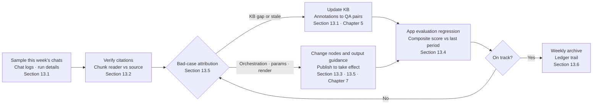
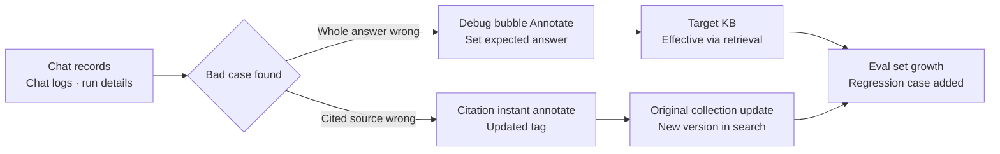
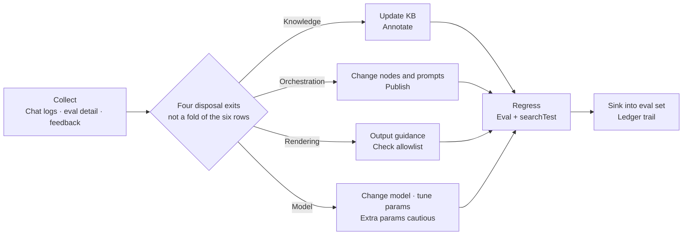

# Chapter 13 Conversation operations and evaluation

> Chapter guide: "After-sales Support" ("售后客服") is live—channels, API, platform, and permissions are in place (Chapters 9–12), real users arrived, and ops faces the same weekly question: are answers right? This chapter is the other half of operations: chat record review and annotations as raw material (Section 13.1), the citation chunk reader to verify sources (Section 13.2), dialog HTML rendering boundaries for output shape (Section 13.3), app evaluation turning “better or worse after a change?” into scores (Section 13.4), common issues as a bad-case map and governance loop (Section 13.5), and a weekly inspection SOP (Section 13.6). After this chapter, you can: follow three paths to review chats and annotate fixes, verify citations with the reader, run an eval regression line for the app, and complete one quality inspection with the weekly checklist.



*Operations flow for this chapter*

## When you need it

Three typical situations, and three ways to use this chapter.

**Channels are open, volume is real, nobody can say if answers are good**—Sections 13.1 and 13.6. Chat logs are raw material, the weekly checklist is the process; Chapter 9 brought traffic, these sections hold quality.

**Someone disputes an answer and wants evidence**—Section 13.2. Open the citation; the overlay shows full text and highlight—whether the citation holds and the source is current; external users see only what visibility allows.

**You changed prompts, models, or KB and cannot tell improvement from regression**—Section 13.4. The eval set is the inspection dashboard (→ ragflow book); batch Q&A pairs, composite score vs last run; retrieval regression assertions use Chapter 10 Section 10.4 searchTest.

Prerequisite: app evaluation was Beta when this book was written (official “current test version”); Chapter 1 table lists it on paid shapes—check your shape in Chapter 1 before you start.

## 13.1 Chat record review and annotation: ops raw material

### First-hand material for QA

Official FAQ on chat records: when debug, publish, and API behavior diverge, context usually differs—“find the record in chat logs and open run details to compare” (guide/build/faq, verified 2026-11-01). Chat logs keep real traffic; run details unfold one answer’s decision path. Chapter 6 introduced these in debug context; this chapter promotes them to ops tools—run details go from debug “microscope” to inspection evidence chain.

Three review paths by human vs program:

| Path | What you see | When | Source |
|------|--------|------|------|
| Chat logs + run details | Full decision chain for one record | Manual sampling, bad-case attribution | This section |
| Chat-related APIs | Programmatic pull and stats (e.g. getChartData chat count, errors, up/down votes) | Platform reconciliation, bulk export | Chapter 10 Sections 10.2, 10.5 |
| Chat log push `CHAT_LOG_URL` | Export chat data | External QA and observability | Chapter 11 (→ langfuse book) |

UI entry confirmed in hands-on on local deploy: app detail top tab “Chat logs”—screenshot from FastGPT community v4.17.3 local deploy (2026-11-03 hands-on, model glm-5.3-flash + embedding-3):


Hands-on list shows debug Q&A by time, titles from user questions (“How is shipping damage compensated?” “How many days for returns?”), message count, source, IP region visible—manual sampling starts here; “Data dashboard” sub-tab is commercial-tagged, community ops start on “Log details.” Visible filters: date, source, title search; finer filters on review checklist.

### Annotation: two entries, one destination

Annotation turns “wrong answers” into KB assets. With Chapter 6 material, two entries, different destinations:

| Entry | Action | Destination |
|------|------|------|
| Debug bubble “Annotate” | Save Q&A to chosen KB with expected answer correction (Chapter 6) | Chosen KB |
| Citation chunk reader “Instant annotate” | Authorized users fix cited content without stopping the chat | Original collection, “Updated” tag (Section 13.2) |

Former: whole answer wrong, supply correct answer; latter: cited source text needs fix. Together they are Chapter 6’s “foundation for quality inspection”—bad cases land in KB and eval set, not scattered in chat history.



*Two annotation entries and destinations (original diagram; Chapter 6 and quoteList material)*

### Boundaries and pitfalls

- Annotations write to KB, not app memory—retrieval must pick them up; do not expect instant fix after annotate;
- “Updated” fixes KB source; old answers in chat history are not rewritten (inferred from material semantics, not hands-on—on review checklist);
- Sampling must be representative: stratify by channel (share link/DingTalk) and topic (policy/FAQ/logistics)—sampling only satisfied chats is not inspection (our recommendation).

## 13.2 Citation chunk reader: verifiable citations

### From black box to overlay

From v4.9.1 (official, verified 2026-11-01), FastGPT upgraded KB citations from “quoted chunk only” to a chunk reader: click the citation under the answer, overlay shows full source with highlighted cited span. Old style gave fragments without context; the reader makes traceability checkable on the spot—does the answer match the source, one link away.

### Features and inspection use

| Feature | Behavior | Inspection use |
|------|------|---------|
| Full text and locate | Click citation → overlay, full text + highlight | Check “citation supports answer” |
| Citation navigation | Top-right moves among citations, “7/10” style index and total | Verify multi-cite answers |
| Citation quality score | Tag shows relevance rank; hover for detail | Why this chunk was chosen |
| One-click export | Save full text locally | Bad-case archive |
| Visibility control | Admin “cited content only” for externals | Tighten share-link exposure |
| Instant annotate | Authorized fix with “Updated” tag | Fix while reviewing |
| On-demand render | Sort by relevance, load by data id | Long docs (e.g. 50-page policy) stay smooth |

### Visibility: login-free link boundary

On login-free links, admin controls what externals see: “cited content only” means they see only the cited fragment, not the full document. "After-sales Support" ("售后客服") share links face customers (Chapter 9)—this setting bounds how much KB text customers see; internal inspection needs full text, external presentation can be narrower—two modes, two expectations.

### Boundaries and pitfalls

- iOS known issue: through 4.17.0, “open source” on citation may no-op—iOS Safari (incl. WeCom in-app) may block “fetch then open window”; workaround: open in system browser from “…”, or allow pop-ups (official FAQ, fix in later versions);
- Export and instant annotate need KB permissions—external customers may see overlay but not export or edit;
- Quality score explains selection, not correctness—high relevance still needs human check on content.

## 13.3 Dialog HTML rendering: output shape boundaries

### From iframe sandbox to native controlled pipeline

Dialog HTML rendering had two generations. Legacy (official deprecated) put Markdown HTML blocks in iframe sandbox: fixed height, media downloaded fully to Blob, often CORS or OOM. **From v4.17.3, native controlled HTML and streaming media enhancement** (official, verified 2026-11-01): HTML parsed in main DOM with container/dark mode; media uses HTML5 and HTTP Range; streaming typing uses Streaming Guard on unclosed tags. Book baseline v4.17.3; below assumes the new pipeline.

### Security allowlist: why rendering looks “incomplete”

Open HTML rendering’s first rule is safety. Server CSRF does not stop same-origin XSS; FastGPT uses AST-level allowlist (`rehype-sanitize`) with five rules:

| Mechanism | Rule | Risk blocked |
|---------|------|-----------|
| Script strip | No `<script>` or external script load | Script injection |
| Event filter | All `on*` inline events disabled | Event injection |
| Style convergence | No generic `style` attribute | Full-screen fraud overlay, style pollution |
| Protocol allowlist | URLs only http, https, mailto, tel, cite, quote; block `javascript:`, `data:text/html`, `file:` | Dangerous pseudo-protocols |
| Form limits | Forms read-only/interactive display only; no `type="file"` or `type="password"` | File theft, password harvesting |

Ops reading: model HTML “missing” tags/attributes is often allowlist stripping at parse time—not necessarily a bad case. Dialog does not run custom JavaScript; illegal tags outside allowlist are stripped; complex standalone pages should use dedicated publish or external links (Chapter 9).

### Controlled tags and enhanced components

Six controlled tag families cover typical model output, mapped to after-sales scenarios:

| Category | Tags | After-sales scenario |
|------|------|---------|
| Media | `<video>` `<audio>` `<source>` `<track>` | Return/exchange demo video |
| Fold | `<details>` `<summary>` (`data-think` for chain-of-thought) | Layer long answers |
| Text/highlight | `<mark>` `<kbd>` `<font>` `<sub>` `<sup>` `<abbr>` etc. | Highlight clauses, abbreviation tooltip |
| Metrics | `<progress>` `<meter>` `<figure>` `<figcaption>` | Ticket progress, SLA fit |
| Tables | `<table>` with `rowspan`/`colspan`/`align`, CSV export | Payout matrix in policy |
| Static controls | `<button>` `<input>` `<textarea>` `<label>` (read-only) | Checklists, option display |

Built-in blocks via Markdown: `echarts` interactive charts; `mermaid` flow/sequence; KaTeX formulas; syntax-highlighted code and PhotoView galleries.

### Boundaries and pitfalls

- Formulas missing—check prompts before swapping models—official FAQ:

```bash
Latex inline: \(x^2\)
Latex block: $$e=mc^2$$
```

- To avoid Markdown output, change KB default prompt—standard template asks Markdown; remove that requirement (official FAQ);
- Complex tables work in dialog; external channels (DingTalk etc.) depend on client—important table answers need per-channel hands-on (on review checklist).

## 13.4 App evaluation (Beta): regression dashboard

### What it does and does not

From v4.11.0, FastGPT supports batch app evaluation: submit Q&A pairs, auto-score outputs (official, verified 2026-11-01). Three boundaries:

- **Beta shape**: planned metrics—answer accuracy, question relevance, semantic accuracy; test version only “answer accuracy” today;
- **Scale cap**: max 1000 Q&A pairs per task per official CSV template;
- **Object is whole app**: retrieval “target chunk in top k” regression is Chapter 10 Section 10.4 searchTest—two layers, full regression together.

Edition: Chapter 1 table lists app evaluation on paid side; material not re-labeled—check table (Chapter 1) and this chapter review checklist.

### Create one evaluation run

Entry: workspace app evaluation, top-right “Create task,” three fields:

| Setting | Description |
|--------|------|
| Task name | Identifier; our recommendation: date and change reason, e.g. “After-sales Support-1102-post-FAQ-update regression” |
| Evaluation model | Scoring model—independent of app under test |
| App under test | App to score |

After picking app, download CSV template: global variables, q, a, history. Upload filled CSV, “Start evaluation.” Eval set sources (our recommendation, by availability): annotated Q&A (Section 13.1), high-frequency rows from `product-faq.xlsx` (Title=q, Content=a), archived bad cases (Section 13.5).

### Reading results: list and detail

List columns—progress, executor, app, start/end, composite score—answer “how did this run go”; “View details” shows task summary and per-row user question, reference answer, app output.

**Inspection reading: composite score only vs last period; row-level results are the workbench—attribute regressions, write conclusions to ledger, not only a number.** Same method as ragflow book Chapter 13 “test set as dashboard,” “regressions attributed row by row” (→ ragflow book).

### Regression line: when you must run

| Change | Regression | Criterion |
|------|---------|------|
| Prompts/opening/input guidance | App evaluation | Composite score not below last; attribute regressions |
| KB doc update/sync | App evaluation + searchTest (Chapter 10 Section 10.4) | Score holds; target chunk still top k |
| Model and params (retrieval etc.) | App evaluation | Before/after runs, score not down |
| Workflow node changes | App evaluation + debug preview walkthrough | Score not down; key branches manual (Chapter 7) |

### Boundaries and pitfalls

- Scoring uses “evaluation model”—its ceiling caps scores; changing eval model breaks horizontal compare with history;
- “History” field feeds multi-turn context; material silent on scoring impact—our recommendation: split eval sets with/without history, do not mix in one table (on review checklist);
- 1000 cap means curated mix: allocate by bad-case type and intent, not “upload everything” (our recommendation).

## 13.5 Common issues and bad-case governance

### Official FAQ bad-case map

Two official FAQ articles (app build + chat box). The table has six rows, so six attribution classes. The chapter does not explain how each row folds into the four disposal exits later, and this section does not invent that fold:

| Attribution | Bad case | Official fix | Link |
|------|------|---------|------|
| Publish chain | Workbench changed, chat/channel stale | Must click “Publish” after app change | Section 13.6 item 6 |
| Context | Debug vs publish vs API mismatch | Usually context: find record in chat logs, compare run details | Section 13.1 |
| Classification | Multi-turn classification wrong; follow-ups misrouted | Weak links: global var for classification; history non-zero skip classifier | Chapter 7 |
| Rendering | Formulas missing; bad Markdown | Prompt formula format; change KB default prompt | Section 13.3 |
| Environment | Voice input broken | Mic permission; browser allow site mic and pick source; SSL required | Chapter 6 |
| Version | Thinking hidden (4.9.1–4.14.x) | Enable “output thinking” on model; extra Body per proxy; params apply to all calls on that model—slower, more tokens | Chapter 2 |

Version notes: thinking FAQ for 4.9.1–4.14.x; book baseline v4.17.3 for legacy triage only; iOS citation issue through 4.17.0 (Section 13.2).

### Bad-case governance loop

One bad case: collect, attribute, fix, regress. The table above is six attribution classes. Knowledge, orchestration, rendering, and model on the figure are four disposal exits, not a folding of those six rows; the chapter never maps each row onto those exits. Whichever exit you take, the regression line is the same:



*Bad-case loop (original diagram; the four disposal exits are not a folding of the six rows above)*

Easiest break: “sink”—fixed cases not in eval set return on the next prompt change. ragflow book Chapter 13 calls this “tickets feed the test set—test set grows with business”; FastGPT counterparts are eval set and annotation KB (→ ragflow book).

### Boundaries and pitfalls

- “Scheduled execution” takes effect after publish, runs in background regardless of share page open—do not assume “page must stay open” (official FAQ semantics; self-hosted reproduction on review checklist);
- Classifier skip when history non-zero depends on “history” variable—API sessions need consistent params (Chapter 10);
- Official FAQ is a map, not exhaustive—channel and model bad cases grow from Section 13.1 sampling.

## 13.6 Running example: "After-sales Support" quality inspection SOP (weekly checklist)

### Seam with neighboring chapters

Boundaries first so the checklist stays ops not platform: service health (SignOz) and model stability (channel probe) are Chapter 11 daily; who can use what is Chapter 12; **this weekly checklist only asks are answers right.** Mirrors ragflow “Chapter 12 platform stable, Chapter 13 content quality” (→ ragflow book).

Roles from Chapter 12 three-way split: support reports bad cases, ops runs weekly inspection, annotations, KB updates; engineering fixes orchestration and publish.

### Weekly checklist

Frequency and owners are suggestions (our recommendation); trim by volume; “trigger” rows run on change, not on calendar:

| # | Frequency | Check | Action and entry | Criterion | Owner |
|---|------|--------|-----------|------|--------|
| 1 | Weekly | Chat sample review | Chat logs stratified by channel × topic; open run details per row | Wrong answer → bad case with ID | Ops |
| 2 | Weekly | Citation spot check | Chunk reader on highlights; logistics SLA answers every row | Citation valid, source current | Ops |
| 3 | Weekly | KB cadence | Product FAQ weekly sync; logistics notice stale pulled; policy manual at revision window | Three doc classes match source (Chapters 3, 5) | Ops |
| 4 | Weekly | Eval regression | Run app evaluation; composite vs last; attribute regressions | Score not below last; all regressions attributed | Ops |
| 5 | Trigger | Post-KB search assert | searchTest per Section 10.4 target chunk in top k | All asserts pass | Ops |
| 6 | Trigger | Post-config publish | After prompt/node/param change confirm Publish; chat and channels updated | Live matches workbench (Section 13.5) | Engineering |
| 7 | Trigger | Render walkthrough | Table/formula/chart answers on target channels | Allowlist renders OK (Section 13.3) | Engineering |
| 8 | Weekly | Bad-case closure | All week’s bad cases attributed and fixed; new rows in eval set; annotation KB grows | No open bad cases; eval set grows | Support + ops |

Two foundations outside the eight: Chapter 11 `CHAT_LOG_URL` and SignOz alerts online for full chat sampling; Chapter 12 permission matrix so support reports, ops edits KB, engineering publishes—if the checklist stalls, check those first.

### A weekly inspection walkthrough (Example)

One week walked through (numbers are example settings, not confirmed in testing): sample 20 chats, 2 bad cases—one logistics answer cited expired notice (knowledge: pull notice + annotate); one payout table misaligned on DingTalk (rendering: prompt to column bullets). After fixes, eval run: composite flat vs last period; one regression from new FAQ not stably recalled—searchTest showed low target chunk rank; tuned per Chapter 4 and re-ran pass. Ledger four lines, archived Friday.

### Boundaries and pitfalls

- Weekly inspection does not chase absolute scores: material gives no pass threshold—judge by vs last period + regression attribution—fabricated pass rates only polish numbers;
- Keep annotation KB separate from business KB (our recommendation): mixed, corrections get retrieved as production knowledge;
- Ledger need not be fancy but must exist—evidence for eval growth and accountability (→ ragflow book same stance).

## Chapter summary

1. **Ops raw material is chat records**: three paths—manual via logs and run details (Section 13.1), API reconciliation (Chapter 10 Section 10.2), external QA via `CHAT_LOG_URL` (Chapter 11).
2. **Two annotation entries**: debug bubble fixes whole answer; reader instant annotate fixes source—both sink to KB, bad cases become assets.
3. **Verifiable citations**: from v4.9.1 chunk reader, full text + highlight; quality score explains selection; visibility limits externals.
4. **HTML rendering boundaries**: v4.17.3 native pipeline replaces iframe; allowlist strips scripts, events, inline style, dangerous protocols—“incomplete” often security, not bad case.
5. **Eval regression dashboard**: v4.11.0+ Beta, only answer-accuracy metric today, CSV max 1000 pairs; composite vs last, rows for attribution; retrieval regressions via searchTest.
6. **Bad-case loop not a flat list**: collect → four disposal exits (knowledge / orchestration / rendering / model; the Section 13.5 table is six classes and is not folded here) → fix → regress → sink; break at sink and cases return.
7. **Weekly checklist for “are answers right”**: eight checks, three roles, periodic and trigger items, ledger as proof.

The book closes here: Chapter 1 shape choice through deploy (Chapter 2), KB (Chapters 3–5), apps and workflow (Chapters 6–7), tools and skills (Chapter 8), publish and integration (Chapters 9–10), ops and governance (Chapters 11–12)—"After-sales Support" ("售后客服") from build to use; this chapter adds operations. Next step outside the book: adapt Section 13.6 checklist to your team with real names and cadence. Further: platform Agent consuming "After-sales Support" via MCP (→ mcp book Chapter 8), deep chat analytics (→ langfuse book), chunk and inspection methodology vs ragflow (→ ragflow book).

## Acceptance checklist

By now you should be able to:

- ☐ Follow three paths for chat records and state manual, programmatic, and external QA paths;
- ☐ Annotate once via debug bubble and once via citation reader; say what each fixes and where it lands;
- ☐ Open a citation, verify highlight vs source, and describe login-free “cited content only”;
- ☐ Name five allowlist stripping categories and why tables may lack styles without being bad cases;
- ☐ Create app evaluation: CSV template, ≤1000 pairs, pick eval model and app, read composite score;
- ☐ Write regression combo for KB update (eval + searchTest) and where “sink” sits in the loop;
- ☐ Run Section 13.6 checklist once and produce inspection record with attribution and ledger.

### Review checklist (before publish)

- [x] Chat log entry verified hands-on (2026-11-03, community v4.17.3 local deploy)—app detail “Chat logs” tab “Log details” shows real records (Section 13.1 figure);
- [ ] Other UI not verified hands-on: finer log filters, both annotation entries, citation overlay/nav/score/export, eval create and detail—vs official v4.17.3 (guide/chat/quoteList, guide/chat/html, guide/chat/htmlRendering, guide/build/evaluation, guide/build/faq, faq/chat), verified 2026-11-01;
- [ ] App evaluation edition: Chapter 1 paid side, material not re-labeled—community entry hands-on; “test version answer accuracy only” per docs at eval time;
- [ ] Whether “Updated” rewrites old chat answers, export scope—material silent, hands-on then revise Sections 13.1 and 13.2;
- [ ] HTML cross-channel: complex table/formula on DingTalk and login-free links, CSV export—per channel (Section 13.3 boundary);
- [ ] “History” field impact on eval scoring (Section 13.4 boundary), classifier skip vs API params (Section 13.5 boundary)—material silent;
- [ ] “Scheduled execution” FAQ (post-publish background) reproduction on self-hosted;
- [ ] Section 13.6 checklist frequency, sample size, owners are book suggestions; walkthrough numbers example settings, not confirmed in testing;
- [ ] Chapter opening flow, Section 13.1 annotation flow, Section 13.5 loop render on GitHub.

## Further reading

- **Chapter 10 Sections 10.4 and 10.2 (KB API and app log API)**—searchTest top-k assertions and getChartData volumes/errors/votes—two programmatic weekly numbers.
- **Chapter 11 Section 11.4 (SignOz and three log layers)**—application-layer “are answers good”: weekly sampling needs `CHAT_LOG_URL` online; system alerts precede quality drops.
- **Chapter 7 (workflow orchestration)**—“orchestration” bad-case fixes on canvas; Section 13.5 classifier skip reuses Chapter 7.
- **Chapter 12 (team collaboration and permission governance)**—inspection roles: support reports, ops edits KB, engineering publishes—matrix must work for checklist to run.
- **(→ ragflow book) Chapter 13 (team collaboration and knowledge-base operations)**—shared skeleton: test set as dashboard, tickets feed test set, ledger required—different tools, same ops frame.