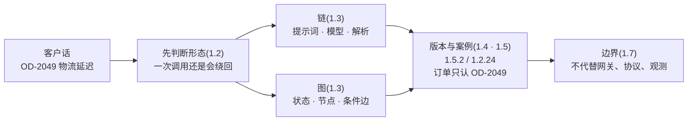
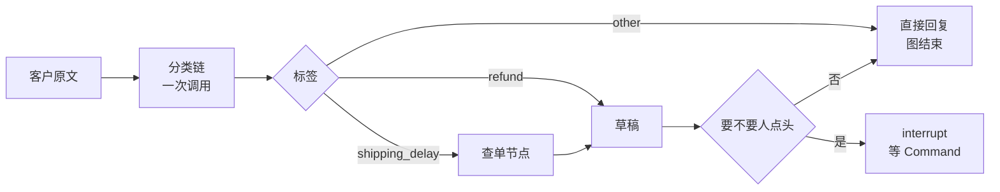
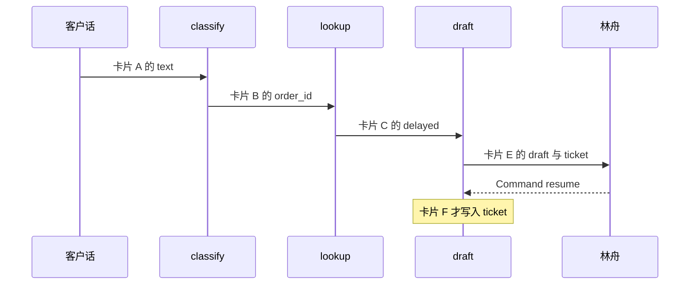

# 第 1 章 链和图各管什么

> 本章导读：海岸优品的客户发来一句「订单 OD-2049 物流延迟，请处理」。林舟要在 Python 里让小帆接住这句话。他可以写一个函数，把句子丢给模型，拿回一个标签；也可以一上来就画一张带循环的 Agent 图。这两件事不是同一层。标签是一次调用，查单、再根据结果决定要不要起草工单、工单还要等人点头，才是会绕回来、会停住的流程。LangChain 把一次调用写成链，LangGraph 把流程写成图。本章不装包、不调模型，只把这张地图画完：什么时候停在链上，什么时候必须上图，以及这本书和书架上 AgentScope、LiteLLM、MCP、Langfuse 各管哪一段。读完本章，你能对同一句客户话指出哪一步是链、哪一步是图，并选定自己的起点。



*本章导览图*

## 你什么时候需要它

三种处境，对应三种读法。

**你手里只有一句客户话，要一个稳定标签或一段结构化字段。** 从 1.2 读到 1.3 的「链」那一列，然后直接去第 2 章。不要先画图。一次调用没有循环，检查点和人工确认都还没有对象。

**你已经能拿到标签，但下一步取决于标签：延误要查单，退款不能自动执行，闲聊直接回复。** 读 1.3 的「图」那一列，再读 1.6。第 4 章才会把节点和边写出来。本章只要求你说出「这里有分支，所以不是一条链」。

**你在选型会上被问：Python 这边还要不要 LangChain，Java 那边已经有 AgentScope。** 读 1.7。结论先放在这里：AgentScope Java 是平台上的客服 Agent，这本书是同一张订单的 Python 编排。两边可以同时存在。LangChain 不取代网关，LangGraph 不取代 MCP。

**你只想确认包版本和案例名词，怕后文各写各的。** 读 1.4 和 1.5，对照 [demo/xiaofan_graph/orders.py](../demo/xiaofan_graph/orders.py)。订单号、工单句、团队名全书只有这一套。

前置：不要求写过 LangChain。要求能读 Python 函数。第 2 章才创建虚拟环境。

## 1.1 概述

小帆要处理的不是「聊天」，是一张售后单上的决定。把这句客户话拆开，至少有五件不同的事：

| 决定 | 输入 | 输出 | 会不会回到上一步 |
| --- | --- | --- | --- |
| 这句话属于哪一类 | 客户原文 | `shipping_delay`、`refund` 或 `other` | 不会。分错了是另一次调用，不是图内部的环 |
| 订单现在什么状态 | 订单号 `OD-2049` | 运单、已过天数、是否延误 | 不会。查不到就返回 `NOT_FOUND`，不要再猜一个订单号 |
| 草稿怎么写 | 类别 + 查单结果 | 给客户或给坐席的一段话 | 通常不会。草稿是纯函数 |
| 要不要真的开单或退款 | 草稿 | 人的「同意 / 拒绝」 | 会停。人没回来之前图不能往下写工单 |
| 明天这个线程还在不在 | 线程号 | 上次停住的状态 | 这是检查点的事，不是模型的事 |

前三行可以用函数和至多一次模型调用完成。第四行要求图在某个节点停住，并把停住时的状态存下来。第五行要求这个状态在进程重启后还在。**业务上推荐先把第一行写成链，确认标签集合，再把第四行升级成带检查点的图。** 一上来就 `create_agent`，标签、工具和人工确认会糊在同一张预置图里，出了问题不知道该改提示词还是该改边。

LangChain 1.x 把「代理」收成 `langchain.agents.create_agent`。它返回的对象是编译后的 LangGraph。迁移说明写明：旧的 `create_react_agent` 换成 `create_agent`，自定义的 `StateGraph`、检查点、`interrupt()`、`Command` 继续可用（[LangGraph v1 migration](https://docs.langchain.com/oss/python/migrate/langgraph-v1)，2026-11-27 对照）。所以这本书不把 LangChain 和 LangGraph 写成两套互斥框架。链是你自己用 `|` 接起来的一次调用；`create_agent` 是官方帮你接好的那张工具循环图；你自己的 `StateGraph` 是业务分支还对不上那张预置图的时候才写。

## 1.2 一次调用和一条会绕回来的流程

用小帆的三句客户话看形态，比看产品介绍快。

| 客户话 | 形态 | 理由 |
| --- | --- | --- |
| 「订单 OD-2049 物流延迟，请处理」 | 先链、后图 | 标签可以一次得出。标签是延误之后，还要查单、起草、等人确认开单，后面是图 |
| 「订单 OD-2049 我要退款」 | 图，而且必须能停 | 退款不能做成立刻执行的工具。图要在执行前停下 |
| 「你们周末上班吗」 | 链就够 | 没有订单副作用。回复完就结束，不需要线程 |

「会绕回来」在这本书里有两个具体意思，不要和日常口语混用。

1. **工具循环。** 模型返回 `tool_calls`，程序执行工具，把 `ToolMessage` 塞回消息列表，再调一次模型。这是环。`create_agent` 的图上，节点名就是 `model` 和 `tools`（第 3 章的运行输出里有这个节点列表）。
2. **业务环。** 你自己写的节点，例如「计数未到 3 就回到自己」。第 5 章用一个与模型无关的计数图把这个环跑到 `n == 3`，再用一个永远返回 `"increment"` 的路由把 `recursion_limit` 打出来。

人工确认不是环，是暂停。图停在 `gate` 节点，`invoke` 返回 `__interrupt__`。人给出 `Command(resume=...)` 之后，**同一个节点从头再执行**，`interrupt()` 的返回值变成那次恢复值。这是第 7 章的主线。本章先记住：暂停要有检查点，否则进程手里没有「停在哪」的记录。



*图 1-2：同一句客户话里，分类是链，开单前的等待是图*

这张图是后文的目录，不是第 1 章要你编译的代码。直线版本在第 4 章，条件边在第 5 章，暂停在第 7 章。

## 1.3 LangChain 与 LangGraph 的分工

按你要写的代码对象来分，不按官网导航来分。

| 你要写的东西 | 放在哪 | 本书里的落点 | 没有它会怎样 |
| --- | --- | --- | --- |
| 提示词模板 | LangChain，`ChatPromptTemplate` | 第 2 章 | 字符串拼接散落在业务函数里，系统句和客户话分不开 |
| 模型 | LangChain，`init_chat_model` 或一个假模型 | 第 2 章 | 业务代码直接握着供应商 URL 和密钥 |
| 解析器 | LangChain，`StrOutputParser` | 第 2 章 | 模型多说一句话，下游就接到整段闲聊 |
| 工具契约 | LangChain，`@tool` | 第 3 章 | 模型不知道参数名，程序也不知道该调哪个函数 |
| 预置的工具循环 | `create_agent`（返回 LangGraph） | 第 3 章 | 手写循环能跑，但线程、暂停要自己接 |
| 状态、节点、边 | LangGraph，`StateGraph` | 第 4、5 章 | 业务分支被塞进一个大函数的 `if` |
| 检查点 | LangGraph，`InMemorySaver` / `SqliteSaver` | 第 6 章 | 进程一退，停在一半的售后就没了 |
| 人工暂停 | LangGraph，`interrupt` 与 `Command` | 第 7 章 | 退款和开单在同一次调用里执行完 |

**立场：分类和草稿优先写成纯函数或一条链；只有出现循环、暂停或跨进程续跑时，才编译一张图。** `create_agent` 适合「模型自己决定要不要查单」的工具循环。小帆的开单规则是业务规则：延误且已过承诺天数才起草工单，退款一律等人。这种规则不要交给模型临时发挥，要写在条件边上。第 8 章的成图就是这条立场的落地：分类函数看关键词，不看模型；假模型只出现在第 2、3 章，用来证明链和 `create_agent` 的接线。

JavaScript 侧有 `@langchain/langgraph`。CopilotKit 书第 5 章用过它的形状。本书不并行写一套 JS。接口名会变，两条线一起维护时，没跑过的那条会先过时。需要 JS 时，以第 5 章把图跑通之后的节点职责为准，再去对官方 JS 文档，不要把本书的 Python 调用原样译过去。

## 1.4 版本基线

2026-11-27，本环境 Python 3.12，按 [demo/requirements.txt](../demo/requirements.txt) 安装后读到的版本：

| 包 | 版本 | 本章用它做什么 |
| --- | --- | --- |
| `langchain` | 1.5.2 | `create_agent`、`init_chat_model`、`@tool`、消息类型 |
| `langchain-core` | 1.8.5 | 提示词、`StrOutputParser`、`FakeListChatModel`、`GenericFakeChatModel` |
| `langgraph` | 1.2.24 | `StateGraph`、`interrupt`、`Command`、`InMemorySaver` |
| `langgraph-checkpoint-sqlite` | 3.1.3 | `SqliteSaver`，第 6 章跨进程 |

同一天确认了两件负向事实，第 2 章会把命令输出贴出来：

- `FakeListChatModel.with_structured_output` 抛出 `NotImplementedError`，消息是 `with_structured_output is not implemented for this model.`
- `init_chat_model("openai:gpt-4o-mini")` 在未安装 `langchain-openai` 时抛出 `ImportError`，消息要求 `pip install langchain-openai`。本次没有安装这个包，也没有跟随这条提示去装。

不要把这些版本和「LangChain 0.3 时代的 `AgentExecutor`」混在一张笔记里。`AgentExecutor` 不是本书的写法。看到旧教程里的 `initialize_agent` 或 `create_react_agent`，先停，回到 `create_agent` 或你自己的 `StateGraph`。

供应商模型名、网关 URL、密钥都不在这次运行里。`llm.example.com` 是 LiteLLM 书的生产形态主机名，第 8 章只说明如果要接，`init_chat_model` 的 `base_url` 应该指向它。那一行没有执行成功过，因为 provider 包不在环境里。

## 1.5 贯穿案例：小帆、OD-2049、一张工单

书架上的订单只有 `OD-2049`。工单句只有「售后升级：订单 OD-2049 客户投诉物流延迟」。团队只有 `xbd-seashore-cs-team`。商家是海岸优品，namespace 是 `seashore-main`。工程师是林舟。这些词在 AgentScope Java 和 LiteLLM 里已经用过。本书追加、并且只追加一组物流字段，让查单函数有稳定返回值：承运云途，运单 `YT-2049-88`，2026-11-18 发出，承诺 7 天，已过 9 天，因此 `delayed` 为真。不要在练习里换成别的订单号来「显得真实」。换了之后，第 3 章的 `NOT_FOUND` 和第 7 章的工单句会对不上。

三条客户话也固定：

| 键 | 原文 | 期望标签 | 期望是否暂停 |
| --- | --- | --- | --- |
| 物流 | 订单 OD-2049 物流延迟，请处理 | `shipping_delay` | 暂停。草稿里含运单号，同意后工单句原样留下 |
| 退款 | 订单 OD-2049 我要退款 | `refund` | 暂停。拒绝时工单字符串为空 |
| 其他 | 你们周末上班吗 | `other` | 不暂停。回复是「已记下。请给出订单号，或说明是物流还是退款。」 |

第 2 章的假模型不读原文，脚本让它固定返回 `shipping_delay`。所以第 2 章**不能**用来证明分类器认识「退款」两个字。认识关键词的是第 4 章以后的 `classify` 函数，那是业务规则，不是模型能力。把这两件事写成同一句「小帆已经能分清意图」，是本书不允许的跳跃。

线程号在检查点章节里用 `xiaofan-OD-2049`。它是这条订单的教学线程，不是生产环境的用户 id。生产里线程号应该能对应到会话，并且不要把订单号当成唯一线程：同一订单可能有两段对话。教学代码故意用订单号，是为了让日志一眼能对上案例。

## 1.6 三条路线，选一条再写

林舟常被推到三条路上。放在一起看，避免第 2 章装包时装错。

| 路线 | 做法 | 适合 | 不适合 | 本书 |
| --- | --- | --- | --- | --- |
| 裸 HTTP | `urllib` 或 `httpx` 自己 POST 到供应商的 Chat Completions | 只有一次调用，想看清报文 | 工具循环、暂停、检查点都要自造 | 不走。密钥和重试会漏进业务仓 |
| 只写链 | `prompt \| model \| parser` | 标签、摘要、抽取 | 要按结果分支并停下来等人 | 第 2 章走通。模型用假的 |
| 链加工具，或自己的图 | `@tool` + `create_agent`，或 `StateGraph` | 查单、循环、开单前确认 | 把网关、追踪、前端聊天窗也塞进这张图 | 第 3 章到第 8 章 |

**推荐的顺序是第二条，然后第三条。** 先让链在假模型上返回 `shipping_delay`，再写查单工具，再写直线图，再加条件边，再加检查点和 `interrupt`。每一步的失败模式不一样：链失败在解析，工具失败在参数，图失败在边的名字，暂停失败在没有检查点或恢复时用了另一个 `thread_id`。混在一天里写完，报错会叠在一起。

不要选的第四条：把旧教程里的 `AgentExecutor` 抄进来，再包一层 LangGraph。1.5.2 的主路径不是它。抄进来能跑也不要，下一章的读者会对不上 `create_agent` 的节点名。

## 1.7 这本书不代替书架上的谁

| 书架上的书 | 它回答的问题 | 小帆在本书里做到哪一步就该停，改去那边 |
| --- | --- | --- |
| AgentScope Java | 平台上的客服 Agent、会话、Java 部署 | Python 图能对三条客户话给出暂停或回复之后。不要用 LangGraph 重写整个中台 |
| LiteLLM | 上游密钥、虚拟密钥、别名、降级 | 业务代码要出现真实模型名或供应商密钥时。应只看见 `llm.example.com` 上的别名 |
| MCP | 工具如何被多个框架发现和调用 | `lookup_order` 要给 Java Agent 和 Python 图同时用时。本书的工具是进程内函数 |
| Langfuse | 一次调用的轨迹、评估、Prompt 版本 | 要回答「这句草稿是哪次调用生成的」。本书不初始化回调 |
| CopilotKit | 这张图如何出现在 React 界面里 | 坐席要点按钮而不是在终端里 `Command(resume=...)`。本书的恢复值是字典，界面是另一本书的事 |

网关没有接上之前，也可以读完本书。demo 不需要网关。把假模型换成 `init_chat_model` 的那天，再打开 LiteLLM 书，不要在本章提前写密钥。

## 1.8 没有密钥时怎么往下读

第 2 章会创建虚拟环境并安装三个直接依赖。能复跑的判据是 `python run_all.py` 打印出第 2 到第 8 章各自的 `main()` 行，而不是聊天窗口里出现一段「像人话」的回复。假模型的回复是脚本写死的中文句子。它证明接线，不证明模型会客服。

读的时候遇到下面几句，按「未跑」处理，不要脑补结果：

- 任何 `openai:`、`anthropic:` 模型的真实回复
- `base_url="https://llm.example.com"` 的 HTTP 状态码
- Langfuse 上的 trace 条数
- Postgres 检查点。第 6 章只跑了 SQLite，并且文件在临时目录，进程结束就删
- `interrupt` 的 `id` 字段。它每次运行都变，demo 不打印它

可以当真的，是 demo 打印出来的那些键：`chain_label`、`manual_types`、`linear_draft`、`route`、`saver_is_same_class`、`sqlite_reopen_n`、`pause_ticket`、`e2e_shipping_opened`。这些键在 2026-11-27 的一次 `run_all.py` 里都出现了。后文引用输出时，只引用这次运行里有的行。

## 1.9 把物流那句话走成六张状态

代码还没写之前，先把「订单 OD-2049 物流延迟，请处理」走成六张只含数据的卡片。后文章节只是给每一张卡片配一个函数。卡片之间的字段名全书不变。

**卡片 A，入口。** 只有客户原文。还没有标签，没有订单号字段（原文里虽然能看见 `OD-2049` 这几个字符，但程序还没有把它抄进 `order_id`）。

| 键 | 值 |
| --- | --- |
| `text` | 订单 OD-2049 物流延迟，请处理 |
| `thread_id` | `xiaofan-OD-2049`（从这一步起就定下来，不要等暂停了再编） |

**卡片 B，分类之后。** 这是链或 `classify` 节点的输出。第 2 章的假模型固定吐出 `shipping_delay`，它没有读原文。第 4 章以后的 `classify` 是看原文里有没有「退款」「物流」或订单号。两处结果在这句物流话上碰巧相同，原因不同。写笔记时要分开写。

| 键 | 值 |
| --- | --- |
| `intent` | `shipping_delay` |
| `order_id` | `OD-2049` |

**卡片 C，查单之后。** `lookup` 只接受卡片 B 的 `order_id`。对得上 `orders.py` 里那一行，就写上延误；对不上，`delayed` 为假，不要另造一笔订单。

| 键 | 值 |
| --- | --- |
| `delayed` | `true` |
| 承运 / 运单 / 发出日 | 云途 / `YT-2049-88` / `2026-11-18` |
| 承诺 / 已过 | 7 天 / 9 天 |

**卡片 D，草稿。** 草稿把卡片 C 的字段写进人话，并带上固定工单句和团队名。草稿不是已经开出的工单。工单字段在人点头之前必须是空的，或者根本还不存在。

草稿的教学句子在第 4 章的运行输出里是一整行 `linear_draft`。这里不另写一句「更自然」的变体。变体一多，第 7 章的人工确认就不知道自己在确认哪一句。

**卡片 E，暂停。** `interrupt` 的载荷至少含：`order_id`、`intent`、`draft`、`ticket`。`ticket` 在载荷里出现，表示「如果同意，将开出这一句」，不是「已经开出」。第 7 章的运行把 `pause_ticket` 打成了那句固定工单，`pause_draft_has_tracking` 为 `True`。

**卡片 F，恢复之后。** 林舟同意，备注「林舟确认开单」。`decision` 为 `approved`，`ticket` 等于固定工单句，草稿末尾带上备注。若备注是「先安抚，不退款」且 `approved` 为假，`ticket` 必须是空字符串。第 7 章对退款句跑过这条拒绝路径，`rejected_ticket_empty` 为 `True`。

六张卡片里，A 到 D 可以在一次进程里算完。E 到 F 之间隔着一个人。这个间隔就是图和链的分界，比任何定义都具体。



*图 1-3：开单发生在恢复之后，不发生在草稿写成的那一刻*

## 1.10 选错层时，故障长什么样

层选错的时候，程序往往还能跑。能跑不是选对了。下面这些症状在后文都有对应的改法，本章先用来做决定。

| 症状 | 实际选错的层 | 改到哪 |
| --- | --- | --- |
| 分类提示词里写了「如果是延误就调用查单」，模型有时查、有时不查 | 把业务分支写进了提示词 | 标签用链或纯函数，分支用条件边（第 5 章） |
| 退款工具一调就把款项标记成已退 | 把副作用放进了 `@tool` | 工具只查询。开单和退款放在 `interrupt` 之后（第 3、7 章） |
| 进程重启后，坐席看不到刚才那份草稿 | 用了只活在内存里的检查点，或根本没编译 checkpointer | 开发用 `SqliteSaver`，生产再谈数据库（第 6 章） |
| 恢复以后又弹出同一次确认，或者确认丢了 | `thread_id` 换了，或恢复时新开了一张图 | 同一张编译结果、同一个线程号（第 6、7 章） |
| 客户问周末上班，图也停下来等审批 | 条件边把所有意图都送进了 `gate` | `other` 在草稿之后直接结束（第 5、7 章） |
| 日志里的订单号每次练习都不一样 | 案例没有固定 | 只准 `OD-2049` |

还有一种选错不表现成异常：用 `create_agent` 的 `model` / `tools` 环去模拟「延误则开单」。环能表达「再调一次模型」，表达不了「这一步必须是林舟」。第 3 章会把这个环跑通，第 7 章不再用它做开单。

## 1.11 从旧笔记迁到 1.x 时删什么

如果林舟的书签还停在 LangChain 0.3，下面这些名字不要带进小帆的代码。迁移说明把其中两条写死了，其余是本书为了只留一条主路径而删的。

| 旧名字 | 1.x 里本书用的替代 | 不要做的事 |
| --- | --- | --- |
| `create_react_agent` | `langchain.agents.create_agent` | 不要从 `langgraph.prebuilt` 再导入旧函数 |
| `AgentExecutor` / `initialize_agent` | 自己的 `StateGraph`，或 `create_agent` | 不要两套循环叠在一起 |
| `prompt=` 传给预置代理 | `system_prompt=` | 参数名以 1.5.2 的签名为准，第 3 章会印出调用 |
| `MessageGraph` | 带 `messages` 键的 `StateGraph`，或直接 `create_agent` | 本书的业务状态不是纯消息列表，还有 `intent`、`draft`、`ticket` |
| 模型类直接 `ChatOpenAI(...)` | 先决定要不要装 provider。没装时 `init_chat_model("openai:...")` 会 `ImportError` | 不要为了消除 ImportError 就在教程环境里装上并调用 |

`MemorySaver` 这个名字还在。第 6 章的运行打印 `saver_is_same_class True`，也就是 `InMemorySaver is MemorySaver`。文档现在把 `InMemorySaver` 放在示例里。本书两处都写，但新代码用 `InMemorySaver`。它们是同一个类，不是两套存储。

## 1.12 状态里最终有哪些键

第 4 章到第 7 章的 `TypedDict` 会逐步变厚。先看终点，免得每一章新加一个键时以为案例换了。

| 键 | 谁写入 | 谁读取 | 空着时表示什么 |
| --- | --- | --- | --- |
| `text` | 调用方 | `classify` | 还没有客户话，图不应该启动 |
| `order_id` | `classify` | `lookup`、`gate` | 原文里没有 `OD-2049`。查单应走「没有订单」而不是查一个默认单 |
| `intent` | `classify` | 条件边、`draft`、`gate` | 分类还没跑 |
| `delayed` | `lookup` | `draft` 与 `route_after_draft` | 没走过查单。退款和闲聊就是这样，第 5 章打印的 `delayed None` 是这个意思 |
| `draft` | `draft`，恢复时 `gate` 可能追加备注 | 坐席、`gate` | 还没有人话 |
| `decision` | `gate` | 调用方 | 还没有人的决定。不要把缺省当成拒绝 |
| `ticket` | `gate` | 调用方 | 空字符串表示没有开单。不要用 `None` 和 `""` 混着表示同一件事。本书统一用空字符串 |

`messages` 不在这张业务表里。第 3 章的工具循环用消息列表，因为 `create_agent` 的状态就是消息。第 4 章以后的售后图用上面这些键，分类不靠模型，所以不需要把客户话再包一层 `HumanMessage`。两套状态不要并成一个「什么都往里放」的字典。并进去之后，检查点里会同时有闲聊消息和工单句，恢复时很难看出这次暂停等的是哪一个。

线程号不是状态键。它在 `config` 里。检查点用它做主键。把它写进状态再参与分支，会出现「状态里一个线程号、config 里另一个」的两套事实。本书不这么写。

## 1.13 两个小时和一条完整路径

时间不够时，不要从第 8 章倒着读。倒着读会看见 `interrupt`，但不知道 `ticket` 为什么在恢复后才有值。

| 可用时间 | 读什么 | 动手到哪 |
| --- | --- | --- |
| 只够一次选型会 | 本章 1.2、1.3、1.7 | 不动手。会上能指出开单必须暂停 |
| 一个下午 | 第 2、3 章 | `run_all.py` 里链和工具两段。确认假模型不读原文 |
| 一天 | 再加上第 4、5 章 | 三条客户话的 `route` 行：只有物流走进查单 |
| 要把暂停讲给坐席听 | 第 6、7 章 | SQLite 第二个进程读到 `n`，以及同意 / 拒绝两条恢复 |
| 要和 Java、网关对齐名词 | 第 8 章 | 看复核清单里哪些行跑过、哪些明确没跑 |

测试同学如果只复跑，不需要读每节。demo 的 README 有命令。复跑结果和书里引用的键不一致时，以你机器上的 `run_all.py` 为准，并核对 `requirements.txt` 的版本是不是 1.5.2 / 1.2.24。版本不同，本书不保证 `InMemorySaver is MemorySaver` 仍然成立。那一行是 2026-11-27 的观察，不是语言规范。

## 1.14 许可和本书不收录的东西

LangChain 与 LangGraph 仓库以 MIT 分发。本书不把它们的源码复制进书架，demo 只依赖已发布的包。假模型类是 `langchain_core` 提供给测试的，官方单元测试文档说明了 `GenericFakeChatModel` 与 `FakeListChatModel` 的差别：前者按迭代器逐条返回，适合工具调用；后者用字符串列表并会循环。第 2 章用后者，第 3 章用前者。不要为了省一个类而混用。`FakeListChatModel` 没有本书需要的 `tool_calls` 脚本能力。

本书不收录：供应商 SDK 的密钥样例、能打到公网的 `base_url`、LangSmith 的追踪密钥、Postgres 的连接串。`init_chat_model` 在已安装的 1.5.2 文档字符串里把 `base_url` 列为会传给底层模型构造函数的常见参数。这句话只说明参数名写在安装包的说明里。本次运行没有把这个参数传进去，因为构造函数在缺 `langchain-openai` 时已经失败。

和生产相关的另一条边界：教学线程 `xiaofan-OD-2049` 可以出现在日志里。任何看起来像密钥的字符串都不应该出现。demo 的依赖文件里没有密钥，`.gitignore` 忽略 `books/langchain/demo/.venv/`。虚拟环境不要提交。

## 1.15 三句客户话，不要合成一句「智能回复」

把三条固定客户话并排写开，是为了阻止后文偷懒。偷懒的写法是：无论输入是什么，都打印一段礼貌的中文，再声称小帆已经上线。三条话的差异必须落在字段上。

| 字段 | 物流延误 | 退款 | 周末上班 |
| --- | --- | --- | --- |
| `intent` | `shipping_delay` | `refund` | `other` |
| 是否进入 `lookup` | 是。原文含订单号，且意图是延误 | 否。意图不是延误，第 5 章的 `delayed` 打印为 `None` | 否 |
| 草稿里有没有运单号 | 有，`YT-2049-88` | 无。草稿是「拟登记退款申请」 | 无。草稿要求补充订单号或说明意图 |
| 是否 `interrupt` | 是 | 是 | 否。结果字典里没有 `__interrupt__` |
| 同意之后 `ticket` | 固定工单句 | 若同意，同样是这句工单句（教学上不另写「退款工单」） | 不会走到同意 |
| 拒绝之后 `ticket` | 空字符串 | 空字符串。第 7 章跑的是这条 | 不发生 |

退款同意后仍使用同一句物流工单，是教学上的收束，不是业务建议。真实客服会把退款和物流分成两种工单。本书把工单句锁死，是为了和 AgentScope 书的那一句逐字相同。第 8 章会把这个限制写进复核清单：工单类型没有拆开，不要把 demo 的 `ticket` 当成生产工单系统的枚举。

周末那一句用来当阴性对照。一张只会暂停的图是错的。阴性对照不过，说明条件边把 `end` 写丢了。第 7 章的 `other_interrupted False` 就是这句对照的结果，不是一句口号。

物流句还有一个容易混的点：原文已经包含「物流延迟」四个字，人眼不需要模型也能分类。本书因此把 `classify` 写成关键词函数，并在第 2 章单独用假模型演示链的接线。若以后换成真模型，标签集合仍然只准这三个词。模型若返回「延误」或「shipping」，解析层应判为无法识别，走 `other` 的回复，而不是悄悄映射。这个解析层在假模型路径上没有被触发，因为假模型被脚本写成只返回合法标签。第 2 章会说明这一点，避免读者以为鲁棒解析已经测过。

## 1.16 评审一张「接了 LangChain」的改动时看什么

林舟如果在代码评审里看到小帆的 Python 目录，可以用下面这份问题单。它不要求评审人读完后七章，但要求改动自己能指出落在哪一章。

| 评审问题 | 合格的回答长什么样 | 不合格 |
| --- | --- | --- |
| 这次改动是链、预置代理，还是自己的图？ | 能指出文件：`chain.py`、`tools_agent.py` 或 `hitl.py` | 「接了 LangChain」一句话 |
| 有没有新的订单号、工单句、团队名？ | 没有。物流字段若新增，必须回到 `orders.py` 且全书只有一组 | 测试里出现 `OD-2050` |
| 副作用发生在 `interrupt` 返回之后吗？ | 开单字符串只在 `approved` 为真时写入 | 工具函数里写数据库 |
| 检查点的线程号从哪来？ | `config` 里的 `thread_id`，与状态字典分开 | 写在提示词里让模型记住 |
| 密钥在哪？ | 不在这个目录。真模型还没接 | `.env` 被提交，或示例里有 `sk-` |
| 运行记录是哪一天的？ | 能对应到 `run_all.py` 的键 | 贴了一段无法复跑的聊天记录，并写成模型的判断 |

这份问题单也是本章验收的操作版。你不需要背 API。你需要在一张 diff 上把链和图分开，并把没跑过的供应商调用从「已完成」里划出去。

图 1-2 里的菱形「要不要人点头」在实现上不是模型的判断，是 `route_after_draft`：退款一律点头，延误且 `delayed` 为真才点头，其余结束。第 5 章先写分类后的路由，第 7 章才把草稿后的这只菱形加上。读图时如果觉得「第 1 章的图和第 4 章的直线对不上」，是正常的。第 4 章故意没有菱形，用来先看懂 `START` 和 `END`。

## 1.17 案例文件逐项

后文所有函数都从 `xiaofan_graph.orders` 取词。文件不长，但每一行都是契约。2026-11-27 的文件如下，后面按常量说明为什么不能改写。

```python
ORDER_ID = "OD-2049"
TICKET = "售后升级：订单 OD-2049 客户投诉物流延迟"
TEAM = "xbd-seashore-cs-team"
MERCHANT = "海岸优品"
NAMESPACE = "seashore-main"

ORDER = {
    "order_id": ORDER_ID,
    "merchant": MERCHANT,
    "namespace": NAMESPACE,
    "status": "shipped",
    "carrier": "云途",
    "tracking": "YT-2049-88",
    "shipped_at": "2026-11-18",
    "promised_days": 7,
    "elapsed_days": 9,
    "delayed": True,
}

SHIPPING_TEXT = "订单 OD-2049 物流延迟，请处理"
REFUND_TEXT = "订单 OD-2049 我要退款"
OTHER_TEXT = "你们周末上班吗"


def lookup_order_record(order_id: str) -> dict | None:
    if order_id == ORDER_ID:
        return dict(ORDER)
    return None


def record_as_text(record: dict) -> str:
    return (
        f"order_id={record['order_id']} merchant={record['merchant']} "
        f"status={record['status']} carrier={record['carrier']} "
        f"tracking={record['tracking']} shipped_at={record['shipped_at']} "
        f"elapsed_days={record['elapsed_days']} promised_days={record['promised_days']} "
        f"delayed={str(record['delayed']).lower()}"
    )
```

`ORDER_ID` 与 LiteLLM 书、AgentScope 书里催单用的是同一个字符串。这里不是「示例订单号请自行替换」。替换之后，`lookup_order_record` 会返回 `None`，第 3 章的工具输出会从一整行字段变成 `NOT_FOUND`，第 7 章的暂停载荷对不上书里引用的 `pause_order`。

`TICKET` 与 AgentScope Java 书第 43 章的工单标题逐字相同，包括中文冒号前的「售后升级」。不要改成「物流升级工单」或英文。`gate` 在人同意之后把这个字符串原样写进状态。草稿里也会拼进同一句，所以人在暂停界面上看到的和最终 `ticket` 字段是同一句，不会出现「确认的是 A、写下的是 B」。

`TEAM` 是 `xbd-seashore-cs-team`。它出现在草稿末尾，告诉坐席这张单属于海岸优品的客服团队。本书没有调用任何团队 API。字符串在不在草稿里，只影响人眼对账，不影响图的边。

`MERCHANT` 与 `NAMESPACE` 跟 LiteLLM 书的海岸优品、`seashore-main` 对齐。namespace 没有参与路由。留在 `ORDER` 字典里，是为了查单的文本行能被人和网关书对上。若删掉它，第 3 章 `manual_tool` 那一行会变短，书里的引用就失效。

`ORDER` 里 `status` 固定为 `shipped`。本书不演示未发货、已签收、已取消。那些状态会改变「是不是该开延误工单」的规则，属于另一张图，而不是同一函数里再加三个 `if`。`delayed` 为 `True` 是数据，不是查单函数现算的。`elapsed_days` 与 `promised_days` 同时写在字典里，草稿把两个数字都念出来，人可以核对「9 > 7」是不是数据本身如此，而不是模型编的。

三个 `*_TEXT` 常量是 `run_all.py` 的全部客户输入。测试不要再 `input()` 一行。交互输入无法在 2026-11-27 的记录里复现。

`lookup_order_record` 返回 `dict(ORDER)` 的拷贝，而不是 `ORDER` 本身。调用方若改返回值，不会改到模块级字典。未知订单号返回 `None`，由工具层翻译成 `NOT_FOUND`。不要在这里抛异常。抛异常会让第 3 章的工具循环变成栈回溯，坐席看不到「没有这张单」这句业务结果。

`record_as_text` 把布尔写成 `true` / `false` 小写，是为了让工具消息稳定，不带 Python 的 `True`。第 3 章引用的 `manual_tool` 行以 `delayed=true` 结尾。改格式就改引用。

这个文件没有模型、没有网络、没有密钥。它是全书唯一允许出现订单事实的地方。章节正文可以引用这些词，不要在另一章的代码块里把运单号写成别的值。

## 1.18 后七章各自拿走这张契约的哪一块

读完案例文件，后文不再重新介绍海岸优品是谁。每一章只增加一种机制，并用 `run_all.py` 里对应模块的打印行作为证据。提前知道证据长什么样，可以防止把「代码能导入」当成「这一章的命题成立」。

第 2 章拿走 `SHIPPING_TEXT`。命题是：`prompt | model | parser` 返回字符串 `shipping_delay`。证据是 `chain_label shipping_delay`。同一章还证明假模型第二次仍返回这个字符串，以及 `init_chat_model("openai:gpt-4o-mini")` 在本环境抛出 `ImportError`。命题不是「模型读懂了物流」。

第 3 章拿走 `lookup_order_record` 和 `record_as_text`。命题是：未知订单号得到 `NOT_FOUND`，`OD-2049` 得到那一行字段；手写循环和 `create_agent` 的消息类型序列都是 `HumanMessage`、`AIMessage`、`ToolMessage`、`AIMessage`。证据是 `tool_missing`、`manual_types`、`agent_types`。

第 4 章拿走物流句，走一条没有菱形的图。命题是：`intent`、`order_id`、`delayed` 和草稿能在一次 `invoke` 里到齐，草稿包含工单句。证据是 `linear_intent`、`linear_delayed True` 和 `linear_draft` 那一整行。

第 5 章把三句客户话都送进带条件边的图。命题是：只有物流句的 `delayed` 为 `True` 且草稿提到工单；退款和周末的 `delayed` 为 `None`。另有一个与订单无关的计数环，停在 `n == 3`；永远不结束的环在 `recursion_limit` 为 4 时抛出 `GraphRecursionError`。

第 6 章几乎不用订单字段。命题换成检查点：`InMemorySaver` 与 `MemorySaver` 是同一个类；同一线程两次加一得到 1 然后 2；SQLite 文件交给第二个 Python 进程后，读到的 `n` 仍是 1，再加一变成 2。订单号只出现在线程号 `xiaofan-OD-2049` 里，用来和案例对齐。

第 7 章把契约里的工单句放进 `interrupt` 的载荷。命题是：物流句会暂停，载荷里的 `ticket` 等于 `TICKET`，草稿含运单号；同意后 `decision` 为 `approved` 且工单留下；退款被拒绝时工单为空；周末句的结果里没有 `__interrupt__`。

第 8 章不再引入新机制。它用同一张图把三条话再跑一遍，然后列出没有做的事：没有供应商请求，没有 Langfuse，没有 MCP Server，没有 Postgres，没有把退款拆成另一种工单。复核清单以 `e2e_*` 那些打印行为准。

按这个目录读，每一章的最后一节都应该能指回 `run_all.py` 的某一段。指不回去的句子，要么是立场，要么是还没跑的边界，不能写成运行结果。

## 1.19 第一次复跑时只看三段

第 2 章会写虚拟环境和依赖文件。若你已经装过，想先确认仓库里的 demo 和书是同一天的，在 `books/langchain/demo` 下用当时的解释器执行 `python run_all.py`（虚拟环境的建法见 demo 的 README）。2026-11-27 这次运行的开头、检查点段和结尾是下面三截。中间的工具与路由段在对应章里整段引用，这里不重复贴全文。

```text
## xiaofan_graph.chain
chain_label shipping_delay
chain_again shipping_delay
prompt_roles ['SystemMessage', 'HumanMessage']
prompt_human 订单 OD-2049 物流延迟，请处理
structured_error NotImplementedError
structured_message with_structured_output is not implemented for this model.
init_error ImportError
init_message Initializing ChatOpenAI requires the langchain-openai package. Please install it with `pip install langchain-openai`
```

```text
## xiaofan_graph.checkpoint
saver_is_same_class True
memory_first 1
memory_second 2
memory_history_len 6
sqlite_reopen_n 1
sqlite_reopen_next
sqlite_second_step 2
```

```text
## xiaofan_graph.app
e2e_shipping_ticket 售后升级：订单 OD-2049 客户投诉物流延迟
e2e_shipping_opened True
e2e_refund_decision rejected
e2e_refund_ticket_empty True
e2e_other_intent other
e2e_other_interrupted False
```

`sqlite_reopen_next` 后面没有节点名。空着是因为计数图那一次 `invoke` 已经走到 `END`，检查点里没有待执行节点。值 `n` 仍在，所以第二个进程能接着加。不要把空的 `next` 读成「文件没写上」。第 6 章会把这次和「暂停时 `next` 指向 `gate`」分开说。第 7 章的暂停路径没有把 `next` 打出来，避免和计数图的空 `next` 混在同一次输出里。

若你的 `chain_label` 不是 `shipping_delay`，先不要改业务代码。核对 `requirements.txt` 是否仍是 `langchain==1.5.2` 与 `langgraph==1.2.24`，以及是不是跑了别的工作目录里的同名脚本。本书只认 demo 目录下这一份 `xiaofan_graph`。

## 本章小结

1. **链和图解决的不是同一个问题。** 链是一次调用的组合。图是状态在节点之间的走动，包括分支、循环和暂停。
2. **小帆的分类可以是链，开单和退款必须是能暂停的图。** 三条客户话里，只有「你们周末上班吗」可以在链上结束。
3. **`create_agent` 是一张预置的 LangGraph。** 工具循环用它。业务规则（延误才开单、退款必须人点头）写在自己的条件边上。
4. **版本以 2026-11-27 的安装为准：** `langchain` 1.5.2，`langgraph` 1.2.24。没有安装 `langchain-openai`。
5. **案例名词不许换。** 订单 `OD-2049`，工单句与团队名与 AgentScope 书一致。物流字段是本书补的，只此一组。
6. **下一步是把分类写成一条能跑的链。** 第 2 章用假模型，不申请密钥。

## 验收清单

- ☐ 对着三句固定客户话，各说一句它该停在链上还是要进图，并说出理由里有没有副作用。
- ☐ 说出 LangChain 与 LangGraph 的分工：提示词、模型和工具契约在哪一层，检查点和 `interrupt` 在哪一层。
- ☐ 说明 `create_agent` 返回的是什么，以及为什么开单规则不交给这张预置图。
- ☐ 背出本书的版本基线四行，并说明 `langchain-openai` 为什么不在依赖里。
- ☐ 指出订单号、工单句、团队名的唯一出处，以及物流字段是哪本书补上的。
- ☐ 列出至少两件本章明确没有跑的事（供应商回复、Langfuse、Postgres 三选二即可）。

## 参考速查

理解主线不依赖本节。

| 名词 | 在本书中的含义 |
| --- | --- |
| 链 | `prompt \| model \| parser` 这种一次调用的组合 |
| 图 | `StateGraph` 编译后的对象，节点共享一份状态 |
| 线程 | `config["configurable"]["thread_id"]`，检查点的主键 |
| 暂停 | 节点调用 `interrupt`，`invoke` 的结果里出现 `__interrupt__` |
| 假模型 | `FakeListChatModel` 或带 `bind_tools` 的 `GenericFakeChatModel`，不访问网络 |

## 延伸阅读

- **第 2 章（第一条链）**——把 1.6 的第二条路线跑通：假模型返回 `shipping_delay`，并看到 `init_chat_model` 在缺包时的 `ImportError`。
- **第 7 章（人工介入）**——1.2 里「暂停不是环」的具体写法：`interrupt` 的载荷和 `Command(resume=...)`。
- **LiteLLM 书第 1 章**——为什么供应商密钥不进业务仓。本章把模型换成真的之前要先读它。
- **AgentScope Java 书中小帆与 `OD-2049` 的章节**——同一张订单在 Java 平台上的名字。本书不重讲平台，只保证名词一致。
- **LangGraph v1 迁移说明**（https://docs.langchain.com/oss/python/migrate/langgraph-v1）——`create_react_agent` 为何改道到 `create_agent`。本书按迁移之后的入口写。
