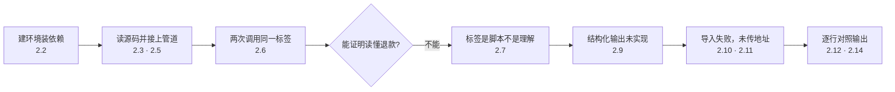
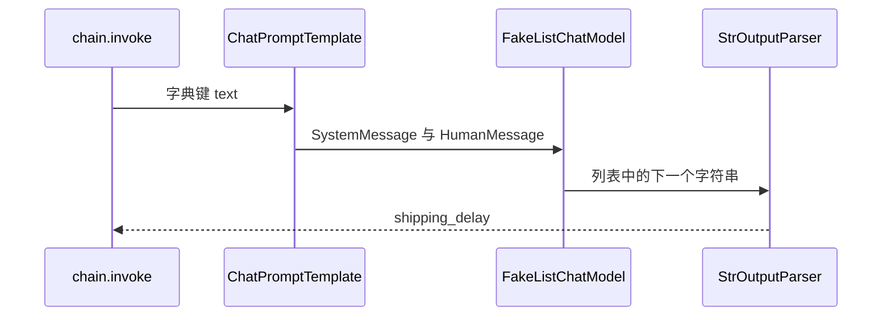

# 第 2 章 第一条链

> 本章导读：海岸优品的客户说「订单 OD-2049 物流延迟，请处理」。林舟要一条能复跑的链，拿回标签 shipping_delay，而不是一段闲聊。本章先在 demo 目录建虚拟环境，按 requirements.txt 装上钉死的包，再用提示词模板、假模型和字符串解析器接成管道。假模型按列表循环，不读提示词，第二次仍返回同一标签，所以本章不能证明它读懂了「退款」。后文的分类是关键词函数，不是这次的模型。结构化输出在这个假模型上抛出未实现错误。初始化聊天模型时因为缺少供应商包而导入失败，调用没有带上网关地址。读完本章，你能复跑这条链，把脚本结果、两条失败和未运行的网关草图分开。



*本章操作流程图*

## 你什么时候需要它

三种处境，对应三种读法。第 1 章已经把链和图分开。本章只做链上的那一次调用。

**你还没有虚拟环境，或者不确定装上的是不是 1.5.2。** 从 2.2 做起。命令以 [demo/README.md](../demo/README.md) 为准。装完再跑 `python run_all.py`，先核对 `chain_label` 那一段，不要先看后面几章的图。

**你想确认「提示词、模型、解析器」这三件是怎么接上的。** 读 2.3 到 2.6。动手标准是：能指出 `|` 两边各是什么对象，并能解释 `chain_again` 为什么仍是 `shipping_delay`。解释里必须出现「假模型不读输入」。没有这一句，就还停在「模型好像分了类」。

**你准备把链换成 `https://llm.example.com` 上的别名 `seashore-cs`。** 读 2.10 和 2.11，然后停。本章的 `init_chat_model` 没有成功，也没有把 `base_url` 传进去。密钥不进仓库。供应商包 `langchain-openai` 不进 `requirements.txt`。真正要接网关时去 LiteLLM 书，不要在这一章里补装。

| 你现在要的结果 | 该停在哪 | 不要提前做的事 |
| --- | --- | --- |
| 一个字符串标签 | 本章的链 | 不要先画 `StateGraph` |
| 查到运单和是否延误 | 第 3 章的 `lookup_order` | 不要把查单写进提示词，指望模型自己记得 |
| 按标签分支、暂停、开单 | 第 4 章以后的图 | 不要用这条链的返回值冒充工单 |
| 真模型、网关别名、密钥 | LiteLLM 书 | 不要执行 2.11 的草图 |

前置是第 1 章的名词：订单只有 `OD-2049`，三条客户话已经固定。本章只用其中的物流句，常量名是 `SHIPPING_TEXT`。退款句和周末句不进入 `chain.py` 的 `main`。

## 2.1 概述

一条链在这本书里就是三个可运行对象接成一次调用：提示词模板把字典填成消息，模型返回一条回复，解析器把回复收成下游要的类型。小帆的下游现在只要一个标签字符串。标签集合只有三个词：`shipping_delay`、`refund`、`other`。集合写在系统句里，也是后文章节 `classify` 的返回值范围。本章的解析器并不检查这个集合。

| 零件 | 本章用的类 | 输入 | 输出 | 这次它有没有读客户原文 |
| --- | --- | --- | --- | --- |
| 提示词 | `ChatPromptTemplate` | 字典，键是 `text` | `SystemMessage` 与 `HumanMessage` | 会。人类消息的内容就是填进去的原文 |
| 模型 | `FakeListChatModel` | 上面那两条消息 | 列表里的下一个字符串，包成 `AIMessage` | 不会。实现不看消息参数 |
| 解析器 | `StrOutputParser` | 模型的消息 | 纯字符串 | 不涉及理解，只取出文本 |

三次零件连在一起，打印出来的是 `shipping_delay` 这一个词。这个词来自构造模型时写下的 `responses=["shipping_delay"]`，不是模型在两个标签之间做了选择。

**业务上推荐先用这条假模型链把标签收成字符串，确认解析器没有改写内容，再决定要不要接网关。** 一上来就 `init_chat_model`，缺包、密钥和提示词会叠在同一次失败里。本章把缺包单独打成 `ImportError`，把「结构化输出还没实现」单独打成 `NotImplementedError`，把「假模型不读原文」单独打成第二次调用。三件事分开，后面才知道该改哪一层。

`with_structured_output` 不是这条链的一部分。`main` 在链跑完之后单独拿一个新的 `FakeListChatModel` 去调它，用来记录失败。不要把失败改写成「本章已经能返回字典」。`init_chat_model` 同样不是链的一段。它出现在文件末尾，是为了把「供应商包没装」留在输出里，避免读者以为环境已经能连模型。

和第 1 章的分工对一下：链解决一次调用。查单、工具循环、条件边、检查点、人工确认都不在 `chain.py`。文件没有导入 `lookup_order_record`，也没有工单句。物流字段要到第 3 章才从工具里出来。

## 2.2 虚拟环境与钉死的依赖

工作目录是 `books/langchain/demo`。链的代码在 `xiaofan_graph/chain.py`，但安装和复跑都从 demo 目录进行。不要在仓库根目录执行 `pip install`，否则虚拟环境和依赖文件会分开，下一章的 `import xiaofan_graph` 也会找错。

[demo/README.md](../demo/README.md) 写下的命令是：

```bash
cd books/langchain/demo
python3 -m venv .venv
. .venv/bin/activate
pip install -r requirements.txt
python run_all.py
```

五行各自的职责如下。

| 命令 | 它改变什么 | 本章要你确认的结果 |
| --- | --- | --- |
| `cd books/langchain/demo` | 当前目录 | 下一步的 `requirements.txt` 就是这一目录里的文件 |
| `python3 -m venv .venv` | 新建虚拟环境目录 | 解释器是 Python 3.12。本书不记录别的主版本 |
| `. .venv/bin/activate` | 当前 shell 改用这个环境的 `python` 与 `pip` | 提示符里出现环境名。没有激活就安装，包装进别的解释器 |
| `pip install -r requirements.txt` | 按文件安装 | 装上三行直接依赖。不要追加文件里没有的包 |
| `python run_all.py` | 按章调用每个 `main` | 开头一段就是 2.12 引用的输出。头一行 `## xiaofan_graph.chain` 是 `run_all.py` 打的 |

`python3 -m venv` 用的是标准库，不需要先装 `virtualenv`。激活脚本用的是 POSIX 的 `.`。本书不另写一套未运行过的激活命令。

依赖文件全文如下。注释是仓库里的原文，说明钉版本的日期，以及故意不装供应商包。

```text
# Pinned on 2026-11-27 after a local install (Python 3.12).
# No provider package: langchain-openai is intentionally absent.
# Model calls in this demo use FakeListChatModel / GenericFakeChatModel.
langchain==1.5.2
langgraph==1.2.24
langgraph-checkpoint-sqlite==3.1.3
```

直接钉住的只有这三行。`langchain-core` 1.8.5 是 2026-11-27 装完之后读到的传递依赖，第 1 章的版本表已经记下。它不出现在 `requirements.txt` 里。传递版本若在别的日子解析成另一版，本书不另做保证。复跑对不上 `chain_label` 时，先核对直接钉住的 `langchain==1.5.2`。

| 包 | 版本从哪来 | 本章用它的哪一块 | 本章不用它的哪一块 |
| --- | --- | --- | --- |
| `langchain` | 依赖文件钉 1.5.2 | `init_chat_model` 的导入与失败 | `create_agent` 留到第 3 章 |
| `langchain-core` | 传递依赖，2026-11-27 读到 1.8.5 | `ChatPromptTemplate`、`FakeListChatModel`、`StrOutputParser` | 不在依赖文件里再钉一行 |
| `langgraph` | 依赖文件钉 1.2.24 | 本章不调用 | 装上是为了后面的图，避免环境装两次 |
| `langgraph-checkpoint-sqlite` | 依赖文件钉 3.1.3 | 本章不调用 | 第 6 章才用 |
| `langchain-openai` | 不在文件里 | 不导入成功 | 错误消息里的 `pip install` 不要照做 |

`langchain-openai` 不写进依赖，是立场，不是遗漏。`init_chat_model("openai:gpt-4o-mini")` 的失败消息会建议安装它。照做会让同一次环境里同时存在「假模型链」和「可以构造供应商客户端」两套事实，后面就分不清某次输出是脚本还是网络。本书选择保持缺包，把 `ImportError` 留在输出里。

虚拟环境目录被仓库的 `.gitignore` 忽略：`books/langchain/demo/.venv/`。不要把 `.venv/` 提交。密钥文件同样不要提交。本章的代码路径上没有读取环境变量里的密钥，也没有把密钥写进参数。

装完之后的合格信号不是聊天窗口里的一段客服话，是 `run_all.py` 打印出 2.12 的那些键。只运行 `python -m xiaofan_graph.chain` 时，不会有 `## xiaofan_graph.chain` 这一行，那一行来自 `run_all.py` 的循环。本书引用的是带这一行的那次输出，所以复跑命令用 `python run_all.py`。

`run_all.py` 里和本章有关的形状是：按固定列表导入模块，先打印 `##` 加模块名，再调用 `main`。列表的第一项就是 `xiaofan_graph.chain`。因此链的输出出现在整次运行的最前面。后面的工具、直线图、条件边、检查点、人工确认和端到端，属于后文各章，本章引用时不把它们的行算进「链已经证明了什么」。

## 2.3 链的源码

2026-11-27 的 `books/langchain/demo/xiaofan_graph/chain.py` 全文如下。后文的走读按这个文本，不按记忆里的「大概写了个 prompt」。

```python
"""Chapter 2: one chain, no vendor key."""

from langchain_core.language_models import FakeListChatModel
from langchain_core.output_parsers import StrOutputParser
from langchain_core.prompts import ChatPromptTemplate

from xiaofan_graph.orders import SHIPPING_TEXT

SYSTEM = "只输出一个标签：shipping_delay、refund、other。"


def build_chain():
    prompt = ChatPromptTemplate.from_messages([
        ("system", SYSTEM),
        ("human", "{text}"),
    ])
    # Cycles: a second invoke returns the same string. It does not read the prompt.
    model = FakeListChatModel(responses=["shipping_delay"])
    return prompt | model | StrOutputParser()


def main() -> None:
    chain = build_chain()
    label = chain.invoke({"text": SHIPPING_TEXT})
    again = chain.invoke({"text": "这段输入假模型不会看"})
    print("chain_label", label)
    print("chain_again", again)
    prompt = ChatPromptTemplate.from_messages([
        ("system", SYSTEM),
        ("human", "{text}"),
    ])
    formatted = prompt.invoke({"text": SHIPPING_TEXT})
    print("prompt_roles", [type(m).__name__ for m in formatted.messages])
    print("prompt_human", formatted.messages[1].content)
    model = FakeListChatModel(responses=["shipping_delay"])
    try:
        model.with_structured_output(dict)
    except NotImplementedError as exc:
        print("structured_error", type(exc).__name__)
        print("structured_message", str(exc))
    from langchain.chat_models import init_chat_model
    try:
        init_chat_model("openai:gpt-4o-mini")
    except ImportError as exc:
        print("init_error", type(exc).__name__)
        print("init_message", str(exc))


if __name__ == "__main__":
    main()
```

文件没有网络客户端，没有密钥参数，没有订单字典。它从 `orders.py` 只拿了 `SHIPPING_TEXT`。这个常量的值是「订单 OD-2049 物流延迟，请处理」。订单号能在字符串里被眼睛看见，但本章没有把它解析进 `order_id` 字段。解析订单号是第 4 章 `classify` 的事。

模块文档字符串写明：一条链，没有供应商密钥。这是文件自己的边界，不是旁注。

## 2.4 逐块走读

### 2.4.1 导入

三行 `langchain_core` 导入对应概述表里的三个零件。模型来自 `langchain_core.language_models`，不是来自 `langchain_openai`。解析器来自 `langchain_core.output_parsers`。提示词来自 `langchain_core.prompts`。

`SHIPPING_TEXT` 的导入把客户话留在 `orders.py`。不要在 `chain.py` 里再写一遍这句话。写第二遍之后，订单模块改一个字，链的输入会悄悄分叉，`prompt_human` 就对不上第 1 章的案例表。

`init_chat_model` 不在文件顶部导入。它放在 `main` 的后半段，紧挨着会失败的那次调用。这样读文件时能看出：链的构造不依赖这个函数。就算导入失败的处理被删掉，`build_chain` 仍然成立。

### 2.4.2 系统句

```python
SYSTEM = "只输出一个标签：shipping_delay、refund、other。"
```

这一句同时做两件事，要把它们拆开。

第一件是约定标签集合。只准这三个英文词。中文「延误」「退款」不在集合里。模型若返回中文近义词，本章的解析器不会把它映射回去。假模型被写成只返回 `shipping_delay`，所以「近义词怎么处理」没有在这次运行里发生。后文若换真模型，不认识的字符串应走 `other` 那条回复，而不是悄悄翻译。这个规则本章没有代码，不要写成已经测过。

第二件是它只是提示词文本。`FakeListChatModel` 不读它。系统句里的「只输出一个标签」对这次运行没有约束力。约束力来自 `responses` 列表里只有这一个合法词。把系统句改成别的句子，只要不改 `responses`，`chain_label` 仍然会是 `shipping_delay`。本章没有做这个改写实验，所以上一句是对实现的阅读，不是另一条打印结果。

顿号隔开的三个词是中文句子里的列举。代码标识符仍然是半角的 `shipping_delay`。不要把标签改成中文常量名。第 5 章的条件边比的就是这三个英文字符串。

### 2.4.3 `build_chain`

函数做三步，然后返回组合对象。

第一步，`ChatPromptTemplate.from_messages` 接收一个列表。列表里是二元组，不是已经格式化好的消息。`("system", SYSTEM)` 表示系统角色，模板文本没有占位符，格式化之后内容不变。`("human", "{text}")` 表示人类角色，花括号里的 `text` 是稍后 `invoke` 字典的键。模板格式用的是 `from_messages` 的默认 `f-string`。本章没有传 `template_format`。

第二步，构造 `FakeListChatModel`。参数 `responses` 是字符串列表，不是 `AIMessage` 列表。列表只有一项。源码注释写了两句事实：第二次 `invoke` 返回同一个字符串；它不读提示词。这两句由 `chain_again` 的打印证实，见 2.6。

第三步，`return prompt | model | StrOutputParser()`。竖线是组合，不是按位或。返回值是一条可 `invoke` 的链。`build_chain` 每次调用都会新建一个模型实例，因此下标从 0 开始。`main` 只调用了一次 `build_chain`，然后对同一条链 `invoke` 两次，所以两次共用同一个会循环的模型。

### 2.4.4 `main` 里的两次调用

```python
chain = build_chain()
label = chain.invoke({"text": SHIPPING_TEXT})
again = chain.invoke({"text": "这段输入假模型不会看"})
print("chain_label", label)
print("chain_again", again)
```

第一次的字典值是物流句。第二次的字典值是一句故意写给读者看的中文：「这段输入假模型不会看」。它不是三条固定客户话之一，也不是退款句。选这句，是为了让输出本身带着「不要把第二次当成另一次分类」的提醒。

两次 `print` 的第一个参数是键，第二个参数是链的返回值。返回值里没有角色名，没有 `AIMessage` 的字样。这和链的末段是 `StrOutputParser` 一致。本次没有平行打印「去掉解析器」的对象，所以书里不出现一个编出来的 `AIMessage` 表示。

### 2.4.5 单独格式化提示词

链的 `invoke` 把提示词和模型裹在一起，打印标签时已经看不到消息对象。所以 `main` 又建了一次同样的模板，只调用模板，不调用模型：

```python
formatted = prompt.invoke({"text": SHIPPING_TEXT})
print("prompt_roles", [type(m).__name__ for m in formatted.messages])
print("prompt_human", formatted.messages[1].content)
```

`prompt.invoke` 返回的对象带有 `messages`。打印的是每条消息的类名，以及下标 1 的 `content`。下标 0 是系统消息，它的内容没有单独打印。系统消息的内容就是 `SYSTEM` 那个常量，这是源码能对上的，不是输出里的另一行。

这里的模板是新建的，不是从 `build_chain` 里取出来的。两边的 `from_messages` 参数相同。若有人只改了其中一处，`prompt_human` 仍可能正确，而链用的是另一套模板。本章的两处现在是相同的。复习时要两处一起看。

### 2.4.6 结构化输出的尝试

```python
model = FakeListChatModel(responses=["shipping_delay"])
try:
    model.with_structured_output(dict)
except NotImplementedError as exc:
    print("structured_error", type(exc).__name__)
    print("structured_message", str(exc))
```

这里又 `new` 了一个模型，避免和链上那个已经 `invoke` 过的实例搅在一起。调用的参数是内建的 `dict`，不是一个 Pydantic 模型，也不是三个标签的枚举。`try` 只接 `NotImplementedError`。别的异常会冒出去。2026-11-27 的输出说明接住的就是这一种。

这次调用没有进入 `except` 之外的成功路径。没有打印结构化结果。不要补一个 `{"label": "shipping_delay"}`。

### 2.4.7 `init_chat_model` 的尝试

```python
from langchain.chat_models import init_chat_model
try:
    init_chat_model("openai:gpt-4o-mini")
except ImportError as exc:
    print("init_error", type(exc).__name__)
    print("init_message", str(exc))
```

调用只有一个位置参数：`"openai:gpt-4o-mini"`。没有 `base_url`，没有 `temperature`，没有密钥。`except` 只接 `ImportError`。输出里的 `init_error` 是 `ImportError`，说明失败发生在导入供应商包，而不是发生在一个已经构造好的客户端发请求的时候。

模型名 `gpt-4o-mini` 是这次失败调用里的字符串。它不是星帆的网关别名。别名 `seashore-cs` 不在这个调用里。不要把两件事情并成「已经试过用小模型访问海岸优品的网关」。

### 2.4.8 入口

`if __name__ == "__main__"` 让文件可以单独当脚本跑。`run_all.py` 走的是另一条路：导入模块再调用 `main`，不会经过这个分支。两条路都会执行 `main` 的函数体。本书记录的输出带 `##` 头，来自导入那条路。

## 2.5 管道在这次调用里做了什么

`prompt | model | parser` 的阅读顺序就是数据方向。左边的输出交给右边。三个对象都实现了可组合的运行接口，所以竖线能接。接完得到的对象仍有 `invoke`。

对 `{"text": SHIPPING_TEXT}` 的那一次，数据经过下面四步。



*图 2-1：链上一次调用的数据方向。模型步不读取人类消息*

| 步骤 | 这一步的输入 | 这一步的输出 | 2026-11-27 的证据 |
| --- | --- | --- | --- |
| 填模板 | `{"text": "订单 OD-2049 物流延迟，请处理"}` | 两条消息 | `prompt_roles` 与 `prompt_human`。证据来自单独的模板调用，不是链内部的日志 |
| 调模型 | 那两条消息 | 字符串 `shipping_delay` | `chain_label`。模型不看消息，所以证据同时是「接上了」和「没读」 |
| 解析 | 模型产出的文本 | 同一个字符串 | 打印值里没有消息类名 |
| 再调一次 | 另一句中文 | 仍然是 `shipping_delay` | `chain_again` |

字典的键必须叫 `text`，因为模板写的是 `{text}`。本章没有用错误的键去调用，所以输出里没有格式化失败的原文。不要补一则 `KeyError` 或模板报错。键名若要改，模板和 `invoke` 一起改。

占位符只出现在人类消息上。系统消息没有 `{text}`，客户原文不会被填进系统角色。这是角色分离：系统句规定标签写法，人类消息承载这一次的客户话。假模型两句都不读，分离在这次运行里只影响 `prompt_roles` 能看见两个类，不影响标签。

`StrOutputParser` 的工作是把模型输出收成字符串。它的 `parse` 把收到的文本原样返回，不修剪三个标签之外的字符，也不在周围加引号。因此链能返回 `shipping_delay`，也能原样返回任何别的脚本字符串。列表若写成 `["你好"]`，链就会返回「你好」。本章没有这样改，输出里也没有「你好」。这里说明的是解析器的职责边界：它不负责「只准三个标签」。

为什么还要接解析器，而不是直接打印模型？因为链的下游在后文会拿这个值去做相等比较。比较的对象是字符串 `shipping_delay`，不是一个消息对象。解析器把这个约定固定在链的末尾。本次打印已经是纯字符串，和这个约定一致。

管道不会自动重试，不会自动记录轨迹，也不会在失败时换一个模型。这些都不是 `|` 的含义。Langfuse 的回调、网关的降级，都不在这条链上。本章没有初始化任何追踪客户端。

## 2.6 假模型循环，而且不读提示词

`FakeListChatModel` 在 `langchain-core` 1.8.5 里是给测试用的聊天模型。构造参数 `responses` 是字符串列表。每次生成时它取出当前下标上的字符串，作为这次的回复。下标还没到最后一项，就加一。已经在最后一项，就回到 0。这就是循环。列表只有一项时，每一次都落在这一项上，看起来像「模型很稳定」，其实是列表太短。

官方单元测试文档把这件事和另一个假模型分开写了（2026-11-27 对照，[Unit testing](https://docs.langchain.com/oss/python/langchain/test/unit-testing)）。`FakeListChatModel` 用字符串列表并会循环，适合只需要文本的测试。`GenericFakeChatModel` 用迭代器逐条返回，用尽为止，适合要排演工具调用的测试。第 3 章用后者。本章若误用迭代器，第二次 `invoke` 会在取下一项时失败。本章没有做那个误用，所以没有「迭代器耗尽」的输出。选用列表模型，是为了让第二次调用仍然返回字符串，从而把「不读输入」打出来。

不读输入，指的是生成函数不使用调用方传来的消息。消息被接上了，模板也格式化了，然后模型步骤把它们放下，只按列表回答。因此下面两句在这次运行里是同一结果：

| 次序 | 传入的 `text` | 打印键 | 打印值 |
| --- | --- | --- | --- |
| 第一次 | 订单 OD-2049 物流延迟，请处理 | `chain_label` | `shipping_delay` |
| 第二次 | 这段输入假模型不会看 | `chain_again` | `shipping_delay` |

第二次的句子若被一个会读原文的程序看见，它不会是物流延误。它甚至不是客户话。返回值仍是 `shipping_delay`，证明返回值没有经过对这句中文的判断。

这也是注释里 “Cycles” 和 “does not read the prompt” 要同时写的原因。只写循环，读者可能以为模型读了两次物流句。第二次根本不是物流句。只写不读，读者可能以为第二次会抛错或返回空。循环保证它仍返回列表里的那一项。

列表若有两项，例如先 `shipping_delay` 再 `refund`，第二次会返回第二项，那仍然不是「读懂了第二句」，只是下标前进了。本章的列表只有一项，输出不能用来演示两项轮转。不要把没出现的 `refund` 写进 `chain_again` 的右边。

`sleep` 这一类参数本章没有传。没有人为的停顿。流式接口本章也没有调用。文档和安装包里假模型可以按字符产出片段，那不是 2026-11-27 这次 `main` 的路径。

## 2.7 三个标签，以及证明不了退款

标签为什么是这三个，而不是一段自由中文，第 1 章已经定了案例。这里把原因收成一张决定表，避免链的系统句和后文的函数各写各的。

| 标签 | 案例里的客户话 | 本章的链有没有收到这句 | 谁负责在后文把它判出来 |
| --- | --- | --- | --- |
| `shipping_delay` | 订单 OD-2049 物流延迟，请处理 | 收到了。第一次 `invoke` | 第 4 章起的 `classify`：原文含订单号或「物流」，且不是退款 |
| `refund` | 订单 OD-2049 我要退款 | 没有收到 | `classify` 先看原文里有没有「退款」 |
| `other` | 你们周末上班吗 | 没有收到 | 上面两条都不中 |

`classify` 在 `linear.py` 里是一个普通函数：先判断「退款」是否出现在 `text` 里，再判断 `OD-2049` 或「物流」，否则 `other`。它不调用模型。第 7 章的同名函数用同一套关键词。本章的 `chain.py` 没有调用它。

因此出现了一个容易写错的句子：「小帆已经能分清退款。」这句话在本章不成立，有两个独立的原因。

1. 假模型不读输入。`chain_again` 把一句与退款无关、也与物流无关的话仍标成 `shipping_delay`。一个不看输入的函数，不能被说成理解了另一个没送进去的词。
2. 就算以后把退款句送进这条链，在 `responses` 仍是 `["shipping_delay"]` 的前提下，返回值还是 `shipping_delay`。那只能再一次证明脚本，不能证明分类器。本章连这次送入都没有做。退款句不在 `main` 的参数里。

物流句上，链的返回值和后文 `classify` 的返回值碰巧都是 `shipping_delay`。原因不同。链是因为列表里写了这个词。`classify` 是因为句子里有「物流」和订单号，并且没有「退款」。写笔记时分成两行。合成一行「模型与规则一致，所以模型是对的」，就把没发生的理解写成了结果。

系统句里虽然列出了 `refund` 和 `other`，列出不等于这次生成过它们。2026-11-27 的链输出里，标签只出现了 `shipping_delay`。`prompt_human` 只出现了物流句。

解析器也不把结果收成枚举。三个词是约定，写在系统句里，也写在后文的条件边上。本章若要强制三个词，需要另写一段检查，不在三个词里就改判 `other`。这段检查没有写，也没有一条输出显示「非法标签被改判」。不要把约定说成已有的校验。

和工单的边界同样清楚。标签不是工单。工单句「售后升级：订单 OD-2049 客户投诉物流延迟」不在本章的任何打印里。团队 `xbd-seashore-cs-team` 也不在。拿到 `shipping_delay` 之后若直接去创建工单，就越过了查单和人工确认。第 1 章的卡片已经把这个顺序钉死。本章停在卡片 B 的意图字符串上，而且这个字符串还不是 `classify` 写的。

## 2.8 解析器只交出字符串

`StrOutputParser` 放在管道最后，是为了下游拿到 `str`。它不调用模型，不访问网络，不看标签表。

| 问题 | 本章的答案 | 不要答成 |
| --- | --- | --- |
| 它验证标签吗 | 不验证。文本原样返回 | 「它保证只可能是三个词之一」 |
| 它会去掉空格或换行吗 | 本章的脚本没有空格和换行。解析器本身不做三个标签的修剪。本次输出就是 `shipping_delay` | 「它会自动清洗模型的客套话」 |
| 它和结构化输出是一回事吗 | 不是。结构化输出在 2.9，而且失败了 | 「字符串解析就是结构化」 |
| 打印为什么这么短 | `print` 的第二个参数就是这个字符串 | 不要补全成一句客服回复 |

如果将来真模型在标签前后加了一句解释，这个解析器会把整段解释交出去。下游拿去和 `shipping_delay` 比较会失败。那是解析层还没写的健壮性，不是本章已经处理的失败。本章的假模型没有加解释，所以这条失败没有出现在输出里。

把解析器拿掉，链的 `invoke` 会把模型的消息对象交出来。本章没有这样打印，因此 2.12 里看不到消息对象的表示。`prompt_roles` 那些类名来自模板，不是来自模型的返回。

## 2.9 结构化输出为什么是 NotImplementedError

调用点是 `model.with_structured_output(dict)`。模型是新的 `FakeListChatModel`，和链上那个实例不是同一个。参数 `dict` 表示希望得到字典。这个希望没有实现。

2026-11-27 的运行输出是：

```text
structured_error NotImplementedError
structured_message with_structured_output is not implemented for this model.
```

异常类型是 `NotImplementedError`。消息全文是 `with_structured_output is not implemented for this model.` 末尾有一个英文句点。引用时不要改成中文，也不要删掉句点。

安装包里的原因可以对照着读，但不要写成另一次实验。`FakeListChatModel` 继承聊天模型基类，自己没有实现 `with_structured_output`。基类在发现这个类也没有覆盖 `bind_tools` 时，抛出上面这句。也就是说，失败发生在「这个假模型不支持结构化输出」这一层，不是发生在字典模式和 Pydantic 模式的差别上。本章没有改用 Pydantic 再试一次，所以没有第二次结构化错误。

这和第 3 章的子类不是同一件事。第 3 章会覆盖 `bind_tools`，因为 `create_agent` 需要它。覆盖之后，基类的结构化输出路径可能会改走工具绑定。那条路径本章没有运行，第 3 章的 `main` 也没有调用 `with_structured_output`。不要把第 3 章的子类说成「结构化输出因此就能用了」。

官方文档字符串里有结构化输出的示例，那些示例构造的是另一个模型类，并且会 `invoke`。本书没有执行那些示例，也不引用它们的返回值。本章唯一的结构化输出事实，就是上面两行打印。

业务上，三个标签若要变成结构，后文用的是 Python 字典键 `intent`，由 `classify` 写入，不由 `with_structured_output` 写入。所以这条 `NotImplementedError` 不阻塞第 4 章。它阻塞的是「在假模型上直接要一个模式」这条捷径。捷径走不通，就保持字符串标签，把结构留给确定的函数。

## 2.10 `init_chat_model` 的 ImportError，以及没传的 `base_url`

调用点是：

```python
init_chat_model("openai:gpt-4o-mini")
```

2026-11-27 的运行输出是：

```text
init_error ImportError
init_message Initializing ChatOpenAI requires the langchain-openai package. Please install it with `pip install langchain-openai`
```

消息里的反引号是异常文本的一部分，来自安装包拼出来的安装提示，不是 Markdown 作者后加的。`class_name` 被填成 `ChatOpenAI`，包名被填成 `langchain-openai`，因为 `"openai:gpt-4o-mini"` 选择的提供者是 `openai`，对应的集成包模块是 `langchain_openai`。导入这个模块失败之后，安装包用 `ImportError` 重新抛出，并写上 `pip install` 提示。

这个失败发生在导入阶段。创建模型的函数还没有被调用，因此任何准备传给底层构造函数的关键字参数都还没有送进去。本次源码里本来也没有写那些关键字参数。两件事要一起说，避免只记住其中一件。

1. 调用语句没有 `base_url`，没有密钥，没有 `temperature`。
2. 就算写了 `base_url`，在 `langchain-openai` 仍未安装时，执行仍会停在导入，到不了底层构造函数。本章没有写 `base_url`，所以不把「写了也会失败」说成一条已经打印的输出。它是对安装包控制流的阅读。打印出来的，是没有这个参数的那次调用。

`langchain` 1.5.2 的 `init_chat_model` 文档字符串把 `base_url` 列在 `**kwargs` 的常见参数里，说明这些参数会传给底层聊天模型的构造函数，并把它描述为自定义 API 端点的 URL。同一段还列出 `temperature`、`max_tokens`、`timeout`、`max_retries`、`rate_limiter`。文档字符串同时写明：需要安装所选提供者的集成包，`openai` 对应 `langchain-openai`。还写明会抛出 `ImportError`，当集成包没有安装。这些句子说明参数名和失败类型在 1.5.2 的说明里。它们不说明本次已经用 `base_url` 构造成功。

文档字符串里的示例还包含安装 `langchain-openai` 之后再 `invoke` 的写法。那些示例不是小帆的代码，本书没有运行，不引用它们的回复。

错误消息建议 `pip install langchain-openai`。本章不执行这条建议。`requirements.txt` 的注释写明供应商包故意缺席。装上它会改变环境，使下一次同样的 `main` 不再抛出 `ImportError`，书里的输出就对不上。密钥仍然不该出现。没有密钥时，构造是否还会因别的原因失败，本章没有测，因为构造没有开始。

`gpt-4o-mini` 这个名字留在失败调用里，是一个具体的、没有发出去的模型字符串。它方便和网关别名区分。它不是推荐的生产模型，也不是海岸优品的别名。

提供者前缀 `openai:` 的含义是：用 OpenAI 集成包去构造。它不等于「请求一定发到 OpenAI 的公网主机」。发到哪一台主机，要看构造时的端点参数。本次构造没发生，所以不存在「发到了哪一台」的答案，也不存在 HTTP 状态码。

## 2.11 未运行的网关草图

LiteLLM 书把生产形态的主机名定为 `llm.example.com`，把海岸优品的模型别名定为 `seashore-cs`。团队名 `xbd-seashore-cs-team` 是工单所属的人，不是模型名。namespace `seashore-main` 是预算和资源的范围，也不是模型名。三个字符串都含有 seashore，不要并成一个。

下面这段只保留将来可能的形状。它没有放进 `chain.py`，没有放进 `requirements.txt`，没有在 2026-11-27 执行。

```python
# 未运行。不要执行这一段。
# 不要把密钥写进参数，也不要写进仓库。
# langchain-openai 仍然不加入 requirements.txt。
from langchain.chat_models import init_chat_model

init_chat_model(
    "openai:seashore-cs",
    base_url="https://llm.example.com",
)
```

草图里的 `"openai:seashore-cs"` 表示：仍走 `init_chat_model` 的 `openai` 提供者，但模型名用网关别名，而不是 `gpt-4o-mini`。`base_url` 用的是文档字符串列出的那个参数名，值是 LiteLLM 书的主机，带 `https`。本书没有安装 `ChatOpenAI`，没有打开它的构造函数去核对参数名是否原样接受 `base_url`。草图按 1.5.2 文档字符串的参数名来写，并因此整段标记为未运行。

密钥不在草图里。将来若要调用，密钥应留在网关进程或运行环境里，由 LiteLLM 书的虚拟密钥路径管理，不写进业务仓库，不写进章节示例。这里甚至不出现环境变量的名字，避免读者抄一个看起来像已接线的调用。

草图没有 `invoke`。没有客户话，没有标签，没有状态码，没有追踪编号。这些都还没有发生。把草图执行之后可能看到的正文写进书里，就是在编造模型回复。

和本次真实调用的对照：

| 项 | 2026-11-27 执行过的调用 | 2.11 的草图 |
| --- | --- | --- |
| 是否执行 | 执行了，结果是 `ImportError` | 未运行 |
| 模型字符串 | `openai:gpt-4o-mini` | `openai:seashore-cs` |
| `base_url` | 没有这个参数 | 写成 `https://llm.example.com`，但没有执行 |
| 密钥 | 没有 | 没有 |
| 是否出现在 `chain.py` | 出现在 `main` 末尾 | 不出现 |
| 能否当作小帆已经接入网关 | 不能 | 不能 |

`seashore-cs-fast` 是 LiteLLM 书里的降级别名。本章的草图不写它。降级是网关配置，不是这条链的 `|` 能表达的。本章没有请求，也就没有「主别名失败后改走快速别名」的记录。

## 2.12 2026-11-27 的运行输出

在 `books/langchain/demo` 下执行 `python run_all.py`，链这一段的打印如下。引用时整段照抄，不要只抄看起来像成功的两行。

```text
## xiaofan_graph.chain
chain_label shipping_delay
chain_again shipping_delay
prompt_roles ['SystemMessage', 'HumanMessage']
prompt_human 订单 OD-2049 物流延迟，请处理
structured_error NotImplementedError
structured_message with_structured_output is not implemented for this model.
init_error ImportError
init_message Initializing ChatOpenAI requires the langchain-openai package. Please install it with `pip install langchain-openai`
```

`prompt_roles` 的值是 Python 打印列表的默认形式：方括号、半角引号、半角逗号。不要改成中文顿号。`prompt_human` 后面没有额外的引号，因为 `print` 把字符串内容直接写了出来。

逐行对应源码：

| 输出行 | 哪一行代码打的 | 它证明什么 | 它不证明什么 |
| --- | --- | --- | --- |
| `## xiaofan_graph.chain` | `run_all.py` 在调用 `main` 之前 | 这一段属于链模块 | 不证明模块单独运行时也会有这一行 |
| `chain_label shipping_delay` | 第一次 `chain.invoke` | 管道返回了脚本里的标签 | 不证明模型读了物流句 |
| `chain_again shipping_delay` | 第二次 `chain.invoke` | 另一句输入没有改变返回值 | 不证明第二次输入被分类成物流 |
| `prompt_roles ['SystemMessage', 'HumanMessage']` | 模板 `invoke` 之后取类名 | 系统与人类两个角色都在 | 不证明模型使用了系统句 |
| `prompt_human 订单 OD-2049 物流延迟，请处理` | `formatted.messages[1].content` | 人类消息等于 `SHIPPING_TEXT` | 不证明订单号已被解析成字段 |
| `structured_error NotImplementedError` | `except` 分支 | 结构化输出这条路径失败 | 不证明别的模型类也失败 |
| `structured_message ...` | `str(exc)` | 失败原因是这个模型没实现该方法 | 不证明返回了空字典 |
| `init_error ImportError` | `except` 分支 | 初始化在导入时失败 | 不证明主机返回了某个 HTTP 状态 |
| `init_message ...` | `str(exc)` | 缺的是 `langchain-openai` | 不证明应该现在就安装它 |

八行 `main` 的打印加上一行模块头，就是本章的全部运行证据。没有第九行隐藏输出。复跑时若多了一行或少了一行，先确认跑的是不是这份 `chain.py`，以及 `langchain` 是不是 1.5.2。

## 2.13 失败对照

本章故意留下的失败，和真正写错链时的失败，不是同一类。对照着看，避免把「设计内的异常」修掉。

| 现象 | 是否出现在 2026-11-27 的输出 | 处理 | 错误的「修复」 |
| --- | --- | --- | --- |
| `NotImplementedError`，消息说结构化输出未实现 | 出现了 | 保持。链继续用字符串 | 换一个未运行的成功示例，写进书里当结果 |
| `ImportError`，消息要求安装 `langchain-openai` | 出现了 | 保持。不安装 | 把包写进 `requirements.txt` 再调用一次，使书中的错误消失 |
| 第二次输入不同，标签相同 | 出现了 | 把它当成「不读输入」的证据 | 改提示词，指望假模型忽然看懂 |
| 退款句没有对应的打印 | 没有这条输出 | 承认本章没跑退款句 | 用物流句的 `shipping_delay` 推断退款也会被正确标出 |
| 模板键写错 | 没有这条输出 | 不编造异常文本 | 在章节里写一个没见过的报错句子 |
| 网关超时或 401 | 没有 | 不写状态码 | 给草图补一个「应该会 200」 |

设计内的两条异常都被 `try` 接住了，所以 `run_all.py` 能继续打印后面的章节。接住不等于成功。成功的判据是异常类型和消息与上表一致。若某天 `init_error` 不再出现，先检查是不是有人装了 `langchain-openai`，而不是庆祝网关已经接通。

另一个方向的失败是静默的：程序退出码正常，`chain_label` 也正确，但结论写错。典型的写错是把 `chain_label` 当成模型能力。静默失败对不上某一行堆栈，只能对上 2.7 的两条规定。验收时要口头说出这两条，不能只贴成功的标签。

## 2.14 这次没有跑的事

下面这些事项没有出现在 2026-11-27 的运行里。列出来是为了阻止后文引用时「补全」。

| 事项 | 状态 | 若要做，去哪 |
| --- | --- | --- |
| `pip install langchain-openai` | 没有做 | 不做。依赖文件保持缺席 |
| `init_chat_model` 传入 `base_url` | 没有执行 | 2.11 只保留未运行的形状 |
| 对 `https://llm.example.com` 的 HTTP 请求 | 没有 | LiteLLM 书。本书不记录状态码 |
| 任何供应商的回复正文 | 没有 | 不要编 |
| 密钥、虚拟密钥、环境变量赋值 | 没有写进仓库，调用参数里也没有 | 保持没有 |
| `with_structured_output` 的成功返回 | 没有。抛了 `NotImplementedError` | 不要改口 |
| 把「订单 OD-2049 我要退款」送进链 | 没有 | 第 4 章以后用 `classify`，那是关键词 |
| 把「你们周末上班吗」送进链 | 没有 | 同上 |
| 调用 `classify` | 没有 | 第 4 章 |
| 流式输出 | 没有调用 | 本章不需要 |
| Langfuse 的 trace | 没有初始化 | Langfuse 书。第 8 章会再列一次边界 |
| 查单、运单号、工单句 | 不在本章输出里 | 第 3 章才出现运单号 |
| 用两项 `responses` 演示轮转 | 没有 | 不要把想象的第二次标签写进来 |
| 文档字符串里的 `invoke` 示例 | 没有执行 | 只借用 `base_url` 这个参数名的说明 |

没有跑，和跑了但失败，要分栏。结构化输出和 `init_chat_model` 是跑了但失败，证据在 2.12。网关草图是没跑。退款分类是没跑。把「失败」和「未运行」都说成「本章测过模型能力」，是同一种越界。

## 2.15 复跑时先看哪几行

时间只够看链，不必读完后文。在 demo 目录、已经激活的虚拟环境里执行 `python run_all.py`，然后只核对下面的判断。

| 你看到的 | 判断 |
| --- | --- |
| `chain_label` 与 `chain_again` 都是 `shipping_delay` | 接线与「不读输入」都还在 |
| `prompt_human` 是物流句全文 | 模板的人类消息没有被改写 |
| `structured_error` 仍是 `NotImplementedError` | 没有人把假模型的结构化输出写成已实现 |
| `init_error` 仍是 `ImportError`，消息仍提到 `langchain-openai` | 供应商包仍然不在环境里 |
| 输出里出现了密钥形状的字符串 | 停止。本章的源码不应该打出这种字符串。先看是不是跑了别的目录 |
| `chain_label` 变成一句长中文 | 停止。假模型的 `responses` 可能被改了，或者链没有走到解析器 |

整次 `run_all.py` 还会打印第 3 章及以后的段落。那些段落的解释不在本章。链这一段对不上时，先不要改图。图还没开始。

虚拟环境若没有激活，`python` 可能指向没有这些包的解释器，失败会变成 `ModuleNotFoundError: langchain_core` 一类。那不是 2026-11-27 记录下来的 `init_error`。本章的 `ImportError` 专指 `init_chat_model` 在 `langchain` 已能导入的前提下缺少 `langchain-openai`。两种缺包不要写成同一条消息。本次输出里没有 `ModuleNotFoundError`。

## 2.16 和后文怎么接

第 3 章不再用 `FakeListChatModel`。工具调用需要一条带 `tool_calls` 的 `AIMessage`，字符串列表表达不了。第 3 章改用 `GenericFakeChatModel` 的子类，并手写一轮循环，再交给 `create_agent`。最终那句中文仍然是脚本，不是本章这个标签的「展开说明」。

第 4 章的 `classify` 不读本章的链。物流句在两边都得到 `shipping_delay`，只是碰巧。评审时若看到有人删除 `classify`、改为调用本章的链，要问：退款句送进去返回什么？在假模型不被换成会读原文的实现之前，答案仍是 `shipping_delay`。那会把退款送进延误分支。这是未运行的推断，用来做代码评审，不是另一条打印。

本章的链可以继续留在仓库里，作为「没有密钥时管道仍能返回字符串」的固定检查。它不是生产分类器。生产分类器在本书的范围内就是关键词函数。真模型分类若要替换关键词，标签集合仍然只有那三个词，并且要有本章还没有的非法字符串处理。那一次替换不在 2026-11-27 的运行里。

## 本章小结

1. **第一条链是** `ChatPromptTemplate`、`FakeListChatModel` 与 `StrOutputParser` **用 `|` 接起来的一次调用。** 输入字典的键是 `text`。物流句走这条链，打印 `chain_label shipping_delay`。
2. **假模型按列表循环，不读提示词。** `chain_again` 的输入是「这段输入假模型不会看」，输出仍是 `shipping_delay`。这不能证明模型认识「退款」。退款句本次没有送进链。后文的 `classify` 是关键词函数。
3. **标签集合只有** `shipping_delay`、`refund`、`other`。集合写在系统句里，解析器不强制它。本章的输出只出现了第一个。
4. **`with_structured_output` 抛出** `NotImplementedError`，消息是 `with_structured_output is not implemented for this model.` 不要写成已经返回字典。
5. **`init_chat_model("openai:gpt-4o-mini")` 抛出** `ImportError`。构造没有开始，调用也没有传 `base_url`。文档字符串把 `base_url` 列为会传给底层构造函数的常见参数。指向 `https://llm.example.com`、别名 `seashore-cs` 的写法只是未运行的草图。密钥不进仓库，`langchain-openai` 不进依赖文件。
6. **下一步是工具，不是网关。** 第 3 章用另一个假模型演示一轮查单。开单和退款仍然不在工具里。

## 验收清单

- ☐ 动作：在 `books/langchain/demo` 创建虚拟环境，执行 `pip install -r requirements.txt`，并确认依赖文件里没有 `langchain-openai`。
- ☐ 动作：运行 `python run_all.py`，指出 `chain_label` 与 `chain_again` 两行，并说明第二次的输入不是物流句，也不是退款句。
- ☐ 动作：说出 `prompt_roles` 的两个类名，以及 `prompt_human` 对应 `SHIPPING_TEXT` 的全文。
- ☐ 动作：说明 `FakeListChatModel` 为什么第二次仍返回 `shipping_delay`，并说明这为什么不能证明模型读懂了「退款」。
- ☐ 动作：复述 `structured_error` 与 `init_error` 的异常类型和消息，并说明这次 `init_chat_model` 没有传入 `base_url`。
- ☐ 动作：指出未运行的网关草图，确认其中没有密钥，模型字符串是 `openai:seashore-cs`，地址是 `https://llm.example.com`。
- ☐ 动作：列出至少三件本章没有跑的事，其中要包括退款句分类、成功的结构化输出、以及向网关发出的请求。

## 参考速查

理解主线不依赖本节。参数以 2026-11-27 的 `chain.py` 和 langchain 1.5.2 的文档字符串为准。

| 名字 | 在本章的取值或含义 |
| --- | --- |
| `SYSTEM` | `只输出一个标签：shipping_delay、refund、other。` |
| 模板 | `("system", SYSTEM)` 与 `("human", "{text}")` |
| `responses` | `["shipping_delay"]`，一项，因此循环后仍是这一项 |
| 第一次输入 | `SHIPPING_TEXT`，即「订单 OD-2049 物流延迟，请处理」 |
| 第二次输入 | `这段输入假模型不会看` |
| 结构化调用 | `with_structured_output(dict)`，结果为 `NotImplementedError` |
| 初始化调用 | `init_chat_model("openai:gpt-4o-mini")`，结果为 `ImportError` |
| 文档中的 `base_url` | 常见关键字参数，传给底层构造函数。本次调用未使用 |
| 未运行草图 | `openai:seashore-cs` 与 `base_url="https://llm.example.com"` |
| 直接依赖 | `langchain==1.5.2`、`langgraph==1.2.24`、`langgraph-checkpoint-sqlite==3.1.3` |
| 传递版本 | `langchain-core` 1.8.5，不在依赖文件的钉死行里 |

## 延伸阅读

- **第 1 章（链和图各管什么）**——为什么分类可以先是一条链，以及为什么 `chain_label` 不能写成「模型已经理解客户」。版本表和案例名词也在那一章。
- **第 3 章（工具与一轮代理）**——字符串列表表达不了工具调用。下一章改用带 `bind_tools` 的假模型，查订单 `OD-2049`。
- **第 4 章的 `classify`**——用关键词区分退款、物流和其他。它才是「退款」两个字被认出来的地方，而且不经过本章的模型。
- **LiteLLM 书中关于 `llm.example.com` 与 `seashore-cs` 的章节**——网关别名和虚拟密钥的家。本章的草图标成未运行，就是为了把那件事留在那本书里。
- **LangChain 单元测试文档**（https://docs.langchain.com/oss/python/langchain/test/unit-testing）——`FakeListChatModel` 会循环，`GenericFakeChatModel` 按迭代器返回。本章用前者，下一章用后者。
