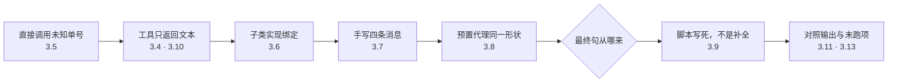
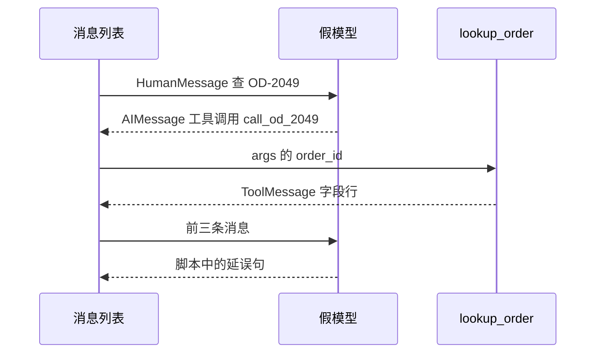

# 第 3 章 工具与一轮代理

> 本章导读：订单 OD-2049 要查承运和运单，不能靠模型现编。林舟这一章给小帆一个只查询的工具：未知单号 OD-0000 返回找不到，正确单号返回海岸优品、云途和运单号。手写的消息循环和预置代理走出同样的四类消息。通用假模型必须子类化并实现工具绑定，因为创建代理时会调用它；这次运行印出了模型节点和工具节点。最终那句延误写在脚本里，已过天数来自订单字典，不来自模型现编。工具函数里没有退款，也没有创建工单。读完本章，你能把查询、手写循环和一轮代理拆开，并拒绝把开单塞进工具。



*本章操作流程图*

## 你什么时候需要它

第 2 章的链只能交出一个标签字符串，而且那个字符串不看原文。客户要的下一件事是：订单 `OD-2049` 现在在哪一家承运、运单号是什么、过了几天。这件事是一次函数调用，不是再写一句提示词。

**你要把查单从模型的散文里拆出来。** 读 3.4 和 3.5。工具对 `OD-0000` 返回 `NOT_FOUND`，对 `OD-2049` 返回一整行字段。返回值是字符串，不是抛出的异常。读完要能指出：未知订单没有栈回溯。

**你要看懂「模型说要调工具，程序真的去调，再把结果送回去」。** 读 3.6 到 3.8。先看手写的四条消息，再看 `create_agent`。两边的类型序列相同。参数名是 `system_prompt`，不是 `prompt`。图上的业务节点叫 `model` 和 `tools`。

**你想让工具顺便退款或创建工单。** 停在 3.10。`lookup_order` 的函数体里没有退款，也没有工单句。副作用留到第 7 章，在人点头之后。本章的最终句子虽然写着「已延误」，它是脚本，不是已经开出的工单。

| 处境 | 选择 | 不要选的做法 |
| --- | --- | --- |
| 只有标签，还没查单 | 回到第 2 章 | 不要用标签字符串冒充运单号 |
| 要稳定的运单字段 | 本章的 `lookup_order` | 不要让模型凭记忆写 `YT-2049-88` |
| 要看一轮工具循环 | 手写循环或 `create_agent`，本章两个都跑 | 不要把业务分支写进这张预置图 |
| 要开单或退款 | 第 7 章的暂停 | 不要在 `@tool` 里写工单 |

前置：第 2 章的虚拟环境和 `pip install -r requirements.txt` 已经完成。本章不新装包，不安装 `langchain-openai`，不调用 `init_chat_model`。复跑仍是 demo 目录里的 `python run_all.py`。本章的证据是其中 `## xiaofan_graph.tools_agent` 那一段。

## 3.1 概述

一轮工具循环有固定的四步：人的消息进去，模型返回工具调用，程序执行工具并把结果包成 `ToolMessage`，模型再返回一段给客户的文本。小帆这一轮只做查单。订单号在脚本里写成 `OD-2049`。工具按这个号码去 `orders.py` 取记录。

| 角色 | 本章的对象 | 它能不能决定退款 |
| --- | --- | --- |
| 工具 | `lookup_order` | 不能。只返回 `NOT_FOUND` 或一行字段 |
| 假模型 | `FakeToolCallingModel` | 不能。它按迭代器交出事先写好的两条 `AIMessage` |
| 手写循环 | `run_manual_loop` | 不能。它只负责把消息接成列表 |
| 预置代理 | `create_agent` | 不能。它提供 `model` 与 `tools` 两个节点，不提供开单规则 |

**业务上推荐先把查单写成只返回文本的工具，并用假模型把一轮循环跑通；退款和开单不要放进工具。** 工具一旦能改状态，模型或脚本多写一次调用，款项和工单就出去了。查询错了还可以再查。退款错了不能靠「再调用一次」收回。第 1 章把这个边界定成立场，本章把它落在函数体里：`lookup_order` 没有第二个副作用。

`create_agent` 在 langchain 1.5.2 里返回编译后的图。本章用它，不是因为小帆的售后规则已经适合这张图，而是因为要看见预置的工具循环长什么样。延误才开单、退款必须人点头，仍然是后文条件边和 `interrupt` 的事。本章的代理没有检查点，没有 `interrupt`，也没有把三条客户话都跑一遍。

最终打印的那句「订单 OD-2049 已延误。运单 YT-2049-88，已过 9 天。」写在假模型的第二条消息里。它不是供应商的补全。脚本在工具执行之前就已经包含这句。读的时候把它当成接线完成的标记，不要当成模型读完工具结果后做的摘要。

## 3.2 这一章接手契约的哪一块

`orders.py` 里和本章有关的是 `ORDER_ID`、`lookup_order_record` 和 `record_as_text`。物流句 `SHIPPING_TEXT` 本章不使用。手写循环和代理用的人话是「查一下订单 OD-2049 的物流」。这句只出现在 `tools_agent.py`，不是三条固定客户话的替换品。订单号仍然是 `OD-2049`，所以查到的记录和全书是同一笔。

记录里的事实，本章的工具会把它们串成一行：

| 字段 | 值 | 是否出现在 `manual_tool` 那一行 |
| --- | --- | --- |
| 订单 | `OD-2049` | 出现 |
| 商家 | 海岸优品 | 出现 |
| namespace | `seashore-main` | 不出现。`record_as_text` 没有这个键 |
| 状态 | `shipped` | 出现 |
| 承运 | 云途 | 出现 |
| 运单 | `YT-2049-88` | 出现 |
| 发出日 | `2026-11-18` | 出现 |
| 已过天数 | `9` | 出现 |
| 承诺天数 | `7` | 出现 |
| 是否延误 | `true` | 出现，小写 |

`delayed` 写成小写 `true`，是 `record_as_text` 用 `str(flag).lower()` 的结果，不是模型决定的格式。namespace 留在订单字典里，供别的书对账，但这一行工具文本不带它。不要在阅读 `manual_tool` 时觉得 namespace 丢了，是格式函数没拼。

工单句和团队名也不在工具文本里。它们不是查单的返回值。草稿要到第 4 章才把工单句拼进去。

未知订单的契约是：`lookup_order_record` 在订单号不等于 `OD-2049` 时返回 `None`。工具把 `None` 译成字符串 `NOT_FOUND`。本次用 `OD-0000` 触发这条路径。别的未知号码是否打印过，没有。源码对所有非 `OD-2049` 的字符串都走 `None`，这是阅读函数得到的，不要为每个号码编一条输出。

## 3.3 源码全文

2026-11-27 的 `books/langchain/demo/xiaofan_graph/tools_agent.py` 如下。

```python
"""Chapter 3: a tool, a hand-written loop, and create_agent. No vendor key."""

from langchain.agents import create_agent
from langchain.messages import AIMessage, HumanMessage, ToolCall, ToolMessage
from langchain.tools import tool
from langchain_core.language_models.fake_chat_models import GenericFakeChatModel

from xiaofan_graph.orders import ORDER_ID, lookup_order_record, record_as_text


class FakeToolCallingModel(GenericFakeChatModel):
    """create_agent calls bind_tools. The stock fake model does not implement it."""

    def bind_tools(self, tools, **kwargs):
        return self


@tool
def lookup_order(order_id: str) -> str:
    """按订单号查询星帆出海的订单。未知订单号返回 NOT_FOUND，不要编造。"""
    record = lookup_order_record(order_id)
    if record is None:
        return "NOT_FOUND"
    return record_as_text(record)


def scripted_model() -> FakeToolCallingModel:
    return FakeToolCallingModel(messages=iter([
        AIMessage(
            content="",
            tool_calls=[ToolCall(
                name="lookup_order",
                args={"order_id": ORDER_ID},
                id="call_od_2049",
            )],
        ),
        AIMessage(content="订单 OD-2049 已延误。运单 YT-2049-88，已过 9 天。"),
    ]))


def run_manual_loop() -> list:
    model = scripted_model().bind_tools([lookup_order])
    messages = [HumanMessage(content="查一下订单 OD-2049 的物流")]
    ai = model.invoke(messages)
    messages.append(ai)
    for call in ai.tool_calls:
        messages.append(ToolMessage(
            content=lookup_order.invoke(call["args"]),
            tool_call_id=call["id"],
        ))
    messages.append(model.invoke(messages))
    return messages


def run_create_agent() -> dict:
    agent = create_agent(
        scripted_model(),
        tools=[lookup_order],
        system_prompt="你是星帆出海客服小帆。只根据工具结果回答，不要编造运单。",
    )
    return agent.invoke({
        "messages": [HumanMessage(content="查一下订单 OD-2049 的物流")],
    })


def main() -> None:
    print("tool_missing", lookup_order.invoke({"order_id": "OD-0000"}))
    manual = run_manual_loop()
    print("manual_types", [type(m).__name__ for m in manual])
    print("manual_tool", manual[2].content)
    print("manual_final", manual[3].content)
    result = run_create_agent()
    names = [type(m).__name__ for m in result["messages"]]
    print("agent_types", names)
    print("agent_final", result["messages"][-1].content)
    agent = create_agent(scripted_model(), tools=[lookup_order])
    print("agent_nodes", list(agent.get_graph().nodes))


if __name__ == "__main__":
    main()
```

模块文档字符串写明三件事：一个工具，一段手写循环，一次 `create_agent`。并且没有供应商密钥。文件里没有 `init_chat_model`，没有 `base_url`，没有工单常量 `TICKET`。

## 3.4 逐块走读

### 3.4.1 导入

`create_agent` 来自 `langchain.agents`。这是 langchain 1.5.2 的入口。不要从旧教程改回 `create_react_agent` 或 `AgentExecutor`。第 1 章已经把那些名字排除了。本章的源码没有导入它们。

消息类型来自 `langchain.messages`：`AIMessage`、`HumanMessage`、`ToolCall`、`ToolMessage`。`ToolCall` 是构造工具调用时用的字典形态。本章给它三个键：`name`、`args`、`id`。

`tool` 装饰器来自 `langchain.tools`。它把普通函数收成带名字、说明和参数模式的工具，从而有 `invoke`。

`GenericFakeChatModel` 来自 `langchain_core.language_models.fake_chat_models`。注意和第 2 章的 `FakeListChatModel` 不是同一个类，导入路径也不同。第 2 章那个类发字符串并会循环。这个类发迭代器里的下一条，不会绕回开头。

订单侧只导入查单所需的三件。不导入 `SHIPPING_TEXT`，是为了本章不会误把第 2 章的客户话当成工具循环的输入。

### 3.4.2 `FakeToolCallingModel`

```python
class FakeToolCallingModel(GenericFakeChatModel):
    """create_agent calls bind_tools. The stock fake model does not implement it."""

    def bind_tools(self, tools, **kwargs):
        return self
```

类的正文只有一个方法。`bind_tools` 接受工具列表和关键字参数，然后返回 `self`。它不保存工具，不检查名字，不把工具说明塞进提示词。返回 `self` 的意义是：绑定之后仍是同一个对象，迭代器还在。若返回一个新实例，新实例上没有原来的 `messages`，下一轮 `invoke` 就不是这两条脚本。

文档字符串只说明动机：`create_agent` 会调用 `bind_tools`，库存的假模型没有实现它。基类的 `bind_tools` 直接抛出 `NotImplementedError`。这是 langchain-core 1.8.5 里 `BaseChatModel.bind_tools` 的写法。本次运行没有去掉子类再跑一次，所以输出里没有那条未捕获的 `NotImplementedError`。运行证明的是子类存在时，`agent_nodes` 能被打印。基类会抛异常，是阅读安装包得到的，不是 3.11 里的一行。

官方单元测试文档给出了同一个模式：子类化 `GenericFakeChatModel`，让 `bind_tools` 返回自身，再交给 `create_agent`（2026-11-27 对照，[Unit testing](https://docs.langchain.com/oss/python/langchain/test/unit-testing)）。文档里的类名也叫 `FakeToolCallingModel`。文档的示例工具是天气，城市名不是本书的订单。本书没有运行天气示例，不引用那份文档里的温度句子。本书的工具是 `lookup_order`，调用编号是 `call_od_2049`。

### 3.4.3 `lookup_order`

```python
@tool
def lookup_order(order_id: str) -> str:
    """按订单号查询星帆出海的订单。未知订单号返回 NOT_FOUND，不要编造。"""
    record = lookup_order_record(order_id)
    if record is None:
        return "NOT_FOUND"
    return record_as_text(record)
```

装饰器下面的函数仍是查单。参数一个，类型是 `str`，名字是 `order_id`。这个名字必须和脚本里 `args` 的键一致。脚本写的是 `{"order_id": ORDER_ID}`。键若改成 `id`，而函数仍要 `order_id`，调用会失败。本章没有做这个错误实验，输出里没有对应的 `TypeError`。不要补一则。

文档字符串是工具的说明：「按订单号查询星帆出海的订单。未知订单号返回 NOT_FOUND，不要编造。」说明里的「不要编造」是写给人看的契约。假模型并不阅读这句说明。它的第一条消息在源码里已经指定了工具名和参数。说明文本没有出现在 2026-11-27 的打印里。

函数体两条路。记录是 `None`，返回 `"NOT_FOUND"`。记录不是 `None`，返回 `record_as_text(record)`。没有第三条路。没有 `raise`。没有写入工单，没有修改 `ORDER` 字典。`lookup_order_record` 返回的是字典的拷贝，工具即使改了局部变量，也不会改模块级订单。本章的工具没有去改它。

`@tool` 使这个函数带上 `invoke`。`main` 和手写循环都用 `invoke`，传入字典。直接调用 `lookup_order("OD-2049")` 的写法本章没有使用，也没有单独打印。工具的 `invoke` 会按参数模式把字典交给函数。本次 `OD-0000` 与 `OD-2049` 都走了 `invoke`。

### 3.4.4 `scripted_model`

每次调用都新建一个模型，并新建一个两项的迭代器。

第一条 `AIMessage` 的 `content` 是空字符串。`tool_calls` 里有一个 `ToolCall`：

| 键 | 值 | 是否被打印 |
| --- | --- | --- |
| `name` | `lookup_order` | 没有单独的输出行。手写循环用它找到的是同一个函数对象，因为循环没有按名字查找，而是直接调用了 `lookup_order` |
| `args` | `{"order_id": "OD-2049"}` | 没有单独打印。`ORDER_ID` 就是这个字符串 |
| `id` | `call_od_2049` | 没有单独打印。它被放进 `ToolMessage` 的 `tool_call_id` |

空的 `content` 加上工具调用，表示这一轮还没有给客户的句子。客户句子是迭代器的第二项，内容固定为「订单 OD-2049 已延误。运单 YT-2049-88，已过 9 天。」

第二项在 `scripted_model` 返回的那一刻就已经在迭代器里。此时 `lookup_order` 还没有执行。所以这句不可能是「根据刚才的工具结果生成的」。它和工具结果在事实上有重叠：订单号、运单号、已过 9 天。它也有省略：没有承运「云途」，没有承诺 7 天，没有商家，没有发出日。重叠来自作者把同一笔订单写进了两个地方，不是模型做了摘要之后删掉了部分字段。

`GenericFakeChatModel` 每次生成调用 `next` 取迭代器的下一项。取到字符串会包成 `AIMessage`，取到 `AIMessage` 就原样使用。本章两项都是 `AIMessage`。它的生成函数同样不读取传入的消息列表。因此系统提示、人的问题、工具结果，都不会改变下一条脚本。

迭代器用尽之后不能再取。文档提醒过：假模型不要在多个测试之间共享同一个迭代器。本章的 `scripted_model()` 每次返回新实例，就是为了避开这个耗尽。`main` 里三次调用 `scripted_model`：手写循环一次，带 `system_prompt` 的代理一次，只为打印节点的代理一次。第三次没有 `invoke`，所以那一个迭代器没有被消耗，输出里也没有第三句最终回复。

和第 2 章的循环不同。这里没有「下标回到 0」。多调一次就会在 `next` 上失败。本章的成功路径恰好每条新模型调两次：一次要工具，一次要最终句。没有第三次 `invoke` 的打印。

### 3.4.5 手写循环

`run_manual_loop` 把四步写在函数里，方便对照类型，而不是交给图。

1. `scripted_model().bind_tools([lookup_order])`。子类返回自身，所以后面的 `invoke` 仍从第一条脚本开始。
2. 消息列表先放一条 `HumanMessage`，内容是「查一下订单 OD-2049 的物流」。
3. `model.invoke(messages)` 得到第一条 `AIMessage`，追加到列表。
4. 遍历 `ai.tool_calls`。对每个调用，用 `call["args"]` 去 `lookup_order.invoke`，把返回的字符串放进 `ToolMessage`，`tool_call_id` 取 `call["id"]`。本章的脚本只有一个调用，所以只会追加一条 `ToolMessage`。
5. 再 `model.invoke(messages)`，把第二条 `AIMessage` 追加进去，返回整个列表。

循环没有 `if` 去判断要不要查。它相信模型这一轮给了 `tool_calls`。假模型被写成一定给。若第一条脚本没有工具调用，`for` 不执行，下一次 `invoke` 会直接交出最终句，工具不会跑。本章没有这种脚本，输出里的 `manual_types` 含有 `ToolMessage`，说明 `for` 至少追加了一条。

手写循环没有系统消息。列表从 `HumanMessage` 开始。这是它和 `run_create_agent` 在源码上的差别之一。类型序列却相同，因为代理返回的消息列表里也没有把系统消息算进去。见 3.8。

### 3.4.6 `run_create_agent`

```python
agent = create_agent(
    scripted_model(),
    tools=[lookup_order],
    system_prompt="你是星帆出海客服小帆。只根据工具结果回答，不要编造运单。",
)
return agent.invoke({
    "messages": [HumanMessage(content="查一下订单 OD-2049 的物流")],
})
```

三个参数里，模型是新的脚本模型，工具列表只有 `lookup_order`，系统提示是一句中文。参数名是 `system_prompt`。langchain 1.5.2 的 `create_agent` 签名用的就是这个名字。本章没有使用 `prompt=`。旧教程里的 `prompt` 参数不要抄进来。

系统提示的文字是：「你是星帆出海客服小帆。只根据工具结果回答，不要编造运单。」它要求根据工具结果回答。假模型做不到这件事，因为它不读工具结果。这句提示因此不是本次最终句子的原因。最终句子在进入 `create_agent` 之前就写在迭代器里。提示的作用是把「生产里希望模型遵守的约束」放在正确的参数上，方便以后换掉假模型时知道约束写在哪。换掉这件事本章没有做。

`invoke` 的输入是一个字典，键是 `messages`，值是只含一条人类消息的列表。人话和手写循环相同。返回值是字典。`main` 只使用了其中的 `messages`。别的键即使存在，也没有被打印。不要根据想象补一个 `structured_response`。本章没有传 `response_format`。

### 3.4.7 `main` 的三次打印组

`main` 按三个目的打印，中间没有交互输入。

第一组只有一行：`lookup_order.invoke({"order_id": "OD-0000"})`。这是直接调用工具，不经过模型，不经过代理。它专门留下未知订单的返回值。

第二组跑手写循环，打印类型列表、下标 2 的内容、下标 3 的内容。下标从 0 开始：0 是人，1 是第一条模型消息，2 是工具消息，3 是最终模型消息。源码用 `manual[2]` 和 `manual[3]`，和这个顺序绑定。若有人在列表开头插入系统消息，下标会错，打印会变成另一段文本。本次没有插入，输出与下标约定一致。

第三组跑 `run_create_agent`，打印返回消息的类型，以及最后一条的 `content`。它不打印中间那条工具消息的内容。因此工具正文的运行证据只有 `manual_tool` 一行。

然后 `main` 再 `create_agent` 一次，不 `invoke`，只把 `get_graph().nodes` 转成列表打印。这次构造没有 `system_prompt`。节点名不依赖那句系统提示。被 `invoke` 过的那个代理，它的节点列表没有单独打印。两边都传了工具，源码里节点名是固定的 `model` 与 `tools`。打印出来的是没有系统提示的那一次构造。

## 3.5 未知订单返回 `NOT_FOUND`，不抛异常

`main` 的第一行调用是：

```python
lookup_order.invoke({"order_id": "OD-0000"})
```

`OD-0000` 不是 `OD-2049`。`lookup_order_record` 返回 `None`。工具返回字符串 `NOT_FOUND`。打印键是 `tool_missing`。

这是一次普通返回。调用栈没有展开，进程没有因为未知订单而退出。`run_all.py` 能继续跑后面的章节，依赖的就是这一点。若这里改成 `raise KeyError`，本次输出不会是一行 `tool_missing`，而会是栈回溯。本章没有改成抛异常，所以没有栈回溯可引用。

| 订单号 | 本次是否调用 | 结果 | 结果的形态 |
| --- | --- | --- | --- |
| `OD-0000` | 调用了，直接 `invoke` 工具 | `NOT_FOUND` | 字符串，不是异常 |
| `OD-2049` | 调用了，经手写循环的 `tool_calls` | `manual_tool` 那一整行 | 字符串 |
| 空字符串或其他号码 | 没有在 `main` 里调用 | 无打印 | 不要编造一行输出 |

代理那一轮的脚本参数是 `OD-2049`，不是 `OD-0000`。所以 `agent_types` 里的 `ToolMessage` 不能用来证明「代理会处理未知订单」。未知订单只在直接调用里证明过。若要让代理看见 `NOT_FOUND`，需要另一条脚本，把 `args` 写成 `OD-0000`，并准备一条看到 `NOT_FOUND` 之后的回复。本章没有这条脚本。

`NOT_FOUND` 四个字母全大写，中间没有空格，没有中文句号。下游若要判断，就和这个字符串相等。不要同时使用「未找到」和 `NOT_FOUND` 两种写法。本章只返回后一种。

工具说明里写了「不要编造」。函数用返回值遵守这件事：没有记录就没有字段行，不会去拼一个假的运单号。假模型的最终句虽然含有真实运单号，那是脚本作者写的，而且那一轮的参数是真实订单号，工具也确实会返回这个运单号。未知订单的路径上，最终句根本没有生成。不要说「模型对 OD-0000 也能诚实回答」。它没有被问到。

## 3.6 为什么必须子类化 `bind_tools`

`create_agent` 在有工具、且没有另做结构化输出配置时，会在模型节点里调用 `bind_tools`，把工具列表交给模型。这是 langchain 1.5.2 里工厂函数的路径。库存的 `GenericFakeChatModel` 不覆盖 `bind_tools`，因此调用会落到基类，基类抛出 `NotImplementedError`，没有附加那句结构化输出的英文消息。第 2 章那句 `with_structured_output is not implemented for this model.` 是另一条路径，本章没有触发。

子类把 `bind_tools` 改成返回 `self` 之后，工厂拿到的仍是这个假模型。随后的 `invoke` 才会按迭代器往下走。2026-11-27 的 `agent_types` 和 `agent_nodes` 说明这条路径走通了。走通的含义是：绑定没有抛异常，图被编译出来，一轮调用产生了四条消息。

手写循环也调用了 `bind_tools`，尽管手写循环并不依赖绑定后的工具列表，因为工具是循环自己调用的。调用仍写在源码里，是为了和 `create_agent` 使用同一个模型类。若手写循环能跑、代理不能跑，差别就在代理内部那次绑定。本次两边都跑了。

| 做法 | 本章是否这样运行 | 预期 | 证据 |
| --- | --- | --- | --- |
| 子类 `bind_tools` 返回 `self` | 是 | 代理能编译并完成一轮 | `agent_nodes` 与 `agent_types` |
| 直接把 `GenericFakeChatModel` 交给 `create_agent` | 否 | 阅读安装包可知 `bind_tools` 会抛 `NotImplementedError` | 输出里没有这条栈。不要写成已经打出来的失败 |
| 在子类里绑定到一个新的空模型 | 否 | 会丢掉迭代器 | 没有这种输出 |
| 用第 2 章的 `FakeListChatModel` 充工具模型 | 否 | 那个类返回字符串，没有 `tool_calls` | 没有这种输出 |

官方文档把「返回自身」写成测试工具循环的固定手法，并提醒迭代器耗尽后不能复用。本章用函数 `scripted_model` 每次新建，与那个提醒一致。文档后半的 `pytest` 固件和 `InMemorySaver` 示例，本章都没有跑。检查点是第 6 章的题目。

`bind_tools` 的参数 `tools` 在子类里没有被使用。这意味着假模型不会因为绑定了 `lookup_order` 就学会只调用这个名字。脚本里的 `name` 是手写的 `lookup_order`。若脚本写成一个不存在的工具名，手写循环仍然只调用 `lookup_order` 这个函数，名字不一致也不会在本章被检查。代理路径会按工具名调度。本章没有做名字不一致的实验，两种路径的成功输出不能用来证明「名字写错也能跑」。脚本里的名字和函数名现在是一致的。

## 3.7 手写循环的四条消息

`manual_types` 的值是：

```text
['HumanMessage', 'AIMessage', 'ToolMessage', 'AIMessage']
```

按这个顺序读四条消息。

| 下标 | 类型 | 内容从哪来 | 本次打印了什么 |
| --- | --- | --- | --- |
| 0 | `HumanMessage` | 源码里的「查一下订单 OD-2049 的物流」 | 类型名。正文没有单独一行 |
| 1 | `AIMessage` | 迭代器第一项。空内容，工具调用 `call_od_2049` | 类型名。`tool_calls` 没有单独一行 |
| 2 | `ToolMessage` | `lookup_order` 对 `OD-2049` 的返回 | `manual_tool` 的整行字段 |
| 3 | `AIMessage` | 迭代器第二项 | `manual_final` 的那句中文 |

`manual_tool` 的全文是：

```text
order_id=OD-2049 merchant=海岸优品 status=shipped carrier=云途 tracking=YT-2049-88 shipped_at=2026-11-18 elapsed_days=9 promised_days=7 delayed=true
```

字段顺序由 `record_as_text` 固定。阅读时可以对上第 3.2 节的表。`delayed=true` 在行尾。已过 9 天，承诺 7 天，两个数字都在。人可以核对 9 大于 7，而不需要模型宣布「所以延误」。延误标记是数据里的 `delayed`，不是这句比较临时算的。`orders.py` 把 `delayed` 存成 `True`，格式化时变成小写。

`manual_final` 的全文是：

```text
订单 OD-2049 已延误。运单 YT-2049-88，已过 9 天。
```

句中的逗号和句号是中文全角，因为它们是脚本字符串的一部分。运单号和数字是半角。这行没有「云途」，没有「7 天」，没有工单句。和 `manual_tool` 并排看，就能看见最终句不是工具行的改写。

工具调用编号 `call_od_2049` 写在 `ToolCall` 的 `id` 里，并传给 `ToolMessage` 的 `tool_call_id`。输出没有单独打印这个编号。它是源码里的固定字符串，用来让工具结果能对上那一次调用。编号不是运行时随机生成的。若改成别的字符串，只要第一条消息和 `ToolMessage` 仍用同一个值，手写循环的类型序列不会变。本章没有改编号，所以没有「编号不一致」的输出。书里提到它，是因为源码写死了 `call_od_2049`，不是因为打印行里有这几个字符。



*图 3-1：手写循环的四步。假模型两步都不读列表里的正文*

图里第二次把前三条消息交给模型，只是 `invoke` 的参数。生成函数不看这个参数。箭头存在，阅读不存在。这个区别要用 `chain_again` 的精神来记：第 2 章用另一句输入证明不读。本章用「最终句在工具执行前就写在迭代器里」来证明不读。两条证据都来自源码结构。本章没有再塞一句无关的人话去做第三次调用。

## 3.8 `create_agent`：`system_prompt` 与节点名

`agent_types` 与 `manual_types` 的列表相同，都是 `HumanMessage`、`AIMessage`、`ToolMessage`、`AIMessage`。`agent_final` 与 `manual_final` 的字符串相同。相同，是因为两边各用了一个新的脚本模型，脚本的两项相同，工具对 `OD-2049` 又是确定的。相同不是因为 `create_agent` 在内部调用了 `run_manual_loop`。两边是两段代码。

代理返回的消息里没有 `SystemMessage`。系统提示不会变成结果列表的第 0 条。langchain 1.5.2 的实现是在调用模型时，若存在系统消息，就把它临时放在本次发给模型的列表前面。结果状态里保存的是模型产出和工具消息，不是那次临时拼接的完整输入。假模型又不读输入，所以这次运行不能证明系统提示已经到达模型。能证明的是：参数名用了 `system_prompt`，而 `agent_types` 仍然是四类、没有第五类 `SystemMessage`。

节点列表的打印是：

```text
['__start__', 'model', 'tools', '__end__']
```

| 节点 | 它是什么 | 本章有没有在这个名字上写业务 |
| --- | --- | --- |
| `__start__` | 图的入口 | 没有。不在 `add_node` 的业务名里 |
| `model` | 调用模型的节点 | 没有自定义逻辑。脚本模型被放进来 |
| `tools` | 执行工具的节点 | 工具只有 `lookup_order` |
| `__end__` | 图的出口 | 没有 |

`__start__` 与 `__end__` 是编译图自带的端点名字，打印时带双下划线。业务节点只有 `model` 和 `tools`。本章没有 `classify`、`draft`、`gate` 这些名字。那些是第 4 章以后自己的 `StateGraph`。不要把预置代理的节点改名去凑业务图，也不要在评审里说「代理已经有开单节点」。打印出来的四个名字里没有开单。

这次 `agent_nodes` 来自 `main` 末尾那次不带 `system_prompt` 的 `create_agent`。它没有 `invoke`。因此节点列表证明的是图的形状，不是又一次查单。带系统提示的那次已经用 `agent_final` 证明查单回合能结束。两件证据来自两次构造，不要并成「同一次 invoke 打印了节点」。

没有工具时，工厂可以只留模型节点。本章传了工具，所以列表里有 `tools`。本章没有再构造一个空工具列表的代理，输出里没有那种对照。

`create_agent` 还有 `checkpointer`、`interrupt_before`、`response_format` 等参数。本章都没有传。不传的后果是：没有线程记忆，没有在工具前暂停，没有结构化响应字段。这些缺省是本章的范围，不是遗漏的打印。人工暂停要用自己的图，第 7 章不再用这张预置图做开单。

系统提示和手写循环的差别可以收成一张表。

| 项目 | 手写循环 | `create_agent` |
| --- | --- | --- |
| 谁执行工具 | `run_manual_loop` 里的 `for` | 图的 `tools` 节点 |
| 系统提示 | 没有 | 第一次构造有，打印节点的那次没有 |
| 输入容器 | Python 列表 | `{"messages": [...]}` |
| 最终句 | `manual_final` | `agent_final`，文字相同 |
| 工具正文字段行 | 打印了 | 没有打印 |
| 节点名 | 没有图 | `model` 与 `tools`，外加入口和出口 |

## 3.9 最终句子是脚本，不是供应商补全

两处最终打印都是：

```text
订单 OD-2049 已延误。运单 YT-2049-88，已过 9 天。
```

这句话的出处是 `scripted_model` 里的第二个 `AIMessage`。要否定「这是模型读完工具后写的摘要」，看三个已经成立的事实。

1. 句子出现在迭代器的字面量里，位于任何 `invoke` 之前。
2. `GenericFakeChatModel` 的生成步骤取迭代器下一项，不读取消息参数。工具结果即使在列表里，也不参与产生这句。
3. 句子比 `manual_tool` 少了承运、承诺天数、商家和发出日。一个被要求「只根据工具结果回答」的实现，若真的在概括那一行，本章没有证据表明它做了删减。删减是因为作者就写了这么短。

系统提示里的「不要编造运单」因此也没有被这次运行验证。运单号 `YT-2049-88` 同时出现在订单字典和脚本里。脚本没有机会去编一个别的运单号，因为它不看输入，也没有第二个随机来源。验证「不编造」需要一个会读工具、并且在工具返回 `NOT_FOUND` 时不吐出运单号的模型。本章没有这种模型。

这句也不是工单。工单是「售后升级：订单 OD-2049 客户投诉物流延迟」。最终句里没有「售后升级」，没有团队 `xbd-seashore-cs-team`。坐席不能把 `agent_final` 抄进工单系统，当作已经开单。开单字符串要到人同意之后才写入状态。那是第 7 章。

和第 2 章的 `shipping_delay` 并排：

| 打印 | 文本 | 是不是模型理解的结果 |
| --- | --- | --- |
| `chain_label` | `shipping_delay` | 不是。字符串列表的一项 |
| `manual_final` / `agent_final` | 订单 OD-2049 已延误。运单 YT-2049-88，已过 9 天。 | 不是。迭代器的第二项 |

两章都用假模型证明接线。两章都不证明小帆会写客服回复。后文草稿函数会另写一句更长的话，包含承运、两个天数和工单句。那一句才是业务草稿。本章这句更短，是为了让脚本和草稿一眼能分开。不要把它们润色成同一句。

## 3.10 工具里不放退款和工单

`lookup_order` 的全部语句是取记录、判断 `None`、返回字符串。下面这些动作不在函数里，本章也没有别的工具。

| 动作 | 在不在本章的工具里 | 应该放在哪 |
| --- | --- | --- |
| 按订单号查询 | 在 | `lookup_order` |
| 未知订单返回 `NOT_FOUND` | 在 | 同上 |
| 登记退款 | 不在 | 不做成工具。退款要人确认，第 7 章 |
| 写入工单句 | 不在 | `interrupt` 恢复之后的 `gate` |
| 修改 `delayed` | 不在 | 数据在 `orders.py`，不由工具现算 |
| 调用模型 | 不在 | 模型在循环的另一侧 |
| 读取密钥或访问网关 | 不在 | 不在本书的 demo 里 |

若把退款写成 `@tool`，`create_agent` 的工具节点会在模型给出调用时执行它。假模型只要在脚本里写上退款工具的名字，款项相关的函数就会跑。本章的脚本只有 `lookup_order`，但这不是安全边界。安全边界是工具列表里根本没有退款函数。换一个会自己决定工具的模型时，这条边界仍然有效。

工单同样不进工具。工具返回的字段行可以被草稿引用。草稿不是工单。本章连草稿函数都没有。`manual_final` 提到延误，只说明脚本这么写，不说明工单已经存在。

直接调用 `OD-0000` 也没有创建「查无此单」的工单。它只返回四个字母。未知订单要不要升级给人，是后文条件边的规则，不是工具的 `else` 分支。本章的 `else` 就是 `NOT_FOUND`。

## 3.11 2026-11-27 的运行输出

`python run_all.py` 里本章这一段是：

```text
## xiaofan_graph.tools_agent
tool_missing NOT_FOUND
manual_types ['HumanMessage', 'AIMessage', 'ToolMessage', 'AIMessage']
manual_tool order_id=OD-2049 merchant=海岸优品 status=shipped carrier=云途 tracking=YT-2049-88 shipped_at=2026-11-18 elapsed_days=9 promised_days=7 delayed=true
manual_final 订单 OD-2049 已延误。运单 YT-2049-88，已过 9 天。
agent_types ['HumanMessage', 'AIMessage', 'ToolMessage', 'AIMessage']
agent_final 订单 OD-2049 已延误。运单 YT-2049-88，已过 9 天。
agent_nodes ['__start__', 'model', 'tools', '__end__']
```

头一行仍由 `run_all.py` 打印。其余七行来自 `main`，顺序与源码里的 `print` 顺序一致。

| 行 | 证明 | 不证明 |
| --- | --- | --- |
| `tool_missing NOT_FOUND` | `OD-0000` 的直接调用返回这个字符串 | 不证明代理被问过未知订单 |
| `manual_types` 四类 | 手写循环走完人、模型、工具、模型 | 不证明模型阅读了人话 |
| `manual_tool` 整行 | `OD-2049` 的字段格式与订单字典一致 | 不证明最终句是从这一行摘要来的 |
| `manual_final` | 第二条脚本被取出来了 | 不证明供应商生成了这句话 |
| `agent_types` 四类 | 预置代理的消息形状与手写循环相同 | 不证明系统提示出现在结果列表里 |
| `agent_final` | 代理路径的最后一条内容与脚本相同 | 不证明它遵守了「只根据工具结果」 |
| `agent_nodes` 四个名字 | 图含入口、`model`、`tools`、出口 | 不证明带 `system_prompt` 的那次构造被打印了节点。打印来自其后的另一次构造 |

列表的引号和逗号保持 Python 的默认打印。`agent_nodes` 里的名字用半角单引号包着，双下划线也在引号内。引用时不要把 `__start__` 写成 `START`。源码里添加节点用的是 `"model"` 和 `"tools"`。入口和出口的打印名带来下划线。

这次输出没有 HTTP 状态，没有追踪编号，没有密钥，没有 `ImportError`。第 2 章的失败留在链那一段。本章没有再次调用 `init_chat_model`。不要把两段输出接成「工具循环已经走网关」。

## 3.12 失败对照

本章没有像第 2 章那样故意接住异常。成功路径的打印就是证据。下面把「看起来像失败但本章没这么写」和「真写错时会怎样」分开。写错的那一列是对源码的阅读，不是另一份已经捕获的日志。

| 如果写成这样 | 本章实际怎么写的 | 2026-11-27 有没有对应的失败输出 |
| --- | --- | --- |
| 未知订单 `raise` | 返回 `NOT_FOUND` | 没有栈回溯。有 `tool_missing` |
| 不子类化，直接用 `GenericFakeChatModel` | `FakeToolCallingModel.bind_tools` 返回 `self` | 没有未捕获的 `NotImplementedError`。有 `agent_nodes` |
| `create_agent(..., prompt=...)` | 参数名是 `system_prompt` | 没有 `TypeError`。本章没写错误的参数名 |
| 工具里创建工单或退款 | 工具只返回文本 | 输出里没有工单句 |
| 最终句改成调用真模型 | 最终句是迭代器里的字面量 | 没有供应商回复 |
| 用 `FakeListChatModel` 返回 `"lookup_order"` 这几个字 | 用 `AIMessage` 的 `tool_calls` | 类型列表里有 `ToolMessage`，说明走的是工具消息，不是一个单词 |
| 手写循环与代理共用同一个迭代器 | 每次 `scripted_model()` 新建 | 两边都有最终句。没有耗尽迭代器的异常 |
| 把 `OD-0000` 写进代理脚本 | 代理脚本用 `ORDER_ID` | 代理的最终句仍是延误句，不是 `NOT_FOUND` |

静默的错误是：输出全部对得上，结论却写成「小帆根据云途的物流做了判断」。输出里最终句没有「云途」两个字。承运只出现在 `manual_tool`。判断延误的标记也在那一行的 `delayed=true`，不在最终句的生成过程里。最终句里的「已延误」三个字是作者写上的。

另一处静默错误是把 `agent_nodes` 理解成业务图已经完成。四个名字里没有草稿，没有人工确认。第 4 章会另起一张图，节点名不会是 `model` 和 `tools`。两张图并存是预定的。预置代理演示工具循环，业务图演示查单、草稿和分支。

## 3.13 这次没有跑的事

| 事项 | 状态 |
| --- | --- |
| 供应商模型的补全 | 没有。最终句是脚本 |
| `init_chat_model`、`base_url`、`https://llm.example.com` | 本章没有这些调用 |
| 安装 `langchain-openai` | 没有 |
| 密钥 | 没有出现在文件和输出里 |
| `with_structured_output` | 没有调用。不要从第 2 章的失败推断本章子类已经能结构化输出。本章没测 |
| 天气工具那份官方示例 | 没有运行。只采用了其中 `bind_tools` 返回自身的模式 |
| 代理路径上 `ToolMessage` 的正文 | 没有打印。字段行只引用 `manual_tool` |
| 工具调用编号 `call_od_2049` | 写在源码里，没有单独的打印行 |
| 带 `system_prompt` 的那次构造的节点列表 | 没有打印。`agent_nodes` 来自下一次不带系统提示的构造 |
| 去掉子类之后的 `bind_tools` 异常 | 没有跑。安装包里基类会抛 `NotImplementedError` |
| 退款工具、工单工具 | 不存在，也没有调用 |
| `OD-0000` 走进代理 | 没有。只直接调用了工具 |
| 空订单号、`OD-2050` 或其他号码 | 没有打印 |
| `interrupt`、检查点、`thread_id` | 没有。预置代理这次没传 `checkpointer` |
| 三条固定客户话 | 没有进入本章。人话是「查一下订单 OD-2049 的物流」 |
| Langfuse | 没有初始化 |
| 让工具抛异常 | 没有 |

未运行的官方天气示例不能拿来填补本章的输出。那份示例的城市、华氏度和断言都不是 `OD-2049`。本书的运行证据只到 3.11 的七行加一个模块头。

`pytest` 也没有被本章使用。`main` 用打印做固定检查，是为了和 `run_all.py` 的其他章节同一套跑法。文档里的固件写法可以作为以后把演示改成测试的参考，不是 2026-11-27 已经执行的文件。

## 3.14 手写循环还留着的理由

既然 `create_agent` 已经给出同样的类型序列和同样的最终句，手写循环看起来可以删。本章留下它，是为了让四条消息的下标可见。

代理把工具执行放进 `tools` 节点。读者看见 `agent_types` 时，知道中间有一条 `ToolMessage`，但看不见是哪一行 Python 把 `tool_call_id` 填上的。手写循环的 `for` 就是那一行。`call["id"]` 来自脚本的 `call_od_2049`。`call["args"]` 交给 `lookup_order.invoke`。这些赋值在代理内部也发生，只是不在 `tools_agent.py` 的函数体里。对照阅读时，手写循环是展开的形式，代理是收起来的形式。

留下的第二个理由是范围。手写循环没有系统提示，没有图。它不能暂停，也不能在进程重启后继续。这些限制使它不适合当小帆的最终形态。它适合当本章的对照。第 4 章开始，查单不再由模型决定调不调，而由直线边上的 `lookup` 节点对已经解析出的 `order_id` 调用。那是第三种形态：没有 `ToolMessage`，因为根本没有模型参与查单。三种形态不要并成「都是 Agent」。

| 形态 | 谁决定查单 | 消息里有没有 `ToolMessage` | 本章或后文 |
| --- | --- | --- | --- |
| 手写循环 | 脚本里的 `tool_calls` | 有 | 本章 |
| `create_agent` | 同样是脚本，图负责执行 | 有 | 本章 |
| 业务图的 `lookup` 节点 | 边，不由模型 | 没有这套消息 | 第 4 章 |

第三行是预告，不是本章的输出。本章的输出里两次都有 `ToolMessage`。

## 3.15 和订单事实怎么对

把 `manual_tool` 拆回订单字典，避免工具文本和案例各写一套。

| 打印中的片段 | 订单字典里的键 | 值 |
| --- | --- | --- |
| `order_id=OD-2049` | `order_id` | `OD-2049` |
| `merchant=海岸优品` | `merchant` | 海岸优品 |
| `status=shipped` | `status` | `shipped` |
| `carrier=云途` | `carrier` | 云途 |
| `tracking=YT-2049-88` | `tracking` | `YT-2049-88` |
| `shipped_at=2026-11-18` | `shipped_at` | `2026-11-18` |
| `elapsed_days=9` | `elapsed_days` | `9` |
| `promised_days=7` | `promised_days` | `7` |
| `delayed=true` | `delayed` | 布尔真，打印为小写 |

`namespace=seashore-main` 不在这张打印对照里，因为 `record_as_text` 没有拼接它。字典里仍然有这个键。别的书用它做网关侧的团队范围。本章的工具不需要用它做查询条件。查询条件只有订单号。

平台名「星帆出海」出现在工具的文档字符串里，也出现在系统提示里。它不是订单字段。打印行里看不到这四个字。代理没有把系统提示打出来，工具说明也没有打出来。

工程师林舟、客服小帆，仍然是贯穿案例里的人。本章的系统提示把模型称为小帆。假模型没有使用这个称呼，最终句里也没有「小帆」两个字。称呼写在提示里，不等于回复会带上它。

## 3.16 复跑时核对什么

环境与第 2 章相同：`books/langchain/demo`，虚拟环境已激活，依赖仍是那三行直接钉死。然后执行 `python run_all.py`，找到 `## xiaofan_graph.tools_agent`。

| 核对 | 通过时的样子 |
| --- | --- |
| 未知订单 | `tool_missing NOT_FOUND` |
| 四类消息 | `manual_types` 与 `agent_types` 两个列表相同 |
| 字段行 | `manual_tool` 以 `delayed=true` 结束，中间有 `YT-2049-88` 与 `elapsed_days=9` |
| 最终句 | 两处都是「订单 OD-2049 已延误。运单 YT-2049-88，已过 9 天。」 |
| 节点 | `agent_nodes` 含 `model` 与 `tools`，以及 `__start__` 与 `__end__` |
| 不该出现的 | 工单句、密钥、HTTP 状态、`ImportError` |

若 `manual_tool` 变成 `NOT_FOUND`，而订单号仍是 `OD-2049`，先看 `orders.py` 是不是被改成了另一套单号。本章的脚本用 `ORDER_ID` 常量。常量一旦不是 `OD-2049`，工具会按未知订单处理。不要在工具里为了「演示成功」写死返回值。返回值应来自 `record_as_text`。

若 `agent_nodes` 缺少 `tools`，先看 `create_agent` 是否还收到工具列表。空工具列表不是本章的源码。本章末尾那次构造把 `tools=[lookup_order]` 传了进去。

若最终句变成另一段中文，那是脚本第二项被改了。改之前要同时改书里对这句的引用。不要只改句子、留下旧的「已过 9 天」，否则读者无法知道哪一句才是 2026-11-27 的输出。

## 本章小结

1. **`lookup_order` 只查询。** `OD-0000` 返回 `NOT_FOUND`，不抛异常。`OD-2049` 返回包含海岸优品、云途、`YT-2049-88`、发出日、已过 9 天、承诺 7 天和 `delayed=true` 的一行。
2. **假模型必须能** `bind_tools`。`FakeToolCallingModel` 返回自身。这是官方单元测试文档里的模式。本次运行因此得到了 `agent_nodes`。库存基类会抛 `NotImplementedError`，但那次失败没有在本次输出里。
3. **手写循环和 `create_agent` 的消息类型都是** `HumanMessage`、`AIMessage`、`ToolMessage`、`AIMessage`。工具调用编号在源码里是 `call_od_2049`。
4. **参数名是 `system_prompt`，不是 `prompt`。** 结果消息里没有 `SystemMessage`。节点名是 `model` 和 `tools`，加上 `__start__` 与 `__end__`。
5. **最终句是脚本里的第二条 `AIMessage`，不是供应商补全。** 它在工具执行前就写好了。它不是工单句。
6. **退款和开单不在工具里。** 下一步是第 4 章的直线图：用关键词分类，再调用查单，不再依赖这一轮脚本去决定要不要查。

## 验收清单

- ☐ 动作：对 `OD-0000` 调用 `lookup_order`，确认打印是 `tool_missing NOT_FOUND`，并且没有异常栈。
- ☐ 动作：指出手写循环四条消息的类型顺序，并说明 `ToolMessage` 的 `tool_call_id` 来自源码里的 `call_od_2049`。
- ☐ 动作：说明 `FakeToolCallingModel.bind_tools` 为什么要存在，以及它返回的是 `self`。
- ☐ 动作：指出 `create_agent` 使用的参数名是 `system_prompt`，并说出 `agent_nodes` 的四个名字。
- ☐ 动作：说明「订单 OD-2049 已延误。运单 YT-2049-88，已过 9 天。」写在脚本的第二条消息里，不是供应商补全。
- ☐ 动作：读 `lookup_order` 的函数体，确认其中没有退款，也没有工单句。
- ☐ 动作：说出至少三件这次没有打印或不曾运行的事，其中要包括代理路径的工具正文、去掉子类后的异常，以及任何网关请求。

## 参考速查

理解主线不依赖本节。名字以 `tools_agent.py` 为准。

| 名字 | 本章的取值 |
| --- | --- |
| 未知订单 | `OD-0000`，返回 `NOT_FOUND` |
| 查到的订单 | `OD-2049` |
| 工具调用编号 | `call_od_2049` |
| 人话 | 查一下订单 OD-2049 的物流 |
| 系统提示 | 你是星帆出海客服小帆。只根据工具结果回答，不要编造运单。 |
| 最终句 | 订单 OD-2049 已延误。运单 YT-2049-88，已过 9 天。 |
| 类型序列 | `HumanMessage`、`AIMessage`、`ToolMessage`、`AIMessage` |
| 节点 | `__start__`、`model`、`tools`、`__end__` |
| `bind_tools` | 子类方法，返回 `self` |
| 不在工具里的事 | 退款、创建工单、访问网关 |

## 延伸阅读

- **第 2 章（第一条链）**——为什么字符串假模型不够用。它会循环，但不产生 `tool_calls`。本章改用迭代器，并且不再把第二次调用设计成绕回同一条字符串。
- **第 4 章（状态、节点、直线边）**——查单从「模型脚本点名」改成图上的固定节点。分类用关键词，不再用本章的最终句冒充草稿。
- **第 7 章（人工介入）**——开单和退款放在 `interrupt` 之后。本章坚持工具只查询，就是为了那一章还有暂停的对象。
- **LangChain 单元测试文档**（https://docs.langchain.com/oss/python/langchain/test/unit-testing）——`bind_tools` 返回自身的写法从这里来。文档中的天气示例不是本书的运行结果。
- **LiteLLM 书的网关别名**——本章没有调用 `seashore-cs`。模型仍是进程内的假对象。要换真模型时，先离开这一章，不要在工具函数里写密钥。
