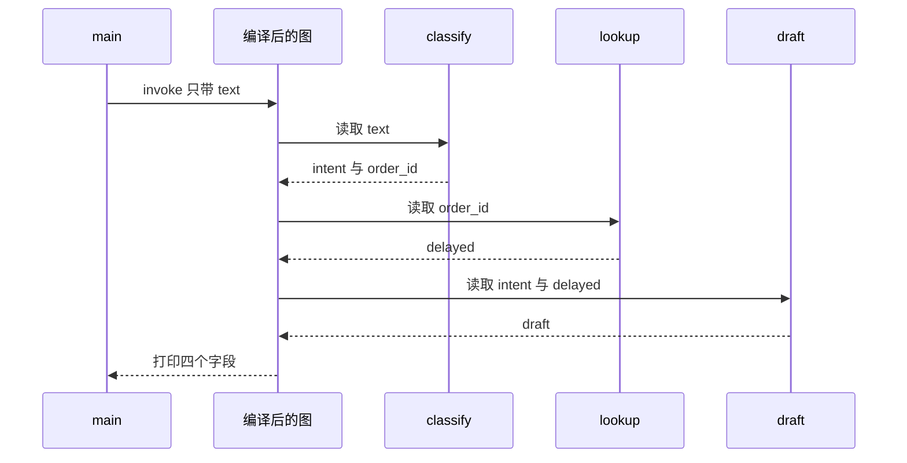

# 第 4 章 状态、节点与边

> 本章导读：海岸优品在星帆出海的订单 OD-2049 被客户催了一次物流。林舟要小帆先走一条没有分叉的路：用关键词写下意图，从订单数据写下是否延误，再拼出给坐席看的草稿。草稿里要出现云途、运单 YT-2049-88、发出日 2026-11-18，以及已过 9 天、承诺 7 天。三个节点各自交回改过的键，图负责合并。本章不用模型，也不做条件边和检查点。读完本章，你能编译这张直线，对上 2026-11-27 的 linear_draft，并说明下一次 invoke 不会记得这一次的草稿。


*本章操作流程图*

## 你什么时候需要它

三种处境，对应三种读法。前两章的链和工具循环先放在一边。

**你已经能从一句话得到标签，也查得到订单，但标签、布尔和草稿还散落在三个互不相干的函数调用里。** 从 4.2 读到 4.9，把这三个函数放进同一份 `SupportState`，用 `add_edge` 连成 `classify` → `lookup` → `draft`。读完用 4.10 的五行打印验收。不要在这一遍就加菱形。直线对不上，条件边会把错误放大。

**你想确认分类是不是又一次模型调用。** 读 4.5。`classify` 只看三个关键词条件：文中有「退款」就是 `refund`；否则文中有 `OD-2049` 或「物流」就是 `shipping_delay`；其余是 `other`。第 2 章的假模型固定返回 `shipping_delay`，它没有读原文。两处在物流句上结果相同，原因不同。本章的证据是关键词函数，不是供应商模型，也不是假模型。

**你准备把退款和「你们周末上班吗」也送进这张图，并期待它们绕过查单。** 先读 4.14，再去第 5 章。本章的四条边不读 `intent`。`draft` 里已经写好退款句和其他句，是为了第 5 章直接复用同一个函数。2026-11-27 的 `main()` 只把 `SHIPPING_TEXT` 送了进去，退款句和其他句没有出现在本章的打印里。

前置：能读 Python 函数和 `TypedDict`。第 1 章的六张卡片里，本章走到卡片 D 的草稿为止。卡片 E 的暂停是第 7 章的事。`langchain` 1.5.2 仍是全书基线，本章源码不导入它。图运行时来自 `langgraph` 1.2.24 的 `StateGraph`、`START` 与 `END`。

## 4.1 概述

小帆在本章要完成的是一次合并，不是一次聊天。调用方拿来一句客户话，走完三个节点，拿回一份含意图、订单号、延误布尔和草稿的状态。工单句出现在草稿正文里，状态字典还没有单独的 `ticket` 键。林舟在本章只能阅读这份草稿。点头、拒绝、把工单句写进独立字段，都还没有节点负责。

| 问题 | 本章的做法 | 留到后面的原因 |
| --- | --- | --- |
| 意图从哪来 | `classify` 看关键词 | 关键词集合只有三个词，不需要模型临时发挥 |
| 延误从哪来 | `lookup` 抄 `ORDER["delayed"]` | 9 天和 7 天写在草稿里给人看，代码不比较这两个数 |
| 下一站谁来选 | `add_edge` 写成固定顺序 | 条件边要等直线的补丁合并先被看懂（第 5 章） |
| 进程重启后草稿还在吗 | 不在。`compile()` 没有检查点 | 检查点是第 6 章的主题 |
| 草稿算不算已经开单 | 不算。句子以「拟开立工单」起头 | 真正写入 `ticket` 要等 `interrupt` 之后（第 7 章） |

三个节点共享的状态是下面这个类型。它只有业务键。

```python
class SupportState(TypedDict, total=False):
    text: str
    order_id: str
    intent: str
    delayed: bool
    draft: str
```

**业务上推荐先把物流句在这张直线上跑通，对上整行草稿，再把 `classify` 到 `lookup` 的固定边换成条件边。** 一上来就写路由，退款路径上的 `delayed` 是缺席还是 `False` 会混在一起。直线图里 `lookup` 一定执行，非 `OD-2049` 会得到 `False`。条件图里退款和闲聊不进 `lookup`，键保持缺席，`dict.get` 得到 `None`。这两件事要分成两章看。

本章模块是 [demo/xiaofan_graph/linear.py](../demo/xiaofan_graph/linear.py)。订单事实仍只在 [demo/xiaofan_graph/orders.py](../demo/xiaofan_graph/orders.py)。`linear.py` 从那里取 `ORDER`、`ORDER_ID`、`SHIPPING_TEXT`、`TEAM`、`TICKET`。它不取 `REFUND_TEXT`、`OTHER_TEXT`、`MERCHANT`、`NAMESPACE`，也不调用 `lookup_order_record`。商家海岸优品和 namespace `seashore-main` 留在订单字典里，供别的章节对账。本章草稿没有拼接这两项。

## 4.2 状态里有五个键

`SupportState` 的五个键和调用顺序绑在一起。先看谁写入、谁读取、空着表示什么。这张表是第 1 章 1.12 的前半段，`decision` 和 `ticket` 还没有出现。

| 键 | 谁写入 | 谁读取 | 本章入口时的情况 |
| --- | --- | --- | --- |
| `text` | 调用方，`invoke` 的参数 | `classify` | 物流句 `SHIPPING_TEXT` |
| `order_id` | `classify` | `lookup` | 还没有。原文里的字符要等节点抄进去 |
| `intent` | `classify` | `draft` | 还没有 |
| `delayed` | `lookup` | `draft` | 还没有。直线图走完之后才会有布尔 |
| `draft` | `draft` | 调用方打印 | 还没有 |

`text` 的值在本章是这一句，全书只此一句物流原文：

```python
SHIPPING_TEXT = "订单 OD-2049 物流延迟，请处理"
```

`classify` 用 `state.get("text", "")` 读取。键缺席时当成空字符串，从而走进 `other`。`main()` 始终传入这个键，所以 2026-11-27 的那次调用没有走缺省空串。

这五个键里没有 `messages`。第 3 章的 `create_agent` 状态是消息列表，节点名是预置图上的 `model` 与 `tools`。那边需要 `HumanMessage`，是因为假模型要消费消息。本章的分类不调用模型，客户话留在普通字符串 `text` 里即可。把消息列表并进 `SupportState`，检查点里会同时躺着闲聊记录和工单草稿，恢复时分不清这次等的是哪一个。第 6 章才会谈检查点，本章先把状态保持成这五键。

也没有 `n`。计数循环用另一份 `CountState`，在第 5 章，和订单图分开编译。不要为了「少一个类」把循环计数塞进售后状态。

`ticket` 这个单词在本章只作为常量 `TICKET` 出现在草稿句子中间。常量全文是：

```python
TICKET = "售后升级：订单 OD-2049 客户投诉物流延迟"
TEAM = "xbd-seashore-cs-team"
```

团队名拼在草稿末尾，告诉坐席这张单属于海岸优品的客服团队。本章没有调用任何团队接口。字符串在不在草稿里，只影响人眼对账。

## 4.3 total=False 让缺键合法

`TypedDict` 默认 `total=True`。类型检查器会要求构造 `SupportState` 时五个键都给出。本章的入口是 `{"text": SHIPPING_TEXT}`，`classify` 的返回值只有 `intent` 和 `order_id`，`lookup` 只有 `delayed`，`draft` 只有 `draft`。若把类型写成默认的全量必填，检查器会在这些字典上报缺键，和运行时的真实形状相反。

`total=False` 把注解里的每个键标成可以缺席。五个名字仍在类的 `__annotations__` 里。`StateGraph(SupportState)` 按这些注解建立通道，不会因为 `total=False` 少建通道。它允许某一次状态里暂时没有其中某些键。

2026-11-27 的运行没有执行 mypy 或 pyright，输出里没有「类型检查通过」这样的行。`total=False` 是写给读代码的人和类型检查器的。`invoke` 不会因为入参缺少 `draft` 而抛出类型错误。缺席的键就是不在字典里。第 5 章退款路径上 `out.get("delayed")` 得到 `None`，是这条规则的后续，不是 `lookup` 把值写成了 `None`。

和「缺席」相对的是「写入一个确定的值」。`lookup` 在订单号不是 `OD-2049` 时返回 `{"delayed": False}`。`False` 是写入。空字符串 `""` 也是写入：`classify` 在原文不含 `OD-2049` 时把 `order_id` 设为 `""`，而不是省略这个键。`draft` 里用 `state.get("order_id")` 做判断的代码在 `lookup`，空字符串不等于 `ORDER_ID`，于是 `delayed` 为 `False`。

因此读状态时要分清三件事。

| 现象 | 含义 | 本章谁造成它 |
| --- | --- | --- |
| 键不在字典里 | 还没有任何节点写过它 | 入口时的 `intent`、`delayed`、`draft` |
| 键在，值是 `""` | 节点明确写下了空字符串 | 原文没有订单号时的 `order_id` |
| 键在，值是 `False` | 节点明确写下了布尔假 | 订单号对不上时的 `delayed` |

`main()` 对直线图使用 `out["intent"]`、`out["order_id"]`、`out["delayed"]`、`out["draft"]`，用的是下标，不是 `get`。这四次下标都没有抛异常，说明走完 `SHIPPING_TEXT` 之后这四个键都在。`text` 有没有留在返回值里，这次打印没有涉及，4.4 单独说明。

## 4.4 节点返回补丁

三个节点的返回值都是只含自己职责的字典。

| 节点 | 返回的键 | 不返回的键 |
| --- | --- | --- |
| `classify` | `intent`、`order_id` | `text`、`delayed`、`draft` |
| `lookup` | `delayed` | 其余四个 |
| `draft` | `draft` | 其余四个 |

LangGraph 对这种没有额外合并函数的键，约定是：返回值里出现的键覆盖旧值，没出现的键保持原样。本章的五个键都没有 `Annotated` 归约器，也没有 `operator.add`。后写的同名键会替换先写的同名键。这条直线每个超步只有一个节点，不会出现两个节点在同一步里写 `draft`。

把物流句按这个约定铺开。中间各行是按返回值推演的，没有单独的打印。最后一行里 `intent`、`order_id`、`delayed`、`draft` 的值与 4.10 的打印一致。`text` 一列没有被任何节点改写，也没有被打印，所以表里只写「入口给过」。

| 时刻 | `intent` | `order_id` | `delayed` | `draft` |
| --- | --- | --- | --- | --- |
| `invoke` 传入，仅有 `text` | 缺席 | 缺席 | 缺席 | 缺席 |
| `classify` 返回之后 | `shipping_delay` | `OD-2049` | 缺席 | 缺席 |
| `lookup` 返回之后 | `shipping_delay` | `OD-2049` | `True` | 缺席 |
| `draft` 返回之后 | `shipping_delay` | `OD-2049` | `True` | 4.11 的那一整句 |

调用方如果在节点里 `return state`，或 `return {**state, "intent": intent}`，这次物流句往往也能得到同样的四个打印值。本书仍然要求只返回补丁。原因写在职责上：节点不拥有的键不该从它的返回值里再写一遍。后面一旦某个键有了归约器，整包展开会把旧值再交回去一次。本章还没有归约器，这个习惯先在直线上养成。

节点返回 `None` 的路径不在本文件里。三个函数每个分支都返回字典。不要根据别的教程补一个 `return None` 再声称它等价于空补丁。那条行为没有出现在 2026-11-27 的输出里。



*图 4-2：物流句在直线上的三次补丁。中间状态没有单独打印，最终四字段与运行输出一致*

## 4.5 classify 是关键词函数

`classify` 不导入模型，不构造消息，不调用 `init_chat_model`。全文如下。

```python
def classify(state: SupportState) -> dict:
    text = state.get("text", "")
    if "退款" in text:
        intent = "refund"
    elif ORDER_ID in text or "物流" in text:
        intent = "shipping_delay"
    else:
        intent = "other"
    order_id = ORDER_ID if ORDER_ID in text else ""
    return {"intent": intent, "order_id": order_id}
```

意图和订单号是两次独立判断。意图走 `if / elif / else`，命中即停。订单号只看 `ORDER_ID` 是否出现在原文里，和意图分支互不赋值。`ORDER_ID` 是字符串 `OD-2049`。

| 顺序 | 条件 | `intent` | 和订单号的关系 |
| --- | --- | --- | --- |
| 1 | 原文包含「退款」 | `refund` | 订单号仍单独判断。含 `OD-2049` 就写上，不含就写 `""` |
| 2 | 上一行不成立，且原文包含 `OD-2049` 或「物流」 | `shipping_delay` | 同上 |
| 3 | 其余 | `other` | 同上 |

「退款」放在第一支，是为了让同时出现的字按固定优先级落在退款上。物流句 `SHIPPING_TEXT` 不含「退款」，含 `OD-2049`，也含「物流」，所以走到第二支，`intent` 为 `shipping_delay`，`order_id` 为 `OD-2049`。这与 `linear_intent`、`linear_order` 两行一致。

下面三句是全书固定客户话。只有第一句在本章被 `invoke`。后两句按同一个函数可以推出来，推演不是本章的打印。

| 原文 | `intent` | `order_id` | 是否出现在本章运行输出 |
| --- | --- | --- | --- |
| 订单 OD-2049 物流延迟，请处理 | `shipping_delay` | `OD-2049` | 是 |
| 订单 OD-2049 我要退款 | `refund` | `OD-2049` | 否。`linear.py` 没有导入这句 |
| 你们周末上班吗 | `other` | `""` | 否 |

退款句同时含「退款」和 `OD-2049`。第一支先命中，意图是 `refund`，订单号仍然是 `OD-2049`。周末那句三个条件都不含，意图是 `other`，订单号是空字符串。空字符串是写进去的值。

还有一条源码上成立、运行没走过的组合：原文只有「物流」，没有订单号。意图是 `shipping_delay`，订单号是 `""`。第 5 章的路由会因为订单号为空而跳过查单。本章的直线边不看这个区别，`lookup` 仍会执行，并因为订单号不是 `OD-2049` 写下 `delayed` 为 `False`。

分类结果只有这三个字符串：`refund`、`shipping_delay`、`other`。函数不会返回「延误」或 `shipping`。下游用等号比较，多一个字就进不了对应分支。

## 4.6 lookup 只抄 delayed

`lookup` 不计算日期，不拼运单文本，也不调用第 3 章那个返回 `NOT_FOUND` 的工具。

```python
def lookup(state: SupportState) -> dict:
    if state.get("order_id") != ORDER_ID:
        return {"delayed": False}
    return {"delayed": bool(ORDER["delayed"])}
```

第一支：`order_id` 缺席、空字符串或任何不是 `OD-2049` 的值，都写成 `False`。`state.get` 在键缺席时得到 `None`，`None != "OD-2049"` 成立，所以缺席也落在这一支。直线图里 `classify` 总是先执行并写入 `order_id`，因此本章实际走到 `lookup` 时，这个键是字符串。防御性的 `get` 仍然留着，避免节点被人单独调用时抛 `KeyError`。

第二支：订单号恰好是 `OD-2049` 时，写下 `bool(ORDER["delayed"])`。订单字典里这个字段已经是 `True`。`bool(True)` 仍是 `True`。2026-11-27 的 `linear_delayed True` 对的是这一支。

日期在订单字典里是并列的数据，不是算式的输入。

| 字段 | 值 | 本章谁使用 |
| --- | --- | --- |
| `delayed` | `True` | `lookup` 读取并写入状态 |
| `elapsed_days` | `9` | 只有 `draft` 把它写进句子 |
| `promised_days` | `7` | 只有 `draft` 把它写进句子 |
| `carrier` | 云途 | 只有 `draft` |
| `tracking` | `YT-2049-88` | 只有 `draft` |
| `shipped_at` | `2026-11-18` | 只有 `draft` |
| `merchant` | 海岸优品 | 本章草稿不读 |
| `namespace` | `seashore-main` | 本章草稿不读 |
| `status` | `shipped` | 本章不读 |

人可以在草稿里看到「已过 9 天，超过承诺的 7 天」，用来核对数据本身是不是 9 大于 7。代码路径上没有 `elapsed_days > promised_days` 这个表达式。假如有人改了天数却忘了改 `delayed`，`lookup` 仍会返回字典里的布尔。本章不演示那个改法，订单字典保持这一组值。

`lookup` 对未知订单号写 `False`，不抛异常，也不写 `None`。第 3 章的 `lookup_order` 工具对未知订单号返回字符串 `NOT_FOUND`。两个函数不要合并。直线图需要的是草稿分支能判断的布尔，不是一行给模型看的工具文本。

## 4.7 draft 的四条字符串

`draft` 按 `intent` 和 `delayed` 选择四句中的一句，并且只返回 `{"draft": text}`。

```python
def draft(state: SupportState) -> dict:
    intent = state.get("intent")
    if intent == "shipping_delay" and state.get("delayed"):
        text = (
            f"订单 {ORDER_ID} 由{ORDER['carrier']}承运，运单 {ORDER['tracking']}，"
            f"{ORDER['shipped_at']} 发出，已过 {ORDER['elapsed_days']} 天，"
            f"超过承诺的 {ORDER['promised_days']} 天。"
            f"拟开立工单：{TICKET}。团队 {TEAM}。"
        )
    elif intent == "refund":
        text = f"拟为订单 {ORDER_ID} 登记退款申请。退款不会自动执行。"
    elif intent == "shipping_delay":
        text = "未查到可判定延误的订单，请核对订单号。"
    else:
        text = "已记下。请给出订单号，或说明是物流还是退款。"
    return {"draft": text}
```

分支顺序就是上面源码的顺序。第一支要求意图等于 `shipping_delay`，并且 `state.get("delayed")` 为真。`True` 满足。缺席时 `get` 得到 `None`，`None` 不满足，于是落到后面的 `elif`。本章物流句的 `delayed` 已经是 `True`，所以命中第一支。

| 分支 | 草稿全文 | 本章 `main()` 是否走到 |
| --- | --- | --- |
| 延误且 `delayed` 为真 | 见 4.11，与 `linear_draft` 同一句 | 走到了 |
| 意图为 `refund` | 拟为订单 OD-2049 登记退款申请。退款不会自动执行。 | 没有走到 |
| 意图为 `shipping_delay`，但上一支不成立 | 未查到可判定延误的订单，请核对订单号。 | 没有走到 |
| 其余，包括 `other` | 已记下。请给出订单号，或说明是物流还是退款。 | 没有走到 |

后三句提前写在这里，是因为第 5 章的路由图会 `from xiaofan_graph.linear import draft`，不再复制一份字符串。退款句必须在本章就存在，第 5 章才谈得上「复用」。第 7 章的暂停图自己另写了一份 `draft`，退款句末尾多了「需要人工确认」。那是后文的文本。本章和下一章都以这一份为准：退款句到「退款不会自动执行。」结束，不含工单常量 `TICKET`。

第一支用的是真值判断，不是 `delayed is True`。本章写入的就是布尔 `True`。不要在没跑过的情况下改成别的哨兵值。

`draft` 不读取 `text`。客户原话不会被原样贴进草稿。物流草稿里的订单号来自常量 `ORDER_ID`，不是再去原文里搜一遍。因此分类阶段若把订单号抄错，草稿不会自己纠正。本章物流句的分类结果是对的，所以草稿里的订单号也是 `OD-2049`。

## 4.8 START、END 与四条直线边

图的装配全部在 `build_linear`。

```python
def build_linear():
    builder = StateGraph(SupportState)
    builder.add_node("classify", classify)
    builder.add_node("lookup", lookup)
    builder.add_node("draft", draft)
    builder.add_edge(START, "classify")
    builder.add_edge("classify", "lookup")
    builder.add_edge("lookup", "draft")
    builder.add_edge("draft", END)
    return builder.compile()
```

`add_node` 的第一个参数是字符串名字，第二个参数是函数。条件边、`draw_mermaid` 和报错信息都用这个字符串，不用函数的 `__name__`。本文件里两者碰巧相同。若写成 `add_node("cls", classify)`，图上的名字是 `cls`。本章没有这样写，2026-11-27 的布尔检查找的是子串 `classify`。

`START` 和 `END` 从 `langgraph.graph` 导入。`START` 表示入口，`END` 表示这次 `invoke` 可以返回。它们不是 `add_node` 登记的业务节点。业务节点只有三个。

四条边都不带条件。

| 边 | 含义 |
| --- | --- |
| `START` → `classify` | 每次 `invoke` 都先分类 |
| `classify` → `lookup` | 分类之后一定查单，不看 `intent` |
| `lookup` → `draft` | 查单之后一定起草 |
| `draft` → `END` | 起草之后结束 |


*图 4-3：本章源码里的四条边。这是结构示意，不是 `draw_mermaid` 的输出*

没有从 `classify` 直接到 `draft` 的边，也没有回到 `classify` 的边。意图是 `refund` 或 `other` 时，这条装配仍然会进入 `lookup`。这是直线章要保留的形状。第 5 章才会删掉 `classify` → `lookup` 这条固定边，改成条件边。

`compile()` 在这里没有参数。没有 `checkpointer`，没有 `interrupt`。返回值是可以 `invoke` 的图。`builder` 本身留在函数局部变量里，调用方拿不到建造器，不能在外面再补一条边。第 5 章因此自己新造一张 `StateGraph`，而不是修改 `build_linear()` 的返回值。

## 4.9 compile 与一次 invoke

`main` 只做五次打印。

```python
def main() -> None:
    graph = build_linear()
    out = graph.invoke({"text": SHIPPING_TEXT})
    print("linear_intent", out["intent"])
    print("linear_order", out["order_id"])
    print("linear_delayed", out["delayed"])
    print("linear_draft", out["draft"])
    print("linear_mermaid_has_classify", "classify" in graph.get_graph().draw_mermaid())
```

`invoke` 的参数只有 `text`。没有 `config`，没有 `thread_id`，没有 `recursion_limit`。输入字典不预填 `intent`。若调用方自己塞一个别的意图再传入，`classify` 仍会按关键词覆盖 `intent`。本章没有做这个实验，打印出来的意图来自节点，不是来自入参。

`invoke` 的返回值赋给 `out`。`main` 用四个下标取出四个字段。能取到，说明合并之后这些键存在，并且值就是打印的那些。`out` 是局部变量。函数返回后，这份字典是否还在，取决于调用方有没有保存它。`run_all.py` 只调用 `main()`，不接收返回值。图对象同样是 `main` 的局部变量，函数结束就不再被引用。

`get_graph()` 写在编译结果上，不写在 `StateGraph` 建造器上。`draw_mermaid()` 的返回值只被用来做一次 `in` 判断，没有被打印。详见 4.12。

`if __name__ == "__main__"` 让直接运行本文件时进入 `main`。`run_all.py` 的做法是 `importlib` 导入模块再调用 `main()`，不走这个分支。两条路进的是同一个 `main`，业务打印相同。2026-11-27 的记录来自 `run_all.py`，所以段首多了一行模块标题。那一行不是 `linear.py` 打印的。

```python
STEPS = [
    "xiaofan_graph.chain",
    "xiaofan_graph.tools_agent",
    "xiaofan_graph.linear",
    "xiaofan_graph.routing",
    "xiaofan_graph.checkpoint",
    "xiaofan_graph.hitl",
    "xiaofan_graph.app",
]
```

`run_all.py` 在调用 `main()` 之前执行 `print(f"## {name}")`。本章对应的 `name` 是 `xiaofan_graph.linear`。

## 4.10 2026-11-27 的运行输出

下面六行是 2026-11-27 的运行输出。第一行来自 `run_all.py`，后五行来自 `linear.main`。

```text
## xiaofan_graph.linear
linear_intent shipping_delay
linear_order OD-2049
linear_delayed True
linear_draft 订单 OD-2049 由云途承运，运单 YT-2049-88，2026-11-18 发出，已过 9 天，超过承诺的 7 天。拟开立工单：售后升级：订单 OD-2049 客户投诉物流延迟。团队 xbd-seashore-cs-team。
linear_mermaid_has_classify True
```

| 打印行 | 它证明的事 | 它没有证明的事 |
| --- | --- | --- |
| `linear_intent shipping_delay` | 物流句走到关键词第二支 | 没有证明退款句会得到 `refund`。那一行本章没打 |
| `linear_order OD-2049` | 原文中的订单号被抄进了状态 | 没有证明商家名或 namespace 也被抄进了状态 |
| `linear_delayed True` | `lookup` 第二支返回了布尔真 | 没有证明代码比较过 9 和 7。`True` 是 Python 的布尔打印，不是小写的 `true` |
| `linear_draft` 整行 | 第一支草稿与订单常量拼接结果一致 | 没有证明工单已经开出。句中是「拟开立工单」 |
| `linear_mermaid_has_classify True` | `draw_mermaid()` 的字符串里含有 `classify` | 没有证明整张图的 Mermaid 原文长什么样 |

`print` 在多个参数之间加一个空格，所以键和值之间是一个半角空格。`linear_delayed` 后面的 `True` 是布尔值的默认显示。第 3 章工具文本把布尔写成小写 `true`，那是 `record_as_text` 的格式。本章不要为了「看起来像 JSON」去改打印。

这五行只对应一次 `invoke`。输出里没有第二组 `linear_*`。没有 `GraphRecursionError`，因为这张图没有环，`draft` 之后就是 `END`。没有 `__interrupt__`，因为没有任何节点调用 `interrupt`。

## 4.11 草稿句子是怎样拼出来的

`linear_draft` 那一行要能逐段对上 f-string，避免以后「润色」一句更顺口的话，导致第 7 章确认的不是同一句。四个字符串常量在源码里是相邻的隐式拼接。

| 片段 | 源码 | 代入后 |
| --- | --- | --- |
| 订单与承运 | `订单 {ORDER_ID} 由{ORDER['carrier']}承运，运单 {ORDER['tracking']}，` | 订单 OD-2049 由云途承运，运单 YT-2049-88， |
| 日期与已过天数 | `{ORDER['shipped_at']} 发出，已过 {ORDER['elapsed_days']} 天，` | 2026-11-18 发出，已过 9 天， |
| 承诺天数 | `超过承诺的 {ORDER['promised_days']} 天。` | 超过承诺的 7 天。 |
| 工单与团队 | `拟开立工单：{TICKET}。团队 {TEAM}。` | 拟开立工单：售后升级：订单 OD-2049 客户投诉物流延迟。团队 xbd-seashore-cs-team。 |

拼起来就是打印的那一整句。几个容易改坏的细节：

「由云途承运」的「由」和「云」之间没有空格。f-string 写成 `由{ORDER['carrier']}承运`，花括号两侧都没有空格。运单号前面有一个空格，因为源码是 `运单 {ORDER['tracking']}`。日期前面的空格来自上一片段末尾的结构，日期本身 `2026-11-18` 没有被格式化函数改写。

工单常量内部已有一个全角冒号：「售后升级：订单……」。外面的「拟开立工单：」又有一个全角冒号。两个冒号都要留着。团队名 `xbd-seashore-cs-team` 是半角标识符，前后是全角句号和「团队」二字，源码在 `团队 {TEAM}。` 的「团队」后有一个空格。

句子里没有「海岸优品」，没有 `seashore-main`，没有 `shipped`。这三项目前都在 `ORDER` 里，只是这份 f-string 没有引用。看到草稿里缺少商家名，先对 f-string，不要以为 `lookup` 丢了字段。`lookup` 根本不返回这些字段。

`TICKET` 作为子串完整出现在草稿中。第 5 章的 `mentions_ticket` 就是用 `TICKET in out["draft"]` 做的判断。物流句这条为真。退款句那条为假，因为退款模板没有插入 `TICKET`。本章的 `main` 没有做这个 `in` 判断，第 5 章才会打印。

## 4.12 draw_mermaid 只核对 classify

最后一次打印是：

```python
print("linear_mermaid_has_classify", "classify" in graph.get_graph().draw_mermaid())
```

`graph.get_graph()` 取出编译图的结构对象，`draw_mermaid()` 返回一段字符串。表达式只问这段字符串里有没有 `classify` 这几个字符。2026-11-27 的结果是 `True`。

这行布尔成立，是因为 `add_node("classify", classify)` 用了这个名字，并且绘制函数把节点名写进了返回的文本。它不提供下列信息，本书也不补写：

- 整段 Mermaid 的原文、方向是 `TD` 还是 `LR`、有没有 frontmatter
- 边的箭头写法和 `START` 在图里显示成什么
- 字符串里除了 `classify` 之外还有哪些词

图 4-3 是按 `add_edge` 的四次调用画的示意，用来读源码。它不是 `draw_mermaid()` 的转储。把示意和运行输出绑成「程序打印了这张图」，会超出那次运行实际检查的范围。那次运行只检查了布尔值。

若以后改了节点名字却忘了改这个 `in` 判断，布尔会变成 `False`，`main` 仍会正常打印，不会抛异常。验收时要看这一行是 `True`，不能只看前面的草稿。

## 4.13 没有检查点，第二次不会记得

`build_linear` 的最后一行是 `return builder.compile()`。参数列表是空的。源码里没有 `InMemorySaver`，没有 `SqliteSaver`，没有 `thread_id`。`invoke` 也没有第二个参数。

因此这张编译结果不加载上一次的检查点。一次 `invoke` 的起点就是这次传入的字典。`main` 只调用了一次，2026-11-27 的输出里只有一组 `linear_intent` 到 `linear_mermaid_has_classify`。没有「第二次的 draft」可供引用。

「不记得」指的是图自己不保留业务状态。`out` 这个局部变量在 `main` 里当然还拿着第一次的结果，直到函数结束。那是调用方手里的普通字典，不是图的记忆。`run_all.py` 没有把这个字典存下来再传回去。

若再执行一次 `graph.invoke({"text": SHIPPING_TEXT})`，调用方必须自己再次放入 `text`。图不会从上一份 `draft` 接着写。这次运行没有这第二次调用，所以本书不给它编一行假想的打印。可以从源码确定的是：没有检查点对象，也没有线程号，第二次调用没有地方可读「上次停在 draft」。

第 6 章才会把 `compile(checkpointer=...)` 和 `thread_id` 加到另一张计数图上，并打印第二次加一的结果。不要把那两行数字提前算到本章的售后图上。售后图在本章连计数器都没有。

也还没有暂停。`compile()` 没有检查点时，`interrupt` 没有地方保存「停在哪」。本章的节点因此都不调用它。林舟要确认开单，得到第 7 章。

## 4.14 直线不看意图

四条 `add_edge` 的终点是字面量。`classify` 返回的 `refund` 或 `other` 不会改变下一条边。下一条边永远是 `lookup`。

本章 `main` 只传入了 `SHIPPING_TEXT`，所以下面后两行是按三个函数推演的，不是运行输出。不要把它们写成 `linear_intent refund` 这种打印行。

| 若把这句传入 `build_linear()` | 是否仍进 `lookup` | `delayed` 的推演 | `draft` 选哪一支 |
| --- | --- | --- | --- |
| `SHIPPING_TEXT` | 进。与运行一致 | `True`。与 `linear_delayed` 一致 | 第一支。与 `linear_draft` 一致 |
| 订单 OD-2049 我要退款 | 仍会进。边不看意图 | `True`。`lookup` 只比较订单号，这句里有 `OD-2049` | 第二支退款句。本章未打印 |
| 你们周末上班吗 | 仍会进 | `False`。`order_id` 是 `""`，不等于 `OD-2049` | 第四支「已记下」。本章未打印 |

退款句这一行尤其容易读错。`classify` 会同时写下 `intent=refund` 和 `order_id=OD-2049`。`lookup` 看见订单号对得上，就把 `delayed` 写成 `True`，它不看意图。`draft` 的第二支只看意图是不是 `refund`，于是即使 `delayed` 为真，写出来的仍是退款句，而不是含运单的那句。直线图上，`delayed` 为 `True` 并不表示草稿一定在讲物流。

周末句则相反：`lookup` 会把缺席变成明确的 `False`。这和下一章「没进 lookup，所以 `get` 得到 `None`」是两个结果。本章先记住直线的版本：只要边还在，`lookup` 就会写布尔，未知或缺失的订单号写成 `False`。

这张表就是第 5 章要改的理由。业务规则是：只有物流延误并且已经抽出订单号才查单。规则该写在边上。本章把边留成直线，是为了先看清 `START`、`END`、补丁和一次 `invoke`。

`draft` 的后三句在本章没有被这次 `invoke` 走到，函数仍要保留。删掉退款支，第 5 章复用时会落到错误的 `else`。改写退款支的措辞，第 5 章关于「不含工单句」的判断会跟着变。

## 4.15 不要把消息列表并进来

第 3 章结束时，状态里是一组消息：`HumanMessage`、`AIMessage`、`ToolMessage`，工具名是 `lookup_order`。那张预置图回答的是「模型要不要再调一次工具」。本章回答的是「这句售后现在的意图、订单号、延误和草稿是什么」。

两套键并进一个 `TypedDict` 之后，会出现两类事实。

| 事实 | 放在哪一套里 | 本章的选择 |
| --- | --- | --- |
| 客户原话 | 消息的 `content`，或业务键 `text` | 只用 `text` |
| 分类结果 | 模型生成的字符串，或 `intent` | 只用关键词写入的 `intent` |
| 查单结果 | 工具消息里的一行文本，或布尔 `delayed` | 只用布尔 |
| 给坐席的话 | 模型的最终 `AIMessage`，或 `draft` | 只用模板拼出的 `draft` |

本章的 `linear.py` 没有从 `langchain` 导入任何名字。`requirements.txt` 仍钉着 `langchain==1.5.2`，因为第 2 章和第 3 章需要它，全书用同一个环境。直线图的导入是：

```python
from typing import TypedDict

from langgraph.graph import END, START, StateGraph

from xiaofan_graph.orders import ORDER, ORDER_ID, SHIPPING_TEXT, TEAM, TICKET
```

版本以 2026-11-27 的钉扎为准：`langgraph` 1.2.24 提供上面的 `StateGraph`。本章不因为「书名里有 LangChain」就在节点里调用模型。供应商模型名、网关地址和密钥都不进入这个文件。

`create_agent` 返回的也是编译后的图，但它的节点是预置的。本章的节点名是 `classify`、`lookup`、`draft`，由三次 `add_node` 决定。不要把 `agent_nodes` 那次打印里的名字抄到这张图上，那是第 3 章的图。

## 4.16 整文件按块读

下面是 2026-11-27 的 `linear.py` 全文。后面的表按块说明职责，避免只记得草稿、忘了 `main` 还做了 Mermaid 布尔检查。

```python
"""Chapter 4: one straight graph. Classify, look up, draft. No branch, no model call."""

from typing import TypedDict

from langgraph.graph import END, START, StateGraph

from xiaofan_graph.orders import ORDER, ORDER_ID, SHIPPING_TEXT, TEAM, TICKET


class SupportState(TypedDict, total=False):
    text: str
    order_id: str
    intent: str
    delayed: bool
    draft: str


def classify(state: SupportState) -> dict:
    text = state.get("text", "")
    if "退款" in text:
        intent = "refund"
    elif ORDER_ID in text or "物流" in text:
        intent = "shipping_delay"
    else:
        intent = "other"
    order_id = ORDER_ID if ORDER_ID in text else ""
    return {"intent": intent, "order_id": order_id}


def lookup(state: SupportState) -> dict:
    if state.get("order_id") != ORDER_ID:
        return {"delayed": False}
    return {"delayed": bool(ORDER["delayed"])}


def draft(state: SupportState) -> dict:
    intent = state.get("intent")
    if intent == "shipping_delay" and state.get("delayed"):
        text = (
            f"订单 {ORDER_ID} 由{ORDER['carrier']}承运，运单 {ORDER['tracking']}，"
            f"{ORDER['shipped_at']} 发出，已过 {ORDER['elapsed_days']} 天，"
            f"超过承诺的 {ORDER['promised_days']} 天。"
            f"拟开立工单：{TICKET}。团队 {TEAM}。"
        )
    elif intent == "refund":
        text = f"拟为订单 {ORDER_ID} 登记退款申请。退款不会自动执行。"
    elif intent == "shipping_delay":
        text = "未查到可判定延误的订单，请核对订单号。"
    else:
        text = "已记下。请给出订单号，或说明是物流还是退款。"
    return {"draft": text}


def build_linear():
    builder = StateGraph(SupportState)
    builder.add_node("classify", classify)
    builder.add_node("lookup", lookup)
    builder.add_node("draft", draft)
    builder.add_edge(START, "classify")
    builder.add_edge("classify", "lookup")
    builder.add_edge("lookup", "draft")
    builder.add_edge("draft", END)
    return builder.compile()


def main() -> None:
    graph = build_linear()
    out = graph.invoke({"text": SHIPPING_TEXT})
    print("linear_intent", out["intent"])
    print("linear_order", out["order_id"])
    print("linear_delayed", out["delayed"])
    print("linear_draft", out["draft"])
    print("linear_mermaid_has_classify", "classify" in graph.get_graph().draw_mermaid())


if __name__ == "__main__":
    main()
```

| 块 | 作用 | 本章运行时是否执行 |
| --- | --- | --- |
| 模块文档字符串 | 标明直线、无分支、无模型调用 | 不产生打印 |
| 三行导入 | 类型、图原语、订单常量 | 导入成功才会有后面的打印 |
| `SupportState` | 五个可选键 | 作为 `StateGraph` 的参数 |
| `classify` | 关键词与订单号 | 执行了。证据是前两行打印 |
| `lookup` | 抄 `delayed` | 执行了。证据是 `linear_delayed True` |
| `draft` | 四选一的句子 | 执行了第一支。证据是整行 `linear_draft` |
| `build_linear` | 登记节点和直线边并 `compile` | 执行了 |
| `main` | 一次 `invoke` 和五次 `print` | 执行了 |
| `__main__` 守卫 | 直接运行文件时调用 `main` | `run_all.py` 不走这里 |

文件里没有第二个订单号，没有第二句工单，没有网络请求。订单号若被改成别的值，`lookup` 会走 `False` 那一支，`linear_delayed` 不会再是 `True`，草稿也不会再是现在这一句。全书仍只允许 `OD-2049`。

## 4.17 坑

| 坑 | 会看到什么 | 怎么对回本章 |
| --- | --- | --- |
| 用模型重写 `classify` | 节点里出现聊天模型或供应商名 | 删掉。意图只按 4.5 的三支关键词 |
| 用 `9 > 7` 重写 `lookup` | `delayed` 不再来自 `ORDER["delayed"]` | 日期只留在草稿句子里 |
| 节点 `return state` | 直线的四个打印也许还在，职责已经混了 | 只返回本节点写入的键 |
| 在 `classify` 上再加一条到 `draft` 的固定边 | 同一节点发出两条边 | 本章只有一条 `classify` → `lookup`。扇出不是这张图的形状，运行输出也没有演示扇出 |
| 把退款句放进 `main` 并指望跳过查单 | 边仍会进 `lookup` | 跳过查单是第 5 章条件边的事 |
| 删掉 `draft` 的退款支和其他支 | 本章物流句仍能过 | 第 5 章会复用这个函数，三句都要还在 |
| 把 `draw_mermaid()` 整段贴进书里 | 贴出来的文本没有这次运行的原文可对 | 只保留布尔 `True` |
| 给 `compile` 顺手加上检查点 | 本章命题变成了记忆 | 空参数的 `compile()` 保持不变。记忆放到第 6 章 |
| 把 `linear_delayed` 改成小写 `true` | 与 `print` 布尔的显示不一致 | 保持 `True` |
| 在草稿里补上海岸优品或 `seashore-main` | `linear_draft` 对不上 4.10 | 这两项留在 `ORDER`，不进这句草稿 |

本章的源码没有在同一个节点上同时登记固定边和条件边，2026-11-27 的输出也没有「一个节点执行了两次」的证据。读代码时不要自行再加一条边。那种组合不在本文件里，本书不为它编结果。

另一个坑是把 `False` 和缺席当成一样。本章 `lookup` 一定会写出 `True` 或 `False`。它不会留下一个缺席的 `delayed` 给 `draft`。`draft` 第一支因此在本章能稳定看到布尔。缺席出现在「边上根本没调用 `lookup`」的图里，那是下一章的打印。

## 本章小结

1. **售后直线的状态是五个业务键。** `text`、`order_id`、`intent`、`delayed`、`draft`。没有消息列表，也还没有 `ticket` 字段。
2. **`total=False` 让入口和补丁都可以缺键。** 五个通道都在。缺席、空字符串和 `False` 是三种不同的情况。
3. **节点只返回自己改过的键。** 物流句最终的意图、订单号、`delayed` 和草稿与一次 `invoke` 的打印一致。
4. **`classify` 是关键词函数。** 「退款」优先，其次才是订单号或「物流」。本章运行只覆盖了物流句。
5. **`delayed` 抄自 `ORDER["delayed"]`。** 9 天和 7 天写进草稿，供人眼核对，代码不做这个比较。未知订单号写成 `False`。
6. **四条边是直线。** 即使意图不是延误，源码仍会进入 `lookup`。条件路由留到第 5 章。`draft` 的退款句和其他句为此保留。
7. **`compile()` 没有检查点。** 2026-11-27 的输出只有一次调用。图不保留上一份草稿。
8. **Mermaid 只核对了子串。** `linear_mermaid_has_classify True` 表示绘制文本里有 `classify`。全书不粘贴未打印的整图。

下一步是第 5 章：同一批节点，把 `classify` 后面的固定边换成 `add_conditional_edges`。物流句仍会得到 `delayed True` 和含工单的草稿。退款和周末那句会打印 `delayed None`。

## 验收清单

- ☐ 指出 `SupportState` 的五个键，并说明 `messages` 为什么不在其中。
- ☐ 用「退款」、订单号或「物流」、其余这三支，说出 `classify` 如何得到 `intent`，并分开说出 `order_id` 只取决于原文里有没有 `OD-2049`。
- ☐ 说明 `linear_delayed True` 来自 `ORDER["delayed"]`，草稿中的 9 天和 7 天是写给人看的。
- ☐ 对着 `linear_draft` 那一行，指出云途、`YT-2049-88`、`2026-11-18`、9 天、7 天、工单句和 `xbd-seashore-cs-team` 各在什么位置。
- ☐ 说明 `compile()` 没有检查点，因此 2026-11-27 的输出里没有第二次调用的草稿。
- ☐ 说明直线边为什么不看意图，退款句若送进这张图仍会进入 `lookup`，以及这件事为什么改在第 5 章。
- ☐ 说明 `linear_mermaid_has_classify True` 只证明绘制字符串含有 `classify`，并拒绝补写整段未打印的 Mermaid。

## 参考速查

理解主线不依赖本节。符号以 `linear.py` 为准。

| 名字 | 在本章的含义 |
| --- | --- |
| `SupportState` | `TypedDict`，`total=False`，五个键 |
| `START` / `END` | 入口与结束。不是业务节点 |
| `add_node` | 登记字符串名字和函数 |
| `add_edge` | 无条件连接两个名字 |
| `compile` | 本章无参数。返回可 `invoke` 的图 |
| `invoke` | 本章调用一次，参数为 `{"text": SHIPPING_TEXT}` |
| 补丁 | 节点返回的部分键。未返回的键保持原样 |
| `linear_mermaid_has_classify` | `"classify" in draw_mermaid()` 的布尔打印 |

| 节点 | 读取 | 返回 |
| --- | --- | --- |
| `classify` | `text` | `intent`、`order_id` |
| `lookup` | `order_id` | `delayed` |
| `draft` | `intent`、`delayed` | `draft` |

## 延伸阅读

- **第 5 章（条件边与循环）**——把本章 `classify` → `lookup` 的固定边换成路由。退款和闲聊因此不再写入 `delayed`。本章留好的三句草稿会在那里被实际走到。
- **第 6 章（检查点）**——`compile(checkpointer=...)` 与 `thread_id`。本章的第二次 `invoke` 没有记忆，原因在这里补上。
- **第 1 章 1.9 与 1.12**——卡片 B 到 D，以及状态键的终点表。本章还没有 `decision` 和 `ticket` 字段。
- **第 3 章（工具与 `create_agent`）**——消息列表上的工具循环。查单工具返回的是一行文本或 `NOT_FOUND`，和本章的布尔 `delayed` 分工不同。
- **`demo/xiaofan_graph/orders.py`**——承运、运单、日期、7 天和 9 天的唯一出处。本章草稿只是把其中几项念出来。
