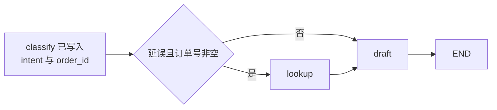
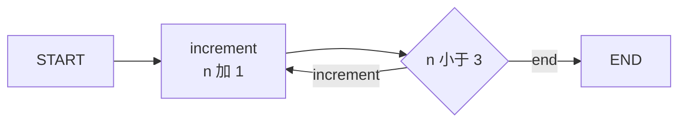

# 第 5 章 条件边与循环

> 本章导读：海岸优品的三句客户话不能再走同一条查单边。林舟给 classify 加上条件边：意图是物流延误且已有订单号，才进入 lookup，其余直接 draft。退款和闲聊的 delayed 打印为 None，只有物流草稿含工单句。另一张与 OD-2049 无关的小图把 n 从 0 加到不再小于 3，返回 3。去掉停条件、递归上限设为 4 时，抛出 GraphRecursionError，消息只核对子串。本章不暂停，也没有检查点。读完本章，你能指出谁进了查单，并说明环要有走到结束的边。


*本章操作流程图*

## 你什么时候需要它

三种处境，对应三种读法。第 4 章的直线先当成已经对上 `linear_draft`。

**物流句已经能出草稿，但退款和周末问询也被送进了 `lookup`。** 从 5.2 读到 5.6。条件边只放行「意图是 `shipping_delay` 且 `order_id` 非空」。验收看三行 `route`：只有 `shipping` 的 `delayed` 是 `True`，另外两行是 `None`。分类仍是第 4 章那个关键词函数，不要在路由里再调一次模型。

**你要讲清楚「图可以绕回自己」，又不想拿订单数据做实验。** 读 5.10 到 5.13。计数图的状态只有 `n`。`invoke({"n": 0})` 的打印是 `{'n': 3}`。这张图不读海岸优品，不读运单 `YT-2049-88`。把它和售后图编译成两个对象。

**你看到有人用把递归上限调大来「修」一个停不下来的环。** 读 5.12 和 5.14。`limit_always=True` 的那次调用传入 `{"recursion_limit": 4}`，异常类型名是 `GraphRecursionError`，消息里被检查的只有子串 `Recursion limit of 4`。上限是运行时的刹车，不是业务上的结束条件。结束条件是路由函数有机会返回通向 `END` 的标签。

前置：第 4 章的 `SupportState`、三个节点和「补丁只含自己的键」。本章不引入 `interrupt`，不引入检查点。林舟仍然只看到草稿。点头开单在第 7 章。进程重启后还在不在，在第 6 章。`langgraph` 1.2.24 提供 `StateGraph`、`START`、`END` 和 `langgraph.errors.GraphRecursionError`。`langchain` 1.5.2 仍在环境里，因为前两章需要它。`routing.py` 不导入 `langchain`。

## 5.1 概述

第 4 章把「下一站是谁」写死在 `add_edge` 里。本章把这个决定挪到函数里。节点仍然只改自己的键。选路的函数返回下一站的名字，不返回状态补丁。小帆在星帆出海要同时接住海岸优品的三句客户话，分类仍是关键词函数。

售后图回答的问题是：这句客户话要不要查 `OD-2049`。计数图回答的问题是：`n` 还要不要再加一。两张图各有各的状态类型，各调用一次 `compile()`。

| 图 | 状态 | 停在哪里 | 2026-11-27 的证据 |
| --- | --- | --- | --- |
| `build_router` | `SupportState` 五键 | `draft` 之后的 `END` | 三行 `route` |
| `build_cycle()` | `CountState` 的 `n` | `n < 3` 不再成立时走向 `END` | `cycle {'n': 3}` |
| `build_cycle(limit_always=True)` | 同一个 `CountState` | 源码里没有通向 `END` 的边 | `recursion_error GraphRecursionError` |

**业务上推荐把「要不要查单」写在条件边上：只有物流延误且已经抽出订单号才进入 `lookup`，退款和闲聊直接起草。** 不要在 `classify` 里面调用 `lookup`。分类函数的返回值只有 `intent` 和 `order_id`。查单节点若没被边调度到，它的返回值就不会并进状态。退款行上的 `delayed None` 就是「节点没跑」的打印，不是草稿把布尔删掉了。

本章文件是 [demo/xiaofan_graph/routing.py](../demo/xiaofan_graph/routing.py)。订单原文和工单句仍在 [demo/xiaofan_graph/orders.py](../demo/xiaofan_graph/orders.py)。三句客户话是：

```python
SHIPPING_TEXT = "订单 OD-2049 物流延迟，请处理"
REFUND_TEXT = "订单 OD-2049 我要退款"
OTHER_TEXT = "你们周末上班吗"
TICKET = "售后升级：订单 OD-2049 客户投诉物流延迟"
```

商家是海岸优品，namespace 是 `seashore-main`，承运是云途，运单是 `YT-2049-88`，发出日是 2026-11-18，承诺 7 天，已过 9 天。这些字段不在 `routing.py` 的导入列表里。物流草稿会通过复用的 `draft` 把云途、运单、日期和天数念出来，那一句的全文已经在第 4 章的 `linear_draft` 里。本章的物流行只额外打印 `mentions_ticket True`，用来证明工单常量出现在草稿中。本章不再把整句草稿打一遍。

## 5.2 复用直线图的节点

`routing.py` 不重新定义分类、查单和草稿。

```python
from xiaofan_graph.linear import SupportState, classify, draft, lookup
from xiaofan_graph.orders import OTHER_TEXT, REFUND_TEXT, SHIPPING_TEXT, TICKET
```

`classify` 仍是关键词函数。文中有「退款」则 `intent` 为 `refund`；否则文中有 `OD-2049` 或「物流」则 `shipping_delay`；否则 `other`。`order_id` 仍只看原文里有没有 `OD-2049`，有则写入这个订单号，没有则写入空字符串。本章不把这套规则改成模型调用。第 2 章的假模型只在链那一章固定返回 `shipping_delay`，它不读「退款」两个字。能把退款句分成 `refund` 的，是这个关键词函数。

`lookup` 仍不比较 9 和 7。订单号等于 `OD-2049` 时写入 `bool(ORDER["delayed"])`，也就是 `True`。其他订单号写入 `False`。本章的退款和闲聊根本不会调用它，所以那两行不会出现 `False`，详见 5.9。

`draft` 的四句模板也原样留在 `linear.py`。本章会实际走到其中三句。

| `draft` 的分支 | 句子要点 | 本章哪一次 `invoke` 走到 |
| --- | --- | --- |
| 延误且 `delayed` 为真 | 云途、`YT-2049-88`、`2026-11-18`、9 天、7 天、工单句、团队 `xbd-seashore-cs-team` | `shipping`。工单句是否在草稿里，由 `mentions_ticket True` 证明 |
| 意图为 `refund` | 拟为订单 OD-2049 登记退款申请。退款不会自动执行。 | `refund`。整句没有被 `main` 打印，见 5.8 |
| 延误但 `delayed` 不成立 | 未查到可判定延误的订单，请核对订单号。 | 三句输入都没走到 |
| 其余 | 已记下。请给出订单号，或说明是物流还是退款。 | `other`。同样只通过 `mentions_ticket False` 间接约束 |

第 7 章的 `hitl.py` 会另写一份 `draft`。那里的退款句在「退款不会自动执行」之后还有「，需要人工确认」。那是暂停章的文本。本章导入的是 `linear.draft`，退款句到「退款不会自动执行。」为止。不要提前把第 7 章的逗号补进 `linear.py`，否则本章关于工单子串的说明还在，句子本身已经和源码不一致。

`build_linear` 没有被导入。本章新造一个 `StateGraph(SupportState)`，重新 `add_node` 三次。编译好的直线图不会被改边。两张图可以同时存在，`main` 只调用 `build_router`。

## 5.3 route_after_classify

选路函数全名就说明了位置：分类节点跑完之后。

```python
def route_after_classify(state: SupportState) -> Literal["lookup", "draft"]:
    if state.get("intent") == "shipping_delay" and state.get("order_id"):
        return "lookup"
    return "draft"
```

返回值是字符串 `"lookup"` 或 `"draft"`，不是字典。图不会把这个返回值合并进 `SupportState`。状态要等被选中的节点执行之后才变。

两个条件用 `and` 连起来，必须同时成立。

| 条件 | 成立时 | 不成立时 |
| --- | --- | --- |
| `intent` 等于 `shipping_delay` | 有可能去查单 | 直接去 `draft`。退款和闲聊落在这里 |
| `order_id` 为真 | 空字符串过不了 | 意图即使是延误，也去 `draft` |

`state.get("order_id")` 把缺席和空字符串都当成不成立。`classify` 在没有订单号时写入的是 `""`，不是省略键。`""` 在布尔上下文里为假，所以「写了空字符串」和「键缺席」在这一个 `if` 里效果相同，都进 `draft`。

退款句「订单 OD-2049 我要退款」同时含有「退款」和 `OD-2049`。`classify` 先命中退款，`intent` 为 `refund`，`order_id` 仍是 `OD-2049`。路由只看意图不是 `shipping_delay`，于是返回 `"draft"`。订单号已经抽出来，仍然不查单。这是本章要保住的规则：有单号不够，意图必须是物流延误。

物流句两个条件都成立，返回 `"lookup"`。周末句意图是 `other`，订单号是 `""`，返回 `"draft"`。

还有一条三句输入都没覆盖的路径：原文只有「物流」，没有 `OD-2049`。`classify` 得到 `shipping_delay` 和 `""`。路由因为订单号为空返回 `"draft"`。`lookup` 不运行，`delayed` 保持缺席。`draft` 看到意图是延误但 `delayed` 不成立，会走上「未查到可判定延误的订单，请核对订单号。」2026-11-27 的 `main` 没有用这句做输入，输出里没有它。知道这条路径在源码里即可，不要补一行 `route` 打印。



*图 5-2：分类之后的两条路。菱形是 `route_after_classify`，不是模型*

## 5.4 add_conditional_edges 与 path map

装配售后图的函数是 `build_router`。

```python
def build_router():
    builder = StateGraph(SupportState)
    builder.add_node("classify", classify)
    builder.add_node("lookup", lookup)
    builder.add_node("draft", draft)
    builder.add_edge(START, "classify")
    builder.add_conditional_edges(
        "classify",
        route_after_classify,
        {"lookup": "lookup", "draft": "draft"},
    )
    builder.add_edge("lookup", "draft")
    builder.add_edge("draft", END)
    return builder.compile()
```

`add_conditional_edges` 在这里有三个位置参数。

| 位置 | 本章的值 | 作用 |
| --- | --- | --- |
| 源节点 | `"classify"` | 这个节点的补丁写入之后，才调用路由函数 |
| 路由函数 | `route_after_classify` | 读状态，返回路径标签 |
| path map | `{"lookup": "lookup", "draft": "draft"}` | 把标签翻译成下一站 |

path map 的键是函数允许返回的标签，值是要调度的节点名，或者 `END`。本章这张表的键和值拼写相同，读起来像重复。它们的角色不同。左边是 `Literal["lookup", "draft"]` 里的那些字符串。右边必须是已经 `add_node` 的名字。若把节点改名为 `find_order`，函数仍可返回 `"lookup"`，表应写成 `{"lookup": "find_order", "draft": "draft"}`。本章没有改名，所以左右一样。

路由函数先看到的是合并之后的状态。`classify` 返回的 `intent` 和 `order_id` 已经写进状态，`route_after_classify` 才能读到它们。它读不到「调用方当初传入的那份旧字典」里被覆盖之前的空缺，因为覆盖已经发生。物流句上，它读到的意图就是 `shipping_delay`。

`compile()` 仍然没有参数。没有检查点，没有中断点。和直线图的差别只在 `classify` 后面那一条边：直线是 `add_edge("classify", "lookup")`，这里换成了条件边。`lookup` → `draft` 和 `draft` → `END` 还是固定的。查单一旦发生，下一步一定起草。不查单时，`draft` 由条件边直接调度，同样再走向 `END`。

本章没有省略 path map、让返回值「自己就是节点名」的写法。两处条件边都传了字典。字典里没有的标签，本文件没有做失败实验，输出里也没有对应的异常行。不要另写一句未运行的报错。

## 5.5 和直线图差在哪几条边

把两张图的边放在一起，差异只有一处。

| 连接 | 第 4 章 `build_linear` | 本章 `build_router` |
| --- | --- | --- |
| `START` → `classify` | 固定边 | 固定边 |
| `classify` 的下一站 | 固定到 `lookup` | 条件边，标签 `lookup` 或 `draft` |
| `lookup` → `draft` | 固定边 | 固定边。只有去过查单才用得到 |
| `draft` → `END` | 固定边 | 固定边 |

节点函数一个字都没改。所以直线图上关于补丁的约定在这里继续有效：节点没返回的键保持原样。`classify` 不返回 `delayed`。若条件边没有调度 `lookup`，就没有任何返回值写入 `delayed`。`draft` 只返回 `draft`，不会补一个 `delayed`。

这就是三行打印里 `None` 的来源。`main` 使用的是 `out.get("delayed")`。键不在字典里时，`get` 得到 `None`。源码里没有哪一行把 `delayed` 赋成 `None`。打印出来的 `None` 是「键缺席」在 `get` 上的显示。

直线图若送入退款句，按第 4 章的推演会进入 `lookup`，并且因为订单号是 `OD-2049` 而写下 `True`。那个推演没有被第 4 章打印。本章的退款行被打印了，值是 `None`。两章放在一起读：同一句退款，边不同，`delayed` 的命运不同。本章的证据是打印出来的 `None`。第 4 章没有对应的打印行。

## 5.6 三条客户话

`main` 用一个循环跑完三句。标签是英文单词，用来区分输入，不是 `intent` 本身。

```python
for label, text in (
    ("shipping", SHIPPING_TEXT),
    ("refund", REFUND_TEXT),
    ("other", OTHER_TEXT),
):
    out = graph.invoke({"text": text})
    print(
        "route",
        label,
        out["intent"],
        "delayed",
        out.get("delayed"),
        "mentions_ticket",
        TICKET in out["draft"],
    )
```

`print` 把这些参数用空格拼成一行。因此每一行的第二个词是循环里的标签，第三个词才是状态里的 `intent`。`refund` 那一行会看到两个 `refund` 挨在一起，前一个是标签，后一个是意图。`other` 同样。`shipping` 后面跟着的是 `shipping_delay`，两者并不相同。

三次 `invoke` 的参数都只有 `text`。没有 `thread_id`，没有 `recursion_limit`。三次都正常返回了字典，所以这三步没有撞上递归上限。默认上限的具体数字没有被打印，本书不写那个数字。

| 标签 | 原文 | `intent` 的打印 | `delayed` 的打印 | `mentions_ticket` |
| --- | --- | --- | --- | --- |
| `shipping` | 订单 OD-2049 物流延迟，请处理 | `shipping_delay` | `True` | `True` |
| `refund` | 订单 OD-2049 我要退款 | `refund` | `None` | `False` |
| `other` | 你们周末上班吗 | `other` | `None` | `False` |

物流行和直线章的字段对得上：意图是 `shipping_delay`，`delayed` 是 `True`。直线章还打印了订单号和整句草稿。本章的循环没有打印 `order_id`，也没有打印 `draft` 全文。物流路径上订单号是 `OD-2049`、草稿含云途和 `YT-2049-88`，依据是复用的函数和第 4 章已经打印过的 `linear_order`、`linear_draft`。本章自己的新证据是 `mentions_ticket True`。

退款和闲聊的 `delayed` 是 `None`。按 5.3 的条件，这两句都不会返回 `"lookup"`。`lookup` 没有机会写入布尔。这不是 `lookup` 返回了 `None`。`lookup` 的两个 `return` 都是布尔。

中间状态没有逐节点打印。下面三张小表是按返回值推演的，最后一列的 `delayed` 与 `mentions_ticket` 和运行输出一致。`order_id` 一列来自 `classify` 的源码，本章没有把它打印出来。

物流句：

| 时刻 | `intent` | `order_id`（未打印） | `delayed` |
| --- | --- | --- | --- |
| 入口 | 缺席 | 缺席 | 缺席 |
| `classify` 之后 | `shipping_delay` | `OD-2049` | 缺席 |
| 路由 | 去 `lookup` |  |  |
| `lookup` 之后 | `shipping_delay` | `OD-2049` | `True` |
| `draft` 之后 | 不变 | 不变 | `True`。打印如此 |

退款句：

| 时刻 | `intent` | `order_id`（未打印） | `delayed` |
| --- | --- | --- | --- |
| 入口 | 缺席 | 缺席 | 缺席 |
| `classify` 之后 | `refund` | `OD-2049` | 缺席 |
| 路由 | 去 `draft`。意图不是延误 |  |  |
| `lookup` | 不执行 |  |  |
| `draft` 之后 | `refund` | `OD-2049` | 仍然缺席。`get` 打印 `None` |

闲聊句：

| 时刻 | `intent` | `order_id`（未打印） | `delayed` |
| --- | --- | --- | --- |
| 入口 | 缺席 | 缺席 | 缺席 |
| `classify` 之后 | `other` | `""` | 缺席 |
| 路由 | 去 `draft` |  |  |
| `lookup` | 不执行 |  |  |
| `draft` 之后 | `other` | `""` | 仍然缺席。`get` 打印 `None` |

退款句的订单号列要特别看。原文里有 `OD-2049`，`classify` 会把它写入 `order_id`。路由仍去 `draft`，因为 `and` 的第一项已经失败。所以 `delayed None` 不能读成「这句没有订单号」。没有订单号的是周末那句。退款句是「有订单号，但意图不是延误」。

## 5.7 mentions_ticket 只是打印出来的布尔

`SupportState` 没有 `mentions_ticket` 这个键。没有任何节点返回它。它是 `main` 在打印前现算的：

```python
TICKET in out["draft"]
```

`TICKET` 的全文是「售后升级：订单 OD-2049 客户投诉物流延迟」。`in` 判断的是这整个字符串是不是草稿的子串，不是草稿里有没有「退款」或「物流」这两个词。

| 路径 | 草稿里和这个布尔相关的事实 | 打印 |
| --- | --- | --- |
| 物流 | `draft` 第一支把 `{TICKET}` 插进「拟开立工单：」和「。团队」之间 | `True` |
| 退款 | 模板是退款登记，没有插入 `TICKET` | `False` |
| 闲聊 | 模板是请补充订单号或说明意图，没有插入 `TICKET` | `False` |

闲聊模板本身含有「退款」二字：「或说明是物流还是退款」。`mentions_ticket` 仍是 `False`。布尔为假，只说明工单全句不在草稿里，不说明草稿里没有「退款」这个词。

这个判断是子串，不是结构化字段。假如有人把退款模板改成带上 `TICKET` 的句子，布尔会变成 `True`，即使业务上仍不该开物流工单。本章的退款模板没有这样做。第 7 章才会有独立的 `ticket` 键，人同意之后才写入。本章的工单句只生活在物流草稿的正文里。

团队名 `xbd-seashore-cs-team` 也只在物流模板里。本章没有单独打印团队名。它是否在物流草稿里，沿用第 4 章那一整行 `linear_draft`。退款模板和闲聊模板都不含团队名。

## 5.8 退款草稿不含工单句

退款分支的源码是这一句赋值：

```python
text = f"拟为订单 {ORDER_ID} 登记退款申请。退款不会自动执行。"
```

`ORDER_ID` 是 `OD-2049`，所以草稿全文是：

拟为订单 OD-2049 登记退款申请。退款不会自动执行。

`main` 没有把这句打印出来。2026-11-27 的退款行只提供 `intent`、`delayed` 和 `mentions_ticket`。句子本身以 `linear.py` 的这行 f-string 为准。`mentions_ticket False` 与这句里没有 `TICKET` 一致：句中没有「售后升级」，没有工单标题，也没有团队名。

句子里有两层意思，都要留着。

| 分句 | 作用 |
| --- | --- |
| 拟为订单 OD-2049 登记退款申请。 | 告诉坐席这是退款登记，订单号用的是常量，不是从 `state["order_id"]` 再读一遍 |
| 退款不会自动执行。 | 标明本章没有退款动作。没有支付调用，没有状态键记录「已退」 |

第二句是第 4 章就写好的。它让退款路径即使在直线图里被 `lookup` 写成 `delayed True`，草稿也不会变成物流工单。本章跳过了 `lookup`，第二句仍然需要，因为坐席看到的文本要自己说明「不会自动执行」。条件边负责不查单，句子负责不把查单结果说成退款已经发生。

`draft` 的退款支不读 `delayed`。因此哪怕将来有人把路由改回「退款也查单」，只要意图仍是 `refund`，第一支的「延误且 delayed」进不去，写出来的还是这一句，`mentions_ticket` 仍会是 `False`。本章的 `None` 证明的是查单节点没跑，不是证明草稿函数会清除工单句。工单句没出现，是因为模板里没有它。

## 5.9 None 与 False

`delayed` 在打印里可能出现三种样子。本章的三行只用到了前两种。第三种留在 `lookup` 的源码里，留给「节点真的跑了，但订单号不是 `OD-2049`」的情况。

| 打印或推演 | 字典里的情况 | 谁会把它变出来 |
| --- | --- | --- |
| `True` | 键在，值为布尔真 | `lookup` 见到 `OD-2049`，抄 `ORDER["delayed"]`。物流行已打印 |
| `None` | `get` 的缺席结果。源码没有赋值 `None` | 条件边没调度 `lookup`。退款行和闲聊行已打印 |
| `False` | 键在，值为布尔假 | `lookup` 见到的订单号不是 `OD-2049`。本章三次 `invoke` 都没有打印 `False` |

周末句如果走第 4 章的直线，`lookup` 会把空订单号写成 `False`。本章的条件边让 `lookup` 不运行，打印就成了 `None`。同一个客户句，两种图，两种打印。验收时不要把 `None` 改成 `False` 来「填上默认延误状态」。默认不存在。没查过就是没写这个键。

`draft` 第一支用的是 `state.get("delayed")` 的真值。`None` 和 `False` 都进不了第一支。对退款句这无所谓，因为它走第二支。对「意图已是延误、但没查单」的那条未运行路径，真值失败会落到「未查到可判定延误的订单」。`None` 和 `False` 在那一支上的句子相同，在打印上不同。本章用 `get` 把这个差别留在输出里，供人区分「没查」和「查了但不是这张单」。

物流行的 `True` 仍然不是 `9 > 7` 的计算结果。天数进草稿，是为了让人看到 9 天超过承诺的 7 天。布尔来自订单字典。本章没有新的计算。

## 5.10 计数图与订单图分开

循环用另一份状态，避免把 `n` 塞进售后五键。

```python
class CountState(TypedDict):
    n: int


def increment(state: CountState) -> dict:
    return {"n": state["n"] + 1}
```

这里没有写 `total=False`。`TypedDict` 默认要求 `n`。`invoke` 传入的 `{"n": 0}` 满足这一点。`increment` 每次都返回 `n`，所以这个键在进入环之后一直在。

`increment` 只做加一。它不返回 `"end"`，不看阈值。阈值放在边上，和「查单与否放在边上」是同一条设计。节点若自己决定结束，边就失去了唯一的决策点，读图的人要在两个地方找停条件。

`build_cycle` 用参数切换两套边。默认 `limit_always=False`，走有界环。`True` 时走永远回到自己的那一套。

```python
def build_cycle(limit_always: bool = False):
    builder = StateGraph(CountState)
    builder.add_node("increment", increment)
    builder.add_edge(START, "increment")
    if limit_always:
        builder.add_conditional_edges(
            "increment",
            lambda state: "increment",
            {"increment": "increment"},
        )
    else:
        builder.add_conditional_edges(
            "increment",
            continue_until_three,
            {"increment": "increment", "end": END},
        )
    return builder.compile()
```

两次调用是两次 `compile()`。先建的有界图在 `print("cycle", ...)` 里用完。后建的无界图在 `try` 里单独 `invoke`。有界图不会被第二个参数改造成无界图。`increment` 函数对象被两张图共用，这没有关系，因为它不保存 `n`。`n` 在各自的状态里。

这张图不导入 `orders`。跑循环不会改写 `OD-2049` 的 `delayed`，也不会生成工单句。星帆出海的客服单和这个计数器只在同一章里相邻出现，数据不相通。

## 5.11 从 0 加到 3

有界环的路由是：

```python
def continue_until_three(state: CountState) -> Literal["increment", "end"]:
    if state["n"] < 3:
        return "increment"
    return "end"
```

path map 是 `{"increment": "increment", "end": END}`。函数返回的 `"end"` 是标签。`END` 是结束哨兵，不是 `add_node("end", ...)` 登记出来的业务节点。标签可以换成别的词，只要 map 的键跟着改、值仍是 `END`。本章用的就是 `"end"` 这个词。

条件是严格小于 3。路由看到的 `n` 是 `increment` 已经写回之后的值。下面的表从 `invoke({"n": 0})` 推演，最终字典与打印的 `{'n': 3}` 一致。中间的 `n` 没有逐次打印。

| 第几次进入 `increment` | 进入时的 `n` | 节点返回 | 路由读到的 `n` | `n < 3` | 路由返回 |
| --- | --- | --- | --- | --- | --- |
| 1 | 0 | `{"n": 1}` | 1 | 成立 | `"increment"` |
| 2 | 1 | `{"n": 2}` | 2 | 成立 | `"increment"` |
| 3 | 2 | `{"n": 3}` | 3 | 不成立 | `"end"` |

第三次之后 map 把 `"end"` 送到 `END`，`invoke` 返回。打印是：

```text
cycle {'n': 3}
```

花括号和单引号是 Python 打印字典时的样子。`main` 写的是 `print("cycle", build_cycle().invoke({"n": 0}))`，所以字典的显示跟在 `cycle` 后面，中间一个空格。本书不把它改成 JSON 的双引号。

`n` 停在 3，是因为 3 已经不小于 3，环不再调度 `increment`。结果里包含 3。若条件写成 `n <= 3`，3 仍会继续加，返回值会不同。那个写法不在源码里，也没有另一次打印。

入口若不是 0，次数会变。例如从 3 起步，按同一函数会先加到 4，再因 4 不小于 3 而结束。2026-11-27 只调用了 `{"n": 0}`。别的起点不要写成已运行的结果。



*图 5-3：有界环。菱形读的是加一之后的 n，停止时 n 为 3*

这次 `invoke` 没有传 `recursion_limit`。它在默认预算内走到了 `END`，证据是返回了字典而不是走进下面的 `except`。默认预算的数字仍不引用。

## 5.12 永远加一

`limit_always=True` 时，条件边换成：

```python
builder.add_conditional_edges(
    "increment",
    lambda state: "increment",
    {"increment": "increment"},
)
```

`lambda` 忽略 `state`，每次都返回标签 `"increment"`。map 里只有这一项，值也是节点 `increment`。从 `START` 进入之后，没有一条边的终点是 `END`。`n` 会一直加，业务上没有「到此为止」。

调用写在 `main` 的 `try` 里：

```python
build_cycle(limit_always=True).invoke({"n": 0}, {"recursion_limit": 4})
```

第二个参数是这次调用的配置，不是 `CountState`。`recursion_limit` 不要写进 `n` 旁边当成状态键。它限制的是这一次 `invoke` 允许走多少步，不是订单系统的超时，也不是林舟的审批时限。

4 这个数字只属于这次调用。有界环那次没有传它。把 4 说成「计数器的业务上限」会和 `n < 3` 打架：业务停止看的是 3，运行时刹车看的是这次配置里的 4。两张图各用各的。

异常被接住之后，`main` 才打印类型名和子串判断。若没有 `except`，异常会冒出去，`run_all.py` 后面的检查点模块就不会再被调用。第 1 章记录的检查点段存在，说明进程没有死在这里。本章自己的证据则是 `except` 里面那两行确实出现在输出里。

## 5.13 超步与停条件

LangGraph 按超步推进一次 `invoke`。一个超步里，运行时执行上一超步选出的节点，把返回的补丁写入状态，再根据边决定下一超步是谁。本章的售后图和计数图都没有从一个节点同时拉出两个下一站，所以每一超步只有一个节点。按这个形状，每一次节点执行计一步。

直线上的物流路径是 `classify`，然后 `lookup`，然后 `draft`，三步之后到 `END`。退款和闲聊少了 `lookup`，两步之后到 `END`。有界环是三次 `increment`，然后路由选择 `END`。这些步在同一次 `invoke` 里走完，不需要检查点，因为下一步不等人。

`recursion_limit` 限制的就是这种一步接一步的次数。有界环在步数用完之前到达 `END`，调用正常返回。无界环永远选回 `increment`，步数到达本次配置的上限时，运行时抛出异常，调用不会返回字典。

2026-11-27 的输出没有打印步号，也没有打印异常发生时的 `n`。因此本书不写「第 4 步的节点是谁」或「出错时 `n` 等于几」。能够确定的是源码安排了上限 4，并且异常文本里包含 `Recursion limit of 4` 这段字符。步号若要引用，需要另一次把步号打印出来的运行。这次没有。

环要有停条件，指的是 path map 里要存在一条通往 `END` 的可能。`continue_until_three` 在 `n < 3` 为假时返回 `"end"`，map 把这个标签送到 `END`。这就是停条件。它写在路由函数里，不写在 `increment` 里。

没有这条件时，调大 `recursion_limit` 只会把异常推迟。本章没有用别的上限再跑一次，所以不引用第二份异常文本。停条件一旦写成 `n < 3`，有界环就不依赖把上限调到某个魔法数字。

超步也不是人工暂停。暂停要节点调用 `interrupt`，并且图在编译时带上检查点，人之后用 `Command` 恢复。本章的节点没有 `interrupt`。无界环的异常是运行时拒绝继续空转，调用栈回到 `except`。坐席没有机会在中间点头。不要把 `GraphRecursionError` 当成「等林舟审批」。审批是第 7 章的 `gate`。

## 5.14 2026-11-27 的运行输出

下面是 2026-11-27 的运行输出。第一行是 `run_all.py` 在导入 `xiaofan_graph.routing` 之后、调用 `main()` 之前打印的标题。其余行都来自 `routing.main`。

```text
## xiaofan_graph.routing
route shipping shipping_delay delayed True mentions_ticket True
route refund refund delayed None mentions_ticket False
route other other delayed None mentions_ticket False
cycle {'n': 3}
recursion_error GraphRecursionError
recursion_limit_in_message True
```

| 行 | 它证明的事 | 它没有证明的事 |
| --- | --- | --- |
| `route shipping ... True ... True` | 物流句进了会写 `delayed` 的路径，草稿含 `TICKET` | 没有把草稿全文再打一遍。全文见第 4 章 |
| `route refund ... None ... False` | 退款句的结果里没有 `delayed` 这个键的写入，草稿不含工单全句 | 没有打印 `order_id`。单号仍在原文里，路由是因意图跳过查单 |
| `route other ... None ... False` | 周末句同样没写 `delayed`，草稿不含工单全句 | 没有证明草稿里没有「退款」二字。闲聊模板里有这两个字 |
| `cycle {'n': 3}` | 从 `{"n": 0}` 出发的有界环返回的字典就是它 | 没有打印中间的 1 和 2 |
| `recursion_error GraphRecursionError` | `type(exc).__name__` 是这个名字 | 没有打印完整的 `repr` 或堆栈 |
| `recursion_limit_in_message True` | `str(exc)` 里包含 `Recursion limit of 4` | 没有证明消息只由这几个词组成 |

最后两行对应的源码是：

```python
try:
    build_cycle(limit_always=True).invoke({"n": 0}, {"recursion_limit": 4})
except GraphRecursionError as exc:
    print("recursion_error", type(exc).__name__)
    print("recursion_limit_in_message", "Recursion limit of 4" in str(exc))
```

导入语句是 `from langgraph.errors import GraphRecursionError`。打印出来的名字与这个类的 `__name__` 一致。异常对象的完整字符串除了被检查的子串以外，还有哪些句子，这次运行没有另存。本书只引用子串 `Recursion limit of 4`，以及「这个子串确实在消息里」这个布尔 `True`。不要把文档或记忆里的整段英文补到章里，再当成 2026-11-27 的输出。

`in` 判断区分大小写，空格也要一致。源码里的子串是 `Recursion limit of 4`，首字母大写，`limit` 与 `of` 之间是空格，末尾是数字 4，没有句号。布尔为 `True`，说明消息里有这一段，4 与传入的配置相同。

`except` 只接 `GraphRecursionError`。别的异常不会打这两行，而会中断 `main`。这两行出现了，说明被接住的就是这个类型。无界环的 `invoke` 没有返回到一个被打印的字典。输出里因此没有第二行 `cycle`。

## 5.15 仍然没有暂停和检查点

在 `routing.py` 里搜这些名字，都没有：`interrupt`、`Command`、`InMemorySaver`、`MemorySaver`、`SqliteSaver`、`checkpointer`、`thread_id`。`compile()` 两处都是无参数。售后图的三次 `invoke` 和计数图的两次 `invoke` 都没有在配置里放 `configurable`。

因此本章的每次调用都从传入的字典重新开始。有界环返回 `{'n': 3}` 之后，这个 3 只在 `print` 的参数里。图没有把它存成线程。若再调用一次并仍然传入 `{"n": 0}`，起点仍是这次参数里的 0，图里没有上一份 3 可读。这次运行只调用了一次有界环，输出里只有一行 `cycle`。第 6 章才会在另一张计数图上保存检查点，并让第二个进程读到已经写下的 `n`。

售后图同样不记得上一句客户话。循环里三次 `invoke` 是三次独立入口，每次只带当前的 `text`。退款句不会看见物流句留下的 `draft`。输出里三行 `intent` 各不相同，和这个调用方式一致。

人工介入需要的载荷，本章也还没有。没有 `decision`，没有独立的 `ticket` 键。物流草稿里的工单句仍是「拟开立」。团队名出现在那句草稿里，不表示已经调用了团队接口。海岸优品和 `seashore-main` 仍只住在订单字典中，路由函数不读它们。

把递归上限说成暂停，会让坐席误以为异常弹出来的时候可以点同意。异常出来的时候，`invoke` 已经失败，`except` 只拿到异常对象。没有一份可以 `Command(resume=...)` 的暂停载荷。要那份载荷，去第 7 章，并且先有第 6 章的检查点。

## 5.16 整文件按块读

下面是 2026-11-27 的 `routing.py` 全文。

```python
"""Chapter 5: conditional edges, a bounded cycle, and a recursion limit."""

from typing import Literal, TypedDict

from langgraph.errors import GraphRecursionError
from langgraph.graph import END, START, StateGraph

from xiaofan_graph.linear import SupportState, classify, draft, lookup
from xiaofan_graph.orders import OTHER_TEXT, REFUND_TEXT, SHIPPING_TEXT, TICKET


def route_after_classify(state: SupportState) -> Literal["lookup", "draft"]:
    if state.get("intent") == "shipping_delay" and state.get("order_id"):
        return "lookup"
    return "draft"


def build_router():
    builder = StateGraph(SupportState)
    builder.add_node("classify", classify)
    builder.add_node("lookup", lookup)
    builder.add_node("draft", draft)
    builder.add_edge(START, "classify")
    builder.add_conditional_edges(
        "classify",
        route_after_classify,
        {"lookup": "lookup", "draft": "draft"},
    )
    builder.add_edge("lookup", "draft")
    builder.add_edge("draft", END)
    return builder.compile()


class CountState(TypedDict):
    n: int


def increment(state: CountState) -> dict:
    return {"n": state["n"] + 1}


def continue_until_three(state: CountState) -> Literal["increment", "end"]:
    if state["n"] < 3:
        return "increment"
    return "end"


def build_cycle(limit_always: bool = False):
    builder = StateGraph(CountState)
    builder.add_node("increment", increment)
    builder.add_edge(START, "increment")
    if limit_always:
        builder.add_conditional_edges(
            "increment",
            lambda state: "increment",
            {"increment": "increment"},
        )
    else:
        builder.add_conditional_edges(
            "increment",
            continue_until_three,
            {"increment": "increment", "end": END},
        )
    return builder.compile()


def main() -> None:
    graph = build_router()
    for label, text in (
        ("shipping", SHIPPING_TEXT),
        ("refund", REFUND_TEXT),
        ("other", OTHER_TEXT),
    ):
        out = graph.invoke({"text": text})
        print(
            "route",
            label,
            out["intent"],
            "delayed",
            out.get("delayed"),
            "mentions_ticket",
            TICKET in out["draft"],
        )
    print("cycle", build_cycle().invoke({"n": 0}))
    try:
        build_cycle(limit_always=True).invoke({"n": 0}, {"recursion_limit": 4})
    except GraphRecursionError as exc:
        print("recursion_error", type(exc).__name__)
        print("recursion_limit_in_message", "Recursion limit of 4" in str(exc))


if __name__ == "__main__":
    main()
```

| 块 | 作用 | 运行输出里的对应 |
| --- | --- | --- |
| 导入 `classify`、`lookup`、`draft` | 复用第 4 章节点 | 三行 `route` 的意图来自原关键词函数 |
| `route_after_classify` | 延误且有单号才查单 | 只有 `shipping` 的 `delayed` 为 `True` |
| `build_router` | 条件边加两条固定边，无检查点 | 三行都正常返回 |
| `CountState` 与 `increment` | 与订单无关的加一 | 不出现在 `route` 行里 |
| `continue_until_three` | `n < 3` 才继续 | `cycle {'n': 3}` |
| `limit_always` 分支 | 永远返回 `"increment"` | 没有第二个 `cycle` 字典 |
| `except GraphRecursionError` | 打印类型名和子串布尔 | 最后两行 |

文件底部的 `__main__` 守卫与第 4 章相同。`run_all.py` 通过导入调用 `main()`，标题行由 `run_all.py` 打印。直接运行本文件会得到同样的六行业务打印，但不会自动出现 `## xiaofan_graph.routing`，除非外层再打标题。本书引用的是带标题的那一次。

## 5.17 坑

| 坑 | 后果 | 怎么对回本章 |
| --- | --- | --- |
| 在路由函数里调用 `lookup` 并指望状态里出现 `delayed` | 路由函数的返回值是字符串，图只按字符串调度节点 | 让边去调度 `lookup` 节点。本章的退款路径故意不调度 |
| 把「有 `OD-2049`」当成查单条件，丢掉意图判断 | 退款句也会进 `lookup`，`delayed` 会变成 `True` | 条件是 `and`。退款行的 `None` 依赖意图这一项 |
| 用 `out["delayed"]` 替换 `out.get("delayed")` | 退款和闲聊会在打印前抛 `KeyError` | 保持 `get`。`None` 是这次输出的一部分 |
| 把 `mentions_ticket` 写成状态键 | 多一个无人写入的通道 | 它只存在于 `print` 的参数里 |
| 看到闲聊草稿里的「退款」就认为 `mentions_ticket` 应为真 | 判断的是整句 `TICKET` | 闲聊行的打印是 `False` |
| 把计数器的 `n` 放进 `SupportState` | 售后状态多一个与工单无关的键 | `CountState` 单独编译 |
| 让 `increment` 在 `n` 到 3 时返回特殊值来结束 | 停条件分裂到节点里 | 停条件留在 `continue_until_three`，节点只加一 |
| 把 `"end"` 当成节点名去 `add_node` | 多一个不会被这张图使用的函数 | map 的值使用导入的 `END` |
| 只调大 `recursion_limit` 来处理无界环 | 异常来得更晚，调用仍失败 | 给 path map 一条到 `END` 的路。本章不另跑更大的上限 |
| 把异常全文补成某段英文 | 超出子串检查 | 只写 `GraphRecursionError` 和 `Recursion limit of 4` |
| 在本章加上 `interrupt` | 没有检查点的暂停没有落点 | 留到第 6 章和第 7 章 |
| 改退款模板去对齐第 7 章的「需要人工确认」 | 本章复用的句子变了 | 本章以 `linear.draft` 的原句为准 |

还有一个和超步有关的读法错误：把三次 `route` 看成一张图里的一个环。循环变量在 `main` 里，每次都是新的 `invoke`。图内部的环只有计数图那一张。售后图从 `START` 到 `END` 不回到 `classify`。客户连说三句，是三次调用，不是三个超步绕回分类。

## 本章小结

1. **条件边决定查不查单。** `route_after_classify` 只在意图为 `shipping_delay` 且订单号非空时返回 `"lookup"`，其余返回 `"draft"`。
2. **path map 的左边是标签，右边是节点或 `END`。** 售后图上左右拼写相同。计数图上 `"end"` 映射到 `END`，并不是一个叫 `end` 的业务节点。
3. **退款和闲聊的 `delayed` 打印为 `None`。** `lookup` 没有执行，没有任何节点把这个键写成 `None` 或 `False`。`main` 用 `get` 读到缺席。
4. **`mentions_ticket` 是 `TICKET in draft`。** 物流行为 `True`。退款草稿是「拟为订单 OD-2049 登记退款申请。退款不会自动执行。」其中没有工单全句，所以为 `False`。
5. **有界环与订单无关。** `invoke({"n": 0})` 在 `n < 3` 不再成立时停止，打印 `{'n': 3}`。
6. **无界环靠递归上限停住，并且是以异常的方式停住。** 配置为 4 时，类型名是 `GraphRecursionError`，消息包含 `Recursion limit of 4`。完整消息超出这次检查的范围，不写入本书。
7. **一步节点执行计一步。** 环必须有走到 `END` 的条件。递归上限是刹车。本章没有 `interrupt`，也没有检查点。

下一步是第 6 章：给计数器装上检查点，让另一个进程还能读到已经写下的 `n`。售后三句话在本章已经分好路，暂停仍要等检查点就位。

## 验收清单

- ☐ 对三句固定客户话各说一句：路由返回 `lookup` 还是 `draft`，`delayed` 的打印是 `True` 还是 `None`。
- ☐ 指出 path map 的键是路由函数的返回值，值才是节点名或 `END`，并举出计数图里 `"end"` 与 `END` 的对应。
- ☐ 写出退款草稿的全文「拟为订单 OD-2049 登记退款申请。退款不会自动执行。」，并说明其中没有工单句，因此 `mentions_ticket` 为 `False`。
- ☐ 说明退款原文里虽然有 `OD-2049`，仍然不查单，因为意图不是 `shipping_delay`。
- ☐ 从 `{"n": 0}` 推到打印的 `{'n': 3}`，说明停的时候 `n < 3` 已为假，并且路由看到的是加一之后的 `n`。
- ☐ 说明无界环那次 `invoke` 的配置是 `{"recursion_limit": 4}`，异常类型名是 `GraphRecursionError`，消息只核对了子串 `Recursion limit of 4`。
- ☐ 说明本章的 `compile()` 没有检查点，源码里也没有 `interrupt`。

## 参考速查

理解主线不依赖本节。

| 名字 | 在本章的含义 |
| --- | --- |
| `route_after_classify` | 返回 `"lookup"` 或 `"draft"` |
| `add_conditional_edges` | 源节点、路由函数、path map |
| path map | 标签到节点名或 `END` 的字典 |
| `mentions_ticket` | 打印用的 `TICKET in draft`，不是状态键 |
| `CountState` | 只有 `n` 的另一张图 |
| `continue_until_three` | `n < 3` 则 `"increment"`，否则 `"end"` |
| `limit_always` | `True` 时路由恒为 `"increment"` |
| `recursion_limit` | `invoke` 配置里的步数上限，本章失败那次设为 4 |
| `GraphRecursionError` | `langgraph.errors` 中的异常，被 `main` 接住 |

| 调用 | 参数 | 2026-11-27 的结果 |
| --- | --- | --- |
| `build_router().invoke` | `{"text": SHIPPING_TEXT}` | `delayed True`，`mentions_ticket True` |
| `build_router().invoke` | `{"text": REFUND_TEXT}` | `delayed None`，`mentions_ticket False` |
| `build_router().invoke` | `{"text": OTHER_TEXT}` | `delayed None`，`mentions_ticket False` |
| `build_cycle().invoke` | `{"n": 0}` | `{'n': 3}` |
| `build_cycle(limit_always=True).invoke` | `{"n": 0}` 与 `{"recursion_limit": 4}` | `GraphRecursionError`，子串判断为 `True` |

## 延伸阅读

- **第 4 章（状态、节点与边）**——`classify`、`lookup`、`draft` 的原文。本章没有复制它们。直线边为什么会把退款也送进查单，在那一章的推演里。
- **第 6 章（检查点）**——同一次进程结束之后，`n` 怎样还在。本章的 `{'n': 3}` 只活在那一次 `print` 里。
- **第 7 章（人工介入）**——`interrupt` 与 `Command`。递归上限抛出的异常不能代替坐席点头。退款句在那一章会多出「需要人工确认」。
- **第 1 章 1.2**——工具循环、业务环、暂停是三种不同的「绕」。本章只做了业务环的计数版本，以及售后图上的分支。
- **`demo/xiaofan_graph/routing.py`**——三行 `route`、一行 `cycle`、两行异常检查的唯一出处。复跑时以这一份 `main` 的打印为准。
