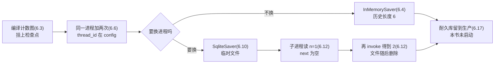
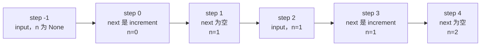
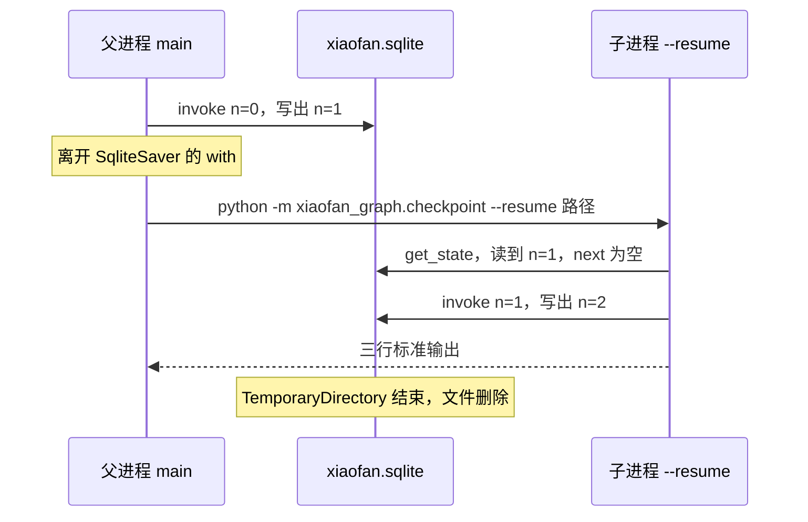

# 第 6 章 检查点

> 本章导读：林舟把订单 OD-2049 的售后停在开单前，怕的是进程一退出，线程里的状态一起消失。检查点（checkpoint）按线程号把图的值留下来。本章不用工单字段，只跑一张计数图：同一线程从 0 加到 1，再加到 2。同一进程里 InMemorySaver 与 MemorySaver 是同一个类，进程结束它就没了；SqliteSaver 写进临时文件，第二个进程仍能读到 n 为 1，再加一得到 2。线程号 xiaofan-OD-2049 只放在 config 的 configurable 里。读完本章，你能说明空的 next 表示已经走到终点，两次 invoke 为何留下 6 条历史，以及为什么这本书没有启动数据库。



*本章操作流程图*

## 你什么时候需要它

三种处境，对应三种保存方式。本章的运行只覆盖前两种里的教学形态，第三种明确没有启动。

**暂停和恢复发生在同一次 Python 进程里。** 第 7 章就是这样：`interrupt` 返回之后，同一个进程马上用 `Command` 恢复。`InMemorySaver` 够用。它是进程里的对象，进程退出，线程就没了。不要把这种跑法写成「已经持久化」。

**你要证明另一个操作系统进程还能读到同一个线程。** 读 6.10 到 6.13。父进程用 `SqliteSaver` 把计数写入临时文件，关掉连接，再用 `subprocess` 拉起 `python -m xiaofan_graph.checkpoint --resume PATH`。子进程读到的 `n` 是 1，再走一次 `increment` 变成 2。文件放在 `tempfile.TemporaryDirectory` 里，`main()` 结束就被删掉。

**你在写生产上的售后线程，进程会重启，机器也不止一台。** 本章的立场是：换用耐久的数据库检查点。这本书没有启动数据库，没有构造连接串，也没有跑 `PostgresSaver`。不要从别的教程抄一条连接串贴进笔记，假装第 6 章跑过。

和第 5 章的计数环不是同一张图。第 5 章的环在一次 `invoke` 里加到 `n == 3`，用来观察 `recursion_limit`。本章的图没有环：`START` 到 `increment`，再到 `END`。一次 `invoke` 只加一。两次 `invoke` 得到 2，是因为调用了两次，不是因为图内部绕了两圈。

前置：能读 `StateGraph`、`START`、`END`（第 4 章）。不要求第 7 章的 `interrupt`。检查点先于暂停，是因为没有检查点的图无法在恢复时找回线程。

## 6.1 概述

检查点回答的问题只有一个：这个 `thread_id` 上一次停住时，状态是什么，下一步该执行哪个节点。它不负责分类，不负责查订单，也不代替模型。

| 概念 | 本章里它是什么 | 它不是什么 |
| --- | --- | --- |
| 检查点 | 一次超级步写下来的状态快照 | 工单系统里的一条记录 |
| 线程 | `config["configurable"]["thread_id"]` | 状态字典里的一个键 |
| `InMemorySaver` | 进程内的保存器；与 `MemorySaver` 是同一个类 | 会落盘的数据库 |
| `SqliteSaver` | 把快照写进一个 SQLite 文件 | 本章的生产方案 |
| `get_state` | 该线程最新的一张快照 | 全部历史 |
| `get_state_history` | 该线程的快照栈，从新到旧 | `run_all.py` 没有逐条打印它 |

`compile(checkpointer=...)` 在构图时就把保存器挂上。之后每一次 `invoke` 和 `get_state` 都要带同一个 `config`。不带 `thread_id`，保存器不知道往哪一格读写。把线程号写进 `CountState`，保存器仍然不认，因为主键不在状态里。

**业务上推荐：同一进程里的教学暂停用 `InMemorySaver`；只要另一个进程还要读这个线程，就改用会落盘的 `SqliteSaver`。生产上的耐久数据库本章没有启动，不要用内存对象冒充它。**

2026-11-27 的依赖与第 1 章相同：`langgraph` 1.2.24，`langgraph-checkpoint-sqlite` 3.1.3。`InMemorySaver is MemorySaver` 为真，是这一天的观察，写在 `saver_is_same_class True` 这一行里。版本若换了，先重跑这一行，不要沿用旧笔记。

## 6.2 为什么是计数图，不是售后图

`checkpoint.py` 的状态只有一个整数 `n`。订单号只出现在线程号 `xiaofan-OD-2049` 里，用来和全书案例对齐，不参与加一。

这样拆开有三个原因。

第一，检查点的失败模式要单独看见。若把工单、草稿和 `interrupt` 放进同一张图，`n` 读错时你会去改 `classify`。本章的输出只有数字和历史长度，对错一目了然：第一次是 1，第二次是 2，历史长度是 6，子进程重开时仍是 1。

第二，这张图会跑到 `END`。`next` 因此是空的。第 7 章的暂停停在节点内部，`next` 的含义不同。两章若共用一张图、共用一次输出，空的 `next` 会被读成「暂停失败」。第 1 章已经把这两件事分开：本章的空 `next` 表示没有待执行节点；第 7 章的运行故意不打印 `next`。

第三，子进程要能导入同一份构图函数。`build_counter` 不依赖 `orders.py`。子进程只需要 `xiaofan_graph.checkpoint` 这一个模块，就能对上文件里的节点名 `increment`。

售后字段没有消失。第 7 章仍用 `OD-2049`、工单句和团队名。本章把它们搁下，是为了先把保存器讲完。

## 6.3 源码里的状态、节点和编译

2026-11-27 的 `books/langchain/demo/xiaofan_graph/checkpoint.py` 全文如下。后文按函数引用，不再改写其中的打印键。

```python
"""Chapter 6: InMemorySaver is MemorySaver. SqliteSaver survives a second process."""

import os
import subprocess
import sys
import tempfile
from pathlib import Path
from typing import TypedDict

from langgraph.checkpoint.memory import InMemorySaver, MemorySaver
from langgraph.checkpoint.sqlite import SqliteSaver
from langgraph.graph import END, START, StateGraph


class CountState(TypedDict):
    n: int


def increment(state: CountState) -> dict:
    return {"n": state["n"] + 1}


def build_counter(checkpointer):
    builder = StateGraph(CountState)
    builder.add_node("increment", increment)
    builder.add_edge(START, "increment")
    builder.add_edge("increment", END)
    return builder.compile(checkpointer=checkpointer)


def resume_sqlite(path: str) -> None:
    """Second process: read the checkpoint written by the parent."""
    config = {"configurable": {"thread_id": "xiaofan-OD-2049"}}
    with SqliteSaver.from_conn_string(path) as saver:
        graph = build_counter(saver)
        snap = graph.get_state(config)
        print("sqlite_reopen_n", snap.values.get("n"))
        nxt = snap.next
        print("sqlite_reopen_next", ",".join(nxt) if nxt else "")
        out = graph.invoke({"n": snap.values["n"]}, config)
        print("sqlite_second_step", out["n"])


def main() -> None:
    print("saver_is_same_class", InMemorySaver is MemorySaver)
    graph = build_counter(InMemorySaver())
    config = {"configurable": {"thread_id": "xiaofan-OD-2049"}}
    first = graph.invoke({"n": 0}, config)
    second = graph.invoke({"n": first["n"]}, config)
    print("memory_first", first["n"])
    print("memory_second", second["n"])
    history = list(graph.get_state_history(config))
    print("memory_history_len", len(history))

    with tempfile.TemporaryDirectory() as directory:
        path = str(Path(directory) / "xiaofan.sqlite")
        config = {"configurable": {"thread_id": "xiaofan-OD-2049"}}
        with SqliteSaver.from_conn_string(path) as saver:
            graph = build_counter(saver)
            graph.invoke({"n": 0}, config)
        demo_root = Path(__file__).resolve().parents[1]
        env = os.environ.copy()
        env["PYTHONPATH"] = str(demo_root) + os.pathsep + env.get("PYTHONPATH", "")
        proc = subprocess.run(
            [sys.executable, "-m", "xiaofan_graph.checkpoint", "--resume", path],
            check=True,
            capture_output=True,
            text=True,
            cwd=str(demo_root),
            env=env,
        )
        print(proc.stdout, end="")


if __name__ == "__main__":
    if len(sys.argv) >= 3 and sys.argv[1] == "--resume":
        resume_sqlite(sys.argv[2])
    else:
        main()
```

`CountState` 要求键 `n` 为 `int`。没有 `total=False`，也没有归约器。节点返回的字典是一份新的 `n`，不是在旧值上做累加注解。因此第二次 `invoke` 传入的 `n` 是多少，`increment` 就在那个数上加一。探针里第二次输入那条的 `n` 是 1，加一之后才是 2。这件事不是「两个检查点的 `n` 被框架相加」。

`increment` 不读线程号，不读订单。它只做 `state["n"] + 1`。若状态里没有 `n`，这里会在取下标时失败。父进程两次调用都传入了 `n`。子进程用 `snap.values["n"]` 取值，用的是方括号而不是 `.get`，因为走到 `invoke` 时它已经确认这个键存在。打印时用的是 `.get("n")`，两者在这次运行里得到同一个 1。

`build_counter` 接收任何一个检查点保存器。内存路径传入 `InMemorySaver()`，SQLite 路径传入 `with` 语句给出的 `saver`。图的形状不变：一个节点，两条普通边，没有条件边。`compile` 的 `checkpointer` 参数就是本章要挂上的对象。不传它，`invoke` 仍可把 0 加成 1，但 `get_state` 没有线程可读。demo 没有跑「不传检查点」的对照，那条失败形态未在这次输出里展开。

节点名是字符串 `"increment"`。检查点里的 `next` 用这个名字指向下一步。子进程重新 `build_counter`，节点名必须仍是 `increment`，文件里的快照才对得上这张图。本章没有改名实验。

## 6.4 InMemorySaver 与 MemorySaver 是同一个类

`main` 的第一行是：

```python
print("saver_is_same_class", InMemorySaver is MemorySaver)
```

`is` 比较的是类对象本身，不是两个实例。2026-11-27 的运行输出这一行是 `saver_is_same_class True`。在已安装的 langgraph 1.2.24 上，`InMemorySaver` 就是 `MemorySaver`。文档示例现在写 `InMemorySaver`。旧笔记里的 `MemorySaver` 不是另一套存储。

| 写法 | 本章怎么对待 |
| --- | --- |
| `InMemorySaver` | 新代码用这个名字。`build_counter(InMemorySaver())` 用的就是它 |
| `MemorySaver` | 只出现在上面的 `is` 比较里。demo 没有调用 `MemorySaver()` |
| 两个实例 | 即使类相同，两次 `InMemorySaver()` 也是两个对象，线程不共享。demo 的内存图只构造了一次 |

不要写成「内存里有两种保存器，一种叫 In，一种叫 Memory」。身份为真，说明名字有两个，类只有一个。第 7 章 `from langgraph.checkpoint.memory import InMemorySaver`，不再导入 `MemorySaver`。

这一行放在任何 `invoke` 之前。它不依赖订单，也不依赖 SQLite 文件是否写成功。文件后面的步骤若失败，这一行仍然成立。读输出时不要把它和 `memory_second` 绑成同一个命题。

## 6.5 线程号放在 config 里

内存路径和 SQLite 路径用的是同一个字典形状：

```python
config = {"configurable": {"thread_id": "xiaofan-OD-2049"}}
```

`thread_id` 在 `configurable` 下面，不在状态里，也不在 `invoke` 的第一个参数里。第一个参数是图的输入，本章是 `{"n": 0}` 或 `{"n": 1}`。第二个参数才是 `config`。

教学线程故意含订单号，是为了在日志里一眼对齐 `OD-2049`。它不是生产环境的用户 id。同一订单可以有两段对话，生产上的线程号应该对应会话。本书为了教学，让这一章的内存图和 SQLite 图都使用这一个字符串。它们写进的是两个不同的保存器，所以不会互相覆盖。输出能帮你看清这一点：内存路径的第二次结果是 2，SQLite 重开时读到的是 1。若 SQLite 续的是内存线程，重开时应读到 2。它读到 1，因为父进程对 SQLite 只 `invoke` 了一次 `{"n": 0}`。

下面这段没有出现在 demo 里，用来对照主键的位置。不要把它当成跑过的代码。

```python
class CountState(TypedDict):
    n: int
    thread_id: str


graph.invoke({"n": 0, "thread_id": "xiaofan-OD-2049"}, config)
```

即使状态里也有同名字符串，`get_state` 仍然只按 `config` 查找。两套事实并存时，日志里的订单号会对上，读出来的 `n` 却属于另一个线程。本章的 `CountState` 因此不设 `thread_id`。第 1 章的状态表已经把这条写成全书约定，这里第一次在运行里遵守它。

`get_state` 和 `get_state_history` 必须带同一个 `config`。换一个 `thread_id`，读到的是另一格。那一格如果没写过，值是空的。demo 没有打印「换线程号之后的空快照」，未在这次输出里展开。

## 6.6 同一进程里的两次 invoke

内存段的调用是：

```python
graph = build_counter(InMemorySaver())
config = {"configurable": {"thread_id": "xiaofan-OD-2049"}}
first = graph.invoke({"n": 0}, config)
second = graph.invoke({"n": first["n"]}, config)
print("memory_first", first["n"])
print("memory_second", second["n"])
```

第一次输入 `n` 为 0。`increment` 返回 1。图走到 `END`。`memory_first` 因此是 1。

第二次的输入不是常数 0，而是 `first["n"]`，也就是 1。`increment` 再加一，`memory_second` 是 2。两次调用共用一个 `graph`、一个保存器、一个 `thread_id`。第二次不是 `Command(resume=...)`。这张图里没有 `interrupt`，第一次已经走到终点，没有待恢复的暂停值。

| 调用 | 输入 | 节点做的事 | 打印键 | 2026-11-27 的值 |
| --- | --- | --- | --- | --- |
| 第一次 `invoke` | `{"n": 0}` | `0 + 1` | `memory_first` | `1` |
| 第二次 `invoke` | `{"n": first["n"]}`，即 `{"n": 1}` | `1 + 1` | `memory_second` | `2` |

若第二次仍传入 `{"n": 0}`，按 `increment` 的函数体，结果会是 1，`memory_second` 不会是 2。输出是 2，和源码里的 `first["n"]` 对得上。

这次 `invoke` 的返回值就是图结束时的状态。本章用返回值里的 `n` 当作下一次的输入，而不是在两次调用之间手写一个全局变量。保存器里当然也有这个 1。内存路径没有调用 `get_state`，它直接用返回值。SQLite 路径相反：父进程丢掉返回值，子进程用 `get_state` 把 1 读回来。两条路径说明两件事：返回值在同一进程里够用；另一个进程只能去保存器里读。

## 6.7 历史长度是 6，run_all 不打印明细

```python
history = list(graph.get_state_history(config))
print("memory_history_len", len(history))
```

demo 用 `list(...)` 把 `get_state_history` 收下再取长度，所以打印的是条数，不是逐条内容。2026-11-27 的运行输出是 `memory_history_len 6`。两次 `invoke` 不是两条快照。每一次调用都会在输入和节点步骤上各写快照，两次合在一起是 6 条。

`run_all.py` 只打印这个长度。它不打印每条的 `step`、`next`、`n` 或 `source`。那些字段如果出现在下文，来自另一次检查，不是 `run_all.py` 的行。检查点 id、时间戳、父快照的 id，两次都没有打印，未在这次输出里展开。

一般事实：`get_state_history` 给出的是一叠快照，从新到旧，先拿到的是最新的一条。下面的探针和这个顺序一致。只背「最新在前」而不看这张计数图，仍然不知道 6 这个数字是怎么来的。

## 6.8 另一次探针：同一张计数图的六条快照

2026-11-27，对同一张内存计数图做了两次 `invoke`（先 `{"n": 0}`，再以结果为输入），然后检查 `get_state_history`。这不是 `run_all.py` 的打印，是后续检查。顺序是从新到旧。

| 从新到旧 | step | next | n | source | 它对应的步骤 |
| --- | --- | --- | --- | --- | --- |
| 第 1 条 | 4 | `()` | 2 | `loop` | 第二次调用：`increment` 已执行完，图在终点 |
| 第 2 条 | 3 | `('increment',)` | 1 | `loop` | 第二次调用：下一步将进入 `increment`，`n` 仍是 1 |
| 第 3 条 | 2 | `('__start__',)` | 1 | `input` | 第二次调用的输入，`n` 为 1 |
| 第 4 条 | 1 | `()` | 1 | `loop` | 第一次调用：`increment` 已执行完，图在终点 |
| 第 5 条 | 0 | `('increment',)` | 0 | `loop` | 第一次调用：下一步将进入 `increment`，`n` 为 0 |
| 第 6 条 | -1 | `('__start__',)` | `None` | `input` | 第一次调用的输入；这一条上的 `n` 还不是整数 |

`step` 随时间增大。列表却从 `step` 4 开始，到 `step` -1 结束。所以 `history[0]` 是最新的终点，不是第一笔输入。若有人把 `history[0]` 印出来当「初始状态」，会看到 `n` 为 2，从而以为检查点没有保存过程。长度 6 已经在 `run_all.py` 里。上表的六行只属于这次后续检查。

`source` 在这张表里只有两种值。`input` 是一次 `invoke` 送进来的那条。`loop` 是图往下走时写下的那条。没有出现第三种 `source`。不要据此推断别的图也只有这两种；本章的计数图没有 `update` 之类的写入。

`step` -1 那一条的 `n` 是 `None`。输入字典明明是 `{"n": 0}`，却还没有体现在这一条的 `n` 上。下一条 `step` 0 的 `n` 才是 0，并且 `next` 指向 `increment`。读历史时，不要用最旧一条的 `n` 去对第一次 `invoke` 的返回值。返回值对应的是第一次调用的终点，也就是 `step` 1、`n` 为 1、`next` 为空的那一条。



*图 6-2：两次 invoke 写成六条快照，时间从左到右；get_state_history 从右往左给*

第二次输入的 `n` 已经是 1，因为调用方传入了 `first["n"]`。`step` 3 的 `n` 仍是 1：节点还没执行，`next` 才指向 `increment`。`step` 4 的 `n` 是 2，`next` 再次为空。加一发生在节点函数里，发生在 `step` 3 与 `step` 4 之间。

`memory_second` 打印的 2，就是这叠快照最新一条上的 `n`。`memory_history_len` 打印的 6，就是这六条的条数。两个数字对得上，但只有长度出现在 `run_all.py` 里。

## 6.9 空的 next 在计数图里表示已经结束

探针里有两条 `next` 为 `()`：`step` 1 和 `step` 4。它们都是某一次调用走完 `increment` 之后的终点。`END` 不是一个还要执行的业务节点，所以 `next` 里没有名字。

这和「文件没写上」相反。`step` 1 的 `n` 是 1，值在。`step` 4 的 `n` 是 2，值也在。SQLite 那一节会再遇到同一个现象：子进程读到 `n` 为 1，同时 `next` 拼不出节点名。两处是同一张图的同一种终点，只是保存器不同。

`next` 为 `('increment',)` 的那两条，表示图停在「即将执行 `increment`」的边界上。本章的 `invoke` 不会在这里把控制权交还给调用方，它会把节点跑完。你在历史里看见它，是因为每一步都留了快照，不是因为程序暂停等人。等人的是第 7 章的 `interrupt`。本章没有调用它。

## 6.10 SqliteSaver.from_conn_string 是上下文管理器

SQLite 段的写法是：

```python
with tempfile.TemporaryDirectory() as directory:
    path = str(Path(directory) / "xiaofan.sqlite")
    config = {"configurable": {"thread_id": "xiaofan-OD-2049"}}
    with SqliteSaver.from_conn_string(path) as saver:
        graph = build_counter(saver)
        graph.invoke({"n": 0}, config)
    # 离开内层 with 之后才启动子进程
```

`SqliteSaver.from_conn_string` 在 demo 里出现在 `with` 语句的头部，所以这次使用把它当作上下文管理器。父进程只在 `with` 块内 `invoke` 一次 `{"n": 0}`。离开这个块之后，源码才去计算 `demo_root` 并 `subprocess.run`。顺序是源码里的顺序：先结束 `with`，再拉起子进程。内部怎样关闭连接，未在这次输出里展开。本章要求你记住的是这个顺序，而不是去猜未打印的异常文本。

内层 `invoke` 的返回值没有赋给变量，也没有打印。父进程不需要它。证据放在子进程的 `sqlite_reopen_n` 里。那一行是 1，与「从 0 加一，然后进程边界把返回值丢掉」一致。

文件名是 `xiaofan.sqlite`，目录是 `TemporaryDirectory` 生成的。目录的绝对路径没有被打印。不要在笔记里补一个 `/tmp/...` 的具体字符串，那不是 2026-11-27 这次输出的一部分。

`config` 在进入 `with tempfile` 之后又写了一次，值仍是 `xiaofan-OD-2049`。重写是为了让 SQLite 段自己能读懂，不依赖内存段那个局部变量一直活着。两段的线程号字符串相同，保存器不同，前一节已经用 2 和 1 的差异说明过。

## 6.11 第二个进程怎么被拉起来

离开 SQLite 的 `with` 之后，`main` 做了这些事：

```python
demo_root = Path(__file__).resolve().parents[1]
env = os.environ.copy()
env["PYTHONPATH"] = str(demo_root) + os.pathsep + env.get("PYTHONPATH", "")
proc = subprocess.run(
    [sys.executable, "-m", "xiaofan_graph.checkpoint", "--resume", path],
    check=True,
    capture_output=True,
    text=True,
    cwd=str(demo_root),
    env=env,
)
print(proc.stdout, end="")
```

`__file__` 是 `xiaofan_graph/checkpoint.py`。`parents[1]` 是 `books/langchain/demo`。子进程的工作目录设到这里，`PYTHONPATH` 也把这里放在最前，因此 `-m xiaofan_graph.checkpoint` 导入的是 demo 里的包，不是另一个同名目录。

参数是解释器、`-m`、模块名、`--resume`、SQLite 文件路径。`sys.executable` 保证子进程和父进程用同一个解释器。`check=True`：子进程非零退出会抛错，`main` 就不会走到 `print(proc.stdout)`。2026-11-27 的输出里有子进程的三行，说明它以退出码 0 结束。`capture_output=True` 且 `text=True`，标准输出被收成字符串。标准错误没有被 `main` 打印；这次没有一条来自标准错误的行可引用。

`print(proc.stdout, end="")` 把子进程的输出原样接在父进程已经打印的四行后面。`end=""` 避免再多一个空行。子进程自己的 `print` 已经带换行。

文件仍在 `TemporaryDirectory` 的 `with` 里面。子进程读的是还活着的路径。`with` 结束、`main` 返回之后，目录被删掉。仓库里不会留下 `xiaofan.sqlite`。这次运行没有把文件拷到 demo 目录，也没有在输出里打印「文件已删除」。删除是 `TemporaryDirectory` 的生命周期，不是一条打印。



*图 6-3：文件在两个进程之间传递，不在进程内存之间传递*

子进程拿不到父进程里的 `InMemorySaver` 对象。那一段加到 2 的内存图，不会出现在子进程的输出里。子进程只打开路径上的 SQLite。

## 6.12 resume_sqlite 逐行

模块底部的守卫决定谁调用谁：

```python
if __name__ == "__main__":
    if len(sys.argv) >= 3 and sys.argv[1] == "--resume":
        resume_sqlite(sys.argv[2])
    else:
        main()
```

`run_all.py` 是 `importlib` 导入后调用 `main()`。那时模块名不是 `"__main__"`，守卫不执行，不会在导入时再拉起一个子进程。子进程用 `-m` 运行，模块名是 `"__main__"`，并且 `argv` 里有 `--resume` 和路径，于是只进 `resume_sqlite`，不会再进 `main()`，也就不会再起孙进程。

`resume_sqlite` 的正文：

```python
def resume_sqlite(path: str) -> None:
    config = {"configurable": {"thread_id": "xiaofan-OD-2049"}}
    with SqliteSaver.from_conn_string(path) as saver:
        graph = build_counter(saver)
        snap = graph.get_state(config)
        print("sqlite_reopen_n", snap.values.get("n"))
        nxt = snap.next
        print("sqlite_reopen_next", ",".join(nxt) if nxt else "")
        out = graph.invoke({"n": snap.values["n"]}, config)
        print("sqlite_second_step", out["n"])
```

它重新编译一张计数图，挂上新的 `SqliteSaver`，指向同一个文件。`get_state` 使用和父进程相同的 `thread_id`。`sqlite_reopen_n` 打印 `snap.values.get("n")`。2026-11-27 的值是 1。

下一行：

```python
print("sqlite_reopen_next", ",".join(nxt) if nxt else "")
```

`snap.next` 在图已经走到 `END` 时为空。空值在布尔判断里为假，于是打印空字符串。`print` 在两个参数之间仍会放一个空格。所以这一行的样子是键名、一个空格、然后什么都没有。输出里看不见节点名，不是因为打印语句被跳过。`run_all.py` 的对应行写出来就是 `sqlite_reopen_next` 后面带着那个空格。

若 `next` 里有名字，`",".join` 会把它们用逗号接成一个字符串。这次没有名字，分支没有走到 `join`。不要把这一行脑补成 `sqlite_reopen_next END` 或 `sqlite_reopen_next __end__`。输出里没有这些词。

最后一次 `invoke` 的输入是 `{"n": snap.values["n"]}`。读到的是 1，所以输入是 `{"n": 1}`。`increment` 把它变成 2。`sqlite_second_step` 是 2。这里用方括号取值：若 `n` 不在 `values` 里，会在 `invoke` 之前失败，而不会悄悄传入 `None`。打印行用 `.get`，是为了在值为空时仍能打出一行；这次值是 1，两种取法一致。

子进程的三行，按源码顺序是：

| 打印键 | 值 | 值从哪来 |
| --- | --- | --- |
| `sqlite_reopen_n` | `1` | 父进程那一次 `{"n": 0}` 走完 `increment` |
| `sqlite_reopen_next` | 空，键名后有一个空格 | `next` 为空，图已在终点 |
| `sqlite_second_step` | `2` | 子进程用读到的 1 再 `invoke` 一次 |

这三行由子进程打印，被父进程转发。它们不是父进程直接 `print` 的。读堆栈时若只在父进程里搜这三串字面量，会搜到 `resume_sqlite`，而 `resume_sqlite` 只在 `--resume` 分支被调用。

## 6.13 2026-11-27 的运行输出

`run_all.py` 在调用 `main()` 之前打印模块名。下面这一段是那天 `xiaofan_graph.checkpoint` 的完整输出。`sqlite_reopen_next` 那一行键名后面有一个空格，没有节点名。

```text
## xiaofan_graph.checkpoint
saver_is_same_class True
memory_first 1
memory_second 2
memory_history_len 6
sqlite_reopen_n 1
sqlite_reopen_next
sqlite_second_step 2
```

八行键值可以分成三组，不要合成一句「检查点测试通过」。

| 组 | 行 | 命题 |
| --- | --- | --- |
| 类 | `saver_is_same_class True` | `InMemorySaver` 与 `MemorySaver` 是同一个类 |
| 同一进程 | `memory_first 1`、`memory_second 2`、`memory_history_len 6` | 两次加一得到 1 然后 2；历史有 6 条 |
| 另一个进程 | `sqlite_reopen_n 1`、空的 `sqlite_reopen_next`、`sqlite_second_step 2` | 文件里仍是 1，终点没有待执行节点，再加一得到 2 |

6.8 的六条明细不属于上面这个代码块。引用时要写明是后续检查，避免别人复跑 `run_all.py` 时以为漏打了 `step`。

## 6.14 InMemorySaver 随进程消失

内存保存器没有出现在子进程的参数里。子进程的命令行只有 SQLite 路径。这说明两套保存器的寿命不同：`InMemorySaver()` 那个对象活在父进程的堆上；SQLite 的寿命是文件，并且文件还被 `TemporaryDirectory` 再限制一次。

因此有两层「没了」，不要并成一层。

| 对象 | 什么时候没 | 本章有没有把它留到仓库里 |
| --- | --- | --- |
| `InMemorySaver` 实例 | 持有它的进程结束 | 没有。子进程也拿不到它 |
| `xiaofan.sqlite` | `TemporaryDirectory` 的 `with` 结束 | 没有。路径在临时目录 |

第 7 章仍用 `InMemorySaver`，是因为暂停和 `Command` 恢复发生在同一次 `main()` 里，进程不退出。那个选择只覆盖「同进程」这一格。若把第 7 章的进程杀掉再恢复，内存里的暂停点不会还在。本章没有做这个杀掉进程的实验，未在这次输出里展开。结构上的结论已经够用：跨进程的证据只来自 SQLite 那三行。

也不要把临时 SQLite 当成生产持久化。它证明的是「另一个进程、同一台机器、文件还在的那几秒」。进程一结束，教学文件就删了。明天的售后线程不能靠这个临时目录。

## 6.15 第二次 invoke 不是恢复暂停

本章容易和下一章串读的地方，集中在「又调用了一次」。

| | 本章的第二次调用 | 第 7 章的恢复 |
| --- | --- | --- |
| 图有没有 `interrupt` | 没有 | 有，在 `gate` 里 |
| 第一次调用结束时的 `next` | 空，已经是 `END` | 第 7 章的运行不打印 `next` |
| 第二次传入的对象 | 普通状态 `{"n": 已保存的值}` | `Command(resume=...)` |
| 线程 | 同一个 `thread_id` | 同一个 `thread_id` |
| 节点会不会从头再执行 | 会从 `START` 再进入 `increment`，因为上一次已经结束 | `gate` 会从函数第一行再执行，这是第 7 章的事 |

探针支持「从 `START` 再进入」：第二次的 `source` 为 `input` 的那一条，`next` 是 `('__start__',)`，不是 `('increment',)`。若第二次是停在 `increment` 半路再继续，输入那一条不会再指向 `__start__`。本章的图没有停在半路。

把 `Command` 提前用到计数图上，不是本章的运行。demo 没有导入 `Command`。不要在复述输出时加上 `resume`。

## 6.16 写错时，输出会变成什么样

下面每一种都是对照，不是 2026-11-27 的打印。demo 没有为它们各跑一遍并收集异常文本。能从这次输出反推的，只写反推；不能反推的，标明未展开。

**忘记把 `config` 传给第二次 `invoke`。** 第二次就不再是线程 `xiaofan-OD-2049` 上的续写。`memory_second` 是否还是 2，要看输入里的 `n`，不再能说明保存器里的线程。本章两次都传了 `config`，`memory_second` 是 2。

**把 `history[0]` 当成最旧的一条。** 探针的第 1 条是 `step` 4、`n` 为 2。最新在前。`run_all.py` 只给了长度，若你没有做后续检查，就不要假设下标 0 的内容；你只知道一共 6 条。

**看见 `sqlite_reopen_next` 后面是空的，就重跑父进程。** 空是终点。`sqlite_reopen_n` 同时为 1，说明快照在。要修的是阅读方式，不是保存器。

**在 SQLite 的 `with` 还没结束时就启动第二个进程去打开同一文件。** demo 把 `subprocess.run` 放在 `with` 之外。不这样写会遇到什么数据库锁定信息，未在这次输出里展开。复现时应保持源码里的顺序。

**换一个进程却仍用 `InMemorySaver`。** 子进程里的新 `InMemorySaver()` 是空的。本章的跨进程证据全部来自文件路径。命令行里没有把内存对象传过去，也传不过去。

**改了 `increment` 的函数体再让子进程去读旧文件。** 快照里有 `n`，没有函数源码。子进程执行的是它导入的那一版 `increment`。本章父进程和子进程导入同一文件，没有做「改函数再读旧快照」的实验。

## 6.17 生产上的耐久库：本书没有启动

同一台机器上的一个 SQLite 文件，解决不了这些事：进程在另一台机器上拉起、文件没有共享盘、多个工作进程同时写、你需要备份。那些是数据库检查点的工作。

本章的立场到此为止。**没有**做的事：

| 没有做的事 | 不要写成的句子 |
| --- | --- |
| 启动 Postgres | 「本章连接了数据库」 |
| 调用 `PostgresSaver` | 「生产保存器已经跑通」 |
| 写入连接串 | 任何带口令的 URL |
| 把 `xiaofan.sqlite` 留在仓库 | 「示例数据库见 demo 目录」 |

开发时若只是要跨一次进程，沿用本章的 `SqliteSaver` 和临时文件即可，并接受文件会消失。要留给明天的坐席线程时，再接耐久库，并把线程号改成会话 id，而不是继续把 `xiaofan-OD-2049` 当生产主键。本书不在这里展开那次接入。

`InMemorySaver` 与 `MemorySaver` 的身份，也不要被理解成「内存保存器有正式版和持久版两个类」。持久与否看你传入 `compile` 的是内存对象还是数据库保存器。类的别名只说明导入路径可以有两个。

## 6.18 交给人工介入的三条约束

第 7 章会在 `gate` 里调用 `interrupt`。它从本章拿走的只有三条，不拿走计数图。

1. **编译时必须带检查点。** 第 7 章用默认的 `InMemorySaver()`。暂停和恢复在同一次进程，符合 6.14 的寿命。
2. **恢复时使用同一个 `thread_id`。** 主键仍在 `config["configurable"]` 里。第 7 章的物流路径两次都用 `xiaofan-OD-2049`。退款和闲聊用别的线程号，以免读到物流那次暂停。
3. **不要把本章的空 `next` 当成暂停的样子。** 计数图的空 `next` 是 `END`。第 7 章不打印 `next`，避免两章的输出叠在一起。

第 8 章不会再换一种保存器。它调用的仍是第 7 章编好的图。SQLite 子进程只存在于本章的 `checkpoint.py`。

## 本章小结

1. **检查点的主键是 `config` 里的 `thread_id`。** 本章用 `xiaofan-OD-2049`。它不写进 `CountState`。
2. **`InMemorySaver` 就是 `MemorySaver`。** 2026-11-27 的 `saver_is_same_class` 为 `True`。新代码用前一个名字。它随进程消失。
3. **同一进程两次 `invoke`，`n` 从 0 到 1 再到 2。** 第二次传入的是第一次的返回值，不是 `Command`。
4. **历史长度是 6。** `run_all.py` 只打印长度。后续检查看到的顺序是从新到旧：终点 `n` 为 2 在最前，第一次输入时 `n` 为 `None` 在最后。
5. **SQLite 文件能跨进程。** 子进程读到 1，`next` 为空，再加一得到 2。文件在临时目录，进程结束即删。
6. **下一步是把暂停放进售后图。** 第 7 章在同进程里用 `InMemorySaver`，在 `interrupt` 之后才写工单。

## 验收清单

- ☐ 指出 `thread_id` 写在 `config["configurable"]` 里，并说明为什么 `CountState` 不含这个键。
- ☐ 用 2026-11-27 的四行内存输出，说出 `InMemorySaver` 与 `MemorySaver` 的关系，以及 1、2、6 各是什么。
- ☐ 说明 `memory_history_len` 为 6 时，`run_all.py` 没有打印每条快照；若引用六条明细，能说清那是后续检查、且最新的一条在前。
- ☐ 解释 `sqlite_reopen_next` 为何没有节点名，同时 `sqlite_reopen_n` 仍是 1。
- ☐ 说出子进程的启动方式：`python -m xiaofan_graph.checkpoint --resume` 加上临时文件路径，并且 `--resume` 不会再进 `main()`。
- ☐ 列出本章没有启动的保存器：至少包括数据库检查点，以及「进程退出后仍能读到的 `InMemorySaver`」。

## 参考速查

理解主线不依赖本节。打印键以 2026-11-27 的 `run_all.py` 为准。

| 键 | 含义 |
| --- | --- |
| `saver_is_same_class` | `InMemorySaver is MemorySaver` |
| `memory_first` | 内存图第一次 `invoke({"n": 0})` 的 `n` |
| `memory_second` | 以第一次的 `n` 再 `invoke` 的结果 |
| `memory_history_len` | `get_state_history` 的条数，不是 `invoke` 的次数 |
| `sqlite_reopen_n` | 第二个进程 `get_state` 读到的 `n` |
| `sqlite_reopen_next` | `next` 用逗号拼接；为空时键名后只有一个空格 |
| `sqlite_second_step` | 子进程用读到的 `n` 再加一 |

| 调用 | 所在进程 | 作用 |
| --- | --- | --- |
| `build_counter(checkpointer)` | 父或子 | 编译 `START → increment → END` |
| `graph.invoke(输入, config)` | 父或子 | 跑完一张已结束的图，并写入检查点 |
| `graph.get_state(config)` | 子进程 | 读最新快照 |
| `graph.get_state_history(config)` | 父进程，仅内存图 | 只取了长度 |
| `SqliteSaver.from_conn_string(path)` | 父与子各一次 | 作为上下文管理器使用 |

## 延伸阅读

- **第 5 章（条件边与有界循环）**——那里的计数图会在一次 `invoke` 里加到 3，或在 `recursion_limit` 为 4 时抛出 `GraphRecursionError`。本章没有环，不要把 `memory_second` 的 2 当成递归次数。
- **第 7 章（人工介入）**——同进程的 `InMemorySaver` 用来记住 `interrupt`。恢复对象变成 `Command`，副作用写在 `interrupt` 返回之后。
- **第 8 章（小帆的售后图）**——不再换保存器。复核清单里会把「没有启动数据库」再列一次。
- **demo 的 README**——写明 SQLite 在临时目录、进程结束即删。复跑命令以那一页为准。
- **LangGraph 的检查点文档**——生产保存器的接入方式以你安装的 1.2.24 为准。本书没有跟随文档去启动数据库。
