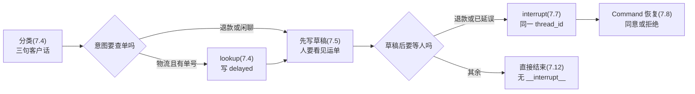
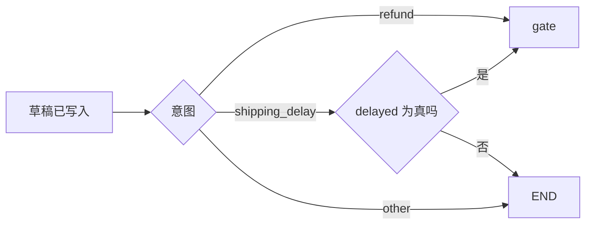
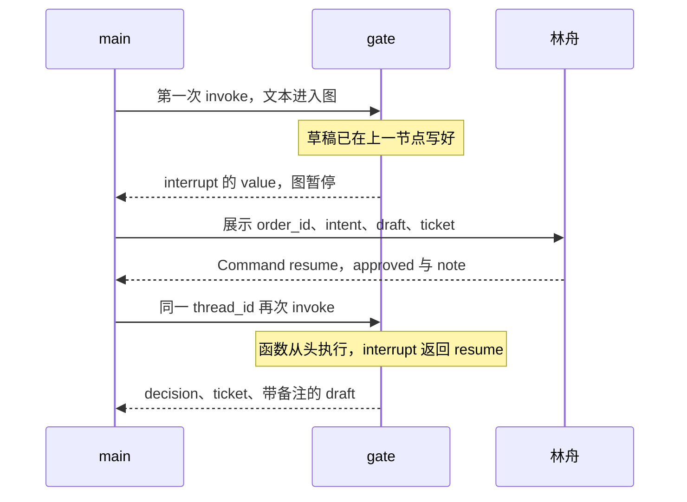
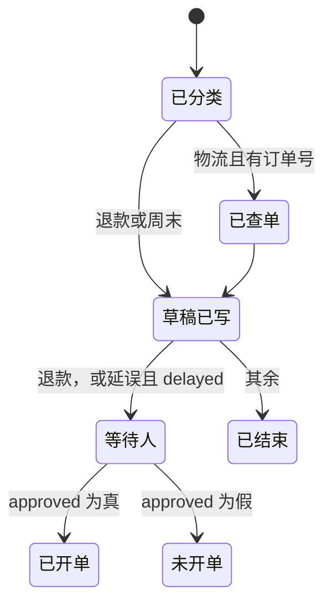

# 第 7 章 人工介入

> 本章导读：林舟不能让退款和开单在同一次调用里做完。人工介入（Human-in-the-Loop）是图在 `gate` 里调用 `interrupt`，把已经写好的草稿交给人，再用同一线程上的 `Command` 把决定送回来。物流句会停下，草稿里已有运单 `YT-2049-88`；同意后工单句留下，备注是「林舟确认开单」。退款句也会停下，拒绝后工单是空字符串，备注是「先安抚，不退款」。周末上班那句不进 `gate`，结果里没有 `__interrupt__`。副作用放在 `interrupt` 返回之后，因为恢复时节点从头再执行。读完本章，你能按三条客户话说出谁该停、谁该结束，并分清默认 `invoke` 的 `__interrupt__` 与另一次 `version="v2"` 探针。



*本章操作流程图*

## 你什么时候需要它

三种处境，对应三种读法。本章的运行把三种都走了一遍，但走的是动态 `interrupt()`，不是静态 `interrupt_before`。

**开单或退款会留下业务后果，必须等人点头。** 读 7.5 到 7.11。物流句在草稿里已经写明云途和 `YT-2049-88`，然后停住。林舟用 `{"approved": True, "note": "林舟确认开单"}` 恢复，工单句才写进状态。退款句即使不查单也停住；这次用 `{"approved": False, "note": "先安抚，不退款"}` 恢复，工单是空字符串。

**这句话没有副作用，不该把坐席叫过来。** 「你们周末上班吗」走 `other`。草稿要求补充订单号或说明意图，图在草稿之后结束。结果字典里没有 `__interrupt__` 这个键。`other_interrupted` 为 `False` 证明的是键不在，不是「中断值是假」。

**你想在每一次工具调用前都停一下。** 那是另一条机制：在 `create_agent` 的节点上使用静态 `interrupt_before`。第 3 章那张预置图的节点是 `model` 与 `tools`。本章的 `run_all.py` 没有使用它。小帆的规则不是「凡是工具就等人」，而是「退款一律等人，延误且已经延误才等人」。规则写在 `route_after_draft` 里。

前置是第 6 章的线程和第 5 章的条件边。检查点用 `InMemorySaver`，因为暂停和恢复在同一次进程。本章不启动子进程，也不启动数据库。

## 7.1 概述

这张图从第 4 章的直线和第 5 章的条件边长出来，新增的只有两件事：草稿之后有时进入 `gate`，`gate` 用 `interrupt` 把控制权交还调用方。分类仍是关键词函数，不调用模型。查单仍读 `orders.py` 里唯一的那笔订单。

| 客户话 | 意图 | 是否查单 | 是否 `interrupt` | 这次人的决定 | 结束后的 `ticket` |
| --- | --- | --- | --- | --- | --- |
| 订单 OD-2049 物流延迟，请处理 | `shipping_delay` | 是 | 是 | 同意，备注「林舟确认开单」 | 固定工单句 |
| 订单 OD-2049 我要退款 | `refund` | 否 | 是 | 拒绝，备注「先安抚，不退款」 | 空字符串 `""` |
| 你们周末上班吗 | `other` | 否 | 否 | 不发生 | 不会写入。运行没有打印这个键 |

固定工单句只有一句：「售后升级：订单 OD-2049 客户投诉物流延迟」。团队只有 `xbd-seashore-cs-team`。承运云途，运单 `YT-2049-88`。这些词的唯一出处仍是 `orders.py`。本章的 `draft` 与 `gate` 只引用，不另造。

**业务上推荐：草稿先写完，再在 `gate` 里 `interrupt`；工单字符串的赋值放在 `interrupt` 返回之后。退款一律进入 `gate`，物流延误要等 `delayed` 为真，其余意图在草稿之后结束。**

`interrupt` 的载荷是给人看的提议，不是已经落库的工单。载荷里的 `ticket` 始终是那句固定工单，好让人知道「若同意，将开出这一句」。状态里的 `ticket` 要等恢复之后才写。拒绝时写成空字符串，不用 `None`。`rejected_ticket_empty` 比较的是 `== ""`，结果为 `True`。

默认的 `graph.invoke` 把中断放在返回字典的 `__interrupt__` 键下。`pause` 读的是 `__interrupt__[0].value`。另一次探针用 `version="v2"` 得到 `langgraph.types.GraphOutput`，中断在 `.interrupts` 上。那次探针不是 `run_all.py` 的路径，7.15 单独写。中断对象上的标识每次运行都变，`pause` 不读它，本书不记录。

## 7.2 动态 interrupt 与静态 interrupt_before

本章运行用的是节点函数内部的 `interrupt()`。调用发生在 `gate` 的第一行可执行语句上。图编译时没有传入 `interrupt_before`。

另一条机制是静态断点。`create_agent` 编出来的图，节点名是 `model` 和 `tools`（第 1 章已写明；第 3 章的 `agent_nodes` 会打印那份列表，本章不重跑）。若在编译时指定在 `tools` 之前停下，每一次工具调用都会把控制权交还。查单这种只读步骤也会停。小帆的查单不需要林舟点头，需要点头的是开单和退款。

| | 本章的 `interrupt()` | 静态 `interrupt_before` |
| --- | --- | --- |
| 写在哪 | `gate` 函数体内 | 编译预置图时，指向 `model` 或 `tools` |
| 谁决定停 | `route_after_draft` 先决定进不进 `gate` | 只要执行流碰到那个节点名就停 |
| 本章 `run_all.py` | 用了 | 没用 |
| 适合 | 业务规则：退款必停，延误且 `delayed` 才停 | 调试时想在每一轮工具前看消息 |

不要把两种写法说成同一次运行的两个步骤。demo 的 `hitl.py` 没有导入 `create_agent`，也没有出现 `interrupt_before` 这个参数名。

## 7.3 状态比直线图多了决定和工单

`HitlState` 在第 4 章的字段上增加 `decision` 和 `ticket`。`total=False`，键可以先不存在。`other` 那条路径不会写入 `decision` 和 `ticket`，所以结果字典里不去读它们。读了会怎样，未在这次输出里展开。

| 键 | 谁写入 | 谁读取 | 空着表示什么 |
| --- | --- | --- | --- |
| `text` | 调用方的第一次 `invoke` | `classify` | 还没有客户话 |
| `intent` | `classify` | 两条条件边、`draft`、`gate` | 还没分类 |
| `order_id` | `classify` | `lookup`、`interrupt` 载荷 | 原文里没有 `OD-2049`。周末句就是空字符串 |
| `delayed` | `lookup` | `draft`、`route_after_draft` | 没走过查单。退款和周末都是这样 |
| `draft` | `draft`；恢复后 `gate` 可能追加备注 | 载荷、坐席 | 还没有给人看的句子 |
| `decision` | `gate`，在 `interrupt` 返回之后 | 调用方 | 人还没决定。缺省不要当成拒绝 |
| `ticket` | `gate`，在 `interrupt` 返回之后 | 调用方 | 本章用空字符串表示没开单 |

线程号仍然不在这张表里。`pause` 和 `finish` 各自组装 `{"configurable": {"thread_id": thread_id}}`。物流路径的线程是 `xiaofan-OD-2049`，退款是 `xiaofan-OD-2049-reject`，周末是 `xiaofan-other`。三个字符串故意不同。

## 7.4 源码：整张图

2026-11-27 的 `books/langchain/demo/xiaofan_graph/hitl.py` 如下。后文按函数拆开，打印键不再改写。

```python
"""Chapter 7: interrupt before opening a ticket. Resume with Command."""

from typing import Literal, TypedDict

from langgraph.checkpoint.memory import InMemorySaver
from langgraph.graph import END, START, StateGraph
from langgraph.types import Command, interrupt

from xiaofan_graph.orders import ORDER, ORDER_ID, OTHER_TEXT, REFUND_TEXT, SHIPPING_TEXT, TEAM, TICKET


class HitlState(TypedDict, total=False):
    text: str
    order_id: str
    intent: str
    delayed: bool
    draft: str
    decision: str
    ticket: str


def classify(state: HitlState) -> dict:
    text = state.get("text", "")
    if "退款" in text:
        intent = "refund"
    elif ORDER_ID in text or "物流" in text:
        intent = "shipping_delay"
    else:
        intent = "other"
    order_id = ORDER_ID if ORDER_ID in text else ""
    return {"intent": intent, "order_id": order_id}


def lookup(state: HitlState) -> dict:
    delayed = state.get("order_id") == ORDER_ID and bool(ORDER["delayed"])
    return {"delayed": delayed}


def draft(state: HitlState) -> dict:
    intent = state.get("intent")
    if intent == "refund":
        text = f"拟为订单 {ORDER_ID} 登记退款申请。退款不会自动执行，需要人工确认。"
    elif intent == "shipping_delay" and state.get("delayed"):
        text = (
            f"订单 {ORDER_ID} 由{ORDER['carrier']}承运，运单 {ORDER['tracking']}，"
            f"{ORDER['shipped_at']} 发出，已过 {ORDER['elapsed_days']} 天，"
            f"超过承诺的 {ORDER['promised_days']} 天。"
            f"拟开立工单：{TICKET}。团队 {TEAM}。"
        )
    elif intent == "shipping_delay":
        text = "未查到可判定延误的订单，请核对订单号。"
    else:
        text = "已记下。请给出订单号，或说明是物流还是退款。"
    return {"draft": text}


def gate(state: HitlState) -> dict:
    # This node restarts from the top on resume. Keep side effects after interrupt.
    decision = interrupt({
        "order_id": state.get("order_id", ""),
        "intent": state.get("intent", ""),
        "draft": state.get("draft", ""),
        "ticket": TICKET,
    })
    approved = bool(decision.get("approved"))
    note = decision.get("note") or ""
    ticket = TICKET if approved and state.get("intent") in {"shipping_delay", "refund"} else ""
    draft_text = state.get("draft", "")
    if note:
        draft_text = f"{draft_text} 备注：{note}"
    return {
        "decision": "approved" if approved else "rejected",
        "ticket": ticket,
        "draft": draft_text,
    }


def route_after_classify(state: HitlState) -> Literal["lookup", "draft"]:
    if state.get("intent") == "shipping_delay" and state.get("order_id"):
        return "lookup"
    return "draft"


def route_after_draft(state: HitlState) -> Literal["gate", "end"]:
    if state.get("intent") == "refund":
        return "gate"
    if state.get("intent") == "shipping_delay" and state.get("delayed"):
        return "gate"
    return "end"


def build_hitl(checkpointer=None):
    builder = StateGraph(HitlState)
    builder.add_node("classify", classify)
    builder.add_node("lookup", lookup)
    builder.add_node("draft", draft)
    builder.add_node("gate", gate)
    builder.add_edge(START, "classify")
    builder.add_conditional_edges(
        "classify",
        route_after_classify,
        {"lookup": "lookup", "draft": "draft"},
    )
    builder.add_edge("lookup", "draft")
    builder.add_conditional_edges(
        "draft",
        route_after_draft,
        {"gate": "gate", "end": END},
    )
    builder.add_edge("gate", END)
    return builder.compile(checkpointer=checkpointer or InMemorySaver())


def pause(graph, thread_id: str, text: str) -> dict:
    config = {"configurable": {"thread_id": thread_id}}
    out = graph.invoke({"text": text}, config)
    payload = out["__interrupt__"][0].value
    return payload


def finish(graph, thread_id: str, resume: dict) -> dict:
    config = {"configurable": {"thread_id": thread_id}}
    return graph.invoke(Command(resume=resume), config)


def main() -> None:
    graph = build_hitl()
    payload = pause(graph, "xiaofan-OD-2049", SHIPPING_TEXT)
    print("pause_order", payload["order_id"])
    print("pause_intent", payload["intent"])
    print("pause_ticket", payload["ticket"])
    print("pause_draft_has_tracking", "YT-2049-88" in payload["draft"])
    done = finish(graph, "xiaofan-OD-2049", {"approved": True, "note": "林舟确认开单"})
    print("approved_decision", done["decision"])
    print("approved_ticket", done["ticket"])
    print("approved_note", "林舟确认开单" in done["draft"])

    graph_r = build_hitl()
    pause(graph_r, "xiaofan-OD-2049-reject", REFUND_TEXT)
    rejected = finish(graph_r, "xiaofan-OD-2049-reject", {"approved": False, "note": "先安抚，不退款"})
    print("rejected_decision", rejected["decision"])
    print("rejected_ticket_empty", rejected["ticket"] == "")

    other = build_hitl().invoke(
        {"text": OTHER_TEXT},
        {"configurable": {"thread_id": "xiaofan-other"}},
    )
    print("other_intent", other["intent"])
    print("other_interrupted", "__interrupt__" in other)
    print("other_draft", other["draft"])


if __name__ == "__main__":
    main()
```

`build_hitl` 在调用方不传保存器时，自己 `InMemorySaver()`。`main` 三次调用都没传，所以是三个保存器。物流的 `pause` 和 `finish` 共用变量 `graph`，因此共用一个保存器和线程 `xiaofan-OD-2049`。退款换了 `graph_r`，也换了线程号。周末又是一次新的 `build_hitl()`。demo 没有做「只换线程、不换保存器」或「只换保存器、不换线程」的对照，隔离性不能单独归功于其中一样。能从输出肯定的是：三条路径的打印彼此不串，物流的同意没有写进退款的 `ticket`。

节点与边的形状：

| 起点 | 边 | 终点 |
| --- | --- | --- |
| `START` | 普通边 | `classify` |
| `classify` | 条件边，`"lookup"` 或 `"draft"` | `lookup` 或 `draft` |
| `lookup` | 普通边 | `draft` |
| `draft` | 条件边，`"gate"` 或 `"end"` | `gate` 或 `END` |
| `gate` | 普通边 | `END` |

`"end"` 是路由函数的返回字符串，映射到常量 `END`，不是一个名叫 `end` 的节点。

## 7.5 classify 与 lookup

`classify` 按固定顺序看原文。先看有没有「退款」，再看有没有订单号 `OD-2049` 或「物流」，否则是 `other`。三条固定客户话不会同时踩中前两个条件。若一句话里既有「退款」又有「物流」，源码会判成 `refund`。那种句子不在 `orders.py` 里，这次运行没有喂，未在这次输出里展开。

`order_id` 只有原文含 `OD-2049` 时才写成这个订单号，否则是空字符串。周末句走空字符串。退款句含订单号，所以 `order_id` 是 `OD-2049`，但意图不是 `shipping_delay`，`route_after_classify` 仍去 `draft`，不进 `lookup`。

`lookup` 的布尔式是：订单号等于 `OD-2049`，并且 `ORDER["delayed"]` 为真。`orders.py` 里 `delayed` 是 `True`，承诺 7 天，已过 9 天。以现在的 `classify` 为准，能走进 `lookup` 的非空订单号只会是 `OD-2049`；空订单号已经被路由挡下。相等判断仍写着，避免以后有人把别的订单号塞进状态时，只凭意图就当成延误。

这次运行没有单独打印 `delayed`。物流草稿含 `YT-2049-88`，而这个运单号只出现在 `intent == "shipping_delay" and delayed` 的那个分支里。`pause_draft_has_tracking True` 因此同时证明：走进了查单，并且 `delayed` 为真。不要另找一行名叫 `delayed` 的打印，本章没有那一行。

和第 4 章 `linear.py` 的 `lookup` 相比，布尔结果在「订单号对不上」时都是假。本章只在路由放行时才调用 `lookup`。第 4 章的直线图对任何意图都查单，那是另一章的形状。

## 7.6 草稿必须写在 gate 之前

`draft` 在 `gate` 之前执行。`interrupt` 的载荷把 `state["draft"]` 交给人。人若看不见运单号，就无法对「拟开立工单」点头。`pause_draft_has_tracking` 检查的是载荷草稿里有没有 `YT-2049-88`，不是检查状态里最终的 `ticket`。

四个分支的句子按源码拼出。运行没有把物流草稿和退款草稿整行打印出来。周末那句打印了，见 7.12。

| 条件 | 按源码拼出的 `draft` | 这次输出里能看见的证据 |
| --- | --- | --- |
| `refund` | 拟为订单 OD-2049 登记退款申请。退款不会自动执行，需要人工确认。 | 没有整行。只知道后来拒绝成功 |
| `shipping_delay` 且 `delayed` | 订单 OD-2049 由云途承运，运单 YT-2049-88，2026-11-18 发出，已过 9 天，超过承诺的 7 天。拟开立工单：售后升级：订单 OD-2049 客户投诉物流延迟。团队 xbd-seashore-cs-team。 | `pause_draft_has_tracking True` |
| `shipping_delay` 但未延误 | 未查到可判定延误的订单，请核对订单号。 | 这次没有喂这种输入 |
| 其余 | 已记下。请给出订单号，或说明是物流还是退款。 | `other_draft` 整行 |

承运和「云途」之间没有空格，因为格式串是 `由{ORDER['carrier']}承运`。团队名接在工单句之后，以「团队 xbd-seashore-cs-team。」收尾。这些字符属于源码拼接，不属于 `run_all.py` 的某一行。引用时要带着这句限定。

和第 4 章相比，物流这句的形状相同。退款这句多了「需要人工确认」。多出来的六个字只存在于本章的 `draft`，因为这里真的会停下来等人。第 4 章的直线图没有 `gate`，那一章的退款草稿不带这半句。不要把两章的 `linear_draft` 和本章载荷当成同一字符串。

「未延误」那个分支这次没跑。`ORDER["delayed"]` 为真，物流句又带正确订单号，路由进得了 `gate`。不要用想象的客户话去补一条输出。

## 7.7 草稿之后的三支路由

```python
def route_after_draft(state: HitlState) -> Literal["gate", "end"]:
    if state.get("intent") == "refund":
        return "gate"
    if state.get("intent") == "shipping_delay" and state.get("delayed"):
        return "gate"
    return "end"
```

判断顺序就是业务规则。

| 顺序 | 条件 | 去哪 | 三条客户话里谁碰上 |
| --- | --- | --- | --- |
| 先 | 意图是 `refund` | `gate` | 退款句。不看 `delayed`，因为没查单 |
| 后 | 意图是 `shipping_delay` 且 `delayed` 为真 | `gate` | 物流句 |
| 其余 | 上面都不是 | `END` | 周末句。未延误的物流句也会落在这里，但这次没跑 |

退款放在前面，是为了不依赖 `delayed`。`delayed` 对退款来说键都不一定存在。`.get("delayed")` 得到 `None`，`None` 为假。若有人把两条 `if` 对调，又把退款误判成需要 `delayed`，退款会直接结束。现在的源码没有对调。输出里退款路径能执行到 `finish`，并且 `rejected_decision` 有值，说明它进过 `gate`：`finish` 用的是 `Command`，而 `Command` 是用来恢复暂停的。周末路径不调用 `finish`。

物流句必须两条都真。只有「物流」两个字、查单却否决延误时，草稿是「请核对订单号」，然后结束，不开单。这是源码，不是这次的打印。



*图 7-2：route_after_draft 的三支，退款不看 delayed*

## 7.8 gate、载荷，以及恢复时从头执行

`gate` 正文第一行注释写明：恢复时这个节点从头再执行，副作用留在 `interrupt` 之后。注释是源码的一部分，不是运行输出。

```python
def gate(state: HitlState) -> dict:
    # This node restarts from the top on resume. Keep side effects after interrupt.
    decision = interrupt({...})
    approved = bool(decision.get("approved"))
    ...
```

第一次进入 `gate` 时，参数字典先被求值，再调用 `interrupt`。这次调用把控制权交还。`interrupt` 后面的赋值不会在第一次进入时执行。所以暂停返回给 `pause` 的，是载荷，不是 `return` 里的 `ticket`。`pause_ticket` 等于固定工单句，来自载荷里的 `"ticket": TICKET`，不是来自状态更新。

恢复时，`finish` 对同一个 `thread_id` 送入 `Command(resume=...)`。`gate` 从函数开头再跑一遍。参数字典会再算一次，它只读状态里的订单号、意图和草稿，再带上常量 `TICKET`，不写工单。`interrupt()` 这一次不再暂停，返回值就是 `resume` 字典。其后的行才执行。

因此「拟开单」可以放在参数里，给人看；「把工单写进状态」必须放在返回值之后。若在 `interrupt(...)` 之前就去创建外部工单，第一次暂停前会创建一次，恢复时从头执行还会再创建一次。本章没有外部写入，示范的是赋值的位置：`ticket = ...` 在 `interrupt` 调用之后。

`resume` 字典的形状是 demo 实际传入的两种：

| 路径 | `approved` | `note` | 线程 |
| --- | --- | --- | --- |
| 物流 | `True` | 林舟确认开单 | `xiaofan-OD-2049` |
| 退款 | `False` | 先安抚，不退款 | `xiaofan-OD-2049-reject` |

`approved = bool(decision.get("approved"))`。上面两行一个是真，一个是假。`note = decision.get("note") or ""`。两句备注都非空。备注非空时，草稿变成原来的句子、一个空格、然后「备注：」和备注正文。空格来自格式串 `f"{draft_text} 备注：{note}"`。物流路径用 `"林舟确认开单" in done["draft"]` 证明备注进了草稿，`approved_note` 为 `True`。整句草稿仍没有被打印，未在这次输出里展开。退款路径连这个包含检查都没有打印，只打印了决定和工单是否为空。

工单赋值：

```python
ticket = TICKET if approved and state.get("intent") in {"shipping_delay", "refund"} else ""
```

同意，且意图是物流或退款，状态里的 `ticket` 才是那句固定工单。否则是空字符串。物流这次同意，所以 `approved_ticket` 是整句工单。退款这次拒绝，`approved` 为假，短路之后 `ticket` 是 `""`。`rejected_ticket_empty` 为 `True`，比较的是 `rejected["ticket"] == ""`。若键不存在，比较会在打印前出错，输出里就不会有这一行。若值是 `None`，比较结果是 `False`。现在是 `True`，所以键在，并且值是空字符串，不是 `None`。

`decision` 写成字符串 `"approved"` 或 `"rejected"`，不是布尔值。打印行是 `approved_decision approved` 与 `rejected_decision rejected`。

退款若改为同意，源码会把同一句物流工单写进 `ticket`。demo 没有把退款的 `approved` 设为 `True`。不要把「源码里的条件包含 refund」写成「这次运行同意过退款」。这是教学上锁死书架里的那一句工单，不是生产上的工单分类。第 8 章会把这条锁再写进复核清单。

载荷四个键：

| 载荷键 | 从哪来 | 物流暂停时的打印 |
| --- | --- | --- |
| `order_id` | 状态，缺省空字符串 | `pause_order OD-2049` |
| `intent` | 状态，缺省空字符串 | `pause_intent shipping_delay` |
| `draft` | 状态里已经写好的草稿 | 只打印是否含 `YT-2049-88`，为 `True` |
| `ticket` | 常量 `TICKET`，不读状态里的 `ticket` | `pause_ticket` 为整句工单 |

`pause` 的实现是 `out["__interrupt__"][0].value`。它假定键存在且序列非空。物流和退款都进了 `gate`，这个假定成立。周末句不调用 `pause`。中断对象上除 `.value` 以外的字段，包括每次运行都会变的标识，`pause` 没有读取，本书不写下来。



*图 7-3：人看到的是载荷；工单写入发生在第二次进入 gate 且 interrupt 返回之后*

## 7.9 pause 与 finish 只差在传什么

```python
def pause(graph, thread_id: str, text: str) -> dict:
    config = {"configurable": {"thread_id": thread_id}}
    out = graph.invoke({"text": text}, config)
    payload = out["__interrupt__"][0].value
    return payload


def finish(graph, thread_id: str, resume: dict) -> dict:
    config = {"configurable": {"thread_id": thread_id}}
    return graph.invoke(Command(resume=resume), config)
```

两次都把线程号放进 `config`，不放进状态。`pause` 的输入是 `{"text": text}`，让图从 `START` 跑到 `interrupt`。`finish` 的输入是 `Command`，不是一份新的客户话。恢复值包在 `resume=` 里。

`pause` 返回载荷字典，所以 `main` 打的 `pause_*` 四行都来自载荷。`finish` 返回的是恢复之后的状态，所以 `approved_*` 和 `rejected_*` 来自 `gate` 的 `return`。不要把 `pause_ticket` 和 `approved_ticket` 当成同一次赋值。它们这次字符串相同，是因为人同意了，而载荷里的提议本来就是那一句。时间顺序是先打印载荷，再 `finish`，再打印状态。

检查点是必须的。`interrupt` 要把「停在 `gate`、等一个恢复值」记在这个 `thread_id` 上，编译时就得有保存器。`build_hitl` 用 `checkpointer or InMemorySaver()` 满足这一点。拿掉保存器之后的异常文本，未在这次输出里展开。第 6 章已经说明 `InMemorySaver` 随进程消失。本章的 `pause` 和 `finish` 之间没有进程边界，内存保存器覆盖得住这次运行。

`Command` 与普通字典不能互换。第 6 章第二次 `invoke` 传的是 `{"n": ...}`，因为计数图已经在 `END`，那是一次新的运行。本章的图停在 `interrupt` 上，恢复要带 `Command`。demo 没有对暂停中的线程改传普通字典，那个结果未在这次输出里展开。

## 7.10 物流句：暂停，然后同意

`main` 的第一段：

```python
graph = build_hitl()
payload = pause(graph, "xiaofan-OD-2049", SHIPPING_TEXT)
print("pause_order", payload["order_id"])
print("pause_intent", payload["intent"])
print("pause_ticket", payload["ticket"])
print("pause_draft_has_tracking", "YT-2049-88" in payload["draft"])
done = finish(graph, "xiaofan-OD-2049", {"approved": True, "note": "林舟确认开单"})
print("approved_decision", done["decision"])
print("approved_ticket", done["ticket"])
print("approved_note", "林舟确认开单" in done["draft"])
```

`SHIPPING_TEXT` 是「订单 OD-2049 物流延迟，请处理」。按 7.5 和 7.6 的函数，这条路径的状态推进如下。除打印行以外，中间字段是按源码推演，不是 `run_all.py` 逐键打印的。

| 步骤 | 按源码应有的变化 | 输出里的对应行 |
| --- | --- | --- |
| `classify` | `intent` 为 `shipping_delay`，`order_id` 为 `OD-2049` | 载荷上的 `pause_order`、`pause_intent` |
| `lookup` | `delayed` 为真 | 没有单独的键；由下一步的运单号间接证明 |
| `draft` | 草稿含云途、`YT-2049-88`、工单句、团队名 | `pause_draft_has_tracking True` |
| `gate` 第一次 | 交出载荷，状态里的 `ticket` 还没在 `return` 里写 | `pause_ticket` 为工单句 |
| `gate` 恢复 | `decision` 为 `approved`，`ticket` 为工单句，草稿含备注 | `approved_decision`、`approved_ticket`、`approved_note True` |

两次调用的线程都是 `xiaofan-OD-2049`，图对象都是 `graph`。这是「同一保存器、同一线程」的正面例子。

`approved_ticket` 与 `pause_ticket` 的字符串相同，都是「售后升级：订单 OD-2049 客户投诉物流延迟」。含义不同：前者是恢复后的状态，后者是暂停时的提议。

## 7.11 退款句：拒绝，工单是空字符串

```python
graph_r = build_hitl()
pause(graph_r, "xiaofan-OD-2049-reject", REFUND_TEXT)
rejected = finish(
    graph_r,
    "xiaofan-OD-2049-reject",
    {"approved": False, "note": "先安抚，不退款"},
)
print("rejected_decision", rejected["decision"])
print("rejected_ticket_empty", rejected["ticket"] == "")
```

`REFUND_TEXT` 是「订单 OD-2049 我要退款」。`pause` 的返回值没有赋给变量，所以退款的载荷四个键都没有被打印。能从后来的 `finish` 成功返回推断：暂停确实发生了，否则没有可恢复的 `interrupt`。推断停在这里。载荷里的 `intent` 按 `classify` 应是 `refund`，这次没有 `pause_intent` 那样的行，不要写成打印结果。

路径按源码是：`classify` 得到 `refund` 和订单号 `OD-2049`；路由跳过 `lookup`；`draft` 写出「需要人工确认」那句；`route_after_draft` 因意图是退款进入 `gate`；`interrupt` 暂停；`Command` 带回拒绝。

`rejected_decision` 是 `rejected`。`rejected_ticket_empty` 是 `True`。工单键存在且等于空字符串。备注「先安抚，不退款」传进去了。源码会把它接到草稿后面。输出没有检查草稿是否包含这句，未在这次输出里展开。

这次没有对退款使用 `approved: True`。条件表达式里虽然写了 `refund`，那一行在 `approved` 为假时不会把 `TICKET` 赋出去。同意退款仍得到物流工单句这件事，是读源码能看到的分支，不是 2026-11-27 的打印。

新的 `build_hitl()` 意味着新的 `InMemorySaver`。即便误用物流的线程号，这个新保存器里也没有物流那次同意。demo 连线程号也换成了 `xiaofan-OD-2049-reject`，两道隔离都在。没有单因素对照，见 7.4。

## 7.12 周末句：没有 __interrupt__

```python
other = build_hitl().invoke(
    {"text": OTHER_TEXT},
    {"configurable": {"thread_id": "xiaofan-other"}},
)
print("other_intent", other["intent"])
print("other_interrupted", "__interrupt__" in other)
print("other_draft", other["draft"])
```

`OTHER_TEXT` 是「你们周末上班吗」。没有「退款」，没有 `OD-2049`，没有「物流」，所以 `intent` 是 `other`，`order_id` 是空字符串。路由去 `draft`，不查单。草稿走最后的 `else`。`route_after_draft` 两个 `if` 都不中，返回 `"end"`，图结束。没有 `gate`，就没有 `interrupt`。

这一段不经过 `pause`。它直接看返回字典里有没有键 `__interrupt__`。`other_interrupted` 为 `False`，表示键不在字典里。不要改写成「键在，值是空列表」或「键在，值是假」。`in` 为假只能说明没有这个键。

`other_draft` 的整行是：

```text
已记下。请给出订单号，或说明是物流还是退款。
```

这是三条路径里唯一被完整打印的草稿。它没有运单号，没有工单句，没有团队名。阴性对照的意义是：一张只会暂停的图是错的。`False` 把「其余意图直接结束」固定成可核对的输出。

`invoke` 仍然带了 `thread_id`。图编译时有 `InMemorySaver`，所以即使得不到暂停，这次调用仍会把结束状态写进那个线程。demo 没有再对 `xiaofan-other` 调用 `get_state`。写进去的快照长什么样，未在这次输出里展开。周末句不需要恢复。

## 7.13 三条路径对照

| 项 | 物流 | 退款 | 周末 |
| --- | --- | --- | --- |
| 线程 | `xiaofan-OD-2049` | `xiaofan-OD-2049-reject` | `xiaofan-other` |
| 图对象 | `graph`，暂停与恢复共用 | `graph_r`，新建 | 第三次 `build_hitl()` |
| 进入 `lookup` | 是 | 否 | 否 |
| 进入 `gate` | 是 | 是 | 否 |
| 恢复值 | 同意，林舟确认开单 | 拒绝，先安抚，不退款 | 无 |
| 关于工单的打印 | 载荷和状态都是那一句 | `ticket == ""` 为真 | 不打印 `ticket` |
| 关于草稿的打印 | 只证明含运单号；备注被包含检查证明 | 不打印草稿 | 打印完整的「已记下」句 |



*图 7-4：三条客户话在同一张状态图上的落点不同*

「已开单」在这次运行里只有物流那一次。退款停在「未开单」。周末停在「已结束」，没有经过「等待人」。

## 7.14 2026-11-27 的运行输出

`run_all.py` 在 `main()` 之前打印模块名。下面是那天 `xiaofan_graph.hitl` 的完整输出。

```text
## xiaofan_graph.hitl
pause_order OD-2049
pause_intent shipping_delay
pause_ticket 售后升级：订单 OD-2049 客户投诉物流延迟
pause_draft_has_tracking True
approved_decision approved
approved_ticket 售后升级：订单 OD-2049 客户投诉物流延迟
approved_note True
rejected_decision rejected
rejected_ticket_empty True
other_intent other
other_interrupted False
other_draft 已记下。请给出订单号，或说明是物流还是退款。
```

十二行分成三组。

| 组 | 行 | 不要误读成 |
| --- | --- | --- |
| 物流暂停 | `pause_order`、`pause_intent`、`pause_ticket`、`pause_draft_has_tracking` | 工单已经在状态里开出。这四行来自载荷 |
| 物流同意 | `approved_decision`、`approved_ticket`、`approved_note` | 备注被单独存成一个状态键。它是草稿字符串的子串 |
| 退款拒绝 | `rejected_decision`、`rejected_ticket_empty` | 工单键被删掉或写成 `None`。比较对象是空字符串 |
| 周末 | `other_intent`、`other_interrupted`、`other_draft` | `__interrupt__` 存在且为假。`in` 为假表示没有这个键 |

输出里没有中断标识、没有 `next`、没有 `version`、没有数据库、没有模型回复。第 6 章计数图的空 `next` 不要拿来填这个空位。本章的暂停停在 `gate` 内部的 `interrupt`，运行故意不打印 `next`，以免和「已经走到 `END`」混在同一次输出里。

## 7.15 另一次探针：version="v2" 与 GraphOutput

另一次探针，demo 没走这条。2026-11-27，对图调用时传入 `version="v2"`，返回值的类型是 `langgraph.types.GraphOutput`，中断放在 `.interrupts` 上。`hitl.py` 使用的是默认 `invoke`，不传 `version`。默认返回值是字典，中断在 `__interrupt__` 下，`pause` 按这个键取值。

| | `run_all.py` 里的 `hitl.py` | 另一次探针 |
| --- | --- | --- |
| 调用 | `graph.invoke(输入, config)` | `graph.invoke(..., version="v2")` |
| 返回类型 | 字典 | `langgraph.types.GraphOutput` |
| 中断放在 | `__interrupt__` | `.interrupts` |
| 本章是否引用它的打印 | 引用 7.14 的十二行 | 不把探针的对象内容写进那十二行 |

不要把 `GraphOutput` 写进 `hitl.py` 的源码复述。文件里没有 `version` 这个参数。探针也没有进入 `run_all.py`。两种形状不要在同一次排障里混用：用默认 `invoke` 时去字典里找键；只有确实传了 `version="v2"` 时才去看 `.interrupts`。

## 7.16 同进程的 InMemorySaver 够不到明天

`build_hitl` 默认的保存器是 `InMemorySaver`。第 6 章已经打印 `InMemorySaver is MemorySaver`，本章不再导入 `MemorySaver`，也不再证明一次身份。类的关系以那一行为准。

本章能工作，是因为 `pause` 和 `finish` 发生在同一次 `main()`、同一个图对象上。进程若在两次调用之间退出，内存里的暂停点不会留给下一个进程。demo 没有做这个退出实验，未在这次输出里展开。需要跨进程时，回到第 6 章的 `SqliteSaver` 写法，并且仍然使用同一个 `thread_id`。本章没有把售后图接上 SQLite。

生产上的耐久数据库本章同样没有启动。不要把 `xiaofan-OD-2049` 这个教学线程写成已经落在数据库里的会话。

## 7.17 写错时会对不上哪一行

下面每条都对照源码和 7.14 的输出。没有单独跑过的失败文本，标明未展开。

**在 `interrupt` 之前写入 `ticket`。** 第一次进 `gate` 就会写入，恢复时函数从头执行，会再写一次。demo 把赋值放在 `interrupt` 之后。输出无法展示「写了两次」，因为没有外部副作用可数。位置本身在源码里。

**恢复时换了 `thread_id` 或换了一个新的 `build_hitl()`。** 新的保存器或另一个线程上没有这次暂停。失败文本未在这次输出里展开。物流路径的正面事实是：两次都用 `xiaofan-OD-2049`，并且两次都用变量 `graph`。

**把 `pause_ticket` 当成已开出的工单去通知客户。** 这一行出现在 `finish` 之前。人还可能拒绝。拒绝时状态里的 `ticket` 是空字符串，物流这条没有拒绝实验，退款这条拒绝实验的结果是 `rejected_ticket_empty True`。

**周末句也调用 `pause`。** `pause` 要读取 `__interrupt__[0]`。周末的结果没有这个键，`other_interrupted` 为 `False`。demo 对周末用的是 `invoke` 加 `in`，不是 `pause`。

**用 `None` 表示没开单。** 退款的比较是 `== ""` 且结果为真。`None` 会让这一行变成 `False`。本章统一空字符串。

**在笔记里写下某一次的中断标识。** 标识每次运行都变，输出里没有。复跑对不上是正常的，不要去改 `gate`。

**把 `version="v2"` 的 `.interrupts` 写进 `pause`。** `pause` 只认默认字典的 `__interrupt__`。探针不是这条路径。

**让所有意图都返回 `"gate"`。** 周末的 `other_interrupted` 就会不再是 `False`。现在它是 `False`，说明 `"end"` 那个分支在跑。

## 7.18 交给第 8 章的是同一张图

第 8 章的 `app.py` 不写新节点。它调用本章的 `build_hitl`、`pause` 和 `finish`，换了三个线程名：`thread-shipping`、`thread-refund`、`thread-other`。决定与本章相同：物流同意并带「林舟确认开单」，退款拒绝并带「先安抚，不退款」，周末不暂停。

打印键会改成 `e2e_*`。`app.py` 不打印 `other_draft`，也不打印备注是否进入草稿。那些证据留在本章的 `other_draft` 和 `approved_note`。第 8 章要做的是把三条路径收成一个入口，并列出没有跑的边界：模型网关、Langfuse、MCP、Java 平台、数据库、截图，以及退款同意时仍会写同一句工单这件事。

## 本章小结

1. **人工介入是 `gate` 里的 `interrupt`，加上同一线程上的 `Command(resume=...)`。** 编译时带 `InMemorySaver`。本章不用静态 `interrupt_before`。
2. **草稿写在暂停之前。** 物流载荷里含 `YT-2049-88`，`pause_draft_has_tracking` 为 `True`。人看到的 `ticket` 是提议，不是已经写入的状态。
3. **恢复时 `gate` 从头执行。** 工单赋值在 `interrupt` 返回之后。同意且意图是物流或退款，才写入那句固定工单。
4. **物流同意，退款拒绝。** 同意后 `decision` 为 `approved`，备注「林舟确认开单」在草稿里。拒绝后 `ticket` 是空字符串，不是 `None`。备注「先安抚，不退款」传进了 `resume`，草稿全文没有打印。
5. **周末句没有 `__interrupt__` 键。** `other_draft` 是「已记下。请给出订单号，或说明是物流还是退款。」
6. **默认 `invoke` 与 `version="v2"` 不是同一次运行。** 前者用 `__interrupt__`。后者是另一次探针，返回 `GraphOutput`，中断在 `.interrupts`。中断标识不记录。
7. **下一步是把这张图当成唯一入口跑三条客户话。** 第 8 章不再增加机制。

## 验收清单

- ☐ 对三条固定客户话各说一次：进不进 `lookup`，进不进 `gate`，并用 7.14 的某一行作为证据。
- ☐ 指出 `pause_ticket` 来自 `interrupt` 的载荷，`approved_ticket` 来自恢复后的状态，并说出两者这次为什么是同一句。
- ☐ 说明恢复时 `gate` 从头执行，以及为什么 `ticket` 的赋值必须写在 `interrupt(...)` 之后。
- ☐ 用 `rejected_ticket_empty True` 说明没开单时 `ticket` 是空字符串，而不是 `None` 或缺失。
- ☐ 说明 `other_interrupted False` 表示结果里没有 `__interrupt__` 键，并说出周末句为什么不调用 `pause`。
- ☐ 区分默认 `invoke` 的 `__interrupt__` 和另一次 `version="v2"` 探针的 `GraphOutput.interrupts`，并确认中断标识没有被记进笔记。

## 参考速查

理解主线不依赖本节。键以 2026-11-27 的 `run_all.py` 为准。

| 键 | 含义 |
| --- | --- |
| `pause_order` | 载荷里的 `order_id` |
| `pause_intent` | 载荷里的 `intent` |
| `pause_ticket` | 载荷里的 `ticket`，常量 `TICKET`，尚未作为状态里的开单结果 |
| `pause_draft_has_tracking` | 载荷草稿是否含 `YT-2049-88` |
| `approved_decision` | 恢复后的 `decision`，物流这条为 `approved` |
| `approved_ticket` | 恢复后的 `ticket` |
| `approved_note` | 恢复后的草稿是否含「林舟确认开单」 |
| `rejected_decision` | 退款恢复后的 `decision`，为 `rejected` |
| `rejected_ticket_empty` | 退款的 `ticket == ""` |
| `other_intent` | 周末句的意图 |
| `other_interrupted` | `"__interrupt__" in other` |
| `other_draft` | 周末句的完整草稿 |

| 函数 | 作用 |
| --- | --- |
| `route_after_classify` | 物流且有订单号才去 `lookup`，否则去 `draft` |
| `route_after_draft` | 退款必去 `gate`；物流且 `delayed` 才去 `gate`；否则 `END` |
| `interrupt({...})` | 暂停并把四个键交给人；恢复时返回 `resume` |
| `Command(resume=...)` | `finish` 用来把决定送回同一线程 |
| `InMemorySaver` | `build_hitl` 的默认检查点，只活在本进程 |

## 延伸阅读

- **第 6 章（检查点）**——`thread_id` 必须在 `config` 里，`InMemorySaver` 与 `MemorySaver` 是同一个类。本章依赖同进程的那一种，不重复 SQLite 实验。
- **第 5 章（条件边）**——`route_after_classify` 已经在那里把三条客户话分开。本章在草稿之后再加一只菱形。
- **第 8 章（小帆的售后图）**——同一张图、同样的同意和拒绝，换成 `e2e_*` 打印，并列出没有接上的网关、追踪和平台。
- **第 3 章（工具与 `create_agent`）**——预置图的节点是 `model` 与 `tools`。静态 `interrupt_before` 指的是那些名字。开单不要放进那张环。
- **LangGraph 的人工介入文档**——`interrupt` 与 `Command` 的契约以 1.2.24 为准。本书不把文档里的界面截图抄进来，demo 也没有打印中断标识。
