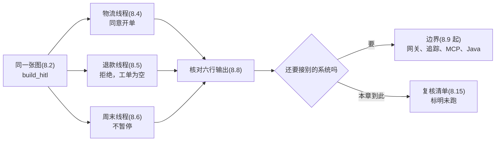
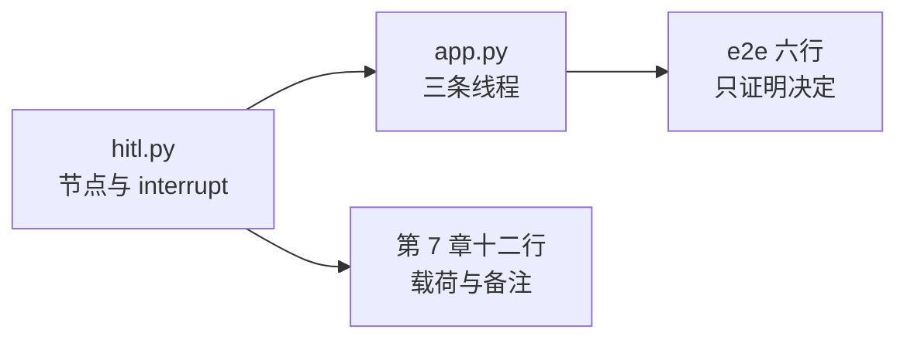
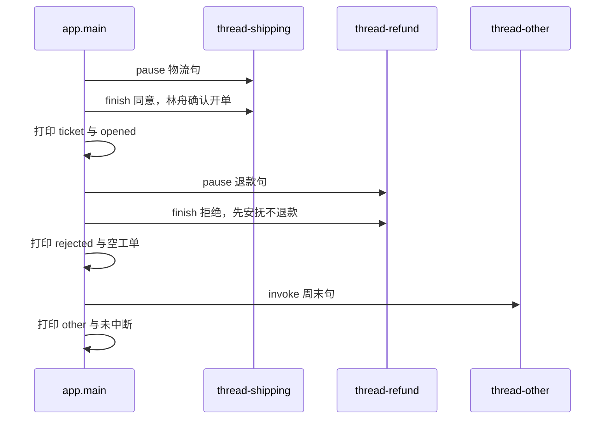

# 第 8 章 小帆的售后图

> 本章导读：本章把前七章收成一个入口，不再增加节点。海岸优品的三条客户话走同一张图：物流句在线程 `thread-shipping` 上由林舟同意，工单句留下；退款句在 `thread-refund` 上被拒绝，工单是空字符串；周末句在 `thread-other` 上不暂停。`app.py` 只调用第 7 章的 `build_hitl`、`pause` 与 `finish`。载荷里的工单句和同意后是否开出，要分开看。模型别名 `seashore-cs`、Langfuse、MCP、Java 平台、数据库和截图都没有跑，退款的同意分支也没有跑。读完本章，你能用 `e2e_` 开头的六行复述三条路径，并指出哪几件事必须改去书架上的其他书。



*本章操作流程图*

## 你什么时候需要它

三种处境，对应三种停法。本章不再教新的 API。

**你要向别人指出：Python 这边的小帆就是这一个入口。** 读 8.2 到 8.8。文件是 `app.py`。它把「订单 OD-2049 物流延迟，请处理」「订单 OD-2049 我要退款」「你们周末上班吗」送进第 7 章已经写好的图。六行 `e2e_*` 是 2026-11-27 的全部证据。物流同意，退款拒绝，周末不中断。

**评审问：模型网关、追踪、工具协议、Java 平台接上了没有。** 读 8.9 到 8.14，然后停。这些事本章都没有跑。网关去 LiteLLM 书，追踪去 Langfuse 书，工具协议去 MCP 书，平台上的客服 Agent 留在 AgentScope Java。本书的 `lookup` 是进程内函数。前端不是第二套教程，CopilotKit 书第 5 章已经把一张 LangGraph 接到界面。

**有人想把退款同意也跑一遍，并期待另一句工单。** 读 8.5。`gate` 在同意且意图属于物流或退款时，写入的仍是那句物流工单。demo 从未把退款的 `approved` 设为真。这是为了锁住书架上的唯一工单句，不是生产上的工单分类。不要在本章补一次同意来「显得完整」。

前置：第 7 章的 `interrupt` 与 `Command` 已经跑通。本章的决定和备注与第 7 章相同，线程号不同。检查点仍是每次 `build_hitl()` 自带的 `InMemorySaver`。不跨进程，不启动数据库。

## 8.1 概述

`app.py` 的模块文档写的是：与第 7 章同一张图，三条客户话，一个入口。它不定义 `classify`、`draft` 或 `gate`。那些函数留在 `hitl.py`。本章如果出现新的状态键、新的节点名或新的工单句，就说明入口没有守住边界。

三条路径和打印含义：

| 线程 | 客户话 | 调用方式 | 人的决定 | 2026-11-27 的打印 |
| --- | --- | --- | --- | --- |
| `thread-shipping` | 订单 OD-2049 物流延迟，请处理 | `pause` 然后 `finish` | `approved` 真，备注「林舟确认开单」 | 载荷工单句；开出为 `True` |
| `thread-refund` | 订单 OD-2049 我要退款 | `pause` 然后 `finish` | `approved` 假，备注「先安抚，不退款」 | `decision` 为 `rejected`；工单为空 |
| `thread-other` | 你们周末上班吗 | 一次 `invoke` | 不发生 | 意图 `other`；没有 `__interrupt__` |

**业务上推荐：三条客户话共用 `hitl.py` 这一张图，用不同的 `thread_id` 分开。本章只组装，不新增机制。模型网关、追踪、MCP 和 Java 平台都留在各自的书里。**

`e2e_shipping_ticket` 打的是暂停载荷里的 `ticket`，不是恢复之后的状态。`e2e_shipping_opened` 才检查恢复后的 `ticket` 是否等于常量 `TICKET`。两行一起为真，表示「提议的那一句」和「同意后写下的那一句」相同。只看前一行，会把尚未同意的提议说成已经开出。

退款没有打印载荷。它只证明拒绝之后工单字符串为空。同意退款的分支在源码里会写下同一句 `TICKET`，运行没有走进去。

## 8.2 源码：入口没有新机制

2026-11-27 的 `books/langchain/demo/xiaofan_graph/app.py` 全文如下。

```python
"""Chapter 8: the same graph as chapter 7, three customer messages, one entry point."""

from xiaofan_graph.hitl import build_hitl, finish, pause
from xiaofan_graph.orders import OTHER_TEXT, REFUND_TEXT, SHIPPING_TEXT, TICKET


def main() -> None:
    graph = build_hitl()
    shipping = pause(graph, "thread-shipping", SHIPPING_TEXT)
    shipping_done = finish(graph, "thread-shipping", {"approved": True, "note": "林舟确认开单"})
    print("e2e_shipping_ticket", shipping["ticket"])
    print("e2e_shipping_opened", shipping_done["ticket"] == TICKET)

    refund_graph = build_hitl()
    pause(refund_graph, "thread-refund", REFUND_TEXT)
    refund_done = finish(refund_graph, "thread-refund", {"approved": False, "note": "先安抚，不退款"})
    print("e2e_refund_decision", refund_done["decision"])
    print("e2e_refund_ticket_empty", refund_done["ticket"] == "")

    other = build_hitl().invoke(
        {"text": OTHER_TEXT},
        {"configurable": {"thread_id": "thread-other"}},
    )
    print("e2e_other_intent", other["intent"])
    print("e2e_other_interrupted", "__interrupt__" in other)


if __name__ == "__main__":
    main()
```

导入只有四个名字：`build_hitl`、`finish`、`pause`，以及订单模块里的三句客户话和 `TICKET`。没有 `init_chat_model`，没有回调，没有数据库驱动，没有 `interrupt` 的直接调用。`interrupt` 发生在 `hitl.gate` 内部，入口不重复写一遍。

`run_all.py` 的步骤列表把这个模块放在最后：

```python
STEPS = [
    "xiaofan_graph.chain",
    "xiaofan_graph.tools_agent",
    "xiaofan_graph.linear",
    "xiaofan_graph.routing",
    "xiaofan_graph.checkpoint",
    "xiaofan_graph.hitl",
    "xiaofan_graph.app",
]
```

每一项都是导入模块并调用 `main()`。打印在 `main()` 之前先输出 `##` 和模块名。所以 `## xiaofan_graph.app` 不是 `app.py` 自己印的。`app.py` 只印六行 `e2e_*`。前面的链、工具、直线图、条件边、检查点和人工介入，已经由各自的 `main()` 在同一次 `run_all.py` 里跑过。本章不把那些行再贴一遍。复核清单用「覆盖 / 未覆盖」指向它们。

三次 `build_hitl()` 是三次编译、三个 `InMemorySaver`。物流的 `pause` 和 `finish` 共用变量 `graph`。退款共用 `refund_graph`。周末那次没有留下变量名，调用完就用返回值。同一进程里三张图互不读取。线程号也各不相同。和第 7 章一样，demo 没有做「只换其中一个」的对照，因此不要把成功归到单一因素上。能肯定的是：入口没有把三条话塞进同一个 `thread_id`。

客户话和工单句仍来自 `orders.py`，入口没有抄写第二份字符串。

| 名字 | 值 |
| --- | --- |
| `SHIPPING_TEXT` | 订单 OD-2049 物流延迟，请处理 |
| `REFUND_TEXT` | 订单 OD-2049 我要退款 |
| `OTHER_TEXT` | 你们周末上班吗 |
| `TICKET` | 售后升级：订单 OD-2049 客户投诉物流延迟 |

`app.py` 没有导入 `TEAM`、承运和运单号。那些词出现在 `hitl.draft` 拼出的草稿里。本章的打印不包含草稿全文，所以团队名 `xbd-seashore-cs-team`、云途和 `YT-2049-88` 不会出现在 `e2e_*` 行上。它们是否进了草稿，证据在第 7 章的 `pause_draft_has_tracking True`，不在本章。

## 8.3 三个线程名是教学用的，不是会话系统

| 本章线程 | 第 7 章的对应线程 | 为什么两边都不用同一个字符串 |
| --- | --- | --- |
| `thread-shipping` | `xiaofan-OD-2049` | 第 7 章要和检查点章的教学线程对齐；本章要让入口的三条线程一眼能分开 |
| `thread-refund` | `xiaofan-OD-2049-reject` | 同上 |
| `thread-other` | `xiaofan-other` | 同上 |

线程号仍只出现在 `config["configurable"]["thread_id"]`。`pause` 和 `finish` 内部组装这个字典。周末路径在 `app.py` 里直接把字典写在 `invoke` 的第二个参数上，形状与 `pause` 内部相同。没有哪一条把线程号写进 `HitlState`。

这些名字不能当生产会话 id。它们不含用户、不含时间、也不防止同一订单的两段对话撞车。教学上用固定字符串，是为了复跑时六行输出稳定。生产上的会话号应在调用 `pause` 之前就定下来，并且一次对话始终用同一个。本章没有接入会话存储。

`InMemorySaver` 只活在这次 `main()` 里。`run_all.py` 结束，三个线程一起消失。第 6 章的 SQLite 子进程不属于 `app.py`。不要在复述本章时加上 `sqlite_reopen_n`。

## 8.4 物流：同意之后才算开出

```python
graph = build_hitl()
shipping = pause(graph, "thread-shipping", SHIPPING_TEXT)
shipping_done = finish(graph, "thread-shipping", {"approved": True, "note": "林舟确认开单"})
print("e2e_shipping_ticket", shipping["ticket"])
print("e2e_shipping_opened", shipping_done["ticket"] == TICKET)
```

`pause` 的返回值是 `interrupt` 载荷，不是整份状态。载荷的 `ticket` 来自 `gate` 里写死的常量 `TICKET`。因此 `e2e_shipping_ticket` 在人同意之前就已经是那句工单。2026-11-27 的值是「售后升级：订单 OD-2049 客户投诉物流延迟」。

`finish` 使用同一个 `graph`、同一个 `thread-shipping`，恢复值是同意，备注是「林舟确认开单」。`shipping_done["ticket"]` 是 `gate` 在 `interrupt` 返回之后写入的状态。`e2e_shipping_opened` 为 `True`，表示这份状态里的字符串与 `TICKET` 相等。

备注传进去了，本章却没有像第 7 章那样打印 `"林舟确认开单" in draft`。含不含备注，不能从六行 `e2e_*` 里读出来。第 7 章在另一个线程上对同一句备注得到 `approved_note True`。那是第 7 章的证据。本章只保证入口把这句备注放进了 `resume`。

按 `hitl.py` 推演，这条线程上的节点顺序是 `classify`、`lookup`、`draft`、`gate` 暂停、再从 `gate` 开头执行到结束。中间字段本章没有打印。推演如下，未在 `app.py` 的输出里逐键展开。

| 节点 | 按 `hitl.py` 应写下的内容 | `app.py` 是否打印 |
| --- | --- | --- |
| `classify` | 意图 `shipping_delay`，订单号 `OD-2049` | 否 |
| `lookup` | `delayed` 为真 | 否 |
| `draft` | 草稿含云途、`YT-2049-88`、工单句、团队名 | 否。第 7 章只证明了运单号在载荷草稿里 |
| `gate` 暂停 | 载荷四键，其中 `ticket` 为常量 | 是，`e2e_shipping_ticket` |
| `gate` 恢复 | `decision` 为 `approved`，`ticket` 等于 `TICKET`，草稿追加备注 | 只打印工单是否等于 `TICKET` |

`e2e_shipping_opened` 不打印 `decision`。同意这件事由传入的 `approved: True` 和开出的工单共同支撑：源码里只有同意且意图是物流或退款时，`ticket` 才会等于 `TICKET`。开出为真，与「这次传入了同意」一致。若当时传的是拒绝，按同一行源码，`ticket` 会是空字符串，这一行会是 `False`。demo 没有对物流再跑一次拒绝。

## 8.5 退款：拒绝，以及没有跑过的同意分支

```python
refund_graph = build_hitl()
pause(refund_graph, "thread-refund", REFUND_TEXT)
refund_done = finish(refund_graph, "thread-refund", {"approved": False, "note": "先安抚，不退款"})
print("e2e_refund_decision", refund_done["decision"])
print("e2e_refund_ticket_empty", refund_done["ticket"] == "")
```

`pause` 的返回值被丢掉。退款载荷里的订单号、意图、草稿和提议工单，都没有出现在本章输出里。随后 `finish` 能返回，说明这个线程上有过一次可恢复的暂停。除此之外，不要把载荷内容写成 `e2e_` 行。

`e2e_refund_decision` 是 `rejected`。`e2e_refund_ticket_empty` 为 `True`，因为 `refund_done["ticket"] == ""`。键存在，值是空字符串，不是 `None`。这与第 7 章 `rejected_ticket_empty` 是同一比较，换了线程和打印键。

备注「先安抚，不退款」在 `resume` 里。`gate` 会在备注非空时把它接到草稿后面。`app.py` 没有检查草稿。这一接是否发生，未在本章输出里展开。

按 `hitl.py` 推演，退款不进 `lookup`。`classify` 看到「退款」，意图为 `refund`，订单号仍是 `OD-2049`，因为原文里有这个号。`route_after_draft` 看到退款就进 `gate`，不看 `delayed`。这些中间值本章都没打印。

同意退款的分支要单独说，并且标明没跑。`gate` 里的赋值是：

```python
ticket = TICKET if approved and state.get("intent") in {"shipping_delay", "refund"} else ""
```

`refund` 和 `shipping_delay` 写在同一个集合里。若 `approved` 为真，退款也会得到「售后升级：订单 OD-2049 客户投诉物流延迟」。不会得到一句「退款工单」或另一种团队。`app.py` 传入的是 `approved: False`，这个真分支对退款没有执行。物流那次同意执行过，所以同一句工单在物流路径上被 `e2e_shipping_opened True` 见过。退款路径没有见过。

这是教学锁，不是生产分类。书架上的工单句要和 AgentScope Java 那一句逐字相同，本书因此不引入第二种工单。真实客服会把退款和物流拆开。拆开的日子，应改 `orders.py` 并让全书只保留新的那一组句子，而不是在 `app.py` 里临时拼一句。本章不改。

| 问题 | 本章的答案 |
| --- | --- |
| 退款同意了吗 | 没有。`e2e_refund_decision` 是 `rejected` |
| 拒绝后工单是什么 | 空字符串。`e2e_refund_ticket_empty True` |
| 若同意会写什么 | 源码会写 `TICKET`。不是这次的打印 |
| 这算工单类型设计吗 | 不算。是锁住唯一一句，避免各章各写各的 |

## 8.6 周末：不暂停，也不打印草稿

```python
other = build_hitl().invoke(
    {"text": OTHER_TEXT},
    {"configurable": {"thread_id": "thread-other"}},
)
print("e2e_other_intent", other["intent"])
print("e2e_other_interrupted", "__interrupt__" in other)
```

`e2e_other_intent` 是 `other`。`e2e_other_interrupted` 是 `False`。`False` 来自 `"__interrupt__" in other`，表示键不在返回字典里。不要写成「中断列表是空的」或「中断值是假」。键若存在，`in` 就会为真，无论值是什么。

这条路径不调用 `pause`，也不调用 `finish`。没有 `Command`。`route_after_draft` 对非退款、且不是「物流且已延误」的状态返回 `"end"`，图结束。

草稿按 `draft()` 的 `else` 应是「已记下。请给出订单号，或说明是物流还是退款。」第 7 章把这句整行印成了 `other_draft`。`app.py` 没有这行打印。本章不能把那句再标成 `e2e` 输出。函数相同，所以句子应按源码相同；证据的位置在第 7 章，不在本章的六行里。

周末句没有订单号，`classify` 把 `order_id` 写成空字符串，不进 `lookup`。本章不打印 `order_id`。空字符串是源码结果，未在 `app.py` 的输出里展开。

## 8.7 和第 7 章相比，变了什么，没变什么

| 项 | 第 7 章 `hitl.py` | 本章 `app.py` |
| --- | --- | --- |
| 图的定义 | 就在这个文件里 | 调用 `build_hitl`，不重写节点 |
| 物流线程 | `xiaofan-OD-2049` | `thread-shipping` |
| 退款线程 | `xiaofan-OD-2049-reject` | `thread-refund` |
| 周末线程 | `xiaofan-other` | `thread-other` |
| 物流决定 | 同意，「林舟确认开单」 | 相同 |
| 退款决定 | 拒绝，「先安抚，不退款」 | 相同 |
| 工单句 | `TICKET` | 同一个常量 |
| 是否打印载荷上的订单号与意图 | 物流打印了 | 不打印。只打印载荷里的 `ticket` |
| 是否打印备注进入草稿 | `approved_note True` | 不打印 |
| 是否打印周末草稿 | 打印整句 | 不打印 |
| 是否打印退款载荷 | 不打印，返回值丢掉 | 同样丢掉 |
| 保存器 | 每次 `build_hitl()` 一个 `InMemorySaver` | 相同 |

机制没有增加。若两章的决定对不上，应先看是不是入口改了 `approved` 或换了一张图，而不是去调模型。2026-11-27 的两边分别是 `approved` / `rejected` / 不中断，对得上。



*图 8-2：入口复用第 7 章的图；备注和周末草稿的证据仍在第 7 章*

## 8.8 2026-11-27 的运行输出

`run_all.py` 打出的 `xiaofan_graph.app` 段只有下面这些行。

```text
## xiaofan_graph.app
e2e_shipping_ticket 售后升级：订单 OD-2049 客户投诉物流延迟
e2e_shipping_opened True
e2e_refund_decision rejected
e2e_refund_ticket_empty True
e2e_other_intent other
e2e_other_interrupted False
```

| 行 | 表达式 | 读法 |
| --- | --- | --- |
| `e2e_shipping_ticket` | `shipping["ticket"]` | 暂停载荷里的提议，人尚未在这一行之前被代码写成「已开出」 |
| `e2e_shipping_opened` | `shipping_done["ticket"] == TICKET` | 恢复后的状态工单等于那一句 |
| `e2e_refund_decision` | `refund_done["decision"]` | 字符串 `rejected`，不是布尔 |
| `e2e_refund_ticket_empty` | `refund_done["ticket"] == ""` | 空字符串，不是 `None` |
| `e2e_other_intent` | `other["intent"]` | `other` |
| `e2e_other_interrupted` | `"__interrupt__" in other` | `False` 表示没有这个键 |

输出里没有模型句子，没有 HTTP 状态码，没有 trace id，没有中断标识，没有截图路径，没有数据库名。下面几节把每一件没出现的事说死，避免后文补写时把它们混进「已经跑通」。

## 8.9 边界：init_chat_model 与 llm.example.com

这条边界没有执行。

LiteLLM 书里海岸优品的模型别名是 `seashore-cs`。网关的主机名是 `https://llm.example.com`。`langchain` 1.5.2 的 `init_chat_model` 文档字符串把 `base_url` 列为关键字参数，会交给底层模型的构造函数。参数名写在安装包的说明里，不等于这次运行把请求发出去了。

下面的调用只标出这两个名字。它不在 `app.py` 里，也不在 `run_all.py` 的任何模块里。

```python
# 未执行。不要把下面这行当成 2026-11-27 的运行输出。
init_chat_model("seashore-cs", base_url="https://llm.example.com")
```

依赖里故意没有 `langchain-openai`。第 2 章对 `init_chat_model("openai:gpt-4o-mini")` 记录过缺包时的 `ImportError`，消息要求安装 `langchain-openai`。指向 `llm.example.com` 的这一行连那个缺包实验都没有做：没有状态码，没有超时，没有模型回复正文。不要补一个 200，也不要补一段「小帆说」。

分类在这张售后图里是 `classify` 的关键词，不是这只未发出的调用。把别名接上之后，标签集合仍然只应是 `shipping_delay`、`refund`、`other`。接法、虚拟密钥和降级在 LiteLLM 书。业务仓库不应出现供应商密钥。本章没有 `.env`，也没有把密钥写进示例。

`FakeListChatModel` 与 `GenericFakeChatModel` 只用在第 2、3 章，用来证明链和 `create_agent` 的接线。`app.py` 不导入它们。三条 `e2e_*` 路径没有模型参与。

## 8.10 边界：Langfuse 没有初始化

这条边界没有执行。

本章没有创建 Langfuse 客户端，没有把回调放进 `config`，也没有查询 trace。`pause` 和 `finish` 的 `config` 里只有 `thread_id`。多出来的 `callbacks` 键不会出现在 2026-11-27 的源码里。

因此不能回答「这句草稿是哪次模型调用生成的」。草稿是 `draft()` 用订单字段拼出来的，本来就不是模型生成的。将来若分类或草稿改成模型，轨迹应记在 Langfuse 书讲的那一侧，而不是写进 `HitlState`。状态字典继续只放订单、意图、草稿、决定和工单。观测数据不要和工单字符串混在一个键里。

本书不初始化 SDK，也就没有主机、公钥或密钥可引用。不要从别的项目抄一套密钥放进 demo。去 Langfuse 书看轨迹怎么读。本章的六行输出不是 trace。

## 8.11 边界：lookup_order 不是 MCP 服务

这条边界没有执行。

第 3 章的 `lookup_order` 是进程内的 `@tool` 函数，内部调用 `lookup_order_record`。未知订单号返回字符串 `NOT_FOUND`，`OD-2049` 返回 `record_as_text` 拼出的那一行。第 7 章和第 8 章的图甚至不调用这个工具。它们的 `lookup` 节点直接读 `orders.py` 的 `ORDER`，写出 `delayed`。

两种查单都在同一个 Python 进程里。没有 MCP Server，没有工具清单的网络发现，也没有把这六个字段暴露给 Java 侧。Java 上的小帆若要查同一笔订单，应走 MCP 书里的工具协议，而不是导入 `xiaofan_graph`。

| 查单写法 | 谁在用 | 本章是否把它变成服务 |
| --- | --- | --- |
| `lookup_order` | 第 3 章的手写循环和 `create_agent` | 否，仍是进程内函数 |
| `lookup` 节点 | 第 7 章的图，本章入口调用该图 | 否，直接读字典 |
| MCP Server | 书架上的 MCP 书 | 本章没有启动 |

不要把 `NOT_FOUND` 改成抛异常来「更像接口」。第 3 章的契约是返回这个字符串。本章的售后图用空的 `order_id` 和条件边表达「没有订单」，周末句就是这条路。两套「没有订单」不要合成一种。

## 8.12 边界：AgentScope Java 拥有平台上的小帆

这条边界没有执行。本章没有调用 Java 接口，没有创建平台 Agent，也没有改中台。

星帆出海、客服 Agent 小帆、工程师林舟、商家海岸优品、namespace `seashore-main`、订单 `OD-2049`、团队 `xbd-seashore-cs-team`、工单句「售后升级：订单 OD-2049 客户投诉物流延迟」，与 AgentScope Java 和 LiteLLM 对齐。本书追加的只有一组物流字段：承运云途，运单 `YT-2049-88`，2026-11-18 发出，承诺 7 天，已过 9 天，因此 `delayed` 为真。物流字段不要倒写成「Java 平台已经存了运单」。工单句和订单号没有被本章改写。

Python 这张图是同一张订单的编排：分类、查单、草稿、等人、再决定写不写那句工单。平台上的会话、部署和 Java Agent 仍由 AgentScope Java 负责。图能对三条客户话给出暂停或直接回复之后，就停。不要用 LangGraph 重写整个中台，也不要在 `app.py` 里再做一个「平台 Agent」。

| 名词 | 本书证明到哪 | 留给 Java 平台的 |
| --- | --- | --- |
| 小帆 | 一个 Python 函数图的名字 | 平台上的客服 Agent |
| `OD-2049` | 唯一订单号 | 同一张订单，不另起单号 |
| 工单句 | 同意后写入状态的那一句字符串 | 工单系统里的同一句，本章不调用工单 API |
| 团队 | 出现在草稿末尾的字符串 | 平台上的团队，本章不调用团队 API |
| 林舟 | 恢复值备注里的虚构工程师 | 不是运行日志里的真实账号 |

备注「林舟确认开单」是教学句子，表示人的那一次同意。它不是平台的审计事件。本章没有把备注提交到任何工单接口。

## 8.13 边界：没有启动 Postgres

这条边界没有执行。

第 6 章用 `SqliteSaver` 把计数图写进临时文件，子进程读到 `n` 为 1，再加一得到 2，然后 `TemporaryDirectory` 把文件删掉。那是计数图，不是售后图。`app.py` 的三次 `build_hitl()` 用的是默认 `InMemorySaver`。进程结束，`thread-shipping`、`thread-refund`、`thread-other` 都不在了。

本章没有连接串，没有 `PostgresSaver`，也没有把售后状态写进 SQLite。生产上若暂停要活过重启，应换耐久的数据库检查点，并仍把 `thread_id` 放在 `config` 里。那次替换不在 2026-11-27 的 `run_all.py` 里。不要写「本章已经持久化了 OD-2049」。

内存保存器与 `MemorySaver` 是同一个类，证据是第 6 章的 `saver_is_same_class True`。本章不再打印这一行。身份关系不因入口换了线程名而改变。

## 8.14 边界：没有截图，JS 也不是第二教程

这条边界没有执行。

本章没有任何界面，也没有 `../assets/images/` 下的截图。章首图和文内图都是 mermaid。坐席按钮、聊天窗、中断卡片，都不在 demo 里。`Command(resume=...)` 的字典是 Python 调用。谁把「同意」和备注从按钮收集起来，是另一本书的事。

JavaScript 侧有 `@langchain/langgraph`。本书不并行写一套 JS 教程，也不把 `app.py` 译过去。接口名会变，没跑过的译本会先过时。CopilotKit 书第 5 章已经演示如何把一张后端 LangGraph 接到前端运行时。需要界面时读那一章，以那边的接入步骤为准。不要把本书的订单号、线程名和 `e2e_*` 键搬进那个前端示例，也不要把那个前端示例的订单搬进 `orders.py`。

中断标识同样没有截图、没有日志。它每次运行都变，`pause` 只取载荷的 `.value`。本章的 `shipping` 变量就是那份 `.value`。标识字段未被打印。

## 8.15 复核清单

下表只区分 2026-11-27 的 `run_all.py` 覆盖了什么、没有覆盖什么。后续探针（第 6 章的六条历史明细、第 7 章的 `version="v2"`）写在备注里，不算 `run_all.py` 的行。

| 事项 | `run_all.py` | 依据或未跑的原因 |
| --- | --- | --- |
| `prompt \| model \| parser` 在假模型上返回 `shipping_delay` | 覆盖 | `xiaofan_graph.chain`。假模型不读原文 |
| 缺包时 `init_chat_model("openai:gpt-4o-mini")` 的 `ImportError` | 覆盖 | 第 2 章。没有跟随提示去安装 `langchain-openai` |
| `init_chat_model("seashore-cs", base_url="https://llm.example.com")` | 未覆盖 | 未执行。没有状态码 |
| 手写工具循环与 `create_agent` 走到 `lookup_order` | 覆盖 | `xiaofan_graph.tools_agent`。未知订单号的契约是 `NOT_FOUND` |
| 静态 `interrupt_before` 停在 `model` 或 `tools` | 未覆盖 | 第 7 章只用了 `gate` 里的 `interrupt()` |
| 直线图 `classify → lookup → draft` | 覆盖 | `xiaofan_graph.linear` |
| 三条客户话的条件边，以及 `recursion_limit` | 覆盖 | `xiaofan_graph.routing`。永远加一的环会触发 `GraphRecursionError` |
| `InMemorySaver is MemorySaver` | 覆盖 | `saver_is_same_class True` |
| 同一进程两次加一得到 1 然后 2，历史长度 6 | 覆盖 | `memory_first`、`memory_second`、`memory_history_len` |
| 六条快照的 `step`、`next`、`n`、`source` | 不在 `run_all.py` 的打印里 | 第 6 章的后续检查，最新的一条在前 |
| SQLite 第二个进程读到 `n` 为 1，再得到 2 | 覆盖 | `sqlite_reopen_n`、空的 `sqlite_reopen_next`、`sqlite_second_step`。文件随后删除 |
| `PostgresSaver` 或任何数据库连接串 | 未覆盖 | 没有启动数据库 |
| 物流句 `interrupt` 后同意，工单句留下 | 覆盖 | 第 7 章 `approved_*`；本章 `e2e_shipping_ticket` 与 `e2e_shipping_opened True` |
| 退款句暂停后拒绝，工单为 `""` | 覆盖 | 第 7 章 `rejected_*`；本章 `e2e_refund_decision rejected` 与 `e2e_refund_ticket_empty True` |
| 退款句同意 | 未覆盖 | 源码若同意会写同一句物流工单。demo 没有把退款的 `approved` 设为真 |
| 周末句不出现 `__interrupt__` | 覆盖 | 第 7 章 `other_interrupted False` 与整句草稿；本章 `e2e_other_interrupted False`。本章不打印草稿 |
| `version="v2"` 的 `GraphOutput.interrupts` | 未覆盖 | 第 7 章标明的另一次探针。demo 走默认字典的 `__interrupt__` |
| 中断标识 | 未覆盖 | 每次运行都变，代码不打印 |
| Langfuse 回调或 trace | 未覆盖 | 没有初始化 |
| MCP Server | 未覆盖 | `lookup_order` 与 `lookup` 都是进程内函数 |
| AgentScope Java 的平台调用 | 未覆盖 | 不重写平台。名词对齐而已 |
| 截图或聊天界面 | 未覆盖 | 没有界面 |
| `@langchain/langgraph` 的平行教程 | 未覆盖 | 前端挂载看 CopilotKit 书第 5 章 |

读这张表的方法：左列若写「覆盖」，就应能在对应模块的 `main()` 里找到打印，或找到第 1 章已经引用过的那次运行片段。左列若写「未覆盖」，正文里出现肯定句时，要带「没有执行」或「源码分支」，不能带运行结果。

`app.py` 自己的六行只支撑表中的三行业务结果：物流开出、退款为空、周末不中断。它不支撑网关、追踪和数据库那几行。把六行输出贴进评审，不能代替「未覆盖」那一栏。

## 8.16 一次 main 里的调用顺序

把 `main` 收成一张时间表，避免把后打印的拒绝说成发生在物流暂停之前。源码顺序就是下面的顺序。三条路径之间没有共享状态。

| 顺序 | 动作 | 线程 | 随后打印 |
| --- | --- | --- | --- |
| 1 | `pause` 物流句 | `thread-shipping` | 尚不打印 |
| 2 | `finish` 同意 | `thread-shipping` | `e2e_shipping_ticket`、`e2e_shipping_opened` |
| 3 | `pause` 退款句，丢掉载荷 | `thread-refund` | 不打印 |
| 4 | `finish` 拒绝 | `thread-refund` | `e2e_refund_decision`、`e2e_refund_ticket_empty` |
| 5 | `invoke` 周末句 | `thread-other` | `e2e_other_intent`、`e2e_other_interrupted` |

物流的两行打印发生在同意之后，但 `e2e_shipping_ticket` 的值在第 1 步的载荷里就已经确定。打印晚，不表示赋值晚。退款的两行只在拒绝之后出现，因为载荷被丢掉了，暂停当时无字可打。

没有第 6 步。没有再对退款发送一次同意，没有再对周末发送 `Command`，也没有 `get_state_history`。历史长度 6 属于第 6 章的计数图，不要安到 `thread-shipping` 上。售后图的检查点条数未在这次输出里展开。



*图 8-3：一个入口、三个线程、没有第四次决定*

## 8.17 评审这句话时怎么改

入口文件很短，评审时的错句往往很长。下面左列是不该出现在本章结论里的话，右列是和源码、输出一致的说法。

| 不该写 | 改成 |
| --- | --- |
| 小帆已经接通 `seashore-cs` | 别名和 `base_url` 只在未执行的形状里出现 |
| Langfuse 上能看到这三次调用 | 没有初始化回调。草稿不是模型生成的 |
| 查单已经做成 MCP 工具 | 进程内函数。协议在 MCP 书 |
| Java 平台被这张图替换了 | 平台 Agent 仍在 AgentScope Java。这里只编排同一张订单 |
| 工单已经写入数据库 | `ticket` 是状态里的字符串。没有数据库 |
| 退款同意后会开退款单 | 同意分支没跑。若跑，源码写的仍是物流那一句 |
| 周末句的草稿是本章打印的 | 本章只打印意图和「键是否存在」。整句在第 7 章 |
| 有一张暂停界面的截图 | 没有截图。恢复值是字典 |
| 中断 id 是某一次运行的那个值 | 不打印，每次都会变 |
| `e2e_shipping_ticket` 表示已经开出 | 它是载荷。开出看 `e2e_shipping_opened` |

这张表也是验收的操作版。你不需要再实现一个功能。你需要在复述 `app.py` 时不把未跑的系统说成已跑。

## 8.18 和前七章各留下的那一行

读完入口，应能指回每一章的命题，而不是只记得六行 `e2e_*`。

| 章 | 留给这张售后图的命题 | 本章还用不用它 |
| --- | --- | --- |
| 1 | 开单和退款必须能停，周末可以结束 | 用。三条路径分别停、停、结束 |
| 2 | 链在假模型上返回标签，不证明读懂了原文 | 不用模型。分类仍是关键词 |
| 3 | 查单工具对未知订单返回 `NOT_FOUND` | 入口不调用该工具。查单在图的 `lookup` 节点 |
| 4 | 直线图能一次写出意图、延误和草稿 | 图已不再是直线。草稿仍先于暂停 |
| 5 | 条件边让退款和周末跳过查单 | `route_after_classify` 仍是这条规则 |
| 6 | 线程在 `config` 里；内存保存器随进程消失 | 三个 `thread-*` 都这样。不跨进程 |
| 7 | `interrupt` 在后，工单赋值更在后；拒绝得到 `""` | 入口把同样的 `resume` 送进去 |

第 5 章的计数环和 `recursion_limit` 不进入售后图。售后图没有回到自己的边。`gate` 到 `END` 是普通边。不要为了「Agent 应该有环」在 `app.py` 上再加一条边。工具循环的环留在第 3 章的 `create_agent`。那张环的节点是 `model` 与 `tools`，不负责开单。

## 8.19 复跑时只核对这一段

demo 的 README 写明：在 `books/langchain/demo` 安装 `requirements.txt`，执行 `python run_all.py`。依赖是 2026-11-27 的 `langchain==1.5.2`、`langgraph==1.2.24`、`langgraph-checkpoint-sqlite==3.1.3`。没有厂商密钥。SQLite 文件在临时目录，随进程删除。

复跑本章时，眼睛只放在 `## xiaofan_graph.app` 下面的六行。六行与 8.8 的代码块不一致，先核对是不是跑了别的目录、是不是改了 `orders.py` 的工单句、是不是把退款的 `approved` 改成了 `True`。不要先去改 `gate` 的文案。

六行一致，仍不表示 8.9 到 8.14 的系统可用。那些系统不在这次命令的覆盖里。一致只表示：同一张图、三个线程、两种决定加一种直接结束，和 2026-11-27 相同。

## 8.20 只运行这个模块，和跑完全部，差在哪

文件末尾是：

```python
if __name__ == "__main__":
    main()
```

直接执行 `app.py` 会进入 `main`。`build_hitl` 在调用时编译第 7 章的图，所以三条客户话仍会暂停或结束，六行 `e2e_*` 仍会打印。这条路径不会调用 `chain.main`、`checkpoint.main` 或其他章的 `main`。你看不到 `saver_is_same_class`，也看不到 SQLite 子进程。

`run_all.py` 用 `importlib` 按列表调用每一个 `main`，不依赖各文件的 `__main__` 守卫。`app` 排在最后。2026-11-27 的完整输出里，六行 `e2e_*` 出现在检查点和人工介入之后。这个顺序是脚本列表的顺序。`app.py` 内部没有再跑一遍前七章。

导入 `app` 不会导入 `checkpoint`，因此也不会在导入时拉起子进程。子进程只存在于 `checkpoint.main`。导入本身不产生那三行 `sqlite_*`。

| 运行方式 | 会执行哪些 `main` | 售后三条路径 | SQLite 子进程 | 假模型链 |
| --- | --- | --- | --- | --- |
| `python run_all.py` | 列表里的七个都执行 | 会。`hitl` 一次，`app` 再一次 | 会，只在 `checkpoint` | 会 |
| 只执行 `app.py` | 只有 `app.main` | 会，只有这一次 | 不会 | 不会 |

只跑入口时，检查点仍是这次进程新建的 `InMemorySaver`。它不读取第 6 章的 SQLite。那个文件在 `checkpoint.main` 结束时就随临时目录删除了，入口也无从读取。

所以「六行对得上」只证明入口。复核清单前几行的「覆盖」，来自 `run_all.py` 前面的步骤，不来自 `app.py` 单独的输出。把入口单独通过写成全书 demo 通过，会把没跑的链、工具和检查点算进来。

## 本章小结

1. **本章组装，不新增机制。** `app.py` 调用 `build_hitl`、`pause`、`finish`。节点仍在 `hitl.py`。
2. **三个线程、三种结果。** `thread-shipping` 同意并开出那句工单；`thread-refund` 拒绝且工单为 `""`；`thread-other` 的结果里没有 `__interrupt__`。
3. **`e2e_shipping_ticket` 是载荷，`e2e_shipping_opened` 才是开出。** 两者在 2026-11-27 都指向同一句「售后升级：订单 OD-2049 客户投诉物流延迟」。
4. **退款同意没有跑。** 源码若同意，仍写物流那一句工单。这是教学锁，不是工单类型设计。
5. **网关、Langfuse、MCP、Java 平台、Postgres、截图和 JS 译本都没有跑。** `init_chat_model` 的 `base_url` 只在文档字符串和未执行的形状里出现。别名是 `seashore-cs`。
6. **书在这里停下。** 要接模型去 LiteLLM 书，要看轨迹去 Langfuse 书，要把查单变成协议去 MCP 书，要改平台去 AgentScope Java，要把图放进界面去 CopilotKit 书第 5 章。

## 验收清单

- ☐ 指出 `app.py` 没有新节点，并说出它从 `hitl` 导入的三个函数名。
- ☐ 用六行输出分别说明：载荷工单、是否开出、退款决定、退款工单为空、周末意图、周末没有 `__interrupt__` 键。
- ☐ 说明 `e2e_shipping_ticket` 与 `e2e_shipping_opened` 的时间差：前者在 `pause` 的返回值里，后者在 `finish` 之后比较。
- ☐ 说出退款同意没有执行；若执行，`gate` 会写入哪一句，并说明这为什么不是生产工单分类。
- ☐ 从复核清单里勾出至少四件 `run_all.py` 未覆盖的事：网关调用、Langfuse、MCP Server、Postgres、截图、JS 译本，任选其四并说出该去哪本书。
- ☐ 确认笔记里没有中断标识、没有 `llm.example.com` 的状态码、没有自造的第二种工单句。

## 参考速查

理解主线不依赖本节。键以 2026-11-27 的 `app.py` 输出为准。

| 键 | 表达式 | 那天的值 |
| --- | --- | --- |
| `e2e_shipping_ticket` | 暂停载荷的 `ticket` | 售后升级：订单 OD-2049 客户投诉物流延迟 |
| `e2e_shipping_opened` | 恢复后 `ticket == TICKET` | `True` |
| `e2e_refund_decision` | 恢复后的 `decision` | `rejected` |
| `e2e_refund_ticket_empty` | 恢复后 `ticket == ""` | `True` |
| `e2e_other_intent` | 结束状态的 `intent` | `other` |
| `e2e_other_interrupted` | `"__interrupt__" in other` | `False` |

| 线程 | `resume` 或输入 |
| --- | --- |
| `thread-shipping` | `{"approved": True, "note": "林舟确认开单"}` |
| `thread-refund` | `{"approved": False, "note": "先安抚，不退款"}` |
| `thread-other` | 只有 `{"text": OTHER_TEXT}`，没有 `Command` |

| 未执行的名字 | 它属于 |
| --- | --- |
| `seashore-cs` 与 `https://llm.example.com` | LiteLLM 书；`base_url` 是 `init_chat_model` 的关键字参数 |
| Langfuse 回调 | Langfuse 书 |
| MCP Server | MCP 书 |
| 平台 Agent 的部署 | AgentScope Java |
| 前端挂载 | CopilotKit 书第 5 章 |
| `PostgresSaver` | 未启动。第 6 章只跑过临时 SQLite |

## 延伸阅读

- **第 7 章（人工介入）**——同一张图的载荷、备注和周末草稿全文。本章把这些打印换成了 `e2e_*`，没有重做实验。
- **第 6 章（检查点）**——为什么三个 `thread-*` 随进程消失，以及 SQLite 证明过的跨进程并不属于 `app.py`。
- **LiteLLM 书**——别名 `seashore-cs` 与主机 `llm.example.com` 的接法。本章那一行 `init_chat_model` 没有执行。
- **Langfuse 书、MCP 书、AgentScope Java**——分别回答轨迹、工具协议和平台 Agent。名词与 `OD-2049`、工单句、团队名对齐，实现不在本文件。
- **CopilotKit 书第 5 章**——把后端的 LangGraph 接到前端。本书不把 `app.py` 译成第二套 `@langchain/langgraph` 教程。
