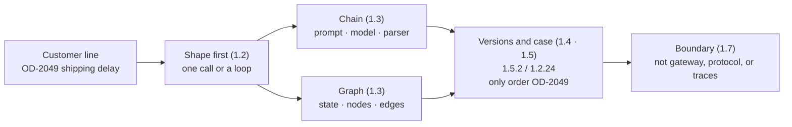
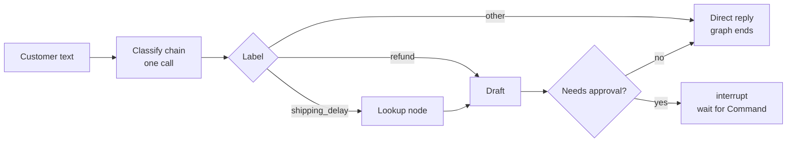
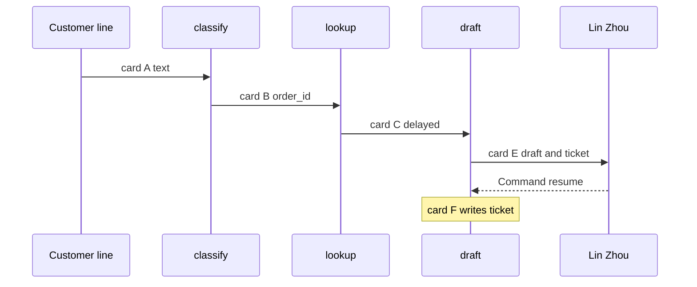

# Chapter 1 What the chain does and what the graph does

> In this chapter: A customer of Seashore Select (海岸优品) sends one sentence, 「订单 OD-2049 物流延迟，请处理」. Lin Zhou (林舟) needs Xiaofan (小帆) to take that sentence in Python. He can write a function that hands the sentence to a model and gets a label back, or he can start by drawing an Agent graph that loops. Those two jobs sit on different layers. A label is one call. Looking up the order, deciding from that result whether to draft a ticket, and waiting for a person to approve the ticket is a process that comes back around and can stop. LangChain writes one call as a chain. LangGraph writes the process as a graph. This chapter installs no package and calls no model. It only finishes the map: when to stay on the chain, when you have to move onto a graph, and which stretch belongs to this book versus AgentScope, LiteLLM, MCP, and Langfuse on the shelf. When you finish, you can point at the same customer sentence and say which step is a chain and which step is a graph, and you can pick your own starting point.



*Map of this chapter*

## When you need it

Three situations, three ways to read.

**You have one customer sentence and you want a stable label or a few structured fields.** Read from 1.2 through the "chain" column of 1.3, then go straight to Chapter 2. Do not draw a graph first. One call has no loop, so a checkpoint and a human approval still have nothing to attach to.

**You can already get the label, but the next step depends on it: a delay means look up the order, a refund must not run by itself, and small talk gets a direct reply.** Read the "graph" column of 1.3, then read 1.6. Chapter 4 is where the nodes and edges get written. This chapter only asks you to say "there is a branch here, so this is not one chain."

**In a selection meeting someone asks whether the Python side still needs LangChain, because the Java side already has AgentScope.** Read 1.7. The conclusion sits here first: AgentScope Java is the support agent on the platform, and this book is the Python orchestration of the same order. Both can exist at once. LangChain does not replace the gateway. LangGraph does not replace MCP.

**You only want to confirm the package versions and the case nouns, so later chapters do not each invent their own.** Read 1.4 and 1.5, and check them against [demo/xiaofan_graph/orders.py](../../demo/xiaofan_graph/orders.py). The order id, the ticket sentence, and the team name are one set for the whole book.

Prerequisite: you do not need to have written LangChain before. You do need to be able to read a Python function. Chapter 2 is where the virtual environment is created.

## 1.1 Overview

What Xiaofan has to handle is a decision on an after-sales ticket. Split this customer sentence and there are at least five different jobs:

| Decision | Input | Output | Does it go back to the previous step? |
| --- | --- | --- | --- |
| Which class this sentence belongs to | The customer's original text | `shipping_delay`, `refund`, or `other` | No. A wrong class is another call, not a loop inside the graph |
| What state the order is in now | Order id `OD-2049` | Tracking number, days elapsed, whether it is delayed | No. If it cannot be found, return `NOT_FOUND`. Do not guess another order id |
| How to write the draft | Class + lookup result | A passage for the customer or for the support person | Usually no. The draft is a pure function |
| Whether to actually open a ticket or refund | The draft | A person's "approve / reject" | It stops. Until the person comes back, the graph must not write the ticket |
| Whether this thread is still here tomorrow | Thread id | The state where it last stopped | That is the checkpoint's job, not the model's |

The first three rows can be done with functions and at most one model call. The fourth row requires the graph to stop at a node and to store the state at the stop. The fifth row requires that state to still be there after the process restarts. **On the business side, write the first row as a chain first, confirm the label set, then promote the fourth row to a graph with a checkpoint.** Starting with `create_agent` glues the label, the tools, and the human approval into one preset graph. When something goes wrong, you cannot tell whether to change the prompt or the edge.

LangChain 1.x folds "agent" into `langchain.agents.create_agent`. The object it returns is a compiled LangGraph. The migration note says it plainly: replace the old `create_react_agent` with `create_agent`, and a custom `StateGraph`, checkpoints, `interrupt()`, and `Command` stay available ([LangGraph v1 migration](https://docs.langchain.com/oss/python/migrate/langgraph-v1), checked on 2026-11-27). So this book does not write LangChain and LangGraph as two frameworks that exclude each other. A chain is one call you connect yourself with `|`. `create_agent` is the tool-loop graph the project has already connected for you. Your own `StateGraph` is what you write when the business branches still do not match that preset graph.

## 1.2 One call, and a process that comes back around

Xiaofan's three customer sentences show the shape faster than a product page does.

| Customer sentence | Shape | Reason |
| --- | --- | --- |
| 「订单 OD-2049 物流延迟，请处理」 | Chain first, then a graph | The label can come from one call. After the label is a delay, you still look up the order, draft, and wait for a person to approve opening the ticket. That later part is a graph |
| 「订单 OD-2049 我要退款」 | A graph, and it must be able to stop | A refund cannot be a tool that runs immediately. The graph has to stop before it executes |
| 「你们周末上班吗」 | A chain is enough | There is no side effect on an order. The reply ends it. No thread is required |

"Comes back around" has two concrete meanings in this book. Do not mix them with everyday speech.

1. **The tool loop.** The model returns `tool_calls`, the program runs the tool, pushes a `ToolMessage` back onto the message list, and calls the model again. That is a cycle. On the `create_agent` graph, the node names are `model` and `tools` (the run output in Chapter 3 lists those nodes).
2. **The business cycle.** A node you write yourself, for example "if the count has not reached 3, go back to yourself." Chapter 5 runs this cycle, on a counting graph that does not touch a model, until `n == 3`, then uses a route that always returns `"increment"` to surface `recursion_limit`.

Human approval is not a cycle. It is a pause. The graph stops at the `gate` node, and `invoke` returns `__interrupt__`. After the person supplies `Command(resume=...)`, **the same node runs again from the start**, and the return value of `interrupt()` becomes that resume value. That is the main line of Chapter 7. For this chapter, remember: a pause needs a checkpoint, or the process has no record of "where it stopped."



*Figure 1-2: In the same customer sentence, classification is a chain, and the wait before opening a ticket is a graph*

This figure is a table of contents for later chapters. It is not code Chapter 1 asks you to compile. The straight-line version is in Chapter 4, conditional edges are in Chapter 5, and the pause is in Chapter 7.

## 1.3 How LangChain and LangGraph divide the work

Split the work by the code object you are about to write, not by the navigation on the docs site.

| What you are writing | Where it lives | Where this book lands it | What happens without it |
| --- | --- | --- | --- |
| A prompt template | LangChain, `ChatPromptTemplate` | Chapter 2 | String concatenation is scattered through business functions, and the system sentence and the customer sentence cannot be told apart |
| A model | LangChain, `init_chat_model` or a fake model | Chapter 2 | Business code holds the vendor URL and the key directly |
| A parser | LangChain, `StrOutputParser` | Chapter 2 | If the model adds one extra sentence, the downstream code receives the whole chat |
| A tool contract | LangChain, `@tool` | Chapter 3 | The model does not know the parameter names, and the program does not know which function to call |
| A preset tool loop | `create_agent` (returns a LangGraph) | Chapter 3 | A hand-written loop can run, but the thread and the pause are yours to wire |
| State, nodes, edges | LangGraph, `StateGraph` | Chapters 4 and 5 | Business branches get stuffed into the `if` of one large function |
| A checkpoint | LangGraph, `InMemorySaver` / `SqliteSaver` | Chapter 6 | When the process exits, an after-sales case that stopped halfway is gone |
| A human pause | LangGraph, `interrupt` and `Command` | Chapter 7 | The refund and the ticket opening both finish inside the same call |

**Position: prefer a pure function or one chain for classification and for the draft. Compile a graph only when there is a loop, a pause, or a resume across processes.** `create_agent` fits the tool loop where the model itself decides whether to look up the order. Xiaofan's rule for opening a ticket is a business rule: draft a ticket only when the shipment is delayed and the promised days have already passed, and a refund always waits for a person. Do not leave that rule for the model to improvise. Write it on a conditional edge. The finished graph in Chapter 8 is this position made concrete: the classify function looks at keywords, not at a model. The fake model appears only in Chapters 2 and 3, to show that the chain and `create_agent` are wired.

On the JavaScript side there is `@langchain/langgraph`. Chapter 5 of the CopilotKit book has used that shape. This book does not write a parallel JS version. Interface names change, and when two lines are maintained together, the one that was never run goes stale first. When you need JS, take the node duties from Chapter 5 after the graph actually runs, then match them to the official JS docs. Do not translate this book's Python calls across as they stand.

## 1.4 Version baseline

On 2026-11-27, this environment was Python 3.12. After installing from [demo/requirements.txt](../../demo/requirements.txt), the versions read were:

| Package | Version | What this chapter uses it for |
| --- | --- | --- |
| `langchain` | 1.5.2 | `create_agent`, `init_chat_model`, `@tool`, message types |
| `langchain-core` | 1.8.5 | Prompts, `StrOutputParser`, `FakeListChatModel`, `GenericFakeChatModel` |
| `langgraph` | 1.2.24 | `StateGraph`, `interrupt`, `Command`, `InMemorySaver` |
| `langgraph-checkpoint-sqlite` | 3.1.3 | `SqliteSaver`, across processes in Chapter 6 |

The same day confirmed two negative facts. Chapter 2 pastes the command output:

- `FakeListChatModel.with_structured_output` raises `NotImplementedError`, and the message is `with_structured_output is not implemented for this model.`
- `init_chat_model("openai:gpt-4o-mini")` raises `ImportError` when `langchain-openai` is not installed, and the message asks for `pip install langchain-openai`. This run did not install that package, and did not follow the hint and install it.

Do not put these versions in the same note as "the LangChain 0.3 era `AgentExecutor`." `AgentExecutor` is not the style of this book. If an old tutorial shows `initialize_agent` or `create_react_agent`, stop, and come back to `create_agent` or to your own `StateGraph`.

Vendor model names, gateway URLs, and keys are not in this run. `llm.example.com` is the production-shaped hostname from the LiteLLM book. Chapter 8 only says that if you connect it, the `base_url` of `init_chat_model` should point there. That line has never run successfully, because the provider package is not in the environment.

## 1.5 The running case: Xiaofan, OD-2049, and one ticket

The only order on this shelf is `OD-2049`. The only ticket sentence is 「售后升级：订单 OD-2049 客户投诉物流延迟」. The only team is `xbd-seashore-cs-team`. The merchant is 海岸优品 (Seashore Select), and the namespace is `seashore-main`. The engineer is 林舟 (Lin Zhou). These words have already been used in AgentScope Java and in LiteLLM. This book adds one set of shipping fields, and only that one set, so the lookup function has a stable return value: carrier 云途, tracking number `YT-2049-88`, shipped on 2026-11-18, promised in 7 days, 9 days elapsed, so `delayed` is true. Do not swap in another order id during an exercise to "look realistic." After a swap, the `NOT_FOUND` in Chapter 3 and the ticket sentence in Chapter 7 no longer match.

The three customer sentences are fixed too:

| Key | Original text | Expected label | Expected pause |
| --- | --- | --- | --- |
| Shipping | 订单 OD-2049 物流延迟，请处理 | `shipping_delay` | Pause. The draft contains the tracking number, and after approval the ticket sentence is left as it is |
| Refund | 订单 OD-2049 我要退款 | `refund` | Pause. On reject, the ticket string is empty |
| Other | 你们周末上班吗 | `other` | No pause. The reply is 「已记下。请给出订单号，或说明是物流还是退款。」 |

The fake model in Chapter 2 does not read the original text. The script makes it return `shipping_delay` every time. So Chapter 2 **cannot** be used to prove that the classifier recognizes the two characters 「退款」. What recognizes the keywords is the `classify` function from Chapter 4 on. That is a business rule, not a model skill. Writing both facts as one sentence, "Xiaofan can already tell intents apart," is a jump this book does not allow.

The thread id in the checkpoint chapters is `xiaofan-OD-2049`. It is the teaching thread for this order, not a user id in production. In production a thread id should correspond to a conversation, and the order id should not be the only thread: the same order can have two conversations. The teaching code uses the order id on purpose, so a log lines up with the case at a glance.

## 1.6 Three routes. Pick one before you write

Lin Zhou keeps getting pushed onto three routes. Look at them together, so Chapter 2 does not install the wrong thing.

| Route | What you do | Fits | Does not fit | This book |
| --- | --- | --- | --- | --- |
| Bare HTTP | `urllib` or `httpx` POSTs to the vendor's Chat Completions yourself | Only one call, and you want to see the payload | The tool loop, the pause, and the checkpoint all have to be built by hand | Not this path. Keys and retries leak into the business repo |
| Chain only | `prompt \| model \| parser` | Labels, summaries, extraction | You need to branch on the result and stop for a person | Chapter 2 walks it through. The model is fake |
| Chain plus tools, or your own graph | `@tool` + `create_agent`, or `StateGraph` | Lookup, loops, confirmation before opening a ticket | Also stuffing the gateway, tracing, and a frontend chat window into this graph | Chapters 3 through 8 |

**The recommended order is the second route, then the third.** First make the chain return `shipping_delay` on the fake model, then write the lookup tool, then the straight-line graph, then conditional edges, then the checkpoint and `interrupt`. Each step fails in a different way: a chain fails in the parser, a tool fails in the arguments, a graph fails in the name of an edge, a pause fails because there is no checkpoint or because resume used another `thread_id`. Write them all in one day and the errors stack.

There is a fourth route you should not pick: copy `AgentExecutor` out of an old tutorial, then wrap it in a layer of LangGraph. That is not the main path of 1.5.2. Even if the copy runs, leave it out. The reader of the next chapter will not be able to match the node names of `create_agent`.

## 1.7 This book does not stand in for anyone else on the shelf

| Book on the shelf | The question it answers | Where Xiaofan should stop in this book and go there instead |
| --- | --- | --- |
| AgentScope Java | The support agent on the platform, sessions, Java deployment | After the Python graph can pause or reply for the three customer sentences. Do not rewrite the whole middle platform in LangGraph |
| LiteLLM | Upstream keys, virtual keys, aliases, fallback | When business code is about to contain a real model name or a vendor key. It should see only an alias on `llm.example.com` |
| MCP | How a tool is discovered and called by more than one framework | When `lookup_order` has to be used by the Java agent and the Python graph at the same time. The tool in this book is an in-process function |
| Langfuse | The trace of one call, evaluation, Prompt versions | When you need to answer "which call produced this draft." This book does not initialize a callback |
| CopilotKit | How this graph shows up in a React UI | When the support person clicks a button instead of typing `Command(resume=...)` in a terminal. The resume value in this book is a dict. The UI is another book's job |

You can finish this book before the gateway is connected. The demo does not need a gateway. On the day you replace the fake model with `init_chat_model`, open the LiteLLM book. Do not write a key ahead of time in this chapter.

## 1.8 How to keep reading when there is no key

Chapter 2 creates a virtual environment and installs three direct dependencies. The check you can re-run is that `python run_all.py` prints the `main()` line for each of Chapters 2 through 8, not that a chat window shows a reply that "sounds like a person." The fake model's reply is a Chinese sentence written into the script. It proves the wiring. It does not prove that the model can do support work.

When you meet the following while reading, treat them as not run, and do not fill in a result:

- Any real reply from an `openai:` or `anthropic:` model
- The HTTP status code of `base_url="https://llm.example.com"`
- A trace count on Langfuse
- A Postgres checkpoint. Chapter 6 ran only SQLite, the file was in a temporary directory, and it was deleted when the process ended
- The `id` field of `interrupt`. It changes on every run, and the demo does not print it

What you can take as real are the keys the demo prints: `chain_label`, `manual_types`, `linear_draft`, `route`, `saver_is_same_class`, `sqlite_reopen_n`, `pause_ticket`, `e2e_shipping_opened`. Every one of these keys appeared in one `run_all.py` on 2026-11-27. When later chapters quote output, they quote only lines that were in that run.

## 1.9 Walk the shipping sentence into six states

Before any code is written, walk 「订单 OD-2049 物流延迟，请处理」 into six cards that hold only data. Later chapters only attach one function to each card. The field names between cards stay the same for the whole book.

**Card A, the entrance.** Only the customer's original text. There is no label yet, and no order-id field (the characters `OD-2049` are visible in the text, but the program has not copied them into `order_id`).

| Key | Value |
| --- | --- |
| `text` | 订单 OD-2049 物流延迟，请处理 |
| `thread_id` | `xiaofan-OD-2049` (fix it from this step on; do not invent it after the pause) |

**Card B, after classification.** This is the output of the chain or of the `classify` node. The fake model in Chapter 2 always emits `shipping_delay`. It did not read the original text. From Chapter 4 on, `classify` looks at whether the text contains 「退款」, 「物流」, or an order id. On this shipping sentence the two results happen to match. The reasons differ. Keep them apart in your notes.

| Key | Value |
| --- | --- |
| `intent` | `shipping_delay` |
| `order_id` | `OD-2049` |

**Card C, after lookup.** `lookup` accepts only the `order_id` from card B. If it matches the row in `orders.py`, write the delay. If it does not match, `delayed` is false. Do not invent another order.

| Key | Value |
| --- | --- |
| `delayed` | `true` |
| Carrier / tracking / ship date | 云途 / `YT-2049-88` / `2026-11-18` |
| Promised / elapsed | 7 days / 9 days |

**Card D, the draft.** The draft writes the fields from card C into wording a person can read, and it carries the fixed ticket sentence and the team name. The draft is not a ticket that has already been opened. Until a person approves, the ticket field must be empty, or it must not exist yet.

The teaching sentence for the draft is one whole `linear_draft` line in the Chapter 4 run output. Do not write a second, "more natural" variant here. Once variants multiply, the human approval in Chapter 7 no longer knows which sentence it is approving.

**Card E, the pause.** The `interrupt` payload contains at least `order_id`, `intent`, `draft`, and `ticket`. `ticket` appears in the payload to mean "if approved, this sentence will be opened," not "it has already been opened." The Chapter 7 run prints `pause_ticket` as that fixed ticket sentence, and `pause_draft_has_tracking` is `True`.

**Card F, after resume.** Lin Zhou approves, with the note 「林舟确认开单」 ("Lin Zhou confirms opening the ticket"). `decision` is `approved`, `ticket` equals the fixed ticket sentence, and the note is appended to the end of the draft. If the note is 「先安抚，不退款」 ("reassure first, do not refund") and `approved` is false, `ticket` must be an empty string. Chapter 7 ran this reject path on the refund sentence, and `rejected_ticket_empty` is `True`.

Of the six cards, A through D can be computed inside one process. Between E and F there is a person. That gap is the boundary between a graph and a chain, and it is more concrete than any definition.



*Figure 1-3: The ticket is opened after resume, not at the moment the draft is written*

## 1.10 What the failure looks like when you pick the wrong layer

When the layer is wrong, the program can often still run. Running does not mean the layer was right. Each symptom below has a matching fix later in the book. This chapter uses them to make the decision.

| Symptom | The layer that was actually wrong | Where to move it |
| --- | --- | --- |
| The classify prompt says "if it is a delay, call lookup," and the model sometimes looks up and sometimes does not | A business branch was written into the prompt | Use a chain or a pure function for the label, and a conditional edge for the branch (Chapter 5) |
| Calling the refund tool immediately marks the money as refunded | A side effect was put inside `@tool` | The tool only queries. Opening a ticket and refunding happen after `interrupt` (Chapters 3 and 7) |
| After the process restarts, the support person cannot see the draft from a moment ago | The checkpoint lives only in memory, or no checkpointer was compiled at all | Use `SqliteSaver` in development, and talk about a database when you reach production (Chapter 6) |
| After resume the same confirmation pops up again, or the confirmation is lost | `thread_id` changed, or resume started a new graph | The same compiled result, the same thread id (Chapters 6 and 7) |
| The customer asks whether you work on weekends, and the graph also stops to wait for approval | The conditional edge sends every intent into `gate` | `other` ends right after the draft (Chapters 5 and 7) |
| The order id in the logs is different on every exercise | The case was not fixed | Only `OD-2049` is allowed |

There is another wrong choice that does not show up as an exception: using the `model` / `tools` cycle of `create_agent` to simulate "open a ticket if delayed." The cycle can express "call the model again." It cannot express "this step has to be Lin Zhou." Chapter 3 runs that cycle through. Chapter 7 does not use it to open tickets.

## 1.11 What to delete when moving old notes to 1.x

If Lin Zhou's bookmarks are still on LangChain 0.3, do not carry the following names into Xiaofan's code. The migration note fixes two of them. The rest are deleted in this book so that only one main path remains.

| Old name | What this book uses in 1.x instead | What not to do |
| --- | --- | --- |
| `create_react_agent` | `langchain.agents.create_agent` | Do not import the old function from `langgraph.prebuilt` again |
| `AgentExecutor` / `initialize_agent` | Your own `StateGraph`, or `create_agent` | Do not stack two loops |
| Passing `prompt=` to a preset agent | `system_prompt=` | Take the parameter name from the 1.5.2 signature. Chapter 3 prints the call |
| `MessageGraph` | A `StateGraph` with a `messages` key, or `create_agent` directly | The business state in this book is not a pure message list. It also has `intent`, `draft`, and `ticket` |
| A model class called directly as `ChatOpenAI(...)` | First decide whether to install a provider. Without it, `init_chat_model("openai:...")` raises `ImportError` | Do not install and call it in the tutorial environment just to make the ImportError go away |

The name `MemorySaver` is still there. The Chapter 6 run prints `saver_is_same_class True`, which is `InMemorySaver is MemorySaver`. The docs now put `InMemorySaver` in the examples. This book writes both, and new code uses `InMemorySaver`. They are the same class, not two stores.

## 1.12 Which keys the state ends up with

The `TypedDict` grows thicker from Chapter 4 to Chapter 7. Look at the end state first, so a new key in each chapter does not look like the case changed.

| Key | Who writes it | Who reads it | What empty means |
| --- | --- | --- | --- |
| `text` | The caller | `classify` | There is no customer sentence yet. The graph should not start |
| `order_id` | `classify` | `lookup`, `gate` | The original text has no `OD-2049`. Lookup should take the "no order" path, not look up a default order |
| `intent` | `classify` | The conditional edge, `draft`, `gate` | Classification has not run |
| `delayed` | `lookup` | `draft` and `route_after_draft` | Lookup was never taken. Refund and small talk are like that. The `delayed None` printed in Chapter 5 means this |
| `draft` | `draft`; on resume, `gate` may append a note | The support person, `gate` | There is no wording for a person yet |
| `decision` | `gate` | The caller | There is no person's decision yet. Do not treat a missing value as a reject |
| `ticket` | `gate` | The caller | An empty string means no ticket was opened. Do not mix `None` and `""` for the same fact. This book uses the empty string throughout |

`messages` is not on this business table. The tool loop in Chapter 3 uses a message list, because the state of `create_agent` is messages. The after-sales graph from Chapter 4 on uses the keys above. Classification does not depend on a model, so the customer sentence does not need to be wrapped in another `HumanMessage`. Do not merge the two states into one dict that "holds everything." After they are merged, the checkpoint holds chat messages and the ticket sentence at the same time, and on resume it is hard to see which one this pause is waiting for.

The thread id is not a state key. It lives in `config`. The checkpoint uses it as the primary key. If you also write it into state and let it join a branch, you get two facts: one thread id in state, another in config. This book does not write it that way.

## 1.13 Two hours, and one complete path

When time is short, do not read backward from Chapter 8. Reading backward shows you `interrupt`, but not why `ticket` has a value only after resume.

| Time you have | What to read | How far to go hands-on |
| --- | --- | --- |
| Only enough for one selection meeting | 1.2, 1.3, and 1.7 of this chapter | No hands-on work. In the meeting you can point out that opening a ticket must pause |
| One afternoon | Chapters 2 and 3 | The chain section and the tool section inside `run_all.py`. Confirm that the fake model does not read the original text |
| One day | Add Chapters 4 and 5 | The `route` lines for the three customer sentences: only the shipping sentence enters lookup |
| You need to explain the pause to the support person | Chapters 6 and 7 | A second process reads `n` from SQLite, plus the approve path and the reject path |
| You need to line up nouns with Java and the gateway | Chapter 8 | See which rows of the review list ran, and which ones are explicitly not run |

If a tester is only re-running, they do not need to read every section. The demo README has the command. When the re-run does not match the keys quoted in the book, trust `run_all.py` on your machine, and check that the versions in `requirements.txt` are still 1.5.2 / 1.2.24. On a different version, this book does not guarantee that `InMemorySaver is MemorySaver` still holds. That line is an observation from 2026-11-27, not a language rule.

## 1.14 The license, and what this book leaves out

The LangChain and LangGraph repositories are distributed under MIT. This book does not copy their source onto the shelf. The demo depends only on published packages. The fake model classes are provided by `langchain_core` for tests. The official unit-testing docs explain the difference between `GenericFakeChatModel` and `FakeListChatModel`: the former returns item by item from an iterator and fits tool calls; the latter uses a list of strings and cycles. Chapter 2 uses the latter. Chapter 3 uses the former. Do not mix them to save a class. `FakeListChatModel` does not have the `tool_calls` script this book needs.

This book does not include: sample keys for a vendor SDK, a `base_url` that can reach the public network, a LangSmith tracing key, or a Postgres connection string. In the docstring of the installed 1.5.2, `init_chat_model` lists `base_url` as a common parameter passed through to the underlying model constructor. That sentence only says the parameter name is written in the installed package's description. This run never passed that parameter in, because the constructor already failed when `langchain-openai` was missing.

Another boundary that touches production: the teaching thread `xiaofan-OD-2049` may appear in logs. Any string that looks like a key should not appear. The demo's dependency file has no key, and `.gitignore` ignores `books/langchain/demo/.venv/`. Do not commit the virtual environment.

## 1.15 Three customer sentences. Do not collapse them into one "smart reply"

The three fixed customer sentences are written side by side to stop later chapters from getting lazy. The lazy version prints a polite Chinese paragraph no matter what the input is, then claims Xiaofan is already live. The differences among the three sentences have to land on fields.

| Field | Shipping delay | Refund | Weekend hours |
| --- | --- | --- | --- |
| `intent` | `shipping_delay` | `refund` | `other` |
| Whether it enters `lookup` | Yes. The text contains an order id, and the intent is a delay | No. The intent is not a delay. Chapter 5 prints `delayed` as `None` | No |
| Whether the draft contains a tracking number | Yes, `YT-2049-88` | No. The draft is 「拟登记退款申请」 ("register a refund request") | No. The draft asks for an order id or a statement of intent |
| Whether it `interrupt`s | Yes | Yes | No. The result dict has no `__interrupt__` |
| `ticket` after approval | The fixed ticket sentence | If approved, the same ticket sentence (the teaching case does not write a separate "refund ticket") | Approval is never reached |
| `ticket` after rejection | An empty string | An empty string. Chapter 7 runs this path | Does not happen |

Using the same shipping ticket after a refund is approved is a teaching close, not a business recommendation. A real support desk would split refund and shipping into two ticket types. This book locks the ticket sentence so it is character-for-character the same sentence as in the AgentScope book. Chapter 8 writes this limit into the review list: ticket types are not split, so do not treat the demo's `ticket` as the enum of a production ticket system.

The weekend sentence is the negative control. A graph that only knows how to pause is wrong. If the negative control fails, the conditional edge dropped `end`. The `other_interrupted False` in Chapter 7 is the result of this control, not a slogan.

The shipping sentence has one easy mix-up: the original text already contains the four characters 「物流延迟」, so a person can classify it without a model. This book therefore writes `classify` as a keyword function, and uses the fake model in Chapter 2 only to show how a chain is wired. If a real model is swapped in later, the label set is still only these three words. If the model returns 「延误」 or 「shipping」, the parser should treat it as unrecognized and take the `other` reply, rather than quietly mapping it. That parser layer is not triggered on the fake-model path, because the script writes the fake model to return only a legal label. Chapter 2 states this, so a reader does not think a robust parser has already been exercised.

## 1.16 What to look for when reviewing a change that "wired up LangChain"

If Lin Zhou sees Xiaofan's Python directory in a code review, he can use the question list below. It does not require the reviewer to finish the next seven chapters. It does require the change itself to say which chapter it lands in.

| Review question | What a passing answer looks like | Failing |
| --- | --- | --- |
| Is this change a chain, a preset agent, or your own graph? | Can point at a file: `chain.py`, `tools_agent.py`, or `hitl.py` | The single sentence "wired up LangChain" |
| Are there a new order id, ticket sentence, or team name? | No. If a shipping field is added, it has to go back to `orders.py`, and the book still has only one set | `OD-2050` shows up in a test |
| Does the side effect happen after `interrupt` returns? | The ticket-opening string is written only when `approved` is true | A tool function writes the database |
| Where does the checkpoint's thread id come from? | `thread_id` in `config`, kept apart from the state dict | Written into the prompt so the model remembers it |
| Where is the key? | Not in this directory. A real model is not connected yet | `.env` is committed, or an example contains `sk-` |
| Which day's run is this record from? | Can be matched to a key from `run_all.py` | A chat log that cannot be re-run is pasted and written up as the model's judgment |

This question list is also the operational form of this chapter's checklist. You do not need to memorize an API. You need to separate the chain and the graph on one diff, and to strike vendor calls that were never run out of "done."

The diamond "needs a person's approval" in Figure 1-2 is not the model's judgment in the implementation. It is `route_after_draft`: a refund always asks for approval, a delay asks only when `delayed` is true, and everything else ends. Chapter 5 writes the route after classification first. Chapter 7 is where this diamond after the draft is added. If the figure in Chapter 1 and the straight line in Chapter 4 do not match while you read, that is expected. Chapter 4 deliberately has no diamond, so you can see `START` and `END` first.

## 1.17 The case file, item by item

Every function later in the book takes its words from `xiaofan_graph.orders`. The file is short, and every line is a contract. The file on 2026-11-27 is below. After it, each constant says why it cannot be rewritten.

```python
ORDER_ID = "OD-2049"
TICKET = "售后升级：订单 OD-2049 客户投诉物流延迟"
TEAM = "xbd-seashore-cs-team"
MERCHANT = "海岸优品"
NAMESPACE = "seashore-main"

ORDER = {
    "order_id": ORDER_ID,
    "merchant": MERCHANT,
    "namespace": NAMESPACE,
    "status": "shipped",
    "carrier": "云途",
    "tracking": "YT-2049-88",
    "shipped_at": "2026-11-18",
    "promised_days": 7,
    "elapsed_days": 9,
    "delayed": True,
}

SHIPPING_TEXT = "订单 OD-2049 物流延迟，请处理"
REFUND_TEXT = "订单 OD-2049 我要退款"
OTHER_TEXT = "你们周末上班吗"


def lookup_order_record(order_id: str) -> dict | None:
    if order_id == ORDER_ID:
        return dict(ORDER)
    return None


def record_as_text(record: dict) -> str:
    return (
        f"order_id={record['order_id']} merchant={record['merchant']} "
        f"status={record['status']} carrier={record['carrier']} "
        f"tracking={record['tracking']} shipped_at={record['shipped_at']} "
        f"elapsed_days={record['elapsed_days']} promised_days={record['promised_days']} "
        f"delayed={str(record['delayed']).lower()}"
    )
```

`ORDER_ID` is the same string the LiteLLM book and the AgentScope book use for the chase-up. This is not "please replace the sample order id yourself." After a replacement, `lookup_order_record` returns `None`, the tool output in Chapter 3 changes from one full line of fields to `NOT_FOUND`, and the pause payload in Chapter 7 no longer matches the `pause_order` quoted in the book.

`TICKET` is character-for-character the same as the ticket title in Chapter 43 of the AgentScope Java book, including 「售后升级」 before the Chinese colon. Do not change it to "shipping escalation ticket" or to English. After the person approves, `gate` writes this string into state as it stands. The draft also splices in the same sentence, so the sentence the person sees on the pause screen and the final `ticket` field are the same sentence. You do not get "what was approved is A, what was written is B."

`TEAM` is `xbd-seashore-cs-team`. It appears at the end of the draft and tells the support person that this case belongs to Seashore Select's support team. This book calls no team API. Whether the string is in the draft only affects a person's check against the record. It does not affect the edges of the graph.

`MERCHANT` and `NAMESPACE` line up with 海岸优品 and `seashore-main` in the LiteLLM book. The namespace does not take part in routing. It stays in the `ORDER` dict so the lookup text line can be matched by a person against the gateway book. If you delete it, the `manual_tool` line in Chapter 3 gets shorter, and the quotation in the book stops matching.

In `ORDER`, `status` is fixed as `shipped`. This book does not demonstrate not-yet-shipped, delivered, or cancelled. Those states would change the rule for "whether a delay ticket should be opened." That is another graph, not three more `if`s inside the same function. `delayed` being `True` is data. The lookup function does not compute it on the spot. `elapsed_days` and `promised_days` are both written in the dict. The draft reads both numbers out, so a person can check that "9 > 7" is what the data itself says, not something the model made up.

The three `*_TEXT` constants are the entire customer input of `run_all.py`. Tests should not `input()` another line. Interactive input cannot be reproduced in the record from 2026-11-27.

`lookup_order_record` returns a copy, `dict(ORDER)`, rather than `ORDER` itself. If the caller mutates the return value, the module-level dict stays as it is. An unknown order id returns `None`, and the tool layer translates that into `NOT_FOUND`. Do not raise here. An exception turns the tool loop in Chapter 3 into a stack trace, and the support person never sees the business result "there is no such order."

`record_as_text` writes the boolean as lowercase `true` / `false`, so the tool message stays stable and does not carry Python's `True`. The `manual_tool` line quoted in Chapter 3 ends with `delayed=true`. Change the format and you change the quotation.

This file has no model, no network, and no key. It is the only place in the book allowed to hold the facts of the order. Chapter prose may quote these words. Do not write the tracking number as some other value in a code block in another chapter.

## 1.18 Which piece of this contract each of the next seven chapters takes

Once you have read the case file, later chapters do not reintroduce who Seashore Select is. Each chapter adds one mechanism, and uses the printed lines of the matching module in `run_all.py` as evidence. Knowing what the evidence looks like ahead of time stops you from treating "the code imports" as "this chapter's claim holds."

Chapter 2 takes `SHIPPING_TEXT`. The claim is: `prompt | model | parser` returns the string `shipping_delay`. The evidence is `chain_label shipping_delay`. The same chapter also shows that the fake model returns this string on the second call, and that `init_chat_model("openai:gpt-4o-mini")` raises `ImportError` in this environment. The claim is not "the model understood the shipping sentence."

Chapter 3 takes `lookup_order_record` and `record_as_text`. The claim is: an unknown order id gets `NOT_FOUND`, and `OD-2049` gets that line of fields. The message-type sequence of both the hand-written loop and `create_agent` is `HumanMessage`, `AIMessage`, `ToolMessage`, `AIMessage`. The evidence is `tool_missing`, `manual_types`, and `agent_types`.

Chapter 4 takes the shipping sentence and walks a graph with no diamond. The claim is: `intent`, `order_id`, `delayed`, and the draft all arrive in one `invoke`, and the draft contains the ticket sentence. The evidence is `linear_intent`, `linear_delayed True`, and the whole `linear_draft` line.

Chapter 5 sends all three customer sentences into a graph with conditional edges. The claim is: only the shipping sentence has `delayed` as `True` and a draft that mentions the ticket; the refund and weekend sentences have `delayed` as `None`. There is also a counting cycle that has nothing to do with the order, and it stops at `n == 3`. A cycle that never ends raises `GraphRecursionError` when `recursion_limit` is 4.

Chapter 6 barely uses the order fields. The claim switches to the checkpoint: `InMemorySaver` and `MemorySaver` are the same class; adding one twice on the same thread yields 1 and then 2; after the SQLite file is handed to a second Python process, the `n` it reads is still 1, and adding one more makes 2. The order id appears only inside the thread id `xiaofan-OD-2049`, to line up with the case.

Chapter 7 puts the ticket sentence from the contract into the `interrupt` payload. The claim is: the shipping sentence pauses, `ticket` in the payload equals `TICKET`, and the draft contains the tracking number; after approval, `decision` is `approved` and the ticket remains; when the refund is rejected, the ticket is empty; the weekend sentence's result has no `__interrupt__`.

Chapter 8 introduces no new mechanism. It runs the three sentences through the same graph again, then lists what was not done: no vendor request, no Langfuse, no MCP server, no Postgres, and no split of the refund into another kind of ticket. The review list takes the `e2e_*` printed lines as the standard.

Read by this table of contents, and the last section of each chapter should be able to point back at one stretch of `run_all.py`. A sentence that cannot point back is either a position or a boundary that has not been run. It cannot be written as a run result.

## 1.19 On the first re-run, look at only three slices

Chapter 2 writes the virtual environment and the dependency file. If you have already installed them and want to confirm that the demo in the repo and the book are from the same day, run `python run_all.py` under `books/langchain/demo` with the interpreter from that time (how to create the virtual environment is in the demo README). The opening, the checkpoint slice, and the ending of the run on 2026-11-27 are the three blocks below. The tool and routing slices in the middle are quoted in full in the matching chapters, and are not pasted again here.

```text
## xiaofan_graph.chain
chain_label shipping_delay
chain_again shipping_delay
prompt_roles ['SystemMessage', 'HumanMessage']
prompt_human 订单 OD-2049 物流延迟，请处理
structured_error NotImplementedError
structured_message with_structured_output is not implemented for this model.
init_error ImportError
init_message Initializing ChatOpenAI requires the langchain-openai package. Please install it with `pip install langchain-openai`
```

```text
## xiaofan_graph.checkpoint
saver_is_same_class True
memory_first 1
memory_second 2
memory_history_len 6
sqlite_reopen_n 1
sqlite_reopen_next
sqlite_second_step 2
```

```text
## xiaofan_graph.app
e2e_shipping_ticket 售后升级：订单 OD-2049 客户投诉物流延迟
e2e_shipping_opened True
e2e_refund_decision rejected
e2e_refund_ticket_empty True
e2e_other_intent other
e2e_other_interrupted False
```

Nothing follows `sqlite_reopen_next`. It is empty because that `invoke` of the counting graph had already reached `END`, and the checkpoint has no node waiting to run. The value `n` is still there, so the second process can keep adding. Do not read an empty `next` as "the file was not written." Chapter 6 separates this case from "on a pause, `next` points at `gate`." The pause path in Chapter 7 does not print `next`, so it is not mixed with the counting graph's empty `next` in the same output.

If your `chain_label` is not `shipping_delay`, do not change the business code first. Check that `requirements.txt` is still `langchain==1.5.2` and `langgraph==1.2.24`, and that you did not run a same-named script from another working directory. This book recognizes only the `xiaofan_graph` under the demo directory.

## Summary

1. **A chain and a graph do not solve the same problem.** A chain is the composition of one call. A graph is state moving between nodes, including branches, cycles, and pauses.
2. **Xiaofan's classification can be a chain. Opening a ticket and refunding must be a graph that can pause.** Of the three customer sentences, only 「你们周末上班吗」 can end on a chain.
3. **`create_agent` is a preset LangGraph.** Use it for the tool loop. Business rules (open a ticket only on a delay, a refund must have a person's approval) are written on your own conditional edges.
4. **Versions follow the install on 2026-11-27:** `langchain` 1.5.2, `langgraph` 1.2.24. `langchain-openai` was not installed.
5. **Case nouns may not be swapped.** Order `OD-2049`. The ticket sentence and the team name match the AgentScope book. The shipping fields are what this book added, and there is only this one set.
6. **The next step is to write classification as a chain that can run.** Chapter 2 uses a fake model and does not apply for a key.

## Checklist

- ☐ For each of the three fixed customer sentences, say whether it should stop on a chain or enter a graph, and say whether the reason includes a side effect.
- ☐ State how LangChain and LangGraph divide the work: which layer holds the prompt, the model, and the tool contract, and which layer holds the checkpoint and `interrupt`.
- ☐ Say what `create_agent` returns, and why the rule for opening a ticket is not handed to that preset graph.
- ☐ Recite the four lines of this book's version baseline, and say why `langchain-openai` is not in the dependencies.
- ☐ Point at the single source of the order id, the ticket sentence, and the team name, and say which book added the shipping fields.
- ☐ List at least two things this chapter explicitly did not run (any two of a vendor reply, Langfuse, and Postgres).

## Quick reference

The main line does not depend on this section.

| Term | What it means in this book |
| --- | --- |
| Chain | A one-call composition such as `prompt \| model \| parser` |
| Graph | The object compiled from a `StateGraph`. Nodes share one state |
| Thread | `config["configurable"]["thread_id"]`, the primary key of the checkpoint |
| Pause | A node calls `interrupt`, and `__interrupt__` appears in the result of `invoke` |
| Fake model | `FakeListChatModel`, or `GenericFakeChatModel` with `bind_tools`. It does not touch the network |

## Further reading

- **Chapter 2 (the first chain)** — walk the second route from 1.6: the fake model returns `shipping_delay`, and you see the `ImportError` from `init_chat_model` when the package is missing.
- **Chapter 7 (human in the loop)** — the concrete form of "a pause is not a cycle" from 1.2: the payload of `interrupt` and `Command(resume=...)`.
- **LiteLLM book, Chapter 1** — why a vendor key does not enter the business repo. Read it before this chapter's model is replaced with a real one.
- **The Xiaofan and `OD-2049` chapters of the AgentScope Java book** — the name of the same order on the Java platform. This book does not re-explain the platform. It only keeps the nouns the same.
- **LangGraph v1 migration guide** (https://docs.langchain.com/oss/python/migrate/langgraph-v1) — why `create_react_agent` moved to `create_agent`. This book is written against the entry after that migration.
