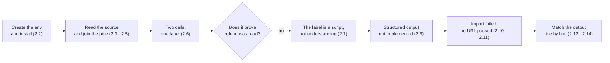
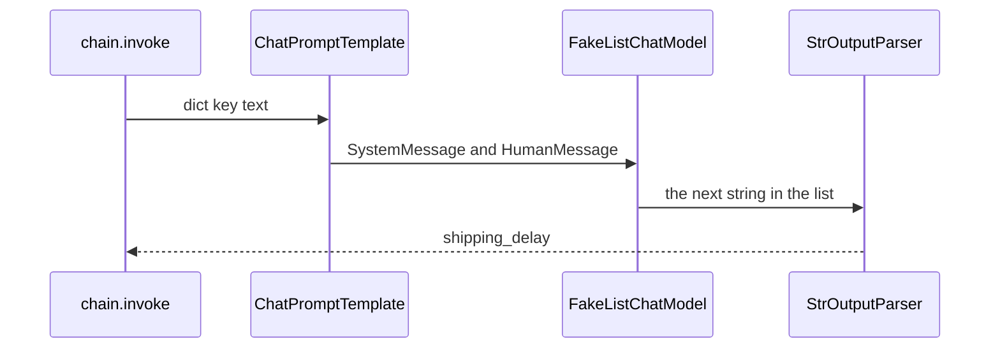

# Chapter 2 The first chain

> In this chapter: A customer of Seashore Select (海岸优品) says 「订单 OD-2049 物流延迟，请处理」. Lin Zhou (林舟) wants a chain he can re-run, and he wants the label `shipping_delay` back, rather than a stretch of small talk. This chapter first creates a virtual environment in the demo directory, installs the pinned packages from `requirements.txt`, then joins a prompt template, a fake model, and a string parser into a pipe. The fake model cycles through a list and does not read the prompt. The second call still returns the same label, so this chapter cannot prove that it understood 「退款」. Classification later in the book is a keyword function, not this model. Structured output raises a not-implemented error on this fake model. Initializing a chat model fails on import because the provider package is missing, and the call did not pass a gateway address. When you finish, you can re-run this chain and keep the script result, the two failures, and the gateway sketch that was not run apart from each other.



*Flow of this chapter*

## When you need it

Three situations, three ways to read. Chapter 1 already split the chain and the graph. This chapter only does the one call on the chain.

**You do not have a virtual environment yet, or you are not sure the install is 1.5.2.** Start at 2.2. The commands follow [demo/README.md](../../demo/README.md). After the install, run `python run_all.py`, and check the `chain_label` stretch first. Do not start with the graphs in later chapters.

**You want to see how the three pieces, prompt, model, and parser, are joined.** Read 2.3 through 2.6. The hands-on standard is: you can point at the object on each side of `|`, and you can explain why `chain_again` is still `shipping_delay`. The explanation has to include "the fake model does not read the input." Without that sentence, you are still at "the model seems to have classified it."

**You are about to replace the chain with the alias `seashore-cs` on `https://llm.example.com`.** Read 2.10 and 2.11, then stop. This chapter's `init_chat_model` did not succeed, and it did not pass `base_url` in. The key does not enter the repo. The provider package `langchain-openai` does not enter `requirements.txt`. When you really need to connect the gateway, go to the LiteLLM book. Do not install the extra package in this chapter.

| Result you want now | Where to stop | What not to do yet |
| --- | --- | --- |
| A string label | The chain in this chapter | Do not draw a `StateGraph` first |
| The tracking number and whether it is delayed | `lookup_order` in Chapter 3 | Do not write the lookup into the prompt and hope the model remembers |
| Branch on the label, pause, and open a ticket | The graph from Chapter 4 on | Do not treat this chain's return value as a ticket |
| A real model, a gateway alias, a key | The LiteLLM book | Do not run the sketch in 2.11 |

The prerequisite is the nouns from Chapter 1: there is only order `OD-2049`, and the three customer lines are already fixed. This chapter uses only the shipping line. The constant name is `SHIPPING_TEXT`. The refund line and the weekend line do not enter `main` in `chain.py`.

## 2.1 Overview

A chain in this book is three runnable objects joined into one call. The prompt template fills a dict into messages. The model returns one reply. The parser collects the reply into the type the downstream code wants. What Xiaofan (小帆) needs downstream right now is one label string. The label set has only three words: `shipping_delay`, `refund`, and `other`. The set is written in the system sentence, and it is also the range of return values of `classify` in later chapters. The parser in this chapter does not check that set.

| Piece | Class used here | Input | Output | Did it read the customer's original text this time? |
| --- | --- | --- | --- | --- |
| Prompt | `ChatPromptTemplate` | A dict whose key is `text` | `SystemMessage` and `HumanMessage` | Yes. The human message's content is the original text that was filled in |
| Model | `FakeListChatModel` | Those two messages | The next string in the list, wrapped as an `AIMessage` | No. The implementation does not look at the message argument |
| Parser | `StrOutputParser` | The model's message | A plain string | Understanding is not involved. It only takes out the text |

Joined, the three pieces print the single word `shipping_delay`. That word comes from `responses=["shipping_delay"]` written when the model was constructed. The model did not choose between two labels.

**On the business side, the recommendation is to use this fake-model chain first, collect the label as a string, confirm the parser did not rewrite the content, and only then decide whether to connect the gateway.** Starting with `init_chat_model` stacks a missing package, a key, and the prompt into the same failure. This chapter prints the missing package on its own as `ImportError`, prints "structured output is not implemented yet" on its own as `NotImplementedError`, and prints "the fake model does not read the original text" on its own as the second call. Once the three are separate, you know which layer to change later.

`with_structured_output` is not part of this chain. After the chain has run, `main` takes a new `FakeListChatModel` and calls it, to record the failure. Do not rewrite the failure as "this chapter can already return a dict." `init_chat_model` is not a segment of the chain either. It appears at the end of the file so that "the provider package is not installed" stays in the output, and a reader does not think the environment can already connect a model.

Line this up with the split in Chapter 1. A chain solves one call. Lookup, the tool loop, conditional edges, the checkpoint, and human approval are not in `chain.py`. The file does not import `lookup_order_record`, and it has no ticket sentence. Shipping fields come out of a tool only in Chapter 3.

## 2.2 The virtual environment and the pinned dependencies

The working directory is `books/langchain/demo`. The chain's code is in `xiaofan_graph/chain.py`, but install and re-run both start from the demo directory. Do not run `pip install` at the repo root. The virtual environment and the dependency file would split, and `import xiaofan_graph` in the next chapter would look in the wrong place.

The commands written in [demo/README.md](../../demo/README.md) are:

```bash
cd books/langchain/demo
python3 -m venv .venv
. .venv/bin/activate
pip install -r requirements.txt
python run_all.py
```

The five lines each have a job.

| Command | What it changes | What this chapter wants you to confirm |
| --- | --- | --- |
| `cd books/langchain/demo` | The current directory | The next `requirements.txt` is the file in this directory |
| `python3 -m venv .venv` | Creates a virtual environment directory | The interpreter is Python 3.12. This book does not record another major version |
| `. .venv/bin/activate` | The current shell switches to this environment's `python` and `pip` | The environment name shows up in the prompt. Install without activating, and the packages go into another interpreter |
| `pip install -r requirements.txt` | Installs from the file | The three direct dependencies are installed. Do not add a package the file does not list |
| `python run_all.py` | Calls each `main` by chapter | The opening stretch is the output quoted in 2.12. The first line, `## xiaofan_graph.chain`, is printed by `run_all.py` |

`python3 -m venv` uses the standard library. You do not need to install `virtualenv` first. The activate script uses the POSIX `.`. This book does not write a second activate command that was never run.

The dependency file in full is below. The comments are the original text in the repo. They state the date the versions were pinned, and that the provider package is left out on purpose.

```text
# Pinned on 2026-11-27 after a local install (Python 3.12).
# No provider package: langchain-openai is intentionally absent.
# Model calls in this demo use FakeListChatModel / GenericFakeChatModel.
langchain==1.5.2
langgraph==1.2.24
langgraph-checkpoint-sqlite==3.1.3
```

Only these three lines are pinned directly. `langchain-core` 1.8.5 is the transitive dependency read after the install on 2026-11-27. The version table in Chapter 1 already records it. It does not appear in `requirements.txt`. If the transitive version resolves to another version on another day, this book does not make a separate guarantee. When a re-run does not match `chain_label`, check the directly pinned `langchain==1.5.2` first.

| Package | Where the version comes from | Which piece this chapter uses | Which piece this chapter does not use |
| --- | --- | --- | --- |
| `langchain` | Pinned at 1.5.2 in the dependency file | The import of `init_chat_model`, and the failure | `create_agent` waits until Chapter 3 |
| `langchain-core` | Transitive. Read as 1.8.5 on 2026-11-27 | `ChatPromptTemplate`, `FakeListChatModel`, `StrOutputParser` | Do not pin another line for it in the dependency file |
| `langgraph` | Pinned at 1.2.24 in the dependency file | This chapter does not call it | It is installed for the graphs later, so the environment is not installed twice |
| `langgraph-checkpoint-sqlite` | Pinned at 3.1.3 in the dependency file | This chapter does not call it | Chapter 6 is where it is used |
| `langchain-openai` | Not in the file | The import does not succeed | Do not follow the `pip install` in the error message |

Leaving `langchain-openai` out of the dependencies is a position, not an omission. The failure message of `init_chat_model("openai:gpt-4o-mini")` suggests installing it. Following that suggestion would put two facts in the same environment at once: the fake-model chain, and a provider client that can be constructed. Later you could not tell whether a given output was the script or the network. This book chooses to keep the package missing, and to leave the `ImportError` in the output.

The virtual environment directory is ignored by the repo's `.gitignore`: `books/langchain/demo/.venv/`. Do not commit `.venv/`. Do not commit a key file either. The code path in this chapter does not read a key from an environment variable, and it does not write a key into a parameter.

The passing signal after install is not a support sentence in a chat window. It is that `run_all.py` prints the keys in 2.12. If you run only `python -m xiaofan_graph.chain`, there is no line `## xiaofan_graph.chain`. That line comes from the loop in `run_all.py`. The output this book quotes is the run that includes that line, so the re-run command is `python run_all.py`.

The shape in `run_all.py` that belongs to this chapter is: import modules from a fixed list, print `##` plus the module name, then call `main`. The first item in the list is `xiaofan_graph.chain`. So the chain's output appears at the very front of the whole run. The tools, the straight-line graph, the conditional edges, the checkpoint, the human approval, and the end-to-end run that follow belong to later chapters. When this chapter quotes output, it does not count those lines as "what the chain has already proved."

## 2.3 The chain's source

The full text of `books/langchain/demo/xiaofan_graph/chain.py` on 2026-11-27 is below. The walk-through later follows this text, not a memory of "there was roughly a prompt."

```python
"""Chapter 2: one chain, no vendor key."""

from langchain_core.language_models import FakeListChatModel
from langchain_core.output_parsers import StrOutputParser
from langchain_core.prompts import ChatPromptTemplate

from xiaofan_graph.orders import SHIPPING_TEXT

SYSTEM = "只输出一个标签：shipping_delay、refund、other。"


def build_chain():
    prompt = ChatPromptTemplate.from_messages([
        ("system", SYSTEM),
        ("human", "{text}"),
    ])
    # Cycles: a second invoke returns the same string. It does not read the prompt.
    model = FakeListChatModel(responses=["shipping_delay"])
    return prompt | model | StrOutputParser()


def main() -> None:
    chain = build_chain()
    label = chain.invoke({"text": SHIPPING_TEXT})
    again = chain.invoke({"text": "这段输入假模型不会看"})
    print("chain_label", label)
    print("chain_again", again)
    prompt = ChatPromptTemplate.from_messages([
        ("system", SYSTEM),
        ("human", "{text}"),
    ])
    formatted = prompt.invoke({"text": SHIPPING_TEXT})
    print("prompt_roles", [type(m).__name__ for m in formatted.messages])
    print("prompt_human", formatted.messages[1].content)
    model = FakeListChatModel(responses=["shipping_delay"])
    try:
        model.with_structured_output(dict)
    except NotImplementedError as exc:
        print("structured_error", type(exc).__name__)
        print("structured_message", str(exc))
    from langchain.chat_models import init_chat_model
    try:
        init_chat_model("openai:gpt-4o-mini")
    except ImportError as exc:
        print("init_error", type(exc).__name__)
        print("init_message", str(exc))


if __name__ == "__main__":
    main()
```

The file has no network client, no key parameter, and no order dict. From `orders.py` it takes only `SHIPPING_TEXT`. The value of that constant is 「订单 OD-2049 物流延迟，请处理」. The order id can be seen by eye inside the string, but this chapter does not parse it into an `order_id` field. Parsing the order id is the job of `classify` in Chapter 4.

The module docstring states it: one chain, no vendor key. That is the file's own boundary, not a side note.

## 2.4 Walk through the file

### 2.4.1 Imports

The three `langchain_core` imports match the three pieces in the overview table. The model comes from `langchain_core.language_models`, not from `langchain_openai`. The parser comes from `langchain_core.output_parsers`. The prompt comes from `langchain_core.prompts`.

The import of `SHIPPING_TEXT` leaves the customer line in `orders.py`. Do not write that sentence a second time in `chain.py`. After a second copy, one changed character in the order module quietly forks the chain's input, and `prompt_human` no longer matches the case table in Chapter 1.

`init_chat_model` is not imported at the top of the file. It sits in the second half of `main`, next to the call that will fail. Reading the file, you can see that constructing the chain does not depend on this function. Even if the handling of the import failure were deleted, `build_chain` would still hold.

### 2.4.2 The system sentence

```python
SYSTEM = "只输出一个标签：shipping_delay、refund、other。"
```

This one sentence does two things, and they have to be split.

The first is the label-set contract. Only these three English words are allowed. The Chinese 「延误」 and 「退款」 are not in the set. If a model returned a Chinese near-synonym, the parser in this chapter would not map it back. The fake model is written to return only `shipping_delay`, so "what to do with a near-synonym" did not happen on this run. If a real model is swapped in later, an unrecognized string should take the `other` reply, rather than being quietly translated. This chapter has no code for that rule. Do not write it up as already tested.

The second is that it is only prompt text. `FakeListChatModel` does not read it. The 「只输出一个标签」 in the system sentence has no force on this run. The force comes from the `responses` list containing only this one legal word. Change the system sentence to some other sentence and, as long as `responses` is unchanged, `chain_label` will still be `shipping_delay`. This chapter did not run that rewrite experiment, so the previous sentence is a reading of the implementation, not another printed result.

The three words separated by enumeration commas are a list inside a Chinese sentence. The code identifiers are still the halfwidth `shipping_delay`. Do not change the labels into Chinese constant names. The conditional edges in Chapter 5 compare these three English strings.

### 2.4.3 `build_chain`

The function does three steps, then returns the composed object.

Step one. `ChatPromptTemplate.from_messages` takes a list. The list holds pairs, not messages that are already formatted. `("system", SYSTEM)` means the system role. The template text has no placeholder, so the content is unchanged after formatting. `("human", "{text}")` means the human role. The `text` inside the braces is the key of the dict passed to `invoke` later. The template format is the default `f-string` of `from_messages`. This chapter does not pass `template_format`.

Step two. Construct `FakeListChatModel`. The `responses` argument is a list of strings, not a list of `AIMessage`. The list has one item. The source comment states two facts: the second `invoke` returns the same string, and it does not read the prompt. Those two sentences are confirmed by the `chain_again` print. See 2.6.

Step three. `return prompt | model | StrOutputParser()`. The vertical bar is composition, not bitwise or. The return value is a chain you can `invoke`. Each call to `build_chain` creates a new model instance, so the index starts at 0. `main` calls `build_chain` only once, then `invoke`s the same chain twice, so both calls share the same model that cycles.

### 2.4.4 The two calls in `main`

```python
chain = build_chain()
label = chain.invoke({"text": SHIPPING_TEXT})
again = chain.invoke({"text": "这段输入假模型不会看"})
print("chain_label", label)
print("chain_again", again)
```

The first dict value is the shipping line. The second dict value is a Chinese sentence written on purpose for the reader: 「这段输入假模型不会看」. It is not one of the three fixed customer lines, and it is not the refund line. This sentence was chosen so the output itself carries the reminder not to treat the second call as another classification.

The first argument of both `print` calls is the key. The second argument is the chain's return value. The return value has no role name and no spelling of `AIMessage`. That matches the chain ending in `StrOutputParser`. This run did not print, in parallel, the object with the parser removed, so the book does not show an invented `AIMessage` representation.

### 2.4.5 Formatting the prompt on its own

`invoke` on the chain wraps the prompt and the model together. By the time the label is printed, the message objects are no longer visible. So `main` builds the same template again, calls only the template, and does not call the model:

```python
formatted = prompt.invoke({"text": SHIPPING_TEXT})
print("prompt_roles", [type(m).__name__ for m in formatted.messages])
print("prompt_human", formatted.messages[1].content)
```

The object returned by `prompt.invoke` has `messages`. What is printed is the class name of each message, and the `content` at index 1. Index 0 is the system message. Its content is not printed on its own. The system message's content is the `SYSTEM` constant. That can be matched from the source. It is not another line in the output.

The template here is newly built. It is not taken out of `build_chain`. The `from_messages` arguments on both sides are the same. If someone changed only one of them, `prompt_human` could still be correct while the chain used another template. The two places are the same now. When you review, look at both.

### 2.4.6 The structured-output attempt

```python
model = FakeListChatModel(responses=["shipping_delay"])
try:
    model.with_structured_output(dict)
except NotImplementedError as exc:
    print("structured_error", type(exc).__name__)
    print("structured_message", str(exc))
```

A new model is constructed here, so it is not mixed with the instance on the chain that has already been `invoke`d. The argument is the builtin `dict`, not a Pydantic model, and not an enum of the three labels. The `try` catches only `NotImplementedError`. Any other exception would escape. The output on 2026-11-27 shows that what was caught is this one.

This call did not enter a success path outside the `except`. No structured result was printed. Do not add a `{"label": "shipping_delay"}`.

### 2.4.7 The `init_chat_model` attempt

```python
from langchain.chat_models import init_chat_model
try:
    init_chat_model("openai:gpt-4o-mini")
except ImportError as exc:
    print("init_error", type(exc).__name__)
    print("init_message", str(exc))
```

The call has one positional argument: `"openai:gpt-4o-mini"`. There is no `base_url`, no `temperature`, and no key. The `except` catches only `ImportError`. `init_error` in the output is `ImportError`, which means the failure happened while importing the provider package, not while an already constructed client was sending a request.

The model name `gpt-4o-mini` is the string in this failed call. It is not the gateway alias of Xingfan (星帆). The alias `seashore-cs` is not in this call. Do not merge the two into "a small model was already tried against the gateway of Seashore Select (海岸优品)."

### 2.4.8 The entry point

`if __name__ == "__main__"` lets the file run as a script on its own. `run_all.py` takes another path: import the module and call `main`. It does not go through this branch. Both paths execute the body of `main`. The output this book records has the `##` header, and it comes from the import path.

## 2.5 What the pipe does on this call

The reading order of `prompt | model | parser` is the data direction. The output on the left is handed to the right. All three objects implement a composable runnable interface, so the vertical bar can join them. The object you get after joining still has `invoke`.

For the one call on `{"text": SHIPPING_TEXT}`, the data goes through the four steps below.



*Figure 2-1: Data direction of one call on the chain. The model step does not read the human message*

| Step | Input of this step | Output of this step | Evidence from 2026-11-27 |
| --- | --- | --- | --- |
| Fill the template | `{"text": "订单 OD-2049 物流延迟，请处理"}` | Two messages | `prompt_roles` and `prompt_human`. The evidence comes from the separate template call, not from a log inside the chain |
| Call the model | Those two messages | The string `shipping_delay` | `chain_label`. The model does not look at the messages, so the evidence is both "it was joined" and "it did not read" |
| Parse | The text the model produced | The same string | The printed value has no message class name |
| Call again | Another Chinese sentence | Still `shipping_delay` | `chain_again` |

The dict key must be called `text`, because the template writes `{text}`. This chapter did not call with a wrong key, so the output has no original text of a formatting failure. Do not add a `KeyError` or a template error. If the key name changes, change the template and `invoke` together.

The placeholder appears only on the human message. The system message has no `{text}`, so the customer's original text is not filled into the system role. That is the role split: the system sentence sets how the label is written, and the human message carries this turn's customer line. The fake model reads neither sentence. On this run the split only affects that `prompt_roles` can see two classes. It does not affect the label.

The job of `StrOutputParser` is to collect the model output into a string. Its `parse` returns the text it received as it stands. It does not trim characters outside the three labels, and it does not add quotes around them. So the chain can return `shipping_delay`, and it can also return any other scripted string as it stands. If the list were written as `["你好"]`, the chain would return 「你好」. This chapter did not change it that way, and the output has no 「你好」. What is being stated here is the parser's duty boundary: it is not in charge of "only the three labels are allowed."

Why join a parser, instead of printing the model directly? Because later the chain's downstream code will compare this value for equality. The thing compared is the string `shipping_delay`, not a message object. The parser fixes that contract at the end of the chain. This run's print is already a plain string, which matches the contract.

The pipe does not retry on its own, does not record a trace on its own, and does not switch to another model on failure. None of that is what `|` means. A Langfuse callback and a gateway fallback are not on this chain. This chapter did not initialize any tracing client.

## 2.6 The fake model cycles, and it does not read the prompt

`FakeListChatModel` in `langchain-core` 1.8.5 is a chat model for tests. The constructor argument `responses` is a list of strings. On each generation it takes the string at the current index and uses that as this turn's reply. If the index has not reached the last item, it adds one. If it is already on the last item, it goes back to 0. That is the cycle. When the list has one item, every call lands on that item. It looks like the model is very stable. What it is, is a list that is too short.

The official unit-testing docs write this apart from the other fake model (checked on 2026-11-27, [Unit testing](https://docs.langchain.com/oss/python/langchain/test/unit-testing)). `FakeListChatModel` uses a list of strings and cycles. It fits tests that only need text. `GenericFakeChatModel` returns item by item from an iterator until it is used up. It fits tests that need to rehearse tool calls. Chapter 3 uses the latter. If this chapter had used the iterator by mistake, the second `invoke` would fail when it took the next item. This chapter did not make that mistake, so there is no "iterator exhausted" output. The list model was chosen so the second call still returns a string, and so "does not read the input" gets printed.

Not reading the input means the generation function does not use the messages the caller passed in. The messages were joined, and the template was formatted, and then the model step puts them down and answers only from the list. So the two rows below are the same result on this run:

| Order | `text` passed in | Print key | Print value |
| --- | --- | --- | --- |
| First | 订单 OD-2049 物流延迟，请处理 | `chain_label` | `shipping_delay` |
| Second | 这段输入假模型不会看 | `chain_again` | `shipping_delay` |

If a program that reads the original text saw the second sentence, it would not be a shipping delay. It is not even a customer line. The return value is still `shipping_delay`, which shows the return value did not pass through a judgment of this Chinese sentence.

That is also why the comment has to write "Cycles" and "does not read the prompt" at the same time. Write only the cycle, and a reader may think the model read the shipping line twice. The second time is not the shipping line at all. Write only "does not read," and a reader may think the second time would raise or return empty. The cycle guarantees it still returns the item in the list.

If the list had two items, for example `shipping_delay` first and then `refund`, the second call would return the second item. That would still not be "it understood the second sentence." The index would only have moved forward. The list in this chapter has one item. The output cannot be used to demonstrate a two-item rotation. Do not write a `refund` that did not appear on the right-hand side of `chain_again`.

Parameters such as `sleep` were not passed in this chapter. There is no artificial pause. The streaming interface was not called either. The docs and the installed package say the fake model can emit fragments character by character. That is not the path `main` took on 2026-11-27.

## 2.7 Three labels, and why this does not prove refund

Why the labels are these three, and not a stretch of free Chinese, was fixed as the case in Chapter 1. Here the reasons are collected into one decision table, so the chain's system sentence and the functions later do not each write their own.

| Label | Customer line in the case | Did this chapter's chain receive this line? | Who is responsible for deciding it later |
| --- | --- | --- | --- |
| `shipping_delay` | 订单 OD-2049 物流延迟，请处理 | Yes. The first `invoke` | `classify` from Chapter 4 on: the original text contains an order id or 「物流」, and it is not a refund |
| `refund` | 订单 OD-2049 我要退款 | Not received | `classify` looks first for 「退款」 in the original text |
| `other` | 你们周末上班吗 | Not received | Neither of the two above hits |

`classify` in `linear.py` is an ordinary function. It first checks whether 「退款」 appears in `text`, then checks for `OD-2049` or 「物流」, otherwise `other`. It does not call a model. The function of the same name in Chapter 7 uses the same keywords. `chain.py` in this chapter does not call it.

So there is a sentence that is easy to write wrong: "Xiaofan can already tell a refund apart." That sentence does not hold in this chapter, for two independent reasons.

1. The fake model does not read the input. `chain_again` still labels a sentence that has nothing to do with a refund and nothing to do with shipping as `shipping_delay`. A function that does not look at the input cannot be said to have understood another word that was never sent in.
2. Even if the refund line were sent into this chain later, while `responses` is still `["shipping_delay"]`, the return value would still be `shipping_delay`. That would only prove the script again. It would not prove a classifier. This chapter did not even do that send. The refund line is not in the arguments of `main`.

On the shipping line, the chain's return value and the later `classify` return value happen to both be `shipping_delay`. The reasons differ. The chain is that way because the list contains this word. `classify` is that way because the sentence contains 「物流」 and the order id, and does not contain 「退款」. When you take notes, split them into two lines. Collapse them into one line, "the model and the rule agree, so the model is right," and you have written an understanding that did not happen as a result.

The system sentence does list `refund` and `other`. Listing them is not the same as having generated them this time. In the chain output on 2026-11-27, the only label that appears is `shipping_delay`. The only line in `prompt_human` is the shipping line.

The parser does not collect the result into an enum either. The three words are a contract. They are written in the system sentence, and they are written on the conditional edges later. If this chapter were to force the three words, it would need another check: anything not in the three words is reclassified as `other`. That check was not written, and no output line shows that an illegal label was reclassified. Do not talk about the contract as if the check already exists.

The boundary with the ticket is just as clear. A label is not a ticket. The ticket sentence 「售后升级：订单 OD-2049 客户投诉物流延迟」 is not in any print in this chapter. The team `xbd-seashore-cs-team` is not there either. Creating a ticket as soon as you have `shipping_delay` skips lookup and human approval. The cards in Chapter 1 already pin that order. This chapter stops on the intent string of card B, and that string was not written by `classify`.

## 2.8 The parser only hands back a string

`StrOutputParser` sits at the end of the pipe so the downstream code gets a `str`. It does not call a model, does not touch the network, and does not look at a label table.

| Question | Answer in this chapter | Do not answer it as |
| --- | --- | --- |
| Does it validate the label? | It does not. The text is returned as it stands | "It guarantees the result can only be one of the three words" |
| Does it strip spaces or newlines? | The script in this chapter has no spaces or newlines. The parser itself does not trim down to the three labels. This output is `shipping_delay` | "It automatically cleans the model's polite filler" |
| Is it the same thing as structured output? | No. Structured output is in 2.9, and it failed | "Parsing a string is structured output" |
| Why is the print so short? | The second argument of `print` is this string | Do not expand it into a support reply |

If a real model later adds a sentence of explanation before or after the label, this parser will hand the whole explanation out. The downstream comparison with `shipping_delay` will fail. That is robustness the parser layer has not written yet. It is not a failure this chapter has already handled. The fake model in this chapter added no explanation, so this failure does not appear in the output.

Take the parser off, and the chain's `invoke` hands out the model's message object. This chapter did not print it that way, so 2.12 does not show a representation of a message object. The class names in `prompt_roles` come from the template, not from the model's return.

## 2.9 Why structured output is a NotImplementedError

The call site is `model.with_structured_output(dict)`. The model is a new `FakeListChatModel`. It is not the same instance as the one on the chain. The argument `dict` means a dict is wanted. That wish is not implemented.

The run output on 2026-11-27 is:

```text
structured_error NotImplementedError
structured_message with_structured_output is not implemented for this model.
```

The exception type is `NotImplementedError`. The full message is `with_structured_output is not implemented for this model.` There is an English period at the end. When you quote it, do not turn it into Chinese, and do not drop the period.

The reason inside the installed package can be read alongside this, but do not write it up as another experiment. `FakeListChatModel` inherits the chat-model base class and does not implement `with_structured_output` itself. When the base class finds that this class also does not override `bind_tools`, it raises the sentence above. The failure happens at the layer "this fake model does not support structured output." It does not happen at the difference between dict mode and Pydantic mode. This chapter did not try again with Pydantic, so there is no second structured-output error.

This is a different matter from the subclass in Chapter 3. Chapter 3 overrides `bind_tools`, because `create_agent` needs it. After the override, the base class's structured-output path might go through tool binding instead. That path was not run in this chapter, and `main` in Chapter 3 does not call `with_structured_output` either. Do not say the Chapter 3 subclass means structured output therefore works.

The official docstrings contain structured-output examples. Those examples construct another model class, and they `invoke`. This book did not run those examples, and it does not quote their return values. The only structured-output fact in this chapter is the two printed lines above.

On the business side, if the three labels need to become structure, later chapters use the Python dict key `intent`, written by `classify`, not by `with_structured_output`. So this `NotImplementedError` does not block Chapter 4. What it blocks is the shortcut of asking the fake model directly for a schema. The shortcut does not go through. Keep the string label, and leave the structure to a function that is determined.

## 2.10 The ImportError from `init_chat_model`, and the `base_url` that was not passed

The call site is:

```python
init_chat_model("openai:gpt-4o-mini")
```

The run output on 2026-11-27 is:

```text
init_error ImportError
init_message Initializing ChatOpenAI requires the langchain-openai package. Please install it with `pip install langchain-openai`
```

The backticks in the message are part of the exception text. They come from the install hint the package assembles. They were not added later by a Markdown author. `class_name` is filled in as `ChatOpenAI`, and the package name is filled in as `langchain-openai`, because the provider selected by `"openai:gpt-4o-mini"` is `openai`, and the matching integration module is `langchain_openai`. After importing that module fails, the package re-raises with `ImportError` and writes the `pip install` hint.

This failure happens at the import stage. The function that creates the model has not been called yet, so any keyword arguments that were going to be passed to the underlying constructor have not been sent in. The source this time did not write those keyword arguments either. Say both facts together, so you do not remember only one of them.

1. The call statement has no `base_url`, no key, and no `temperature`.
2. Even if `base_url` were written, while `langchain-openai` is still not installed, execution would still stop at the import and would not reach the underlying constructor. This chapter did not write `base_url`, so "it would also fail if it were written" is not stated as a line that was already printed. It is a reading of the installed package's control flow. What was printed is the call that does not have this parameter.

The `init_chat_model` docstring in `langchain` 1.5.2 lists `base_url` among the common parameters of `**kwargs`. It says these parameters are passed to the constructor of the underlying chat model, and it describes the parameter as the URL of a custom API endpoint. The same stretch also lists `temperature`, `max_tokens`, `timeout`, `max_retries`, and `rate_limiter`. The docstring also states that the integration package for the chosen provider has to be installed, and that `openai` corresponds to `langchain-openai`. It also states that `ImportError` is raised when the integration package is not installed. These sentences say that the parameter name and the failure type are in the 1.5.2 description. They do not say that this run already constructed successfully with `base_url`.

The examples in the docstring also include the form that installs `langchain-openai` and then calls `invoke`. Those examples are not Xiaofan's code. This book did not run them, and it does not quote their replies.

The error message suggests `pip install langchain-openai`. This chapter does not run that suggestion. The comment in `requirements.txt` states that the provider package is absent on purpose. Installing it would change the environment, so the next run of the same `main` would no longer raise `ImportError`, and the output in the book would not match. A key still should not appear. Without a key, whether construction would still fail for some other reason was not tested in this chapter, because construction never started.

The name `gpt-4o-mini` stays in the failed call as a concrete model string that was never sent out. It is there so it can be told apart from the gateway alias. It is not a recommended production model, and it is not the alias of Seashore Select.

The meaning of the provider prefix `openai:` is: construct with the OpenAI integration package. It does not mean the request is certainly sent to OpenAI's public host. Which host it is sent to depends on the endpoint parameter at construction time. Construction did not happen this time, so there is no answer to which host it was sent to, and there is no HTTP status code.

## 2.11 The gateway sketch that was not run

The LiteLLM book sets the production-shaped hostname to `llm.example.com`, and sets the model alias of Seashore Select to `seashore-cs`. The team name `xbd-seashore-cs-team` is the people the ticket belongs to. It is not a model name. The namespace `seashore-main` is the scope of budget and resources. It is not a model name either. All three strings contain seashore. Do not merge them into one.

The block below only keeps a shape that might be used later. It was not put into `chain.py`, it was not put into `requirements.txt`, and it was not executed on 2026-11-27.

```python
# 未运行。不要执行这一段。
# 不要把密钥写进参数，也不要写进仓库。
# langchain-openai 仍然不加入 requirements.txt。
from langchain.chat_models import init_chat_model

init_chat_model(
    "openai:seashore-cs",
    base_url="https://llm.example.com",
)
```

In the sketch, `"openai:seashore-cs"` means: still go through the `openai` provider of `init_chat_model`, but the model name is the gateway alias, not `gpt-4o-mini`. `base_url` uses the parameter name listed in the docstring. The value is the LiteLLM book's host, with `https`. This book has not installed `ChatOpenAI`, and it has not opened that constructor to check whether the parameter name accepts `base_url` as written. The sketch is written with the parameter name from the 1.5.2 docstring, and the whole block is therefore marked as not run.

The key is not in the sketch. If a call is needed later, the key should stay in the gateway process or in the runtime environment, managed by the virtual-key path in the LiteLLM book. It is not written into the business repo, and it is not written into a chapter example. The name of an environment variable does not even appear here, so a reader does not copy a call that looks already wired.

The sketch has no `invoke`. There is no customer line, no label, no status code, and no trace id. None of that has happened. Writing into the book the body you might see after running the sketch is inventing a model reply.

Compared with the call that actually ran:

| Item | The call that was executed on 2026-11-27 | The sketch in 2.11 |
| --- | --- | --- |
| Was it executed? | Yes. The result is `ImportError` | Not run |
| Model string | `openai:gpt-4o-mini` | `openai:seashore-cs` |
| `base_url` | This parameter is absent | Written as `https://llm.example.com`, but not executed |
| Key | Absent | Absent |
| Does it appear in `chain.py`? | It appears at the end of `main` | It does not appear |
| Can it be taken as Xiaofan already connected to the gateway? | No | No |

`seashore-cs-fast` is the fallback alias in the LiteLLM book. The sketch in this chapter does not write it. Fallback is gateway configuration. It is not something this chain's `|` can express. This chapter made no request, so there is no record of the primary alias failing and then switching to the fast alias.

## 2.12 The run output from 2026-11-27

Run `python run_all.py` under `books/langchain/demo`. The print for the chain stretch is below. When you quote it, copy the whole stretch. Do not copy only the two lines that look like success.

```text
## xiaofan_graph.chain
chain_label shipping_delay
chain_again shipping_delay
prompt_roles ['SystemMessage', 'HumanMessage']
prompt_human 订单 OD-2049 物流延迟，请处理
structured_error NotImplementedError
structured_message with_structured_output is not implemented for this model.
init_error ImportError
init_message Initializing ChatOpenAI requires the langchain-openai package. Please install it with `pip install langchain-openai`
```

The value of `prompt_roles` is the default form of a Python list print: square brackets, halfwidth quotes, a halfwidth comma. Do not change it to a Chinese enumeration comma. There are no extra quotes after `prompt_human`, because `print` writes the string content out directly.

Line by line against the source:

| Output line | Which line of code printed it | What it proves | What it does not prove |
| --- | --- | --- | --- |
| `## xiaofan_graph.chain` | `run_all.py`, before it calls `main` | This stretch belongs to the chain module | It does not prove that running the module alone also prints this line |
| `chain_label shipping_delay` | The first `chain.invoke` | The pipe returned the label in the script | It does not prove the model read the shipping line |
| `chain_again shipping_delay` | The second `chain.invoke` | Another input did not change the return value | It does not prove the second input was classified as shipping |
| `prompt_roles ['SystemMessage', 'HumanMessage']` | Class names taken after the template `invoke` | Both the system role and the human role are there | It does not prove the model used the system sentence |
| `prompt_human 订单 OD-2049 物流延迟，请处理` | `formatted.messages[1].content` | The human message equals `SHIPPING_TEXT` | It does not prove the order id has been parsed into a field |
| `structured_error NotImplementedError` | The `except` branch | The structured-output path failed | It does not prove other model classes also fail |
| `structured_message ...` | `str(exc)` | The reason for the failure is that this model does not implement the method | It does not prove an empty dict was returned |
| `init_error ImportError` | The `except` branch | Initialization failed at import | It does not prove the host returned some HTTP status |
| `init_message ...` | `str(exc)` | What is missing is `langchain-openai` | It does not prove you should install it now |

The eight prints from `main`, plus one module header, are the whole run evidence of this chapter. There is no ninth hidden line of output. If a re-run has one line more or one line less, first confirm that what ran is this `chain.py`, and that `langchain` is 1.5.2.

## 2.13 Failure contrast

The failures this chapter leaves in on purpose, and the failures you get when the chain is actually written wrong, are not the same kind. Read them side by side, so an exception that is inside the design does not get "fixed" away.

| What you see | Did it appear in the output on 2026-11-27? | What to do | The wrong "fix" |
| --- | --- | --- | --- |
| `NotImplementedError`, and the message says structured output is not implemented | It appeared | Leave it. The chain keeps using a string | Swap in a success example that was not run, and write it into the book as a result |
| `ImportError`, and the message asks to install `langchain-openai` | It appeared | Leave it. Do not install | Write the package into `requirements.txt` and call again, so the error in the book disappears |
| The second input differs, and the label is the same | It appeared | Treat it as evidence that the model does not read the input | Change the prompt and hope the fake model suddenly understands |
| There is no print for the refund line | There is no such output line | Admit this chapter did not run the refund line | Infer from the shipping line's `shipping_delay` that a refund would also be labeled correctly |
| The template key is wrong | There is no such output line | Do not invent exception text | Write an error sentence into the chapter that was never seen |
| Gateway timeout or 401 | Absent | Do not write a status code | Add "it should be 200" onto the sketch |

Both in-design exceptions were caught by `try`, so `run_all.py` can keep printing the later chapters. Caught is not the same as success. The criterion is that the exception type and the message match the table above. If one day `init_error` no longer appears, first check whether someone installed `langchain-openai`. That is not a sign that the gateway is already connected.

The failure in the other direction is silent. The process exit code is normal, `chain_label` is also correct, and the conclusion is written wrong. The typical wrong write-up treats `chain_label` as a model capability. A silent failure does not match a stack line. It only matches the two rules in 2.7. At acceptance you have to say those two out loud. Pasting the successful label is not enough.

## 2.14 What this run did not do

The items below did not appear in the run on 2026-11-27. They are listed to stop a later quotation from filling them in.

| Item | Status | If you need to do it, where to go |
| --- | --- | --- |
| `pip install langchain-openai` | Not done | Do not do it. The dependency file stays without it |
| Passing `base_url` to `init_chat_model` | Not executed | 2.11 only keeps the shape that was not run |
| An HTTP request to `https://llm.example.com` | None | The LiteLLM book. This book does not record a status code |
| The reply body from any vendor | None | Do not invent one |
| A key, a virtual key, an environment-variable assignment | Not written into the repo, and not in the call arguments | Keep it absent |
| A successful return from `with_structured_output` | None. It raised `NotImplementedError` | Do not change the story |
| Sending 「订单 OD-2049 我要退款」 into the chain | Not done | From Chapter 4 on, use `classify`. That is keywords |
| Sending 「你们周末上班吗」 into the chain | Not done | Same as above |
| Calling `classify` | Not done | Chapter 4 |
| Streaming output | Not called | This chapter does not need it |
| A Langfuse trace | Not initialized | The Langfuse book. Chapter 8 lists the boundary again |
| Lookup, a tracking number, the ticket sentence | Not in this chapter's output | The tracking number appears only in Chapter 3 |
| Demonstrating rotation with two `responses` items | Not done | Do not write in an imagined second label |
| The `invoke` examples in the docstring | Not executed | Only the description of the parameter name `base_url` is borrowed |

"Not run" and "ran but failed" belong in separate columns. Structured output and `init_chat_model` ran and failed. The evidence is in 2.12. The gateway sketch was not run. Refund classification was not run. Calling both the failures and the items that were not run "this chapter tested the model's ability" is the same kind of overreach.

## 2.15 On a re-run, which lines to look at first

If you only have time for the chain, you do not need to finish the later chapters. In the demo directory, with the virtual environment already activated, run `python run_all.py`, then check only the judgments below.

| What you see | The judgment |
| --- | --- |
| `chain_label` and `chain_again` are both `shipping_delay` | The wiring and "does not read the input" are both still there |
| `prompt_human` is the full shipping line | The template's human message was not rewritten |
| `structured_error` is still `NotImplementedError` | Nobody has written the fake model's structured output as implemented |
| `init_error` is still `ImportError`, and the message still mentions `langchain-openai` | The provider package is still not in the environment |
| A string shaped like a key appears in the output | Stop. The source of this chapter should not print such a string. First see whether another directory was run |
| `chain_label` becomes a long Chinese sentence | Stop. The fake model's `responses` may have been changed, or the chain did not reach the parser |

The whole `run_all.py` also prints the stretches from Chapter 3 on. The explanation of those stretches is not in this chapter. When the chain stretch does not match, do not change the graph first. The graph has not started.

If the virtual environment is not activated, `python` may point at an interpreter that does not have these packages, and the failure becomes something like `ModuleNotFoundError: langchain_core`. That is not the `init_error` recorded on 2026-11-27. The `ImportError` in this chapter means specifically that `init_chat_model` is missing `langchain-openai` while `langchain` itself can already be imported. Do not write the two missing packages as the same message. This output has no `ModuleNotFoundError`.

## 2.16 How this connects to later chapters

Chapter 3 no longer uses `FakeListChatModel`. A tool call needs an `AIMessage` that carries `tool_calls`. A list of strings cannot express that. Chapter 3 switches to a subclass of `GenericFakeChatModel`, writes one loop by hand, then hands it to `create_agent`. The final Chinese sentence there is still a script. It is not an expanded explanation of this chapter's label.

`classify` in Chapter 4 does not read this chapter's chain. The shipping line gets `shipping_delay` on both sides only by coincidence. If a review sees someone delete `classify` and call this chapter's chain instead, ask what the refund line returns when it is sent in. Until the fake model is replaced by an implementation that reads the original text, the answer is still `shipping_delay`. That would send a refund into the delay branch. This is an inference that was not run, for use in code review. It is not another print.

The chain in this chapter can stay in the repo, as a fixed check that the pipe can still return a string when there is no key. It is not the production classifier. Within the scope of this book, the production classifier is the keyword function. If a real-model classifier is to replace the keywords, the label set is still only those three words, and there has to be handling of illegal strings that this chapter does not have yet. That replacement is not in the run on 2026-11-27.

## Summary

1. **The first chain is** one call that joins `ChatPromptTemplate`, `FakeListChatModel`, and `StrOutputParser` **with `|`.** The key of the input dict is `text`. The shipping line goes through this chain, and it prints `chain_label shipping_delay`.
2. **The fake model cycles through a list and does not read the prompt.** The input of `chain_again` is 「这段输入假模型不会看」, and the output is still `shipping_delay`. This cannot prove the model recognized 「退款」. The refund line was not sent into the chain this time. The later `classify` is a keyword function.
3. **The label set is only** `shipping_delay`, `refund`, and `other`. The set is written in the system sentence. The parser does not enforce it. Only the first one appears in this chapter's output.
4. **`with_structured_output` raises** `NotImplementedError`. The message is `with_structured_output is not implemented for this model.` Do not write it up as already returning a dict.
5. **`init_chat_model("openai:gpt-4o-mini")` raises** `ImportError`. Construction did not start, and the call did not pass `base_url`. The docstring lists `base_url` as a common parameter passed to the underlying constructor. The form that points at `https://llm.example.com` with the alias `seashore-cs` is only a sketch that was not run. The key does not enter the repo. `langchain-openai` does not enter the dependency file.
6. **The next step is a tool, not the gateway.** Chapter 3 uses another fake model to demonstrate one round of lookup. Opening a ticket and refunding are still not inside the tool.

## Checklist

- ☐ Action: create a virtual environment in `books/langchain/demo`, run `pip install -r requirements.txt`, and confirm `langchain-openai` is not in the dependency file.
- ☐ Action: run `python run_all.py`, point at the `chain_label` and `chain_again` lines, and say that the second input is not the shipping line and is not the refund line.
- ☐ Action: say the two class names in `prompt_roles`, and that `prompt_human` is the full text of `SHIPPING_TEXT`.
- ☐ Action: explain why `FakeListChatModel` still returns `shipping_delay` the second time, and why that cannot prove the model understood 「退款」.
- ☐ Action: restate the exception type and message of `structured_error` and of `init_error`, and say that this `init_chat_model` did not pass `base_url`.
- ☐ Action: point at the gateway sketch that was not run, confirm it has no key, the model string is `openai:seashore-cs`, and the address is `https://llm.example.com`.
- ☐ Action: list at least three things this chapter did not run, and include refund-line classification, a successful structured output, and a request sent to the gateway.

## Quick reference

The main line does not depend on this section. Parameters follow `chain.py` on 2026-11-27 and the docstring of langchain 1.5.2.

| Name | Value or meaning in this chapter |
| --- | --- |
| `SYSTEM` | `只输出一个标签：shipping_delay、refund、other。` |
| Template | `("system", SYSTEM)` and `("human", "{text}")` |
| `responses` | `["shipping_delay"]`, one item, so after the cycle it is still this item |
| First input | `SHIPPING_TEXT`, that is 「订单 OD-2049 物流延迟，请处理」 |
| Second input | `这段输入假模型不会看` |
| Structured call | `with_structured_output(dict)`, result `NotImplementedError` |
| Init call | `init_chat_model("openai:gpt-4o-mini")`, result `ImportError` |
| `base_url` in the docs | A common keyword argument, passed to the underlying constructor. This call did not use it |
| Sketch that was not run | `openai:seashore-cs` and `base_url="https://llm.example.com"` |
| Direct dependencies | `langchain==1.5.2`, `langgraph==1.2.24`, `langgraph-checkpoint-sqlite==3.1.3` |
| Transitive version | `langchain-core` 1.8.5, not on a pinned line in the dependency file |

## Further reading

- **Chapter 1 (what the chain does and what the graph does)** — why classification can be a chain first, and why `chain_label` cannot be written as "the model already understood the customer." The version table and the case nouns are in that chapter too.
- **Chapter 3 (tools and one agent loop)** — a list of strings cannot express a tool call. The next chapter switches to a fake model with `bind_tools` and looks up order `OD-2049`.
- **`classify` in Chapter 4** — keywords separate refund, shipping, and other. That is where the two characters 「退款」 are recognized, and it does not go through the model in this chapter.
- **The LiteLLM book's chapters on `llm.example.com` and `seashore-cs`** — the home of the gateway alias and the virtual key. The sketch in this chapter is marked not run so that work stays in that book.
- **LangChain unit-testing docs** (https://docs.langchain.com/oss/python/langchain/test/unit-testing) — `FakeListChatModel` cycles, and `GenericFakeChatModel` returns from an iterator. This chapter uses the former. The next chapter uses the latter.
