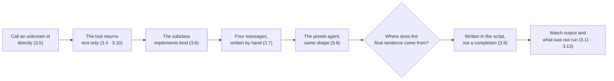
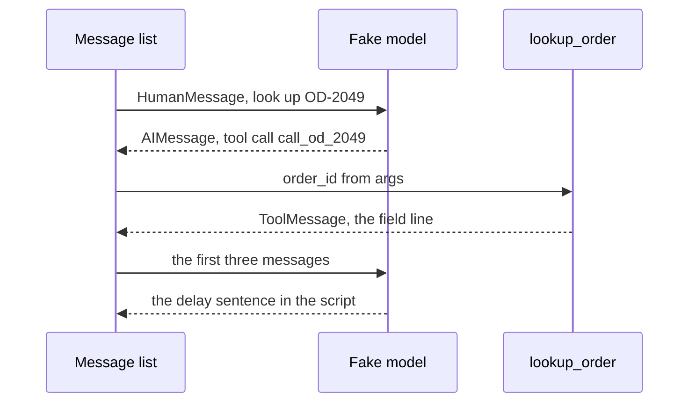

# Chapter 3 Tools and one agent loop

> In this chapter: Order `OD-2049` needs a carrier and a tracking number. They cannot be made up by the model on the spot. Lin Zhou (林舟) gives Xiaofan (小帆) a tool that only queries. The unknown order id `OD-0000` returns not found. The correct order id returns Seashore Select (海岸优品), 云途, and the tracking number. The hand-written message loop and the preset agent walk the same four message types. The generic fake model has to be subclassed, and the subclass has to implement tool binding, because creating the agent calls it. This run printed the model node and the tools node. The final delay sentence is written in the script. The days already elapsed come from the order dict. They do not come from the model making them up. The tool function has no refund, and it does not create a ticket. When you finish, you can split the query, the hand-written loop, and one agent loop apart, and you can refuse to stuff ticket opening into the tool.



*Flow of this chapter*

## When you need it

The chain in Chapter 2 can only hand back one label string, and that string does not look at the original text. The next thing the customer wants is which carrier order `OD-2049` is with now, what the tracking number is, and how many days have passed. That is one function call. It is not another sentence of prompt.

**You want to pull the lookup out of the model's prose.** Read 3.4 and 3.5. The tool returns `NOT_FOUND` for `OD-0000`, and a full line of fields for `OD-2049`. The return value is a string. It is not a raised exception. When you finish, you can point at this: an unknown order has no stack trace.

**You want to see the model say it will call a tool, the program actually call it, and the result get sent back.** Read 3.6 through 3.8. Look at the four hand-written messages first, then at `create_agent`. The type sequence is the same on both sides. The parameter name is `system_prompt`, not `prompt`. The business nodes on the graph are called `model` and `tools`.

**You want the tool to refund or create a ticket while it is at it.** Stop at 3.10. The body of `lookup_order` has no refund, and it has no ticket sentence. Side effects wait until Chapter 7, after a person agrees. The final sentence in this chapter does contain 「已延误」. It is a script. It is not a ticket that has already been opened.

| Situation | Choice | What not to choose |
| --- | --- | --- |
| You only have a label, and you have not looked up the order | Go back to Chapter 2 | Do not pass a label string off as a tracking number |
| You want stable tracking fields | `lookup_order` in this chapter | Do not let the model write `YT-2049-88` from memory |
| You want to see one tool loop | The hand-written loop or `create_agent`. This chapter runs both | Do not write a business branch into this preset graph |
| You want to open a ticket or refund | The pause in Chapter 7 | Do not write a ticket inside `@tool` |

Prerequisite: the virtual environment from Chapter 2 and `pip install -r requirements.txt` are already done. This chapter installs no new package, does not install `langchain-openai`, and does not call `init_chat_model`. The re-run is still `python run_all.py` in the demo directory. The evidence for this chapter is the stretch `## xiaofan_graph.tools_agent` inside that run.

## 3.1 Overview

One tool loop has a fixed four steps. A human message goes in. The model returns a tool call. The program runs the tool and wraps the result as a `ToolMessage`. The model returns a passage of text for the customer. Xiaofan does only a lookup in this round. The order id is written in the script as `OD-2049`. The tool uses that id to fetch the record from `orders.py`.

| Role | Object in this chapter | Can it decide a refund? |
| --- | --- | --- |
| Tool | `lookup_order` | No. It only returns `NOT_FOUND` or one line of fields |
| Fake model | `FakeToolCallingModel` | No. It hands out two `AIMessage`s written in advance, from an iterator |
| Hand-written loop | `run_manual_loop` | No. It only joins messages into a list |
| Preset agent | `create_agent` | No. It provides the two nodes `model` and `tools`. It does not provide a rule for opening a ticket |

**On the business side, the recommendation is to write the lookup first as a tool that only returns text, and to run one loop through with a fake model. A refund and ticket opening do not go into the tool.** Once a tool can change state, one extra call from the model or the script sends the money and the ticket out. A wrong lookup can be looked up again. A wrong refund cannot be taken back by calling once more. Chapter 1 sets this boundary as a position. This chapter lands it in the function body: `lookup_order` has no second side effect.

In langchain 1.5.2, `create_agent` returns a compiled graph. This chapter uses it because the shape of the preset tool loop has to be visible. Xiaofan's after-sales rules are not already a fit for that graph. Opening a ticket only on a delay, and a refund that must have a person's agreement, are still the job of conditional edges and `interrupt` later. The agent in this chapter has no checkpoint, no `interrupt`, and it does not run all three customer lines.

The sentence that is finally printed, 「订单 OD-2049 已延误。运单 YT-2049-88，已过 9 天。」, is written in the fake model's second message. It is not a vendor completion. The script already contains this sentence before the tool runs. When you read it, treat it as the mark that the wiring is done. Do not treat it as a summary the model wrote after reading the tool result.

## 3.2 Which piece of the contract this chapter takes

What matters in `orders.py` for this chapter is `ORDER_ID`, `lookup_order_record`, and `record_as_text`. This chapter does not use the shipping line `SHIPPING_TEXT`. The human line used by the hand-written loop and the agent is 「查一下订单 OD-2049 的物流」. This sentence appears only in `tools_agent.py`. It is not a replacement for the three fixed customer lines. The order id is still `OD-2049`, so the record that is found is the same one as in the rest of the book.

The facts in the record. This chapter's tool strings them into one line:

| Field | Value | Does it appear on the `manual_tool` line? |
| --- | --- | --- |
| Order | `OD-2049` | Yes |
| Merchant | 海岸优品 | Yes |
| namespace | `seashore-main` | No. `record_as_text` does not have this key |
| Status | `shipped` | Yes |
| Carrier | 云途 | Yes |
| Tracking | `YT-2049-88` | Yes |
| Ship date | `2026-11-18` | Yes |
| Days elapsed | `9` | Yes |
| Days promised | `7` | Yes |
| Delayed | `true` | Yes, lowercase |

`delayed` is written as lowercase `true` because `record_as_text` uses `str(flag).lower()`. The format is not one the model decided. The namespace stays in the order dict so other books can reconcile it, but this line of tool text does not carry it. When you read `manual_tool`, the namespace was not dropped. The format function did not splice it in.

The ticket sentence and the team name are not in the tool text either. They are not the return value of a lookup. The draft does not splice the ticket sentence in until Chapter 4.

The contract for an unknown order is: `lookup_order_record` returns `None` when the order id is not equal to `OD-2049`. The tool translates `None` into the string `NOT_FOUND`. This run uses `OD-0000` to trigger that path. Other unknown ids were not printed. The source takes `None` for every string that is not `OD-2049`. That comes from reading the function. Do not invent an output line for each id.

## 3.3 The full source

`books/langchain/demo/xiaofan_graph/tools_agent.py` on 2026-11-27 is below.

```python
"""Chapter 3: a tool, a hand-written loop, and create_agent. No vendor key."""

from langchain.agents import create_agent
from langchain.messages import AIMessage, HumanMessage, ToolCall, ToolMessage
from langchain.tools import tool
from langchain_core.language_models.fake_chat_models import GenericFakeChatModel

from xiaofan_graph.orders import ORDER_ID, lookup_order_record, record_as_text


class FakeToolCallingModel(GenericFakeChatModel):
    """create_agent calls bind_tools. The stock fake model does not implement it."""

    def bind_tools(self, tools, **kwargs):
        return self


@tool
def lookup_order(order_id: str) -> str:
    """按订单号查询星帆出海的订单。未知订单号返回 NOT_FOUND，不要编造。"""
    record = lookup_order_record(order_id)
    if record is None:
        return "NOT_FOUND"
    return record_as_text(record)


def scripted_model() -> FakeToolCallingModel:
    return FakeToolCallingModel(messages=iter([
        AIMessage(
            content="",
            tool_calls=[ToolCall(
                name="lookup_order",
                args={"order_id": ORDER_ID},
                id="call_od_2049",
            )],
        ),
        AIMessage(content="订单 OD-2049 已延误。运单 YT-2049-88，已过 9 天。"),
    ]))


def run_manual_loop() -> list:
    model = scripted_model().bind_tools([lookup_order])
    messages = [HumanMessage(content="查一下订单 OD-2049 的物流")]
    ai = model.invoke(messages)
    messages.append(ai)
    for call in ai.tool_calls:
        messages.append(ToolMessage(
            content=lookup_order.invoke(call["args"]),
            tool_call_id=call["id"],
        ))
    messages.append(model.invoke(messages))
    return messages


def run_create_agent() -> dict:
    agent = create_agent(
        scripted_model(),
        tools=[lookup_order],
        system_prompt="你是星帆出海客服小帆。只根据工具结果回答，不要编造运单。",
    )
    return agent.invoke({
        "messages": [HumanMessage(content="查一下订单 OD-2049 的物流")],
    })


def main() -> None:
    print("tool_missing", lookup_order.invoke({"order_id": "OD-0000"}))
    manual = run_manual_loop()
    print("manual_types", [type(m).__name__ for m in manual])
    print("manual_tool", manual[2].content)
    print("manual_final", manual[3].content)
    result = run_create_agent()
    names = [type(m).__name__ for m in result["messages"]]
    print("agent_types", names)
    print("agent_final", result["messages"][-1].content)
    agent = create_agent(scripted_model(), tools=[lookup_order])
    print("agent_nodes", list(agent.get_graph().nodes))


if __name__ == "__main__":
    main()
```

The module docstring states three things: one tool, one hand-written loop, and one `create_agent`. And there is no vendor key. The file has no `init_chat_model`, no `base_url`, and no ticket constant `TICKET`.

## 3.4 Walk through the file

### 3.4.1 Imports

`create_agent` comes from `langchain.agents`. That is the entry in langchain 1.5.2. Do not change it back to `create_react_agent` or `AgentExecutor` from an old tutorial. Chapter 1 already ruled those names out. The source of this chapter does not import them.

The message types come from `langchain.messages`: `AIMessage`, `HumanMessage`, `ToolCall`, and `ToolMessage`. `ToolCall` is the dict shape used when constructing a tool call. This chapter gives it three keys: `name`, `args`, and `id`.

The `tool` decorator comes from `langchain.tools`. It collects an ordinary function into a tool with a name, a description, and a parameter schema, so it has `invoke`.

`GenericFakeChatModel` comes from `langchain_core.language_models.fake_chat_models`. It is not the same class as `FakeListChatModel` in Chapter 2, and the import path is different too. The class in Chapter 2 emits strings and cycles. This class emits the next item in an iterator, and it does not wrap back to the start.

The order side imports only the three pieces the lookup needs. `SHIPPING_TEXT` is not imported, so this chapter does not mistake the customer line from Chapter 2 for the input of the tool loop.

### 3.4.2 `FakeToolCallingModel`

```python
class FakeToolCallingModel(GenericFakeChatModel):
    """create_agent calls bind_tools. The stock fake model does not implement it."""

    def bind_tools(self, tools, **kwargs):
        return self
```

The body of the class has only one method. `bind_tools` accepts a tool list and keyword arguments, then returns `self`. It does not save the tools, does not check names, and does not stuff the tool description into the prompt. Returning `self` means that after binding it is still the same object, and the iterator is still there. A new instance would not have the original `messages`, and the next `invoke` would not be these two script lines.

The docstring only states the motive: `create_agent` calls `bind_tools`, and the stock fake model does not implement it. The base class's `bind_tools` raises `NotImplementedError` directly. That is how `BaseChatModel.bind_tools` is written in langchain-core 1.8.5. This run did not remove the subclass and run again, so the output has no uncaught `NotImplementedError` of that kind. What the run proves is that, while the subclass is present, `agent_nodes` can be printed. That the base class would raise is a reading of the installed package. It is not a line in 3.11.

The official unit-testing docs show the same pattern: subclass `GenericFakeChatModel`, have `bind_tools` return itself, then hand it to `create_agent` (checked on 2026-11-27, [Unit testing](https://docs.langchain.com/oss/python/langchain/test/unit-testing)). The class name in the docs is also `FakeToolCallingModel`. The example tool in the docs is weather. The city name is not this book's order. This book did not run the weather example, and it does not quote the temperature sentence in that doc. This book's tool is `lookup_order`, and the call id is `call_od_2049`.

### 3.4.3 `lookup_order`

```python
@tool
def lookup_order(order_id: str) -> str:
    """按订单号查询星帆出海的订单。未知订单号返回 NOT_FOUND，不要编造。"""
    record = lookup_order_record(order_id)
    if record is None:
        return "NOT_FOUND"
    return record_as_text(record)
```

The function under the decorator is still a lookup. One parameter, type `str`, name `order_id`. That name has to match the key of `args` in the script. The script writes `{"order_id": ORDER_ID}`. If the key were changed to `id` while the function still required `order_id`, the call would fail. This chapter did not run that mistake, and the output has no matching `TypeError`. Do not add one.

The docstring is the tool's description: 「按订单号查询星帆出海的订单。未知订单号返回 NOT_FOUND，不要编造。」 The 「不要编造」 in the description is a contract written for a person to read. The platform name there is Xingfan (星帆出海). The fake model does not read this description. Its first message already specifies the tool name and the arguments in the source. The description text does not appear in the print on 2026-11-27.

The function body has two paths. If the record is `None`, return `"NOT_FOUND"`. If the record is not `None`, return `record_as_text(record)`. There is no third path. There is no `raise`. There is no ticket write, and there is no modification of the `ORDER` dict. `lookup_order_record` returns a copy of the dict. Even if the tool changed a local variable, it would not change the module-level order. The tool in this chapter does not change it.

`@tool` puts `invoke` on this function. Both `main` and the hand-written loop use `invoke` and pass a dict. The form that calls `lookup_order("OD-2049")` directly is not used in this chapter, and it is not printed on its own. The tool's `invoke` hands the dict to the function according to the parameter schema. This time both `OD-0000` and `OD-2049` went through `invoke`.

### 3.4.4 `scripted_model`

Each call creates a new model, and a new two-item iterator.

The first `AIMessage` has `content` as an empty string. `tool_calls` holds one `ToolCall`:

| Key | Value | Was it printed? |
| --- | --- | --- |
| `name` | `lookup_order` | No separate output line. What the hand-written loop finds with it is the same function object, because the loop does not look up by name. It calls `lookup_order` directly |
| `args` | `{"order_id": "OD-2049"}` | Not printed on its own. `ORDER_ID` is this string |
| `id` | `call_od_2049` | Not printed on its own. It is placed into `tool_call_id` of the `ToolMessage` |

An empty `content` plus a tool call means this round does not yet have a sentence for the customer. The customer sentence is the second item of the iterator. Its content is fixed as 「订单 OD-2049 已延误。运单 YT-2049-88，已过 9 天。」

The second item is already in the iterator at the moment `scripted_model` returns. `lookup_order` has not run yet. So this sentence cannot be one generated from the tool result just now. It overlaps the tool result in fact: the order id, the tracking number, and 9 days elapsed. It also leaves things out: no carrier 云途, no promised 7 days, no merchant, and no ship date. The overlap comes from the author writing the same order in two places. It is not the model making a summary and then deleting some fields.

On each generation, `GenericFakeChatModel` calls `next` to take the next item of the iterator. A string is wrapped as an `AIMessage`. An `AIMessage` is used as it stands. Both items in this chapter are `AIMessage`s. Its generation function also does not read the message list that was passed in. So the system prompt, the person's question, and the tool result do not change the next script line.

Once the iterator is used up, nothing more can be taken. The docs warn that a fake model should not share the same iterator across tests. `scripted_model()` in this chapter returns a new instance each time, to avoid that exhaustion. `main` calls `scripted_model` three times: once for the hand-written loop, once for the agent with `system_prompt`, and once for the agent that only prints nodes. The third time has no `invoke`, so that iterator is not consumed, and the output has no third final reply.

This differs from the cycle in Chapter 2. Here the index does not go back to 0. One extra call fails on `next`. The success path in this chapter calls each new model exactly twice: once for the tool, once for the final sentence. There is no print of a third `invoke`.

### 3.4.5 The hand-written loop

`run_manual_loop` writes the four steps in the function, so the types can be compared, instead of handing them to a graph.

1. `scripted_model().bind_tools([lookup_order])`. The subclass returns itself, so the later `invoke` still starts from the first script line.
2. The message list first holds one `HumanMessage`. The content is 「查一下订单 OD-2049 的物流」.
3. `model.invoke(messages)` gets the first `AIMessage` and appends it to the list.
4. Iterate `ai.tool_calls`. For each call, use `call["args"]` with `lookup_order.invoke`, put the returned string into a `ToolMessage`, and take `tool_call_id` from `call["id"]`. The script in this chapter has only one call, so only one `ToolMessage` is appended.
5. `model.invoke(messages)` again, append the second `AIMessage`, and return the whole list.

The loop has no `if` that decides whether to look up. It trusts that the model gave `tool_calls` this round. The fake model is written so that it always does. If the first script line had no tool call, the `for` would not run, the next `invoke` would hand out the final sentence directly, and the tool would not run. This chapter has no such script. `manual_types` in the output contains `ToolMessage`, which means the `for` appended at least one.

The hand-written loop has no system message. The list starts from `HumanMessage`. That is one of the differences, in the source, from `run_create_agent`. The type sequence is still the same, because the message list the agent returns does not count a system message either. See 3.8.

### 3.4.6 `run_create_agent`

```python
agent = create_agent(
    scripted_model(),
    tools=[lookup_order],
    system_prompt="你是星帆出海客服小帆。只根据工具结果回答，不要编造运单。",
)
return agent.invoke({
    "messages": [HumanMessage(content="查一下订单 OD-2049 的物流")],
})
```

Of the three arguments, the model is a new scripted model, the tool list has only `lookup_order`, and the system prompt is one Chinese sentence. The parameter name is `system_prompt`. The signature of `create_agent` in langchain 1.5.2 uses that name. This chapter does not use `prompt=`. Do not copy the `prompt` parameter from an old tutorial in here.

The text of the system prompt is 「你是星帆出海客服小帆。只根据工具结果回答，不要编造运单。」 It asks for an answer based on the tool result. The fake model cannot do that, because it does not read the tool result. This prompt is therefore not the cause of the final sentence this time. The final sentence is written in the iterator before it enters `create_agent`. The prompt's job is to put the constraint you want the model to follow in production on the right parameter, so that when the fake model is replaced later you know where the constraint is written. This chapter did not do that replacement.

The input of `invoke` is a dict. The key is `messages`. The value is a list that contains only one human message. The human line is the same as in the hand-written loop. The return value is a dict. `main` uses only `messages` from it. Even if other keys exist, they were not printed. Do not add an imagined `structured_response`. This chapter did not pass `response_format`.

### 3.4.7 The three print groups in `main`

`main` prints for three purposes. There is no interactive input in between.

The first group is only one line: `lookup_order.invoke({"order_id": "OD-0000"})`. This calls the tool directly. It does not go through a model, and it does not go through an agent. It is there to leave the return value of an unknown order.

The second group runs the hand-written loop and prints the type list, the content at index 2, and the content at index 3. Indexes start at 0: 0 is the human, 1 is the first model message, 2 is the tool message, and 3 is the final model message. The source uses `manual[2]` and `manual[3]`, bound to this order. If someone inserted a system message at the start of the list, the indexes would be wrong, and the print would become another stretch of text. This run did not insert one. The output matches the index contract.

The third group runs `run_create_agent`, prints the types of the returned messages, and the `content` of the last one. It does not print the content of the tool message in the middle. So the only run evidence of the tool body is the one line `manual_tool`.

Then `main` calls `create_agent` once more, does not `invoke`, and only turns `get_graph().nodes` into a list and prints it. This construction has no `system_prompt`. The node names do not depend on that system prompt. The node list of the agent that was `invoke`d is not printed on its own. Both sides passed tools. The node names in the source are the fixed `model` and `tools`. What was printed is the construction without a system prompt.

## 3.5 An unknown order returns `NOT_FOUND`, and does not raise

The first call in `main` is:

```python
lookup_order.invoke({"order_id": "OD-0000"})
```

`OD-0000` is not `OD-2049`. `lookup_order_record` returns `None`. The tool returns the string `NOT_FOUND`. The print key is `tool_missing`.

This is an ordinary return. The call stack is not unwound. The process does not exit because of an unknown order. `run_all.py` can keep running the later chapters because of this. If this were changed to `raise KeyError`, this output would not be one line of `tool_missing`. It would be a stack trace. This chapter did not change it to raise, so there is no stack trace to quote.

| Order id | Was it called this time? | Result | Shape of the result |
| --- | --- | --- | --- |
| `OD-0000` | Yes, `invoke` the tool directly | `NOT_FOUND` | A string, not an exception |
| `OD-2049` | Yes, through `tool_calls` of the hand-written loop | The whole `manual_tool` line | A string |
| An empty string or another id | Not called in `main` | No print | Do not invent an output line |

The script argument of the agent round is `OD-2049`, not `OD-0000`. So the `ToolMessage` inside `agent_types` cannot be used to prove that the agent handles an unknown order. The unknown order was proved only in the direct call. To make the agent see `NOT_FOUND`, you would need another script, with `args` written as `OD-0000`, and a reply prepared for after it sees `NOT_FOUND`. This chapter has no such script.

`NOT_FOUND` is four letters, all capitals, with no space in the middle and no Chinese period. If downstream code needs to judge it, compare for equality with this string. Do not use both 「未找到」 and `NOT_FOUND`. This chapter returns only the latter.

The tool description writes 「不要编造」. The function obeys that with its return value: no record means no field line, and it will not splice a fake tracking number. The fake model's final sentence does contain the real tracking number. That was written by the script author, the argument of that round is the real order id, and the tool does return this tracking number. On the unknown-order path, the final sentence is never generated. The model was not asked about `OD-0000`, so there is no honest answer from it on that id.

## 3.6 Why `bind_tools` has to be subclassed

When there are tools, and no separate structured-output configuration, `create_agent` calls `bind_tools` inside the model node and hands the tool list to the model. That is the path of the factory function in langchain 1.5.2. The stock `GenericFakeChatModel` does not override `bind_tools`, so the call falls through to the base class. The base class raises `NotImplementedError`, without the English structured-output sentence attached. The Chapter 2 sentence `with_structured_output is not implemented for this model.` is another path. This chapter did not trigger it.

After the subclass changes `bind_tools` to return `self`, what the factory holds is still this fake model. Only then does the later `invoke` walk down the iterator. `agent_types` and `agent_nodes` on 2026-11-27 show that this path went through. What went through means: binding did not raise, the graph was compiled, and one round of calls produced four messages.

The hand-written loop also calls `bind_tools`, even though the hand-written loop does not depend on the tool list after binding, because the loop calls the tool itself. The call is still written in the source so that it uses the same model class as `create_agent`. If the hand-written loop could run and the agent could not, the difference would be that bind inside the agent. This time both sides ran.

| Approach | Did this chapter run it this way? | What to expect | Evidence |
| --- | --- | --- | --- |
| Subclass `bind_tools` and return `self` | Yes | The agent can compile and finish one round | `agent_nodes` and `agent_types` |
| Hand `GenericFakeChatModel` straight to `create_agent` | No | Reading the installed package, `bind_tools` raises `NotImplementedError` | That stack is not in the output. Do not write it up as a failure that was already printed |
| Bind, inside the subclass, to a new empty model | No | The iterator would be dropped | There is no such output |
| Use Chapter 2's `FakeListChatModel` as the tool model | No | That class returns strings and has no `tool_calls` | There is no such output |

The official docs write "return itself" as the fixed technique for testing a tool loop, and they warn that an exhausted iterator cannot be reused. This chapter uses the function `scripted_model` to create a new one each time, which matches that warning. The `pytest` fixtures and the `InMemorySaver` example in the later half of the docs were not run in this chapter. The checkpoint is the subject of Chapter 6.

The `tools` argument of `bind_tools` is not used in the subclass. The fake model does not learn to call only this name just because `lookup_order` was bound. The `name` in the script is the handwritten `lookup_order`. If the script wrote a tool name that does not exist, the hand-written loop would still call only the function `lookup_order`. A mismatched name would not be checked in this chapter. The agent path dispatches by tool name. This chapter did not run a name-mismatch experiment. The successful output of the two paths cannot be used to prove that a wrong name still runs. The name in the script and the function name are the same now.

## 3.7 The four messages of the hand-written loop

The value of `manual_types` is:

```text
['HumanMessage', 'AIMessage', 'ToolMessage', 'AIMessage']
```

Read the four messages in this order.

| Index | Type | Where the content comes from | What was printed this time |
| --- | --- | --- | --- |
| 0 | `HumanMessage` | 「查一下订单 OD-2049 的物流」 in the source | The type name. The body has no line of its own |
| 1 | `AIMessage` | The first item of the iterator. Empty content, tool call `call_od_2049` | The type name. `tool_calls` has no line of its own |
| 2 | `ToolMessage` | The return of `lookup_order` for `OD-2049` | The whole field line of `manual_tool` |
| 3 | `AIMessage` | The second item of the iterator | The Chinese sentence of `manual_final` |

The full text of `manual_tool` is:

```text
order_id=OD-2049 merchant=海岸优品 status=shipped carrier=云途 tracking=YT-2049-88 shipped_at=2026-11-18 elapsed_days=9 promised_days=7 delayed=true
```

The field order is fixed by `record_as_text`. While reading, you can match it to the table in 3.2. `delayed=true` is at the end of the line. Nine days elapsed and seven days promised are both there. A person can check that 9 is greater than 7 without the model announcing that the shipment is therefore delayed. The delay mark is `delayed` in the data. It is not computed on the spot by this comparison. `orders.py` stores `delayed` as `True`, and formatting turns it lowercase.

The full text of `manual_final` is:

```text
订单 OD-2049 已延误。运单 YT-2049-88，已过 9 天。
```

The comma and the period in the sentence are fullwidth Chinese, because they are part of the script string. The tracking number and the digits are halfwidth. This line has no 云途, no 「7 天」, and no ticket sentence. Put it next to `manual_tool`, and the final sentence is visibly not a rewrite of the tool line.

The tool-call id `call_od_2049` is written in the `id` of `ToolCall`, and it is passed to `tool_call_id` of `ToolMessage`. The output does not print this id on its own. It is a fixed string in the source, so the tool result can be matched to that one call. The id is not generated at random at runtime. If it were changed to another string, as long as the first message and the `ToolMessage` still used the same value, the type sequence of the hand-written loop would not change. This chapter did not change the id, so there is no output where the ids fail to match. The book mentions it because the source hard-codes `call_od_2049`, not because those characters appear in a printed line.



*Figure 3-1: The four steps of the hand-written loop. Neither step of the fake model reads the text in the list*

The second time the figure hands the first three messages to the model, that is only the argument of `invoke`. The generation function does not look at that argument. The arrow is there. The read is not. Hold that difference the way `chain_again` is held. Chapter 2 proves "does not read" with another input sentence. This chapter proves "does not read" with the final sentence already written in the iterator before the tool runs. Both pieces of evidence come from the structure of the source. This chapter did not stuff in another unrelated human line for a third call.

## 3.8 `create_agent`: `system_prompt` and the node names

The lists of `agent_types` and `manual_types` are the same. Both are `HumanMessage`, `AIMessage`, `ToolMessage`, `AIMessage`. The strings of `agent_final` and `manual_final` are the same. They match because each side uses a new scripted model, the two script items are the same, and the tool is determined for `OD-2049`. They do not match because `create_agent` calls `run_manual_loop` internally. The two sides are two stretches of code.

The messages the agent returns have no `SystemMessage`. The system prompt does not become item 0 of the result list. In the langchain 1.5.2 implementation, when the model is called and a system message exists, that message is placed temporarily at the front of the list sent to the model this time. What the result state stores is the model output and the tool messages, not that temporarily joined full input. The fake model also does not read the input, so this run cannot prove the system prompt reached the model. What can be proved is that the parameter name `system_prompt` was used, and that `agent_types` is still four types, with no fifth type `SystemMessage`.

The node-list print is:

```text
['__start__', 'model', 'tools', '__end__']
```

| Node | What it is | Did this chapter write business logic on this name? |
| --- | --- | --- |
| `__start__` | The graph's entrance | No. It is not among the business names of `add_node` |
| `model` | The node that calls the model | No custom logic. The scripted model is placed here |
| `tools` | The node that runs tools | The only tool is `lookup_order` |
| `__end__` | The graph's exit | No |

`__start__` and `__end__` are the endpoint names the compiled graph brings with it. The print carries the double underscores. The only business nodes are `model` and `tools`. This chapter has no names such as `classify`, `draft`, or `gate`. Those belong to your own `StateGraph` from Chapter 4 on. Do not rename the preset agent's nodes to match the business graph, and do not say in a review that the agent already has a ticket-opening node. None of the four printed names is ticket opening.

This `agent_nodes` comes from the `create_agent` at the end of `main` that has no `system_prompt`. It was not `invoke`d. So the node list proves the shape of the graph, not another lookup. The construction with the system prompt already proved, with `agent_final`, that the lookup round can finish. The two pieces of evidence come from two constructions. Do not merge them into one `invoke` that printed the nodes.

When there are no tools, the factory can leave only the model node. This chapter passed tools, so the list contains `tools`. This chapter did not construct another agent with an empty tool list, and the output has no such comparison.

`create_agent` also has parameters such as `checkpointer`, `interrupt_before`, and `response_format`. This chapter passed none of them. Leaving them out means no thread memory, no pause before the tool, and no structured-response field. Those defaults are the scope of this chapter. They are not a print that was left out. A human pause uses your own graph. Chapter 7 does not use this preset graph to open tickets.

The difference between the system prompt and the hand-written loop can be collected into one table.

| Item | Hand-written loop | `create_agent` |
| --- | --- | --- |
| Who runs the tool | The `for` in `run_manual_loop` | The graph's `tools` node |
| System prompt | None | The first construction has one. The construction that prints nodes does not |
| Input container | A Python list | `{"messages": [...]}` |
| Final sentence | `manual_final` | `agent_final`, the same text |
| The tool's field line | Printed | Not printed |
| Node names | No graph | `model` and `tools`, plus the entrance and the exit |

## 3.9 The final sentence is a script, not a vendor completion

Both final prints are:

```text
订单 OD-2049 已延误。运单 YT-2049-88，已过 9 天。
```

The source of this sentence is the second `AIMessage` in `scripted_model`. To set aside the claim that this is a summary the model wrote after reading the tool, look at three facts that already hold.

1. The sentence appears in a literal inside the iterator, before any `invoke`.
2. The generation step of `GenericFakeChatModel` takes the next item of the iterator and does not read the message argument. Even if the tool result is in the list, it does not take part in producing this sentence.
3. The sentence is shorter than `manual_tool`: no carrier, no promised days, no merchant, and no ship date. An implementation asked to answer only from the tool result, if it were really summarizing that line, has no evidence in this chapter that it deleted fields. The sentence is short because the author wrote it this short.

The 「不要编造运单」 in the system prompt was therefore not verified by this run either. The tracking number `YT-2049-88` appears in both the order dict and the script. The script had no chance to invent another tracking number, because it does not look at the input and it has no second random source. Verifying "does not invent" needs a model that reads the tool and, when the tool returns `NOT_FOUND`, does not emit a tracking number. This chapter has no such model.

This sentence is not a ticket either. The ticket is 「售后升级：订单 OD-2049 客户投诉物流延迟」. The final sentence has no 「售后升级」, and no team `xbd-seashore-cs-team`. A support person cannot copy `agent_final` into the ticket system and treat it as a ticket already opened. The ticket-opening string is written into state only after a person agrees. That is Chapter 7.

Set it next to `shipping_delay` from Chapter 2:

| Print | Text | Is it the result of the model understanding? |
| --- | --- | --- |
| `chain_label` | `shipping_delay` | No. One item of a string list |
| `manual_final` / `agent_final` | 订单 OD-2049 已延误。运单 YT-2049-88，已过 9 天。 | No. The second item of the iterator |

Both chapters use a fake model to prove the wiring. Neither chapter proves that Xiaofan can write a support reply. The draft function later writes another, longer sentence, which includes the carrier, both day counts, and the ticket sentence. That sentence is the business draft. This chapter's sentence is shorter, so the script and the draft can be told apart at a glance. Do not polish them into the same sentence.

## 3.10 The tool does not hold a refund or a ticket

The whole body of `lookup_order` is: fetch the record, test `None`, and return a string. The actions below are not in the function, and this chapter has no other tool.

| Action | Is it in this chapter's tool? | Where it should go |
| --- | --- | --- |
| Look up by order id | Yes | `lookup_order` |
| An unknown order returns `NOT_FOUND` | Yes | The same function |
| Register a refund | No | Do not make it a tool. A refund needs a person's confirmation. Chapter 7 |
| Write the ticket sentence | No | `gate`, after `interrupt` resumes |
| Change `delayed` | No | The data is in `orders.py`. The tool does not compute it on the spot |
| Call a model | No | The model is on the other side of the loop |
| Read a key or reach the gateway | No | Not in this book's demo |

If a refund were written as `@tool`, the tools node of `create_agent` would run it when the model produced the call. As soon as the fake model wrote the refund tool's name in the script, the function that touches the money would run. The script in this chapter has only `lookup_order`, and that is not the safety boundary. The safety boundary is that the tool list has no refund function at all. When you switch to a model that decides tools itself, that boundary still holds.

A ticket does not enter the tool either. The field line the tool returns can be quoted by a draft. A draft is not a ticket. This chapter does not even have a draft function. `manual_final` mentions a delay only because the script is written that way. It does not mean a ticket already exists.

The direct call of `OD-0000` did not create a ticket for "no such order" either. It only returns four letters. Whether an unknown order should be escalated to a person is a rule of the conditional edges later. It is not the tool's `else` branch. The `else` in this chapter is `NOT_FOUND`.

## 3.11 The run output from 2026-11-27

The stretch for this chapter inside `python run_all.py` is:

```text
## xiaofan_graph.tools_agent
tool_missing NOT_FOUND
manual_types ['HumanMessage', 'AIMessage', 'ToolMessage', 'AIMessage']
manual_tool order_id=OD-2049 merchant=海岸优品 status=shipped carrier=云途 tracking=YT-2049-88 shipped_at=2026-11-18 elapsed_days=9 promised_days=7 delayed=true
manual_final 订单 OD-2049 已延误。运单 YT-2049-88，已过 9 天。
agent_types ['HumanMessage', 'AIMessage', 'ToolMessage', 'AIMessage']
agent_final 订单 OD-2049 已延误。运单 YT-2049-88，已过 9 天。
agent_nodes ['__start__', 'model', 'tools', '__end__']
```

The first line is still printed by `run_all.py`. The other seven lines come from `main`, in the same order as the `print` calls in the source.

| Line | Proves | Does not prove |
| --- | --- | --- |
| `tool_missing NOT_FOUND` | The direct call of `OD-0000` returns this string | It does not prove the agent was asked about an unknown order |
| `manual_types`, four types | The hand-written loop finished human, model, tool, model | It does not prove the model read the human line |
| The whole `manual_tool` line | The field format of `OD-2049` matches the order dict | It does not prove the final sentence was summarized from this line |
| `manual_final` | The second script line was taken out | It does not prove a vendor generated this sentence |
| `agent_types`, four types | The preset agent's message shape matches the hand-written loop | It does not prove the system prompt appears in the result list |
| `agent_final` | The last content on the agent path matches the script | It does not prove it obeyed "answer only from the tool result" |
| `agent_nodes`, four names | The graph contains the entrance, `model`, `tools`, and the exit | It does not prove the construction with `system_prompt` had its nodes printed. The print comes from another construction after it |

The quotes and commas of the lists stay in Python's default print. The names in `agent_nodes` are wrapped in halfwidth single quotes, and the double underscores are inside the quotes. When you quote them, do not write `__start__` as `START`. The source adds nodes with `"model"` and `"tools"`. The printed names of the entrance and the exit bring the underscores.

This output has no HTTP status, no trace id, no key, and no `ImportError`. The failure from Chapter 2 stays in the chain stretch. This chapter did not call `init_chat_model` again. Do not join the two stretches of output into a claim that the tool loop already went through the gateway.

## 3.12 Failure contrast

This chapter does not catch exceptions on purpose the way Chapter 2 does. The prints of the success path are the evidence. Below, a shape that looks like a failure but is not how this chapter is written stays apart from what would happen if it were written wrong. The written-wrong column is a reading of the source. It is not another log that was already captured.

| If it were written this way | How this chapter actually writes it | Is there a matching failure output on 2026-11-27? |
| --- | --- | --- |
| An unknown order raises | Return `NOT_FOUND` | No stack trace. There is `tool_missing` |
| No subclass. Use `GenericFakeChatModel` directly | `FakeToolCallingModel.bind_tools` returns `self` | No uncaught `NotImplementedError`. There is `agent_nodes` |
| `create_agent(..., prompt=...)` | The parameter name is `system_prompt` | No `TypeError`. This chapter did not write the wrong parameter name |
| The tool creates a ticket or refunds | The tool only returns text | The output has no ticket sentence |
| The final sentence is changed to call a real model | The final sentence is a literal in the iterator | No vendor reply |
| Use `FakeListChatModel` to return the characters `"lookup_order"` | Use `tool_calls` on an `AIMessage` | The type list contains `ToolMessage`, which means the path is a tool message, not one word |
| The hand-written loop and the agent share one iterator | Each `scripted_model()` creates a new one | Both sides have a final sentence. There is no iterator-exhausted exception |
| Write `OD-0000` into the agent script | The agent script uses `ORDER_ID` | The agent's final sentence is still the delay sentence, not `NOT_FOUND` |

The silent error is that the output all matches, while the conclusion is written as Xiaofan having judged from the shipping of 云途. The final sentence in the output does not contain the two characters 「云途」. The carrier appears only in `manual_tool`. The mark that decides delay is also `delayed=true` on that line, not inside the generation of the final sentence. The three characters 「已延误」 in the final sentence were written by the author.

Another silent error is to read `agent_nodes` as the business graph already being finished. Among the four names there is no draft and no human approval. Chapter 4 starts another graph. The node names will not be `model` and `tools`. The two graphs existing together is planned. The preset agent demonstrates the tool loop. The business graph demonstrates lookup, the draft, and the branches.

## 3.13 What this run did not do

| Item | Status |
| --- | --- |
| A vendor model's completion | None. The final sentence is a script |
| `init_chat_model`, `base_url`, `https://llm.example.com` | This chapter has none of these calls |
| Installing `langchain-openai` | Not done |
| A key | It does not appear in the file or the output |
| `with_structured_output` | Not called. Do not infer from the failure in Chapter 2 that this chapter's subclass can already do structured output. This chapter did not test that |
| The official weather-tool example | Not run. Only the pattern where `bind_tools` returns itself was taken from it |
| The body of `ToolMessage` on the agent path | Not printed. The field line is quoted only from `manual_tool` |
| The tool-call id `call_od_2049` | Written in the source. There is no print line of its own |
| The node list of the construction that has `system_prompt` | Not printed. `agent_nodes` comes from the next construction, which has no system prompt |
| The `bind_tools` exception after the subclass is removed | Not run. In the installed package the base class raises `NotImplementedError` |
| A refund tool, a ticket tool | They do not exist, and they were not called |
| `OD-0000` entering the agent | No. Only the tool was called directly |
| An empty order id, `OD-2050`, or another id | Not printed |
| `interrupt`, a checkpoint, `thread_id` | None. This preset agent did not pass `checkpointer` |
| The three fixed customer lines | They do not enter this chapter. The human line is 「查一下订单 OD-2049 的物流」 |
| Langfuse | Not initialized |
| Making the tool raise | Not done |

The official weather example that was not run cannot be used to fill in this chapter's output. The city, the Fahrenheit reading, and the assertions in that example are not `OD-2049`. This book's run evidence stops at the seven lines of 3.11 plus one module header.

`pytest` was not used by this chapter either. `main` uses prints as the fixed check, so it runs the same way as the other chapters in `run_all.py`. The fixture style in the docs can be a reference if the demo is later turned into tests. It is not a file that was already executed on 2026-11-27.

## 3.14 Why the hand-written loop is still there

`create_agent` already gives the same type sequence and the same final sentence, so the hand-written loop looks as if it could be deleted. This chapter keeps it so the indexes of the four messages stay visible.

The agent puts tool execution inside the `tools` node. When a reader sees `agent_types`, they know there is a `ToolMessage` in the middle, but they cannot see which line of Python filled in `tool_call_id`. The `for` of the hand-written loop is that line. `call["id"]` comes from the script's `call_od_2049`. `call["args"]` is handed to `lookup_order.invoke`. Those assignments also happen inside the agent. They are just not in a function body of `tools_agent.py`. Read side by side, the hand-written loop is the expanded form, and the agent is the folded form.

The second reason it stays is scope. The hand-written loop has no system prompt and no graph. It cannot pause, and it cannot continue after the process restarts. Those limits make it a poor final shape for Xiaofan. It fits as this chapter's comparison. From Chapter 4 on, lookup is no longer decided by whether the model calls it. The `lookup` node on a straight edge calls the `order_id` that has already been parsed. That is a third shape: there is no `ToolMessage`, because no model takes part in the lookup. Do not merge the three shapes into "they are all an Agent."

| Shape | Who decides to look up | Is there a `ToolMessage` in the messages? | This chapter or later |
| --- | --- | --- | --- |
| Hand-written loop | `tool_calls` in the script | Yes | This chapter |
| `create_agent` | Also the script. The graph runs it | Yes | This chapter |
| The business graph's `lookup` node | An edge. The model does not decide | This message set is absent | Chapter 4 |

The third row is a preview. It is not this chapter's output. Both times in this chapter's output there is a `ToolMessage`.

## 3.15 How this lines up with the order facts

Split `manual_tool` back into the order dict, so the tool text and the case do not each write their own set.

| Fragment in the print | Key in the order dict | Value |
| --- | --- | --- |
| `order_id=OD-2049` | `order_id` | `OD-2049` |
| `merchant=海岸优品` | `merchant` | 海岸优品 |
| `status=shipped` | `status` | `shipped` |
| `carrier=云途` | `carrier` | 云途 |
| `tracking=YT-2049-88` | `tracking` | `YT-2049-88` |
| `shipped_at=2026-11-18` | `shipped_at` | `2026-11-18` |
| `elapsed_days=9` | `elapsed_days` | `9` |
| `promised_days=7` | `promised_days` | `7` |
| `delayed=true` | `delayed` | Boolean true, printed lowercase |

`namespace=seashore-main` is not in this print comparison, because `record_as_text` does not splice it in. The dict still has this key. Other books use it as the team scope on the gateway side. The tool in this chapter does not need it as a query condition. The only query condition is the order id.

The platform name 「星帆出海」 appears in the tool's docstring, and it also appears in the system prompt. It is not an order field. Those four characters are not visible on the printed line. The agent did not print the system prompt, and the tool description was not printed either.

The engineer 林舟 (Lin Zhou) and the support person 小帆 (Xiaofan) are still the people who run through the case. The system prompt in this chapter calls the model 小帆. The fake model did not use that name, and the final sentence does not contain the two characters 「小帆」. A name written in the prompt is not the same as the reply carrying it.

## 3.16 What to check on a re-run

The environment is the same as Chapter 2: `books/langchain/demo`, the virtual environment is activated, and the dependencies are still those three directly pinned lines. Then run `python run_all.py` and find `## xiaofan_graph.tools_agent`.

| Check | What passing looks like |
| --- | --- |
| Unknown order | `tool_missing NOT_FOUND` |
| Four message types | The two lists `manual_types` and `agent_types` are the same |
| Field line | `manual_tool` ends with `delayed=true`, and `YT-2049-88` and `elapsed_days=9` are in the middle |
| Final sentence | Both places are 「订单 OD-2049 已延误。运单 YT-2049-88，已过 9 天。」 |
| Nodes | `agent_nodes` contains `model` and `tools`, and also `__start__` and `__end__` |
| What should not appear | The ticket sentence, a key, an HTTP status, `ImportError` |

If `manual_tool` becomes `NOT_FOUND` while the order id is still `OD-2049`, first see whether `orders.py` was changed to another set of ids. The script in this chapter uses the `ORDER_ID` constant. Once the constant is not `OD-2049`, the tool treats it as an unknown order. Do not hard-code a return value inside the tool in order to demonstrate success. The return value should come from `record_as_text`.

If `agent_nodes` is missing `tools`, first see whether `create_agent` still receives the tool list. An empty tool list is not the source of this chapter. The construction at the end of this chapter passes `tools=[lookup_order]` in.

If the final sentence becomes another stretch of Chinese, the second script item was changed. Before changing it, also change the quotations of this sentence in the book. Do not change only the sentence and leave the old 「已过 9 天」, or the reader cannot tell which sentence is the output from 2026-11-27.

## Summary

1. **`lookup_order` only queries.** `OD-0000` returns `NOT_FOUND` and does not raise. `OD-2049` returns one line that contains 海岸优品, 云途, `YT-2049-88`, the ship date, 9 days elapsed, 7 days promised, and `delayed=true`.
2. **The fake model has to be able to** `bind_tools`. `FakeToolCallingModel` returns itself. This is the pattern in the official unit-testing docs. This run therefore got `agent_nodes`. The stock base class raises `NotImplementedError`, but that failure is not in this output.
3. **The message types of both the hand-written loop and `create_agent` are** `HumanMessage`, `AIMessage`, `ToolMessage`, `AIMessage`. The tool-call id in the source is `call_od_2049`.
4. **The parameter name is `system_prompt`, not `prompt`.** The result messages have no `SystemMessage`. The node names are `model` and `tools`, plus `__start__` and `__end__`.
5. **The final sentence is the second `AIMessage` in the script, not a vendor completion.** It was written before the tool ran. It is not the ticket sentence.
6. **A refund and ticket opening are not in the tool.** The next step is the straight-line graph in Chapter 4: classify with keywords, then call lookup, and no longer depend on this round of script to decide whether to look up.

## Checklist

- ☐ Action: call `lookup_order` on `OD-0000`, confirm the print is `tool_missing NOT_FOUND`, and that there is no exception stack.
- ☐ Action: point at the type order of the four messages in the hand-written loop, and say that `tool_call_id` of `ToolMessage` comes from `call_od_2049` in the source.
- ☐ Action: explain why `FakeToolCallingModel.bind_tools` has to exist, and that what it returns is `self`.
- ☐ Action: point out that the parameter name `create_agent` uses is `system_prompt`, and say the four names in `agent_nodes`.
- ☐ Action: explain that 「订单 OD-2049 已延误。运单 YT-2049-88，已过 9 天。」 is written in the second message of the script, and is not a vendor completion.
- ☐ Action: read the body of `lookup_order` and confirm it has no refund and no ticket sentence.
- ☐ Action: say at least three things that were not printed or were never run this time, and include the tool body on the agent path, the exception after the subclass is removed, and any request to the gateway.

## Quick reference

The main line does not depend on this section. Names follow `tools_agent.py`.

| Name | Value in this chapter |
| --- | --- |
| Unknown order | `OD-0000`, returns `NOT_FOUND` |
| Order that was found | `OD-2049` |
| Tool-call id | `call_od_2049` |
| Human line | 查一下订单 OD-2049 的物流 |
| System prompt | 你是星帆出海客服小帆。只根据工具结果回答，不要编造运单。 |
| Final sentence | 订单 OD-2049 已延误。运单 YT-2049-88，已过 9 天。 |
| Type sequence | `HumanMessage`, `AIMessage`, `ToolMessage`, `AIMessage` |
| Nodes | `__start__`, `model`, `tools`, `__end__` |
| `bind_tools` | A method on the subclass. It returns `self` |
| What is not in the tool | A refund, creating a ticket, reaching the gateway |

## Further reading

- **Chapter 2 (the first chain)** — why a string fake model is not enough. It cycles, but it does not produce `tool_calls`. This chapter switches to an iterator, and the second call is no longer designed to wrap back to the same string.
- **Chapter 4 (state, nodes, and straight edges)** — lookup changes from a name in the model script to a fixed node on the graph. Classification uses keywords. The final sentence of this chapter is not passed off as a draft.
- **Chapter 7 (human in the loop)** — opening a ticket and refunding sit after `interrupt`. This chapter keeps the tool to queries only, so that chapter still has something to pause on.
- **LangChain unit-testing docs** (https://docs.langchain.com/oss/python/langchain/test/unit-testing) — the form where `bind_tools` returns itself comes from here. The weather example in the docs is not a run result of this book.
- **The gateway alias in the LiteLLM book** — this chapter did not call `seashore-cs`. The model is still an in-process fake object. When a real model is needed, leave this chapter first. Do not write a key inside the tool function.
