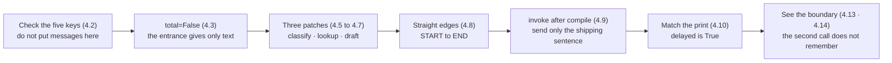
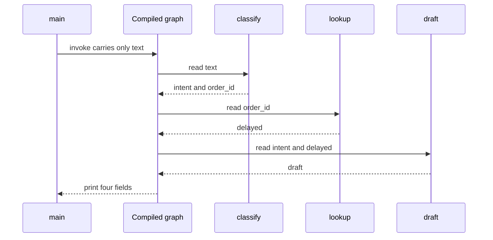

# Chapter 4 State, nodes, and edges

> In this chapter: A customer chased the shipping once on order OD-2049. The order belongs to Seashore Select (海岸优品) on Xingfan (星帆出海). Lin Zhou (林舟) wants Xiaofan (小帆) to walk a path with no fork first: write the intent from keywords, write whether it is delayed from the order data, then splice a draft the support person can read. The draft has to contain 云途, tracking number YT-2049-88, ship date 2026-11-18, 9 days elapsed, and 7 days promised. Each of the three nodes hands back the keys it changed, and the graph merges them. This chapter uses no model, and it adds neither conditional edges nor a checkpoint. When you finish, you can compile this straight line, match the `linear_draft` from 2026-11-27, and explain why the next `invoke` will not remember this draft.



*Flow of this chapter*

## When you need it

Three situations, three ways to read. Set the chain and the tool loop from the previous two chapters aside for now.

**You can already get a label from one sentence, and you can already look up the order, but the label, the boolean, and the draft still sit in three function calls that do not know about each other.** Read from 4.2 through 4.9. Put the three functions into one `SupportState`, and connect them with `add_edge` as `classify` → `lookup` → `draft`. When you finish, accept the result against the five printed lines in 4.10. Do not add a diamond on this pass. If the straight line does not match, a conditional edge will magnify the error.

**You want to confirm whether classification is another model call.** Read 4.5. `classify` looks at only three keyword conditions: 「退款」 in the text means `refund`; otherwise `OD-2049` or 「物流」 in the text means `shipping_delay`; everything else is `other`. The fake model in Chapter 2 always returns `shipping_delay`. It did not read the original text. On the shipping sentence the two results match. The reasons differ. The evidence in this chapter is the keyword function. It is not a vendor model, and it is not the fake model.

**You are about to send the refund sentence and 「你们周末上班吗」 into this graph, and you expect them to skip lookup.** Read 4.14 first, then go to Chapter 5. The four edges in this chapter do not read `intent`. The refund sentence and the other sentence are already written inside `draft`, so Chapter 5 can reuse the same function. On 2026-11-27, `main()` sent in only `SHIPPING_TEXT`. The refund sentence and the other sentence do not appear in this chapter's printed lines.

Prerequisite: you can read a Python function and a `TypedDict`. Of the six cards in Chapter 1, this chapter stops at the draft on card D. The pause on card E is Chapter 7's job. `langchain` 1.5.2 is still the baseline for the whole book. This chapter's source does not import it. The graph runtime comes from `StateGraph`, `START`, and `END` in `langgraph` 1.2.24.

## 4.1 Overview

What Xiaofan finishes in this chapter is one merge. The caller brings one customer sentence, walks three nodes, and gets back a state that holds the intent, the order id, the delay boolean, and the draft. The ticket sentence appears inside the draft text. The state dict still has no separate `ticket` key. In this chapter Lin Zhou can only read that draft. Nodding, rejecting, and writing the ticket sentence into its own field still have no node responsible for them.

| Question | What this chapter does | Why it is left for later |
| --- | --- | --- |
| Where the intent comes from | `classify` looks at keywords | The keyword set is only three words. A model does not need to improvise |
| Where the delay comes from | `lookup` copies `ORDER["delayed"]` | 9 days and 7 days are written into the draft for a person to read. The code does not compare the two numbers |
| Who picks the next stop | `add_edge` writes a fixed order | The conditional edge waits until the straight line's patch merge has been understood (Chapter 5) |
| Is the draft still there after the process restarts? | No. `compile()` has no checkpoint | The checkpoint is the subject of Chapter 6 |
| Does the draft count as a ticket already opened? | No. The sentence starts with 「拟开立工单」 | Writing `ticket` for real waits until after `interrupt` (Chapter 7) |

The state the three nodes share is the type below. It has only business keys.

```python
class SupportState(TypedDict, total=False):
    text: str
    order_id: str
    intent: str
    delayed: bool
    draft: str
```

**On the business side, run the shipping sentence through this straight line first, match the whole draft line, and only then replace the fixed edge from `classify` to `lookup` with a conditional edge.** If you write the route at the start, "absent" and `False` get mixed together for `delayed` on the refund path. On the straight-line graph `lookup` always runs, and anything other than `OD-2049` gets `False`. On the conditional graph the refund and the small talk never enter `lookup`, the key stays absent, and `dict.get` returns `None`. Those two facts belong in two chapters.

This chapter's module is [demo/xiaofan_graph/linear.py](../../demo/xiaofan_graph/linear.py). The order facts still live only in [demo/xiaofan_graph/orders.py](../../demo/xiaofan_graph/orders.py). `linear.py` takes `ORDER`, `ORDER_ID`, `SHIPPING_TEXT`, `TEAM`, and `TICKET` from there. It does not take `REFUND_TEXT`, `OTHER_TEXT`, `MERCHANT`, or `NAMESPACE`, and it does not call `lookup_order_record`. The merchant 海岸优品 and the namespace `seashore-main` stay in the order dict, so other chapters can check them against the record. This chapter's draft does not splice those two items in.

## 4.2 Five keys in the state

The five keys of `SupportState` are tied to the call order. Look first at who writes each one, who reads it, and what empty means. This table is the first half of 1.12 in Chapter 1. `decision` and `ticket` have not appeared yet.

| Key | Who writes it | Who reads it | At this chapter's entrance |
| --- | --- | --- | --- |
| `text` | The caller, the argument to `invoke` | `classify` | The shipping sentence `SHIPPING_TEXT` |
| `order_id` | `classify` | `lookup` | Not yet. The characters in the original text wait for a node to copy them in |
| `intent` | `classify` | `draft` | Not yet |
| `delayed` | `lookup` | `draft` | Not yet. The boolean exists only after the straight-line graph has finished |
| `draft` | `draft` | The caller, when it prints | Not yet |

The value of `text` in this chapter is this sentence, the only shipping original text in the whole book:

```python
SHIPPING_TEXT = "订单 OD-2049 物流延迟，请处理"
```

`classify` reads it with `state.get("text", "")`. When the key is absent, that call treats it as an empty string, and the node walks into `other`. `main()` always passes this key, so the call on 2026-11-27 did not take the default empty string.

These five keys do not include `messages`. The state of `create_agent` in Chapter 3 is a message list, and the node names are `model` and `tools` on the preset graph. That side needs a `HumanMessage` because the fake model consumes messages. Classification in this chapter does not call a model. The customer sentence can stay in the ordinary string `text`. If you merge the message list into `SupportState`, the checkpoint holds small-talk history and the ticket draft at the same time, and on resume you cannot tell which one this pause is waiting for. Chapter 6 is where the checkpoint is discussed. This chapter keeps the state as these five keys.

There is no `n` either. The counting cycle uses another `CountState`, in Chapter 5, compiled apart from the order graph. Do not stuff the cycle counter into the after-sales state in order to "save a class."

The word `ticket` appears in this chapter only as the constant `TICKET`, in the middle of the draft sentence. The full constant is:

```python
TICKET = "售后升级：订单 OD-2049 客户投诉物流延迟"
TEAM = "xbd-seashore-cs-team"
```

The team name is spliced onto the end of the draft, and it tells the support person that this case belongs to Seashore Select's support team. This chapter calls no team API. Whether the string is in the draft only affects a person's check against the record.

## 4.3 total=False makes a missing key legal

A `TypedDict` defaults to `total=True`. A type checker then requires all five keys when you construct a `SupportState`. The entrance in this chapter is `{"text": SHIPPING_TEXT}`. The return value of `classify` has only `intent` and `order_id`. `lookup` has only `delayed`. `draft` has only `draft`. If the type were written as the default "every key required," the checker would report missing keys on these dicts, which is the opposite of the real shape at runtime.

`total=False` marks every key in the annotation as allowed to be absent. The five names are still in the class's `__annotations__`. `StateGraph(SupportState)` builds channels from those annotations. It does not build fewer channels because of `total=False`. It allows a given state to be temporarily without some of those keys.

The run on 2026-11-27 did not execute mypy or pyright. The output has no line that says the type check passed. `total=False` is written for the person reading the code and for the type checker. `invoke` does not raise a type error because the input is missing `draft`. An absent key is simply not in the dict. On the refund path in Chapter 5, `out.get("delayed")` returns `None`. That is the follow-on of this rule. It is not `lookup` writing the value as `None`.

Opposite "absent" is "a definite value was written." When the order id is not `OD-2049`, `lookup` returns `{"delayed": False}`. `False` is a write. The empty string `""` is a write too: when the original text does not contain `OD-2049`, `classify` sets `order_id` to `""`, and it does not omit the key. The code that judges with `state.get("order_id")` is in `lookup`, not in `draft`. An empty string is not equal to `ORDER_ID`, so `delayed` is `False`.

So when you read the state, separate three facts.

| What you see | What it means | Who causes it in this chapter |
| --- | --- | --- |
| The key is not in the dict | No node has written it yet | `intent`, `delayed`, and `draft` at the entrance |
| The key is present, and the value is `""` | A node explicitly wrote an empty string | `order_id` when the original text has no order id |
| The key is present, and the value is `False` | A node explicitly wrote boolean false | `delayed` when the order id does not match |

`main()` uses `out["intent"]`, `out["order_id"]`, `out["delayed"]`, and `out["draft"]` on the straight-line graph. Those are subscripts, not `get`. None of the four subscripts raised. After `SHIPPING_TEXT` has been walked, those four keys are present. Whether `text` remains in the return value is not touched by this print. Section 4.4 covers that on its own.

## 4.4 A node returns a patch

The return value of each of the three nodes is a dict that holds only that node's own duty.

| Node | Keys it returns | Keys it does not return |
| --- | --- | --- |
| `classify` | `intent`, `order_id` | `text`, `delayed`, `draft` |
| `lookup` | `delayed` | The other four |
| `draft` | `draft` | The other four |

For a key with no extra merge function, LangGraph's contract is: a key that appears in the return value overwrites the old value, and a key that does not appear stays as it was. None of the five keys in this chapter has an `Annotated` reducer, and none uses `operator.add`. A later write of the same key replaces the earlier write of that key. Each superstep on this straight line has only one node, so two nodes never write `draft` in the same step.

Lay the shipping sentence out under that contract. The middle rows are deduced from the return values. They were not printed on their own. In the last row, the values of `intent`, `order_id`, `delayed`, and `draft` match the print in 4.10. The `text` column was not rewritten by any node, and it was not printed, so the table does not list values for `text`. The first row only records that the entrance supplied it.

| Moment | `intent` | `order_id` | `delayed` | `draft` |
| --- | --- | --- | --- | --- |
| `invoke` passes in, with only `text` | absent | absent | absent | absent |
| After `classify` returns | `shipping_delay` | `OD-2049` | absent | absent |
| After `lookup` returns | `shipping_delay` | `OD-2049` | `True` | absent |
| After `draft` returns | `shipping_delay` | `OD-2049` | `True` | the whole sentence in 4.11 |

If the caller writes `return state` inside a node, or `return {**state, "intent": intent}`, this shipping sentence can often still produce the same four printed values. This book still requires a patch only. The reason sits in the duty: a key the node does not own should not be written again from its return value. Later, once some key has a reducer, spreading the whole dict hands the old value back one more time. This chapter has no reducer yet. The habit is formed on the straight line first.

A path where a node returns `None` is not in this file. Every branch of the three functions returns a dict. Do not add a `return None` from some other tutorial and then claim it is equivalent to an empty patch. That behavior does not appear in the output from 2026-11-27.



*Figure 4-2: Three patches for the shipping sentence on the straight line. Intermediate state was not printed on its own. The final four fields match the run output*

## 4.5 classify is a keyword function

`classify` does not import a model, does not construct a message, and does not call `init_chat_model`. The whole function is below.

```python
def classify(state: SupportState) -> dict:
    text = state.get("text", "")
    if "退款" in text:
        intent = "refund"
    elif ORDER_ID in text or "物流" in text:
        intent = "shipping_delay"
    else:
        intent = "other"
    order_id = ORDER_ID if ORDER_ID in text else ""
    return {"intent": intent, "order_id": order_id}
```

Intent and order id are two separate judgments. Intent walks `if / elif / else` and stops at the first hit. The order id only looks at whether `ORDER_ID` appears in the original text. It does not assign through the intent branch. `ORDER_ID` is the string `OD-2049`.

| Order | Condition | `intent` | Relation to the order id |
| --- | --- | --- | --- |
| 1 | The original text contains 「退款」 | `refund` | The order id is still judged on its own. If the text contains `OD-2049`, write it. If it does not, write `""` |
| 2 | The previous row does not hold, and the original text contains `OD-2049` or 「物流」 | `shipping_delay` | Same as above |
| 3 | Everything else | `other` | Same as above |

「退款」 is the first branch so that, when those characters appear together with others, the fixed priority lands on refund. The shipping sentence `SHIPPING_TEXT` does not contain 「退款」. It contains `OD-2049`, and it contains 「物流」, so it takes the second branch. `intent` is `shipping_delay`, and `order_id` is `OD-2049`. That matches the two lines `linear_intent` and `linear_order`.

The three sentences below are the fixed customer sentences for the whole book. Only the first one is `invoke`d in this chapter. The last two can be deduced from the same function. The deduction is not this chapter's print.

| Original text | `intent` | `order_id` | Does it appear in this chapter's run output? |
| --- | --- | --- | --- |
| 订单 OD-2049 物流延迟，请处理 | `shipping_delay` | `OD-2049` | Yes |
| 订单 OD-2049 我要退款 | `refund` | `OD-2049` | No. `linear.py` does not import this sentence |
| 你们周末上班吗 | `other` | `""` | No |

The refund sentence contains both 「退款」 and `OD-2049`. The first branch hits first, the intent is `refund`, and the order id is still `OD-2049`. The weekend sentence contains none of the three conditions. The intent is `other`, and the order id is an empty string. The empty string is a value that was written.

There is one more combination that holds in the source and that the run did not walk: the original text has only 「物流」, and no order id. The intent is `shipping_delay`, and the order id is `""`. The route in Chapter 5 skips lookup because the order id is empty. The straight edges in this chapter do not look at that difference. `lookup` still runs, and because the order id is not `OD-2049` it writes `delayed` as `False`.

The classification result is only these three strings: `refund`, `shipping_delay`, and `other`. The function does not return 「延误」 or `shipping`. Downstream code compares with equality. One extra character misses the matching branch.

## 4.6 lookup only copies delayed

`lookup` does not compute a date, does not splice tracking text, and does not call the Chapter 3 tool that returns `NOT_FOUND`.

```python
def lookup(state: SupportState) -> dict:
    if state.get("order_id") != ORDER_ID:
        return {"delayed": False}
    return {"delayed": bool(ORDER["delayed"])}
```

First branch: if `order_id` is absent, an empty string, or any value that is not `OD-2049`, write `False`. When the key is absent, `state.get` returns `None`. `None != "OD-2049"` holds, so absence lands on this branch too. On the straight-line graph `classify` always runs first and writes `order_id`, so when this chapter actually reaches `lookup`, the key is a string. The defensive `get` stays, so the node does not raise `KeyError` if someone calls it alone.

Second branch: when the order id is exactly `OD-2049`, write `bool(ORDER["delayed"])`. That field in the order dict is already `True`. `bool(True)` is still `True`. The `linear_delayed True` from 2026-11-27 matches this branch.

The dates in the order dict are data sitting side by side. They are not inputs to a formula.

| Field | Value | Who uses it in this chapter |
| --- | --- | --- |
| `delayed` | `True` | `lookup` reads it and writes it into state |
| `elapsed_days` | `9` | Only `draft` writes it into the sentence |
| `promised_days` | `7` | Only `draft` writes it into the sentence |
| `carrier` | 云途 | Only `draft` |
| `tracking` | `YT-2049-88` | Only `draft` |
| `shipped_at` | `2026-11-18` | Only `draft` |
| `merchant` | 海岸优品 | This chapter's draft does not read it |
| `namespace` | `seashore-main` | This chapter's draft does not read it |
| `status` | `shipped` | This chapter does not read it |

A person can see 「已过 9 天，超过承诺的 7 天」 in the draft, and use it to check whether the data itself says 9 is greater than 7. There is no expression `elapsed_days > promised_days` on the code path. If someone changed the day counts and forgot to change `delayed`, `lookup` would still return the boolean in the dict. This chapter does not demonstrate that edit. The order dict keeps this one set of values.

For an unknown order id, `lookup` writes `False`. It does not raise, and it does not write `None`. The `lookup_order` tool in Chapter 3 returns the string `NOT_FOUND` for an unknown order id. Do not merge the two functions. What the straight-line graph needs is a boolean the draft branch can test, not a line of tool text for a model to read.

## 4.7 The four strings in draft

`draft` picks one of four sentences from `intent` and `delayed`, and it returns only `{"draft": text}`.

```python
def draft(state: SupportState) -> dict:
    intent = state.get("intent")
    if intent == "shipping_delay" and state.get("delayed"):
        text = (
            f"订单 {ORDER_ID} 由{ORDER['carrier']}承运，运单 {ORDER['tracking']}，"
            f"{ORDER['shipped_at']} 发出，已过 {ORDER['elapsed_days']} 天，"
            f"超过承诺的 {ORDER['promised_days']} 天。"
            f"拟开立工单：{TICKET}。团队 {TEAM}。"
        )
    elif intent == "refund":
        text = f"拟为订单 {ORDER_ID} 登记退款申请。退款不会自动执行。"
    elif intent == "shipping_delay":
        text = "未查到可判定延误的订单，请核对订单号。"
    else:
        text = "已记下。请给出订单号，或说明是物流还是退款。"
    return {"draft": text}
```

The branch order is the order of the source above. The first branch requires the intent to equal `shipping_delay`, and `state.get("delayed")` to be true. `True` satisfies that. When the key is absent, `get` returns `None`. `None` does not satisfy it, so control falls through to the later `elif`. On this chapter's shipping sentence, `delayed` is already `True`, so the first branch hits.

| Branch | Full draft text | Does this chapter's `main()` reach it? |
| --- | --- | --- |
| Delayed, and `delayed` is true | See 4.11. The same sentence as `linear_draft` | Reached |
| Intent is `refund` | 拟为订单 OD-2049 登记退款申请。退款不会自动执行。 | Not reached |
| Intent is `shipping_delay`, but the previous branch does not hold | 未查到可判定延误的订单，请核对订单号。 | Not reached |
| Everything else, including `other` | 已记下。请给出订单号，或说明是物流还是退款。 | Not reached |

The last three sentences are written here ahead of time because the routing graph in Chapter 5 does `from xiaofan_graph.linear import draft` and does not copy a second set of strings. The refund sentence has to exist in this chapter already, so that Chapter 5 can talk about reuse. The pause graph in Chapter 7 writes its own `draft`. That refund sentence adds 「需要人工确认」 at the end. That text belongs to a later chapter. This chapter and the next one both take this copy as the standard: the refund sentence ends at 「退款不会自动执行。」 and does not contain the ticket constant `TICKET`.

The first branch uses a truthiness test, not `delayed is True`. What this chapter writes is the boolean `True`. Do not change it to some other sentinel on a path that has not been run.

`draft` does not read `text`. The customer's original words are not pasted into the draft as they stand. The order id in the shipping draft comes from the constant `ORDER_ID`. It does not search the original text again. So if classification copied the order id wrong, the draft will not correct it by itself. The classification result for this chapter's shipping sentence is right, so the order id in the draft is also `OD-2049`.

## 4.8 START, END, and four straight edges

All of the graph assembly is in `build_linear`.

```python
def build_linear():
    builder = StateGraph(SupportState)
    builder.add_node("classify", classify)
    builder.add_node("lookup", lookup)
    builder.add_node("draft", draft)
    builder.add_edge(START, "classify")
    builder.add_edge("classify", "lookup")
    builder.add_edge("lookup", "draft")
    builder.add_edge("draft", END)
    return builder.compile()
```

The first argument of `add_node` is a string name. The second is the function. Conditional edges, `draw_mermaid`, and error messages all use that string. They do not use the function's `__name__`. In this file the two happen to be the same. If you wrote `add_node("cls", classify)`, the name on the graph would be `cls`. This chapter does not write it that way. The boolean check on 2026-11-27 looks for the substring `classify`.

`START` and `END` are imported from `langgraph.graph`. `START` means the entrance. `END` means this `invoke` may return. They are not business nodes registered with `add_node`. There are only three business nodes.

None of the four edges carries a condition.

| Edge | Meaning |
| --- | --- |
| `START` → `classify` | Every `invoke` classifies first |
| `classify` → `lookup` | After classification, lookup always runs. It does not look at `intent` |
| `lookup` → `draft` | After lookup, drafting always runs |
| `draft` → `END` | After drafting, the graph ends |


*Figure 4-3: The four edges in this chapter's source. This is a structural sketch, not the output of `draw_mermaid`*

There is no edge from `classify` straight to `draft`, and there is no edge back to `classify`. When the intent is `refund` or `other`, this assembly still enters `lookup`. That is the shape the straight-line chapter keeps. Chapter 5 is where the fixed edge `classify` → `lookup` is deleted and replaced with a conditional edge.

`compile()` has no arguments here. There is no `checkpointer`, and there is no `interrupt`. The return value is a graph you can `invoke`. `builder` itself stays in a local variable of the function. The caller cannot get the builder, and cannot add another edge from outside. Chapter 5 therefore builds a new `StateGraph` of its own. It does not modify the return value of `build_linear()`.

## 4.9 compile and one invoke

`main` does only five prints.

```python
def main() -> None:
    graph = build_linear()
    out = graph.invoke({"text": SHIPPING_TEXT})
    print("linear_intent", out["intent"])
    print("linear_order", out["order_id"])
    print("linear_delayed", out["delayed"])
    print("linear_draft", out["draft"])
    print("linear_mermaid_has_classify", "classify" in graph.get_graph().draw_mermaid())
```

The argument to `invoke` is only `text`. There is no `config`, no `thread_id`, and no `recursion_limit`. The input dict does not prefill `intent`. If the caller stuffed in some other intent and passed it in, `classify` would still overwrite `intent` from the keywords. This chapter did not run that experiment. The intent that was printed comes from the node, not from the input argument.

The return value of `invoke` is assigned to `out`. `main` takes four fields with four subscripts. Being able to take them means that after the merge those keys exist, and the values are the ones printed. `out` is a local variable. After the function returns, whether that dict is still around depends on whether the caller saved it. `run_all.py` only calls `main()`. It does not receive a return value. The graph object is also a local variable of `main`. When the function ends, nothing refers to it anymore.

`get_graph()` is written on the compiled result, not on the `StateGraph` builder. The return value of `draw_mermaid()` is used only for one `in` test. It is not printed. See 4.12.

`if __name__ == "__main__"` enters `main` when this file is run directly. What `run_all.py` does is import the module with `importlib` and then call `main()`. It does not take this branch. Both roads enter the same `main`, and the business prints are the same. The record from 2026-11-27 comes from `run_all.py`, so the block starts with an extra module title. That line is not printed by `linear.py`.

```python
STEPS = [
    "xiaofan_graph.chain",
    "xiaofan_graph.tools_agent",
    "xiaofan_graph.linear",
    "xiaofan_graph.routing",
    "xiaofan_graph.checkpoint",
    "xiaofan_graph.hitl",
    "xiaofan_graph.app",
]
```

Before calling `main()`, `run_all.py` runs `print(f"## {name}")`. The `name` for this chapter is `xiaofan_graph.linear`.

## 4.10 The run output from 2026-11-27

The six lines below are the run output from 2026-11-27. The first line comes from `run_all.py`. The last five come from `linear.main`.

```text
## xiaofan_graph.linear
linear_intent shipping_delay
linear_order OD-2049
linear_delayed True
linear_draft 订单 OD-2049 由云途承运，运单 YT-2049-88，2026-11-18 发出，已过 9 天，超过承诺的 7 天。拟开立工单：售后升级：订单 OD-2049 客户投诉物流延迟。团队 xbd-seashore-cs-team。
linear_mermaid_has_classify True
```

| Printed line | What it proves | What it does not prove |
| --- | --- | --- |
| `linear_intent shipping_delay` | The shipping sentence took the second keyword branch | It does not prove that the refund sentence gets `refund`. This chapter did not print that line |
| `linear_order OD-2049` | The order id in the original text was copied into state | It does not prove that the merchant name or the namespace was also copied into state |
| `linear_delayed True` | The second branch of `lookup` returned boolean true | It does not prove that the code compared 9 and 7. `True` is Python's boolean display, not lowercase `true` |
| The whole `linear_draft` line | The first-branch draft matches the splice of the order constants | It does not prove that a ticket has already been opened. The sentence says 「拟开立工单」 |
| `linear_mermaid_has_classify True` | The string from `draw_mermaid()` contains `classify` | It does not prove what the full Mermaid source of the graph looks like |

`print` puts one space between arguments, so there is one ASCII space between the key and the value. The `True` after `linear_delayed` is the default display of a boolean. The tool text in Chapter 3 writes the boolean as lowercase `true`. That is the format of `record_as_text`. Do not change this chapter's print so that it "looks like JSON."

These five lines correspond to one `invoke`. The output has no second group of `linear_*`. There is no `GraphRecursionError`, because this graph has no cycle, and `END` comes right after `draft`. There is no `__interrupt__`, because no node calls `interrupt`.

## 4.11 How the draft sentence is spliced together

The `linear_draft` line has to match the f-string piece by piece. Otherwise a later "polish" into a smoother sentence makes Chapter 7 confirm a different sentence. The four string constants are adjacent implicit concatenations in the source.

| Fragment | Source | After substitution |
| --- | --- | --- |
| Order and carrier | `订单 {ORDER_ID} 由{ORDER['carrier']}承运，运单 {ORDER['tracking']}，` | 订单 OD-2049 由云途承运，运单 YT-2049-88， |
| Date and days elapsed | `{ORDER['shipped_at']} 发出，已过 {ORDER['elapsed_days']} 天，` | 2026-11-18 发出，已过 9 天， |
| Promised days | `超过承诺的 {ORDER['promised_days']} 天。` | 超过承诺的 7 天。 |
| Ticket and team | `拟开立工单：{TICKET}。团队 {TEAM}。` | 拟开立工单：售后升级：订单 OD-2049 客户投诉物流延迟。团队 xbd-seashore-cs-team。 |

Joined together, that is the whole sentence that was printed. A few details are easy to break:

In 「由云途承运」 there is no space between 「由」 and 「云」. The f-string is written `由{ORDER['carrier']}承运`, with no space on either side of the curly braces. There is a space before the tracking number, because the source is `运单 {ORDER['tracking']}`. The space before the date comes from the end of the previous fragment. The date itself, `2026-11-18`, is not rewritten by a formatting function.

The ticket constant already contains one full-width colon: 「售后升级：订单……」. Outside it, 「拟开立工单：」 has another full-width colon. Both colons stay. The team name `xbd-seashore-cs-team` is an ASCII identifier. Around it are a full-width period and the two characters 「团队」. In the source `团队 {TEAM}。` there is one space after 「团队」.

The sentence does not contain 「海岸优品」, does not contain `seashore-main`, and does not contain `shipped`. All three are in `ORDER` right now. This f-string simply does not reference them. If the draft is missing the merchant name, check the f-string first. Do not assume `lookup` dropped a field. `lookup` does not return these fields at all.

`TICKET` appears in the draft as a complete substring. `mentions_ticket` in Chapter 5 is the test `TICKET in out["draft"]`. On the shipping sentence that test is true. On the refund sentence it is false, because the refund template does not insert `TICKET`. `main` in this chapter does not make that `in` test. Chapter 5 is where it is printed.

## 4.12 draw_mermaid only checks for classify

The last print is:

```python
print("linear_mermaid_has_classify", "classify" in graph.get_graph().draw_mermaid())
```

`graph.get_graph()` takes the structure object of the compiled graph. `draw_mermaid()` returns a string. The expression only asks whether that string contains the characters `classify`. The result on 2026-11-27 is `True`.

The boolean holds because `add_node("classify", classify)` used that name, and the drawing function writes the node name into the returned text. It does not supply the following, and this book does not fill them in:

- The full Mermaid source, whether the direction is `TD` or `LR`, and whether there is frontmatter
- How edge arrows are written, and what `START` is displayed as in the drawing
- Which other words the string contains besides `classify`

Figure 4-3 is a sketch drawn from the four `add_edge` calls, for reading the source. It is not a dump of `draw_mermaid()`. Binding the sketch to the run output as "the program printed this figure" would go past what that run actually checked. That run checked only the boolean.

If a node name is changed later and this `in` test is forgotten, the boolean becomes `False`. `main` still prints normally and does not raise. When you accept the result, this line has to be `True`. Looking only at the draft above it is not enough.

## 4.13 With no checkpoint, the second call does not remember

The last line of `build_linear` is `return builder.compile()`. The argument list is empty. The source has no `InMemorySaver`, no `SqliteSaver`, and no `thread_id`. `invoke` has no second argument either.

So this compiled result does not load a previous checkpoint. The start of one `invoke` is the dict passed in this time. `main` called it only once. The output from 2026-11-27 has only one group, from `linear_intent` through `linear_mermaid_has_classify`. There is no "second draft" to quote.

"Does not remember" means the graph itself does not keep business state. The local variable `out` of course still holds the first result inside `main`, until the function ends. That is an ordinary dict in the caller's hands. It is not the graph's memory. `run_all.py` did not store that dict and pass it back.

If you ran `graph.invoke({"text": SHIPPING_TEXT})` once more, the caller would have to put `text` in again. The graph would not continue writing from the previous `draft`. This run has no such second call, so this book does not invent a hypothetical printed line for it. What can be settled from the source is this: there is no checkpoint object, and there is no thread id, so a second call has nowhere to read "last time it stopped at draft."

Chapter 6 is where `compile(checkpointer=...)` and `thread_id` are added to another counting graph, and where the result of adding one a second time is printed. Do not apply those two numbers ahead of time to this chapter's after-sales graph. The after-sales graph in this chapter does not even have a counter.

There is no pause yet either. When `compile()` has no checkpoint, `interrupt` has nowhere to save "where it stopped." The nodes in this chapter therefore do not call it. Lin Zhou confirming that the ticket should be opened waits until Chapter 7.

## 4.14 The straight line does not look at intent

The targets of the four `add_edge` calls are literals. A `refund` or `other` returned by `classify` does not change the next edge. The next edge is always `lookup`.

`main` in this chapter passed in only `SHIPPING_TEXT`, so the last two rows below are deduced from the three functions. They are not run output. Do not write them as printed lines such as `linear_intent refund`.

| If this sentence is passed to `build_linear()` | Does it still enter `lookup`? | Deduction for `delayed` | Which branch `draft` picks |
| --- | --- | --- | --- |
| `SHIPPING_TEXT` | It enters. Matches the run | `True`. Matches `linear_delayed` | The first branch. Matches `linear_draft` |
| 订单 OD-2049 我要退款 | It still enters. The edge does not look at intent | `True`. `lookup` only compares the order id, and this sentence contains `OD-2049` | The second branch, the refund sentence. This chapter did not print it |
| 你们周末上班吗 | It still enters | `False`. `order_id` is `""`, which is not equal to `OD-2049` | The fourth branch, 「已记下」. This chapter did not print it |

The refund row is especially easy to misread. `classify` writes both `intent=refund` and `order_id=OD-2049`. `lookup` sees that the order id matches and writes `delayed` as `True`. It does not look at the intent. The second branch of `draft` only looks at whether the intent is `refund`, so even when `delayed` is true, what gets written is still the refund sentence, not the sentence that contains the tracking number. On the straight-line graph, `delayed` being `True` does not mean the draft is certainly talking about shipping.

The weekend sentence is the other way around: `lookup` turns absence into an explicit `False`. That and the next chapter's "lookup was never entered, so `get` returns `None`" are two results. For this chapter, remember the straight-line version: as long as the edge is still there, `lookup` writes a boolean, and an unknown or missing order id is written as `False`.

This table is the reason Chapter 5 changes the graph. The business rule is: look the order up only when it is a shipping delay and an order id has already been extracted. The rule belongs on an edge. This chapter leaves the edges as a straight line so that `START`, `END`, the patch, and one `invoke` can be seen first.

The last three sentences of `draft` were not reached by this `invoke`. The function still has to keep them. Delete the refund branch, and Chapter 5's reuse falls into the wrong `else`. Rewrite the wording of the refund branch, and Chapter 5's judgment about "does not contain the ticket sentence" changes with it.

## 4.15 Do not merge the message list in

At the end of Chapter 3, the state is a set of messages: `HumanMessage`, `AIMessage`, `ToolMessage`, and the tool name is `lookup_order`. That preset graph answers "does the model need to call the tool once more." This chapter answers "what are the intent, the order id, the delay, and the draft of this after-sales sentence right now."

Once the two sets of keys are merged into one `TypedDict`, two kinds of facts appear.

| Fact | Which set it lives in | This chapter's choice |
| --- | --- | --- |
| The customer's original words | `content` of a message, or the business key `text` | Use only `text` |
| The classification result | A string the model generated, or `intent` | Use only the `intent` written by keywords |
| The lookup result | One line of text in a tool message, or the boolean `delayed` | Use only the boolean |
| The words for the support person | The model's final `AIMessage`, or `draft` | Use only the `draft` spliced from the template |

`linear.py` in this chapter does not import any name from `langchain`. `requirements.txt` still pins `langchain==1.5.2`, because Chapters 2 and 3 need it, and the whole book uses one environment. The imports of the straight-line graph are:

```python
from typing import TypedDict

from langgraph.graph import END, START, StateGraph

from xiaofan_graph.orders import ORDER, ORDER_ID, SHIPPING_TEXT, TEAM, TICKET
```

Versions follow the pin from 2026-11-27: `langgraph` 1.2.24 provides the `StateGraph` above. This chapter does not call a model inside a node just because "LangChain is in the book title." Vendor model names, gateway addresses, and keys do not enter this file.

What `create_agent` returns is also a compiled graph, but its nodes are preset. The node names in this chapter are `classify`, `lookup`, and `draft`, decided by three `add_node` calls. Do not copy the names from that `agent_nodes` print onto this graph. That is Chapter 3's graph.

## 4.16 Read the whole file by block

Below is the full text of `linear.py` on 2026-11-27. The table after it says what each block is for, so that remembering the draft does not mean forgetting that `main` also checks the Mermaid boolean.

```python
"""Chapter 4: one straight graph. Classify, look up, draft. No branch, no model call."""

from typing import TypedDict

from langgraph.graph import END, START, StateGraph

from xiaofan_graph.orders import ORDER, ORDER_ID, SHIPPING_TEXT, TEAM, TICKET


class SupportState(TypedDict, total=False):
    text: str
    order_id: str
    intent: str
    delayed: bool
    draft: str


def classify(state: SupportState) -> dict:
    text = state.get("text", "")
    if "退款" in text:
        intent = "refund"
    elif ORDER_ID in text or "物流" in text:
        intent = "shipping_delay"
    else:
        intent = "other"
    order_id = ORDER_ID if ORDER_ID in text else ""
    return {"intent": intent, "order_id": order_id}


def lookup(state: SupportState) -> dict:
    if state.get("order_id") != ORDER_ID:
        return {"delayed": False}
    return {"delayed": bool(ORDER["delayed"])}


def draft(state: SupportState) -> dict:
    intent = state.get("intent")
    if intent == "shipping_delay" and state.get("delayed"):
        text = (
            f"订单 {ORDER_ID} 由{ORDER['carrier']}承运，运单 {ORDER['tracking']}，"
            f"{ORDER['shipped_at']} 发出，已过 {ORDER['elapsed_days']} 天，"
            f"超过承诺的 {ORDER['promised_days']} 天。"
            f"拟开立工单：{TICKET}。团队 {TEAM}。"
        )
    elif intent == "refund":
        text = f"拟为订单 {ORDER_ID} 登记退款申请。退款不会自动执行。"
    elif intent == "shipping_delay":
        text = "未查到可判定延误的订单，请核对订单号。"
    else:
        text = "已记下。请给出订单号，或说明是物流还是退款。"
    return {"draft": text}


def build_linear():
    builder = StateGraph(SupportState)
    builder.add_node("classify", classify)
    builder.add_node("lookup", lookup)
    builder.add_node("draft", draft)
    builder.add_edge(START, "classify")
    builder.add_edge("classify", "lookup")
    builder.add_edge("lookup", "draft")
    builder.add_edge("draft", END)
    return builder.compile()


def main() -> None:
    graph = build_linear()
    out = graph.invoke({"text": SHIPPING_TEXT})
    print("linear_intent", out["intent"])
    print("linear_order", out["order_id"])
    print("linear_delayed", out["delayed"])
    print("linear_draft", out["draft"])
    print("linear_mermaid_has_classify", "classify" in graph.get_graph().draw_mermaid())


if __name__ == "__main__":
    main()
```

| Block | Role | Does this chapter's run execute it? |
| --- | --- | --- |
| Module docstring | Marks the straight line, no branch, no model call | Produces no print |
| Three import lines | Types, graph primitives, order constants | The later prints exist only if the import succeeds |
| `SupportState` | Five optional keys | Passed as the argument to `StateGraph` |
| `classify` | Keywords and the order id | Ran. The evidence is the first two printed lines |
| `lookup` | Copies `delayed` | Ran. The evidence is `linear_delayed True` |
| `draft` | One sentence of four | Ran the first branch. The evidence is the whole `linear_draft` line |
| `build_linear` | Registers nodes and straight edges, then `compile` | Ran |
| `main` | One `invoke` and five `print`s | Ran |
| The `__main__` guard | Calls `main` when the file is run directly | `run_all.py` does not take this path |

The file has no second order id, no second ticket sentence, and no network request. If the order id were changed to some other value, `lookup` would take the `False` branch, `linear_delayed` would no longer be `True`, and the draft would no longer be this sentence. The whole book still allows only `OD-2049`.

## 4.17 Pitfalls

| Pitfall | What you would see | How to put it back on this chapter |
| --- | --- | --- |
| Rewrite `classify` with a model | A chat model or a vendor name appears inside the node | Delete it. Intent follows only the three keyword branches in 4.5 |
| Rewrite `lookup` with `9 > 7` | `delayed` no longer comes from `ORDER["delayed"]` | Leave the dates only in the draft sentence |
| The node does `return state` | The four straight-line prints may still be there, and the duties are already mixed | Return only the keys this node writes |
| Add another fixed edge from `classify` to `draft` | The same node emits two edges | This chapter has only one `classify` → `lookup`. Fan-out is not this graph's shape, and the run output does not demonstrate fan-out |
| Put the refund sentence into `main` and expect lookup to be skipped | The edge still enters `lookup` | Skipping lookup is the conditional edge's job in Chapter 5 |
| Delete the refund branch and the other branch of `draft` | This chapter's shipping sentence can still pass | Chapter 5 reuses this function. All three sentences have to stay |
| Paste the whole `draw_mermaid()` into the book | The pasted text has no original from this run to match | Keep only the boolean `True` |
| Add a checkpoint to `compile` while you are there | This chapter's claim turns into memory | Keep the no-argument `compile()`. Memory goes in Chapter 6 |
| Change `linear_delayed` to lowercase `true` | It no longer matches how `print` displays a boolean | Keep `True` |
| Add 海岸优品 or `seashore-main` to the draft | `linear_draft` no longer matches 4.10 | Those two stay in `ORDER`. They do not enter this draft sentence |

This chapter's source does not register a fixed edge and a conditional edge on the same node at once, and the output from 2026-11-27 has no evidence that "one node ran twice." When you read the code, do not add another edge on your own. That combination is not in this file, and this book does not invent a result for it.

Another pitfall is treating `False` and absence as the same thing. `lookup` in this chapter always writes `True` or `False`. It does not leave an absent `delayed` for `draft`. The first branch of `draft` can therefore see a boolean steadily in this chapter. Absence appears on a graph where "the edge never called `lookup` at all." That is the next chapter's print.

## Summary

1. **The state of the after-sales straight line is five business keys.** `text`, `order_id`, `intent`, `delayed`, and `draft`. There is no message list, and there is no `ticket` field yet.
2. **`total=False` lets the entrance and the patches omit keys.** All five channels are there. Absence, the empty string, and `False` are three different situations.
3. **A node returns only the keys it changed.** The final intent, order id, `delayed`, and draft of the shipping sentence match the print of one `invoke`.
4. **`classify` is a keyword function.** 「退款」 comes first, and only then the order id or 「物流」. This chapter's run covers only the shipping sentence.
5. **`delayed` is copied from `ORDER["delayed"]`.** 9 days and 7 days are written into the draft for a person to check. The code does not make that comparison. An unknown order id is written as `False`.
6. **The four edges are a straight line.** Even when the intent is not a delay, the source still enters `lookup`. Conditional routing waits until Chapter 5. The refund sentence and the other sentence in `draft` are kept for that.
7. **`compile()` has no checkpoint.** The output from 2026-11-27 is one call. The graph does not keep the previous draft.
8. **Mermaid was checked only as a substring.** `linear_mermaid_has_classify True` means the drawn text contains `classify`. The book does not paste a full figure that was not printed.

The next step is Chapter 5: the same nodes, with the fixed edge after `classify` replaced by `add_conditional_edges`. The shipping sentence still gets `delayed True` and a draft that contains the ticket. The refund sentence and the weekend sentence print `delayed None`.

## Checklist

- ☐ Point at the five keys of `SupportState`, and say why `messages` is not among them.
- ☐ Using the three branches 「退款」, order id or 「物流」, and everything else, say how `classify` gets `intent`, and separately say that `order_id` depends only on whether the original text contains `OD-2049`.
- ☐ Explain that `linear_delayed True` comes from `ORDER["delayed"]`, and that the 9 days and 7 days in the draft are written for a person to read.
- ☐ Against the `linear_draft` line, point at where 云途, `YT-2049-88`, `2026-11-18`, 9 days, 7 days, the ticket sentence, and `xbd-seashore-cs-team` each sit.
- ☐ Explain that `compile()` has no checkpoint, so the output from 2026-11-27 has no draft from a second call.
- ☐ Explain why the straight edges do not look at intent, why a refund sentence sent into this graph still enters `lookup`, and why that change is made in Chapter 5.
- ☐ Explain that `linear_mermaid_has_classify True` only proves that the drawn string contains `classify`, and refuse to fill in a full Mermaid figure that was not printed.

## Quick reference

The main line does not depend on this section. Names follow `linear.py`.

| Name | What it means in this chapter |
| --- | --- |
| `SupportState` | A `TypedDict`, `total=False`, five keys |
| `START` / `END` | Entrance and end. Not business nodes |
| `add_node` | Registers a string name and a function |
| `add_edge` | Connects two names with no condition |
| `compile` | No arguments in this chapter. Returns a graph you can `invoke` |
| `invoke` | Called once in this chapter, with the argument `{"text": SHIPPING_TEXT}` |
| Patch | The partial keys a node returns. Keys that were not returned stay as they were |
| `linear_mermaid_has_classify` | The boolean print of `"classify" in draw_mermaid()` |

| Node | Reads | Returns |
| --- | --- | --- |
| `classify` | `text` | `intent`, `order_id` |
| `lookup` | `order_id` | `delayed` |
| `draft` | `intent`, `delayed` | `draft` |

## Further reading

- **Chapter 5 (conditional edges and cycles)** — replace this chapter's fixed edge `classify` → `lookup` with a route. Refund and small talk therefore no longer write `delayed`. The three draft sentences kept here are actually reached there.
- **Chapter 6 (checkpoints)** — `compile(checkpointer=...)` and `thread_id`. This chapter's second `invoke` has no memory. The reason is filled in there.
- **Chapter 1, 1.9 and 1.12** — cards B through D, and the end-state table of state keys. This chapter still has no `decision` field and no `ticket` field.
- **Chapter 3 (tools and `create_agent`)** — the tool loop on a message list. The lookup tool returns one line of text or `NOT_FOUND`. That is a different job from this chapter's boolean `delayed`.
- **`demo/xiaofan_graph/orders.py`** — the only source of the carrier, the tracking number, the date, 7 days, and 9 days. This chapter's draft only reads a few of those items out loud.
