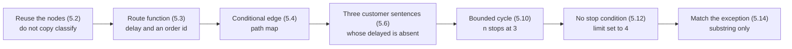
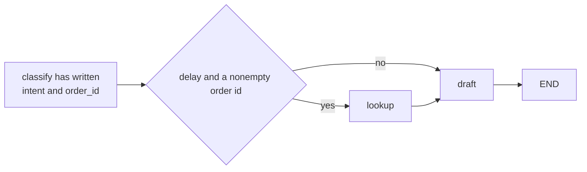
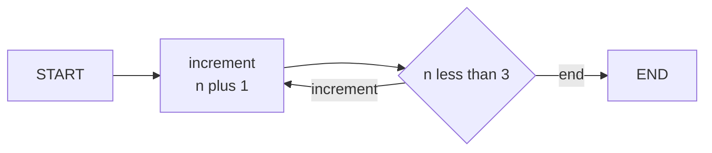

# Chapter 5 Conditional edges and cycles

> In this chapter: The three customer sentences for Seashore Select (海岸优品) can no longer share one lookup edge. Lin Zhou (林舟) adds a conditional edge after classify: enter lookup only when the intent is a shipping delay and an order id is already present, and go straight to draft otherwise. The refund and the small talk print `delayed` as `None`. Only the shipping draft contains the ticket sentence. A second small graph, unrelated to OD-2049, adds `n` from 0 until it is no longer less than 3, and returns 3. When the stop condition is removed and the recursion limit is set to 4, the call raises `GraphRecursionError`, and the message is checked only for a substring. This chapter does not pause, and it has no checkpoint. When you finish, you can point at who entered lookup, and you can say that a cycle needs an edge that can reach the end.



*Flow of this chapter*

## When you need it

Three situations, three ways to read. Take the straight line from Chapter 4 as already matched to `linear_draft`.

**The shipping sentence can already produce a draft, but the refund and the weekend question were also sent into `lookup`.** Read from 5.2 through 5.6. The conditional edge lets a sentence through only when "the intent is `shipping_delay` and `order_id` is nonempty." For the check, look at the three `route` lines: only `shipping` has `delayed` as `True`, and the other two lines are `None`. Classification is still the keyword function from Chapter 4. Do not call a model again inside the route.

**You want to explain "a graph can come back around to itself," and you do not want to experiment on the order data.** Read 5.10 through 5.13. The counting graph's state is only `n`. The print of `invoke({"n": 0})` is `{'n': 3}`. This graph does not read Seashore Select, and it does not read tracking number `YT-2049-88`. Compile it and the after-sales graph as two objects.

**You have seen someone "fix" a cycle that will not stop by turning the recursion limit up.** Read 5.12 and 5.14. The call with `limit_always=True` passes `{"recursion_limit": 4}`. The exception type name is `GraphRecursionError`. The only part of the message that is checked is the substring `Recursion limit of 4`. The limit is a brake at runtime. It is not the business end condition. The end condition is that the route function has a chance to return a label that leads to `END`.

Prerequisite: `SupportState` from Chapter 4, the three nodes, and "a patch holds only its own keys." This chapter does not introduce `interrupt`, and it does not introduce a checkpoint. Lin Zhou still only sees the draft. Nodding to open the ticket is in Chapter 7. Whether the state is still there after the process restarts is in Chapter 6. `langgraph` 1.2.24 provides `StateGraph`, `START`, `END`, and `langgraph.errors.GraphRecursionError`. `langchain` 1.5.2 is still in the environment, because the previous two chapters need it. `routing.py` does not import `langchain`.

## 5.1 Overview

Chapter 4 wrote "who the next stop is" into `add_edge`. This chapter moves that decision into a function. A node still changes only its own keys. The function that picks the path returns the name of the next stop. It does not return a state patch. Xiaofan (小帆), on Xingfan (星帆出海), has to take all three of Seashore Select's customer sentences at once. Classification is still the keyword function.

The question the after-sales graph answers is: should this customer sentence look up `OD-2049`. The question the counting graph answers is: does `n` still need one more increment. Each graph has its own state type, and each calls `compile()` once.

| Graph | State | Where it stops | Evidence from 2026-11-27 |
| --- | --- | --- | --- |
| `build_router` | The five keys of `SupportState` | `END` after `draft` | Three `route` lines |
| `build_cycle()` | `n` in `CountState` | Goes to `END` when `n < 3` no longer holds | `cycle {'n': 3}` |
| `build_cycle(limit_always=True)` | The same `CountState` | The source has no edge that leads to `END` | `recursion_error GraphRecursionError` |

**On the business side, write "whether to look the order up" on a conditional edge: enter `lookup` only when it is a shipping delay and an order id has already been extracted, and draft the refund and the small talk directly.** Do not call `lookup` inside `classify`. The return value of the classify function is only `intent` and `order_id`. If the lookup node is not scheduled by an edge, its return value is not merged into state. The `delayed None` on the refund line is the print for "the node did not run." The draft did not delete the boolean.

This chapter's file is [demo/xiaofan_graph/routing.py](../../demo/xiaofan_graph/routing.py). The original order text and the ticket sentence are still in [demo/xiaofan_graph/orders.py](../../demo/xiaofan_graph/orders.py). The three customer sentences are:

```python
SHIPPING_TEXT = "订单 OD-2049 物流延迟，请处理"
REFUND_TEXT = "订单 OD-2049 我要退款"
OTHER_TEXT = "你们周末上班吗"
TICKET = "售后升级：订单 OD-2049 客户投诉物流延迟"
```

The merchant is 海岸优品, the namespace is `seashore-main`, the carrier is 云途, the tracking number is `YT-2049-88`, the ship date is 2026-11-18, the promise is 7 days, and 9 days have elapsed. These fields are not in the import list of `routing.py`. The shipping draft, through the reused `draft`, reads 云途, the tracking number, the date, and the day counts out loud. The full text of that sentence is already in `linear_draft` in Chapter 4. This chapter's shipping line only prints `mentions_ticket True` in addition, to prove that the ticket constant appears in the draft. This chapter does not print the whole draft sentence again.

## 5.2 Reuse the nodes from the straight-line graph

`routing.py` does not redefine classification, lookup, or the draft.

```python
from xiaofan_graph.linear import SupportState, classify, draft, lookup
from xiaofan_graph.orders import OTHER_TEXT, REFUND_TEXT, SHIPPING_TEXT, TICKET
```

`classify` is still the keyword function. If the text contains 「退款」, `intent` is `refund`; otherwise, if the text contains `OD-2049` or 「物流」, it is `shipping_delay`; otherwise it is `other`. `order_id` still looks only at whether the original text contains `OD-2049`. If it does, the node writes that order id. If it does not, the node writes an empty string. This chapter does not turn this rule into a model call. The fake model in Chapter 2 always returns `shipping_delay`, and only in that chain chapter. It does not read the two characters 「退款」. What classifies the refund sentence as `refund` is this keyword function.

`lookup` still does not compare 9 and 7. When the order id equals `OD-2049`, it writes `bool(ORDER["delayed"])`, which is `True`. Any other order id is written as `False`. The refund and the small talk in this chapter never call it, so those two lines do not show `False`. See 5.9.

The four sentence templates of `draft` also stay in `linear.py` as they are. This chapter actually reaches three of them.

| Branch of `draft` | What the sentence contains | Which `invoke` in this chapter reaches it |
| --- | --- | --- |
| Delayed, and `delayed` is true | 云途, `YT-2049-88`, `2026-11-18`, 9 days, 7 days, the ticket sentence, team `xbd-seashore-cs-team` | `shipping`. Whether the ticket sentence is in the draft is proved by `mentions_ticket True` |
| Intent is `refund` | 拟为订单 OD-2049 登记退款申请。退款不会自动执行。 | `refund`. `main` does not print the whole sentence. See 5.8 |
| A delay, but `delayed` does not hold | 未查到可判定延误的订单，请核对订单号。 | None of the three inputs reaches it |
| Everything else | 已记下。请给出订单号，或说明是物流还是退款。 | `other`. Constrained only indirectly, by `mentions_ticket False` |

`hitl.py` in Chapter 7 writes another `draft`. The refund sentence there still has 「，需要人工确认」 after 「退款不会自动执行」. That is the pause chapter's text. What this chapter imports is `linear.draft`. The refund sentence stops at 「退款不会自动执行。」. Do not add Chapter 7's comma into `linear.py` ahead of time. If you do, this chapter's account of the ticket substring would still stand, and the sentence itself would already disagree with the source.

`build_linear` is not imported. This chapter builds a new `StateGraph(SupportState)` and calls `add_node` three times again. The compiled straight-line graph does not have its edges changed. The two graphs can exist at the same time. `main` calls only `build_router`.

## 5.3 route_after_classify

The full name of the path function already says where it sits: after the classify node has run.

```python
def route_after_classify(state: SupportState) -> Literal["lookup", "draft"]:
    if state.get("intent") == "shipping_delay" and state.get("order_id"):
        return "lookup"
    return "draft"
```

The return value is the string `"lookup"` or `"draft"`. It is not a dict. The graph does not merge this return value into `SupportState`. The state changes only after the node that was selected runs.

The two conditions are joined with `and`. Both have to hold.

| Condition | When it holds | When it does not hold |
| --- | --- | --- |
| `intent` equals `shipping_delay` | Lookup is possible | Go straight to `draft`. The refund and the small talk land here |
| `order_id` is true | An empty string does not pass | Even if the intent is a delay, go to `draft` |

`state.get("order_id")` treats both absence and the empty string as not holding. When there is no order id, `classify` writes `""`. It does not omit the key. `""` is false in a boolean context, so "an empty string was written" and "the key is absent" have the same effect in this one `if`. Both go to `draft`.

The refund sentence 「订单 OD-2049 我要退款」 contains both 「退款」 and `OD-2049`. `classify` hits refund first. `intent` is `refund`, and `order_id` is still `OD-2049`. The route only sees that the intent is not `shipping_delay`, so it returns `"draft"`. The order id has already been extracted, and lookup still does not run. This is the rule this chapter has to keep: an order id is not enough. The intent has to be a shipping delay.

Both conditions hold for the shipping sentence, so the route returns `"lookup"`. The weekend sentence has intent `other` and order id `""`, so the route returns `"draft"`.

There is one more path that none of the three inputs covers: the original text has only 「物流」, and no `OD-2049`. `classify` gets `shipping_delay` and `""`. The route returns `"draft"` because the order id is empty. `lookup` does not run, and `delayed` stays absent. `draft` sees that the intent is a delay but `delayed` does not hold, and it takes 「未查到可判定延误的订单，请核对订单号。」. `main` on 2026-11-27 did not use this sentence as input. It is not in the output. Knowing that the path is in the source is enough. Do not add a `route` print for it.



*Figure 5-2: The two paths after classification. The diamond is `route_after_classify`, not a model*

## 5.4 add_conditional_edges and the path map

The function that assembles the after-sales graph is `build_router`.

```python
def build_router():
    builder = StateGraph(SupportState)
    builder.add_node("classify", classify)
    builder.add_node("lookup", lookup)
    builder.add_node("draft", draft)
    builder.add_edge(START, "classify")
    builder.add_conditional_edges(
        "classify",
        route_after_classify,
        {"lookup": "lookup", "draft": "draft"},
    )
    builder.add_edge("lookup", "draft")
    builder.add_edge("draft", END)
    return builder.compile()
```

`add_conditional_edges` has three positional arguments here.

| Position | Value in this chapter | Role |
| --- | --- | --- |
| Source node | `"classify"` | The route function is called only after this node's patch has been written |
| Route function | `route_after_classify` | Reads the state and returns a path label |
| Path map | `{"lookup": "lookup", "draft": "draft"}` | Translates the label into the next stop |

The keys of the path map are the labels the function is allowed to return. The values are the node names to schedule, or `END`. In this chapter's map the keys and the values are spelled the same, so it looks repetitive. Their roles differ. The left side is those strings inside `Literal["lookup", "draft"]`. The right side has to be a name already passed to `add_node`. If the node were renamed to `find_order`, the function could still return `"lookup"`, and the map should be written `{"lookup": "find_order", "draft": "draft"}`. This chapter does not rename anything, so the two sides match.

The route function sees the state after the merge. The `intent` and `order_id` returned by `classify` have already been written into state, which is why `route_after_classify` can read them. It cannot read the gap, in "the old dict the caller originally passed in," from before the overwrite, because the overwrite has already happened. On the shipping sentence, the intent it reads is `shipping_delay`.

`compile()` still has no arguments. There is no checkpoint, and there is no interrupt point. The only difference from the straight-line graph is the one edge after `classify`: the straight line is `add_edge("classify", "lookup")`, and here that is replaced by a conditional edge. `lookup` → `draft` and `draft` → `END` are still fixed. Once lookup happens, the next step is always a draft. When lookup does not happen, the conditional edge schedules `draft` directly, and that still goes on to `END`.

This chapter does not omit the path map and use the style where the return value "is itself the node name." Both conditional edges pass a dict. This file did not run a failure experiment for a label that is not in the dict, and the output has no matching exception line. Do not write a separate error that was not run.

## 5.5 Where the edges differ from the straight-line graph

Put the edges of the two graphs side by side. The difference is in one place.

| Connection | Chapter 4 `build_linear` | This chapter `build_router` |
| --- | --- | --- |
| `START` → `classify` | Fixed edge | Fixed edge |
| The next stop after `classify` | Fixed to `lookup` | Conditional edge, label `lookup` or `draft` |
| `lookup` → `draft` | Fixed edge | Fixed edge. Used only if lookup was taken |
| `draft` → `END` | Fixed edge | Fixed edge |

Not one character of the node functions was changed. So the contract about patches on the straight-line graph still holds here: a key the node did not return stays as it was. `classify` does not return `delayed`. If the conditional edge does not schedule `lookup`, no return value writes `delayed`. `draft` returns only `draft`. It does not fill in a `delayed`.

That is where the `None` in the three printed lines comes from. `main` uses `out.get("delayed")`. When the key is not in the dict, `get` returns `None`. No line in the source assigns `delayed` to `None`. The printed `None` is how "the key is absent" shows up on `get`.

If the straight-line graph were given the refund sentence, the deduction in Chapter 4 says it would enter `lookup`, and because the order id is `OD-2049` it would write `True`. That deduction was not printed in Chapter 4. The refund line in this chapter was printed, and the value is `None`. Read the two chapters together: the same refund sentence, different edges, and a different fate for `delayed`. The evidence in this chapter is the printed `None`. Chapter 4 has no matching printed line.

## 5.6 Three customer sentences

`main` runs the three sentences in one loop. The labels are English words, used to tell the inputs apart. They are not `intent` itself.

```python
for label, text in (
    ("shipping", SHIPPING_TEXT),
    ("refund", REFUND_TEXT),
    ("other", OTHER_TEXT),
):
    out = graph.invoke({"text": text})
    print(
        "route",
        label,
        out["intent"],
        "delayed",
        out.get("delayed"),
        "mentions_ticket",
        TICKET in out["draft"],
    )
```

`print` joins these arguments with spaces into one line. So the second word of each line is the label from the loop, and the third word is the `intent` in state. On the `refund` line you see two `refund`s next to each other. The first is the label, and the second is the intent. `other` is the same. What follows `shipping` is `shipping_delay`. The two are not the same word.

The argument of each of the three `invoke` calls is only `text`. There is no `thread_id`, and there is no `recursion_limit`. All three returned a dict normally, so these three steps did not hit the recursion limit. The concrete number of the default limit was not printed. This book does not write that number.

| Label | Original text | Printed `intent` | Printed `delayed` | `mentions_ticket` |
| --- | --- | --- | --- | --- |
| `shipping` | 订单 OD-2049 物流延迟，请处理 | `shipping_delay` | `True` | `True` |
| `refund` | 订单 OD-2049 我要退款 | `refund` | `None` | `False` |
| `other` | 你们周末上班吗 | `other` | `None` | `False` |

The shipping row matches the fields from the straight-line chapter: the intent is `shipping_delay`, and `delayed` is `True`. The straight-line chapter also printed the order id and the whole draft. This chapter's loop does not print `order_id`, and it does not print the full text of `draft`. On the shipping path the order id is `OD-2049`, and the draft contains 云途 and `YT-2049-88`. The basis is the reused functions, plus `linear_order` and `linear_draft`, which Chapter 4 already printed. The new evidence this chapter itself adds is `mentions_ticket True`.

`delayed` for the refund and the small talk is `None`. Under the conditions in 5.3, neither sentence returns `"lookup"`. `lookup` never gets a chance to write a boolean. This is not `lookup` returning `None`. Both `return` statements in `lookup` are booleans.

Intermediate state was not printed node by node. The three small tables below are deduced from the return values. The `delayed` values in the last column match the run output, and so does `mentions_ticket`. The `order_id` column comes from the source of `classify`. This chapter did not print it.

The shipping sentence:

| Moment | `intent` | `order_id` (not printed) | `delayed` |
| --- | --- | --- | --- |
| Entrance | absent | absent | absent |
| After `classify` | `shipping_delay` | `OD-2049` | absent |
| Route | Go to `lookup` |  |  |
| After `lookup` | `shipping_delay` | `OD-2049` | `True` |
| After `draft` | unchanged | unchanged | `True`. That is what was printed |

The refund sentence:

| Moment | `intent` | `order_id` (not printed) | `delayed` |
| --- | --- | --- | --- |
| Entrance | absent | absent | absent |
| After `classify` | `refund` | `OD-2049` | absent |
| Route | Go to `draft`. The intent is not a delay |  |  |
| `lookup` | Does not run |  |  |
| After `draft` | `refund` | `OD-2049` | Still absent. `get` prints `None` |

The small-talk sentence:

| Moment | `intent` | `order_id` (not printed) | `delayed` |
| --- | --- | --- | --- |
| Entrance | absent | absent | absent |
| After `classify` | `other` | `""` | absent |
| Route | Go to `draft` |  |  |
| `lookup` | Does not run |  |  |
| After `draft` | `other` | `""` | Still absent. `get` prints `None` |

Look at the order-id column of the refund sentence in particular. The original text contains `OD-2049`, and `classify` writes it into `order_id`. The route still goes to `draft`, because the first term of the `and` has already failed. So `delayed None` cannot be read as "this sentence has no order id." The sentence with no order id is the weekend one. The refund sentence is "there is an order id, but the intent is not a delay."

## 5.7 mentions_ticket is only a printed boolean

`SupportState` has no key named `mentions_ticket`. No node returns it. `main` computes it on the spot, before printing:

```python
TICKET in out["draft"]
```

The full text of `TICKET` is 「售后升级：订单 OD-2049 客户投诉物流延迟」. The `in` test asks whether this whole string is a substring of the draft. It does not ask whether the draft contains the two words 「退款」 or 「物流」.

| Path | The fact in the draft that this boolean depends on | Print |
| --- | --- | --- |
| Shipping | The first branch of `draft` inserts `{TICKET}` between 「拟开立工单：」 and 「。团队」 | `True` |
| Refund | The template is a refund registration. It does not insert `TICKET` | `False` |
| Small talk | The template asks for an order id or a statement of intent. It does not insert `TICKET` | `False` |

The small-talk template itself contains the two characters 「退款」: 「或说明是物流还是退款」. `mentions_ticket` is still `False`. The boolean being false only says the full ticket sentence is not in the draft. It does not say the draft has no word 「退款」.

This test is a substring, not a structured field. If someone changed the refund template into a sentence that carries `TICKET`, the boolean would become `True`, even if the business still should not open a shipping ticket. This chapter's refund template does not do that. Chapter 7 is where there is an independent `ticket` key, written only after a person agrees. In this chapter the ticket sentence lives only in the body of the shipping draft.

The team name `xbd-seashore-cs-team` is only in the shipping template too. This chapter does not print the team name on its own. Whether it is in the shipping draft follows the whole `linear_draft` line from Chapter 4. The refund template and the small-talk template both omit the team name.

## 5.8 The refund draft does not contain the ticket sentence

The source of the refund branch is this one assignment:

```python
text = f"拟为订单 {ORDER_ID} 登记退款申请。退款不会自动执行。"
```

`ORDER_ID` is `OD-2049`, so the full draft is:

拟为订单 OD-2049 登记退款申请。退款不会自动执行。

`main` did not print this sentence. The refund line from 2026-11-27 supplies only `intent`, `delayed`, and `mentions_ticket`. The sentence itself follows this f-string in `linear.py`. `mentions_ticket False` agrees with this sentence having no `TICKET`: the sentence has no 「售后升级」, no ticket title, and no team name.

The sentence has two layers of meaning, and both stay.

| Clause | Role |
| --- | --- |
| 拟为订单 OD-2049 登记退款申请。 | Tells the support person this is a refund registration. The order id is the constant. It is not read again from `state["order_id"]` |
| 退款不会自动执行。 | Marks that this chapter has no refund action. There is no payment call, and there is no state key that records "already refunded" |

The second sentence was written back in Chapter 4. It keeps the refund path from turning into a shipping ticket even when, on the straight-line graph, `lookup` has written `delayed True`. This chapter skipped `lookup`. The second sentence is still needed, because the text the support person sees has to say on its own that it "will not run automatically." The conditional edge is in charge of not looking the order up. The sentence is in charge of not talking about the lookup result as if the refund had already happened.

The refund branch of `draft` does not read `delayed`. So even if someone later changed the route back to "a refund looks the order up too," as long as the intent is still `refund`, the first branch "delay and delayed" cannot be entered. What gets written is still this sentence, and `mentions_ticket` would still be `False`. The `None` in this chapter proves that the lookup node did not run. It does not prove that the draft function clears the ticket sentence. The ticket sentence is absent because the template does not contain it.

## 5.9 None and False

`delayed` can show up in three shapes in a print. The three lines in this chapter use only the first two. The third stays in the source of `lookup`, for the case "the node really did run, but the order id is not `OD-2049`."

| Print or deduction | What the dict holds | Who produces it |
| --- | --- | --- |
| `True` | The key is present, and the value is boolean true | `lookup` sees `OD-2049` and copies `ORDER["delayed"]`. The shipping line was printed |
| `None` | The absent result of `get`. The source does not assign `None` | The conditional edge did not schedule `lookup`. The refund line and the small-talk line were printed |
| `False` | The key is present, and the value is boolean false | `lookup` sees an order id that is not `OD-2049`. None of the three `invoke`s in this chapter printed `False` |

If the weekend sentence took Chapter 4's straight line, `lookup` would write the empty order id as `False`. The conditional edge in this chapter lets `lookup` not run, and the print becomes `None`. The same customer sentence, two graphs, two prints. When you accept the result, do not change `None` to `False` in order to "fill in a default delay state." There is no default. If it was not looked up, the key was not written.

The first branch of `draft` uses the truthiness of `state.get("delayed")`. Neither `None` nor `False` can enter the first branch. For the refund sentence that does not matter, because it takes the second branch. For the path that was not run, "the intent is already a delay, but lookup did not happen," a failed truthiness test falls through to 「未查到可判定延误的订单」. `None` and `False` produce the same sentence on that branch, and different prints. This chapter uses `get` to leave that difference in the output, so a person can tell "not looked up" from "looked up, but it is not this order."

The `True` on the shipping line is still not the result of computing `9 > 7`. The day counts go into the draft so a person can see that 9 days exceed the promised 7 days. The boolean comes from the order dict. This chapter has no new calculation.

## 5.10 The counting graph stays separate from the order graph

The cycle uses another state, so `n` is not stuffed into the five after-sales keys.

```python
class CountState(TypedDict):
    n: int


def increment(state: CountState) -> dict:
    return {"n": state["n"] + 1}
```

`total=False` is not written here. A `TypedDict` requires `n` by default. The `{"n": 0}` passed to `invoke` satisfies that. `increment` returns `n` every time, so after the cycle has been entered this key is always present.

`increment` only adds one. It does not return `"end"`, and it does not look at the threshold. The threshold sits on the edge, the same design as "whether to look the order up sits on the edge." If the node decided the end by itself, the edge would lose the single decision point, and a person reading the graph would have to look in two places for the stop condition.

`build_cycle` uses a parameter to switch between two sets of edges. The default `limit_always=False` takes the bounded cycle. `True` takes the set that always comes back to itself.

```python
def build_cycle(limit_always: bool = False):
    builder = StateGraph(CountState)
    builder.add_node("increment", increment)
    builder.add_edge(START, "increment")
    if limit_always:
        builder.add_conditional_edges(
            "increment",
            lambda state: "increment",
            {"increment": "increment"},
        )
    else:
        builder.add_conditional_edges(
            "increment",
            continue_until_three,
            {"increment": "increment", "end": END},
        )
    return builder.compile()
```

The two calls are two `compile()`s. The bounded graph built first is used up inside `print("cycle", ...)`. The unbounded graph built later is `invoke`d on its own inside `try`. The bounded graph is not turned into an unbounded graph by the second argument. The `increment` function object is shared by the two graphs. That does not matter, because it does not store `n`. `n` lives in each graph's own state.

This graph does not import `orders`. Running the cycle does not rewrite `delayed` on `OD-2049`, and it does not generate a ticket sentence. Xingfan's support case and this counter only sit next to each other in the same chapter. The data does not connect.

## 5.11 Add from 0 up to 3

The route of the bounded cycle is:

```python
def continue_until_three(state: CountState) -> Literal["increment", "end"]:
    if state["n"] < 3:
        return "increment"
    return "end"
```

The path map is `{"increment": "increment", "end": END}`. The `"end"` the function returns is a label. `END` is the end sentinel. It is not a business node registered by `add_node("end", ...)`. The label can be some other word, as long as the map's key changes with it and the value is still `END`. What this chapter uses is the word `"end"`.

The condition is strictly less than 3. The `n` the route sees is the value after `increment` has already written it back. The table below is deduced from `invoke({"n": 0})`. The final dict matches the printed `{'n': 3}`. The intermediate values of `n` were not printed one by one.

| Which entry into `increment` | `n` on entry | What the node returns | `n` the route reads | `n < 3` | What the route returns |
| --- | --- | --- | --- | --- | --- |
| 1 | 0 | `{"n": 1}` | 1 | holds | `"increment"` |
| 2 | 1 | `{"n": 2}` | 2 | holds | `"increment"` |
| 3 | 2 | `{"n": 3}` | 3 | does not hold | `"end"` |

After the third time, the map sends `"end"` to `END`, and `invoke` returns. The print is:

```text
cycle {'n': 3}
```

The curly braces and the single quotes are how Python prints a dict. `main` writes `print("cycle", build_cycle().invoke({"n": 0}))`, so the dict's display follows `cycle`, with one space in between. This book does not change it to JSON double quotes.

`n` stops at 3 because 3 is already not less than 3, and the cycle no longer schedules `increment`. The result contains 3. If the condition were written `n <= 3`, 3 would keep incrementing, and the return value would differ. That spelling is not in the source, and there is no separate print of it.

If the entrance were not 0, the number of steps would change. Starting from 3, for example, the same function would first add up to 4, then end because 4 is not less than 3. On 2026-11-27 the only call was `{"n": 0}`. Do not write any other starting point as a result that has been run.



*Figure 5-3: The bounded cycle. The diamond reads n after the increment. When it stops, n is 3*

This `invoke` did not pass `recursion_limit`. It reached `END` inside the default budget. The evidence is that a dict was returned, and the call did not enter the `except` below. The number of the default budget is still not cited.

## 5.12 Always add one

When `limit_always=True`, the conditional edge is replaced with:

```python
builder.add_conditional_edges(
    "increment",
    lambda state: "increment",
    {"increment": "increment"},
)
```

The `lambda` ignores `state` and returns the label `"increment"` every time. The map has only this one entry, and the value is also the node `increment`. After entering from `START`, no edge has `END` as its target. `n` keeps increasing. On the business side there is no "stop here."

The call is written inside the `try` of `main`:

```python
build_cycle(limit_always=True).invoke({"n": 0}, {"recursion_limit": 4})
```

The second argument is the config for this call. It is not `CountState`. Do not write `recursion_limit` next to `n` and treat it as a state key. It limits how many steps this one `invoke` is allowed to take. It is not a timeout of the order system, and it is not Lin Zhou's approval deadline.

The number 4 belongs only to this call. The bounded-cycle call did not pass it. Calling 4 "the business ceiling of the counter" would fight with `n < 3`: the business stop looks at 3, and the runtime brake looks at the 4 in this config. Each graph uses its own.

After the exception is caught, `main` prints the type name and the substring test. Without the `except`, the exception would propagate, and `run_all.py` would not go on to call the checkpoint module. The checkpoint block recorded in Chapter 1 exists, which means the process did not die here. This chapter's own evidence is that those two lines inside the `except` do appear in the output.

## 5.13 Supersteps and the stop condition

LangGraph advances one `invoke` by supersteps. In one superstep, the runtime runs the nodes selected by the previous superstep, writes the returned patches into state, then uses the edges to decide who the next superstep is. Neither the after-sales graph nor the counting graph in this chapter pulls two next stops out of one node at the same time, so each superstep has only one node. On this shape, each node execution counts as one step.

The shipping path on a straight line is `classify`, then `lookup`, then `draft`, and after three steps it reaches `END`. The refund and the small talk skip `lookup`, and they reach `END` after two steps. The bounded cycle is three `increment`s, and then the route chooses `END`. These steps finish inside the same `invoke`. They do not need a checkpoint, because the next step is not waiting for a person.

What `recursion_limit` limits is exactly this count of one step after another. The bounded cycle reaches `END` before the steps run out, and the call returns normally. The unbounded cycle always chooses `increment` again. When the step count reaches the limit in this config, the runtime raises, and the call does not return a dict.

The output from 2026-11-27 did not print a step number, and it did not print `n` at the moment the exception happened. This book therefore does not write "who the node is at step 4" or "what `n` equals when it fails." What can be settled is that the source arranged a limit of 4, and that the exception text contains the characters `Recursion limit of 4`. Quoting a step number would need another run that printed the step number. This one did not.

A cycle having a stop condition means the path map has to contain a possibility that leads to `END`. When `n < 3` is false, `continue_until_three` returns `"end"`, and the map sends that label to `END`. That is the stop condition. It is written in the route function. It is not written in `increment`.

Without that condition, turning `recursion_limit` up only postpones the exception. This chapter did not run again with some other limit, so it does not quote a second exception text. Once the stop condition is written as `n < 3`, the bounded cycle does not depend on turning the limit to some magic number.

A superstep is not a human pause either. A pause requires a node to call `interrupt`, the graph to carry a checkpoint when it is compiled, and a person to resume later with `Command`. The nodes in this chapter have no `interrupt`. The exception on the unbounded cycle is the runtime refusing to keep spinning. The call stack returns to `except`. The support person has no chance to nod in the middle. Do not treat `GraphRecursionError` as "waiting for Lin Zhou to approve." Approval is the `gate` in Chapter 7.

## 5.14 The run output from 2026-11-27

Below is the run output from 2026-11-27. The first line is the title `run_all.py` prints after importing `xiaofan_graph.routing` and before calling `main()`. The other lines all come from `routing.main`.

```text
## xiaofan_graph.routing
route shipping shipping_delay delayed True mentions_ticket True
route refund refund delayed None mentions_ticket False
route other other delayed None mentions_ticket False
cycle {'n': 3}
recursion_error GraphRecursionError
recursion_limit_in_message True
```

| Line | What it proves | What it does not prove |
| --- | --- | --- |
| `route shipping ... True ... True` | The shipping sentence took the path that writes `delayed`, and the draft contains `TICKET` | It does not print the full draft again. The full text is in Chapter 4 |
| `route refund ... None ... False` | The refund sentence's result has no write of the `delayed` key, and the draft does not contain the full ticket sentence | It does not print `order_id`. The order id is still in the original text. The route skipped lookup because of the intent |
| `route other ... None ... False` | The weekend sentence likewise did not write `delayed`, and the draft does not contain the full ticket sentence | It does not prove that the draft has no characters 「退款」. The small-talk template contains those two characters |
| `cycle {'n': 3}` | The dict returned by the bounded cycle that started from `{"n": 0}` is this one | It does not print the intermediate 1 and 2 |
| `recursion_error GraphRecursionError` | `type(exc).__name__` is this name | It does not print the full `repr` or the stack |
| `recursion_limit_in_message True` | `str(exc)` contains `Recursion limit of 4` | It does not prove that the message consists only of these few words |

The source for the last two lines is:

```python
try:
    build_cycle(limit_always=True).invoke({"n": 0}, {"recursion_limit": 4})
except GraphRecursionError as exc:
    print("recursion_error", type(exc).__name__)
    print("recursion_limit_in_message", "Recursion limit of 4" in str(exc))
```

The import is `from langgraph.errors import GraphRecursionError`. The printed name matches this class's `__name__`. Whatever other sentences the exception object's full string contains, besides the substring that was checked, this run did not save them separately. This book quotes only the substring `Recursion limit of 4`, and the boolean `True` for "this substring really is in the message." Do not fill a whole English paragraph from the docs or from memory into the chapter and then treat it as the output from 2026-11-27.

The `in` test is case sensitive, and the spaces have to match too. The substring in the source is `Recursion limit of 4`: the first letter is capital, there is a space between `limit` and `of`, the end is the digit 4, and there is no period. The boolean is `True`, which means the message contains this stretch, and the 4 is the same 4 that was passed in the config.

`except` catches only `GraphRecursionError`. Any other exception would not print these two lines. It would interrupt `main`. These two lines appeared, which means what was caught is this type. The unbounded cycle's `invoke` did not return to a dict that was printed. The output therefore has no second `cycle` line.

## 5.15 Still no pause and no checkpoint

Search `routing.py` for these names and none of them are there: `interrupt`, `Command`, `InMemorySaver`, `MemorySaver`, `SqliteSaver`, `checkpointer`, `thread_id`. Both `compile()` calls take no arguments. None of the three `invoke`s of the after-sales graph, and neither of the two `invoke`s of the counting graph, puts `configurable` in the config.

So every call in this chapter starts over from the dict that was passed in. After the bounded cycle returns `{'n': 3}`, that 3 exists only in the argument to `print`. The graph did not store it as a thread. If you called once more and still passed `{"n": 0}`, the start would still be the 0 in this argument. There is no previous 3 in the graph to read. This run called the bounded cycle only once. The output has only one `cycle` line. Chapter 6 is where a checkpoint is saved on another counting graph, and where a second process reads the `n` that was already written.

The after-sales graph likewise does not remember the previous customer sentence. The three `invoke`s in the loop are three independent entrances. Each carries only the current `text`. The refund sentence does not see the `draft` left by the shipping sentence. The three `intent`s in the output are all different, which matches this way of calling.

The payload a human handoff needs is not here yet either. There is no `decision`, and there is no independent `ticket` key. The ticket sentence inside the shipping draft is still 「拟开立」. The team name appearing in that draft does not mean a team API was called. 海岸优品 and `seashore-main` still live only in the order dict. The route function does not read them.

Calling the recursion limit a pause would make the support person think that, when the exception pops up, they can click agree. When the exception comes out, `invoke` has already failed, and `except` holds only the exception object. There is no pause payload that can take `Command(resume=...)`. For that payload, go to Chapter 7, and have Chapter 6's checkpoint first.

## 5.16 Read the whole file by block

Below is the full text of `routing.py` on 2026-11-27.

```python
"""Chapter 5: conditional edges, a bounded cycle, and a recursion limit."""

from typing import Literal, TypedDict

from langgraph.errors import GraphRecursionError
from langgraph.graph import END, START, StateGraph

from xiaofan_graph.linear import SupportState, classify, draft, lookup
from xiaofan_graph.orders import OTHER_TEXT, REFUND_TEXT, SHIPPING_TEXT, TICKET


def route_after_classify(state: SupportState) -> Literal["lookup", "draft"]:
    if state.get("intent") == "shipping_delay" and state.get("order_id"):
        return "lookup"
    return "draft"


def build_router():
    builder = StateGraph(SupportState)
    builder.add_node("classify", classify)
    builder.add_node("lookup", lookup)
    builder.add_node("draft", draft)
    builder.add_edge(START, "classify")
    builder.add_conditional_edges(
        "classify",
        route_after_classify,
        {"lookup": "lookup", "draft": "draft"},
    )
    builder.add_edge("lookup", "draft")
    builder.add_edge("draft", END)
    return builder.compile()


class CountState(TypedDict):
    n: int


def increment(state: CountState) -> dict:
    return {"n": state["n"] + 1}


def continue_until_three(state: CountState) -> Literal["increment", "end"]:
    if state["n"] < 3:
        return "increment"
    return "end"


def build_cycle(limit_always: bool = False):
    builder = StateGraph(CountState)
    builder.add_node("increment", increment)
    builder.add_edge(START, "increment")
    if limit_always:
        builder.add_conditional_edges(
            "increment",
            lambda state: "increment",
            {"increment": "increment"},
        )
    else:
        builder.add_conditional_edges(
            "increment",
            continue_until_three,
            {"increment": "increment", "end": END},
        )
    return builder.compile()


def main() -> None:
    graph = build_router()
    for label, text in (
        ("shipping", SHIPPING_TEXT),
        ("refund", REFUND_TEXT),
        ("other", OTHER_TEXT),
    ):
        out = graph.invoke({"text": text})
        print(
            "route",
            label,
            out["intent"],
            "delayed",
            out.get("delayed"),
            "mentions_ticket",
            TICKET in out["draft"],
        )
    print("cycle", build_cycle().invoke({"n": 0}))
    try:
        build_cycle(limit_always=True).invoke({"n": 0}, {"recursion_limit": 4})
    except GraphRecursionError as exc:
        print("recursion_error", type(exc).__name__)
        print("recursion_limit_in_message", "Recursion limit of 4" in str(exc))


if __name__ == "__main__":
    main()
```

| Block | Role | What matches it in the run output |
| --- | --- | --- |
| The imports of `classify`, `lookup`, and `draft` | Reuse the Chapter 4 nodes | The intents on the three `route` lines come from the original keyword function |
| `route_after_classify` | Look the order up only on a delay with an order id | Only `shipping` has `delayed` as `True` |
| `build_router` | A conditional edge plus two fixed edges, no checkpoint | All three lines return normally |
| `CountState` and `increment` | Add one, unrelated to the order | Does not appear on the `route` lines |
| `continue_until_three` | Continue only while `n < 3` | `cycle {'n': 3}` |
| The `limit_always` branch | Always returns `"increment"` | There is no second `cycle` dict |
| `except GraphRecursionError` | Prints the type name and the substring boolean | The last two lines |

The `__main__` guard at the bottom of the file is the same as in Chapter 4. `run_all.py` calls `main()` through an import, and the title line is printed by `run_all.py`. Running this file directly produces the same six lines of business print, but `## xiaofan_graph.routing` does not appear on its own unless an outer layer prints the title. What this book quotes is the run that carries the title.

## 5.17 Pitfalls

| Pitfall | Consequence | How to put it back on this chapter |
| --- | --- | --- |
| Call `lookup` inside the route function and expect `delayed` to appear in state | The route function's return value is a string. The graph schedules a node only from that string | Let the edge schedule the `lookup` node. This chapter's refund path deliberately does not schedule it |
| Treat "has `OD-2049`" as the lookup condition, and drop the intent test | The refund sentence would also enter `lookup`, and `delayed` would become `True` | The condition is `and`. The `None` on the refund line depends on the intent term |
| Replace `out.get("delayed")` with `out["delayed"]` | The refund and the small talk raise `KeyError` before the print | Keep `get`. `None` is part of this output |
| Write `mentions_ticket` as a state key | One more channel that nobody writes | It exists only in the arguments to `print` |
| See 「退款」 in the small-talk draft and decide `mentions_ticket` should be true | The test is the whole `TICKET` sentence | The small-talk line prints `False` |
| Put the counter's `n` into `SupportState` | The after-sales state gains a key that has nothing to do with the ticket | Compile `CountState` on its own |
| Let `increment` return a special value to end when `n` reaches 3 | The stop condition splits into the node | Leave the stop condition in `continue_until_three`. The node only adds one |
| Treat `"end"` as a node name and `add_node` it | One more function this graph will not use | The map's value uses the imported `END` |
| Only turn `recursion_limit` up to deal with the unbounded cycle | The exception comes later, and the call still fails | Give the path map a road to `END`. This chapter does not run a larger limit on the side |
| Fill the exception text out into some English paragraph | That goes past the substring check | Write only `GraphRecursionError` and `Recursion limit of 4` |
| Add `interrupt` in this chapter | A pause with no checkpoint has nowhere to land | Leave it for Chapters 6 and 7 |
| Change the refund template to line up with Chapter 7's 「需要人工确认」 | The sentence this chapter reuses has changed | This chapter takes the original sentence of `linear.draft` as the standard |

There is one more misreading, and it has to do with supersteps: treating the three `route` lines as one cycle inside a single graph. The loop variable is in `main`. Each time is a new `invoke`. The only cycle inside a graph is the counting graph. The after-sales graph goes from `START` to `END` and does not return to `classify`. A customer saying three sentences in a row is three calls. It is not three supersteps coming back around to classification.

## Summary

1. **The conditional edge decides whether to look the order up.** `route_after_classify` returns `"lookup"` only when the intent is `shipping_delay` and the order id is nonempty. Otherwise it returns `"draft"`.
2. **The left side of the path map is a label. The right side is a node or `END`.** On the after-sales graph the two sides are spelled the same. On the counting graph `"end"` maps to `END`. It is not a business node named `end`.
3. **`delayed` for the refund and the small talk prints as `None`.** `lookup` did not run. No node wrote this key as `None` or as `False`. `main` reads the absence with `get`.
4. **`mentions_ticket` is `TICKET in draft`.** The shipping line is `True`. The refund draft is 「拟为订单 OD-2049 登记退款申请。退款不会自动执行。」. That sentence does not contain the full ticket sentence, so the boolean is `False`.
5. **The bounded cycle has nothing to do with the order.** `invoke({"n": 0})` stops when `n < 3` no longer holds, and it prints `{'n': 3}`.
6. **The unbounded cycle stops on the recursion limit, and it stops by raising.** When the config is 4, the type name is `GraphRecursionError`, and the message contains `Recursion limit of 4`. The full message is outside what this check covered. It is not written into this book.
7. **One node execution counts as one step.** A cycle has to have a condition that reaches `END`. The recursion limit is a brake. This chapter has no `interrupt`, and it has no checkpoint.

The next step is Chapter 6: put a checkpoint on the counter, so another process can still read the `n` that was already written. The three after-sales sentences have already been split onto their paths in this chapter. The pause still waits until the checkpoint is in place.

## Checklist

- ☐ For each of the three fixed customer sentences, say one thing: whether the route returns `lookup` or `draft`, and whether the printed `delayed` is `True` or `None`.
- ☐ Point out that the keys of the path map are the return values of the route function, and that the values are node names or `END`, and give the correspondence of `"end"` and `END` on the counting graph.
- ☐ Write the full text of the refund draft, 「拟为订单 OD-2049 登记退款申请。退款不会自动执行。」, and explain that it contains no ticket sentence, so `mentions_ticket` is `False`.
- ☐ Explain that the refund original text contains `OD-2049` and still does not look the order up, because the intent is not `shipping_delay`.
- ☐ Walk from `{"n": 0}` to the printed `{'n': 3}`, and explain that when it stops `n < 3` is already false, and that the route sees `n` after the increment.
- ☐ Explain that the config of the unbounded cycle's `invoke` is `{"recursion_limit": 4}`, that the exception type name is `GraphRecursionError`, and that the message was checked only for the substring `Recursion limit of 4`.
- ☐ Explain that this chapter's `compile()` has no checkpoint, and that the source has no `interrupt` either.

## Quick reference

The main line does not depend on this section.

| Name | What it means in this chapter |
| --- | --- |
| `route_after_classify` | Returns `"lookup"` or `"draft"` |
| `add_conditional_edges` | Source node, route function, path map |
| Path map | A dict from labels to node names or `END` |
| `mentions_ticket` | `TICKET in draft`, used for printing. Not a state key |
| `CountState` | The other graph, which has only `n` |
| `continue_until_three` | `"increment"` while `n < 3`, otherwise `"end"` |
| `limit_always` | When `True`, the route is always `"increment"` |
| `recursion_limit` | The step ceiling in the `invoke` config. The failing call in this chapter sets it to 4 |
| `GraphRecursionError` | The exception in `langgraph.errors`, caught by `main` |

| Call | Arguments | Result on 2026-11-27 |
| --- | --- | --- |
| `build_router().invoke` | `{"text": SHIPPING_TEXT}` | `delayed True`, `mentions_ticket True` |
| `build_router().invoke` | `{"text": REFUND_TEXT}` | `delayed None`, `mentions_ticket False` |
| `build_router().invoke` | `{"text": OTHER_TEXT}` | `delayed None`, `mentions_ticket False` |
| `build_cycle().invoke` | `{"n": 0}` | `{'n': 3}` |
| `build_cycle(limit_always=True).invoke` | `{"n": 0}` and `{"recursion_limit": 4}` | `GraphRecursionError`, and the substring test is `True` |

## Further reading

- **Chapter 4 (state, nodes, and edges)** — the original text of `classify`, `lookup`, and `draft`. This chapter did not copy them. Why the straight edge also sends a refund into lookup is in that chapter's deduction.
- **Chapter 6 (checkpoints)** — how `n` is still there after the same process ends. This chapter's `{'n': 3}` lives only in that one `print`.
- **Chapter 7 (human in the loop)** — `interrupt` and `Command`. An exception raised by the recursion limit cannot stand in for the support person nodding. The refund sentence in that chapter gains 「需要人工确认」.
- **Chapter 1, 1.2** — a tool loop, a business cycle, and a pause are three different kinds of "coming back around." This chapter only does the counting version of the business cycle, and the branch on the after-sales graph.
- **`demo/xiaofan_graph/routing.py`** — the only source of the three `route` lines, the one `cycle` line, and the two exception checks. On a re-run, take the print of this `main` as the standard.
