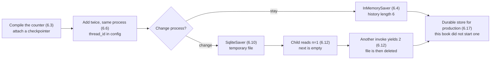
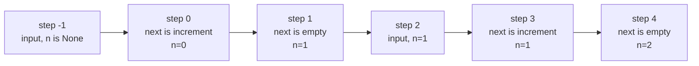
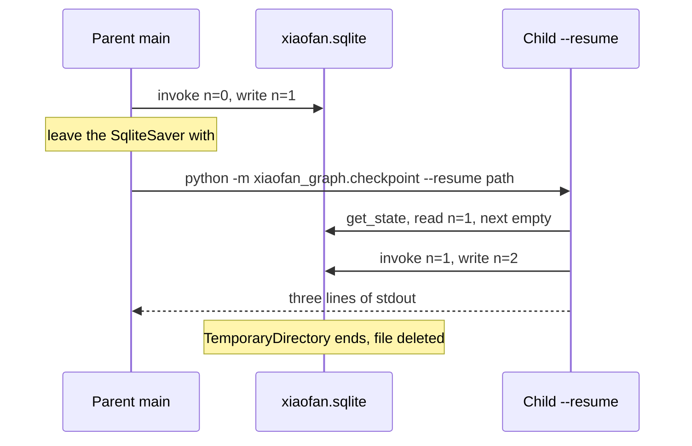

# Chapter 6 Checkpoints

> In this chapter: Lin Zhou (林舟) stops the after-sales work for order OD-2049 before a ticket is opened, because a process exit would take the thread's state with it. A checkpoint keeps the graph's values under a thread id. This chapter does not use ticket fields. It runs one counting graph: the same thread goes from 0 to 1, then to 2. In one process, InMemorySaver and MemorySaver are the same class, and that object is gone when the process ends. SqliteSaver writes a temporary file. A second process can still read n as 1, and adding one more yields 2. The thread id xiaofan-OD-2049 sits only under configurable in config. When you finish, you can say what an empty next means (the graph has reached the end), why two invokes leave 6 history entries, and why this book did not start a database.



*Flow of this chapter*

## When you need it

Three situations, three ways to keep the state. The run in this chapter covers the teaching shape of the first two. The third one was explicitly not started.

**The pause and the resume happen inside one Python process.** Chapter 7 is that shape: after `interrupt` returns, the same process resumes at once with `Command`. `InMemorySaver` is enough. It is an object in the process. When the process exits, the thread is gone. Do not write that run up as "already persisted."

**You need to show that another operating-system process can still read the same thread.** Read 6.10 through 6.13. The parent uses `SqliteSaver` to write the count into a temporary file, closes the connection, then starts `python -m xiaofan_graph.checkpoint --resume PATH` with `subprocess`. The child reads `n` as 1, and one more pass through `increment` makes it 2. The file lives in a `tempfile.TemporaryDirectory`, and it is deleted when `main()` ends.

**You are writing a production support thread. The process will restart, and there is more than one machine.** The position in this chapter is: switch to a durable database checkpoint. This book did not start a database, did not build a connection string, and did not run `PostgresSaver`. Do not copy a connection string out of another tutorial into your notes and pretend Chapter 6 ran it.

This is a different graph from the counting cycle in Chapter 5. The cycle in Chapter 5 adds until `n == 3` inside one `invoke`, so you can watch `recursion_limit`. The graph in this chapter has no cycle: `START` to `increment`, then to `END`. One `invoke` adds one. Two `invoke` calls yield 2 because the graph was called twice, and the inside of the graph did not loop twice.

Prerequisite: you can read `StateGraph`, `START`, and `END` (Chapter 4). Chapter 7's `interrupt` is not required yet. The checkpoint comes before the pause, because a graph with no checkpoint cannot find the thread again at resume time.

## 6.1 Overview

A checkpoint answers one question: when this `thread_id` last stopped, what was the state, and which node should run next. It does not classify, it does not look up an order, and it does not stand in for the model.

| Concept | What it is in this chapter | What it is not |
| --- | --- | --- |
| Checkpoint | A state snapshot written at one superstep | A row in a ticket system |
| Thread | `config["configurable"]["thread_id"]` | A key in the state dict |
| `InMemorySaver` | An in-process saver; the same class as `MemorySaver` | A database that lands on disk |
| `SqliteSaver` | Writes snapshots into one SQLite file | The production plan for this chapter |
| `get_state` | The latest snapshot for that thread | The whole history |
| `get_state_history` | The snapshot stack for that thread, newest first | Something `run_all.py` prints row by row |

`compile(checkpointer=...)` attaches the saver when the graph is built. After that, every `invoke` and every `get_state` has to carry the same `config`. With no `thread_id`, the saver does not know which slot to read or write. Writing the thread id into `CountState` still does not make the saver recognize it, because the primary key is not in the state.

**On the business side: use `InMemorySaver` for a teaching pause inside one process; as soon as another process has to read this thread, switch to `SqliteSaver`, which lands on disk. This chapter did not start a durable production database. Do not let an in-memory object stand in for one.**

The dependencies on 2026-11-27 are the same as in Chapter 1: `langgraph` 1.2.24, `langgraph-checkpoint-sqlite` 3.1.3. `InMemorySaver is MemorySaver` is true. That observation from this day is the line `saver_is_same_class True`. If the version changes, re-run that line before you keep the old note.

## 6.2 Why the chapter uses a counting graph

The state in `checkpoint.py` is one integer, `n`. The order id appears only inside the thread id `xiaofan-OD-2049`, so the log lines up with the case for the whole book. It does not take part in the add.

The split has three reasons.

First, the failure modes of a checkpoint have to be visible on their own. If the ticket, the draft, and `interrupt` sat on the same graph, a wrong `n` would send you off to edit `classify`. The output of this chapter is only numbers and a history length, and right or wrong is immediate: the first value is 1, the second is 2, the history length is 6, and the child still reads 1 when it reopens the file.

Second, this graph runs through to `END`. `next` is therefore empty. The pause in Chapter 7 stops inside a node, and `next` means something else there. If the two chapters shared one graph and one output, an empty `next` would be read as "the pause failed." Chapter 1 already separates the two facts: an empty `next` in this chapter means there is no node waiting to run; the run in Chapter 7 deliberately does not print `next`.

Third, the child process has to be able to import the same graph-building function. `build_counter` does not depend on `orders.py`. The child only needs the module `xiaofan_graph.checkpoint`, and then the node name `increment` in the file matches.

The support fields have not disappeared. Chapter 7 still uses `OD-2049`, the ticket sentence, and the team name. This chapter sets them aside so the saver can be finished first.

## 6.3 State, nodes, and compile in the source

The full text of `books/langchain/demo/xiaofan_graph/checkpoint.py` on 2026-11-27 is below. Later sections cite it by function, and they do not rewrite the printed keys.

```python
"""Chapter 6: InMemorySaver is MemorySaver. SqliteSaver survives a second process."""

import os
import subprocess
import sys
import tempfile
from pathlib import Path
from typing import TypedDict

from langgraph.checkpoint.memory import InMemorySaver, MemorySaver
from langgraph.checkpoint.sqlite import SqliteSaver
from langgraph.graph import END, START, StateGraph


class CountState(TypedDict):
    n: int


def increment(state: CountState) -> dict:
    return {"n": state["n"] + 1}


def build_counter(checkpointer):
    builder = StateGraph(CountState)
    builder.add_node("increment", increment)
    builder.add_edge(START, "increment")
    builder.add_edge("increment", END)
    return builder.compile(checkpointer=checkpointer)


def resume_sqlite(path: str) -> None:
    """Second process: read the checkpoint written by the parent."""
    config = {"configurable": {"thread_id": "xiaofan-OD-2049"}}
    with SqliteSaver.from_conn_string(path) as saver:
        graph = build_counter(saver)
        snap = graph.get_state(config)
        print("sqlite_reopen_n", snap.values.get("n"))
        nxt = snap.next
        print("sqlite_reopen_next", ",".join(nxt) if nxt else "")
        out = graph.invoke({"n": snap.values["n"]}, config)
        print("sqlite_second_step", out["n"])


def main() -> None:
    print("saver_is_same_class", InMemorySaver is MemorySaver)
    graph = build_counter(InMemorySaver())
    config = {"configurable": {"thread_id": "xiaofan-OD-2049"}}
    first = graph.invoke({"n": 0}, config)
    second = graph.invoke({"n": first["n"]}, config)
    print("memory_first", first["n"])
    print("memory_second", second["n"])
    history = list(graph.get_state_history(config))
    print("memory_history_len", len(history))

    with tempfile.TemporaryDirectory() as directory:
        path = str(Path(directory) / "xiaofan.sqlite")
        config = {"configurable": {"thread_id": "xiaofan-OD-2049"}}
        with SqliteSaver.from_conn_string(path) as saver:
            graph = build_counter(saver)
            graph.invoke({"n": 0}, config)
        demo_root = Path(__file__).resolve().parents[1]
        env = os.environ.copy()
        env["PYTHONPATH"] = str(demo_root) + os.pathsep + env.get("PYTHONPATH", "")
        proc = subprocess.run(
            [sys.executable, "-m", "xiaofan_graph.checkpoint", "--resume", path],
            check=True,
            capture_output=True,
            text=True,
            cwd=str(demo_root),
            env=env,
        )
        print(proc.stdout, end="")


if __name__ == "__main__":
    if len(sys.argv) >= 3 and sys.argv[1] == "--resume":
        resume_sqlite(sys.argv[2])
    else:
        main()
```
`CountState` requires the key `n` to be an `int`. There is no `total=False`, and there is no reducer. The dict the node returns is a new `n`. It is not an accumulation annotation laid on top of the old value. So whatever `n` the second `invoke` passes in, `increment` adds one to that number. In the probe, the `n` on the second input entry is 1, and it becomes 2 only after the add. That is not the framework adding the `n` values of two checkpoints together.

`increment` does not read the thread id, and it does not read the order. It only does `state["n"] + 1`. If the state has no `n`, the subscript fails here. Both of the parent's calls passed `n` in. The child takes the value with `snap.values["n"]`, using brackets and not `.get`, because by the time it reaches `invoke` it has already confirmed that the key exists. The print uses `.get("n")`. On this run the two reads produce the same 1.

`build_counter` accepts any checkpoint saver. The memory path passes `InMemorySaver()`. The SQLite path passes the `saver` from the `with` statement. The shape of the graph stays the same: one node, two ordinary edges, no conditional edge. The `checkpointer` argument of `compile` is the object this chapter attaches. If you omit it, `invoke` can still turn 0 into 1, but `get_state` has no thread to read. The demo did not run a "no checkpointer" control. That failure shape was not expanded in this run's output.

The node name is the string `"increment"`. `next` in the checkpoint uses that name to point at the next step. The child calls `build_counter` again, and the node name still has to be `increment`, or the snapshot in the file does not match this graph. This chapter did not run a rename experiment.

## 6.4 InMemorySaver and MemorySaver are the same class

The first line of `main` is:

```python
print("saver_is_same_class", InMemorySaver is MemorySaver)
```
`is` compares the class objects themselves, not two instances. The run output on 2026-11-27 prints this line as `saver_is_same_class True`. On the installed langgraph 1.2.24, `InMemorySaver` is `MemorySaver`. The docs examples now write `InMemorySaver`. The `MemorySaver` in an old note is not a second store.

| Spelling | How this chapter treats it |
| --- | --- |
| `InMemorySaver` | New code uses this name. `build_counter(InMemorySaver())` uses it |
| `MemorySaver` | It appears only in the `is` comparison above. The demo does not call `MemorySaver()` |
| Two instances | Even when the class is the same, two calls to `InMemorySaver()` are two objects, and they do not share threads. The in-memory graph in the demo is constructed once |

Do not write "memory holds two savers, one called In and one called Memory." The identity is true, so there are two names and one class. Chapter 7 uses `from langgraph.checkpoint.memory import InMemorySaver`, and it does not import `MemorySaver`.

This line is placed before any `invoke`. It does not depend on the order, and it does not depend on whether the SQLite file was written successfully. If a later step in the file fails, this line still holds. When you read the output, do not bind it to `memory_second` as one claim.

## 6.5 The thread id lives in config

The memory path and the SQLite path use the same dict shape:

```python
config = {"configurable": {"thread_id": "xiaofan-OD-2049"}}
```
`thread_id` sits under `configurable`. It is not in the state, and it is not in the first argument of `invoke`. The first argument is the graph input. In this chapter that is `{"n": 0}` or `{"n": 1}`. The second argument is `config`.

The teaching thread contains the order id on purpose, so a log lines up with `OD-2049` at a glance. It is not a user id in production. The same order can have two conversations, and a production thread id should correspond to a conversation. For teaching, this book lets both the in-memory graph and the SQLite graph in this chapter use this one string. They write into two different savers, so they do not overwrite each other. The output shows that: the second result on the memory path is 2, and the SQLite reopen reads 1. If SQLite were continuing the memory thread, the reopen would read 2. It reads 1 because the parent `invoke`d SQLite only once, with `{"n": 0}`.

The block below does not appear in the demo. It is here so you can see where the primary key sits. Do not treat it as code that was run.

```python
class CountState(TypedDict):
    n: int
    thread_id: str


graph.invoke({"n": 0, "thread_id": "xiaofan-OD-2049"}, config)
```
Even if the state also holds a string of the same name, `get_state` still looks up only by `config`. When two facts sit side by side, the order id in the log matches, and the `n` you read belongs to another thread. `CountState` in this chapter therefore has no `thread_id`. The state table in Chapter 1 already wrote this as a convention for the whole book. This is the first run that keeps it.

`get_state` and `get_state_history` must carry the same `config`. A different `thread_id` reads another slot. If that slot was never written, the value is empty. The demo did not print "the empty snapshot after the thread id is changed." That case was not expanded in this run's output.

## 6.6 Two invokes in the same process

The calls on the memory stretch are:

```python
graph = build_counter(InMemorySaver())
config = {"configurable": {"thread_id": "xiaofan-OD-2049"}}
first = graph.invoke({"n": 0}, config)
second = graph.invoke({"n": first["n"]}, config)
print("memory_first", first["n"])
print("memory_second", second["n"])
```
The first input has `n` as 0. `increment` returns 1. The graph reaches `END`. `memory_first` is therefore 1.

The second input is not the constant 0. It is `first["n"]`, which is 1. `increment` adds one again, and `memory_second` is 2. The two calls share one `graph`, one saver, and one `thread_id`. The second call is not `Command(resume=...)`. This graph has no `interrupt`. The first call already reached the end, and there is no pause value waiting to be resumed.

| Call | Input | What the node does | Printed key | Value on 2026-11-27 |
| --- | --- | --- | --- | --- |
| First `invoke` | `{"n": 0}` | `0 + 1` | `memory_first` | `1` |
| Second `invoke` | `{"n": first["n"]}`, that is `{"n": 1}` | `1 + 1` | `memory_second` | `2` |

If the second call still passed `{"n": 0}`, the body of `increment` would make the result 1, and `memory_second` would not be 2. The output is 2, which matches `first["n"]` in the source.

The return value of this `invoke` is the state when the graph ends. This chapter uses the `n` in the return value as the next input, and it does not hand-write a global variable between the two calls. The saver of course also holds this 1. The memory path does not call `get_state`. It uses the return value directly. The SQLite path is the other way around: the parent discards the return value, and the child uses `get_state` to read the 1 back. The two paths show two facts: a return value is enough inside one process; another process can only read the saver.

## 6.7 The history length is 6, and run_all prints no rows

```python
history = list(graph.get_state_history(config))
print("memory_history_len", len(history))
```
The demo takes `get_state_history` with `list(...)` and then takes the length, so what it prints is a count, not the contents row by row. The run output on 2026-11-27 is `memory_history_len 6`. Two `invoke` calls are not two snapshots. Each call writes a snapshot on the input and on the node step, and the two calls together are 6 entries.

`run_all.py` prints only this length. It does not print each entry's `step`, `next`, `n`, or `source`. If those fields appear below, they come from another inspection, not from a line of `run_all.py`. Checkpoint ids, timestamps, and parent-snapshot ids were not printed either time. They were not expanded in this run's output.

A general fact: `get_state_history` hands back a stack of snapshots, newest first, so the first one you receive is the latest. The probe below agrees with that order. Memorizing "newest first" without looking at this counting graph still does not tell you where the number 6 comes from.

## 6.8 A separate probe: six snapshots of the same counting graph

On 2026-11-27 the same in-memory counting graph was `invoke`d twice (first `{"n": 0}`, then with that result as the input), and `get_state_history` was inspected. This is not a print from `run_all.py`. It is a follow-up inspection. The order is newest to oldest.

| Newest to oldest | step | next | n | source | The step it matches |
| --- | --- | --- | --- | --- | --- |
| 1st | 4 | `()` | 2 | `loop` | Second call: `increment` has finished, and the graph is at the end |
| 2nd | 3 | `('increment',)` | 1 | `loop` | Second call: the next step will enter `increment`, and `n` is still 1 |
| 3rd | 2 | `('__start__',)` | 1 | `input` | The input of the second call, with `n` as 1 |
| 4th | 1 | `()` | 1 | `loop` | First call: `increment` has finished, and the graph is at the end |
| 5th | 0 | `('increment',)` | 0 | `loop` | First call: the next step will enter `increment`, and `n` is 0 |
| 6th | -1 | `('__start__',)` | `None` | `input` | The input of the first call; `n` on this entry is not yet an integer |

`step` grows with time. The list starts at `step` 4 and ends at `step` -1. So `history[0]` is the latest end, not the first input. If someone prints `history[0]` and calls it "the initial state," they see `n` as 2 and then think the checkpoint did not save the process. The length 6 is already in `run_all.py`. The six rows of the table belong only to this follow-up inspection.

`source` has only two values in this table. `input` is the entry an `invoke` sent in. `loop` is the entry written as the graph walked forward. A third `source` did not appear. Do not infer from this that other graphs have only these two; the counting graph in this chapter has no write such as `update`.

On the `step` -1 entry, `n` is `None`. The input dict is plainly `{"n": 0}`, and that value is not yet reflected in the `n` of this entry. The next entry, `step` 0, is where `n` is 0, and `next` points at `increment`. When you read the history, do not use the `n` of the oldest entry to match the return value of the first `invoke`. The return value matches the end of the first call: the entry with `step` 1, `n` as 1, and an empty `next`.



*Figure 6-2: Two invokes are written as six snapshots, time running left to right; get_state_history hands them back from right to left*

The `n` of the second input is already 1, because the caller passed `first["n"]`. The `n` at `step` 3 is still 1: the node has not run yet, and `next` is what points at `increment`. The `n` at `step` 4 is 2, and `next` is empty again. The add happens inside the node function, between `step` 3 and `step` 4.

The 2 printed by `memory_second` is the `n` on the newest entry of this stack. The 6 printed by `memory_history_len` is the count of these six entries. The two numbers match, and only the length appears in `run_all.py`.

## 6.9 An empty next means the counting graph has finished

The probe has two entries whose `next` is `()`: `step` 1 and `step` 4. Each is the end of one call, after `increment` has finished. `END` is not a business node that still has to run, so `next` holds no name.

This is the opposite of "the file was not written." The `n` at `step` 1 is 1, and the value is there. The `n` at `step` 4 is 2, and the value is there too. The SQLite section meets the same thing again: the child reads `n` as 1, and at the same time `next` cannot be joined into a node name. The two places are the same kind of end on the same graph. The saver is what differs.

The two entries whose `next` is `('increment',)` mean the graph is stopped on the boundary "about to run `increment`." The `invoke` in this chapter does not hand control back to the caller there. It runs the node to completion. You see that entry in the history because every step left a snapshot, and the program did not pause for a person. The thing that waits for a person is `interrupt` in Chapter 7. This chapter does not call it.

## 6.10 SqliteSaver.from_conn_string is a context manager

The SQLite stretch is written like this:

```python
with tempfile.TemporaryDirectory() as directory:
    path = str(Path(directory) / "xiaofan.sqlite")
    config = {"configurable": {"thread_id": "xiaofan-OD-2049"}}
    with SqliteSaver.from_conn_string(path) as saver:
        graph = build_counter(saver)
        graph.invoke({"n": 0}, config)
    # 离开内层 with 之后才启动子进程
```
In the demo, `SqliteSaver.from_conn_string` appears at the head of a `with` statement, so this use treats it as a context manager. The parent `invoke`s `{"n": 0}` only once, inside the `with` block. After it leaves that block, the source computes `demo_root` and calls `subprocess.run`. The order is the order in the source: the `with` ends first, and then the child is started. How the connection is closed inside was not expanded in this run's output. What this chapter asks you to remember is this order, and not to guess at exception text that was not printed.

The return value of the inner `invoke` is not assigned to a variable, and it is not printed. The parent does not need it. The evidence sits in the child's `sqlite_reopen_n`. That line is 1, which agrees with "add one from 0, then the process boundary discards the return value."

The file name is `xiaofan.sqlite`, and the directory is one that `TemporaryDirectory` generated. The absolute path of the directory was not printed. Do not fill a concrete `/tmp/...` string into your notes. That string is not part of this output from 2026-11-27.

`config` is written again after entering `with tempfile`, and the value is still `xiaofan-OD-2049`. The rewrite lets the SQLite stretch be readable on its own, without depending on the local variable from the memory stretch staying alive. The thread-id string is the same on both stretches, and the savers differ. The previous section already showed that with the difference between 2 and 1.

## 6.11 How the second process is started

After leaving the SQLite `with`, `main` does this:

```python
demo_root = Path(__file__).resolve().parents[1]
env = os.environ.copy()
env["PYTHONPATH"] = str(demo_root) + os.pathsep + env.get("PYTHONPATH", "")
proc = subprocess.run(
    [sys.executable, "-m", "xiaofan_graph.checkpoint", "--resume", path],
    check=True,
    capture_output=True,
    text=True,
    cwd=str(demo_root),
    env=env,
)
print(proc.stdout, end="")
```
`__file__` is `xiaofan_graph/checkpoint.py`. `parents[1]` is `books/langchain/demo`. The child's working directory is set there, and `PYTHONPATH` puts that directory first, so `-m xiaofan_graph.checkpoint` imports the package under the demo, and not another directory of the same name.

The arguments are the interpreter, `-m`, the module name, `--resume`, and the SQLite file path. `sys.executable` makes the child and the parent use the same interpreter. `check=True`: a non-zero exit from the child raises, and `main` does not reach `print(proc.stdout)`. The output on 2026-11-27 contains the child's three lines, which means the child ended with exit code 0. `capture_output=True` and `text=True` collect standard output into a string. Standard error was not printed by `main`. This run has no line from standard error that can be quoted.

`print(proc.stdout, end="")` appends the child's output as it stands, after the four lines the parent has already printed. `end=""` avoids one more blank line. The child's own `print` calls already carry newlines.

The file is still inside the `with` of `TemporaryDirectory`. The child reads a path that is still alive. After the `with` ends and `main` returns, the directory is deleted. The repository does not keep `xiaofan.sqlite`. This run did not copy the file into the demo directory, and it did not print "file deleted" in the output. The deletion is the lifetime of `TemporaryDirectory`, not a printed line.



*Figure 6-3: The file is what passes between the two processes. Process memory does not carry the checkpoint across*

The child cannot obtain the `InMemorySaver` object from the parent. The in-memory graph that was added up to 2 does not appear in the child's output. The child opens only the SQLite file on the path.

## 6.12 resume_sqlite, line by line

The guard at the bottom of the module decides who calls whom:

```python
if __name__ == "__main__":
    if len(sys.argv) >= 3 and sys.argv[1] == "--resume":
        resume_sqlite(sys.argv[2])
    else:
        main()
```
`run_all.py` imports with `importlib` and then calls `main()`. At that time the module name is not `"__main__"`, the guard does not run, and importing does not start another child. The child is run with `-m`, the module name is `"__main__"`, and `argv` holds `--resume` and the path, so it enters only `resume_sqlite`. It does not enter `main()` again, and it does not start a grandchild.

The body of `resume_sqlite`:

```python
def resume_sqlite(path: str) -> None:
    config = {"configurable": {"thread_id": "xiaofan-OD-2049"}}
    with SqliteSaver.from_conn_string(path) as saver:
        graph = build_counter(saver)
        snap = graph.get_state(config)
        print("sqlite_reopen_n", snap.values.get("n"))
        nxt = snap.next
        print("sqlite_reopen_next", ",".join(nxt) if nxt else "")
        out = graph.invoke({"n": snap.values["n"]}, config)
        print("sqlite_second_step", out["n"])
```
It compiles a counting graph again, attaches a new `SqliteSaver`, and points it at the same file. `get_state` uses the same `thread_id` as the parent. `sqlite_reopen_n` prints `snap.values.get("n")`. The value on 2026-11-27 is 1.

The next line:

```python
print("sqlite_reopen_next", ",".join(nxt) if nxt else "")
```
`snap.next` is empty once the graph has reached `END`. An empty value is false in a boolean test, so the print is an empty string. `print` still puts a space between its two arguments. The shape of this line is the key, one space, and then nothing. You do not see a node name in the output, and that is not because the print statement was skipped. The matching line in `run_all.py`, written out, is `sqlite_reopen_next` followed by that space.

If `next` holds names, `",".join` joins them into one string with commas. This time there is no name, and the branch does not reach `join`. Do not fill this line in as `sqlite_reopen_next END` or `sqlite_reopen_next __end__`. Those words are not in the output.

The input of the last `invoke` is `{"n": snap.values["n"]}`. What was read is 1, so the input is `{"n": 1}`. `increment` turns it into 2. `sqlite_second_step` is 2. The brackets are used for the read: if `n` is not in `values`, the failure happens before `invoke`, and `None` is not quietly passed in. The print line uses `.get`, so a line can still be printed when the value is empty. This time the value is 1, and the two ways of reading agree.

The child's three lines, in source order, are:

| Printed key | Value | Where the value comes from |
| --- | --- | --- |
| `sqlite_reopen_n` | `1` | The parent's one `{"n": 0}` finished `increment` |
| `sqlite_reopen_next` | Empty, with one space after the key | `next` is empty, and the graph is already at the end |
| `sqlite_second_step` | `2` | The child `invoke`s once more with the 1 it read |

These three lines are printed by the child and forwarded by the parent. They are not printed directly by the parent. If you search a stack only inside the parent for these three literals, you land on `resume_sqlite`, and `resume_sqlite` is called only on the `--resume` branch.

## 6.13 The run output from 2026-11-27

`run_all.py` prints the module name before it calls `main()`. The block below is the complete output of `xiaofan_graph.checkpoint` that day. The `sqlite_reopen_next` line has one space after the key, and no node name.

```text
## xiaofan_graph.checkpoint
saver_is_same_class True
memory_first 1
memory_second 2
memory_history_len 6
sqlite_reopen_n 1
sqlite_reopen_next
sqlite_second_step 2
```
The eight key-value lines split into three groups. Do not fold them into one sentence, "the checkpoint test passed."

| Group | Lines | Claim |
| --- | --- | --- |
| Class | `saver_is_same_class True` | `InMemorySaver` and `MemorySaver` are the same class |
| Same process | `memory_first 1`, `memory_second 2`, `memory_history_len 6` | Two adds yield 1 and then 2; the history has 6 entries |
| Another process | `sqlite_reopen_n 1`, the empty `sqlite_reopen_next`, `sqlite_second_step 2` | The file still holds 1, the end has no node waiting to run, and adding one more yields 2 |

The six detail rows in 6.8 do not belong to the code block above. When you quote them, say they are the follow-up inspection, so a person who re-runs `run_all.py` does not think a `step` line was left unprinted.

## 6.14 InMemorySaver disappears with the process

The in-memory saver does not appear in the child's arguments. The child's command line has only the SQLite path. That shows the two savers have different lifetimes: the `InMemorySaver()` object lives on the parent's heap; the lifetime of SQLite is the file, and `TemporaryDirectory` limits that file once more.

So there are two layers of "gone." Do not merge them into one.

| Object | When it is gone | Does this chapter leave it in the repository? |
| --- | --- | --- |
| The `InMemorySaver` instance | The process that holds it ends | No. The child cannot obtain it either |
| `xiaofan.sqlite` | The `with` of `TemporaryDirectory` ends | No. The path is in a temporary directory |

Chapter 7 still uses `InMemorySaver`, because the pause and the `Command` resume happen inside one `main()`, and the process does not exit. That choice covers only the "same process" cell. If you kill the Chapter 7 process and then try to resume, the pause point in memory will not still be there. This chapter did not run that kill-the-process experiment. It was not expanded in this run's output. The structural conclusion is already enough: the cross-process evidence comes only from those three SQLite lines.

Do not treat the temporary SQLite file as production persistence either. What it proves is "another process, the same machine, and the few seconds while the file is still there." When the process ends, the teaching file is deleted. Tomorrow's support thread cannot depend on this temporary directory.

## 6.15 The second invoke is a new run, and the pause belongs to Chapter 7

The place where this chapter is easy to read straight into the next one is the phrase "it was called once more."

| | The second call in this chapter | The resume in Chapter 7 |
| --- | --- | --- |
| Does the graph have `interrupt`? | No | Yes, inside `gate` |
| `next` when the first call ends | Empty. It is already `END` | The run in Chapter 7 does not print `next` |
| The object passed the second time | An ordinary state, `{"n": the saved value}` | `Command(resume=...)` |
| Thread | The same `thread_id` | The same `thread_id` |
| Does the node run again from the start? | It enters `increment` again from `START`, because the previous call already ended | `gate` runs again from the first line of the function. That is Chapter 7's concern |

The probe supports "enter again from `START`": on the second call, the entry whose `source` is `input` has `next` as `('__start__',)`, not `('increment',)`. If the second call were continuing halfway through a stop at `increment`, that input entry would not point at `__start__` again. The graph in this chapter did not stop halfway.

Using `Command` early, on the counting graph, is not a run of this chapter. The demo does not import `Command`. Do not add `resume` when you retell the output.

## 6.16 What the output becomes when the wiring is wrong

Each case below is a contrast. It is not a print from 2026-11-27. The demo did not run each of them and collect exception text. Where this output lets you reason backward, only that reasoning is written. Where it does not, the case is marked as not expanded.

**Forgetting to pass `config` to the second `invoke`.** The second call is then no longer a continuation on the thread `xiaofan-OD-2049`. Whether `memory_second` is still 2 depends on the `n` in the input, and it no longer says anything about the thread in the saver. This chapter passed `config` both times, and `memory_second` is 2.

**Treating `history[0]` as the oldest entry.** The 1st entry in the probe is `step` 4, with `n` as 2. Newest is first. `run_all.py` gave only the length. If you did not do the follow-up inspection, do not assume what index 0 contains. You only know there are 6 entries.

**Seeing that `sqlite_reopen_next` is empty afterward, and re-running the parent.** Empty is the end. `sqlite_reopen_n` is 1 at the same time, which means the snapshot is there. What needs fixing is the way of reading, not the saver.

**Starting a second process to open the same file before the SQLite `with` has ended.** The demo places `subprocess.run` outside the `with`. What database-lock message you would meet if you did not write it that way was not expanded in this run's output. A reproduction should keep the order in the source.

**Changing processes and still using `InMemorySaver`.** A new `InMemorySaver()` in the child is empty. All of the cross-process evidence in this chapter comes from the file path. The command line does not pass the in-memory object across, and it cannot.

**Changing the body of `increment` and then having the child read the old file.** The snapshot holds `n`. It does not hold the function source. The child executes the `increment` it imported. The parent and the child in this chapter import the same file. There was no experiment that changes the function and then reads an old snapshot.

## 6.17 A durable production store: this book did not start one

One SQLite file on one machine does not solve these: the process is started on another machine, the file has no shared disk, several worker processes write at once, and you need a backup. Those are the job of a database checkpoint.

The position of this chapter stops here. What was **not** done:

| What was not done | The sentence not to write |
| --- | --- |
| Postgres was not started | "This chapter connected to a database" |
| `PostgresSaver` was not called | "The production saver already ran through" |
| No connection string was written | Any URL that carries a password |
| `xiaofan.sqlite` was not left in the repository | "See the demo directory for the sample database" |

In development, if all you need is to cross one process, keep this chapter's `SqliteSaver` and the temporary file, and accept that the file will disappear. When you need to leave a support thread for tomorrow, connect a durable store then, and change the thread id to a conversation id, instead of keeping `xiaofan-OD-2049` as a production primary key. This book does not unfold that connection here.

The identity of `InMemorySaver` and `MemorySaver` should also not be read as "the in-memory saver has an official class and a persistent class." Whether it persists depends on whether the object you pass to `compile` is an in-memory object or a database saver. The class alias only says the import path can be one of two.

## 6.18 Three constraints handed to the human pause

Chapter 7 calls `interrupt` inside `gate`. What it takes from this chapter is only three constraints. It does not take the counting graph.

1. **Compile time must include a checkpointer.** Chapter 7 uses the default `InMemorySaver()`. The pause and the resume are in the same process, which matches the lifetime in 6.14.
2. **Resume uses the same `thread_id`.** The primary key is still in `config["configurable"]`. Both calls on the shipping path in Chapter 7 use `xiaofan-OD-2049`. The refund and the small talk use other thread ids, so they do not read the shipping pause.
3. **Do not take this chapter's empty `next` as what a pause looks like.** An empty `next` on the counting graph is `END`. Chapter 7 does not print `next`, so the outputs of the two chapters do not stack.

Chapter 8 does not switch to another saver. It still calls the graph compiled in Chapter 7. The SQLite child exists only in this chapter's `checkpoint.py`.

## Summary

1. **The primary key of a checkpoint is the `thread_id` in `config`.** This chapter uses `xiaofan-OD-2049`. It is not written into `CountState`.
2. **`InMemorySaver` is `MemorySaver`.** `saver_is_same_class` on 2026-11-27 is `True`. New code uses the first name. It disappears with the process.
3. **Two `invoke` calls in the same process take `n` from 0 to 1 and then to 2.** What the second call passes in is the return value of the first, not a `Command`.
4. **The history length is 6.** `run_all.py` prints only the length. The order seen by the follow-up inspection is newest first: the end, with `n` as 2, is at the front, and the first input, with `n` as `None`, is at the end.
5. **A SQLite file can cross processes.** The child reads 1, `next` is empty, and adding one more yields 2. The file is in a temporary directory, and it is deleted when the process ends.
6. **The next step is to put the pause into the support graph.** Chapter 7 uses `InMemorySaver` in the same process, and it writes the ticket only after `interrupt`.

## Checklist

- ☐ Point at where `thread_id` is written, in `config["configurable"]`, and say why `CountState` does not contain this key.
- ☐ Using the four in-memory output lines from 2026-11-27, state the relationship of `InMemorySaver` and `MemorySaver`, and say what 1, 2, and 6 each are.
- ☐ Explain that when `memory_history_len` is 6, `run_all.py` did not print each snapshot; if you quote the six detail rows, you can say they are the follow-up inspection, and that the newest entry is first.
- ☐ Explain why `sqlite_reopen_next` has no node name, while `sqlite_reopen_n` is still 1.
- ☐ Say how the child is started: `python -m xiaofan_graph.checkpoint --resume` plus the temporary file path, and that `--resume` does not enter `main()` again.
- ☐ List the savers this chapter did not start: at least a database checkpoint, and an `InMemorySaver` that can still be read after the process exits.

## Quick reference

The main line does not depend on this section. Printed keys follow `run_all.py` on 2026-11-27.

| Key | Meaning |
| --- | --- |
| `saver_is_same_class` | `InMemorySaver is MemorySaver` |
| `memory_first` | The `n` from the in-memory graph's first `invoke({"n": 0})` |
| `memory_second` | The result of `invoke` again with the first `n` |
| `memory_history_len` | The number of entries from `get_state_history`, not the number of `invoke` calls |
| `sqlite_reopen_n` | The `n` the second process reads with `get_state` |
| `sqlite_reopen_next` | `next` joined with commas; when it is empty, only one space follows the key |
| `sqlite_second_step` | The child adds one to the `n` it read |

| Call | Which process | Role |
| --- | --- | --- |
| `build_counter(checkpointer)` | Parent or child | Compiles `START → increment → END` |
| `graph.invoke(input, config)` | Parent or child | Runs a graph that has already ended, and writes a checkpoint |
| `graph.get_state(config)` | Child | Reads the latest snapshot |
| `graph.get_state_history(config)` | Parent, in-memory graph only | Only the length was taken |
| `SqliteSaver.from_conn_string(path)` | Once in the parent and once in the child | Used as a context manager |

## Further reading

- **Chapter 5 (conditional edges and a bounded loop)** — the counting graph there adds up to 3 inside one `invoke`, or raises `GraphRecursionError` when `recursion_limit` is 4. This chapter has no cycle. Do not read the 2 in `memory_second` as a recursion count.
- **Chapter 7 (human-in-the-loop)** — the in-process `InMemorySaver` is what remembers `interrupt`. The resume object becomes `Command`, and the side effect is written after `interrupt` returns.
- **Chapter 8 (Xiaofan's support graph)** — the saver does not change again. The review list names "a database was not started" once more.
- **The demo README** — it states that SQLite is in a temporary directory and is deleted when the process ends. The re-run command follows that page.
- **The LangGraph checkpoint docs** — how to connect a production saver follows the 1.2.24 you installed. This book did not follow the docs and start a database.
