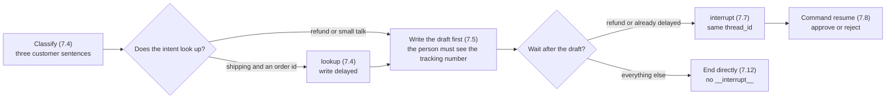
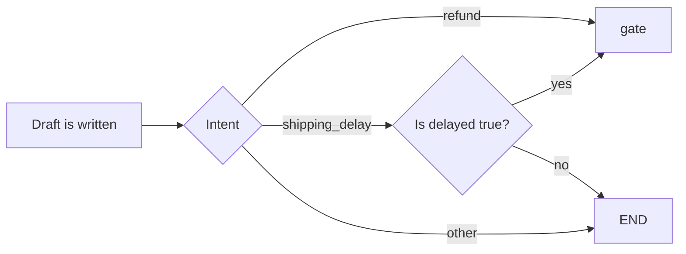
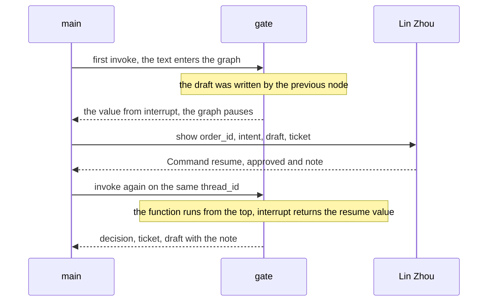
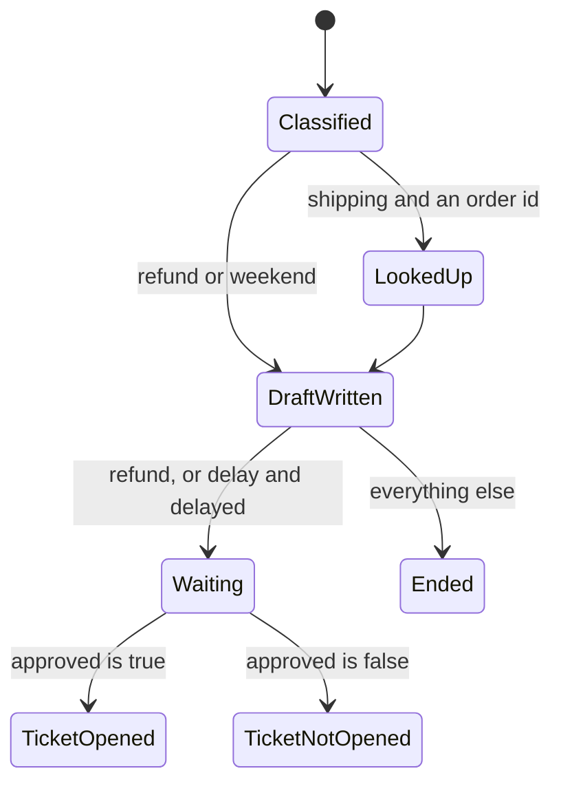

# Chapter 7 Human-in-the-loop

> In this chapter: Lin Zhou (林舟) cannot let a refund and a ticket opening finish inside the same call. Human-in-the-loop is the graph calling `interrupt` inside `gate`, handing a draft that has already been written to a person, then sending the decision back with `Command` on the same thread. The shipping sentence stops. The draft already holds tracking number `YT-2049-88`. After approval the ticket sentence stays, and the note is 「林舟确认开单」 ("Lin Zhou confirms opening the ticket"). The refund sentence stops too. After rejection the ticket is an empty string, and the note is 「先安抚，不退款」 ("reassure first, do not refund"). The weekend sentence does not enter `gate`, and the result has no `__interrupt__`. The side effect sits after `interrupt` returns, because on resume the node runs again from the top. When you finish, you can say, for each of the three customer sentences, which one should stop and which one should end, and you can tell the `__interrupt__` of the default `invoke` apart from a separate `version="v2"` probe.



*Flow of this chapter*

## When you need it

Three situations, three ways to read. The run in this chapter walks all three, and what it walks is the dynamic `interrupt()`, not the static `interrupt_before`.

**Opening a ticket or refunding leaves a business consequence, and it has to wait for a person to agree.** Read 7.5 through 7.11. The shipping sentence already names 云途 and `YT-2049-88` in the draft, and then it stops. Lin Zhou resumes with `{"approved": True, "note": "林舟确认开单"}`, and only then is the ticket sentence written into state. The refund sentence stops even when there is no lookup. This run resumes it with `{"approved": False, "note": "先安抚，不退款"}`, and the ticket is an empty string.

**This sentence has no side effect, and it should not call the support person over.** 「你们周末上班吗」 takes `other`. The draft asks for an order id or a statement of intent, and the graph ends after the draft. The result dict has no key `__interrupt__`. `other_interrupted` being `False` proves that the key is absent. It does not prove that "the interrupt value is false."

**You want a stop before every tool call.** That is another mechanism: a static `interrupt_before` on a node of `create_agent`. The nodes of the preset graph in Chapter 3 are `model` and `tools`. The `run_all.py` of this chapter does not use it. The rule for Xiaofan (小帆) is "a refund always waits for a person, and a delay waits only when the shipment is already delayed." The rule is written in `route_after_draft`.

The prerequisite is the thread from Chapter 6 and the conditional edges from Chapter 5. The checkpointer is `InMemorySaver`, because the pause and the resume are in the same process. This chapter does not start a child process, and it does not start a database.

## 7.1 Overview

This graph grows out of the straight line in Chapter 4 and the conditional edges in Chapter 5. Only two things are new: after the draft, the graph sometimes enters `gate`, and `gate` uses `interrupt` to hand control back to the caller. Classification is still a keyword function, and it does not call a model. Lookup still reads the single order in `orders.py`.

| Customer sentence | Intent | Lookup? | `interrupt`? | The person's decision this time | `ticket` after the end |
| --- | --- | --- | --- | --- | --- |
| 订单 OD-2049 物流延迟，请处理 | `shipping_delay` | Yes | Yes | Approve, note 「林舟确认开单」 | The fixed ticket sentence |
| 订单 OD-2049 我要退款 | `refund` | No | Yes | Reject, note 「先安抚，不退款」 | The empty string `""` |
| 你们周末上班吗 | `other` | No | No | Does not happen | Not written. The run did not print this key |

There is only one fixed ticket sentence: 「售后升级：订单 OD-2049 客户投诉物流延迟」. There is only one team, `xbd-seashore-cs-team`. The carrier is 云途, and the tracking number is `YT-2049-88`. The single source of these words is still `orders.py`. The `draft` and `gate` in this chapter only cite them. They do not invent another set.

**On the business side: finish writing the draft, then `interrupt` inside `gate`; put the assignment of the ticket string after `interrupt` returns. A refund always enters `gate`. A shipping delay waits until `delayed` is true. Every other intent ends after the draft.**

The payload of `interrupt` is a proposal for a person to read. It is not a ticket that has already been written to a store. The `ticket` in the payload is always that fixed ticket sentence, so the person knows "if this is approved, this sentence will be opened." The `ticket` in state is written only after resume. On rejection it is written as an empty string, and `None` is not used. `rejected_ticket_empty` compares with `== ""`, and the result is `True`.

The default `graph.invoke` puts the interrupt under the `__interrupt__` key of the returned dict. `pause` reads `__interrupt__[0].value`. A separate probe uses `version="v2"` and gets `langgraph.types.GraphOutput`, with the interrupts on `.interrupts`. That probe is not the path of `run_all.py`. Section 7.15 writes it on its own. The identifier on the interrupt object changes on every run. `pause` does not read it, and this book does not record it.

## 7.2 A dynamic interrupt and a static interrupt_before

What this chapter runs is `interrupt()` inside the node function. The call is the first executable statement of `gate`. The graph was not compiled with `interrupt_before`.

The other mechanism is a static breakpoint. On the graph compiled by `create_agent`, the node names are `model` and `tools` (Chapter 1 already states this; Chapter 3's `agent_nodes` prints that list, and this chapter does not re-run it). If compile time says to stop before `tools`, every tool call hands control back. A read-only step such as lookup would stop too. Xiaofan's lookup does not need Lin Zhou's agreement. What needs agreement is opening a ticket and refunding.

| | `interrupt()` in this chapter | Static `interrupt_before` |
| --- | --- | --- |
| Where it is written | Inside the body of `gate` | When the preset graph is compiled, pointing at `model` or `tools` |
| Who decides to stop | `route_after_draft` first decides whether to enter `gate` | The flow stops whenever it hits that node name |
| This chapter's `run_all.py` | Used | Not used |
| Fits | A business rule: a refund must stop, and a delay stops only when `delayed` is true | Debugging, when you want to see the messages before every tool round |

Do not describe the two spellings as two steps of the same run. The demo's `hitl.py` does not import `create_agent`, and the parameter name `interrupt_before` does not appear.

## 7.3 State adds a decision and a ticket

`HitlState` adds `decision` and `ticket` on top of the fields from Chapter 4. `total=False`, so a key can be absent at first. The `other` path does not write `decision` or `ticket`, so the result dict does not read them. What would happen if it did was not expanded in this run's output.

| Key | Who writes it | Who reads it | What empty means |
| --- | --- | --- | --- |
| `text` | The caller's first `invoke` | `classify` | There is no customer sentence yet |
| `intent` | `classify` | Both conditional edges, `draft`, `gate` | Classification has not run |
| `order_id` | `classify` | `lookup`, the `interrupt` payload | The original text has no `OD-2049`. The weekend sentence is the empty string |
| `delayed` | `lookup` | `draft`, `route_after_draft` | Lookup was never taken. The refund and the weekend sentence are both like that |
| `draft` | `draft`; after resume, `gate` may append a note | The payload, the support person | There is no sentence for a person yet |
| `decision` | `gate`, after `interrupt` returns | The caller | The person has not decided. A missing value is not a rejection |
| `ticket` | `gate`, after `interrupt` returns | The caller | This chapter uses the empty string to mean no ticket was opened |

The thread id is still not on this table. `pause` and `finish` each build `{"configurable": {"thread_id": thread_id}}`. The shipping thread is `xiaofan-OD-2049`, the refund thread is `xiaofan-OD-2049-reject`, and the weekend thread is `xiaofan-other`. The three strings differ on purpose.

## 7.4 Source: the whole graph

`books/langchain/demo/xiaofan_graph/hitl.py` on 2026-11-27 is below. Later sections split it by function, and they do not rewrite the printed keys.

```python
"""Chapter 7: interrupt before opening a ticket. Resume with Command."""

from typing import Literal, TypedDict

from langgraph.checkpoint.memory import InMemorySaver
from langgraph.graph import END, START, StateGraph
from langgraph.types import Command, interrupt

from xiaofan_graph.orders import ORDER, ORDER_ID, OTHER_TEXT, REFUND_TEXT, SHIPPING_TEXT, TEAM, TICKET


class HitlState(TypedDict, total=False):
    text: str
    order_id: str
    intent: str
    delayed: bool
    draft: str
    decision: str
    ticket: str


def classify(state: HitlState) -> dict:
    text = state.get("text", "")
    if "退款" in text:
        intent = "refund"
    elif ORDER_ID in text or "物流" in text:
        intent = "shipping_delay"
    else:
        intent = "other"
    order_id = ORDER_ID if ORDER_ID in text else ""
    return {"intent": intent, "order_id": order_id}


def lookup(state: HitlState) -> dict:
    delayed = state.get("order_id") == ORDER_ID and bool(ORDER["delayed"])
    return {"delayed": delayed}


def draft(state: HitlState) -> dict:
    intent = state.get("intent")
    if intent == "refund":
        text = f"拟为订单 {ORDER_ID} 登记退款申请。退款不会自动执行，需要人工确认。"
    elif intent == "shipping_delay" and state.get("delayed"):
        text = (
            f"订单 {ORDER_ID} 由{ORDER['carrier']}承运，运单 {ORDER['tracking']}，"
            f"{ORDER['shipped_at']} 发出，已过 {ORDER['elapsed_days']} 天，"
            f"超过承诺的 {ORDER['promised_days']} 天。"
            f"拟开立工单：{TICKET}。团队 {TEAM}。"
        )
    elif intent == "shipping_delay":
        text = "未查到可判定延误的订单，请核对订单号。"
    else:
        text = "已记下。请给出订单号，或说明是物流还是退款。"
    return {"draft": text}


def gate(state: HitlState) -> dict:
    # This node restarts from the top on resume. Keep side effects after interrupt.
    decision = interrupt({
        "order_id": state.get("order_id", ""),
        "intent": state.get("intent", ""),
        "draft": state.get("draft", ""),
        "ticket": TICKET,
    })
    approved = bool(decision.get("approved"))
    note = decision.get("note") or ""
    ticket = TICKET if approved and state.get("intent") in {"shipping_delay", "refund"} else ""
    draft_text = state.get("draft", "")
    if note:
        draft_text = f"{draft_text} 备注：{note}"
    return {
        "decision": "approved" if approved else "rejected",
        "ticket": ticket,
        "draft": draft_text,
    }


def route_after_classify(state: HitlState) -> Literal["lookup", "draft"]:
    if state.get("intent") == "shipping_delay" and state.get("order_id"):
        return "lookup"
    return "draft"


def route_after_draft(state: HitlState) -> Literal["gate", "end"]:
    if state.get("intent") == "refund":
        return "gate"
    if state.get("intent") == "shipping_delay" and state.get("delayed"):
        return "gate"
    return "end"


def build_hitl(checkpointer=None):
    builder = StateGraph(HitlState)
    builder.add_node("classify", classify)
    builder.add_node("lookup", lookup)
    builder.add_node("draft", draft)
    builder.add_node("gate", gate)
    builder.add_edge(START, "classify")
    builder.add_conditional_edges(
        "classify",
        route_after_classify,
        {"lookup": "lookup", "draft": "draft"},
    )
    builder.add_edge("lookup", "draft")
    builder.add_conditional_edges(
        "draft",
        route_after_draft,
        {"gate": "gate", "end": END},
    )
    builder.add_edge("gate", END)
    return builder.compile(checkpointer=checkpointer or InMemorySaver())


def pause(graph, thread_id: str, text: str) -> dict:
    config = {"configurable": {"thread_id": thread_id}}
    out = graph.invoke({"text": text}, config)
    payload = out["__interrupt__"][0].value
    return payload


def finish(graph, thread_id: str, resume: dict) -> dict:
    config = {"configurable": {"thread_id": thread_id}}
    return graph.invoke(Command(resume=resume), config)


def main() -> None:
    graph = build_hitl()
    payload = pause(graph, "xiaofan-OD-2049", SHIPPING_TEXT)
    print("pause_order", payload["order_id"])
    print("pause_intent", payload["intent"])
    print("pause_ticket", payload["ticket"])
    print("pause_draft_has_tracking", "YT-2049-88" in payload["draft"])
    done = finish(graph, "xiaofan-OD-2049", {"approved": True, "note": "林舟确认开单"})
    print("approved_decision", done["decision"])
    print("approved_ticket", done["ticket"])
    print("approved_note", "林舟确认开单" in done["draft"])

    graph_r = build_hitl()
    pause(graph_r, "xiaofan-OD-2049-reject", REFUND_TEXT)
    rejected = finish(graph_r, "xiaofan-OD-2049-reject", {"approved": False, "note": "先安抚，不退款"})
    print("rejected_decision", rejected["decision"])
    print("rejected_ticket_empty", rejected["ticket"] == "")

    other = build_hitl().invoke(
        {"text": OTHER_TEXT},
        {"configurable": {"thread_id": "xiaofan-other"}},
    )
    print("other_intent", other["intent"])
    print("other_interrupted", "__interrupt__" in other)
    print("other_draft", other["draft"])


if __name__ == "__main__":
    main()
```
When the caller does not pass a saver, `build_hitl` makes its own `InMemorySaver()`. All three calls in `main` pass nothing, so there are three savers. The shipping `pause` and `finish` share the variable `graph`, so they share one saver and the thread `xiaofan-OD-2049`. The refund switches to `graph_r`, and it also switches the thread id. The weekend sentence is another new `build_hitl()`. The demo did not run a control that "changes only the thread and keeps the saver" or "changes only the saver and keeps the thread," so the isolation cannot be credited to one of those alone. What the output can affirm is this: the prints of the three paths do not cross, and the shipping approval is not written into the refund `ticket`.

The shape of the nodes and edges:

| From | Edge | To |
| --- | --- | --- |
| `START` | Ordinary edge | `classify` |
| `classify` | Conditional edge, `"lookup"` or `"draft"` | `lookup` or `draft` |
| `lookup` | Ordinary edge | `draft` |
| `draft` | Conditional edge, `"gate"` or `"end"` | `gate` or `END` |
| `gate` | Ordinary edge | `END` |

`"end"` is the string the route function returns. It maps to the constant `END`. It is not a node named `end`.

## 7.5 classify and lookup

`classify` reads the original text in a fixed order. It looks first for 「退款」, then for the order id `OD-2049` or 「物流」, and otherwise the intent is `other`. The three fixed customer sentences do not hit the first two conditions at once. If one sentence contained both 「退款」 and 「物流」, the source would classify it as `refund`. That sentence is not in `orders.py`. This run did not feed it, and it was not expanded in this run's output.

`order_id` is written as this order id only when the original text contains `OD-2049`. Otherwise it is the empty string. The weekend sentence takes the empty string. The refund sentence contains the order id, so `order_id` is `OD-2049`, but the intent is not `shipping_delay`. `route_after_classify` still goes to `draft`, and it does not enter `lookup`.

The boolean in `lookup` is: the order id equals `OD-2049`, and `ORDER["delayed"]` is true. In `orders.py`, `delayed` is `True`, the promise is 7 days, and 9 days have elapsed. With the current `classify`, the only non-empty order id that can enter `lookup` is `OD-2049`. An empty order id is already blocked by the route. The equality check is still written, so that if someone later stuffs another order id into state, intent alone does not count as a delay.

This run does not print `delayed` on its own line. The shipping draft contains `YT-2049-88`, and that tracking number appears only in the branch `intent == "shipping_delay" and delayed`. `pause_draft_has_tracking True` therefore proves both facts at once: lookup was entered, and `delayed` is true. Do not go looking for a printed line named `delayed`. This chapter does not have that line.

Compared with `lookup` in Chapter 4's `linear.py`, the boolean is false in both places when the order id does not match. This chapter calls `lookup` only when the route lets it through. The straight-line graph in Chapter 4 looks up the order for every intent. That is the shape of another chapter.

## 7.6 The draft is written before gate

`draft` runs before `gate`. The payload of `interrupt` hands `state["draft"]` to the person. If the person cannot see the tracking number, they cannot agree to 「拟开立工单」. `pause_draft_has_tracking` checks whether the draft in the payload contains `YT-2049-88`. It does not check the final `ticket` in state.

The four branches are the sentences the source concatenates. The run does not print the shipping draft or the refund draft as a whole line. The weekend sentence is printed. See 7.12.

| Condition | The `draft` concatenated from the source | Evidence visible in this output |
| --- | --- | --- |
| `refund` | 拟为订单 OD-2049 登记退款申请。退款不会自动执行，需要人工确认。 | No whole line. All that is known is that the later rejection succeeded |
| `shipping_delay` and `delayed` | 订单 OD-2049 由云途承运，运单 YT-2049-88，2026-11-18 发出，已过 9 天，超过承诺的 7 天。拟开立工单：售后升级：订单 OD-2049 客户投诉物流延迟。团队 xbd-seashore-cs-team。 | `pause_draft_has_tracking True` |
| `shipping_delay` but not delayed | 未查到可判定延误的订单，请核对订单号。 | This run did not feed that input |
| Everything else | 已记下。请给出订单号，或说明是物流还是退款。 | The whole line of `other_draft` |

There is no space between 「云途」 and 「承运」, because the format string is `由{ORDER['carrier']}承运`. The team name follows the ticket sentence, and the draft ends with 「团队 xbd-seashore-cs-team。」. These characters belong to the source concatenation. They do not belong to one line of `run_all.py`. Quote them with that limit attached.

Compared with Chapter 4, the shipping sentence has the same shape. The refund sentence adds 「需要人工确认」. Those extra six characters exist only in this chapter's `draft`, because this chapter really does stop and wait for a person. The straight-line graph in Chapter 4 has no `gate`, and the refund draft in that chapter does not carry this half sentence. Do not treat `linear_draft` from the two chapters and the payload in this chapter as the same string.

The "not delayed" branch did not run this time. `ORDER["delayed"]` is true, the shipping sentence carries the right order id, and the route can enter `gate`. Do not invent a customer sentence to fill in an extra output line.

## 7.7 Three routes after the draft

```python
def route_after_draft(state: HitlState) -> Literal["gate", "end"]:
    if state.get("intent") == "refund":
        return "gate"
    if state.get("intent") == "shipping_delay" and state.get("delayed"):
        return "gate"
    return "end"
```
The order of the tests is the business rule.

| Order | Condition | Where it goes | Which of the three customer sentences hits it |
| --- | --- | --- | --- |
| First | The intent is `refund` | `gate` | The refund sentence. It does not look at `delayed`, because there was no lookup |
| Next | The intent is `shipping_delay` and `delayed` is true | `gate` | The shipping sentence |
| Everything else | Neither of the above | `END` | The weekend sentence. A shipping sentence that is not delayed would land here too, and this run did not take that path |

The refund test is first so it does not depend on `delayed`. For a refund, the key `delayed` may not even exist. `.get("delayed")` yields `None`, and `None` is false. If someone swapped the two `if`s, and also required `delayed` for a refund, the refund would end immediately. The source as it stands does not swap them. In the output the refund path can reach `finish`, and `rejected_decision` has a value, which means it entered `gate`: `finish` uses `Command`, and `Command` is what resumes a pause. The weekend path does not call `finish`.

The shipping sentence needs both conditions true. With only the two characters 「物流」, if lookup then rejects the delay, the draft is 「请核对订单号」, and the graph ends without opening a ticket. That is the source. It is not a print from this run.



*Figure 7-2: The three branches of route_after_draft. The refund branch does not read delayed*

## 7.8 gate, the payload, and running from the top on resume

The first comment in the body of `gate` says it: on resume this node runs again from the top, and side effects stay after `interrupt`. The comment is part of the source. It is not run output.

```python
def gate(state: HitlState) -> dict:
    # This node restarts from the top on resume. Keep side effects after interrupt.
    decision = interrupt({...})
    approved = bool(decision.get("approved"))
    ...
```
The first time the graph enters `gate`, the argument dict is evaluated, and then `interrupt` is called. That call hands control back. The assignments after `interrupt` do not run on the first entry. So what the pause returns to `pause` is the payload, not the `ticket` inside `return`. `pause_ticket` equals the fixed ticket sentence because of `"ticket": TICKET` in the payload, not because of a state update.

On resume, `finish` sends `Command(resume=...)` to the same `thread_id`. `gate` runs again from the start of the function. The argument dict is computed again. It only reads the order id, the intent, and the draft from state, and it attaches the constant `TICKET`. It does not write a ticket. This time `interrupt()` does not pause. Its return value is the `resume` dict. The lines after that are the ones that run.

So "propose opening a ticket" can sit in the argument, for a person to read. "Write the ticket into state" has to sit after the return value. If an external ticket were created before `interrupt(...)`, it would be created once before the first pause, and the restart from the top on resume would create it again. This chapter has no external write. What it demonstrates is the position of the assignment: `ticket = ...` comes after the `interrupt` call.

The `resume` dict has the two shapes the demo actually passes:

| Path | `approved` | `note` | Thread |
| --- | --- | --- | --- |
| Shipping | `True` | 林舟确认开单 | `xiaofan-OD-2049` |
| Refund | `False` | 先安抚，不退款 | `xiaofan-OD-2049-reject` |

`approved = bool(decision.get("approved"))`. Of the two rows above, one is true and one is false. `note = decision.get("note") or ""`. Both notes are non-empty. When the note is non-empty, the draft becomes the original sentence, a space, then 「备注：」 and the note text. The space comes from the format string `f"{draft_text} 备注：{note}"`. The shipping path uses `"林舟确认开单" in done["draft"]` to prove the note entered the draft, and `approved_note` is `True`. The whole draft is still not printed. It was not expanded in this run's output. The refund path does not even print that containment check. It prints only the decision and whether the ticket is empty.

The ticket assignment:

```python
ticket = TICKET if approved and state.get("intent") in {"shipping_delay", "refund"} else ""
```
When the decision is approval, and the intent is shipping or refund, the `ticket` in state is that fixed ticket sentence. Otherwise it is the empty string. This shipping run approves, so `approved_ticket` is the whole ticket sentence. This refund run rejects, `approved` is false, and after the short-circuit `ticket` is `""`. `rejected_ticket_empty` is `True`, and the comparison is `rejected["ticket"] == ""`. If the key were absent, the comparison would fail before the print, and this line would not be in the output. If the value were `None`, the comparison result would be `False`. It is `True` now, so the key is present, and the value is the empty string, not `None`.

`decision` is written as the string `"approved"` or `"rejected"`, not as a boolean. The printed lines are `approved_decision approved` and `rejected_decision rejected`.

If the refund were changed to an approval, the source would write the same shipping ticket sentence into `ticket`. The demo does not set the refund's `approved` to `True`. Do not turn "the condition in the source includes refund" into "this run approved a refund." This is a teaching lock on the one ticket sentence on the shelf. It is not a production ticket classification. Chapter 8 writes this lock into the review list again.

The four payload keys:

| Payload key | Where it comes from | What is printed at the shipping pause |
| --- | --- | --- |
| `order_id` | State, defaulting to the empty string | `pause_order OD-2049` |
| `intent` | State, defaulting to the empty string | `pause_intent shipping_delay` |
| `draft` | The draft already written in state | Only whether it contains `YT-2049-88`, which is `True` |
| `ticket` | The constant `TICKET`. It does not read `ticket` from state | `pause_ticket` is the whole ticket sentence |

The implementation of `pause` is `out["__interrupt__"][0].value`. It assumes the key exists and the sequence is non-empty. Shipping and refund both entered `gate`, so the assumption holds. The weekend sentence does not call `pause`. Fields on the interrupt object other than `.value`, including the identifier that changes on every run, are not read by `pause`, and this book does not write them down.



*Figure 7-3: The person sees the payload. The ticket is written after the second entry into gate, once interrupt has returned*

## 7.9 pause and finish differ in what they pass

```python
def pause(graph, thread_id: str, text: str) -> dict:
    config = {"configurable": {"thread_id": thread_id}}
    out = graph.invoke({"text": text}, config)
    payload = out["__interrupt__"][0].value
    return payload


def finish(graph, thread_id: str, resume: dict) -> dict:
    config = {"configurable": {"thread_id": thread_id}}
    return graph.invoke(Command(resume=resume), config)
```
Both calls put the thread id into `config`, not into state. The input of `pause` is `{"text": text}`, so the graph runs from `START` to `interrupt`. The input of `finish` is a `Command`, not a new customer sentence. The resume value is wrapped in `resume=`.

`pause` returns the payload dict, so the four `pause_*` lines that `main` prints all come from the payload. `finish` returns the state after resume, so `approved_*` and `rejected_*` come from the `return` of `gate`. Do not treat `pause_ticket` and `approved_ticket` as the same assignment. The strings match this time because the person approved, and the proposal in the payload was already that sentence. The time order is: print the payload, then `finish`, then print the state.

A checkpoint is required. `interrupt` has to record "stopped at `gate`, waiting for a resume value" on this `thread_id`, so compile time has to have a saver. `build_hitl` satisfies that with `checkpointer or InMemorySaver()`. The exception text after the saver is removed was not expanded in this run's output. Chapter 6 already explained that `InMemorySaver` disappears with the process. There is no process boundary between `pause` and `finish` in this chapter, so the in-memory saver covers this run.

`Command` and an ordinary dict are not interchangeable. The second `invoke` in Chapter 6 passes `{"n": ...}`, because the counting graph is already at `END`, and that is a new run. The graph in this chapter is stopped on `interrupt`, and the resume has to carry `Command`. The demo did not pass an ordinary dict to a thread that is paused. That result was not expanded in this run's output.

## 7.10 The shipping sentence: pause, then approve

The first stretch of `main`:

```python
graph = build_hitl()
payload = pause(graph, "xiaofan-OD-2049", SHIPPING_TEXT)
print("pause_order", payload["order_id"])
print("pause_intent", payload["intent"])
print("pause_ticket", payload["ticket"])
print("pause_draft_has_tracking", "YT-2049-88" in payload["draft"])
done = finish(graph, "xiaofan-OD-2049", {"approved": True, "note": "林舟确认开单"})
print("approved_decision", done["decision"])
print("approved_ticket", done["ticket"])
print("approved_note", "林舟确认开单" in done["draft"])
```
`SHIPPING_TEXT` is 「订单 OD-2049 物流延迟，请处理」. By the functions in 7.5 and 7.6, the state on this path moves as follows. Apart from the printed lines, the intermediate fields are deduced from the source. They are not printed key by key by `run_all.py`.

| Step | The change the source should make | The matching line in the output |
| --- | --- | --- |
| `classify` | `intent` is `shipping_delay`, `order_id` is `OD-2049` | `pause_order` and `pause_intent` on the payload |
| `lookup` | `delayed` is true | No key of its own; the tracking number in the next step proves it indirectly |
| `draft` | The draft contains 云途, `YT-2049-88`, the ticket sentence, and the team name | `pause_draft_has_tracking True` |
| First entry to `gate` | The payload is handed over, and the `ticket` in state has not yet been written in `return` | `pause_ticket` is the ticket sentence |
| Resume of `gate` | `decision` is `approved`, `ticket` is the ticket sentence, and the draft contains the note | `approved_decision`, `approved_ticket`, `approved_note True` |

Both calls use the thread `xiaofan-OD-2049`, and both use the graph object `graph`. This is the positive example of "the same saver, the same thread."

The strings of `approved_ticket` and `pause_ticket` are the same. Both are 「售后升级：订单 OD-2049 客户投诉物流延迟」. The meanings differ: the first is the state after resume, and the second is the proposal at pause time.

## 7.11 The refund sentence: reject, and the ticket is an empty string

```python
graph_r = build_hitl()
pause(graph_r, "xiaofan-OD-2049-reject", REFUND_TEXT)
rejected = finish(
    graph_r,
    "xiaofan-OD-2049-reject",
    {"approved": False, "note": "先安抚，不退款"},
)
print("rejected_decision", rejected["decision"])
print("rejected_ticket_empty", rejected["ticket"] == "")
```
`REFUND_TEXT` is 「订单 OD-2049 我要退款」. The return value of `pause` is not assigned to a variable, so none of the four payload keys for the refund are printed. From the later success of `finish` you can infer that the pause did happen, because otherwise there would be no `interrupt` to resume. The inference stops there. By `classify`, the `intent` in the payload should be `refund`. This run has no line like `pause_intent`. Do not write it up as a printed result.

The path according to the source is: `classify` yields `refund` and the order id `OD-2049`; the route skips `lookup`; `draft` writes the sentence that contains 「需要人工确认」; `route_after_draft` enters `gate` because the intent is a refund; `interrupt` pauses; `Command` brings the rejection back.

`rejected_decision` is `rejected`. `rejected_ticket_empty` is `True`. The ticket key exists and equals the empty string. The note 「先安抚，不退款」 was passed in. The source would append it to the draft. The output does not check whether the draft contains this sentence. It was not expanded in this run's output.

This run does not use `approved: True` on the refund. The conditional expression does mention `refund`, and that line does not assign `TICKET` when `approved` is false. "An approved refund would still receive the shipping ticket sentence" is a branch you can see by reading the source. It is not a print from 2026-11-27.

A new `build_hitl()` means a new `InMemorySaver`. Even if the shipping thread id were used by mistake, this new saver would not hold that shipping approval. The demo also changes the thread id to `xiaofan-OD-2049-reject`. Both layers of isolation are present. There is no single-factor control. See 7.4.

## 7.12 The weekend sentence has no __interrupt__

```python
other = build_hitl().invoke(
    {"text": OTHER_TEXT},
    {"configurable": {"thread_id": "xiaofan-other"}},
)
print("other_intent", other["intent"])
print("other_interrupted", "__interrupt__" in other)
print("other_draft", other["draft"])
```
`OTHER_TEXT` is 「你们周末上班吗」. There is no 「退款」, no `OD-2049`, and no 「物流」, so `intent` is `other` and `order_id` is the empty string. The route goes to `draft`, and there is no lookup. The draft takes the final `else`. Neither `if` in `route_after_draft` matches, the function returns `"end"`, and the graph ends. With no `gate`, there is no `interrupt`.

This stretch does not go through `pause`. It looks directly at whether the returned dict has the key `__interrupt__`. `other_interrupted` is `False`, which means the key is not in the dict. Do not rewrite it as "the key is present, and the value is an empty list" or "the key is present, and the value is false." `in` being false can only mean the key is absent.

The whole line of `other_draft` is:

```text
已记下。请给出订单号，或说明是物流还是退款。
```
This is the only draft, among the three paths, that is printed in full. It has no tracking number, no ticket sentence, and no team name. The point of the negative control is: a graph that only knows how to pause is wrong. `False` fixes "every other intent ends directly" as output you can check.

`invoke` still carries a `thread_id`. The graph was compiled with `InMemorySaver`, so even though there is no pause, this call still writes the end state into that thread. The demo does not call `get_state` again on `xiaofan-other`. What the written snapshot looks like was not expanded in this run's output. The weekend sentence does not need a resume.

## 7.13 The three paths side by side

| Item | Shipping | Refund | Weekend |
| --- | --- | --- | --- |
| Thread | `xiaofan-OD-2049` | `xiaofan-OD-2049-reject` | `xiaofan-other` |
| Graph object | `graph`, shared by pause and resume | `graph_r`, newly built | A third `build_hitl()` |
| Enters `lookup` | Yes | No | No |
| Enters `gate` | Yes | Yes | No |
| Resume value | Approve, 林舟确认开单 | Reject, 先安抚，不退款 | None |
| What is printed about the ticket | The payload and the state are both that sentence | `ticket == ""` is true | `ticket` is not printed |
| What is printed about the draft | Only that it contains the tracking number; the note is proved by a containment check | The draft is not printed | The full 「已记下」 sentence is printed |



*Figure 7-4: The three customer sentences land in different places on the same state diagram*

In this run, TicketOpened happens only on the shipping path. The refund stops at TicketNotOpened. The weekend sentence stops at Ended, and it does not pass through Waiting.

## 7.14 The run output from 2026-11-27

`run_all.py` prints the module name before `main()`. Below is the complete output of `xiaofan_graph.hitl` that day.

```text
## xiaofan_graph.hitl
pause_order OD-2049
pause_intent shipping_delay
pause_ticket 售后升级：订单 OD-2049 客户投诉物流延迟
pause_draft_has_tracking True
approved_decision approved
approved_ticket 售后升级：订单 OD-2049 客户投诉物流延迟
approved_note True
rejected_decision rejected
rejected_ticket_empty True
other_intent other
other_interrupted False
other_draft 已记下。请给出订单号，或说明是物流还是退款。
```
The twelve lines fall into the groups below.

| Group | Lines | Do not misread it as |
| --- | --- | --- |
| Shipping pause | `pause_order`, `pause_intent`, `pause_ticket`, `pause_draft_has_tracking` | The ticket has already been opened in state. These four lines come from the payload |
| Shipping approval | `approved_decision`, `approved_ticket`, `approved_note` | The note was stored as its own state key. It is a substring of the draft string |
| Refund rejection | `rejected_decision`, `rejected_ticket_empty` | The ticket key was deleted, or written as `None`. The comparison target is the empty string |
| Weekend | `other_intent`, `other_interrupted`, `other_draft` | `__interrupt__` is present and false. `in` being false means the key is absent |

The output has no interrupt identifier, no `next`, no `version`, no database, and no model reply. Do not fill this gap with the empty `next` from the counting graph in Chapter 6. The pause in this chapter stops at the `interrupt` inside `gate`. The run deliberately does not print `next`, so it is not mixed, in the same output, with "the graph has already reached `END`."

## 7.15 A separate probe: version="v2" and GraphOutput

A separate probe. The demo does not take this path. On 2026-11-27, a call to the graph passed `version="v2"`. The type of the return value is `langgraph.types.GraphOutput`, and the interrupts sit on `.interrupts`. `hitl.py` uses the default `invoke` and does not pass `version`. The default return value is a dict, the interrupt is under `__interrupt__`, and `pause` reads that key.

| | `hitl.py` inside `run_all.py` | The separate probe |
| --- | --- | --- |
| Call | `graph.invoke(input, config)` | `graph.invoke(..., version="v2")` |
| Return type | A dict | `langgraph.types.GraphOutput` |
| Where the interrupt sits | `__interrupt__` | `.interrupts` |
| Does this chapter quote its print? | It quotes the twelve lines in 7.14 | The probe's object contents are not written into those twelve lines |

Do not write `GraphOutput` into a retelling of the `hitl.py` source. The file has no `version` parameter. The probe also did not enter `run_all.py`. Do not mix the two shapes in one debugging session: with the default `invoke`, look for the key in the dict; look at `.interrupts` only when `version="v2"` was actually passed.

## 7.16 An in-process InMemorySaver does not last until tomorrow

The default saver in `build_hitl` is `InMemorySaver`. Chapter 6 already printed `InMemorySaver is MemorySaver`. This chapter does not import `MemorySaver` again, and it does not prove the identity again. The relationship of the classes follows that line.

This chapter works because `pause` and `finish` happen inside one `main()`, on the same graph object. If the process exits between the two calls, the pause point in memory is not left for the next process. The demo did not run that exit experiment. It was not expanded in this run's output. When you need to cross processes, go back to the `SqliteSaver` spelling in Chapter 6, and still use the same `thread_id`. This chapter does not attach the support graph to SQLite.

A durable production database was likewise not started in this chapter. Do not write the teaching thread `xiaofan-OD-2049` up as a conversation that has already landed in a database.

## 7.17 A wrong change fails to match a printed line

Each item below is set against the source and the output in 7.14. Failure text that was not run on its own is marked as not expanded.

**Writing `ticket` before `interrupt`.** The first entry to `gate` would write it, and on resume the function runs from the top and would write it again. The demo places the assignment after `interrupt`. The output cannot show "it was written twice," because there is no external side effect to count. The position itself is in the source.

**Changing `thread_id` on resume, or using a new `build_hitl()`.** The new saver, or the other thread, does not hold this pause. The failure text was not expanded in this run's output. The positive fact on the shipping path is: both calls use `xiaofan-OD-2049`, and both use the variable `graph`.

**Treating `pause_ticket` as a ticket that has already been opened, and notifying the customer.** This line appears before `finish`. The person may still reject. On rejection, the `ticket` in state is the empty string. The shipping path has no rejection experiment. The result of the rejection experiment on the refund path is `rejected_ticket_empty True`.

**Calling `pause` on the weekend sentence too.** `pause` has to read `__interrupt__[0]`. The weekend result does not have this key, and `other_interrupted` is `False`. For the weekend sentence the demo uses `invoke` plus `in`, not `pause`.

**Using `None` to mean no ticket was opened.** The refund comparison is `== ""`, and the result is true. `None` would turn this line into `False`. This chapter uses the empty string throughout.

**Writing some run's interrupt identifier into the notes.** The identifier changes on every run, and it is not in the output. A re-run that does not match is expected. Do not go and edit `gate`.

**Writing the `.interrupts` of `version="v2"` into `pause`.** `pause` recognizes only `__interrupt__` on the default dict. The probe is not this path.

**Making every intent return `"gate"`.** The weekend `other_interrupted` would then no longer be `False`. It is `False` now, which means the `"end"` branch is running.

## 7.18 Chapter 8 gets the same graph

`app.py` in Chapter 8 writes no new node. It calls this chapter's `build_hitl`, `pause`, and `finish`, and it uses three different thread names: `thread-shipping`, `thread-refund`, and `thread-other`. The decisions match this chapter: the shipping sentence is approved with 「林舟确认开单」, the refund is rejected with 「先安抚，不退款」, and the weekend sentence does not pause.

The printed keys change to `e2e_*`. `app.py` does not print `other_draft`, and it does not print whether the note entered the draft. That evidence stays in this chapter's `other_draft` and `approved_note`. What Chapter 8 does is gather the three paths into one entry point, and list the boundaries that were not run: the model gateway, Langfuse, MCP, the Java platform, a database, screenshots, and the fact that an approved refund would still write the same ticket sentence.

## Summary

1. **Human-in-the-loop is `interrupt` inside `gate`, plus `Command(resume=...)` on the same thread.** Compile time includes `InMemorySaver`. This chapter does not use the static `interrupt_before`.
2. **The draft is written before the pause.** The shipping payload contains `YT-2049-88`, and `pause_draft_has_tracking` is `True`. The `ticket` the person sees is a proposal. It is not state that has already been written.
3. **On resume, `gate` runs from the top.** The ticket assignment is after `interrupt` returns. The fixed ticket sentence is written only when the decision is approval and the intent is shipping or refund.
4. **Shipping is approved, and the refund is rejected.** After approval, `decision` is `approved`, and the note 「林舟确认开单」 is in the draft. After rejection, `ticket` is the empty string, not `None`. The note 「先安抚，不退款」 was passed in `resume`, and the full draft was not printed.
5. **The weekend sentence has no `__interrupt__` key.** `other_draft` is 「已记下。请给出订单号，或说明是物流还是退款。」
6. **The default `invoke` and `version="v2"` are not the same run.** The first uses `__interrupt__`. The second is a separate probe. It returns `GraphOutput`, and the interrupts sit on `.interrupts`. The interrupt identifier is not recorded.
7. **The next step is to run the three customer sentences through this graph as the only entry point.** Chapter 8 adds no mechanism.

## Checklist

- ☐ For each of the three fixed customer sentences, say once whether it enters `lookup` and whether it enters `gate`, and use one line from 7.14 as evidence.
- ☐ Point out that `pause_ticket` comes from the payload of `interrupt`, that `approved_ticket` comes from the state after resume, and say why the two are the same sentence this time.
- ☐ Explain that on resume `gate` runs from the top, and why the assignment of `ticket` has to be written after `interrupt(...)`.
- ☐ Use `rejected_ticket_empty True` to explain that when no ticket is opened, `ticket` is the empty string, and it is neither `None` nor missing.
- ☐ Explain that `other_interrupted False` means the result has no `__interrupt__` key, and say why the weekend sentence does not call `pause`.
- ☐ Separate the `__interrupt__` of the default `invoke` from `GraphOutput.interrupts` on the separate `version="v2"` probe, and confirm that the interrupt identifier was not written into the notes.

## Quick reference

The main line does not depend on this section. Keys follow `run_all.py` on 2026-11-27.

| Key | Meaning |
| --- | --- |
| `pause_order` | `order_id` in the payload |
| `pause_intent` | `intent` in the payload |
| `pause_ticket` | `ticket` in the payload, the constant `TICKET`, not yet the opened-ticket result in state |
| `pause_draft_has_tracking` | Whether the payload draft contains `YT-2049-88` |
| `approved_decision` | `decision` after resume. On the shipping path it is `approved` |
| `approved_ticket` | `ticket` after resume |
| `approved_note` | Whether the draft after resume contains 「林舟确认开单」 |
| `rejected_decision` | `decision` after the refund resume. It is `rejected` |
| `rejected_ticket_empty` | The refund's `ticket == ""` |
| `other_intent` | The intent of the weekend sentence |
| `other_interrupted` | `"__interrupt__" in other` |
| `other_draft` | The full draft of the weekend sentence |

| Function | Role |
| --- | --- |
| `route_after_classify` | Go to `lookup` only for shipping with an order id. Otherwise go to `draft` |
| `route_after_draft` | A refund must go to `gate`. Shipping goes to `gate` only when `delayed` is true. Otherwise `END` |
| `interrupt({...})` | Pause and hand the four keys to the person. On resume it returns `resume` |
| `Command(resume=...)` | What `finish` uses to send the decision back to the same thread |
| `InMemorySaver` | The default checkpoint of `build_hitl`. It lives only in this process |

## Further reading

- **Chapter 6 (checkpoints)** — `thread_id` has to be in `config`, and `InMemorySaver` and `MemorySaver` are the same class. This chapter depends on the in-process kind, and it does not repeat the SQLite experiment.
- **Chapter 5 (conditional edges)** — `route_after_classify` already separates the three customer sentences there. This chapter adds one more diamond after the draft.
- **Chapter 8 (Xiaofan's support graph)** — the same graph, the same approval and the same rejection, with the prints changed to `e2e_*`, plus a list of the gateway, the traces, and the platform that were not connected.
- **Chapter 3 (tools and `create_agent`)** — the nodes of the preset graph are `model` and `tools`. A static `interrupt_before` points at those names. Opening a ticket does not belong on that cycle.
- **The LangGraph human-in-the-loop docs** — the contract of `interrupt` and `Command` follows 1.2.24. This book does not copy interface screenshots out of the docs, and the demo does not print the interrupt identifier.
