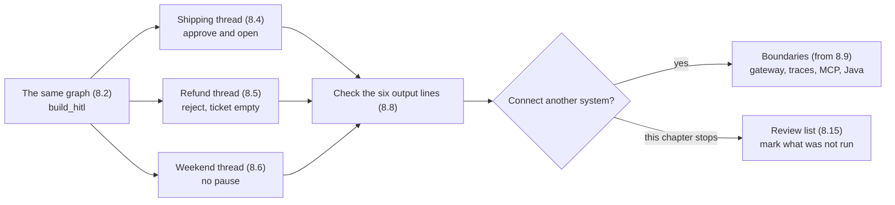
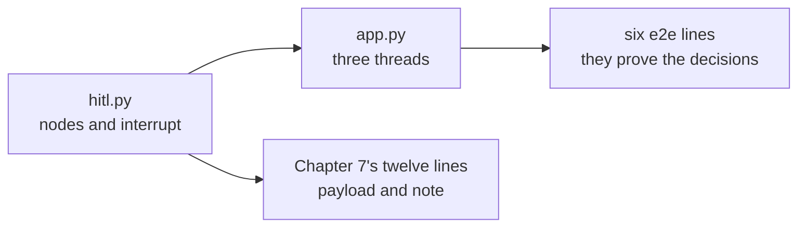
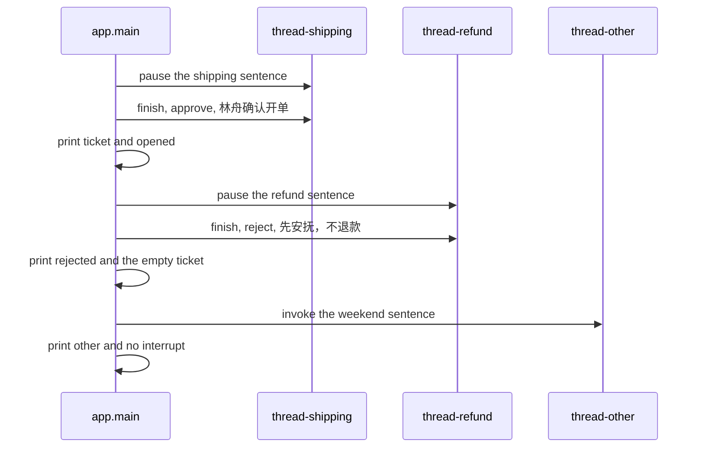

# Chapter 8 Xiaofan's support graph

> In this chapter: This chapter gathers the first seven chapters into one entry point, and it adds no node. The three customer sentences of Seashore Select (海岸优品) walk the same graph. On the thread `thread-shipping`, Lin Zhou (林舟) approves the shipping sentence, and the ticket sentence stays. On `thread-refund` the refund sentence is rejected, and the ticket is an empty string. On `thread-other` the weekend sentence does not pause. `app.py` only calls Chapter 7's `build_hitl`, `pause`, and `finish`. The ticket sentence in the payload, and whether a ticket was opened after approval, have to be read apart. The model alias `seashore-cs`, Langfuse, MCP, the Java platform, a database, and screenshots were not run. The refund's approval branch was not run either. When you finish, you can retell the three paths with the six lines that start with `e2e_`, and you can point at which matters have to move to another book on the shelf.



*Flow of this chapter*

## When you need it

Three situations, three places to stop. This chapter does not teach a new API.

**You need to point someone at this: on the Python side, Xiaofan (小帆) is this one entry point.** Read 8.2 through 8.8. The file is `app.py`. It sends 「订单 OD-2049 物流延迟，请处理」, 「订单 OD-2049 我要退款」, and 「你们周末上班吗」 into the graph Chapter 7 already wrote. The six `e2e_*` lines are the whole of the evidence from 2026-11-27. Shipping is approved, the refund is rejected, and the weekend sentence does not interrupt.

**A review asks whether the model gateway, tracing, the tool protocol, and the Java platform are connected.** Read 8.9 through 8.14, and then stop. None of these were run in this chapter. The gateway goes to the LiteLLM book, tracing goes to the Langfuse book, the tool protocol goes to the MCP book, and the support agent on the platform stays in AgentScope Java. The `lookup` in this book is an in-process function. The frontend is not a second tutorial. Chapter 5 of the CopilotKit book has already attached a LangGraph to an interface.

**Someone wants to run the refund approval as well, and expects a different ticket sentence.** Read 8.5. When `gate` approves and the intent is shipping or refund, what it writes is still that shipping ticket sentence. The demo never sets the refund's `approved` to true. This locks the only ticket sentence on the shelf. It is not a production ticket classification. Do not add an approval in this chapter to make the picture look complete.

Prerequisite: Chapter 7's `interrupt` and `Command` have already run through. The decisions and the notes in this chapter match Chapter 7. The thread ids differ. The checkpoint is still the `InMemorySaver` that each `build_hitl()` brings with it. There is no cross-process step, and a database is not started.

## 8.1 Overview

The module docstring of `app.py` says: the same graph as Chapter 7, three customer sentences, one entry point. It does not define `classify`, `draft`, or `gate`. Those functions stay in `hitl.py`. If this chapter grew a new state key, a new node name, or a new ticket sentence, the entry point would have failed to hold its boundary.

The three paths, and what the prints mean:

| Thread | Customer sentence | How it is called | The person's decision | The print on 2026-11-27 |
| --- | --- | --- | --- | --- |
| `thread-shipping` | 订单 OD-2049 物流延迟，请处理 | `pause`, then `finish` | `approved` true, note 「林舟确认开单」 ("Lin Zhou confirms opening the ticket") | The ticket sentence from the payload; opened is `True` |
| `thread-refund` | 订单 OD-2049 我要退款 | `pause`, then `finish` | `approved` false, note 「先安抚，不退款」 ("reassure first, do not refund") | `decision` is `rejected`; the ticket is empty |
| `thread-other` | 你们周末上班吗 | One `invoke` | Does not happen | Intent `other`; no `__interrupt__` |

**On the business side: the three customer sentences share the one graph in `hitl.py`, and different `thread_id` values keep them apart. This chapter only assembles. It adds no mechanism. The model gateway, tracing, MCP, and the Java platform each stay in their own book.**

`e2e_shipping_ticket` prints the `ticket` in the pause payload. It is not the state after resume. `e2e_shipping_opened` is what checks whether the `ticket` after resume equals the constant `TICKET`. The two lines being true together means "the sentence that was proposed" and "the sentence written after approval" are the same sentence. Reading only the first line would turn a proposal that has not been approved yet into a ticket that has already been opened.

The refund path does not print the payload. It only proves that after rejection the ticket string is empty. The branch that approves a refund would, in the source, write the same `TICKET`. The run does not enter it.

## 8.2 Source: the entry point adds no mechanism

The full text of `books/langchain/demo/xiaofan_graph/app.py` on 2026-11-27 is below.

```python
"""Chapter 8: the same graph as chapter 7, three customer messages, one entry point."""

from xiaofan_graph.hitl import build_hitl, finish, pause
from xiaofan_graph.orders import OTHER_TEXT, REFUND_TEXT, SHIPPING_TEXT, TICKET


def main() -> None:
    graph = build_hitl()
    shipping = pause(graph, "thread-shipping", SHIPPING_TEXT)
    shipping_done = finish(graph, "thread-shipping", {"approved": True, "note": "林舟确认开单"})
    print("e2e_shipping_ticket", shipping["ticket"])
    print("e2e_shipping_opened", shipping_done["ticket"] == TICKET)

    refund_graph = build_hitl()
    pause(refund_graph, "thread-refund", REFUND_TEXT)
    refund_done = finish(refund_graph, "thread-refund", {"approved": False, "note": "先安抚，不退款"})
    print("e2e_refund_decision", refund_done["decision"])
    print("e2e_refund_ticket_empty", refund_done["ticket"] == "")

    other = build_hitl().invoke(
        {"text": OTHER_TEXT},
        {"configurable": {"thread_id": "thread-other"}},
    )
    print("e2e_other_intent", other["intent"])
    print("e2e_other_interrupted", "__interrupt__" in other)


if __name__ == "__main__":
    main()
```
The imports are only four names: `build_hitl`, `finish`, `pause`, plus the three customer sentences and `TICKET` from the orders module. There is no `init_chat_model`, no callback, no database driver, and no direct call to `interrupt`. `interrupt` happens inside `hitl.gate`. The entry point does not write it a second time.

The step list in `run_all.py` puts this module last:

```python
STEPS = [
    "xiaofan_graph.chain",
    "xiaofan_graph.tools_agent",
    "xiaofan_graph.linear",
    "xiaofan_graph.routing",
    "xiaofan_graph.checkpoint",
    "xiaofan_graph.hitl",
    "xiaofan_graph.app",
]
```
Each item imports the module and calls `main()`. The print writes `##` and the module name before `main()`. So `## xiaofan_graph.app` is not printed by `app.py` itself. `app.py` prints only the six `e2e_*` lines. The chain, the tools, the straight-line graph, the conditional edges, the checkpoint, and the human pause have already been run by their own `main()` inside the same `run_all.py`. This chapter does not paste those lines again. The review list points at them with "covered / not covered."

Three calls to `build_hitl()` are three compiles and three `InMemorySaver`s. The shipping `pause` and `finish` share the variable `graph`. The refund shares `refund_graph`. The weekend call does not keep a variable name. It uses the return value as soon as the call ends. Inside one process the three graphs do not read each other. The thread ids also differ. As in Chapter 7, the demo did not run a control that changes only one of them, so do not credit the success to a single factor. What can be affirmed is this: the entry point does not stuff the three sentences into the same `thread_id`.

The customer sentences and the ticket sentence still come from `orders.py`. The entry point does not copy out a second set of strings.

| Name | Value |
| --- | --- |
| `SHIPPING_TEXT` | 订单 OD-2049 物流延迟，请处理 |
| `REFUND_TEXT` | 订单 OD-2049 我要退款 |
| `OTHER_TEXT` | 你们周末上班吗 |
| `TICKET` | 售后升级：订单 OD-2049 客户投诉物流延迟 |

`app.py` does not import `TEAM`, the carrier, or the tracking number. Those words appear in the draft that `hitl.draft` concatenates. The prints in this chapter do not include the full draft, so the team name `xbd-seashore-cs-team`, 云途, and `YT-2049-88` do not appear on the `e2e_*` lines. Whether they entered the draft is evidence in Chapter 7's `pause_draft_has_tracking True`, not in this chapter.

## 8.3 Three thread names for teaching, and no session system

| Thread in this chapter | The matching thread in Chapter 7 | Why the two sides do not use the same string |
| --- | --- | --- |
| `thread-shipping` | `xiaofan-OD-2049` | Chapter 7 lines up with the teaching thread from the checkpoint chapter. This chapter wants the three threads at the entry point to be separable at a glance |
| `thread-refund` | `xiaofan-OD-2049-reject` | Same reason |
| `thread-other` | `xiaofan-other` | Same reason |

The thread id still appears only in `config["configurable"]["thread_id"]`. `pause` and `finish` build that dict internally. The weekend path writes the dict directly as the second argument of `invoke` in `app.py`, and the shape matches the inside of `pause`. None of the paths writes the thread id into `HitlState`.

These names cannot serve as production conversation ids. They contain no user, they contain no time, and they do not stop two conversations on the same order from colliding. Teaching uses fixed strings so the six output lines stay stable on a re-run. A production conversation id should be fixed before `pause` is called, and one conversation should keep using the same id. This chapter does not connect a conversation store.

`InMemorySaver` lives only inside this `main()`. When `run_all.py` ends, the three threads disappear together. The SQLite child from Chapter 6 does not belong to `app.py`. Do not add `sqlite_reopen_n` when you retell this chapter.

## 8.4 Shipping: opened only after approval

```python
graph = build_hitl()
shipping = pause(graph, "thread-shipping", SHIPPING_TEXT)
shipping_done = finish(graph, "thread-shipping", {"approved": True, "note": "林舟确认开单"})
print("e2e_shipping_ticket", shipping["ticket"])
print("e2e_shipping_opened", shipping_done["ticket"] == TICKET)
```
The return value of `pause` is the `interrupt` payload, not the whole state. The payload's `ticket` comes from the constant `TICKET` written into `gate`. So `e2e_shipping_ticket` is already that ticket sentence before the person approves. The value on 2026-11-27 is 「售后升级：订单 OD-2049 客户投诉物流延迟」.

`finish` uses the same `graph` and the same `thread-shipping`. The resume value is approval, and the note is 「林舟确认开单」. `shipping_done["ticket"]` is the state that `gate` writes after `interrupt` returns. `e2e_shipping_opened` is `True`, which means the string in this state equals `TICKET`.

The note was passed in, and this chapter does not print `"林舟确认开单" in draft` the way Chapter 7 does. Whether the note is contained cannot be read out of the six `e2e_*` lines. Chapter 7, on another thread, gets `approved_note True` for the same note. That is Chapter 7's evidence. This chapter only guarantees that the entry point put this note into `resume`.

Deduced from `hitl.py`, the node order on this thread is `classify`, `lookup`, `draft`, `gate` pausing, then running again from the start of `gate` through to the end. This chapter does not print the intermediate fields. The deduction is below, and it is not expanded key by key in the output of `app.py`.

| Node | What `hitl.py` should write | Does `app.py` print it? |
| --- | --- | --- |
| `classify` | Intent `shipping_delay`, order id `OD-2049` | No |
| `lookup` | `delayed` is true | No |
| `draft` | The draft contains 云途, `YT-2049-88`, the ticket sentence, and the team name | No. Chapter 7 only proved that the tracking number is in the payload draft |
| `gate` pauses | Four payload keys, of which `ticket` is the constant | Yes, `e2e_shipping_ticket` |
| `gate` resumes | `decision` is `approved`, `ticket` equals `TICKET`, and the draft appends the note | It prints only whether the ticket equals `TICKET` |

`e2e_shipping_opened` does not print `decision`. The approval is supported jointly by the `approved: True` that was passed in and by the ticket that was opened: in the source, `ticket` equals `TICKET` only when the decision is approval and the intent is shipping or refund. Opened being true agrees with "this call passed an approval." If a rejection had been passed then, the same line of source would make `ticket` the empty string, and this line would be `False`. The demo does not run the shipping path once more as a rejection.

## 8.5 Refund: the rejection, and the approval branch that was not run

```python
refund_graph = build_hitl()
pause(refund_graph, "thread-refund", REFUND_TEXT)
refund_done = finish(refund_graph, "thread-refund", {"approved": False, "note": "先安抚，不退款"})
print("e2e_refund_decision", refund_done["decision"])
print("e2e_refund_ticket_empty", refund_done["ticket"] == "")
```
The return value of `pause` is discarded. The order id, the intent, the draft, and the proposed ticket in the refund payload do not appear in this chapter's output. `finish` being able to return afterward means this thread had a pause that could be resumed. Beyond that, do not write the payload contents up as `e2e_` lines.

`e2e_refund_decision` is `rejected`. `e2e_refund_ticket_empty` is `True`, because `refund_done["ticket"] == ""`. The key exists, and the value is the empty string, not `None`. This is the same comparison as Chapter 7's `rejected_ticket_empty`, with a different thread and a different printed key.

The note 「先安抚，不退款」 is in `resume`. `gate` appends it to the draft when the note is non-empty. `app.py` does not check the draft. Whether that append happened was not expanded in this chapter's output.

Deduced from `hitl.py`, the refund does not enter `lookup`. `classify` sees 「退款」, the intent is `refund`, and the order id is still `OD-2049`, because that id is in the original text. `route_after_draft` sees a refund and enters `gate`. It does not look at `delayed`. None of these intermediate values are printed in this chapter.

The branch that approves a refund has to be stated on its own, and marked as not run. The assignment inside `gate` is:

```python
ticket = TICKET if approved and state.get("intent") in {"shipping_delay", "refund"} else ""
```
`refund` and `shipping_delay` are written in the same set. If `approved` is true, a refund also receives 「售后升级：订单 OD-2049 客户投诉物流延迟」. It does not receive a sentence called "refund ticket," and it does not receive another team. What `app.py` passes is `approved: False`. That true branch does not execute for the refund. The shipping approval did execute, so the same ticket sentence has been seen on the shipping path as `e2e_shipping_opened True`. The refund path has not seen it.

This is a teaching lock. It is not a production classification. The ticket sentence on the shelf has to be character-for-character the same sentence as in AgentScope Java, so this book does not introduce a second kind of ticket. A real support desk would split refund and shipping. On the day they are split, `orders.py` should change, and the whole book should keep only the new set of sentences, rather than concatenating a sentence on the spot inside `app.py`. This chapter does not make that change.

| Question | The answer in this chapter |
| --- | --- |
| Was the refund approved? | No. `e2e_refund_decision` is `rejected` |
| What is the ticket after rejection? | The empty string. `e2e_refund_ticket_empty True` |
| What would be written if it were approved? | The source would write `TICKET`. That is not a print from this run |
| Is this a ticket-type design? | No. It locks the single sentence, so the chapters do not each write their own |

## 8.6 Weekend: no pause, and the draft is not printed

```python
other = build_hitl().invoke(
    {"text": OTHER_TEXT},
    {"configurable": {"thread_id": "thread-other"}},
)
print("e2e_other_intent", other["intent"])
print("e2e_other_interrupted", "__interrupt__" in other)
```
`e2e_other_intent` is `other`. `e2e_other_interrupted` is `False`. `False` comes from `"__interrupt__" in other`, which means the key is not in the returned dict. Do not write it as "the interrupt list is empty" or "the interrupt value is false." If the key were present, `in` would be true, whatever the value was.

This path does not call `pause`, and it does not call `finish`. There is no `Command`. For a state that is not a refund, and is not "shipping and already delayed," `route_after_draft` returns `"end"`, and the graph ends.

By the `else` of `draft()`, the draft should be 「已记下。请给出订单号，或说明是物流还是退款。」 Chapter 7 prints that whole line as `other_draft`. `app.py` does not have this print. This chapter cannot mark that sentence as `e2e` output again. The function is the same, so the sentence should be the same according to the source. The evidence sits in Chapter 7, not in the six lines of this chapter.

The weekend sentence has no order id. `classify` writes `order_id` as the empty string, and it does not enter `lookup`. This chapter does not print `order_id`. The empty string is a result of the source. It was not expanded in the output of `app.py`.

## 8.7 What changed from Chapter 7, and what stayed

| Item | Chapter 7 `hitl.py` | This chapter's `app.py` |
| --- | --- | --- |
| Where the graph is defined | In that file | Calls `build_hitl`, and does not rewrite the nodes |
| Shipping thread | `xiaofan-OD-2049` | `thread-shipping` |
| Refund thread | `xiaofan-OD-2049-reject` | `thread-refund` |
| Weekend thread | `xiaofan-other` | `thread-other` |
| Shipping decision | Approve, 「林舟确认开单」 | The same |
| Refund decision | Reject, 「先安抚，不退款」 | The same |
| Ticket sentence | `TICKET` | The same constant |
| Whether the order id and the intent on the payload are printed | The shipping path prints them | Not printed. Only the `ticket` in the payload is printed |
| Whether "the note entered the draft" is printed | `approved_note True` | Not printed |
| Whether the weekend draft is printed | The whole sentence is printed | Not printed |
| Whether the refund payload is printed | Not printed. The return value is discarded | Discarded the same way |
| Saver | One `InMemorySaver` per `build_hitl()` | The same |

No mechanism was added. If the decisions in the two chapters do not match, look first at whether the entry point changed `approved` or swapped in another graph, and not at tuning a model. On 2026-11-27 the two sides are `approved`, `rejected`, and no interrupt, and they match.



*Figure 8-2: The entry point reuses the graph from Chapter 7. The evidence for the note and the weekend draft stays in Chapter 7*

## 8.8 The run output from 2026-11-27

The `xiaofan_graph.app` stretch printed by `run_all.py` is only the lines below.

```text
## xiaofan_graph.app
e2e_shipping_ticket 售后升级：订单 OD-2049 客户投诉物流延迟
e2e_shipping_opened True
e2e_refund_decision rejected
e2e_refund_ticket_empty True
e2e_other_intent other
e2e_other_interrupted False
```
| Line | Expression | How to read it |
| --- | --- | --- |
| `e2e_shipping_ticket` | `shipping["ticket"]` | The proposal in the pause payload. The code has not yet written it up as "already opened" on the line before this one |
| `e2e_shipping_opened` | `shipping_done["ticket"] == TICKET` | The ticket in the state after resume equals that sentence |
| `e2e_refund_decision` | `refund_done["decision"]` | The string `rejected`, not a boolean |
| `e2e_refund_ticket_empty` | `refund_done["ticket"] == ""` | The empty string, not `None` |
| `e2e_other_intent` | `other["intent"]` | `other` |
| `e2e_other_interrupted` | `"__interrupt__" in other` | `False` means this key is absent |

The output has no model sentence, no HTTP status code, no trace id, no interrupt identifier, no screenshot path, and no database name. The next sections close each thing that did not appear, so a later addition does not mix them into "already ran through."

## 8.9 Boundary: init_chat_model and llm.example.com

This boundary was not executed.

In the LiteLLM book, the model alias for Seashore Select is `seashore-cs`. The gateway hostname is `https://llm.example.com`. The docstring of `init_chat_model` in `langchain` 1.5.2 lists `base_url` as a keyword argument, passed on to the constructor of the underlying model. The parameter name being written in the installed package's description does not mean this run sent the request.

The call below only names those two. It is not in `app.py`, and it is not in any module of `run_all.py`.

```python
# 未执行。不要把下面这行当成 2026-11-27 的运行输出。
init_chat_model("seashore-cs", base_url="https://llm.example.com")
```
`langchain-openai` is left out of the dependencies on purpose. Chapter 2 recorded the `ImportError` from `init_chat_model("openai:gpt-4o-mini")` when the package is missing, and the message asks for `langchain-openai` to be installed. The line that points at `llm.example.com` did not even run that missing-package experiment: there is no status code, no timeout, and no model reply body. Do not fill in a 200, and do not fill in a passage of "what Xiaofan said."

Classification on this support graph is the keywords in `classify`. It is not this call that was never sent. After the alias is connected, the label set should still be only `shipping_delay`, `refund`, and `other`. The connection, the virtual keys, and the fallback are in the LiteLLM book. A vendor key should not appear in the business repository. This chapter has no `.env`, and it does not write a key into an example.

`FakeListChatModel` and `GenericFakeChatModel` are used only in Chapters 2 and 3, to prove the wiring of the chain and of `create_agent`. `app.py` does not import them. The three `e2e_*` paths have no model taking part.

## 8.10 Boundary: Langfuse was not initialized

This boundary was not executed.

This chapter does not create a Langfuse client, does not put a callback into `config`, and does not query a trace. The `config` of `pause` and `finish` holds only `thread_id`. An extra `callbacks` key does not appear in the source from 2026-11-27.

So this chapter cannot answer "which model call generated this draft." The draft is concatenated by `draft()` from the order fields. It was not generated by a model in the first place. If classification or the draft is later changed to a model, the trace should be recorded on the side the Langfuse book describes, and not written into `HitlState`. The state dict continues to hold only the order, the intent, the draft, the decision, and the ticket. Observation data should not share a key with the ticket string.

This book does not initialize the SDK, so there is no host, public key, or secret key to quote. Do not copy a set of keys out of another project into the demo. Read the Langfuse book for how to read a trace. The six output lines of this chapter are not a trace.

## 8.11 Boundary: lookup_order is not an MCP server

This boundary was not executed.

`lookup_order` in Chapter 3 is an in-process `@tool` function, and it calls `lookup_order_record` internally. An unknown order id returns the string `NOT_FOUND`. `OD-2049` returns the line that `record_as_text` concatenates. The graphs in Chapters 7 and 8 do not even call this tool. Their `lookup` node reads `ORDER` from `orders.py` directly and writes `delayed`.

Both lookups run inside the same Python process. There is no MCP server, no network discovery of a tool list, and no exposure of these six fields to the Java side. If Xiaofan on Java has to look up the same order, that should go through the tool protocol in the MCP book, and not through an import of `xiaofan_graph`.

| How lookup is written | Who uses it | Does this chapter turn it into a service? |
| --- | --- | --- |
| `lookup_order` | The hand-written loop and `create_agent` in Chapter 3 | No. It is still an in-process function |
| The `lookup` node | The graph in Chapter 7, which this chapter's entry point calls | No. It reads the dict directly |
| MCP server | The MCP book on the shelf | This chapter did not start one |

Do not change `NOT_FOUND` into a raised exception to make it "look more like an interface." The contract in Chapter 3 is to return this string. The support graph in this chapter uses an empty `order_id` and a conditional edge to express "there is no order." The weekend sentence is that path. Do not merge the two kinds of "no order" into one.

## 8.12 Boundary: AgentScope Java owns Xiaofan on the platform

This boundary was not executed. This chapter does not call a Java interface, does not create a platform agent, and does not change the middle platform.

Xingfan (星帆出海), the support agent Xiaofan, the engineer Lin Zhou, the merchant Seashore Select, namespace `seashore-main`, order `OD-2049`, team `xbd-seashore-cs-team`, and the ticket sentence 「售后升级：订单 OD-2049 客户投诉物流延迟」 line up with AgentScope Java and with LiteLLM. The only thing this book adds is one set of shipping fields: carrier 云途, tracking number `YT-2049-88`, shipped on 2026-11-18, promised in 7 days, 9 days elapsed, so `delayed` is true. Do not write the shipping fields backward as "the Java platform already stores the tracking number." This chapter does not rewrite the ticket sentence or the order id.

This Python graph is the orchestration of the same order: classify, look up, draft, wait for a person, then decide whether to write that ticket sentence. Sessions, deployment, and the Java agent on the platform stay with AgentScope Java. Once the graph can pause or reply directly for the three customer sentences, stop. Do not rewrite the whole middle platform in LangGraph, and do not build another "platform agent" inside `app.py`.

| Noun | How far this book proves it | What stays with the Java platform |
| --- | --- | --- |
| Xiaofan | The name of one graph of Python functions | The support agent on the platform |
| `OD-2049` | The only order id | The same order. No second order id is started |
| Ticket sentence | The one string written into state after approval | The same sentence in the ticket system. This chapter calls no ticket API |
| Team | The string at the end of the draft | The team on the platform. This chapter calls no team API |
| Lin Zhou | The fictional engineer in the note of the resume value | Not a real account in a run log |

The note 「林舟确认开单」 is a teaching sentence. It stands for that one human approval. It is not an audit event on the platform. This chapter does not submit the note to any ticket interface.

## 8.13 Boundary: Postgres was not started

This boundary was not executed.

Chapter 6 uses `SqliteSaver` to write the counting graph into a temporary file. The child reads `n` as 1, adding one more yields 2, and then `TemporaryDirectory` deletes the file. That is the counting graph, not the support graph. The three `build_hitl()` calls in `app.py` use the default `InMemorySaver`. When the process ends, `thread-shipping`, `thread-refund`, and `thread-other` are all gone.

This chapter has no connection string, no `PostgresSaver`, and it does not write the support state into SQLite. In production, if a pause has to survive a restart, switch to a durable database checkpoint, and still put `thread_id` in `config`. That replacement is not in the `run_all.py` of 2026-11-27. Do not write "this chapter already persisted OD-2049."

The in-memory saver and `MemorySaver` are the same class. The evidence is `saver_is_same_class True` in Chapter 6. This chapter does not print that line again. The identity does not change because the entry point uses different thread names.

## 8.14 Boundary: no screenshots, and JS is not a second tutorial

This boundary was not executed.

This chapter has no interface, and it has no screenshot under `../assets/images/`. The opening figure and the figures in the text are mermaid. A support-desk button, a chat window, and an interrupt card are not in the demo. The dict of `Command(resume=...)` is a Python call. Who collects "approve" and the note from a button is another book's job.

On the JavaScript side there is `@langchain/langgraph`. This book does not write a parallel JS tutorial, and it does not translate `app.py` across. Interface names change, and a translation that was never run goes stale first. Chapter 5 of the CopilotKit book already shows how to attach a backend LangGraph to a frontend runtime. When you need an interface, read that chapter, and follow the connection steps there. Do not carry this book's order id, thread names, and `e2e_*` keys into that frontend example, and do not carry that frontend example's order into `orders.py`.

The interrupt identifier likewise has no screenshot and no log. It changes on every run. `pause` takes only the `.value` of the payload. The `shipping` variable in this chapter is that `.value`. The identifier field was not printed.

## 8.15 Review list

The table below only separates what the `run_all.py` of 2026-11-27 covered and what it did not cover. Later probes (the six history rows in Chapter 6, and the `version="v2"` probe in Chapter 7) are written in the notes. They do not count as lines of `run_all.py`.

| Item | `run_all.py` | Basis, or why it was not run |
| --- | --- | --- |
| `prompt \| model \| parser` returns `shipping_delay` on the fake model | Covered | `xiaofan_graph.chain`. The fake model does not read the original text |
| The `ImportError` from `init_chat_model("openai:gpt-4o-mini")` when the package is missing | Covered | Chapter 2. The hint was not followed, and `langchain-openai` was not installed |
| `init_chat_model("seashore-cs", base_url="https://llm.example.com")` | Not covered | Not executed. There is no status code |
| The hand-written tool loop and `create_agent` reach `lookup_order` | Covered | `xiaofan_graph.tools_agent`. The contract for an unknown order id is `NOT_FOUND` |
| A static `interrupt_before` stops at `model` or `tools` | Not covered | Chapter 7 used only `interrupt()` inside `gate` |
| The straight-line graph `classify → lookup → draft` | Covered | `xiaofan_graph.linear` |
| Conditional edges for the three customer sentences, and `recursion_limit` | Covered | `xiaofan_graph.routing`. A cycle that always adds one raises `GraphRecursionError` |
| `InMemorySaver is MemorySaver` | Covered | `saver_is_same_class True` |
| Two adds in the same process yield 1 and then 2, and the history length is 6 | Covered | `memory_first`, `memory_second`, `memory_history_len` |
| `step`, `next`, `n`, and `source` of the six snapshots | Not in the print of `run_all.py` | The follow-up inspection in Chapter 6. The newest entry is first |
| A second SQLite process reads `n` as 1, then gets 2 | Covered | `sqlite_reopen_n`, the empty `sqlite_reopen_next`, `sqlite_second_step`. The file is deleted afterward |
| `PostgresSaver`, or any database connection string | Not covered | A database was not started. Postgres was not started |
| The shipping sentence is approved after `interrupt`, and the ticket sentence stays | Covered | Chapter 7's `approved_*`; this chapter's `e2e_shipping_ticket` and `e2e_shipping_opened True` |
| The refund sentence is rejected after the pause, and the ticket is `""` | Covered | Chapter 7's `rejected_*`; this chapter's `e2e_refund_decision rejected` and `e2e_refund_ticket_empty True` |
| The refund sentence is approved | Not covered | If the source approved it, it would write the same shipping ticket sentence. The demo does not set the refund's `approved` to true |
| The weekend sentence does not show `__interrupt__` | Covered | Chapter 7's `other_interrupted False` and the whole draft; this chapter's `e2e_other_interrupted False`. This chapter does not print the draft |
| `GraphOutput.interrupts` from `version="v2"` | Not covered | The separate probe marked in Chapter 7. The demo takes `__interrupt__` on the default dict |
| The interrupt identifier | Not covered | It changes on every run, and the code does not print it |
| A Langfuse callback or a trace | Not covered | Not initialized |
| An MCP server | Not covered | `lookup_order` and `lookup` are both in-process functions |
| A platform call from AgentScope Java | Not covered | The platform is not rewritten. The nouns are aligned, and that is all |
| A screenshot or a chat interface | Not covered | There is no interface |
| A parallel tutorial for `@langchain/langgraph` | Not covered | Frontend mounting is Chapter 5 of the CopilotKit book |

How to read this table: if the left column says "Covered," you should be able to find the print inside the matching module's `main()`, or find the stretch of that run that Chapter 1 already quoted. If the left column says "Not covered," an affirmative sentence in the prose has to carry "was not executed" or "a branch in the source." It cannot carry a run result.

The six lines of `app.py` itself support only three business results in the table: the shipping ticket was opened, the refund ticket is empty, and the weekend sentence does not interrupt. They do not support the gateway rows, the tracing rows, or the database rows. Pasting the six lines into a review does not stand in for the "Not covered" column.

## 8.16 Call order inside one main

Fold `main` into a timeline, so a rejection that is printed later is not described as happening before the shipping pause. The order in the source is the order below. The three paths share no state.

| Order | Action | Thread | What is printed next |
| --- | --- | --- | --- |
| 1 | `pause` the shipping sentence | `thread-shipping` | Nothing printed yet |
| 2 | `finish` the approval | `thread-shipping` | `e2e_shipping_ticket`, `e2e_shipping_opened` |
| 3 | `pause` the refund sentence, and discard the payload | `thread-refund` | Not printed |
| 4 | `finish` the rejection | `thread-refund` | `e2e_refund_decision`, `e2e_refund_ticket_empty` |
| 5 | `invoke` the weekend sentence | `thread-other` | `e2e_other_intent`, `e2e_other_interrupted` |

The two shipping prints happen after the approval, but the value of `e2e_shipping_ticket` was already fixed in the payload of step 1. Printing later does not mean the assignment was later. The two refund lines appear only after the rejection, because the payload was discarded, and there was nothing to print at pause time.

There is no step 6. There is no second send of an approval for the refund, no `Command` sent to the weekend sentence, and no `get_state_history`. The history length 6 belongs to the counting graph in Chapter 6. Do not attach it to `thread-shipping`. The number of checkpoint entries on the support graph was not expanded in this run's output.



*Figure 8-3: One entry point, three threads, and no fourth decision*

## 8.17 How to correct the sentence in review

The entry file is short, and the wrong sentences in a review tend to be long. The left column below is a sentence that should not appear in this chapter's conclusions. The right column matches the source and the output.

| Do not write | Write this instead |
| --- | --- |
| Xiaofan is already connected to `seashore-cs` | The alias and `base_url` appear only in a shape that was not executed |
| These three calls can be seen on Langfuse | No callback was initialized. The draft was not generated by a model |
| Lookup has already been made into an MCP tool | An in-process function. The protocol is in the MCP book |
| The Java platform was replaced by this graph | The platform agent is still in AgentScope Java. This side only orchestrates the same order |
| The ticket has already been written to a database | `ticket` is a string in state. There is no database |
| Approving a refund opens a refund ticket | The approval branch was not run. If it ran, the source would still write the shipping sentence |
| The weekend draft is printed by this chapter | This chapter prints only the intent and whether the key exists. The whole sentence is in Chapter 7 |
| There is a screenshot of a pause screen | There is no screenshot. The resume value is a dict |
| The interrupt id is the value from some particular run | It is not printed, and it changes every time |
| `e2e_shipping_ticket` means the ticket has been opened | It is the payload. Whether it was opened is `e2e_shipping_opened` |

This table is also the operational form of the checklist. You do not need to implement another feature. You need, when you retell `app.py`, to keep a system that was not run from being described as one that was run.

## 8.18 The line each of the first seven chapters leaves

After the entry point, you should be able to point back at each chapter's claim, and not only remember the six `e2e_*` lines.

| Chapter | The claim it leaves for this support graph | Does this chapter still use it? |
| --- | --- | --- |
| 1 | Opening a ticket and refunding must be able to stop. The weekend sentence can end | Yes. The three paths stop, stop, and end |
| 2 | The chain returns a label on the fake model, and that does not prove it read the original text | No model is used. Classification is still keywords |
| 3 | The lookup tool returns `NOT_FOUND` for an unknown order | The entry point does not call that tool. Lookup is the graph's `lookup` node |
| 4 | A straight-line graph can write the intent, the delay, and the draft in one pass | The graph is no longer a straight line. The draft still comes before the pause |
| 5 | Conditional edges let the refund and the weekend sentence skip lookup | `route_after_classify` is still this rule |
| 6 | The thread is in `config`. The in-memory saver disappears with the process | All three `thread-*` values work that way. There is no cross-process step |
| 7 | `interrupt` comes first, and the ticket assignment comes later still. Rejection yields `""` | The entry point sends in the same `resume` |

The counting cycle and `recursion_limit` from Chapter 5 do not enter the support graph. The support graph has no edge back to itself. `gate` to `END` is an ordinary edge. Do not add another edge on `app.py` so that "an agent ought to have a cycle." The cycle of the tool loop stays in Chapter 3's `create_agent`. The nodes of that cycle are `model` and `tools`, and they do not open tickets.

## 8.19 On a re-run, check only this block

The demo README states: under `books/langchain/demo`, install `requirements.txt` and run `python run_all.py`. The dependencies are the 2026-11-27 pins `langchain==1.5.2`, `langgraph==1.2.24`, and `langgraph-checkpoint-sqlite==3.1.3`. There is no vendor key. The SQLite file is in a temporary directory, and it is deleted with the process.

When you re-run this chapter, keep your eyes only on the six lines under `## xiaofan_graph.app`. If the six lines do not match the code block in 8.8, check first whether another directory was run, whether the ticket sentence in `orders.py` was changed, and whether the refund's `approved` was changed to `True`. Do not start by editing the wording of `gate`.

Six lines that match still do not mean the systems in 8.9 through 8.14 are available. Those systems are outside the coverage of this command. A match only means: the same graph, three threads, two decisions plus one direct end, the same as on 2026-11-27.

## 8.20 Running this module alone, and running the whole demo

The end of the file is:

```python
if __name__ == "__main__":
    main()
```
Running `app.py` directly enters `main`. `build_hitl` compiles the Chapter 7 graph at call time, so the three customer sentences still pause or end, and the six `e2e_*` lines are still printed. This path does not call `chain.main`, `checkpoint.main`, or the `main` of any other chapter. You do not see `saver_is_same_class`, and you do not see the SQLite child.

`run_all.py` uses `importlib` to call every `main` on the list, and it does not depend on the `__main__` guard in each file. `app` is last. In the complete output of 2026-11-27, the six `e2e_*` lines appear after the checkpoint and the human pause. That order is the order of the script's list. The inside of `app.py` does not run the first seven chapters again.

Importing `app` does not import `checkpoint`, so importing does not start a child. The child exists only in `checkpoint.main`. The import itself does not produce those three `sqlite_*` lines.

| How you run it | Which `main` functions run | The three support paths | The SQLite child | The fake-model chain |
| --- | --- | --- | --- | --- |
| `python run_all.py` | All seven on the list run | Yes. Once in `hitl`, and once more in `app` | Yes, only inside `checkpoint` | Yes |
| Run only `app.py` | Only `app.main` | Yes, and only this once | No | No |

When only the entry point is run, the checkpoint is still an `InMemorySaver` newly created in this process. It does not read Chapter 6's SQLite. That file was deleted with the temporary directory when `checkpoint.main` ended, and the entry point has nowhere to read it from.

So "the six lines match" proves only the entry point. The "Covered" marks on the earlier rows of the review list come from the earlier steps of `run_all.py`. They do not come from the output of `app.py` alone. Writing "the entry point passed on its own" as "the whole demo passed" would count in the chain, the tools, and the checkpoint that were not run.

## Summary

1. **This chapter assembles, and it adds no mechanism.** `app.py` calls `build_hitl`, `pause`, and `finish`. The nodes are still in `hitl.py`.
2. **Three threads, three results.** `thread-shipping` approves and opens that ticket sentence. `thread-refund` rejects, and the ticket is `""`. The result for `thread-other` has no `__interrupt__`.
3. **`e2e_shipping_ticket` is the payload, and `e2e_shipping_opened` is the opening.** On 2026-11-27 both point at the same sentence, 「售后升级：订单 OD-2049 客户投诉物流延迟」.
4. **The refund approval was not run.** If the source approved it, it would still write the shipping ticket sentence. This is a teaching lock. It is not a ticket-type design.
5. **The gateway, Langfuse, MCP, the Java platform, Postgres, screenshots, and a JS translation were not run.** The `base_url` of `init_chat_model` appears only in the docstring and in a shape that was not executed. The alias is `seashore-cs`.
6. **The book stops here.** To connect a model, go to the LiteLLM book. To read a trace, go to the Langfuse book. To turn lookup into a protocol, go to the MCP book. To change the platform, go to AgentScope Java. To put the graph in an interface, go to Chapter 5 of the CopilotKit book.

## Checklist

- ☐ Point out that `app.py` has no new node, and name the three functions it imports from `hitl`.
- ☐ Use the six output lines to explain, one each: the payload ticket, whether it was opened, the refund decision, the refund ticket being empty, the weekend intent, and the weekend result having no `__interrupt__` key.
- ☐ Explain the time gap between `e2e_shipping_ticket` and `e2e_shipping_opened`: the first is in the return value of `pause`, and the second is compared after `finish`.
- ☐ Say that the refund approval was not executed; if it were, say which sentence `gate` would write, and say why that is not a production ticket classification.
- ☐ From the review list, mark at least four things `run_all.py` did not cover: the gateway call, Langfuse, an MCP server, Postgres, a screenshot, a JS translation. Pick any four, and say which book each one belongs to.
- ☐ Confirm that the notes contain no interrupt identifier, no status code for `llm.example.com`, and no second ticket sentence that was made up.

## Quick reference

The main line does not depend on this section. Keys follow the `app.py` output on 2026-11-27.

| Key | Expression | The value that day |
| --- | --- | --- |
| `e2e_shipping_ticket` | `ticket` from the pause payload | 售后升级：订单 OD-2049 客户投诉物流延迟 |
| `e2e_shipping_opened` | `ticket == TICKET` after resume | `True` |
| `e2e_refund_decision` | `decision` after resume | `rejected` |
| `e2e_refund_ticket_empty` | `ticket == ""` after resume | `True` |
| `e2e_other_intent` | `intent` of the end state | `other` |
| `e2e_other_interrupted` | `"__interrupt__" in other` | `False` |

| Thread | `resume` or input |
| --- | --- |
| `thread-shipping` | `{"approved": True, "note": "林舟确认开单"}` |
| `thread-refund` | `{"approved": False, "note": "先安抚，不退款"}` |
| `thread-other` | Only `{"text": OTHER_TEXT}`, and no `Command` |

| A name that was not executed | Where it belongs |
| --- | --- |
| `seashore-cs` and `https://llm.example.com` | The LiteLLM book. `base_url` is a keyword argument of `init_chat_model` |
| A Langfuse callback | The Langfuse book |
| An MCP server | The MCP book |
| Deployment of the platform agent | AgentScope Java |
| Frontend mounting | Chapter 5 of the CopilotKit book |
| `PostgresSaver` | Not started. Chapter 6 ran only temporary SQLite |

## Further reading

- **Chapter 7 (human-in-the-loop)** — the payload, the note, and the full weekend draft of the same graph. This chapter replaces those prints with `e2e_*`, and it does not redo the experiment.
- **Chapter 6 (checkpoints)** — why the three `thread-*` values disappear with the process, and why the cross-process proof from SQLite does not belong to `app.py`.
- **The LiteLLM book** — how to connect the alias `seashore-cs` and the host `llm.example.com`. The `init_chat_model` line in this chapter was not executed.
- **The Langfuse book, the MCP book, and AgentScope Java** — they answer traces, the tool protocol, and the platform agent. The nouns line up with `OD-2049`, the ticket sentence, and the team name. The implementation is not in this file.
- **Chapter 5 of the CopilotKit book** — attach a backend LangGraph to a frontend. This book does not translate `app.py` into a second `@langchain/langgraph` tutorial.
