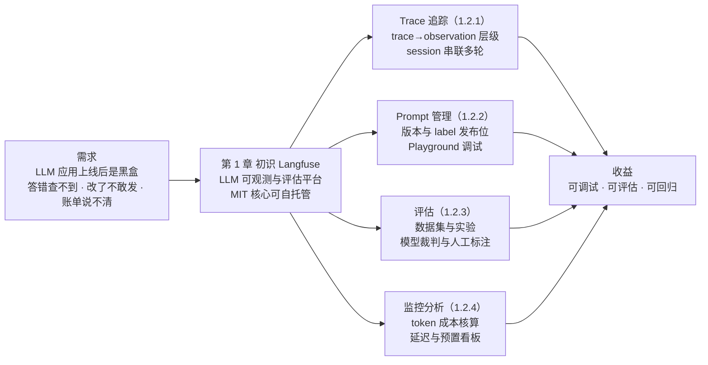
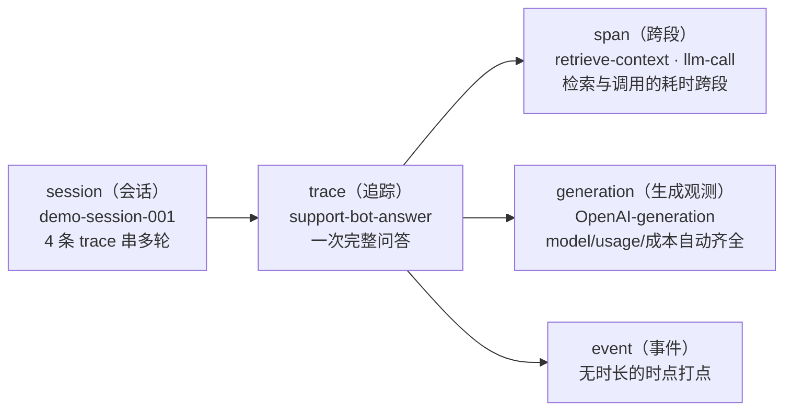
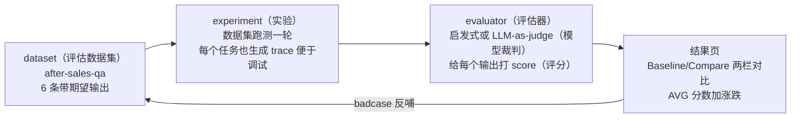
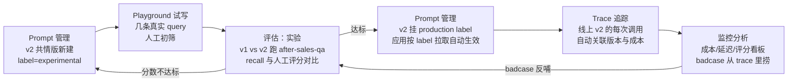
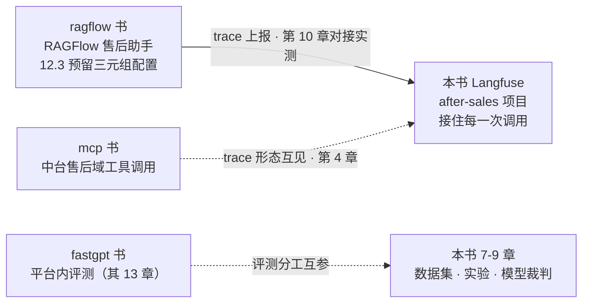

# 第 1 章 初识 Langfuse

> 本章导读：「售后助手」上线第三周，客服转来一条投诉——用户问「保税仓发货多久能到」，机器人却答了一堆退货政策。此刻唯一的排查手段是翻服务日志，而日志给不出答案：那一次调用的完整输入是什么？线上跑的是哪个版本的 Prompt？这次回答花了多少 token？LLM 应用上线后就是一个黑盒：输出不确定、成本按 token 累积、Prompt 改一版丢一版历史。本章不写一行代码，只建全书地基：Langfuse 用 Trace 追踪、Prompt 管理、评估、监控分析四大能力面把黑盒重新变白；MIT 开源核心与企业版（EE）的边界在哪；v3→v4 版本交替对你意味着什么。读完本章，你能：为每一种黑盒之痛找到对应的能力面与展开章节，并按自己的处境选好进入全书的路径。

*本章导览图*

## 你什么时候需要它

三种典型处境，对应三条进入全书的路径——本章读完即可选定。

**处境一：应用上线了，用户说「它答错了」，而你查不到任何现场。** 这是黑盒排查之痛，主线在第 3-4 章：第 3 章给应用装上 Python SDK，产出第一条 trace（追踪）；第 4 章掌握链路层级、session（会话）串联与过滤视图。本章先读 1.1 与 1.2.1，建立「一次请求在 Langfuse 里长什么样」的预期。

**处境二：改了一版 Prompt（比如把直答改成共情话术），不知道是变好还是变坏。** 这是评估之痛，主线在第 6-9 章：第 6 章把 Prompt 纳入版本管理，第 7 章建评估数据集（dataset，评估数据集），第 8 章跑实验做对比，第 9 章上自动化评估。本章先读 1.2.2 与 1.2.3。

**处境三：月底模型账单涨了，说不清花在哪个项目、哪类调用上。** 这是成本之痛，主线在第 5 章：模型配价、成本核算、看板与延迟分析。本章先读 1.2.4。

三种处境之外，如果你手上还没有一个 Langfuse 实例，第 2 章的 Docker Compose 六容器部署是一切动手内容的前置——本书贯穿案例的全部实测都发生在那台实例上（版本基线见 1.3）。本章本身无前置，读完全章即可做出「要不要引入」的决定。

## 概述

Langfuse 的官方自我介绍只有一句话：「Traces， evals， prompt management and metrics to debug and improve your LLM application.」——追踪、评估、Prompt 管理与指标，用来调试和改进你的 LLM 应用（这句英文出现在 RAGFlow 设置页 Langfuse 区的说明文字中，2026-11-04 本机实测，与 ragflow 书 12.3 为同源素材）。**本书给它的一句话概括：Langfuse 是一个开源的 LLM 可观测与评估平台，把「每一次调用的现场、每一个版本的 Prompt、每一轮改动的分数、每一分钱的去向」装进同一个界面。**

它有两种取用形态：自托管（本书路线，Docker Compose 六容器，MIT 许可证核心）与 Langfuse Cloud 托管（2026-11-16 起 v4-only，见 1.3）。本书全程走自托管——原因很直接：可观测平台要接住的是应用的真实流量，数据不出自己的机器是多数团队的底线，本书立场。

面向的读者与各自最吃的能力面：

| 读者 | 最吃的能力面 | 在本书的主线章节 |
|------|-------------|----------------|
| 测试工程师 | 评估：数据集建设、评分体系、Prompt 回归与质量工程 | 第 7-9、12-13 章 |
| 运维工程师 | Trace 追踪与监控分析：采集、成本、延迟、看板 | 第 3-5、11 章 |
| 运营人员 | Prompt 管理与评估：版本、A/B 实验、badcase 运营 | 第 6-8 章 |

后续十二章反复出现的概念，先用一张表混个脸熟——中英对照在此给出，后文可直接用中文；每行都标注了展开章节，这张表就是全书的「字典页」：

| 概念 | 英文 | 一句话定义 | 贯穿案例中的对象 | 展开章节 |
|------|------|-----------|----------------|---------|
| trace（追踪） | trace | 一次请求的完整链路，所有观测的根 | `support-bot-answer`：一次完整问答 | 第 3-4 章 |
| observation（观测） | observation | 链路上的节点，分 span/generation/event 三类 | 每条 trace 下的多个节点 | 第 4 章 |
| span（跨段） | span | 有起止时长的观测，包住一段工作 | `retrieve-context`、`llm-call` | 第 4 章 |
| generation（生成观测） | generation | 一次模型调用的观测，含模型/用量/成本 | `OpenAI-generation`（wrapper 自动创建） | 第 4 章 |
| event（事件） | event | 无时长的时点打点 | 第 4 章给出示例 | 第 4 章 |
| session（会话） | session | 串联同一用户多轮多 trace 的会话 | `demo-session-001`（4 条 trace） | 第 4 章 |
| score（评分） | score | 挂在 trace 或观测上的分数，来自三个来源 | 实验任务上的 recall 评分 | 第 7 章 |
| dataset（评估数据集） | dataset | 带期望输出的测例集合 | `after-sales-qa`（6 条） | 第 7 章 |
| experiment（实验） | experiment | v4 UI 对「数据集跑测一轮」的称谓，替代 v3 的 dataset run | `glm-v1-baseline`、`glm-v2-prompt` | 第 8 章 |
| evaluator（评估器） | evaluator | 给输出打分的函数或配置 | `recall_evaluator`（启发式） | 第 8-9 章 |
| LLM-as-judge（模型裁判） | LLM-as-judge | 用模型给输出打分的评估方式 | Evaluators 页的配置 | 第 9 章 |
| annotation queue（标注队列） | annotation queue | 人工标注的排队工作流 | Human annotation 页 | 第 7 章 |
| prompt label（Prompt 标签） | prompt label | production/staging/experimental 三档发布位 | `after-sales-answer` 当前 production=v2 | 第 6 章 |
| playground（调试场） | playground | 侧栏单列的 Prompt 调试入口 | Playground 页 | 第 6 章 |
| API Key（项目密钥） | API Key | pk- 开头公开、sk- 开头保密，作用域为项目，创建时只显示一次 | after-sales 项目的一对 Key | 第 2 章 |
| OTel（OpenTelemetry） | OTel | 开放遥测标准；SDK 经其端点摄取 trace | `/api/public/otel/v1/traces` | 第 3 章 |

不必现在记住这张表。**四大能力面是主线，概念表是字典**——每章开头的导读会回到当下需要的几个概念，读到忘了随时翻回来查。

## 1.1 LLM 应用为什么需要专门的可观测

先回到贯穿案例的那条投诉。售后助手的检索器是关键词匹配：「保税仓发货多久能到」这个 query 没有命中物流语料的关键词，回退（fallback）到了退货资料；模型读到一段对不上号的资料，判断「资料不足以回答」，于是引导用户转人工——用户看到的就是答非所问。这类问题的完整解释链条（检索哪一步没命中、模型当时看到了什么、哪个版本的 Prompt 在指挥它）散落在应用日志、模型返回和代码仓库三处，没有任何一处能单独给出答案。

这不是售后助手独有的困境。传统可观测体系（APM，应用性能监控；日志平台）是为确定性软件设计的，LLM 应用打破了它的四个默认假设，外加一个全新的成本结构：

| 维度 | 传统 APM/日志 | LLM 应用（需要 Langfuse 一类平台） |
|------|--------------|--------------------------------|
| 输出确定性 | 同输入同输出，断言可复现 | 同配置两次实验分数不同（贯穿案例实测 recall 0.45 与 0.39） |
| 度量单位 | 耗时、错误率、QPS | 之外多一个 token 维度：每次调用按模型单价折算成本，配价缺失或错误会静默失真 |
| 变更载体 | 代码与配置，随发布可追溯 | Prompt 是最高频的变更载体，散在代码里改一版丢一版历史，线上跑的哪版说不清 |
| 质量判定 | 指标阈值即可判定（错误率超线即故障） | 「答得好不好」需要评分（score）体系：自动化评估器、人工标注、线上反馈三来源构成评估闭环 |
| 排查入口 | 日志检索加调用栈 | trace 树：一次请求里的检索、生成、评分逐层展开可见 |

五维里最难被传统工具补上的是第四维。错误率能告诉你「有多少次调用失败了」，但答非所问不是失败——HTTP 200，token 正常计费，只是用户被引导去了人工。**本书立场：LLM 应用的可观测不是 APM 的附加功能，而是一套新的工程面；评估闭环是它区别于传统监控的本质。**

### 1.1.1 非确定性不是 bug，是度量对象

贯穿案例给过一个实测教训：同一个配置、同一个数据集，连续跑两轮 `glm-v1-baseline` 实验，recall 评分一轮 0.45、一轮 0.39——LLM 输出的非确定性让「同配置」不等于「同分数」。这带来两个直接推论：评估结论需要多次采样或容差（threshold 不能卡在小数点后一位）；回归对比要区分「真实退化」与「正常波动」。这两个推论分别在第 8 章（run 波动引出阈值容差）和第 12 章（回归门禁）落地。

### 1.1.2 一条底线：可观测不改行为

埋点数据经异步摄取（ingestion）上报，采集失败不阻塞业务——可观测平台挂了，应用照常回答。但这条底线有一个反面：采集静默失败也不会有人发现，所以短进程要显式 flush（SDK 细节见第 3 章），平台自身的健康要在平台侧盯住（第 11 章）。

### 1.1.3 两次排障的对照：黑盒结局与白盒结局

把导读里那条投诉放到两个团队面前，看同一个问题的两种结局。**黑盒结局**：客服转来投诉「保税仓发货多久能到被答成了退货政策」。工程师先翻应用日志——日志里有请求参数和响应文本，但没有「为什么」；再查 Prompt 仓库——Git 记录显示上周改过一版 system 模板，但线上跑的到底是不是这一版，没人说得准；最后猜「是不是模型变了」，而模型服务的调用记录散在供应商控制台里，token 数和版本号对不上本地任何记录。三处翻完，结论只能写「疑似检索问题，待复现」——复现不了，因为那次请求的现场已经丢了。

**白盒结局**：同样的投诉，另一个团队的售后助手接了 Langfuse。在 Traces 页按用户与时间过滤，30 秒定位到那条 trace：树里 `retrieve-context` 跨段显示检索命中 0 条（关键词「保税仓」不在语料关键词表里，回退到了退货资料）；展开 `llm-call` 的 generation，Input 区完整呈现模型当时看到的 system 消息——正是那段对不上号的退货资料；trace 关联的 prompt 版本字段写明当时生效的是 `after-sales-answer` v1。三分钟出结论：检索关键词表缺同义表达，模型行为反而正确（资料不符时引导转人工）。修复动作也随之具体——扩充关键词表，并把这条 query 进评估数据集 `after-sales-qa` 当回归测例（第 7 章的 badcase 反哺）。

两个结局的分野不在工程师水平，在**现场是否被完整留下**。前者的排查材料随请求结束而消散，后者每次调用自动归档成可检索、可展开、可关联的结构化现场。本书接下来十三章做的事情，说白了就一件：**让你的每一次 LLM 调用，都落在白盒结局那一列。**

## 1.2 Langfuse 四大能力面导览

官方那句话里的四个名词——traces、evals、prompt management、metrics——就是四大能力面。每一面接住一类黑盒之痛：

| 黑盒之痛 | 能力面 | 核心对象 | 展开章节 |
|---------|--------|---------|---------|
| 现场不可查：答错了不知道当时发生了什么 | Trace 追踪 | trace/observation/session | 第 3-4 章 |
| Prompt 无版本：线上跑的哪版说不清 | Prompt 管理 | 版本/prompt label/playground | 第 6 章 |
| 改动无评估：变好变坏全凭感觉 | 评估 | dataset/experiment/score | 第 7-9 章 |
| 成本不可见：账单说不清花在哪 | 监控分析 | 配价/看板/延迟 | 第 5 章 |

### 1.2.1 Trace 追踪：把一次请求的现场完整留下

trace 是根，一条 trace 下挂多个 observation（观测），observation 分三类：span（跨段）包住一段有时长的工作，generation（生成观测）记录一次模型调用（模型、token 用量、成本），event（事件）是无时长的时点打点。session（会话）再把同一位用户的多轮 trace 串成完整对话。贯穿案例「售后助手」的一次问答在这个模型里长这样：

*「售后助手」一次问答的数据模型；层级与采集规范在第 4 章完整展开*

你在界面上能看到的：Traces 列表支持 `level:ERROR, scores.quality>0.8` 这样的过滤语法，常用条件可存成 My Views；trace 详情页头部一行给全 traceId、时长、成本汇总、token 数、session 链接与用户，左侧树提供 Tree/Timeline/Graph 三种视图，右侧详情有 Preview/Metadata/Scores/Log View 标签页，Formatted 与 Raw 一键切换（以上全部为 v4.76.0 实测界面事实，核实日期 2026-11-08）。Sessions 页在 v4 改版为对话式视图：每条 trace 折叠成一组用户消息与助手消息，多轮会话一眼读完。

埋点有两个入口：手动装饰器（粒度可控，自己命名节点）与 OpenAI SDK 包装器（一行接入，generation 自动带上 model/usage/成本）。两风格对比与选型是第 3 章的主线；**本书立场：演示与快速接入优先 wrapper，生产埋点用装饰器定型。**

一条 trace 的完整旅程值得走一遍，它解释了第 2 章那六个容器为什么缺一不可：

1. **埋点侧**：应用代码里 SDK 把调用包装成 OTel（OpenTelemetry）载荷——trace、跨段、生成观测各自带名称、时间戳、输入输出与元数据；
2. **摄取侧**：载荷发往 web 容器的公开端点，web 入队队列立即返回——**埋点不阻塞业务**（1.1.2 的底线在架构上的落点）；worker 异步消费，把数据写进观测库；
3. **存储侧**：观测数据落 ClickHouse（支撑高频写入与聚合查询），事务数据（组织/项目/Key）落 PostgreSQL，原始载荷与多媒体落对象存储；
4. **消费侧**：你从 Traces 列表、Sessions 会话视图、Dashboards 看板三个入口读数据，评估实验也在同一批数据上跑。

这条旅程给出一个排查铁律：**trace 没出现时，按旅程四段逐段问**——埋点是否发出（SDK Debug 模式，第 3 章）、摄取是否入队（worker 是否健康，第 2 章排障）、存储是否落库、界面是否过滤掉了（时间范围与项目选择）。第 4 章的排障小节就是按这四段组织的。

一个提前踩过的坑：SDK 旧版查询接口返回的观测字段不全（model/usage 可能是 None），而界面与底层数据里有值——验证数据以界面为准，第 3/4 章会再次提醒。

### 1.2.2 Prompt 管理：把 Prompt 当版本化资产管起来

Prompt 散在代码里是三重风险：改一版丢一版历史；谁在线上跑的哪版说不清；想试一版新话术只能改代码重新发布。Langfuse 把 Prompt 变成平台上的版本化资产：

- **版本**：同名新建即新版本，历史版本全部留存、随时可看差异；
- **prompt label（Prompt 标签）**：production/staging/experimental 三档发布位，应用侧按 label 拉取，「发上线」从改代码变成改标签；
- **playground（调试场）**：侧栏单列的调试入口，选一个版本、填几个变量、立刻试效果；
- **trace 关联**：每次模型调用的观测上记着 prompt_id/prompt_name/prompt_version，「现场是哪版 Prompt 在指挥」从此有据可查。

贯穿案例的 `after-sales-answer` 走了这条路：v1 直答版，v2 共情版，当前 production 指向 v2——第 8 章的 A/B 实验就用这套标签做流量切分。版本、label、编译、缓存与回退的完整机制在第 6 章。

label 的发布语义值得先说清一句，它是第 6 章与第 8 章共同的基石：**label 是「环境位」而非「版本号」**——production 标签指向哪个版本是可以移动的（v2 挂上、v1 摘下），应用侧永远只问「production 是哪版」，发布动作因此从「改代码重新部署」退化为「平台上挪一个标签」；回滚同理，标签挪回旧版本即可秒级生效。**用工程的话说：label 把 Prompt 的发布从构建时推迟到了运行时。**

label 的发布语义值得在这里先说清一句，它是第 6 章与第 8 章共同的基石：**label 是「环境位」而非「版本号」**——production 这个标签指向哪个版本是可以移动的（把 v2 挂上、把 v1 摘下），应用侧永远只问「production 是哪版」，发布动作因此从「改代码重新部署」退化为「平台上挪一个标签」；回滚同理，把标签挪回旧版本即可，秒级生效。同一版本的标签还可以并存（一版既挂 production 又挂 staging 做灰度观察），A/B 流量切分（第 8 章）就是在这个语义上做百分比拆分。**用工程的话说：label 把 Prompt 的「发布」从构建时推迟到了运行时。**

### 1.2.3 评估：从「感觉变好了」到「分数说话」

评估回答的问题是：「这版 Prompt（或这个模型、这套检索）到底比上一版好吗？」侧栏 Evaluation 组给出五个入口：Scores/Evaluators/Human annotation/Datasets/Experiments。机制串起来是一条闭环：

*评估闭环：数据集 → 实验 → 评分 → 对比，badcase 回流进数据集（第 7 章）*

三个来源都能产 score：自动化评估器（实验里跑的启发式或模型裁判）、人工标注（annotation queue 标注队列排队逐条打分）、线上反馈（挂在真实 trace 上）。贯穿案例用 `after-sales-qa` 六条测例（退货、保税仓时效、直邮超时、质量换货、退款周期、拆封）跑出过两组实验，结果页的 Baseline/Compare 两栏给出 AVG 分数与逐条涨跌。实验读数、A/B 流量切分与版本回滚在第 8 章；LLM-as-judge 的裁判 Prompt 设计与持续评估在第 9 章；人工标注队列在第 7 章。

一个如实的边界：Evaluators 与 Human annotation 的部分高级功能属于企业版（EE）范畴，自托管实例上以界面实际可见为准——第 9 章按本机界面如实展开，不预支功能承诺。

三种 score 来源各有擅场，选型时可以对照这张表（评分维度的具体设计在第 7 章展开）：

| 来源 | 触发时机 | 擅长判定 | 短板 | 贯穿案例对应 |
|------|---------|---------|------|-------------|
| 自动化评估器 | 每次实验/生产调用后自动跑 | 大批量、口径稳定、可回归 | 判定质量受 rubric 与裁判模型水平限制 | `recall` 启发式评估器（关键词要点覆盖率） |
| 人工标注 | 标注队列排队逐条打 | 微妙语义、语气、合规边界 | 慢、贵、口径因人而异 | Human annotation 队列（第 7 章） |
| 线上反馈 | 真实用户点选/提交 | 最真实的用户感受 | 稀疏、有偏（不满的更愿意点） | 挂在真实 trace 上的用户评分 |

**本书立场：三来源不是三选一，是三层滤网。** 自动化评估器负责「每一次都看」，人工标注负责「自动化看不准的细看」，线上反馈负责「最终权重」。第 7 章按这个分层给出评分维度设计的完整方法。

### 1.2.4 监控分析：成本、延迟与看板

成本从配价开始：项目 Settings 的 Model Definitions 里给每个模型建单价（API 亦可），之后每条 trace 头部显示成本汇总，树里每个 generation 节点显示自己的成本——贯穿案例实测见过节点级 `$0.000007` 的精度。两个实操要点提前给：内置价格表没有智谱模型，glm-5.3-flash 需要手工建配价（教学值，第 5 章给步骤）；**配价只对新摄取的 trace 生效，改价不会追溯历史**。

看板：Dashboards 页自带预置看板，trace 量、成本、延迟的日常巡检从这里看；延迟分析以 P95 视角为主（第 5 章）；metrics API 在 v4 提供 v2 端点（自托管 v3 只有 v1，口径差异见 langfuse.com/docs/compatibility）。告警（如 webhook 通知）是这一面的最后一环——本机实测的可用状态第 5 章如实记录，本书不预支承诺。

### 1.2.5 四个能力面如何协同：一条完整的工作流

四个能力面不是四个孤岛，日常工作流把它们串成一个环。以「运营想换一版更共情的售后话术」为例走一遍全流程：

*四个能力面的协同环：改 Prompt → 试 → 测 → 发 → 看 → 回流*

这个环里有三个角色各取所需：运营改 Prompt 看 Playground，测试跑实验看分数，运维看板盯成本与延迟——**同一份数据（trace）服务三种角色，这是「三个角色共用一本手册」的底气**。全书章节就是沿着这个环铺开的：第 3-4 章让 trace 流起来，第 5 章把成本点亮，第 6 章把 Prompt 搬进环里，第 7-9 章把「测」这一步做扎实，第 12 章把这个环变成自动化的质量门禁，第 13 章给它加上对抗性检验。

### 1.2.6 自托管还是 Cloud：一分钟选型

Langfuse 有两种获取方式：Cloud（官方托管，注册即用）与自托管（MIT 核心，Docker 起栈）。一分钟选型表：

| 关注点 | Cloud | 自托管（本书路线） |
|--------|-------|------------------|
| 上手速度 | 注册即用，十分钟出首条 trace | 需部署第 2 章的六容器（首次拉镜像 4-8GB） |
| 数据归属 | 出自己的网络边界 | 全部落在自己的卷里（postgres/clickhouse/minio） |
| 版本控制 | 官方统一升级 | 锁 `LANGFUSE_IMAGE_TAG`，升级节奏自己定 |
| 操作深度 | 只能改界面上的 | 配置、备份、卷管理、源码级排障都可做 |
| 成本 | 免费档有限额，用量计费 | 机器资源（本机实测约 4-6GB 内存占用） |

**本书立场：学习与生产评估建议自托管**——书架的每一本操作书（fastgpt、ragflow）都建在自己机器上的真实实例上，Langfuse 也一样：改配置、备份卷、锁版本、看启动日志这些「运维手感」，Cloud 给不了。Cloud 适合先花十分钟体验概念，再回来自托管深学。

## 1.3 开源与企业版：MIT 核心的边界与 v3→v4 大背景

### 1.3.1 MIT 核心：自托管即可跑通四大能力面

Langfuse 核心以 MIT 许可证开源，自托管不需要 license 即可覆盖四大能力面——本书基线 v4.76.0（2026-11-05 发布，2026-11-08 于本机部署核实，镜像 `docker.langfuse.com/langfuse/langfuse:4.76.0`）。本机 Docker Compose 六容器加可选网关：web（3000）、worker（3030）、ai-gateway（3031，无 Key 时为未配置态）、clickhouse、minio、redis、postgres，职责分工在第 2 章逐个讲。登录后组织列表页的版本标识显示 `v4.76.0 OSS`，健康检查 `GET /api/public/health` 返回 `{"status":"OK","version":"4.76.0"}`——两处都是核对「你跑的是哪个版本」的实测锚点。

贯穿案例的全部事实（trace/session/Prompt/数据集/实验/成本全链路）都产自这台自托管实例——**MIT 核心的自托管形态，足够支撑本书十三章的全部主线内容。**

### 1.3.2 EE 边界：以界面实际可见为准

企业版（EE，Enterprise Edition）功能需要商业 license，自托管默认不可见。本书在写作时立下两条纪律：**界面上可见且可操作的功能才写操作步骤；界面上不可见的 EE 功能如实标注「EE」，不凭文档想象展开操作。**

| 功能项 | 归属 | 本书的处理 |
|--------|------|-----------|
| 组织/项目两层隔离、成员管理、项目级 API Key | 自托管核心，界面可见 | 第 11 章正常展开 |
| RBAC 细粒度角色、SCIM、审计增强、数据保留策略 | EE，自托管界面不可见 | 如实标 EE，只讲「它解决什么」，不讲操作 |
| 组织级 API Key | EE，本机未验证 | 不写 |

EE 边界还有一个**界面上的实锤观察**：项目 Members 页的角色列，组织级角色（Owner）可正常操作，而项目级角色一栏显示「N/A on plan」——开源计划下项目级 RBAC 不可用，官方用界面向你声明了 EE 边界（第 11 章的截图与解读）。这种「以界面自证边界」的自查法值得推广：**判断一个功能是不是 EE，最可靠的方式不是翻文档，而是打开对应页面看它是否存在、是否可操作**。本书所有 EE 判断都按这个方法实测过。

### 1.3.3 v3→v4：你正处在版本交替期

Langfuse 正在经历一次大版本交替（出处 langfuse.com/docs/compatibility，核实日期 2026-11-08），三个事实构成背景板：

| 事实 | 内容 | 对读者的含义 |
|------|------|-------------|
| v3 自托管维护期 | 安全维护至 2027-01-31 | 新部署不要再起 v3；存量 v3 的升级窗口是有限的 |
| Cloud 版本切换 | 2026-11-16 起 v4-only | 用 Cloud 的团队已被推到 v4 |
| SDK 兼容矩阵 | Python SDK v5 要求自托管服务器 ≥4.59.0；本书用 SDK 5.2.0 | 升 SDK 前先核对服务器版本，两者配套升级 |

本书基线（v4.76.0 + Python SDK 5.2.0）落在 v4 一侧。版本交替有一个现实影响，第 10 章会正面撞上：老客户端按 v3 时代的端点向 v4 服务器上报，可能直接 404——RAGFlow v1.0.0-rc2 与 Langfuse v4.76 的对接实测（结论：不兼容）就是活例子。上报协议（v4 的摄取写模式 events_only/dual/legacy）在第 10 章展开，这里只需记住：**报端点与服务器版本要配套看，兼容性问题多半出在两侧版本错位。**

版本交替期还有三个你打开界面就会撞见的现场观察（2026-11-08 实测，后续各章引用时不再重复出处）：

1. **双 UI 体验并存**：页面顶部有「You are viewing legacy UI」横幅与「Switch to latest UI」按钮——v4 迁移期允许用户在旧版与新版界面间切换，本书全部截图来自 legacy UI 视图，你的界面若已切到新版，布局会有差异但概念与数据一致。
2. **新旧数据表并存**：v4 的观测数据落新表（events 模型），迁移写模式决定旧 API 的事件流向新表还是旧表。这带来一个实测过的现象：SDK 写入的数据实验页可见、旧版查询接口的个别字段却读不全——**验证数据一律以界面为准**（第 3/4 章的实操提醒）。
3. **迁移管理有 UI 入口**：项目设置侧栏有 V4 migration 外链，写模式（events_only/dual/legacy）是管理员可配的官方迁移机制——第 10 章的 RAGFlow 对接实测会真正用到 dual 模式，这里先挂个号。

一句话总结版本交替期的生存法则：**锁住你的服务器版本（本书 v4.76.0），升级 SDK 前查兼容矩阵，遇到「文档说有、界面没有」先怀疑版本或迁移态，再怀疑自己。**

版本漂移对一本技术书是比对你更大的威胁——Langfuse 日更 1-2 版，等你读到这本书，界面可能又变了。本书用三条纪律把漂移的伤害压到最低，也是你日后自己维护内部文档可以照抄的模板：

1. **锁基线并声明核实日期**。全书一切版本事实挂「v4.76.0，核实日期 2026-11-08」——读者拿到的不是模糊的「最新版」，而是一个可复查、可复现的时间锚点；你的实例版本若更新，以界面实际可见为准。
2. **事实与立场分家**。界面行为（截图+解读）是实测事实层；「本书立场」的判断句（如 wrapper 优先）是立场层——版本漂移首先冲击事实层，立场层大多仍然成立，两层分开写让回改有明确边界。
3. **差异如实标注而不是藏**。实测与官方文档不符处（第 3 章的 SDK 投影不全、第 7 章的列表空态、第 10 章的不兼容）全部如实写进对应章节——差异记录本身就是这本书比官方文档多出来的价值。

## 1.4 Langfuse 在书架的位置

本书不是孤立的：书架里三本书与它有明确的交接面。**立场句：Langfuse 不替代其中任何一个平台，它站在这些平台旁边，接住它们产出的每一次调用。**

*本书与书架三本书的交接面*

| 对面书 | 交接点 | 本书对应位置 |
|--------|--------|-------------|
| ragflow 书第 12.3 节「可观测：tracing 进 Langfuse」 | RAGFlow 侧租户级配好 Host 与一对 Key 的三元组，并预留了「trace 的内部结构、评估与多租户数据分析属于 Langfuse 一侧的功夫（→ langfuse 书）」的引用 | 第 4 章接住 trace 结构，第 7-9 章接住评估；第 10 章完成 rc2 × v4 的对接实测，并如实给出兼容性结论（不兼容，ragflow 书 12.3 的上报行为表需回改标注） |
| fastgpt 书第 13 章「对话运营与评测」 | 同为本地部署实测路线；FastGPT 的评测在平台内 | 与本书第 7-9 章互参：平台内建评测与平台外 Langfuse 评估的分工与取舍 |
| mcp 书（中台售后域：20 接口 → 6 工具 → Gateway） | Agent 的工具调用链路 | 本书第 4 章讲 trace 采集时，工具调用链路的 trace 形态与 mcp 书的售后域视角互见 |

一句话说清分工：**知识库与编排平台负责「把答案造出来」，Langfuse 负责「证明这一次造得怎么样」。**

其中 ragflow 书那一行值得单独预告，因为它是全书唯一一处「两个书架平台正面相撞」的实测：ragflow 书 12.3 节当年预留的对接路径（RAGFlow 侧填 Host 与一对 Key 的三元组），第 10 章会在本机真实跑一遍——RAGFlow v1.0.0-rc2 侧的配置、聊天触发、Langfuse 侧查证，三步都实测；结论也如实：**这条 v3 时代的上报路径在 Langfuse v4 上不通**（rc2 使用的旧版摄取端点在 v4 已移除，实测细节与三条出路在第 10 章展开），ragflow 书 12.3 的上报行为表需要回改标注。把「文档说可行」与「实测可复现」之间的这条缝隙摊开给你看，正是本书「一切以实测为准」纪律的最好注脚。

顺手把边界也画清楚——本书**不做什么**：

- **不替代 APM 与日志平台**。服务进程的内存、连接池、JVM 指标这类系统级观测仍归你的 APM 管；Langfuse 只接 LLM 调用链路。两者是并排关系，不是替换关系。
- **不做模型网关选型综述**。Langfuse v4 自带 ai-gateway（beta，第 2 章见过它），但本书主线是「应用直连模型供应商 + Langfuse 观测」这条最简路径，网关的进阶玩法不展开。
- **不承诺 EE 功能的操作步骤**。第 1.3 节立过纪律：界面可见才写操作，EE 项只讲它解决什么。
- **不做官方文档的翻译**。本书是「官方文档 + 本机实测」的重组：结构与案例是本书的，事实与出处是官方的，两边冲突时以实测为准并如实标注。

贯穿案例「售后助手」的命名约定全书一致（禁自造），先给速查表，后续各章直接沿用：

## 1.5 全书路线图：你的处境对应哪几章

全书十三章四个板块（板块划分为本书梳理）：

| 板块 | 章节 | 内容一句话 |
|------|------|-----------|
| 基础篇 | 第 1-3 章 | 认知（本章）、本地部署（第 2 章：六容器、初始化、升级与排障实录）、快速开始（第 3 章：SDK 接入、首条 trace、两种埋点风格） |
| 可观测篇 | 第 4-5 章 | Trace 模型与链路追踪（第 4 章：层级、session、采集规范、过滤视图）、成本与性能监控（第 5 章：配价、成本核算、看板、延迟与告警） |
| Prompt 与评估篇 | 第 6-9 章 | Prompt 管理（第 6 章：版本与 label、编译、Playground、trace 关联）、数据集与评分（第 7 章）、实验与 A/B（第 8 章）、自动化评估（第 9 章：模型裁判、持续评估、幻觉检测入门） |
| 工程化篇 | 第 10-13 章 | 接入已有系统（第 10 章：RAGFlow 联动实测与兼容性、集成清单）、多项目与团队管理（第 11 章）、Prompt 回归与质量门禁（第 12 章）、红队与安全评估（第 13 章） |

按你进入全书的处境选路：排查质量从第 3 章起，评估改动从第 6 章起，成本看板从第 5 章起——三条路都经过第 2 章的部署前置。

三种典型读者的走法，可以更具体一些：

- **测试工程师**：你的主场是第三篇。第 2 章部署完直接跳第 6 章看 Prompt 版本机制（它是被测对象的第一形态），然后第 7 章建 `after-sales-qa` 这样的评估数据集、第 8 章跑实验对比、第 9 章把模型裁判接进来；第 12 章把这一切装配成回归门禁——Prompt 改动没有分数支撑就不许上线，这是测试角色的终局武器。
- **运维工程师**：你的主场是第二篇加第 2 章。第 2 章的六容器架构、持久化与排障实录是日常，第 4 章的 trace 采集规范决定线上数据的长期质量，第 5 章的成本核算与延迟看板是巡检主战场；第 11 章的组织、项目与环境隔离是你在多团队落地的抓手。
- **运营人员**：你可以几乎不写代码。第 2 章部署（照抄命令）之后，第 6 章的 Playground 是你的日常——改话术、填变量、立刻试效果，版本与 label 让「上线一版新话术」变成改个标签；第 8 章的 A/B 流量切分让你用数据而不是直觉决定新旧版本的去留；第 7 章的标注队列与第 13 章的 badcase 闭环，让你手里积累的每个坏案例都变成团队的资产。

无论哪条路，第 3 章都值得通读一次：两种埋点风格的选型（装饰器定型还是包装器接入）是全书代码示例的公共底座，理解它，后面各章的代码都不会有惊喜。

贯穿案例「售后助手」不是一成不变的布景，它随章节推进成长了三次，每次成长都对应能力面的一次到位：

- **第一次成长：从黑盒到白盒（第 3-4 章）**。最小版售后助手接上 SDK，一次问答变成一棵可见的 trace 树（检索跨段 → 调用 → 自动 generation）；session 串联让多轮对话连成完整会话。此刻它已经落在白盒结局那一列（1.1.3）——现场不再丢失。
- **第二次成长：从能用到可评（第 6-9 章）**。system 模板搬进 Langfuse 托管（版本与 label 机制接管发布）；六条真实售后问句连同期望输出建成数据集 `after-sales-qa`；检索器关键词没命中的真实 badcase（「保税仓发货多久能到」被答成退货政策）回流成回归测例；实验对比给每次改动打分。
- **第三次成长：从可评到可信（第 10-13 章）**。RAGFlow 实例的售后助手试图把 trace 送进同一个 Langfuse——对接实测撞上版本兼容性，结论如实记录；回归门禁让 Prompt 改动没有分数支撑就不上线；红队数据集给助手加上对抗性检验。

三次成长对应三条工程化的硬道理：**先有现场才有排查，先有基线才有回归，先有对抗才敢说可信**。这也是本书四章板块划分的内在逻辑——不是知识分类，是质量工程的递进阶段。读后面各章时，回头看看售后助手成长到哪一步了，你手里的应用走到了哪一步。

贯穿案例「售后助手」的命名约定全书一致（禁自造），先给速查表，后续各章直接沿用：

| 对象 | 命名 | 说明 |
|------|------|------|
| 组织 | `yubing-org` | 组织/项目两层的管理单位 |
| 项目 | `after-sales` | 所有 trace、Prompt、数据集都落在这个项目 |
| Demo 应用 | 售后助手（`support_bot.py`） | 关键词检索 → 托管 Prompt → glm-5.3-flash 回答 |
| 根 trace | `support-bot-answer` | 三层埋点：根 span → 检索 → 调用 → 自动 generation |
| Prompt | `after-sales-answer` | v1 直答版/v2 共情版，当前 production=v2 |
| 数据集 | `after-sales-qa` | 6 条测例，期望输出齐全 |
| session | `demo-session-001` | 4 条 trace 串联的多轮会话 |
| 实验 | `glm-v1-baseline` ×2、`glm-v2-prompt` | 同配置 recall 波动（0.45/0.39）的教学点 |

最后三条环境纪律，全书生效：模型走智谱 OpenAI 兼容端点（`https://open.bigmodel.cn/api/paas/v4`，model `glm-5.3-flash`）；书稿代码里一切 Key 写占位符，真实凭据不出现；一切界面事实以本机 v4.76.0 实例为准（核实日期 2026-11-08），你的实例若版本更新，以界面实际可见为准。

三个初见者最常问的问题，提前答掉：

**「Langfuse 和 LangSmith 是一类东西吗？」**——定位同类（LLM 可观测与评估平台），差异在开放性：Langfuse 核心开源可自托管、数据落在自己机器上；选型对比是商业化议题，本书不展开，但「自托管才能做本书的操作章」这个工程理由在第 1.2.6 节已经给足。

**「我的应用已经打了 APM 埋点，还需要重复埋一遍吗？」**——需要，但不是重复劳动。LLM 调用的关键信息（模型、Prompt 版本、token、评分）APM 的埋点模型装不下；Langfuse 的 SDK/包装器针对这类调用设计，一次埋点换来第 4-9 章的全部能力。两套埋点并存，互不干扰（1.1 节的边界声明）。

**「先部署还是先看概念？」**——本书的答案是概念先行、部署跟上：本章建完概念地图，第 2 章照命令部署，第 3 章写第一行代码。如果你偏好先动手，直接跳第 2 章也成立——每章开头都有导读帮你回接。

## 本章小结

1. LLM 应用上线后的黑盒之痛有四类：现场不可查、Prompt 无版本、改动无评估、成本不可见——分别由 Trace 追踪、Prompt 管理、评估、监控分析四个能力面接住，这就是全书十三张地图的疆域。
2. 传统 APM 补不上这块：输出非确定性（同配置 recall 0.45 与 0.39 的实测波动）、token 成本维度、Prompt 版本维度、评估闭环，是 LLM 可观测新增的四个度量对象。
3. 核心概念一棵树：session 串联 trace，trace 下挂 observation（span/generation/event 三类）；评估侧 dataset → experiment → score 三步成环；Prompt 侧版本 → label → playground 三件套。
4. 版本大背景：本书基线 v4.76.0 加 Python SDK 5.2.0；v3 自托管安全维护至 2027-01-31，Cloud 2026-11-16 起 v4-only，Python SDK v5 要求服务器 ≥4.59.0（出处 langfuse.com/docs/compatibility，核实 2026-11-08）。
5. MIT 核心自托管即覆盖四大能力面；EE 项（RBAC 细粒度/SCIM/审计增强/数据保留策略）的处理纪律是「界面可见才展开操作，不可见如实标 EE」。
6. 下一步：第 2 章把这套平台部署到你自己的机器上——Docker Compose 六容器、初始化、升级与排障实录；部署完成后第 3 章产出你的第一条 trace。

## 验收清单

读到这里，你应该能：

- ☐ 不翻书画出「LLM 应用上线后的四类黑盒之痛」，并为每一类指出 Langfuse 对应的能力面与展开章节；
- ☐ 说出 trace、observation（span/generation/event）、session 三层概念的分工，并各举一个贯穿案例中的真实对象名；
- ☐ 说出 prompt label 三个发布位（production/staging/experimental）的用途，并指出贯穿案例的 production 当前指向哪一版；
- ☐ 用一分钟向同事讲清「传统 APM 补不了 LLM 可观测」的四条理由，并举出同配置实验分数波动的实测数据；
- ☐ 说出 MIT 自托管核心与 EE 功能的边界，并复述本书处理 EE 功能的两条纪律；
- ☐ 对照自己的处境（排查质量/评估改动/成本看板）选出进入全书的章节路径，并写出你的第一步动作。

## 延伸阅读

- **第 2 章（本地部署）**——认知建完的第一个动手动作：Docker Compose 六容器自托管 v4.76.0，初始化、升级与排障实录，一切实测的底座。
- **第 3 章（快速开始）**——第一行埋点代码：Python SDK 5.2.0 接入、首条 trace 十分钟链路、两种埋点风格的选型，1.2.1 的现场版。
- **第 4 章（Trace 模型与链路追踪）**——1.2.1 三层概念的完整展开：层级、session 串联、采集规范、过滤语法与保存视图。
- **（→ ragflow 书）第 12.3 节**——对面视角：RAGFlow 侧怎么把 trace 送进 Langfuse；本书第 10 章给出 rc2 × v4 的兼容性实测结论，两处对照读。
- **官方文档 docs/index.mdx 与 langfuse.com/docs/compatibility**——本章 `source` 指向的官方文档路径与版本兼容矩阵原文；一切版本相关表述以官方矩阵为准。
