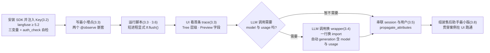

# 第 3 章 快速开始

> 本章导读：第 2 章把 Langfuse 跑在了本机，项目 `after-sales` 也建好了——但第一条 trace(追踪)落进 UI 之前，它对你来说只是一张空表格。本章解决接入问题：装上 Python SDK、注入三个环境变量，十分钟走通首条 trace；然后处理两个立刻会踩到的实测坑——LLM 节点缺 model 与 usage(两种埋点风格之别)、短脚本跑完 trace 不落库(flush 缺失)；再用 `propagate_attributes` 把零散 trace 串成会话；最后把贯穿案例「售后助手」的最小版跑起来。读完本章，你能：独立完成 SDK 接入与连通性自检；为一个 LLM 调用选对埋点风格并说出理由；在 UI 里读懂一条 trace 的层级与字段；把售后助手最小版跑通，并在 Traces 页与 Sessions 页看到它的数据。



*本章操作流程图*

## 你什么时候需要它

三种典型处境，对应本章三种用法。

**刚完成第 2 章部署，项目 Traces 页还是空的**——按 3.2(安装与 Key)→ 3.3(首条 trace)顺序走一遍，全程十分钟量级。这一趟会把 SDK 的安装、三变量注入、连通性自检和 UI 验证一次打通，后续所有章节都建立在这条链路上。

**已经在埋点了，但 LLM 节点上只有 input/output，成本页算不出钱**——直奔 3.4。这是本章最重要的实测教训：给函数标 `as_type="generation"` 并不会让它长出 model 与 usage 字段；要让 LLM 调用带上模型名、token 用量与成本，一行换 import 用 `langfuse.openai` 的 wrapper 才是正路。

**应用能跑了，但要回答「某个用户的一次会话里发生了什么」，或者脚本跑完 UI 里查无此 trace**——前者看 3.5(session 串联与用户标识)，后者看 3.6(flush)；各种「接不上、看不见、字段缺」的排查手段汇总在 3.7。

前置：第 2 章完成部署并可登录 UI；项目 API Key 已创建——pk-/sk- 两条 Key 成对使用，且**创建后只显示一次**，丢了只能重建(第 2 章)。本章代码里的 Key 一律写占位符 `pk-lf-***` / `sk-lf-***`，运行时换成你自己项目的真实值，不要把真实 Key 提交进代码库。

## 3.1 概述：SDK 在做什么，本章交付什么

**Python SDK 是接入 Langfuse 的默认路径：装饰一个函数、换一行 import，应用的行为不变，观测数据已经在路上了。**它不适合被当成一个「日志框架」来理解——你的业务代码不需要拼接日志文本、不需要决定「记什么级别」；SDK 在进程内收集观测点，经 OpenTelemetry(OTel)管道批量送往服务器的摄取(ingestion)端点 `/api/public/otel/v1/traces`。本书实测基线:Python SDK 5.2.0(PyPI 最新版，要求服务器 ≥4.59.0)，服务器 v4.76.0，核实日期 2026-11-08。

动手之前，把本章会用到的概念最小集过一遍。完整的数据模型(trace→observation 层级、字段、过滤语法)是第 4 章的主题，本章只取够用的子集：

| 概念 | 一句话定义 | 本章用法 | 展开 |
|------|-----------|---------|------|
| trace(追踪) | 一次请求的完整链路，层级树的根 | 一个脚本运行 = 一条 trace | 第 4 章 |
| observation(观测) | 链路上的节点，父 trace 之下 | 每个被装饰的函数 = 一个节点 | 第 4 章 |
| span(跨段) | observation 的一种：有起止的一段工作 | 默认装饰结果；检索、业务段用它 | 第 4 章 |
| generation(生成观测) | observation 的一种：一次模型调用 | LLM 调用节点，理想情况含 model 与 usage | 本章 3.4 |
| session(会话) | 把多条 trace 串成一次会话的标识 | `propagate_attributes` 注入(3.5) | 第 4 章 |

本章结束时，你手上会有四个可验证的交付物：

| 交付物 | 验证方式 | 小节 |
|--------|---------|------|
| 一套能连通的 SDK 环境 | `auth_check()` 返回 True | 3.2 |
| UI 里可见的首条 trace | Traces 页点开详情，层级树可读 | 3.3 |
| 一个带 model 与 usage 的 generation 节点 | 详情页 generation 字段齐全 | 3.4 |
| 售后助手最小版跑通 | Traces/Sessions 页出现 demo 数据 | 3.8 |

贯穿案例「售后助手」从本章开始成长：3.8 落地它的最小版(关键词检索占位 + LLM 应答)，之后各章逐步给它加料——第 4 章串 session 看会话视图，第 6 章把内置提示词模板换成 Langfuse 托管 Prompt，第 7-9 章进数据集与实验，第 12 章变成回归门禁。

### 事实来源与实测口径

- 出自官方文档(本章 `source` 指向 SDK overview):安装方式、三个环境变量、`@observe` 与 wrapper 的公开用法。
- 出自本书实测(2026-11-08，SDK 5.2.0 + 服务器 v4.76.0，本机 Docker 部署)：手动 `as_type="generation"` 缺 model/usage、wrapper 自动节点命名 `OpenAI-generation`、旧版查询接口投影不全、atexit 兜底对短进程不可靠、系统代理劫持 localhost 致 502。
- 本书立场：「LLM 调用一律 wrapper、业务段一律手动 `@observe`」是工程判断，不是文档结论；实测观察如实记录，不外推成官方承诺。

## 3.2 安装 SDK 与注入 Key:三变量加一次自检

### 安装

Python 环境建议 3.10 以上。本书 demo 的依赖就两行(实测版本:langfuse 5.2.0、openai ≥1.50):

```bash
pip install "langfuse>=5.2" "openai>=1.50"
```

langfuse 是 SDK 本体;openai 只有当你的应用直接调 OpenAI 或任意 OpenAI 兼容端点时才需要——3.4 的 wrapper 埋点与 3.8 的售后助手都走这条路，所以一起装上。本书实例的 LLM 是智谱的 OpenAI 兼容端点(`https://open.bigmodel.cn/api/paas/v4`,模型 `glm-5.3-flash`)，对 SDK 而言它就是一个换了 `base_url` 的 openai 客户端。

### 三个环境变量

SDK 从环境变量读连接信息，三个都要有：

| 环境变量 | 含义 | 本书实例取值 |
|---------|------|-------------|
| `LANGFUSE_HOST` | 服务器地址，本地部署即 UI 同源 | `http://localhost:3000` |
| `LANGFUSE_PUBLIC_KEY` | 项目公钥，`pk-lf-` 开头 | `pk-lf-***`(占位) |
| `LANGFUSE_SECRET_KEY` | 项目私钥，`sk-lf-` 开头 | `sk-lf-***`(占位) |

三条 Key 从第 2 章的项目 Settings → API Keys 页来：创建弹窗里 Name 必填(不填按钮禁用)，创建后 pk-/sk- **只显示一次**，当场落进 `.env`。Key 的作用域是项目——`after-sales` 项目的 Key 只会把数据送进 `after-sales`，多项目隔离的治理话题在第 11 章。本书实例的 demo 目录下 `.env` 长这样:

```bash
# .env —— Key 一律占位,运行时换成你项目自己的真实值
LANGFUSE_HOST=http://localhost:3000
LANGFUSE_PUBLIC_KEY=pk-lf-***
LANGFUSE_SECRET_KEY=sk-lf-***
ZHIPU_API_KEY=***
NO_PROXY=localhost,127.0.0.1
```

最后两行先记下备用:`ZHIPU_API_KEY` 到 3.4/3.8 的 LLM 调用才用;`NO_PROXY` 是本机实测踩过的坑——**如果你的系统设了 HTTP(S)_PROXY 代理，发往 `localhost:3000` 的请求会被劫进代理，返回 502**。本地部署调试一律设 `NO_PROXY=localhost,127.0.0.1`(curl 侧等价写法是 `--noproxy '*'`)。这不是 Langfuse 的问题，但足以让一个完全正确的接入「看起来失败」。

### 连通性自检:auth_check

三变量配好，先花十秒钟确认链路通，再开始写埋点：

```python
# check_conn.py —— 连通性自检
from langfuse import get_client

lf = get_client()        # 读三个环境变量,返回全局客户端
print(lf.auth_check())   # True = 服务器可达且 Key 有效
```

```bash
python check_conn.py
# True
```

实测输出 `True` 才继续往下走。若抛 401 或连接错误，按 3.7 的排障表对症处理——大多数情况是 Key 复制不全(只显示一次的遗留问题)或代理劫持(上面的 `NO_PROXY`)。

服务端侧还有一个更底层的探针:健康检查端点不要求认证，可用来确认「服务器活着」:

```bash
curl --noproxy '*' http://localhost:3000/api/public/health
# {"status":"OK","version":"4.76.0"}
```

`auth_check` 回答「Key 对不对」，健康检查回答「服务器在不在」，两个探针配合足以定位「连不上」发生在哪一层。

### Key 的作用域：为什么三变量是「项目级」的

三变量注入的是**项目级**身份:`after-sales` 的 Key 只会把数据送进 `after-sales`。这意味着两件事:其一,接入阶段的「数据去哪了」问题先查 Key——拿错项目的 Key,数据照样落库,只是落在另一个项目里,排查时容易南辕北辙;其二,「开发/生产数据分开」最朴素的做法就是两个项目、两套 Key,各自配各自的 `.env`(环境与多项目的完整隔离方案见第 11 章)。

## 3.3 首条 trace 十分钟走通

### 最小埋点:两个 @observe 嵌套

`@observe` 装饰器是 SDK 的最小入口：函数被调用时，SDK 在当前链路上挂一个 observation，函数的入参与返回值自动记为该节点的 input 与 output。嵌套调用自动成树——被装饰函数内部再调用另一个被装饰函数，后者成为前者的子节点。写一个十几行的脚本：

```python
# hello_trace.py —— 首条 trace:两个 @observe 嵌套
from langfuse import get_client, observe

lf = get_client()

@observe(name="hello-parent")
def pipeline() -> str:
    return worker()

@observe(name="hello-child")
def worker() -> str:
    return "ok"

if __name__ == "__main__":
    print(pipeline())
    lf.flush()   # 短生命周期进程显式刷送,否则 trace 可能不落库(3.6 详解)
```

两个要点。其一，`name` 参数决定节点在 UI 里显示的名字，不写则默认用函数名——本书建议显式命名，因为第 4 章的采集规范会要求「节点名可读且稳定」。其二，最后一行 `lf.flush()` 现在先照抄，它的原理与边界在 3.6 展开。

### @observe 到底替你记了什么

不写任何观测代码，装饰器已经记下了三样东西：

| 记录项 | 来源 | hello_trace.py 里的取值 |
|--------|------|------------------------|
| name | 装饰器参数，缺省用函数名 | `hello-parent` / `hello-child` |
| input | 函数入参，序列化为 args/kwargs | `pipeline()` 无参，args 为空 |
| output | 函数返回值，序列化 | `"ok"` |

外加 SDK 自动补齐的时间戳、时长与父子层级关系。同样重要的是它**没有**记的东西：没有 model、没有 usage、没有成本——这些语义字段只有模型调用才谈得上(下一节的主角)，普通业务段也确实不需要。若还想给节点附结构化信息(订单号、租户之类)，那是 metadata 与 tags 的用途，同样第 4 章展开。

### 运行前:UI 的空态长什么样

运行脚本之前，先去 UI 确认起点。登录后进入项目(本书实例的组织/项目是 `yubing-org` / `after-sales`)，侧栏 Observability 组点 Tracing，URL 形如 `http://localhost:3000/project/<你的项目ID>/traces`。还没接过 SDK 的项目，这一页是一张「引导你埋点」的空态页：


这张空态页本身就是官方版「快速开始」，三步与本章结构一一对应：**Create API keys** 对应第 2 章与本章 3.2(页面上 Create new API key 按钮直达)；**Add tracing with your coding agent** 是 v4 新增的推荐路线——把一段提示词复制给编码代理让它替你埋点，本书走的则是 3.3/3.4 的手动路线(下面的 "or follow our docs to set up tracing manually" 链接即官方文档)；**Run your app** 那句话给了预期——「Once your app makes an LLM call, traces show up within seconds」，trace 在调用后几秒内出现。标题里那句 "it only takes a minute" 略有营销成分，实测含装依赖与配环境变量，十分钟量级是合理预期。

### 运行与验证:Traces 页出现首条数据

运行脚本:

```bash
python hello_trace.py
# ok
```

回到 Tracing 页刷新。列表出现一条名为 `hello-parent` 的 trace——名字取自根节点装饰器的 `name`。列表行的列(名称、时长、时间、session、user 等)可通过 Display/Columns 配置，过滤搜索框支持 `level:ERROR` 这类语法——列表的完整玩法(保存视图 My Views、过滤语法)第 4 章展开，本章只需要会点行进详情。

点开这条 trace，你会看到本章最重要的一个界面:


(这张实测截图来自 3.8 的售后助手，层级比 `hello_trace.py` 丰富，正好看全界面元素。)逐块读它：

| 界面元素 | 你看到什么 | 背后的概念 |
|---------|-----------|-----------|
| 头部 traceId | `801b333d98742686143dcf7c8a3b1c85` 这样的十六进制串，一 trace 一串 | trace 的唯一标识，排障时的「单号」 |
| 头部摘要 | 时长 10.35s、session 链接、`user: demo-user` | session 与 user 标识(3.5 注入)；成本与 tokens 汇总也在头部一排，配好模型价格后按真实价显示(第 5 章) |
| 左树三视图 | Tree / Timeline / Graph 可切换，默认 Tree | 同一棵层级树的三种画法：缩进树 / 时间轴 / 图 |
| 树节点 | 根之下挂 `retrieve-context`、`llm-call` 等子节点，各带时长 | observation 层级；类型图标区分 span 与 generation(第 4 章) |
| 右侧标签 | Preview / Metadata / Scores / Log View，默认 Preview | Preview 看 Input/Output;Scores 是评分入口(第 7 章) |
| Formatted/Raw | 美化 JSON 与原始 JSON 切换 | 排查字段细节时切 Raw 更诚实 |
| 操作按钮 | + Add to / Annotate / Comment | 入库、人工标注、评论——评估侧的入口(第 7、9 章) |

本节只需记住一个动作**:「列表点行 → 左树看层级 → Preview 看进出参」**,这个三步动作是全书验证埋点的基本功。Tree/Timeline/Graph 各视图的适用场景与 observation 的字段全集，第 4 章展开。

## 3.4 两种埋点风格:手动 observe 与 OpenAI wrapper(本章重点)

### 问题:generation 节点为什么缺 model 和 usage

3.3 的 `hello_trace.py` 没有涉及 LLM。现在给 LLM 调用埋点，直觉做法是把装饰器标注成 generation 类型——`as_type="generation"` 把节点标为「一次模型调用」，UI 里的类型图标也随之变化。本书实测(2026-11-08，SDK 5.2.0)：

```python
# 风格一:手动装饰器标注 generation —— 实测只有 input/output
import os
from openai import OpenAI
from langfuse import observe

zhipu = OpenAI(
    base_url="https://open.bigmodel.cn/api/paas/v4",
    api_key=os.environ["ZHIPU_API_KEY"],
)

@observe(name="llm-call", as_type="generation")
def llm_call(messages: list) -> str:
    resp = zhipu.chat.completions.create(
        model="glm-5.3-flash",
        messages=messages,
        temperature=0.3,
    )
    return resp.choices[0].message.content
```

跑一次，UI 里确实多了一个 generation 类型的 `llm-call` 节点。但点开 Preview 你会看到:字段只有 input 与 output——**没有 model，没有 usage(token 用量)，自然也算不出成本**。这不是配置遗漏，是机制使然:装饰器只能看到 Python 函数的入参和返回值；模型名与 token 数藏在 SDK 响应对象(`resp.model`、`resp.usage`)里，装饰器够不着。理论上可以在每个调用点把这些字段手动搬进观测属性，但那意味着每处 LLM 调用都写一遍样板代码，观测代码喧宾夺主。

### 方案:一行换 import,wrapper 自动记录 generation

SDK 为 openai 官方客户端准备了 wrapper:**import 来源从 `openai` 换成 `langfuse.openai`,其余代码不动**，它会在 `chat.completions.create` 执行时自动挂一个 generation 子节点——实测节点名为 `OpenAI-generation`,模型名、prompt/completion token 用量、延迟齐全；结合模型单价定义，成本字段随之入账(配价见第 5 章):

```python
# 风格二:wrapper 一行换 import —— chat 调用自动挂 generation(实测)
import os
from langfuse.openai import OpenAI   # 唯一的改动:import 来源

zhipu = OpenAI(
    base_url="https://open.bigmodel.cn/api/paas/v4",   # 任意 OpenAI 兼容端点
    api_key=os.environ["ZHIPU_API_KEY"],
)

@observe(name="llm-call")
def llm_call(messages: list) -> str:
    resp = zhipu.chat.completions.create(
        model="glm-5.3-flash",
        messages=messages,
        temperature=0.3,
    )
    return resp.choices[0].message.content
```

这里 `llm-call` 恢复成普通 span(它记录的是「这一次 LLM 调用发生在业务流程的哪个位置」)，而 wrapper 在它之下自动补出 `OpenAI-generation` 节点补齐语义字段。wrapper 拦截的是 openai SDK 的调用本身，所以端点是不是 OpenAI 官方无关紧要——凡是走 openai 客户端的调用都拦得住，本书的智谱兼容端点实测可用;`resp.model` 与 `resp.usage` 是 OpenAI 兼容响应的标配字段，wrapper 从响应里取值，不需要你提供任何额外配置。

### 两种风格对比与选型

| 维度 | 风格一：手动 `@observe(as_type="generation")` | 风格二:`langfuse.openai` wrapper |
|------|----------------------------------------------|----------------------------------|
| 改动量 | 给函数加装饰器参数 | 一行换 import |
| 记录内容 | 只有 input/output(实测) | model/usage/延迟齐全(实测) |
| 成本核算 | 算不出——缺 model 与 usage | 配价后自动入账(第 5 章) |
| 节点名字 | 装饰器 `name` 参数自定 | 自动命名 `OpenAI-generation` |
| 适用范围 | 任意 Python 函数/业务段 | 仅走 openai SDK 的调用 |
| 字段来源 | 函数入参与返回值 | openai 响应对象，wrapper 自取 |
| 实测结论 | 单独用它埋 LLM 调用 = 字段残缺 | LLM 调用埋点的首选 |

**本书立场：LLM 调用一律 wrapper，业务段一律手动 `@observe`，两者组合而非二选一。**wrapper 负责「模型调用」这一类语义明确的节点；检索、数据加工、工具执行这些业务段 wrapper 管不着，仍由 `@observe` 记录——3.8 的售后助手正是这个组合：`retrieve-context` 与 `llm-call` 是手动 span，`OpenAI-generation` 是 wrapper 自动补的 generation。若你的 LLM 调用不走 openai SDK(自研 HTTP 客户端、其他 SDK),wrapper 帮不上忙，此时退回手动路线并手动补录字段，或改用框架集成(第 10 章的集成清单覆盖 LangChain/LlamaIndex 等路线)。

一个容易混淆的点顺带澄清:`as_type="generation"` 并非无用——它决定节点的**类型**；wrapper 决定的是**字段的丰富度**。两者作用于不同维度，本书不建议用「手动标类型」去替代「wrapper 取字段」，因为后者是前者做不到的事。

## 3.5 session 串联与用户标识:propagate_attributes

### 问题:列表里的 trace 是散的

按 3.3/3.4 跑下来的 trace 在列表里各排各的——同一用户的连续提问、同一轮排障的几次尝试，UI 无从把它们归为一组。session(会话)就是补这个的：给相关 trace 打上同一个 `session_id`,UI 的 Sessions 页把它们聚合为一个会话;`user_id` 同理，给 trace 挂上用户标识，Users 页按用户聚合。

### 方案:上下文管理器一次性注入

SDK v5 的用法是 `propagate_attributes` 上下文管理器——进入作用域时把属性挂上当前上下文，作用域内新建的 trace 全部携带：

```python
# 承接 3.4:把一次应答的 trace 串进会话
from langfuse import observe, propagate_attributes

@observe(name="support-bot-answer")
def answer(query: str, session_id: str | None = None) -> str:
    with propagate_attributes(session_id=session_id, user_id="demo-user"):
        # 作用域内产生的 trace 与子节点都带 session/user
        ...  # 检索与 LLM 调用,3.8 组装
```

三个实操要点。**其一，放在尽量高的层级**：包住整个应答函数，根 trace 与其下所有 observation 都能继承;只包住最内层的话，根节点就挂不上。**其二，session_id 用你业务里已有的会话键**(前端会话 ID、对话轮次组 ID),不要为埋点新造一套编号——3.8 的 demo 用环境变量 `DEMO_SESSION_ID` 演示注入，默认 `demo-session-001`。**其三，user_id 是业务标识而非凭据**，不要把手机号、邮箱这类个人信息直接当 user_id 用(采集规范里的敏感字段原则，第 4 章)。

验证方式还是 3.3 的基本功：跑两条同 session 的 trace，打开详情页，头部的 session 链接可点，落地在 Sessions 页——本书实例里 `demo-session-001` 串起了 4 条 trace，user 为 `demo-user`。会话视图(v4 把每条 trace 折叠成对话式消息对)是第 4 章的看点，本章能确认「trace 已归组」即可。

## 3.6 短生命周期进程必须 lf.flush()

### 问题:脚本跑完了,UI 里查无此 trace

SDK 的上报是异步的：`@observe` 的记录先进进程内队列，后台线程攒批送往摄取端点。这对常驻服务是性能红利，对「跑完就退」的脚本却是陷阱——**进程退出时 SDK 虽有 atexit 兜底，但对短生命周期进程并不可靠**，实测(2026-11-08)不 flush 的短脚本 trace 时有时无，典型的竞态表现：偶尔能看到，多数时候看不到，且越快的脚本越容易丢。

### 方案:退出前显式 flush

```python
lf = get_client()
# ... 业务逻辑与埋点 ...
lf.flush()   # 阻塞至队列清空,确保 trace 落库
```

`lf.flush()` 阻塞等待队列里的记录全部送出，一行解决。本书 demo(`support_bot.py`)的最后一行就是它。

边界划清楚:**凡「跑完就退」的进程都必须 flush**——命令行脚本、定时任务、CI 里的评估脚本(第 8、12 章的实验脚本都属于此类)；**常驻的 Web 服务、长跑的 worker 可以不显式 flush**——进程不退出，队列自然被后台线程持续送出。判据只有一个：进程会不会在埋点后立刻退出。多花了这一行，换来的是「UI 里查无此 trace」这类玄学问题的根除；反过来说，若你确认加了 flush 仍然缺数据，那就不是 flush 的问题，去 3.7 按表排查。

## 3.7 Debug 与验证:以 UI 为准

### 排障入口:两个探针加一张表

接入阶段的问题集中在「连不上」「看不见」「字段缺」三类。前两类用 3.2 的两个探针定位:`auth_check()` 回答 Key 与连通性，健康检查端点回答服务器状态；「看不见」优先怀疑 flush(3.6)与代理(`NO_PROXY`)。常见症状速查：

| 症状 | 多数原因 | 处理 |
|------|---------|------|
| `auth_check()` 抛 401/403 | Key 错误或 pk/sk 跨项目混配 | 重建 Key(第 2 章);确认 pk/sk 同批且属于目标项目 |
| 连接错误/502(本机部署) | 系统代理劫持 localhost | 设 `NO_PROXY=localhost,127.0.0.1`;curl 加 `--noproxy '*'` |
| 脚本跑完 UI 没数据 | 短进程未 flush | `lf.flush()`(3.6) |
| trace 出现但 generation 缺 model/usage | 手动 `as_type="generation"` 埋 LLM | 换 wrapper(3.4) |
| session/user 列空白 | 未注入或注入层级太低 | `propagate_attributes` 包住应答入口(3.5) |

### 实测观察:旧版查询 API 投影不全,验证以 UI 为准

进阶排查时你会想用代码查询刚写入的数据，这里有一处必须如实交代的实测观察:SDK 5.2.0 保留的旧版查询接口 `lf.api.observations.get_many` **投影不全——返回的 model 与 usage 字段为 None**,而同一批数据在 UI 里有值，服务器侧 ClickHouse 的 `events_core` 表里也有值。也就是说，数据好好地在服务器上，只是这个旧接口没把新字段投影出来：

```python
# 实测观察(2026-11-08,SDK 5.2.0):model/usage 打印为 None,并非数据缺失
obs = lf.api.observations.get_many()
for o in obs.data:
    print(o.name, o.type, o.model, o.usage)
```

顺带两个版本提示：SDK v5 已移除 v4 时代的 `lf.api.trace.list`(trace 查询请走 UI 或服务端 API),网上旧教程里的 `dataset.run()` 系列同样已被移除(第 8 章用 `run_experiment` 替代)——照抄旧代码会直接 AttributeError。

**本书立场：验证埋点结果，以 UI 为准。**代码侧查询只做「数据到了没有」的存在性检查，字段是否齐全、成本是否入账，切到 UI 的详情页确认。这不圆满，但如实：工具链处在 v3→v4 的迁移带上，UI 是唯一与落库数据保持一致的窗口。第 5 章讲成本时还会遇到同族问题(配价只对新摄取生效)，口径一致。

## 3.8 贯穿案例落地:售后助手最小版

### 从片段到完整应用

前三节的片段该合体了。贯穿案例「售后助手」的最小版：关键词检索器(占位，一句带过)+ wrapper 埋点的 LLM 调用 + session 注入 + flush。检索器极简——三条售后域 FAQ 按关键词命中，未命中回退退货资料；生产里换成向量检索或知识库(→ ragflow 书)都行，Langfuse 不关心检索器怎么实现，只负责记录它跑了、跑了多久、进了什么出了什么。完整链路(多轮会话、检索质量、Prompt 托管)第 4 章起逐章展开。

```python
# support_bot.py(本章最小版)—— 售后助手:检索占位 + LLM 应答,全程 Langfuse 埋点
import os
import sys

from langfuse.openai import OpenAI   # wrapper:chat 调用自动记录为 generation(3.4)
from langfuse import get_client, observe, propagate_attributes

lf = get_client()
zhipu = OpenAI(
    base_url="https://open.bigmodel.cn/api/paas/v4",   # 智谱 OpenAI 兼容端点
    api_key=os.environ["ZHIPU_API_KEY"],
)

# 检索器占位:关键词命中三条售后 FAQ,未命中回退退货资料(生产替换为向量检索/知识库)
FAQ = {
    "退货": (
        "跨境商品支持签收后 7 天无理由退货(激活/拆封类商品除外);"
        "退货需商品完好、附件齐全,运费由买家承担(质量问题除外)。"
    ),
    "物流": (
        "保税仓发货订单 3-5 日送达;海外直邮订单 7-15 日送达;"
        "节假日期间时效顺延,超 30 日未送达可申请全额退款。"
    ),
    "换货": (
        "质量问题支持签收后 30 天内免费换货一次;"
        "非质量问题换货需商品未拆封,运费自理。"
    ),
}

@observe(name="retrieve-context")
def retrieve(query: str) -> str:
    hits = [v for k, v in FAQ.items() if k in query]
    return "\n".join(hits) if hits else FAQ["退货"]

@observe(name="llm-call")
def llm_call(messages: list) -> str:
    resp = zhipu.chat.completions.create(
        model="glm-5.3-flash",
        messages=messages,
        temperature=0.3,
    )
    return resp.choices[0].message.content

@observe(name="support-bot-answer")
def answer(query: str, session_id: str | None = None) -> str:
    """一次售后应答 = 一条 trace;检索与 LLM 是它的两个 observation。"""
    with propagate_attributes(session_id=session_id, user_id="demo-user"):
        context = retrieve(query)
        system_text = (
            "你是跨境电商售后助手,仅依据以下资料回答,资料之外请引导转人工:\n"
            f"{context}"
        )
        messages = [
            {"role": "system", "content": system_text},
            {"role": "user", "content": query},
        ]
        return llm_call(messages)

if __name__ == "__main__":
    query = sys.argv[1] if len(sys.argv) > 1 else "我想退货,政策是什么?"
    session = os.environ.get("DEMO_SESSION_ID", "demo-session-001")
    print(f"Q: {query}")
    print(f"A: {answer(query, session_id=session)}")
    lf.flush()   # 短生命周期进程显式刷送(3.6)
```

这份最小版与实测仓库里的 `support_bot.py` 有意保持了两处差距，留作后续章节的接口：实测版还从 Langfuse 托管拉取 Prompt(`get_prompt("after-sales-answer")`,失败回退内置模板)——本章先用内置 system 模板，托管化在第 6 章；实测版的检索器注释与语料维护也更完整——检索质量的话题第 7 章接手。**案例随章节成长，每章的代码都可运行，这是全书约定。**

### 运行与 UI 验证

```bash
python support_bot.py                                    # 默认问题「我想退货,政策是什么?」
python support_bot.py "换货流程是什么"                     # 自定义问题
DEMO_SESSION_ID=demo-session-002 python support_bot.py   # 换个会话 ID 再跑一条
```

跑一到两条，然后按本章学到的基本功逐项验收：

| 验证点 | 位置 | 预期 |
|--------|------|------|
| trace 出现 | Tracing 页 | 名为 `support-bot-answer` 的 trace,几秒内可见 |
| 三层结构 | 详情页左树(Tree 视图) | `retrieve-context` 与 `llm-call` 挂在根下,各带时长 |
| generation 字段 | `llm-call` 之下的 `OpenAI-generation` | model=`glm-5.3-flash`,usage 含 prompt/completion tokens |
| session 归组 | 详情页头部 session 链接 → Sessions 页 | 同一 `session_id` 的 trace 聚成一组,user=`demo-user` |
| 进出参 | 根节点 Preview | Input 含 query 与 session_id,Output 为最终回答 |

3.3 的那张详情截图(`lf-trace-detail.png`)正是这个 demo 的实测产物——注意它回答的问题是「海外直邮超时了怎么办？」：检索器按关键词没命中「物流」(query 里没有这个词)，回退到了退货资料，LLM 判定资料不符，回答引导转人工。**这是一个原生的 badcase**,本书不打算掩盖它：它是第 7 章数据集建设「badcase 反哺」的活案例，也是第 12 章回归测试价值的最佳注脚——先把问题真实地记下来，才谈得上改进与防回退。

到这里，贯穿案例的最小闭环完成：应用在跑，trace 在落，UI 里看得见层级、模型与用量。它还没有成本数字(模型配价，第 5 章)、没有托管 Prompt(第 6 章)、没有评估(第 7-9 章)——接下来的章节逐个补齐。

## 本章小结

回到开头的问题，本章交付了四件事：

1. **接入**：安装 `langfuse>=5.2`,注入 `LANGFUSE_HOST` / `LANGFUSE_PUBLIC_KEY` / `LANGFUSE_SECRET_KEY` 三变量，`auth_check()` 自检通过(3.2);
2. **首条 trace**:`@observe` 嵌套成树，运行后 UI 里按「列表点行 → 左树看层级 → Preview 看进出参」三步读懂数据(3.3);
3. **埋点选型**：LLM 调用用 `langfuse.openai` wrapper 一行换 import 自动获得 model/usage/延迟；手动 `@observe(as_type="generation")` 只有 input/output,两者组合使用(3.4);
4. **工程化三件事**:`propagate_attributes` 串 session 与用户(3.5),短生命周期进程 `lf.flush()`(3.6),验证埋点以 UI 为准(3.7)。

贯穿案例方面，售后助手最小版已在你的机器上跑通，UI 里能找到它的 trace、层级与 generation 字段；那个「海外直邮超时」badcase 也已如实入库，等着第 7 章回收。

下一步建议：带着 3.8 跑出的数据进第 4 章——trace 与 observation 的数据模型、session 会话视图、采集规范(命名约定、敏感字段、采样)与列表过滤语法，都在那里展开；如果你更关心「这些 usage 数字怎么变成钱」，第 5 章的模型配价与成本看板可以先读。

## 验收清单

- ☐ 不看书写出三个环境变量名，并说清 pk-/sk- 为什么成对创建、为什么创建后只显示一次
- ☐ 从 `pip install` 走到 UI 里看到自己的一条 trace,全程不超过十分钟
- ☐ 点开一条 trace,说出 Tree/Timeline/Graph 三视图与 Preview/Metadata/Scores 标签各回答什么问题
- ☐ 把一个 LLM 调用从手动 `as_type="generation"` 改成 wrapper 埋点，并在 UI 里指出 model 与 usage 字段的变化
- ☐ 用 `propagate_attributes` 把两条 trace 串进同一 session,并在 Sessions 页找到它们
- ☐ 解释为什么短脚本必须 `lf.flush()` 而常驻服务可以不加，并检查自己的应用属于哪一类
- ☐ 被问「查询接口里 model/usage 为什么是 None」时，能按「验证以 UI 为准」给出处理路径

## 参考速查

理解主线不依赖本节；本节供接入与排障时查阅。

### 环境变量

| 变量 | 必填 | 说明 |
|------|------|------|
| `LANGFUSE_HOST` | 是 | 服务器地址；本地部署为 `http://localhost:3000` |
| `LANGFUSE_PUBLIC_KEY` | 是 | 项目公钥，`pk-lf-` 开头，作用域为项目 |
| `LANGFUSE_SECRET_KEY` | 是 | 项目私钥，`sk-lf-` 开头，与公钥同批创建 |
| `NO_PROXY` | 本机调试建议 | 设 `localhost,127.0.0.1`,防系统代理劫持 |
| `ZHIPU_API_KEY`(示例应用自有) | 本章 demo 需要 | LLM 提供商 Key,与 Langfuse 无关 |

### 本章用到的 SDK 入口(SDK 5.2.0)

| API | 用途 | 备注 |
|-----|------|------|
| `get_client()` | 取全局客户端，读三环境变量 | 全书 demo 统一入口 |
| `@observe(name=…, as_type=…)` | 函数埋点，默认 span | `as_type="generation"` 只定类型，字段不增 |
| `from langfuse.openai import OpenAI` | wrapper,LLM 调用自动 generation | 节点名 `OpenAI-generation`,含 model/usage/延迟 |
| `propagate_attributes(session_id=…, user_id=…)` | 上下文管理器注入会话与用户 | 包住应答入口层级 |
| `lf.flush()` | 阻塞刷送上报队列 | 短生命周期进程必须 |
| `lf.auth_check()` | 连通性与 Key 自检 | 返回 True 才继续 |
| `lf.api.observations.get_many()` | 旧版查询(投影不全) | model/usage 返回 None,验证以 UI 为准 |

### 版本基线(核实日期 2026-11-08)

| 项 | 值 |
|----|-----|
| Langfuse 服务器 | v4.76.0(本机 Docker 自托管) |
| Python SDK | langfuse 5.2.0(要求服务器 ≥4.59.0) |
| 摄取端点 | `/api/public/otel/v1/traces`(OTel) |
| LLM(示例应用) | 智谱 OpenAI 兼容端点,`glm-5.3-flash` |

## 延伸阅读

- **第 2 章 本地部署**——本章三变量与 Key 从哪来：项目创建、API Key 生成「只显示一次」的全流程，以及六容器栈的日常启停与排障。
- **第 4 章 Trace 模型与链路追踪**——本章左树里那些节点的数据模型全集：trace→observation 层级、session 会话视图、命名与敏感字段等采集规范、过滤语法与保存视图。
- **第 5 章 成本与性能监控**——`OpenAI-generation` 里的 usage 如何变成成本数字：模型配价(内置价格表无智谱模型，需手工建)、成本口径、看板与延迟分析。
- **第 6 章 Prompt 管理**——把 3.8 最小版里的内置 system 模板换成 Langfuse 托管 Prompt(`after-sales-answer`),版本、label 与 trace 关联。
- **第 10 章 接入已有系统**——wrapper 之外的接入路线全景:LangChain/LlamaIndex 等框架集成清单，以及 RAGFlow 联动的兼容性实测结论。
