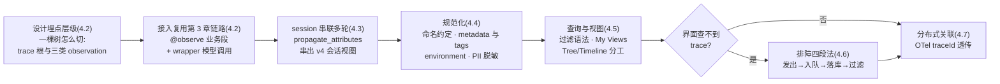
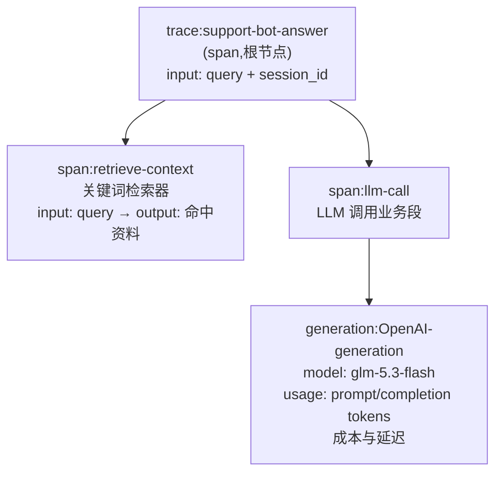
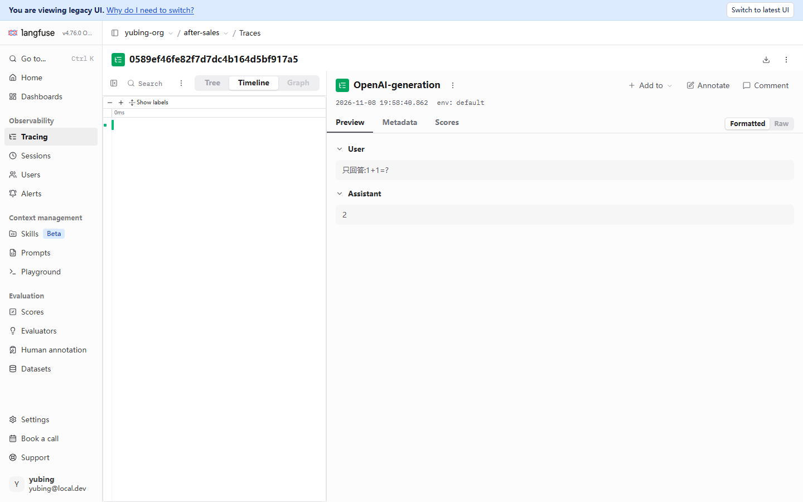
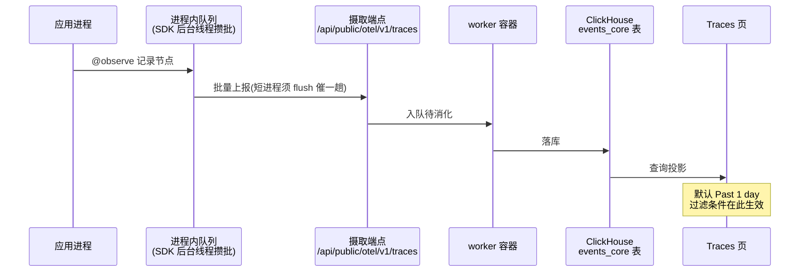
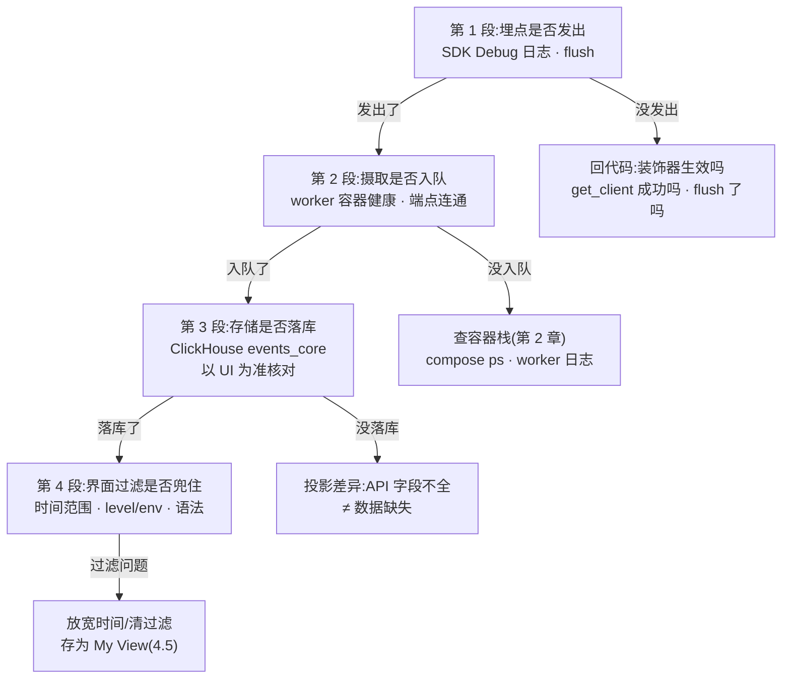

# 第 4 章 Trace 模型与链路追踪

> 本章导读：第 3 章走通了接入链路，售后助手的 trace 已经落进 UI——但「能看见」和「看得懂、管得住」之间还差一层：层级树里每个节点是什么、字段从哪来、多条 trace 怎么串成一次会话、名字起得不好三个月后自己都看不懂、用户手机号混进 input 怎么办。本章把数据模型与采集规范一次讲透：trace(追踪)与 observation(观测)的字段全集、三类 observation 的分工、session(会话)串联与会话视图、命名与敏感字段的采集纪律、过滤语法与保存视图，最后给出排查「UI 里查无此 trace」的四段法。读完本章，你能：画出自己应用的一棵 trace 树并给三层节点命名；用 `propagate_attributes` 串出多轮会话并读懂 v4 会话视图；为项目定一套命名与脱敏规范；用过滤语法与保存视图在几百条 trace 里找到目标；按四段法定位丢 trace 的环节。



*本章操作流程图*

## 你什么时候需要它

三种典型处境，对应本章三种用法。

**应用已经埋上点了，但列表里的数据「能看不能用」**——节点名字随手起的、没有 session 串不起来、看不出钱花在哪。直奔 4.2 与 4.4：前者给你字段全集，让你知道每个槽位是干什么的；后者是本章的方法论重点，命名约定、metadata/tags 的使用边界、environment 隔离与敏感字段脱敏，都是「埋点写完之后回头补成本极高」的规范，值得现在就定下来。

**要回答「这个用户的这次会话里发生了什么」，或者产品同事想按对话读记录**——看 4.3。session 把散条 trace 串成一次会话，v4 的新版会话视图把每条 trace 折叠成对话式消息对，给非工程师看的最合适；实测里有个「JSON-only message」的折叠怪相，与 4.4 的命名规范直接相关，顺带讲清。

**trace 明明埋了，列表里却查不到、过滤不出来**——先看 4.5(过滤语法与时间范围，很多时候只是过滤条件不对)，再按 4.6 的排障四段法逐段定位：埋点是否发出、摄取是否入队、存储是否落库、界面过滤是否兜住。

前置：第 3 章的接入链路(三变量、`@observe`、wrapper、flush)可用；售后助手最小版跑过至少一次。本章不换新的依赖，代码都在 3.8 的 `support_bot.py` 上演进。

## 4.1 概述：一棵树与两件事

Langfuse 的可观测模型可以压缩成一句话：**一条 trace 是一次业务执行完整链路，其下挂一棵 observation 树；本书围绕它要做对两件事——把树切对(数据模型)，把数据填对(采集规范)。**第 3 章已经在用这条模型(装饰一个函数 = 挂一个节点)，本章把它展开成可查表、可执行的全集。

| 概念 | 一句话定义 | 关键字段 | 展开 |
|------|-----------|---------|------|
| trace(追踪) | 一次请求的完整链路，树的根 | traceId、name、session_id、user_id、tags、environment | 4.2.1 |
| observation(观测) | 树上的节点，三类之一 | name、level、input/output、起止时间 | 4.2.2 |
| span(跨段) | 有起止的一段工作 | startTime/endTime、时长 | 4.2.2 |
| generation(生成观测) | span 的特化：一次模型调用 | model、usage、成本 | 4.2.2 |
| event(事件) | 无时长的一个时点打点 | 单一时间戳 | 4.2.2 |
| session(会话) | 同一 session_id 的 trace 组 | `propagate_attributes` 注入 | 4.3 |
| score(评分) | 挂在 trace/observation 上的评价 | 三来源(人工/评估器/用户) | 第 7-9 章 |

本章结束时，你手上会有四个可验证的交付物：

| 交付物 | 验证方式 | 小节 |
|--------|---------|------|
| 一张自己的 trace 树设计图(三层节点各就各位) | 能对着 UI 的 Tree 视图逐节点说出类型与字段来源 | 4.2 |
| `demo-session-001` 这样的多轮会话 | Sessions 页对话式视图可读 | 4.3 |
| 一套落字的采集规范(命名/metadata/tags/脱敏) | 新埋点代码可直接对照检查 | 4.4 |
| 一个保存视图(My View)+ 一次四段法排障演练 | 过滤语法命中目标 trace；能说出丢 trace 卡在哪一段 | 4.5、4.6 |

与第 3 章的分工也要说清：第 3 章回答「怎么接上」，本章回答「怎么接好」——第 3 章的全部代码(`support_bot.py` 最小版)本章原样沿用，不引入新依赖；你要做的只是把它跑出的数据读透，再按 4.4 的规范回改两三处埋点代码。

同样要交代本章不做什么：不讲成本数字的来龙去脉(第 5 章)、不建评估数据集(第 7 章)、不做部署侧的容量与数据保留治理(第 11 章)、不做跨服务透传实操(4.7 只立概念，第 10 章实操)。本章的野心边界就是「一棵树 + 一套规范」——树是你自己应用的形状，规范是让它三个月后还能用的纪律。

### 事实来源与实测口径

- 出自官方数据模型概念(本章 `source` 指向 traces 概念文档)：trace→observation 层级、span/generation/event 三类、字段语义。
- 出自本书实测(2026-11-08，SDK 5.2.0 + 服务器 v4.76.0，本机 Docker 部署)：过滤语法与会话视图形态、`@observe` 合法 `as_type` 取值、SDK 5.2.0 的 debug 开关与 mask 钩子(对照本机安装的 SDK 源码核实)、旧版查询 API 投影不全。
- 本书立场：「数据模型是文档写定的，采集规范是团队约定的」——前者照文档用，后者必须显式定出来并写进代码评审清单，4.4 就是替你把这套约定先写好的底稿。

## 4.2 数据模型全集：trace 根对象与三类 observation

### 4.2.1 trace 根对象：一条链路的户口本

trace 是树的根，也是列表页里的一行。官方数据模型给它的字段全集如下(出处：官方 traces 概念文档；实测补充以 2026-11-08 UI 为准)：

| 字段 | 类型 | 语义 | 谁来填 | 贯穿案例取值 |
|------|------|------|--------|-------------|
| traceId | 32 位十六进制串 | 唯一标识，排障时的「单号」 | SDK 生成；也可指定外部 id 做分布式关联(4.7) | `0589ef46fe82f7d7dc4b164d5bf917a5` 这类 |
| name | 字符串 | trace 名，取自根节点名；列表与过滤的主要维度 | 埋点方(命名规范 4.4) | `support-bot-answer` |
| timestamp | 时间戳 | trace 开始时间 | SDK 自动 | — |
| input / output | 任意 JSON | 这次执行的入参与最终产出 | `@observe` 自动记录函数进出参 | query 与最终回答 |

input/output 的两个填法边界先立好。**其一，载荷要克制**：「任意 JSON」不等于「什么都塞」——多模态(multimodal)场景下 input 可以承载图片等媒体，但正确的形态是放引用(对象存储键、URL)而非整个文件本体，metadata 值 ≤200 字符的约束(4.2.4)也提示了这条路的丈量单位；把几 MB 的上下文原文整包塞进每条 trace，列表页与导出都会跟着变重。**其二，形态要为下游视图着想**——4.3 会看到的对话式会话视图，只认消息结构的 input；这一条将在那里展开。
| session_id | 字符串 | 会话归属，同 id 的 trace 聚成组 | `propagate_attributes` 注入(4.3) | `demo-session-001` |
| user_id | 字符串 | 触发执行的用户标识 | 同上 | `demo-user` |
| metadata | JSON 对象 | 结构化附注：订单号、渠道、租户…… | 埋点方(使用边界 4.4) | — |
| tags | 字符串数组 | 可过滤的分类标签 | 埋点方(与 metadata 的分工 4.4) | — |
| version | 字符串 | 该 trace 对应的应用版本 | 埋点方 | — |
| environment | 字符串 | 环境标识，默认 `default`(实测) | 埋点方 | 未显式设置，落 `default` |
| release | 字符串 | 部署版本标识(数据模型字段；v5 Python SDK 当前属性清单以 version/tags/environment 为主，如实标注) | 埋点方 | — |

两点实测补充。其一，trace 头部那一排摘要字段(时长、成本、tokens)是服务器算出来的派生值，不在写入字段之列——点开一条 trace 就能看到：


这张图回答「usage 字段去哪了」：generation 节点行与右侧详情都带 tokens 与成本，模型名可点——这些字段由第 3 章的 wrapper 从模型响应里自取(3.4)，再结合模型单价定义换算成金额(配价见第 5 章)。注意一个显示细节：**头部汇总显示 `$0.00`，节点行却是 `$0.000007`**——本书解读：金额没丢，头部汇总按两位小数四舍五入，教学级的小金额被抹成了零；判断成本是否入账，看节点行与第 5 章的看板，不要只盯头部两位小数。另外本截图顶部有「You are viewing legacy UI」横幅——实测处于 v4 迁移期双 UI 形态(第 2 章交代过)，以下截图同此，不再逐一标注。

把详情页头部这一排摘要整理成速读表，点开任何一条 trace 时自上而下扫一遍即可完成基本体检：

| 头部元素 | 速读什么 | 异常时的去向 |
|---------|---------|-------------|
| traceId | 单号，复制进工单与排障记录 | — |
| 时长 | 本次执行总耗时，与节点耗时对照找大头 | Timeline 视图(4.5) |
| 成本与 tokens | 汇总金额与用量 | 缺数字→查 generation 字段(3.4)与配价(第 5 章) |
| session 链接 | 会话归属对不对 | 跳 Sessions 页(4.3) |
| user | 用户标识对不对 | 空白→注入层级(3.5)与 4.4.4 |

其二，environment 的默认值在 UI 里可直接验证：4.5 的列表过滤面板里有 Environment 过滤面，本书四条 trace 全部落 `default`，面板附提示文案「See docs on how to add environments to your observations-events」——环境隔离怎么配、为什么要配，4.4.3 与第 11 章展开。

### 4.2.2 observation 三类：span、generation、event

根之下所有节点统称 observation，分三类，区别就在时间维度与语义特化：

| 类型 | 语义 | 时间维度 | 特有字段 | 贯穿案例对应节点 |
|------|------|---------|---------|----------------|
| span(跨段) | 有起止的一段工作：检索、工具执行、业务段 | startTime→endTime，有时长 | 时长、level | `retrieve-context`、`llm-call` |
| generation(生成观测) | span 的语义特化：一次模型调用 | 同 span | model、模型参数、usage(prompt/completion tokens)、成本、延迟 | `OpenAI-generation` |
| event(事件) | 无时长的一个时点打点 | 单一时间戳 | 无起止 | 本 demo 未用到；多见于框架集成与 OTel 桥接的数据落点 |

三类之外，observation 还有一组通用字段。同 trace 字段一样值得过一遍，埋点时才知道每个槽位由谁填：

| 通用字段 | 语义 | 谁来填 |
|---------|------|--------|
| name | 节点名 | 装饰器 `name` 参数，缺省函数名(4.4.1) |
| input / output | 函数进出参 | `@observe` 自动 |
| metadata | 结构化附注，与 trace 同名字段同规 | 埋点方(4.4.2) |
| level | DEBUG/DEFAULT/WARNING/ERROR 四值 | SDK 依异常自动标，也可手动标 |
| statusMessage | 状态描述，出错时放异常摘要 | SDK 自动或手动 |
| startTime / endTime | 起止时间，时长由二者得出 | SDK 自动 |

其中 **level(级别)值得单独说**：取值为 `DEBUG` / `DEFAULT` / `WARNING` / `ERROR`(实测核实：SDK 5.2.0 类型定义 `SpanLevel` 即此四值)，它是列表过滤语法 `level:ERROR` 的数据来源(4.5)，也是 UI 里把出错节点标红的依据。`@observe` 装饰的函数抛异常时，SDK 会把节点标为 ERROR 并记录异常信息——「失败的 trace」是排障与 badcase 反哺(第 7 章)的第一入口。

一个如实标注的实测边界：**SDK 5.2.0 的 `@observe` 装饰器并不提供 event 类型**——`as_type` 的合法取值实测为 `span`、`agent`、`tool`、`chain`、`retriever`、`evaluator`、`guardrail`、`generation`、`embedding`，写 `as_type="event"` 会回退为 span 并打警告。event 在数据模型里存在，但其创建入口主要面向框架集成与 OTel 桥接的数据(第 10 章)；手写埋点场景，本书立场：**span 与 generation 两类就够，不必为「记个时点」去找 event 的入口**——一个秒级完成的 span 同样能表达。

三类里最容易被混同的是 span 与 generation——类型不同之外，**记录内容的丰富度也不同**，这是第 3 章 3.4 实测结论在数据模型层的重述：

| 对比项 | span | generation |
|--------|------|-----------|
| 记录内容 | input/output、时长 | 上述全部 + model + usage(tokens) + 成本 |
| 字段来源 | 装饰器可见的函数进出参 | 模型响应对象，wrapper/集成自取 |
| 手动标注能否补齐 model/usage | 不相关 | 不能——装饰器够不着响应对象(3.4 实测) |
| 列表统计 | 时长类 | 成本与 token 类看板的取数来源(第 5 章) |

记住这行的落点：**「要不要单独建 generation 节点」的判据不是「调了模型没有」，而是「要不要它带出 model/usage/成本」**——要，就用 wrapper 让它自动长出来；不要，普通 span 足矣。

顺带一提，`as_type` 里那批 `agent` / `tool` / `chain` / `retriever` 之类的取值改变的是节点的类型图标与语义分类，不改变记录内容的丰富度——字段丰富度是 wrapper 与集成的职责(3.4 的结论在这里的数据模型层面对上了号)。

### 4.2.3 父子层级：贯穿案例的一棵树

层级关系由调用栈决定：`@observe` 嵌套调用自动成树，wrapper 在最内层 LLM 调用下再补一个 generation。贯穿案例「售后助手」一次应答的完整一棵树：



*售后助手一次应答的 observation 树(实测数据，截图见第 3 章 3.3)*

读这棵树对应到界面——把它在 UI 里原样调出来看一眼（这张实测截图在第 3 章出现过，本节从数据模型视角重读一遍）：


逐层对照 4.2.2 的字段表：根节点是 span(它承载业务动作的进出参)，两个业务 span 挂在根下，generation 是叶子——**类型图标即 4.2.2 三类之别**，时长从 startTime/endTime 得出，generation 的 model/usage 点开 Preview 可见。三个设计决定值得复盘，它们就是 4.2 开头说的「把树切对」：

| 节点 | 为什么这样切 | 反例 |
|------|-------------|------|
| 根 trace 用 `@observe` 装饰应答入口 | 一次业务动作 = 一条 trace，根名即业务动作名 | 把整个进程当成一条 trace，几十次应答挤在一棵树里 |
| 检索单独成 span | 检索质量与延迟要单独归因(第 7 章 badcase 反哺靠它) | 检索并进根函数，出了问题分不清是没查到还是没答好 |
| `llm-call` 用 span、模型细节交给 wrapper 的 generation | 业务段归业务段，模型语义归 wrapper，两层各记各的 | 手动 `as_type="generation"` 埋 LLM，字段残缺(3.4 实测) |
| 工具调用、外部 API 访问各自成 span | 工具是 Agent 应用排障的第一现场(每个工具一个节点) | 多个工具共用一个「call-tools」节点，慢与错都无处归因 |
| 常量配置、模板拼接不单独成节点 | 记录它们属于 metadata 或直接不记，避免树噪 | 每行代码一个 span，树比业务还复杂，没人再读 |

**本书立场：埋点层级在写代码前画出来，树切错了，后面所有过滤、归因、评估都在错误的颗粒度上打转。**切树的经验法则：凡是你要单独回答「它跑没跑、跑了多久、进出是什么」的工作，就值得一个独立节点；只为调试存在的琐碎步骤，留在 metadata 里即可。

### 4.2.4 把字段填进去：SDK v5 的属性注入面

字段表看完了，怎么写代码把 metadata、tags、environment 这些「谁来填」的槽位填上？SDK v5 的答案收敛在一处：**trace 级属性统一走 `propagate_attributes`**——它是 4.3 要讲的 session 注入器，同时也是版本、标签、环境、metadata 的注入器。实测(SDK 5.2.0 源码)它接受的完整参数面：

| 参数 | 类型 | 填什么 | 约束(实测自源码) |
|------|------|--------|-----------------|
| `session_id` | 字符串 | 会话归属 | 须 US-ASCII,≤200 字符 |
| `user_id` | 字符串 | 用户标识 | 同上 |
| `metadata` | 字典 | 结构化附注 | 值 JSON 编码后 ≤200 字符，文档明言避免大对象 |
| `tags` | 字符串列表 | 可过滤分类 | — |
| `version` | 字符串 | 应用版本 | — |
| `trace_name` | 字符串 | 覆盖根 trace 名 | — |
| `environment` | 字符串 | 环境标识 | 小写字母数字加连字符/下划线，≤40 字符，不得以 `langfuse` 开头(实测：不合规的值会被 SDK 丢弃并打警告) |
| `prompt` | Prompt 对象 | 关联托管 Prompt 版本 | 第 6 章的主角，此处认个门牌 |

给售后助手补上这些字段的完整写法(在 3.8 最小版上增量)：

```python
# support_bot.py 的注入点,按本章规范补齐 trace 级属性
with propagate_attributes(
    session_id=session_id,          # 业务会话键(4.3)
    user_id="demo-user",            # 业务标识,非凭据(4.4.4)
    metadata={"retriever": "keyword-v1"},   # 结构化事实:检索器版本
    tags=["after-sales", "demo"],           # 少量稳定分类
    version="v0.1",                         # 应用版本
    environment="dev",                      # 环境标识(4.4.3)
):
    ...  # 检索与 LLM 调用产生的全部节点继承以上属性
```

两个版本注意点，都是替读者踩过的坑。**其一**，v2/v3 时代教程里的 `update_current_trace` / `update_current_observation` 系列「逐条回填当前 trace 属性」的写法，在本机 SDK 5.2.0 的源码中已检索不到(实测)——v5 的注入面收敛到 `propagate_attributes` 一处，照抄旧代码会 AttributeError;**其二**，`propagate_attributes` 只对进入作用域**之后**创建的节点生效，源码文档原话是「Pre-existing spans will NOT be retroactively updated」——这就是「注入点尽量高、尽量早」的原理侧写：聚合查询(按 user 算成本、按 session 归组)只统计带属性的节点，注晚了，先创建的节点就漏在统计外。

## 4.3 session 串联：从散条 trace 到一次会话

### 问题：列表里的 trace 是散的，会话是连的

第 3 章末尾用 `propagate_attributes` 把 trace 串进了 `demo-session-001`，本节把它讲透并看 v4 的会话视图。业务视角里，用户的一次咨询是「四轮问答」，而 trace 视角里它是「四条独立链路」——session(会话)就是两者之间的桥：给相关 trace 打同一个 session_id,UI 的 Sessions 页把它们聚合；user_id 同理，Users 页按用户聚合。

三个聚合维度各回答不同粒度的问题，别混着用：

| 维度 | 粒度 | 回答的问题 | UI 落点 |
|------|------|-----------|--------|
| trace | 一次业务动作 | 这一轮问答发生了什么 | Traces 页一行 |
| session(会话) | 一组相关 trace | 这一次咨询/会话的整体过程 | Sessions 页 |
| user | 一个用户 | 这个用户的成本与行为画像 | Users 页 |

### 实操：把多轮会话跑出来

4.2.4 的注入写法已含 session_id；要跑出「一条会话多条 trace」，把同一 session 连跑多次即可(3.8 的 demo 已支持经环境变量换会话)：

```bash
# 同一会话四连问 -> demo-session-001 串起 4 条 trace(本书实测即此做法)
python support_bot.py "我想退货,政策是什么?"
python support_bot.py "保税仓发货多久能到?"
python support_bot.py "海外直邮超时了怎么办?"
python support_bot.py "商品质量问题能换货吗?"
```

### 方案：propagate_attributes 在入口层一次性注入(SDK v5)

```python
# 承接 3.8:support_bot.py 的注入点(实测)
@observe(name="support-bot-answer")
def answer(query: str, session_id: str | None = None) -> str:
    with propagate_attributes(session_id=session_id, user_id="demo-user"):
        context = retrieve(query)
        ...  # 检索与 LLM 调用产生的全部节点都继承 session/user
```

三条实操要点(第 3 章 3.5 给过，这里收进采集规范)：**注入点尽量高**——包住应答入口，根 trace 与全部子节点才挂得上；**session_id 用业务里已有的会话键**，不要为埋点新造编号；**user_id 是业务标识而非凭据**，手机号、邮箱不入此字段(4.4.4)。SDK v5 的 `propagate_attributes` 是上下文管理器，作用域内新建的 trace 全部携带属性——这是 v5 与旧版逐条传参的风格差异，网上旧教程里「每个 trace 手动传 session_id」的写法可以升级了。

### 实测：demo-session-001 与 v4 新版会话视图

本书实例里，`demo-session-001` 串起 4 条 `support-bot-answer` trace，总计时长 2m08s,user 为 `demo-user`。点开 Sessions 页的这条会话：


这个 v4 重新设计的会话视图是「给非工程师看」的形态：**每条 trace 折叠成一对 User message / Assistant message**，整页读起来就是聊天记录，产品与运营同事不需要懂层级树也能看懂一次会话；头部一排(N traces · 总时长 · user)给出会话级摘要，顶部横幅如实标注这是重设计后的新视图。会话的入口有两条：侧栏 Sessions 的列表页先按会话聚合(标识、trace 条数、最近活动)，点进去才是对话式详情；或从 Traces 列表点开某条 trace 后，点头部的 session 链接直接跳进来(3.3 读图时的路径)。排障时走后者顺路，给产品同事演示走前者。

图里有一个诚实的怪相值得停下来看：第 1 条的「用户消息」显示为一条 **JSON-only message detected** 折叠条，而不是聊天文本。原因在数据形态——我们 demo 的根 span input 是函数参数(args/kwargs 的 JSON)，不是 `{role, content}` 消息结构；会话视图识别不出消息对，只能折叠展示。这正好引出 4.4 的规范价值：**埋点数据的形态决定下游视图的表达力**。本书立场：**对话类应用应让根节点的 input 贴近消息结构(或至少把用户原文放进 input)，会话视图才能按对话渲染**；4.4 的命名与字段规范，本质都是在为「三个月后的查询者与下游视图」投资。

同一批数据换一个入口再看，还有一层对照价值：Traces 列表里这 4 条是 4 行独立记录(见 4.5 的截图，每一行带各自的 Start Time 与 Input/Output),Sessions 视图里它们是 4 段对话——**同一份数据，两种读法**。给工程师看链路去 Traces，给非工程师看过程去 Sessions，这个分工建议直接写进团队文档。

### session 设计的三个决策

session_id 一打就完事？没那么简单。三个设计决策在动手前想清楚，否则会话数据会「串了味」：

| 决策 | 选项与后果 | 本书建议 |
|------|-----------|---------|
| 粒度：什么算「一次会话」 | 按一轮对话开 session(会话碎)/按用户整个咨询周期(含隔天追问)(会话粗)/按前端会话键(与业务对齐) | **用业务里已有的会话键**，不新造编号；前端几轮对话就是一次会话 |
| 生命周期：session 何时开新 | 固定时长切分/业务事件触发(新工单、新订单) | 由业务事件驱动，时间只是兜底 |
| 命名：session_id 长什么样 | 业务键原样/加前缀区分渠道 | 加前缀(`web-`、`api-`)便于过滤；注意 SDK 约束——session_id 须 US-ASCII 且 ≤200 字符(4.2.4 实测核实)，中文会话键先转码 |

第三个决策里藏着一条实测核实的硬约束：**session_id 与 user_id 须为 US-ASCII 字符串**——中文昵称、中文订单号当标识前先做转码，否则 SDK 侧就会出问题。这条约束也再次呼应 4.4.4：凡是「业务里随便什么都能当 id」的想法，都该在埋点层收一道口子。

最后一个边界问题：哪些 trace 不该进同一 session？跨用户的请求绝不共 session；同一用户的不同业务(售前咨询与售后工单)建议拆开——session 是「一次完整过程」的边界，边界画大了，会话视图变成大杂烩，头部摘要(N traces · 总时长)也失去解读意义。拿不准时用业务事件当切分刀：新工单、新订单、隔天再访，各自开新 session。

## 4.4 采集规范：命名、元数据、环境与脱敏(本章方法论重点)

埋点 API 十分钟能学会，难的是「记什么、叫什么、哪些不记」。本节把贯穿案例里已经在用的做法提炼成一套可落字的规范，每条都给正例与反例。**本书立场：以下四条是团队约定而非文档规定，建议原样抄进你的代码评审清单。**

规范之所以要放在接入后的第一时间立起来，原因是观测数据的一条铁律：**埋点错了可以改代码，但改不了历史**——第 3 章 3.7 见过「配价只对新摄取生效」，4.2 的字段也一样：名字改了，旧 trace 还是旧名字；字段补了，过去的数据不会长出来。观测数据的「历史不可迁移」决定了一条工程次序：**采集规范必须先于流量**，流量起来之后再回头规范，等于永远带着一批不合规的历史数据跑统计。

### 4.4.1 命名约定：动词短语或组件名，三层各守其位

节点名是三个月后的你自己、以及所有过滤与聚合操作的主键——名字乱了，数据等于没有。本书的约定：

| 层 | 约定 | 贯穿案例 | 反例 |
|----|------|---------|------|
| 根 trace | 动词短语，业务动作一目了然 | `support-bot-answer` | `main`、`run`、`test123` |
| 业务 span | 组件_动作 或 动作_对象，与代码模块对应 | `retrieve-context`、`llm-call` | `func1`、把整段业务并成根节点一个名字 |
| generation | 模型调用语义名 | `OpenAI-generation`(wrapper 自动命名，集成名-动作) | 手动改名丢失「这是 wrapper 记的」这条线索 |

约定只有两条硬规则：**名字可读且稳定**(同一个动作永远同一个名字，过滤聚合才有意义)；**不把动态值拼进名字**(用户 ID、订单号进 metadata，进名字就毁掉按名字聚合的能力——「按 trace 名看每天多少次应答」立刻失效)。wrapper 自动命名的 `OpenAI-generation` 是官方给的名字，保持原样即可，它自带「openai 集成所记」的语义。

命名是团队约定，落字之前给一份自查清单——新埋点合入前，对照五问：

1. 根 trace 名是不是动词短语，别人不看代码能猜出业务动作吗？
2. 同一个动作在测试与生产的名字完全一致吗(4.4.3 的 environment 区分环境，名字区分动作，二者不要兼职)？
3. 名字里有拼进去的动态值吗(ID、时间戳、随机数)？
4. 三层名字的风格互相协调吗(根=动作、业务段=组件_动作、generation=官方名)，还是各自为政？
5. 换成英文小写连字符了吗？过滤语法里输入方便，中文名或空格名在搜索框里添堵。

中文团队常见的疑问是「节点名能不能用中文」：能用——input/output 里中文如常记录，名字字段也不拒绝；但本书立场是**节点名用英文小写连字符、业务含义留在 metadata**——过滤语法、导出数据、跨团队协作里，英文标识符的摩擦最小。这与代码评审里「标识符用英文」是同一条纪律的延伸。

### 4.4.2 metadata、tags 与 level：三个槽位各记各的

三个「自由记录」的槽位，各有明确分工，混用是常见病：

| 槽位 | 类型 | 适合记 | 滥用反例 |
|------|------|--------|---------|
| metadata | JSON 对象 | 结构化附注：订单号、租户、渠道、检索命中条数 | 把整个业务上下文倾倒进去(几千字节的大 JSON)；把 PII 塞进来(见 4.4.4) |
| tags | 字符串数组 | 可过滤的少量分类：渠道、实验组、灰度标记 | 打了四五个随意的自由文本标签，等于没有标签；用 tags 记动态值 |
| level | 四值枚举 | 节点健康度：DEBUG/DEFAULT/WARNING/ERROR | 手动到处标 WARNING，把「真正出错的节点」淹没 |

用一个表记住分工：**要查询的结构化事实进 metadata，要过滤的少量分类进 tags，健康状态进 level，大文本进出参本位(input/output)，人读的解释进第 9 章的标注与评论。**贯穿案例的反例现成：若把「检索命中了几条资料」记在 tags 里(`tags=["hit-2"]`)，按命中数过滤就要做字符串匹配；记进 metadata(`metadata={"hit_count": 2}`)，数值过滤与聚合都顺手——这一条对应第 5 章看板与第 7 章数据集建设时的取数便利，值得提前想清楚。

metadata 的价值在「今天多写一个字段，明天少写十行分析脚本」上兑现。两个马上能用的实例：**检索器版本**(`metadata={"retriever": "keyword-v1"}`)——第 7 章给检索器换向量实现后，按这个字段分组对比两代检索器的 badcase 率，没有它就说不清「哪个版本贡献的分数」；**请求来源**(`metadata={"source": "web"}` 或 `api`)——第 5 章看板上「web 与 api 的成本各占多少」这类分组统计，取数靠的就是它。反过来说，metadata 最大的滥用是把「人读的备注」塞进去——备注类内容去详情页的 Comment(第 9 章的人工标注体系)，metadata 只收「机器可查的结构化事实」。

### 4.4.3 environment：开发与生产隔一道墙

trace 字段 environment(环境)默认 `default`(实测，4.5 截图的过滤面板可见)，它的价值在隔离：**dev 的实验性脏数据不进 prod 的统计与看板**。本书实例全部落在 `default`，因为教学场景只有一个环境；生产化时本书建议的最小做法：

- 环境 id 用少量固定枚举(`dev` / `staging` / `prod`)，不要自由发挥——这不只是洁癖，SDK 5.2.0 对 environment 值有实测核实的硬约束：小写字母数字加连字符/下划线、≤40 字符、不得以 `langfuse` 开头，不合规的值会被静默丢弃并打警告(4.2.4)；
- 每个环境的部署各自注入自己的 environment(如经环境变量 `APP_ENV` 映射),SDK 侧随 `propagate_attributes` 下发；
- 环境与项目两层隔离的关系——「环境内隔离」靠 environment 字段，「物理隔离」靠多项目多 Key(第 3 章 3.2 的 Key 作用域)——完整的多项目治理与成员权限在第 11 章展开，此处先立规矩：**凡是要看成本与质量统计的环境，从第一天就用 environment 区分，事后迁移数据是做不到的。**

### 4.4.4 敏感字段脱敏：PII 不进 trace 是纪律，不是选项

trace 默认原样记录 input/output——这意味着用户在对话框里输入的手机号、身份证号，会一字不差落库。**本书立场：PII(个人身份信息)不进 trace 是纪律而非建议**：观测数据的访问面(列表、详情、导出)远大于业务库，泄漏面也随之放大。防线按层设：

| 防线 | 做法 | 时机 |
|------|------|------|
| 源头纪律 | user_id 用业务标识不用手机号/邮箱；必要字段先脱敏再进消息 | 写代码时 |
| SDK mask 钩子 | 客户端构造时传 `mask` 函数，SDK 在生成属性时同步调用它，命中敏感模式即替换 | 进程内、数据离开应用之前 |
| 导出前钩子 | SDK 5.2.0 另有 `mask_otel_spans` 导出级钩子，可按 OTel span 属性删除/替换(如实标注：机制自 SDK 源码核实，示例未实测) | 导出前最后一道 |

`mask` 的思路示例(递归替换命中模式的字符串值；**未实测**，按 SDK 5.2.0 的 `MaskFunction` 协议编写——入参关键字 `data`，返回须可 JSON 序列化)：

```python
# mask_demo.py(思路示例,未实测)—— 敏感值在离开应用前被替换
import re
from langfuse import Langfuse

PHONE = re.compile(r"1[3-9]\d{9}")

def mask(*, data):
    if isinstance(data, str):
        return PHONE.sub("[REDACTED]", data)
    if isinstance(data, dict):
        return {k: mask(data=v) for k, v in data.items()}
    if isinstance(data, list):
        return [mask(data=v) for v in data]
    return data

lf = Langfuse(mask=mask)   # 在创建客户端时挂上;get_client() 全局单例需在首次创建时配置
```

一个常见追问：「先埋点，发现敏感数据再从库里删掉」行不行？本书立场：**不行，脱敏必须在写入前完成**——观测数据落库即进入查询、导出、看板的流转面，泄漏窗口从写入那一刻就打开了；事后删除还受制于观测库的追加式写模型与已发生的导出。这也是「源头纪律 + 进程内钩子」两道防线都前置在应用侧的原因：防线离数据越近，泄漏面越小。

两个配套提醒：其一，mask 只兜「经过 SDK 的数据」，纪律层(源头不写)才是主防线，钩子是保险丝不是墙；其二，脱敏函数本身要过测试——把正确的数据误杀成 `[REDACTED]`，观测数据也就废了。

### 4.4.5 采样与降量：高流量场景的取舍(概念级)

单机 demo 每次应答一条 trace，全量记录毫无压力；上到日均百万次调用，全量埋点的存储与查询成本就成了问题。本书不展开实操(贯穿案例用不到)，只给出三个概念级的取舍方向，供流量上去之前心里有数：

| 方向 | 思路 | 代价 |
|------|------|------|
| 头部采样 | 只记录一定比例的请求(如 10%) | 成本与质量统计失真，需在解读时放大 |
| 差异化采样 | 正常流量抽样、报错(level ERROR)与慢请求全量 | 实现复杂一点，信息保留最均衡 |
| 削减载荷 | 全量记录但 input/output 只留摘要，大文本不入 trace | 单条 trace 信息量下降，回放排障变难 |

SDK 侧存在对应的挂点——5.2.0 源码可见 `should_export_span` 过滤机制(mask 小节的导出级钩子正是在「SDK 已按 `should_export_span` 过滤之后」的阶段运行的)，即按自定义条件决定哪些 span 导出，差异化采样可在这一层实现(**思路核实自源码，未实测**)。本书立场：**先全量、后降量**——先让数据说话，真到存储成本扎手时再按上表取舍；一上来就采样，你会把「数据缺失」和「数据稀疏」混为一谈，排障难度翻倍。

## 4.5 查询与视图：过滤语法、保存视图与三视图分工

### 列表页与过滤语法

Traces 列表不只是表格，顶部过滤搜索框支持**字段语法**，实测(2026-11-08)可用：

```
level:ERROR, scores.quality>0.8
```

逗号分隔多个条件，`level:` 按节点级别过滤(4.2.2 的四值枚举),`scores.<名称>` 按评分过滤(评分本身是第 7-9 章的主题，此处先记住语法通路)。列表页左侧还有结构化的过滤面板——点开一条过滤条件即可勾选：


从这张图读出四个查询要点：**其一**，过滤面板把常用字段做成了可点选的 facet(Name/Type/Environment/Trace Name/Metadata/Session ID 等)，不想记语法时点选即可，选中的条件会回写进顶部搜索框(图中 `isRootObservation:true` 就是回写结果——只看根 trace，排除子节点行)；**其二**，顶部 Quality/Slow/Cost 三个快捷视图是预置的过滤(慢查询、高成本)，第 5 章会从成本视角回访它们；**其三**，右上时间范围选择器默认 `Past 1 day`——**「明明埋了却查不到」的最常见原因不是丢数据，是时间窗外**，排障时先放宽到更长时间段；**其四**，Columns(16/34)可配置列表列，把 metadata 里的关键事实提升为列，扫描效率立涨。

为什么建议学语法而不只靠 facet 点选：语法是**可复制的**——过滤条件写进排障文档、代码评审意见、值班手册，同事照抄即可复现；facet 点选的鼠标路径无法传递。4.6 的四段法第 4 段要用的「放宽时间 + 清过滤」动作，最终也落实为一句可粘贴的空条件或宽条件。语法与 facet 是同一套过滤的两种输入方式，存成 My View 后两者殊途同归。

顺带把 user 维度一并交代：列表与过滤之外，侧栏还有 Users 页，按 user_id 聚合全部 trace——「这个用户今天用了多少、花了多少」从此是点开即得。前提当然是 4.3 的 user_id 注入规范执行到位：标识缺失或用了 PII(4.4.4)，这一页的价值就打了折扣。

**My Views(保存视图)**：调好一组过滤条件后存为命名视图，按钮上的数字即已存数量(实测为 0，即尚未保存的初始态)。本书建议每项目至少存三个：`prod-errors`(`level:ERROR` + `environment:prod`)、`slow-traces`(耗时阈值)、`today-badcase`(当天待归档案例，第 7 章的「Select Observations 反哺」从这里取数)——保存视图把「每次排障重新拼过滤条件」变成「点一下」。

把一次完整的「过滤到保存」操作走一遍，作为本节的动手清单(全程 UI 操作，两分钟量级)：

1. **放宽时间**：右上角时间范围先选到覆盖目标时段(默认 `Past 1 day`，查历史数据先放宽，4.6 的教训)；
2. **写过滤**：搜索框输入 `level:ERROR`(或先点选 facet 回写)，按需追加 `, scores.quality>0.8` 这样的第二条件；
3. **核对结果**：看 Total 行数与 Input/Output 列确认命中的就是目标 trace，列不对再点 Columns 调列；
4. **保存**：点 My Views 存为命名视图(如 `errors-last-week`)，下次一键复现；
5. **回改规范**：若这次过滤是为了找「哪类节点在报错」，顺手把结论记回 4.4 的命名与 metadata 规范——查询体验反过来验证采集规范，这是两节之间的闭环。

另外两个列表功能点到为止：**Table/Chart 切换**把当前过滤结果按时间聚合成柱状图，看「错误是零星还是成批」时比表格直观；右上角的 **Ask AI** 按钮是 v4 新增的自然语言查询入口，本书未实测其口径，不做展开——你按 4.6 的纪律以 UI 实际行为为准即可。

### 详情页三视图：Tree/Timeline/Graph 的分工

点进一条 trace，左侧是同一棵层级树的三种画法：

| 视图 | 回答什么问题 | 什么时候用 |
|------|-------------|-----------|
| Tree(默认) | 谁是谁的子节点，层级与归属 | 日常读树、定位节点——全书默认视图 |
| Timeline | 各节点的时间轴排布，谁在谁之后、并发与串行 | 延迟归因：慢在哪一段(第 5 章的 P95 视角在此取数) |
| Graph | 树的图形化画法 | 界面视图切换条上有 Graph 标签(本书实测截图中该标签呈置灰，未截到可用图，细节留缺，不编造) |

Timeline 视图实测如下：



Timeline 的价值要在多节点树上才显出来：售后助手那样的三层树，检索与 LLM 调用的先后与各自耗时一眼可辨；本例恰好是单节点的最小 trace，横条贴着 0ms，反而说明**树的颗粒度决定视图的信息量**——又一次回到 4.2.3「把树切对」。右侧详情区随左侧选中节点联动，时间戳旁的 `env: default` 就是 4.4.3 的 environment 字段在节点上的落影。

延迟归因的读法给一个具体姿势：进 Timeline 后从最长的横条看起——它就是这次执行的延迟大头；再横向上看它与兄弟节点是串行还是并行，串行链上的每一环都在累加总时长。第 5 章的性能看板会把这个动作从「单条 trace 的人工读图」升级为「批量 trace 的 P95 统计」，但单条读图的直觉是后者能读对的前提。

## 4.6 trace 排障四段法：从「埋了」到「看见」隔着四道关

「代码里明明埋了，UI 里就是没有」是接入期最高频的问题，而且答案可能落在四个不同环节。第 3 章 3.7 给过一张症状速查表，本章把它升格成一套**顺序固定、逐段收窄**的方法——四段法的意义在于：不要在第一段就跳去查数据库，也不要在最后一段才发现是时间范围没放宽。

### 先看数据的旅程：一条 trace 从进程到列表

四段法每一段对应数据旅程的一站，先把这条路线画出来(部署组件的职责表见第 2 章)：



*一条 trace 的写入旅程：四段法 = 沿途逐站查票*

对照这张图，四段法的每一段就有了明确落点：第 1 段查「App→Q」(记录有没有进队列)，第 2 段查「Q→Ing→W」(上报与消化)，第 3 段查「W→CH」(落库)，第 4 段查「CH→UI」(投影与过滤)。丢 trace 无非是其中一站把人甩下了车。



*trace 排障四段法：逐段收窄，先客户端后服务端*

逐段展开(端口、容器名等部署事实见第 2 章；健康检查端点见 3.2):

| 段 | 判断什么 | 手段与判据 |
|----|---------|-----------|
| 1 埋点是否发出 | 数据离开进程了吗 | 开 SDK 调试日志：环境变量 `LANGFUSE_DEBUG=true`(或构造参数 `debug=True`；实测核实：SDK 5.2.0 源码即此开关，打开后 logger 升到 DEBUG，可在日志里看到批次发送)；短进程确认 `lf.flush()` 在退出前(3.6)；装饰器是否真的包住了目标函数 |
| 2 摄取是否入队 | 服务器收下了吗 | 摄取端点 `/api/public/otel/v1/traces` 连通(本机注意 `NO_PROXY`，3.2);worker 容器健康:`docker compose ps` 六容器齐、`logs worker` 无持续报错——worker 是摄取管道的消化端(第 2 章六容器职责表) |
| 3 存储是否落库 | 观测库里有吗 | 观测数据落 ClickHouse(`events_core` 表，第 2 章)；**SDK 旧版查询 API 投影不全**——3.7 实测过 `lf.api.observations.get_many` 返回的 model/usage 为 None，而 UI 与 ClickHouse 有值；所以本段的核对以 UI 为准 |
| 4 界面过滤是否兜住 | 是不是被过滤条件挡了 | 放宽时间范围(默认 Past 1 day,4.5)；清掉过滤与 facet；检查 Columns 配置；命中后按 4.5 存为视图 |

**本书立场：验证埋点，以 UI 为准。**这不是权宜之计——工具链处在 v3→v4 迁移带上(双写模式、legacy/latest 双 UI、旧 API 投影滞后)，UI 是当前唯一与落库数据保持一致的窗口；代码侧查询只做「数据到了没有」的存在性检查。四段法跑顺一遍的标志：面对「查无此 trace」，你能在两分钟内说出卡在哪一段、下一步动哪个开关。

### 三个实测故障的段位复盘

四段法不是纸上流程——本书部署与接入过程中真实踩过的三个故障，恰好各卡一段，拿它们复盘一遍(故障细节的完整记录在第 2、3 章)：

| 故障 | 现象 | 卡在哪段 | 定位与解法 |
|------|------|---------|-----------|
| 系统代理劫持 localhost | SDK 报连接错误/502，服务明明在跑 | 第 2 段(摄取)——端点没连通 | 请求被 HTTP(S)_PROXY 劫走；设 `NO_PROXY=localhost,127.0.0.1`(3.2) |
| 短脚本 trace 时有时无 | 脚本正常跑完，UI 里多数时候查无此 trace | 第 1 段(发出)——进程先于上报退出 | 竞态：atexit 兜底对短进程不可靠；退出前 `lf.flush()`(3.6) |
| 查询 API 字段为 None | `observations.get_many` 返回 model/usage 为 None，疑似「数据丢了」 | 第 3 段(落库)——假警报 | 数据在 UI 与 ClickHouse 里都有值，只是旧 API 投影不全；以 UI 为准(3.7) |

复盘的共同规律值得念一遍：**三个故障都不是「埋点代码写错了」**——装饰器、wrapper、注入全部正确，问题出在链路的传送带(代理、进程生命周期、接口投影)上。这正是四段法按「先客户端后服务端」顺序排列的理由：你的埋点代码在第一段就验完了，后面三段查的都是基础设施，不必回头怀疑自己写的每一行。

顺带把第 2 段的服务端视角补全：本机部署的摄取管道横跨容器栈——web 接请求、Redis 队列缓冲、worker 消化并写 ClickHouse(第 2 章的六容器职责表)。「摄取是否入队」这一段因此可能卡在四个位置中的任何一个：端点不通(web)、队列堵(Redis)、worker 崩(worker 容器)、写库失败(ClickHouse)。`docker compose ps` 一眼扫过六容器再加 `logs worker` 追一段日志，是这一段的标准动作；逐容器深挖留给第 11 章的治理话题。

### 四段法变成习惯：评审时问四个问题

排障是事后动作，更好的做法是把四段前移到埋点评审：新埋点合入前问四个问题——进程退出前 flush 了吗(第 1 段)？目标环境的网络能直连摄取端点吗(第 2 段)？第一批数据在 UI 里核对过字段了吗(第 3 段)？按这个埋点的命名与环境，过滤条件写得出来吗(第 4 段)？四问全绿，这条埋点基本不会再进排障流程。

## 4.7 分布式 trace 关联：OTel traceId 透传

到此为止的 trace 都诞生于单进程。真实系统里，一次用户请求往往穿过网关、业务服务、检索服务多个进程——**把分散在各进程的观测点归到同一条 trace，靠的是 OTel(OpenTelemetry)标准的 traceId 透传**：链路起点生成 traceId(32 位十六进制串，实测核实：SDK 5.2.0 的类型定义即按此描述 OTel trace id)，随请求头(如 `traceparent`)逐跳传递，各服务把观测点挂在同一个 traceId 下，Langfuse 作为 OTel 后端天然按 id 收拢成同一棵树。这也解释了 4.2.1 字段表里 traceId「可指定外部 id」的用途：上游系统已有链路 id 时，直接以它建 trace，两边单号互通。

本书的贯穿案例是单进程应用，不展开实操；透传的机制面用三行伪代码示意(标准 HTTP 头 `traceparent` 携带 traceId 与当前 span id，概念示意，未实测)：

```text
服务 A(入口)  ->  生成 traceId,发起调用时写入头:traceparent: 00-<traceId>-<spanId>-01
服务 B(检索)  ->  读到 traceparent,把观测点挂到同一 traceId 下
Langfuse      ->  按 traceId 收拢,两服务的节点合并进同一棵树
```

两个应用侧的落点先记下：**其一**，自研多服务场景在 HTTP 客户端透传 OTel 头，SDK 与 OTel 桥接会自动续接(桥接配置与兼容性实测在第 10 章——包括 RAGFlow 联动走 v2 单事件 API 的兼容性结论)；**其二**，暂时做不到透传的系统，退而求其次把业务单号(订单号、会话键)同时写进双方 metadata，用业务单号做人工关联——不优雅，但排障时救命：

```python
# 退路的形态:业务单号双写,跨系统人工关联
with propagate_attributes(
    session_id=f"web-{order_no}",            # 会话键(4.3 的前缀约定)
    metadata={"order_no": order_no},         # 业务单号,另一系统也记它
):
    ...  # 两个系统的观测数据里都能按 order_no 检索
```

更进一步的做法是让两边「完全同号」——这正是 4.2.1 字段表里 traceId「可指定外部 id」的用途兑现时刻：上游系统已有链路 id 时，直接以它建 trace，排障查一层就通。三条路线按工程成本排序：OTel 头透传(最正)＞同号建 trace(次之)＞业务单号 metadata 双写(最易行的退路)。

## 本章小结

回到开头的问题，本章交付了五件事：

1. **数据模型**：trace 根对象字段全集(traceId/name/session_id/user_id/metadata/tags/version/environment/release)与三类 observation 的分工(span 有时长、generation 带模型语义、event 时点打点)，并画出贯穿案例的三层树(4.2);
2. **session 串联**:`propagate_attributes` 在入口层注入 session/user,v4 新版会话视图把 trace 折叠成对话式消息对——以及「JSON-only message」怪相对我们的提醒：数据形态决定视图表达力(4.3);
3. **采集规范**：命名三层约定(根=动词短语、业务段=组件_动作、generation 保持 wrapper 命名)、metadata/tags/level 的分工与反例、environment 隔离、PII 不进 trace 的纪律与 SDK mask 钩子(4.4);
4. **查询与排障**：过滤语法(`level:ERROR, scores.quality>0.8`)、My Views 保存视图、Tree/Timeline 分工，以及「发出→入队→落库→过滤」的四段法，全程「以 UI 为准」(4.5、4.6);
5. **分布式关联**：OTel traceId 透传的概念与两个应用侧落点，实操留待第 10 章(4.7)。

贯穿案例方面，售后助手的树、会话(`demo-session-001`)与命名规范已就位；4.3 发现的「根 input 非消息结构」问题与那个「海外直邮超时」badcase 一样，都如实挂着，等后续章节回收。

下一步建议：拿着 4.2.3 那棵树复查你自己的应用——层级与命名对了，第 5 章的成本与延迟分析才有干净的分组维度；如果想先看「usage 数字怎么变成钱」，第 5 章的模型配价可直接接在读罢 4.2.1 的成本字段之后。

## 验收清单

- ☐ 画出自己应用的一棵 trace 树：根 trace、至少两个业务 span、generation 各就各位，并能说出每个节点的字段来源(装饰器自动记还是 wrapper 自取)
- ☐ 用 `propagate_attributes` 把同一业务的 3 条以上 trace 串进一个 session，并在 Sessions 页读到会话级摘要(N traces · 总时长 · user)
- ☐ 说出 metadata、tags、level 三个槽位的分工，并给自己的埋点挑出一处混用改掉
- ☐ 解释为什么 user_id 不能用手机号，并口头描述 `mask` 钩子在数据流里的位置(进程内、离开应用之前)
- ☐ 在 Traces 列表用过滤语法命中一组 trace(至少含一个 `level:` 或 `scores.` 条件)，并存为一个 My View
- ☐ 对着四段法流程图，说出「UI 查无此 trace」时每一段的判断手段；并解释为什么第 3 段的核对「以 UI 为准」
- ☐ 说出 traceId 在分布式场景下的两个用法：OTel 透传归树、外部系统单号互通

## 参考速查

理解主线不依赖本节；本节供埋点评审与排障时查阅。

### trace 字段速记

| 查什么 | 去哪 | 备注 |
|--------|------|------|
| 链路唯一标识 | traceId(32 位十六进制) | 头部可复制；可指定外部 id |
| 一次会话 | session_id → Sessions 页 | v4 对话式视图 |
| 某用户全部链路 | user_id → Users 页 | 业务标识，非凭据 |
| 结构化附注 | metadata(JSON) | 数值过滤优于 tags |
| 分类过滤 | tags(字符串数组) | 少量、稳定 |
| 环境 | environment | 默认 `default` |
| 健康度 | level(DEBUG/DEFAULT/WARNING/ERROR) | `level:ERROR` 过滤 |

### 本章新增 SDK 入口(SDK 5.2.0 实测)

| API / 开关 | 用途 | 备注 |
|-----------|------|------|
| `propagate_attributes(session_id=…, user_id=…)` | 上下文管理器注入会话/用户/属性 | SDK v5 风格；包住应答入口 |
| `LANGFUSE_DEBUG=true` 或 `debug=True` | SDK 调试日志(排障第 1 段) | 实测核实：源码 `client.py` 即此开关 |
| `Langfuse(mask=…)` | 生成属性时同步脱敏 | `MaskFunction` 协议：关键字 `data`，返回须可 JSON 序列化 |
| `Langfuse(mask_otel_spans=…)` | 导出级 OTel span 属性脱敏 | 机制自源码核实，示例未实测 |
| `@observe(as_type=…)` 合法取值 | span/agent/tool/chain/retriever/evaluator/guardrail/generation/embedding | 无 event；写 event 回退 span(实测) |
| `lf.api.observations.get_many()` | 旧版查询(投影不全) | model/usage 为 None，核对以 UI 为准 |

### 过滤语法速记

```
level:ERROR                    # 按节点级别
scores.quality>0.8             # 按评分(第 7-9 章)
isRootObservation:true         # 只看根 trace
level:ERROR, scores.quality>0.8   # 逗号连接多条件
```

### 四段法口袋卡

排障现场照此顺序执行，每段一句话判定：

| 段 | 一句话判定 | 动作 |
|----|-----------|------|
| 1 发出 | 日志里有没有上报批次(`LANGFUSE_DEBUG=true`)? | 开 debug；核对 flush |
| 2 入队 | worker 还活着吗？端点直连通吗？ | `compose ps`;`NO_PROXY` |
| 3 落库 | UI 里有没有(别信旧 API 的投影)？ | 以 UI 为准核对 |
| 4 过滤 | 是不是被时间范围或条件挡了？ | 放宽时间；清 facet；存 My View |

### 实测与未实测清单

- 已实测(2026-11-08，SDK 5.2.0 + 服务器 v4.76.0)：过滤语法与会话视图、Environment facet、成本/usage 头部字段、`@observe` 合法 `as_type`、`LANGFUSE_DEBUG` 与 `mask`/`mask_otel_spans` 机制(对照 SDK 源码)、旧版查询 API 投影不全。
- 未实测(思路示例)：4.4.4 的 `mask` 脱敏示例代码；4.7 的 OTel traceId 跨服务透传。采用前请按所用版本自行验证。

### 文档与实测的差异清单

本章「文档/数据模型说的」与「实测见到的」不完全一致处汇总如下，均以实测为准并注明核实日期：

| 项 | 文档/数据模型说法 | 实测(2026-11-08) |
|----|------------------|------------------|
| observation 类型 | 三类：span/generation/event | `@observe` 不收 event，写 event 回退 span 并打警告 |
| trace 属性注入 | (v2/v3 教程)`update_current_trace` 系列 | SDK 5.2.0 无此系列，统一走 `propagate_attributes` |
| environment 取值 | 自由字符串 | 小写字母数字加连字符/下划线、≤40 字符、不得以 `langfuse` 开头 |
| session/user id | 标识字符串 | 须 US-ASCII 且 ≤200 字符 |
| 查询 API | 可编程查询观测数据 | 旧版 `observations.get_many` 投影不全，核对以 UI 为准 |
| Graph 视图 | 详情页三视图之一 | 标签在实测截图中呈置灰，未截到可用图，留缺 |

## 延伸阅读

- **第 3 章 快速开始**——本章所有实测数据的来源：三变量接入、wrapper 与 `@observe` 的组合、flush 纪律；4.2 的树正是 3.8 代码跑出来的。
- **第 5 章 成本与性能监控**——4.2.1 头部那些 `$` 与 tokens 的完整口径：模型配价(内置价格表无智谱，手工建)、成本看板与延迟 P95,4.5 的 Slow/Cost 快捷视图在那里展开。
- **第 7 章 评估数据集**——4.4 采集规范的回报现场：命名与 metadata 规整的 trace，才能被「Select Observations」高效反哺成数据集条目；「海外直邮超时」badcase 在此回收。
- **第 10 章 接入已有系统**——4.7 的实操篇：OTel 桥接、框架集成清单，以及 RAGFlow 联动的兼容性实测结论(v2 单事件 API 与 v4 的兼容问题)。
- **第 11 章 部署与治理**——4.4.3 environment 的完整语境：多项目多 Key 的物理隔离、成员角色与 API Key 治理。
