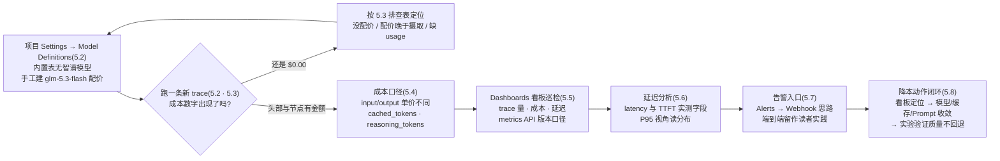
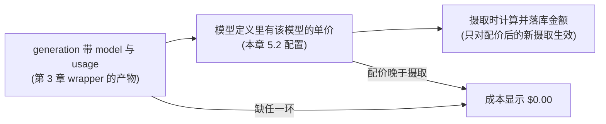
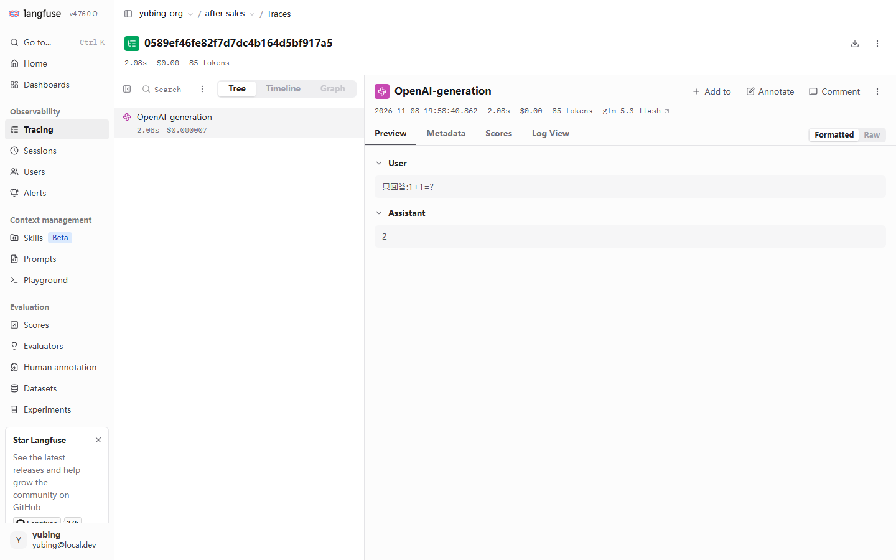
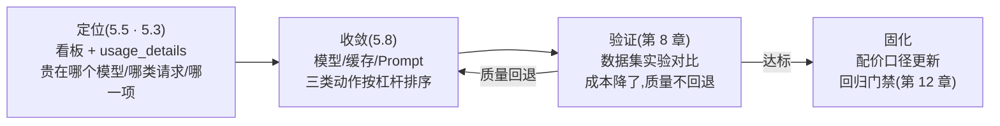

# 第 5 章 成本与性能监控

> 本章导读：第 3 章结尾留了一个悬念——售后助手的 trace 已经有 model 与 usage，却「没有成本数字」。本章来兑现它。成本不会凭空出现：Langfuse 并不知道你的模型一个 token 卖多少钱，模型配价(Model Definitions)是一切的起点；配好价，trace 头部与节点上才长出 $ 金额，预置看板里才有成本曲线可看。本章沿一条操作主线走：给 glm-5.3-flash 手工配价 → 在 trace 与看板里确认成本可见 → 理解成本口径(输入/输出/缓存/推理 token)→ 用 P95 视角做延迟分析 → 认识告警入口(Webhook 思路，端到端留作读者实践)→ 收拢为一条「定位 → 收敛 → 验证」的降本闭环。读完本章，你能：为一个内置价格表里没有的模型手工建配价，并说清「配价只对新摄取生效」的边界；读懂 trace 头部、节点级金额与 usage_details 三项用量；用预置看板回答「钱花在哪、慢在哪」；给出一条从看板定位到实验验证的降本路径。



*本章操作流程图*

## 你什么时候需要它

三种典型处境，对应本章三种用法。

**trace 里的 generation 已有 model 与 usage，但所有成本字段都是 $0.00**——这是本章最典型的入场姿势，直奔 5.2。Langfuse 的内置价格表覆盖主流 OpenAI/Anthropic 等模型，但不含智谱这类国产端点；给 glm-5.3-flash 手工建一条模型定义，成本才开始入账。注意 5.2 的关键边界：配价只对新摄取的 trace 生效，历史数据不会追溯重算。

**成本已经入账，要回答「这个月钱花在哪、哪类请求最贵」**——看 5.3(单条 trace 的成本读法)与 5.5(预置看板巡检)。单条 trace 告诉你一次调用花了多少，看板告诉你聚合后的趋势与构成；两者配合才能从「知道单价」走到「看懂账单」。

**要回答「慢在哪」或者想把成本异常变成主动通知**——前者看 5.6(latency、首字延迟 time to first token，TTFT 与 P95 视角)，后者看 5.7(Alerts 入口与 Webhook 思路)。5.7 必须先交代：本机未完成端到端告警实测，该节是界面入口 + 思路介绍，不是实测记录。

前置：第 3 章的售后助手已在跑，trace 里的 `OpenAI-generation` 节点含 model 与 usage——这是本章一切成本计算的数据前提(没有 usage 就没有成本，5.3 有排查表)；第 2 章的项目 `after-sales` 与管理员账号可用。本章不引入任何新依赖，所有操作在 UI 与已有 Python 环境完成。

## 5.1 概述:成本与延迟是观测数据的「经营读法」

第 3、4 章回答的是「发生了什么」——链路、层级、进出参；本章回答的是「这生意划算吗」。同一批 trace 数据，换两个视角再读一遍：**成本视角**把 usage(token 用量)乘上单价变成金额，**性能视角**把时间戳变成延迟分布。Langfuse 把这两个视角做进了同一套数据面：配价之后，金额自动出现在 trace 与看板里，不需要你再写任何埋点代码。

动手前过一遍本章的概念最小集：

| 概念 | 一句话定义 | 本章用法 | 展开 |
|------|-----------|---------|------|
| 模型定义(Model Definitions) | 一条「模型名 → 单价」的配价记录，项目级 | 给 glm-5.3-flash 建一条配价(input/output 两价) | 5.2 |
| 用量明细(usage details) | generation 上的 token 用量字段，input/output/total 三项起步 | 成本计算的原始数据 | 5.3 |
| 缓存 token(cached tokens) | 提供商侧提示缓存命中的 token 数，出现在 usage_details 键里 | 成本口径的近似项 | 5.4 |
| 推理 token(reasoning tokens) | 推理模型「思考」消耗的输出侧 token | 成本口径的隐藏大头 | 5.4 |
| 看板(dashboard) | 指标卡片的聚合视图，预置五张 | 巡检 trace 量/成本/延迟 | 5.5 |
| 首字延迟(TTFT) | 从请求发出到收到第一个 token 的时间 | 流式体验的核心指标 | 5.6 |
| 告警(alert) | 指标越界时向外部通道发通知 | Slack/Webhook 等四类通道 | 5.7 |

本章结束时，你手上会有四个可验证的交付物：

| 交付物 | 验证方式 | 小节 |
|--------|---------|------|
| glm-5.3-flash 的配价记录 | Model Definitions 列表出现 User 标记的行 | 5.2 |
| 新 trace 上的成本金额 | trace 头部与节点显示 $ 金额 | 5.3 |
| 看板巡检结论 | Cost/Latency 两张预置看板能读出趋势 | 5.5 |
| 一条书面的降本路径 | 「贵在哪 → 收敛动作 → 实验验证」三步有答案 | 5.8 |

### 事实来源与实测口径

- 出自官方文档(本章 `source` 指向 token-cost 特性页)：模型定义的用途、配价驱动成本计算的机制。
- 出自本书实测(2026-11-08，SDK 5.2.0 + 服务器 v4.76.0，本机 Docker 部署)：内置价格表无智谱模型、`lf.api.models.create` 的实测签名、配价不追溯历史、trace 头部与节点的成本精度、usage_details 里 cached_tokens 与 completion_tokens_details 里 reasoning_tokens 的实测存在、generation 的 latency 与 time_to_first_token 字段。
- 出自文献口径(langfuse.com/docs/compatibility，核实日期 2026-11-08)：metrics API 的版本差异——自托管 v3 只有 v1 端点，v4 新增 v2 端点。此项未做逐端点实测，5.5 如实标注。
- 本章价格一律为**教学值**，非智谱官方定价；5.7 告警为**未实测**的思路介绍。事实层与立场层分离的完整口径见各节原文。

## 5.2 成本从配价开始:Model Definitions

### 问题:为什么一切成本都是 $0.00

第 3 章跑通售后助手后，trace 里的 `OpenAI-generation` 节点已经有 model=`glm-5.3-flash` 与 usage 数字，但成本一栏纹丝不动——trace 头部显示 `$0.00`。这不是 bug，而是机制：**Langfuse 的成本是「算出来」的，不是「上报来的」**。SDK 上报的是 token 用量；金额 = 用量 × 单价，而单价只存在于模型定义里。你的项目刚建好时只有 Langfuse 内置的价格表，里面没有智谱的模型——用量有，单价无，金额自然是零。

把这条因果链记牢，后面所有「成本为零」的排查都是它的变体：



### UI 路径:项目 Settings → Model Definitions

配价入口在项目设置里。路径：**项目 `after-sales` → 左侧栏 Settings 组 → Model Definitions**。打开后是一张价格定义列表：


逐块读这张图：

| 界面元素 | 你看到什么 | 背后的机制 |
|---------|-----------|-----------|
| 内置定义(Langfu 标记) | babbage-002、chat-bison、chatgpt-4o-latest 等大量预置行，分页显示(实测 Page 1 of 4) | Langfuse 随版本内置的主流模型价格表；**实测其中没有智谱模型** |
| 用户定义(User 标记) | 首行 glm-5.3-flash，User 标记 | 手工创建的配价；同名匹配时**用户定义优先于内置表** |
| Match Pattern | `(?i)glm-5\.3-flash` 这样的正则 | 摄取时用它去匹配 generation 上报的 model 字符串；`(?i)` 表示不区分大小写 |
| Prices per unit | `input $0.0000002`(本书教学值) | 每 token 单价；input 与 output 分列计价 |
| Tokenizer 列 | 部分行有 tokenizer 配置，glm-5.3-flash 行为空(「—」) | 用于无 usage 上报时的本地 token 估算；wrapper 已上报 usage 时用不上 |
| Test Model Match | 输入模型名即时验证正则是否命中 | 配正则前的自检工具，强烈建议配完就用 |

### API 创建:lf.api.models.create(实测签名)

UI 之外，SDK 也能建模型定义。本书实测(2026-11-08，SDK 5.2.0)的调用签名：

```python
# create_model_price.py —— 给 glm-5.3-flash 手工配价(实测可运行)
from langfuse import get_client

lf = get_client()   # 读第 3 章的三个环境变量

lf.api.models.create(
    model_name="glm-5.3-flash",            # 显示名,列表里的 Model Name
    match_pattern="(?i)glm-5\\.3-flash",   # 正则,匹配 generation 的 model 字符串
    unit="TOKENS",                          # 计价单位:按 token
    input_price=0.0000002,                  # 2e-07 USD/token —— 教学值,非官方定价
    output_price=0.0000007,                 # 7e-07 USD/token —— 教学值,非官方定价
)
print("model definition created")
```

```bash
python create_model_price.py
# model definition created
```

跑完刷新 Model Definitions 页，列表首行出现 User 标记的 `glm-5.3-flash`——与截图一致。三处细节值得停下：

**其一，match_pattern 是正则而不是精确名。**上报侧写什么(比如带网关前缀的全名)，正则就要能匹配什么；拿不准就先用页面的 Test Model Match 验证，或把正则写宽松些(如 `(?i).*glm-5\.3-flash.*`)。第 10 章的 RAGFlow 联动里，模型名会变成 `glm-5.3-flash@zhipu-gateway@OpenAI-API-Compatible` 这样的全名——同一个模型在不同接入路线下上报名不同，是配价时最容易翻车的点。

**其二，价格单位是「美元每 token」。**`input_price=0.0000002` 即每 token 0.0000002 美元(2e-07)；官方文档里常见的「每百万 token $0.2」换算过来正是 2e-07 美元/token。本书这两个值是**教学值，为演示计算而设，不是智谱官方定价**——接入真实项目时，请以你所用模型的官方价格页为准替换。

**其三，unit 选 TOKENS。**Langfuse 也支持按请求计价(CHARACTERS 等其他单位场景)，LLM 按量计费的标准姿势就是 TOKENS 加 input/output 两价。本书实测只覆盖 TOKENS 路线。

### 关键边界:配价只对新摄取生效，不追溯历史

这是本章实测得到的最重要边界(2026-11-08)：**在配价之前已摄取的 trace，金额永远保持 $0.00；配价之后新摄取的 trace 才开始有金额。**Langfuse 不会回头把历史用量按新单价重算。

对本书贯穿案例的直接后果：第 3 章跑出的那批售后助手 trace(`demo-session-001` 的 4 条)，配价后去看依然是 `$0.00`——它们摄取时单价还不存在。验证配价是否生效，必须**新跑一条**：

```bash
python support_bot.py "1+1 等于几?"    # 配价后新摄取的 trace
```

这条新 trace 的头部与节点上会出现金额(下一节细读)。工程上这条边界意味着：**配价要当作上线清单的一项，与埋点同批完成**——先跑流量后补配价，中间窗口的成本数据就永久缺失了。这也与第 3 章「验证以 UI 为准」的口径一致：数据落库那一刻是什么样，就是什么样。

### 多模型配价与优先级:User 覆盖内置

真实项目不会只有一个模型。截图里那两类标记，正好引出配价体系的运行规则：

| 标记 | 来源 | 优先级 |
|------|------|--------|
| Langfu(内置) | 随 Langfuse 版本预置的价格表 | 低——兜底 |
| User(用户定义) | 你在 UI 或 API 创建的模型定义 | **高——同名匹配时覆盖内置** |

这条优先级有个实用场景：内置表里已有某主流模型，但官方降价了、或你拿到的是折扣价——直接建一条 User 定义盖上去即可，不必等 Langfuse 更新内置表。多模型并存时，每个上报名各建一条定义；配套动作是把「本项目用了哪些模型、各自配价了吗」写进上线清单，与第 4 章采集规范里的命名约定衔接——**model 字符串稳定，正则才年年命中**。上游改了模型上报名(比如网关前缀变了)而配价正则没跟上，新数据就会静默掉回 $0.00，这是成本监控最常见的一类「无声故障」。

## 5.3 成本在哪看:trace 头部、节点金额与 usage_details

### trace 头部与节点级金额(实测精度)

配价生效后新跑一条 trace，打开详情页。本书实测截图(2026-11-08)：



这张图里藏着两个实测精度观察，值得专门点破：

| 位置 | 实测显示 | 读法 |
|------|---------|------|
| trace 头部摘要 | `$0.00` | **头部金额按两位小数(分)截断显示**。单条小额调用算出的 $0.000007 在头部就是 `$0.00`——不是零成本，是显示精度 |
| 节点行内金额 | `$0.000007` | **节点级精确到小数点后六位**(实测)，单次调用的真实金额在这里 |
| 头部 tokens | `85 tokens` | 整条 trace 的 token 总量；本条是一个极小的冒烟测试(问题「只回答1+1=?」) |

所以读成本的正确动作是：**头部看量级与趋势，节点看单次精确值**。别被头部的 `$0.00` 骗了——判断「成本到底算没算出来」，要看节点行有没有类似 `$0.000007` 的金额，或者切到 5.5 的看板看聚合曲线。

### usage_details:input/output/total 三项

金额的原始依据是 generation 上的用量明细。在详情节点切到 Raw 视图(第 3 章说过，排查字段细节时 Raw 更诚实)，`usage_details` 里实测可见三项起步的结构：

```json
{
  "usageDetails": {
    "input": 21,
    "output": 4,
    "total": 25,
    "cached_tokens": 0
  }
}
```

(数值为实测结构示意——本书实例该次调用 total 85 tokens 含系统提示与检索上下文；此处取简化数字便于讲解，字段键名与层级为实测。)三项的含义与成本公式：

| 字段 | 含义 | 成本公式中的角色 |
|------|------|----------------|
| `input` | 送进模型的 prompt 侧 token(含 system、上下文、历史) | × input_price |
| `output` | 模型生成的 completion 侧 token | × output_price |
| `total` | input 与 output 之和 | 不直接参与计价，做汇总展示 |
| `cached_tokens` | 提供商缓存命中的 token 数(实测键名) | 口径近似项，5.4 展开 |

成本公式一行写完：

```text
成本 = input × input_price + output × output_price
```

拿本书教学值做一个**教学算例**(数字为假设，便于建立量级感)：售后助手单次应答 input 1200 tokens(系统提示 + 检索到的 FAQ 上下文 + 用户问题)、output 150 tokens，则

```text
1200 × 0.0000002 + 150 × 0.0000007 = 0.00024 + 0.000105 ≈ 0.000345 USD
```

单次约 $0.00035，一万次约 $3.45。这个算例还顺带暴露了一个结构事实：**input 通常远大于 output**——检索上下文塞进 prompt 的每一个字符都在按 input 价计费，这也是 5.8 降本闭环里「Prompt 收敛」与「缓存」两个动作的经济学起点。

### wrapper 自动记录的前提(第 3 章呼应)

本节一切成本读法都有一个前提，即第 3 章 3.4 的埋点选型结论：**generation 节点上必须有 model 与 usage**。回顾两条埋点路线在成本链路上的差别：

| 埋点方式 | model | usage | 配价后能算出成本吗 |
|---------|-------|-------|------------------|
| `langfuse.openai` wrapper(实测节点名 `OpenAI-generation`) | 有(实测) | 有(实测) | **能**——金额自动出现 |
| 手动 `@observe(as_type="generation")` | 无(实测) | 无(实测) | **不能**——没有用量，单价乘不上来 |

若你的某条 LLM 调用走了手动路线，配价后它依然是 $0.00——病灶不在配价，在埋点。换 wrapper 是正路(第 3 章 3.4)；确实无法用 wrapper 的接入路线，退而手动把 model 与 usage 补进观测属性，或等第 10 章的框架集成路线。

### 「成本是 $0.00」排查表

把 5.2/5.3 的机制收敛成一张速查表，按命中率排序：

| 症状 | 多数原因 | 处理 |
|------|---------|------|
| 所有 trace 都是 $0.00 | 内置表没有你的模型，从未配价 | 5.2 手工建模型定义 |
| 老 trace $0.00，新 trace 有金额 | 配价晚于摄取——**不追溯历史**(实测边界) | 正常现象；以新 trace 验证配价 |
| 个别节点 $0.00，其余有金额 | 该调用走了手动 `as_type="generation"`，缺 usage | 换 wrapper(第 3 章 3.4) |
| 新 trace 也是 $0.00 | model 字符串没被 match_pattern 命中 | Test Model Match 验证正则；核对上报的模型全名 |
| 头部 $0.00 但节点有金额 | 头部按分截断的显示精度(实测) | 正常现象；看节点与看板 |

### 三个粒度读成本:单次、会话与项目

单条 trace 的金额只是起点。经营视角的三个粒度，各有各的入口：

| 粒度 | 回答的问题 | 入口 | 本章对应 |
|------|-----------|------|---------|
| 单次 | 一次调用花了多少 | trace 详情节点金额 | 5.3 |
| 会话 | 一次用户会话(多轮问答)合计多少 | trace 头部 session 链接 → Sessions 页，会话视图聚合时长与用量 | 第 4 章会话视图 |
| 项目 | 一段时间的盘子多大、构成如何 | Dashboards(5.5)与 metrics API | 5.5、5.8 |

以贯穿案例来说：单次应答约 $0.00035(5.3 教学算例)；`demo-session-001` 的 4 条 trace 合计就是一个咨询会话的成本；而「售后助手上线一个月花了多少、哪个模型占大头」则是项目粒度的问题——粒度越粗，越依赖看板与 API 而不是逐条点开。会话粒度的成本聚合以 UI 的 Sessions 页显示为准(与第 3 章「以 UI 为准」同一口径)。

## 5.4 成本口径:输入、输出、缓存与推理 token

### 口径一:输入与输出单价不同

LLM 计价的第一原则：**output 单价普遍高于 input**——生成比理解贵。本书教学值 input 2e-07 / output 7e-07，输出侧是输入侧的 3.5 倍，这个倍数在真实价目表上也是常态。它直接推导出两条工程常识：

- **压缩 output 是高杠杆降本**——让模型少说废话(输出长度控制、结构化输出)比压缩 input 更省单价差；
- **但要先看用量分布**——若你的 input 是 output 的几十倍(检索增强场景的常态，见 5.3 算例)，压缩 input 反而是总量上的大头。**杠杆在哪，由 usage_details 的实际分布决定，不由单价倍数决定**——这正是 5.5 看板要先于直觉的原因。

### 口径二:缓存 token——cached_tokens

实测(2026-11-08)在 usage_details 的键里能看到 `cached_tokens` 字段——它来自上游模型端随用量返回的缓存命中信息，经 wrapper 原样透传进了 Langfuse(键名为实测；透传机制为理解口径)。缓存(prompt caching)的机制：提供商把重复出现的 prompt 前缀(通常是长 system 提示、固定上下文)缓存在服务端，下次命中按更低的价格(或更快的速度)处理。

对成本口径，本书给出一个**理解框架**(立场，非文档结论)：Langfuse 的金额计算以 usage_details 的 input/output 两项乘单价为准；`cached_tokens` 是 input 的细分标注，Langfuse **不会**自动为缓存命中的部分按折扣价重算——因为折扣比例是提供商侧的定价策略，Langfuse 的模型定义里只有一对 input/output 价。实操结论：

- 你的提供商对缓存 token 有单独价格时，Langfuse 显示的成本是**按全价 input 口径的近似值**——记账做预算够用，精确对账要以提供商账单为准；
- 缓存的价值在 Langfuse 里依然可见：`cached_tokens` 键出现了，说明命中信息进了观测数据，看板与过滤可以围绕它做应用层的优化验证(比如确认「改了 system 提示结构后命中率上升」)；
- 想把缓存折扣算准，可在模型定义层面自行折算(把折扣后等效单价填进去)，但要明白这是你自己的口径选择，不是 Langfuse 的承诺。

### 口径三:推理 token——reasoning_tokens

glm-5.3-flash 是带推理能力的模型：回答之前有一段「思考」过程，这段思考消耗的 token 按输出计价。实测(2026-11-08)在 generation 的 `completion_tokens_details` 里能看到 `reasoning_tokens` 字段——它统计模型在最终答案之外「想」掉的部分：

```json
{
  "usageDetails": {
    "input": 21,
    "output": 4,
    "total": 25
  },
  "completionTokensDetails": {
    "reasoning_tokens": 3
  }
}
```

(键名层级为实测；数值取自本书实例的冒烟测试量级。)对成本口径，本书的**理解框架**：reasoning_tokens 已包含在 output 的用量里(它是 completion 的细分，不是额外一项)，因此**按 output 价计费**——推理模型的账单大头常常不是「答案有多长」，而是「想了多久」。一句「只回答1+1=?」的极简问题，思考开销也可能与答案本体同一量级。工程启示：

- **简单任务选非推理模型或关掉深度思考**(若提供商支持)，是推理时代最直接的一条降本路径；
- 在 Langfuse 里，`completion_tokens_details.reasoning_tokens` 让「思考开销」从黑盒变成了可观测字段——可以据此对比不同模型/参数下的推理开销(第 8 章实验对比的成本维度)。

### 口径汇总表

| 口径项 | 实测位置 | 计价理解(本书框架) | 出处性质 |
|--------|---------|---------------------|---------|
| input | usage_details.input | × input_price，含 system/上下文/历史 | 实测 + 文档机制 |
| output | usage_details.output | × output_price，含 reasoning_tokens | 实测 + 文档机制 |
| cached_tokens | usage_details.cached_tokens(实测键) | input 的细分标注；Langfuse 不自动按折扣重算 | 实测键 + 本书口径框架 |
| reasoning_tokens | completion_tokens_details.reasoning_tokens(实测键) | 已含在 output 内，按 output 价 | 实测键 + 本书口径框架 |

一张表记不住没关系，记一句就够：**Langfuse 按 usage_details 的 input/output 两项乘单价；缓存与推理是提供商侧的口径细分，Langfuse 让它们可见，但折扣与计价规则以提供商为准。**

## 5.5 Dashboards:预置看板巡检与 metrics API

### 预置看板:五张开箱即用

单条 trace 的成本是「显微镜」，看板是「望远镜」。侧栏点 **Dashboards**，Langfuse 预置了五张看板，开箱即用：


| 预置看板 | 描述(实测页面原文) | 本章巡检用途 |
|---------|---------------------|-------------|
| Langfuse Home | traces、costs、scores、usage、latencies 的总览 | 每日开门第一眼：量、钱、速度三条曲线的异常 |
| Langfuse Cost Dashboard | Review your LLM costs | 5.8 降本闭环的定位起点：钱花在哪 |
| Langfuse Latency Dashboard | Monitor latency metrics across traces and generations | 5.6 延迟分析的可视化落点 |
| Langfuse Usage Management | Track usage metrics across traces， observations， and scores | token 用量的盘子：input/output 分布 |
| Langfuse Agent Dashboard | Monitor agent tool usage: total tool calls, most-called tools… | Agent 场景的工具调用观测(本书案例暂不涉及) |

巡检建议按「量 → 钱 → 速」的顺序：先看 Usage(用量盘子有没有异动，比如某天 input 翻倍——多半是检索上下文膨胀)，再看 Cost(钱随量的走势、按模型的构成)，最后看 Latency(分布有没有整体右移)。每张看板里的卡片(widget)可按时间窗过滤，看板本身也可以复制后改成你自己的——页面的 Widgets 标签管理全部卡片，**+ New dashboard** 从空白建。

### 动手巡检:三张卡片各问一个问题

巡检不必逐卡精读，本书给一个最小套路——每张看板只带一个问题去看，答案异常才深挖：

| 看板 | 带进去的问题 | 异常信号 | 异常时去哪深挖 |
|------|-------------|---------|---------------|
| Usage Management | 用量盘子稳不稳？ | input 或 output 逐日陡增/骤降 | Traces 列表按时段过滤，抽样读 usage_details |
| Cost Dashboard | 钱花在哪？ | 某模型占比突变；总成本与用量脱钩(量稳价涨) | 按成本排序 Traces，核对模型与配价(5.2) |
| Latency Dashboard | 速度有没有劣化？ | P95 右移(5.6)；错误率抬头 | 过滤慢请求/Error，进 trace 看分层耗时 |

对贯穿案例，这套巡检的预期读法：Usage 卡片上 input 应显著大于 output(检索上下文撑起来的，5.4 口径一的结论)；Cost 卡片上 glm-5.3-flash 是唯一模型(只配了它一个价)；Latency 卡片上 P95 若明显高于 P50，说明存在慢请求长尾，按 5.6 的路径分解。看板给出的永远是「哪里不对劲」，定位到具体 trace 的动作仍要回到第 4 章的列表过滤与详情基本功。

### metrics API:v2 与 v1 的版本口径

看板之外想用自己的图表/报表系统消费指标，要走 metrics API。这里有一处必须如实交代的版本口径(出处 langfuse.com/docs/compatibility，核实日期 2026-11-08；**本书未做逐端点实测**)：

- **自托管 v3：只有 v1 metrics 端点**；
- **v4：新增 v2 端点**，本书实测的 v4.76.0 属于此代。

实操含义：网上教程与旧集成代码里的 metrics 调用路径，先对照你服务器的版本代际再用——v3 实例调 v2 路径会 404，反之 v2 的字段与聚合口径也不能假定在 v1 上成立。做导出集成前，以你实例的 API 文档页(`/api/docs`)实测路径为准。这与第 3 章「SDK 旧版查询接口投影不全」是同一族问题：**v3→v4 迁移带上，凡接口行为，以你实例的实测为准，不以教程为准。**

## 5.6 延迟分析:latency、TTFT 与 P95

### generation 里的延迟字段(实测)

成本之外，性能是监控的另一半。实测(2026-11-08)generation 节点上有两个延迟字段：

| 字段 | 含义 | 实测表现 |
|------|------|---------|
| `latency` | 该次模型调用的总耗时 | 5.3 截图里的 `2.08s`——wrapper 自动记录，无需配置 |
| `time_to_first_token` | 从请求发出到收到第一个 token 的时间 | 字段实测存在；**非流式调用下无独立意义**(见下) |

latency 是每一层观测(trace/observation)都有的通用字段；TTFT 则是 generation 特有的语义字段——它只在流式(streaming)调用下才有真正的业务含义。

### 为什么看 P95 而不是平均值

看板与排障时，本书立场：**延迟看分布，不看均值。**理由是 LLM 请求的延迟分布天然长尾——多数请求几百毫秒到两秒，少数请求(长上下文、长推理、提供商抖动)拖到十几秒。均值会被长尾悄悄抬高或被大批快请求稀释，而用户抱怨的恰恰是长尾：

| 视角 | 回答的问题 | 盲区 |
|------|-----------|------|
| 平均值 | 一次调用平均多久 | 长尾被稀释；运营汇报好看，排障没用 |
| P50 | 典型请求的体验 | 完全看不到慢请求 |
| **P95** | 95% 的请求比这快；最慢的 5% 有多慢 | **本书推荐的默认视角**——既是用户可感知的上界，又不会被极端个例(1/1000 的超时)带偏 |
| 最大值 | 最慢的那一次 | 被单次网络异常绑架，波动无意义 |

落地动作：在 Langfuse Latency Dashboard 的延迟卡片上把聚合口径切到 p95(看板卡片支持聚合方式选择)，再配合第 4 章的过滤语法(`level:ERROR`、时长过滤)在 Traces 列表里捞出那 5% 的慢请求，逐条看 tree 找慢在哪一层——是检索器慢还是模型慢，trace 的 Timeline 视图(第 4 章)一眼可辨。

### 在 trace 里做延迟分解:慢在检索还是慢在模型

P95 告诉你「存在慢请求」，trace 的分层耗时告诉你「慢在哪一段」。以售后助手为例，一条 trace 的树上有三个带耗时的节点，延迟分解就是读它们：

| 节点 | 记录的是 | 延迟含义 |
|------|---------|---------|
| `support-bot-answer`(根 span) | 整次应答 | 端到端总耗时——用户体感的那个数 |
| `retrieve-context`(span) | 关键词检索器 | 应用侧开销：本书 demo 是内存匹配，微秒级；生产里换成向量检索/知识库后，这一段常是延迟大户 |
| `llm-call` 与其下的 `OpenAI-generation` | LLM 调用 | 模型侧开销：latency 字段即模型总耗时，TTFT 补充流式首字视角 |

分解的判读逻辑一句话：**根节点总耗时 ≈ 应用段 + 模型段；谁占比大，优化就先动谁。**本书 demo 的实测形态里，模型调用占绝对大头(检索器是内存关键词匹配)，所以延迟优化的第一杠杆在模型侧——换更快的模型、缩短输出、上流式改善 TTFT；而一旦检索器升级为真实的向量检索或外部知识库(→ ragflow 书)，`retrieve-context` 一段就值得单独设卡片监控了。这正是分层观测的价值：**延迟归因不需要猜，树上的数字自己会说话。**

### 流式与非流式:TTFT 的适用边界(概念级)

以下为概念级说明，帮助选型，非本书实测对比：

- **非流式**：一次请求，完整回答一次返回。latency 就是用户等待的全部；TTFT ≈ latency，没有独立信息量。
- **流式**：回答逐 token 推送。用户的体感由两段构成——**TTFT**(等多久看到第一个字，决定「响应快不快」的体感)与首字之后的吐字速度(决定「读起来顺不顺」)。同样的总 latency，TTFT 0.5s 与 TTFT 3s 是天壤之别的产品体验。

因此，流式应用的质量监控要把 TTFT 作为一等指标单独看板，非流式应用看 latency 分布即可。本节字段的实测证据见本节开头表；流式场景的逐 token 观测细节，本书未做实测展开，接入流式时以 wrapper 文档与实测为准。

## 5.7 告警:Alerts 入口与 Webhook 思路(未实测，如实标注)

> 本节性质声明：Alerts 页面的界面入口为本书实测截图(2026-11-08)；**告警的端到端链路(创建通道 → 事件触发 → 通知送达)本机未完成实测**。本节提供的是界面导览与思路介绍，不编造实测结果；端到端实践留作读者动手，操作时以你实例的界面与官方文档为准。

### 界面入口:侧栏 Alerts

侧栏 Observability 组里，Alerts 与 Tracing/Sessions/Users 并排。点开是一个引导式空态页：


这张引导页把告警配置拆成了两步，与本节的思路介绍一一对应：

| 步骤 | 页面原文 | 含义 |
|------|---------|------|
| 步骤 1 | Choose where alerts should go | 通知去处：Slack、Webhooks、GitHub Actions、PagerDuty 四类通道(实测可见) |
| 步骤 2 | Decide what to monitor | 监控对象：cost、quality、latency 等关键指标越界(实测副题口径) |

### Webhook 思路:自托管最通用的通道

四类通道里，Slack 与 PagerDuty 依赖对应 SaaS；GitHub Actions 面向「告警触发一次工作流」的自动化玩法；**对本地部署与国内环境，Webhooks 是最通用的入口**——它不依赖任何特定 SaaS，思路也最直白：


把这条思路落成可跑的系统，需要四件事：一个能公网(或至少容器网可达)接收 POST 的 HTTP 端点；对请求做来源校验与重放防护；按事件 JSON 里的指标字段组装通知文案；接收端自己做幂等与限流。每一步都不难，但合起来是一个小工程——**这正是本书把它留作实践的原因：不做，就不写「实测通过」。**

### 边界与交代

如实收拢本节的已知边界：

- **已实测**：Alerts 侧栏入口与引导页存在，四类通道按钮与 Create Alert 按钮可见(截图为证)；
- **未实测**：通道创建流程、可订阅的事件清单、Webhook 事件 JSON 的结构与字段、触发时效——均未验证；
- **本书口径**：5.7 是「界面入口 + 思路」级别的内容；读完你能找到入口、知道 Webhook 的大致玩法，但不能据此断言你实例上的告警开箱即用。

一个务实的替代路线顺带给出：在告警端到端跑通之前，**看板巡检 + 定时导出**可以覆盖大部分「成本异常要人知道」的诉求——用 5.5 的 metrics API 定时拉数、在你自己的脚本里判断阈值再通知，是把告警逻辑拿回自己手里的笨办法，但每一步都可实测、可控。骨架示意如下(**思路示意，未实测**——metrics 端点路径以你实例的 `/api/docs` 为准，通知段换成你团队的机器人)：

```python
# cost_watchdog.py —— 思路示意(未实测):定时拉指标 + 阈值判断 + 通知
# 端点路径与鉴权细节以你实例的 /api/docs 实测为准;此处只表达「拿回告警逻辑」的骨架
import os
import requests

resp = requests.get(
    f"{os.environ['LANGFUSE_HOST']}/api/public/metrics/...",   # 路径以 /api/docs 为准
    auth=(os.environ["LANGFUSE_PUBLIC_KEY"], os.environ["LANGFUSE_SECRET_KEY"]),
)
daily_cost = parse(resp.json())        # 解析口径同样以实测返回结构为准
if daily_cost > THRESHOLD:             # 阈值是你自己的经营决策,不是 Langfuse 的
    notify_dingtalk(f"售后助手昨日成本 {daily_cost:.2f} USD,超过阈值 {THRESHOLD}")
```

这与第 12 章「门禁脚本」的思路同源：与其依赖黑盒通知，不如把阈值与动作写进自己维护的代码。

## 5.8 降本动作闭环:从看板到实验

### 闭环三步

前面各节是「看清」，本节把观察变成动作。降本不是拍脑袋换模型，而是一个可验证的闭环：



### 第一步:定位——贵在哪

用 5.5 的 Cost Dashboard 与 Usage Management 回答三个问题：**哪个模型**贡献了金额大头(按模型分组的成本卡片)；**哪类请求**最贵(回到 Traces 列表，按成本/时长排序抽样，读它们的 usage_details)；**哪一项用量**是杠杆(input 大还是 output 大——5.4 口径一的结论：杠杆由用量分布决定)。本书贯穿案例的预期读法：售后助手的 input 远大于 output(检索上下文塞满 prompt)，杠杆在 input 侧——查 Cost Dashboard 应能看到用量构成印证这一点。

### 第二步:收敛——三类动作

| 动作 | 具体做法 | 生效位置 | 权衡 |
|------|---------|---------|------|
| 模型收敛 | 简单任务换小模型/非推理模型；分级路由(简单问询走轻模型，复杂工单走强模型) | 单价直接下降 | 质量风险最高，**必须过第三步** |
| 缓存 | 应用层缓存高频问答；利用提供商提示缓存(system 前缀稳定) | input 用量或单价下降 | 命中率决定收益；提示结构要为缓存友好而设计 |
| Prompt 收敛 | 缩短 system 提示、精简检索上下文(只塞命中的条目而非全量语料) | input 用量下降 | 与质量耦合最小，通常第一优先 |

本书案例对「Prompt 收敛」有个现成注脚：3.8 最小版的检索器把整条 FAQ 塞进上下文；上下文每短一分，input 账单就薄一分——而上下文该塞什么，恰恰是第 7 章检索质量与 badcase 反哺的课题。**成本优化与质量优化共享同一批数据**，这是可观测平台的价值所在。

### 贯穿案例预演:一次降本迭代怎么走

把三步闭环套在售后助手上演示一遍(**数字为教学推演，非实测结果**，演示的是决策路径而非结论)：

1. **定位**：Cost Dashboard 显示成本几乎全部来自 glm-5.3-flash 的 input(5.4 口径：检索上下文撑大 input)；抽样 trace 印证——system 提示里塞了未命中的 fallback 语料，白白按 input 价计费；
2. **收敛(第一优先：Prompt 收敛)**：检索器只回传命中的 FAQ 条目而非全量语料；假设这一刀砍掉 30% 的 input tokens，按教学单价折算单次成本从约 $0.00035 降到约 $0.00026——量级小，但这是演示方法论，真实项目里把金额放大三个数量级，同样的决策；
3. **验证**：在 `after-sales-qa` 数据集上跑收敛前后的两次 experiment(第 8 章)，对比 recall 分数——若波动在容差内、badcase 没有新增，则固化；若「保税仓时效」类问题的分数回退了，说明砍掉的那部分上下文是必要的，回到第 2 步换个收敛对象。

这个预演还揭示了一条隐含的次序：**Prompt 收敛与检索质量必须同时评估**——上下文塞多了贵，塞少了答错。经济性(本章)与质量(第 7、8 章)是同一枚硬币的两面，这正是全书把它们编在同一条主线上的原因；迭代成果最终由第 12 章的回归门禁守护。

### 第三步:验证——质量不回退

任何收敛动作上线前，用第 8 章的实验机制跑一遍数据集 `after-sales-qa`：同一个数据集，收敛前后各跑一次 experiment，对比 AVG 分数(第 8 章 run_experiment；实测同配置 run 分数有波动，阈值要留容差)。判据一句话：**成本降了，分数不回退(在容差内)，动作才允许固化**；回退了就回到第二步换动作。固化之后，把「成本 + 质量」一起纳入第 12 章的回归门禁——降本成果从此有了防回退的护栏。

至此本章的操作流程图走完一圈：配价 → 可见 → 口径 → 延迟 → 告警 → 闭环。它也是本书反复出现的循环的又一次出现：**先可观测，再谈优化；先有实验，再动生产。**

## 本章小结

回到导读的问题，本章交付了五件事：

1. **配价**：成本 = 用量 × 单价，单价来自项目 Settings → Model Definitions；内置表无智谱模型，用 `lf.api.models.create(model_name, match_pattern, unit="TOKENS", input_price, output_price)`(实测签名)给 glm-5.3-flash 手工建价(教学值)；**配价只对新摄取生效，不追溯历史**(5.2)；
2. **可见**：trace 头部 `$0.00` 是按分截断的显示精度，节点级 `$0.000007` 才是单次精确值；金额的原始依据是 usage_details 的 input/output/total 三项；前提是 wrapper 埋点带来 model 与 usage(5.3)；
3. **口径**：input/output 分价；cached_tokens 与 reasoning_tokens 是实测可见的口径细分——Langfuse 按 input/output 两项计价，缓存折扣与推理计价规则以提供商为准(5.4)；
4. **看板与延迟**：五张预置看板按「量 → 钱 → 速」巡检；metrics API 自托管 v3 只有 v1、v4 有 v2(文献口径，未逐端点实测)；延迟看 P95 不看均值，generation 的 latency 与 time_to_first_token 实测存在，TTFT 只在流式下有独立意义(5.5、5.6)；
5. **告警与闭环**：Alerts 入口与四类通道实测可见，端到端告警本机未实测、如实留作读者实践；降本走「看板定位 → 模型/缓存/Prompt 收敛 → 实验验证不回退」的闭环(5.7、5.8)。

贯穿案例方面，售后助手从此有了成本维度：glm-5.3-flash 配价生效，新 trace 节点上出现金额，`demo-session-001` 的老 trace 如实保持 $0.00(不追溯的活标本)。它的降本杠杆已被定位在 input 侧——检索上下文与 system 提示的瘦身，恰好与第 7 章的检索质量课题会师。

下一步建议：配价之后的第一个高杠杆动作是 Prompt 托管与版本化——第 6 章把售后助手的内置模板换成 Langfuse 托管 Prompt(`after-sales-answer`)，版本、label 与 trace 关联；Prompt 的每次迭代都要在数据集上验证质量，那是第 7、8 章的入口；而「成本 + 质量」一起纳入门禁的终点站在第 12 章。

## 验收清单

- ☐ 在 Model Definitions 页指出 User 标记与 Langfu 标记的区别，并说出同名匹配时谁优先
- ☐ 用 `lf.api.models.create` 为一个内置表没有的模型建配价，并解释 match_pattern 为什么是正则、Test Model Match 用来做什么
- ☐ 向同事解释清楚「配价后老 trace 为什么还是 $0.00」，并演示用一条新 trace 验证配价生效
- ☐ 打开一条 trace，指出头部金额与节点金额的精度差异，并在 Raw 视图找到 usage_details 的 input/output/total
- ☐ 用教学算例算一次「input 1200、output 150」的单次成本，并说出为什么降本杠杆要看用量分布而不是单价倍数
- ☐ 在预置看板里指出 Cost Dashboard 与 Latency Dashboard 各回答什么问题，并把一张延迟卡片切到 p95 口径
- ☐ 说出 P95 优于平均值与最大值的理由，以及 TTFT 为什么只在流式调用下有独立意义
- ☐ 打开 Alerts 页指出四类通道入口，并如实向团队转述「端到端告警尚未验证，先用看板巡检 + 定时导出替代」的口径
- ☐ 书面写出售后助手的降本三步：贵在哪(用量分布)、收敛动作排序(为何 Prompt 收敛优先)、用什么验证(第 8 章实验 + 容差)

## 参考速查

理解主线不依赖本节；本节供配置与排障时查阅。

### 模型定义参数(lf.api.models.create,实测签名)

| 参数 | 实测取值 | 说明 |
|------|---------|------|
| `model_name` | `glm-5.3-flash` | 显示名；列表 Model Name 列 |
| `match_pattern` | `(?i)glm-5\.3-flash` | 正则；匹配 generation 上报的 model 字符串，`(?i)` 不区分大小写 |
| `unit` | `TOKENS` | 按 token 计价(本书实测路线) |
| `input_price` | `0.0000002`(2e-07，教学值) | USD/token；**非官方定价** |
| `output_price` | `0.0000007`(7e-07，教学值) | USD/token；**非官方定价** |

### 成本字段速查(generation 节点)

| 字段/位置 | 实测表现 | 用途 |
|----------|---------|------|
| trace 头部金额 | `$0.00`(按分截断显示) | 量级与趋势 |
| 节点行内金额 | `$0.000007`(六位小数) | 单次精确成本 |
| `usage_details.input / output / total` | 三项齐全 | 计价原始依据 |
| `usage_details.cached_tokens` | 键实测存在 | 提供商缓存命中标注 |
| `completion_tokens_details.reasoning_tokens` | 键实测存在 | 推理开销细分(含于 output) |
| `latency` / `time_to_first_token` | 字段实测存在 | 总耗时 / 首字延迟(流式有意义) |

### 「成本是 $0.00」排查(同 5.3 表,精简版)

没配价 → 配价晚于摄取(不追溯)→ 缺 usage(手动 generation)→ 正则未命中 → 头部显示精度。

### 版本基线(核实日期 2026-11-08)

| 项 | 值 |
|----|-----|
| Langfuse 服务器 | v4.76.0(本机 Docker 自托管) |
| Python SDK | langfuse 5.2.0 |
| 模型 | 智谱 OpenAI 兼容端点，`glm-5.3-flash` |
| 教学单价 | input 2e-07 / output 7e-07 USD/token(**教学值，非官方定价**) |
| metrics API 口径 | 自托管 v3 仅 v1；v4 有 v2(出处 langfuse.com/docs/compatibility，未逐端点实测) |
| 告警端到端 | **未实测**；5.7 为界面入口 + 思路 |

## 延伸阅读

- **第 3 章 快速开始**——本章一切成本的数据前提：`langfuse.openai` wrapper 如何让 generation 长出 model 与 usage；「验证以 UI 为准」的口径在成本侧同样成立。
- **第 4 章 Trace 模型与链路追踪**——5.3 读 Raw 视图、5.6 捞慢请求用到的基本功：observation 字段全集、Timeline 视图与过滤语法、保存视图。
- **第 6 章 Prompt 管理**——降本闭环里「Prompt 收敛」的工程化落点：托管 Prompt、版本与 label；system 提示的每次瘦身都从这里发版。
- **第 8 章 实验与 A/B**——闭环第三步的验证机制：`run_experiment` 对比收敛前后的质量分数，以及同配置 run 波动带来的阈值容差。
- **第 12 章 Prompt 回归与质量门禁**——把「成本不超标 + 质量不回退」一起写进门禁脚本，让本章的降本成果获得防回退护栏。
