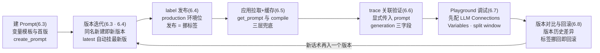
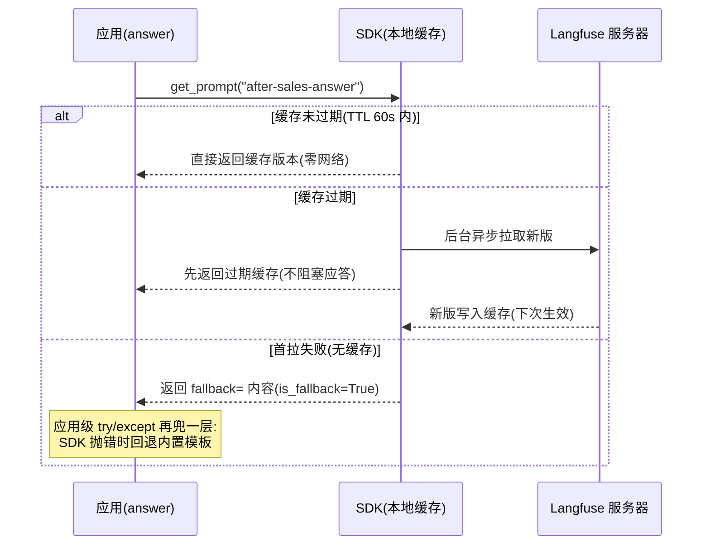
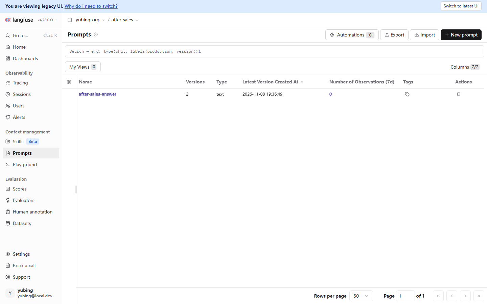

# 第 6 章 Prompt 管理

> 本章导读：第 3 章把售后助手最小版跑通了，但它的 system 提示词还是硬编码在 `support_bot.py` 里的一个字符串——改一版话术就要改代码重新发布，这正是第 1 章立论时点名的 Prompt 之痛。本章把这块字符串变成 Langfuse 平台上的版本化资产：先用 `create_prompt` 把贯穿案例的 `after-sales-answer` 两版话术（v1 直答版、v2 共情版）建上去，理解「同名新建即新版本」；再讲清 label（Prompt 标签）的发布语义——发布从「改代码重新部署」变成「挪一个标签」，回滚秒级；然后写应用侧的消费代码：`get_prompt` 拉取、本地缓存、`compile` 编译与失败回退；再把 prompt 版本与 generation 观测显式关联，让每条 trace 都能回答「现场是哪版 Prompt 在指挥」；最后过一遍 Playground 调试场与版本对比。读完本章，你能：独立完成 Prompt 的创建、发布与回滚；为应用选对缓存与回退策略；在 trace 里查证任意一次调用用的哪版 Prompt。



*本章操作流程图*

## 你什么时候需要它

三种典型处境，对应本章三种用法。

**Prompt 还散在代码里，改一版丢一版历史，谁也说不清线上跑的是哪版**——从 6.1 读起，然后按 6.3 → 6.4 → 6.5 的顺序把贯穿案例的 `after-sales-answer` 走完一遍。这一趟会把创建、版本化、发布与消费的完整链路打通，也是全书约定里「案例随章节成长」的下一步：售后助手从第 3 章的内置模板升级为托管 Prompt。

**应用已经接了托管 Prompt，但要回答两个工程问题：Langfuse 挂了应用会不会跟着挂？某条 trace 当时用的哪版 Prompt？**——前者看 6.5 的三层兜底（本地缓存、SDK 内置 fallback、应用级 try/except），后者看 6.6 的显式关联。两个问题的答案都来自实测，包括我们踩到的两个真实的坑：变量没被替换、版本没有关联上。

**想在线上调一版新话术、对比两版差异、或者把刚上线的版本撤下来**——6.7 的 Playground 是调试场，6.8 是版本对比与回滚；如果要把「试一版新话术」升级成「用数据说话」，那是第 8 章实验的主题，本章先把资产的底座打好。

前置：第 2 章完成部署、第 3 章 SDK 接入可用（三变量与 `auth_check`）。本章代码的 Key 一律写占位符 `pk-lf-***` / `sk-lf-***`，运行时换成你自己项目的真实值。

## 6.1 概述：Prompt 为什么要平台化管

**Prompt 是 LLM 应用里变更频率最高、又最缺乏工程保护的资产。**第 1 章立论时点名了它的三重风险，这里逐条回收——本章就是这三句话的解法：

| 第 1 章的风险 | 具体表现 | Langfuse 的解法 | 本章小节 |
|--------------|---------|----------------|---------|
| 改一版丢一版历史 | 新版话术覆盖旧版字符串，旧版再也找不回来 | 版本：同名新建即新版本，历史全部留存 | 6.3 |
| 线上跑的哪版说不清 | 出了 badcase，没人能回答「当时是哪版 Prompt」 | trace 关联：generation 上记 prompt_id/prompt_name/prompt_version | 6.6 |
| 试一版新话术只能改代码重新发布 | 走完开发—测试—部署全流程，只为换一段文案 | prompt label：production/staging/experimental 环境位，发布=挪标签 | 6.4 |

把这三条解法串起来，就是本章操作流程图画的那条回路：**建 Prompt → 版本迭代 → label 发布 → 应用拉取+缓存 → trace 关联验证 → Playground 调试 →（回到版本迭代）**。回路的每一圈都留下完整的记录——改了什么（版本）、谁在用（label）、效果如何（第 8 章起）。

### 备选方案为什么不够

在把 Prompt 交给 Langfuse 之前，工程上常见的管法有三种，各有真实的局限——这张表也是「什么时候才需要本章」的决策依据：

| 管法 | 做法 | 局限 |
|------|------|------|
| 硬编码在代码里 | 模板字符串写在源码中 | 三重风险全占：无版本隔离、改话术=改代码、现场不可查 |
| git 管模板文件 | 模板放仓库，随代码评审 | 解决了丢历史；但发布仍要走部署链路，「哪版在线上」依旧说不清——git 分支与线上运行态是两个世界 |
| 配置中心 | 模板放 Apollo/Nacos 之类的配置系统 | 解决了不重启改文案；但配置系统不懂 LLM——没有版本化的变量语法、没有 Playground 试跑、更不会把版本号记进 trace |

Langfuse 的位置：它是**懂 LLM 的配置与版本系统**——版本、label、变量编译、调试场、trace 关联五件事是围绕「Prompt 是一种高频变更的运行时资产」这个特性设计的，通用配置系统不专精于此，git 不够运行时。当然，代价是多了一个依赖——所以 6.5 的缓存与回退是本章的工程重心。

### 变量模板：{{variable}} 占位符

托管 Prompt 不是一段死的文本，而是带变量的模板。Langfuse 的变量语法是**双花括号**：`{{variable}}`。编译时按名字替换成调用方传入的值：

```text
你是跨境电商售后助手。

## 售后资料
{{context}}

## 用户问题
{{query}}
```

应用侧编译（下一节的主角，先看个样子）：

```python
prompt = lf.get_prompt("after-sales-answer")
system_text = prompt.compile(context=retrieved_text, query=user_question)
```

两个工程上的理由支持把模板挪到平台侧：其一，**模板与代码解耦**——运营改话术不碰代码仓库，改完在平台上挪标签即发布；其二，**模板自身被版本化**——每一版模板都是平台上的一个资产，有创建时间、有 label 指向、有历史可回溯。

### 两类 Prompt：text 与 chat

Langfuse 支持 text 与 chat 两类 prompt：

| 类型 | 内容形态 | 适用场景 | 本章用法 |
|------|---------|---------|---------|
| text | 一段字符串模板 | 单一 system 提示词、补全式调用 | 贯穿案例用这个 |
| chat | 消息列表（role+content） | 多角色对话模板（system/user/assistant 各一段） | 概念提及 |

创建 chat 型 prompt 时，`prompt` 参数传消息列表而非字符串；SDK 返回的 `ChatPromptClient` 的 `compile()` 同样按 `{{variable}}` 替换每条消息里的变量，返回编译后的消息列表。本书贯穿案例只需要一段 system 提示词，所以全程用 text 型；你的应用若是多角色对话编排，chat 型更贴合，机制与本章所讲完全一致。

### 事实来源与实测口径

- 出自官方文档（本章 `source` 指向 prompt management overview）：`{{variable}}` 变量语法、text/chat 两类 prompt、版本与 label 的公开语义。
- 出自本书实测（2026-11-08，SDK 5.2.0 + 服务器 v4.76.0，本机 Docker 部署）：同名新建即新版本、`latest` 标签自动挂在最新版、**compile 只替换双花括号**（demo 里的单花括号实测未被替换，见 6.3 实测注记）、**prompt 与 generation 的关联是显式的**（`propagate_attributes(prompt=…)`，见 6.6 实测注记）、get_prompt 的缓存与回退行为（见 6.5）、Playground 未配连接时的黄条（见 6.7）。
- 本书立场：「缓存加回退是托管 Prompt 的生产必需」是工程判断，不是文档结论；实测观察如实记录，不外推成官方承诺。

## 6.2 Prompts 页：列表能看什么

### 页面布局

侧栏 Context management 组下有 Prompts 与 Playground 两项（v4.76.0 的实测布局，Skills 是旁边的 Beta 项）。点开 Prompts，看到的不是某个 prompt 的详情，而是项目里全部 prompt 的资产清单：


逐列读这张表，每列都对应本章的一个概念：

| 列 | 实测取值（贯穿案例） | 对应概念 |
|----|---------------------|---------|
| Name | `after-sales-answer` | 资产名；同名即同一资产的多个版本 |
| Versions | 2 | 版本数：v1 直答版 + v2 共情版（6.3） |
| Type | text | text/chat 两类（6.1） |
| Latest Version Created At | 2026-11-08 19:36:49 | 最新版的落库时间 |
| Number of Observations (7d) | 0 | 近 7 天关联到该 prompt 的观测数（6.6 接通后会涨） |
| Tags | （标签图标） | 全版本共享的标签，创建时由 `tags` 参数指定 |
| Actions | 删除 | 删除整个 prompt 资产（含全部版本），慎用 |

顶部搜索框的占位文本就是一份语法速查：`type:chat, labels:production, version:>1`——按类型、按 label、按版本号过滤。prompt 多了以后，这是定位「production 上现在挂的哪版」最快的入口。与 Traces 页一样，My Views 可以保存常用过滤视图，Columns 可配置列显示。

### 列表页的周边能力

顶部一排按钮在实测截图里都可见，按文档语义速记如下（本书未逐一实测，标注为文档口径）：

| 按钮 | 用途 | 实测状态 |
|------|------|---------|
| New prompt | 在 UI 里手工建 prompt（填模板、选类型、挂 label） | 界面可见；本书走 SDK 路线（6.3），两条路线产物等价 |
| Export / Import | 把 prompt 资产导出为 JSON / 从 JSON 导入 | 界面可见；跨环境迁移资产的文档路线（如从开发项目导到生产项目） |
| Automations 0 | 自动化规则入口（实测计数为 0） | 界面可见；贯穿案例未用，与评估规则的联动属第 9 章话题 |
| My Views / Columns | 保存过滤视图 / 配置列 | 与 Traces 页同款交互（第 4 章） |

Export/Import 值得多说一句：它是「模板资产在两个 Langfuse 环境之间搬家」的官方通道——配合第 11 章的「开发/生产项目隔离」，模板先在开发项目里迭代，定稿后导出、导入生产项目再挂 production 发布。

### 贯穿案例的素材从哪来

列表里那两个版本不是在 UI 里手敲的，而是实测仓库 `setup_assets.py` 建的——6.3 就贴它的代码。这里先交代两个实操约定：其一，`setup_assets.py` 的执行顺序在第 2 章部署完成后，所以本章你看到列表时素材应当已在（如果你从零复刻，跑一遍 6.3 的代码即可）；其二，**同名 prompt 重复创建不会报错，而是追加新版本**——这是「版本迭代」的机制（6.3 展开），但反过来说，不小心把同一模板建两遍，Versions 就会变成 3，恢复的唯一办法是接受这个多余版本（平台不提供删单版，只提供删整个资产）。

## 6.3 create_prompt 实测：建 Prompt 与变量模板

### 两个版本，一次到位

实测代码出自 `demo/setup_assets.py`，把贯穿案例的两版话术一次建上。v1 是直答版——只管把政策答对；v2 是共情版——为第 8 章的对比实验准备的第二版话术：

```python
# setup_assets.py（节选）—— 建贯穿案例的托管 Prompt:同名新建即新版本
from langfuse import get_client

lf = get_client()

PROMPT_V1 = (
    "你是跨境电商售后助手。请依据以下售后资料回答用户问题,资料中没有的内容请引导转人工。\n\n"
    "## 售后资料\n{context}\n\n## 用户问题\n{query}\n\n## 回答要求\n"
    "1. 先直接回答政策要点;2. 不编造资料之外的承诺;3. 语气友好,末尾询问是否需要进一步帮助。"
)
PROMPT_V2 = (
    "你是跨境电商售后助手。用户可能带着不满情绪,请先安抚,再依据资料给出准确政策。\n\n"
    "## 售后资料\n{context}\n\n## 用户问题\n{query}\n\n## 回答要求\n"
    "1. 共情一句话开头;2. 直接回答政策要点,不编造资料之外的承诺;"
    "3. 给出下一步动作(申请入口/时效);4. 末尾询问是否需要转人工。"
)

print("== prompt v1 ==")
lf.create_prompt(name="after-sales-answer", type="text", prompt=PROMPT_V1, labels=["production"])
print("== prompt v2 ==")
lf.create_prompt(name="after-sales-answer", type="text", prompt=PROMPT_V2, labels=["production"])
```

跑完刷新 Prompts 页，Versions 列从 0 变 2——这正是「同名新建即新版本」：**平台不提供「更新」，只提供「新建即版本化」**。两次 `create_prompt` 用了同一个 `name`，平台自动编号 v1、v2，两版内容都永久留存。

`create_prompt` 的完整参数面（SDK 5.2.0 实测签名）：

| 参数 | 类型与默认 | 说明 |
|------|-----------|------|
| `name` | str，必填 | 资产名；同名重复调用=追加新版本 |
| `prompt` | str（text 型）或消息列表（chat 型） | 模板本体，变量写 `{{variable}}` |
| `labels` | List[str]，默认 `[]` | 本版挂的标签；要作为默认解析目标需显式挂 `production` |
| `tags` | List[str]，可选 | 全版本共享的标签（区别于 label：label 挂在单个版本上） |
| `config` | 任意结构化数据，可选 | 随版本保存的配置（如模型名、temperature 快照） |
| `commit_message` | str，可选 | 本次变更的说明，版本历史里可读 |
| `type` | `"text"` 或 `"chat"`，默认 text | 两类模板（6.1） |

两个值得强调的细节。其一，`labels` 默认是空列表——**新版本不挂 `production` 就不会被应用侧默认解析到**，这保证了「建新版」与「发布」是两个动作（6.4 的核心语义）。其二，`config` 与 `commit_message` 是版本资产的元数据：把「这版用的模型与温度」存进 config、把「为什么改」写进 commit_message，版本历史才能当变更日志读——这些是文档公开参数，本书实测代码未用，读者按需取用。

### 运行与验证

```bash
python setup_assets.py
# == prompt v1 ==
# == prompt v2 ==
# == dataset ==
#   + 我想退货,政策是什么?
#   ...(数据集条目,第 7 章的主角)
# done: prompts x2, dataset items x6
```

跑完到 UI 里按表验收（都在 6.2 读过的 Prompts 页上）：

| 验证点 | 位置 | 预期 |
|--------|------|------|
| 资产出现 | Prompts 页列表 | 一行 `after-sales-answer`，Versions=2，Type=text |
| 最新版时间 | Latest Version Created At 列 | 等于刚才脚本运行的时刻 |
| 版本内容 | 点资产名进详情 | v1 直答版与 v2 共情版两段模板都在，创建时间先后 |
| label 状态 | 版本详情 | v2 上 production（v1 的 production 已被 6.4 将讲的语义挪走）与 latest |
| 重复执行 | 再跑一遍脚本 | Versions 变 4——同名新建即新版本，不报错不覆盖 |

最后一行值得单独一提：`setup_assets.py` 的幂等性说明写明「重复执行前先在 UI 删除旧数据集」，prompt 部分则是「重复创建=追加版本」——**两个资产的幂等语义不同**，复刻贯穿案例时留意。本机实测基线上，`after-sales-answer` 就是跑这个脚本建出来的，两版话术随后被 support_bot 与实验脚本消费（第 8 章）。

### 实测注记：单花括号不会被 compile 替换（本章踩到的第一个坑）

上面贴的 PROMPT_V1/V2 里，变量写的是单花括号 `{context}`/`{query}`——这是 Python `str.format` 的习惯写法，也是实测仓库里的真实形态。**而 Langfuse 的变量语法是双花括号，compile 只替换 `{{variable}}`**。我们写作本章时专门做了本地验证（SDK 5.2.0，模板解析器纯本地逻辑）：

```python
# 验证:单花括号与双花括号,compile 各自怎么处理
from langfuse.model import TemplateParser

tpl = "资料:{context}\n问题:{{query}}"
print(TemplateParser.compile_template(tpl, {"context": "CTX", "query": "QRY"}))
# 资料:{context}          <- 单花括号原样保留,没有被替换!
# 问题:QRY                <- 双花括号正常替换
print(TemplateParser.find_variable_names(tpl))
# ['query']               <- 变量识别只认出双花括号的那个
```

再用真实资产复核一遍——拉取线上的 `after-sales-answer`，看它的变量识别与编译结果：

```python
prompt = lf.get_prompt("after-sales-answer")
print(prompt.version)      # 2
print(prompt.variables)    # [] —— 单花括号模板,一个变量都没被识别
compiled = prompt.compile(context="真实资料", query="真实问题")
# 编译产物里 {context} 与 {query} 作为字面量原样留在了发给模型的文本里
```

**后果是什么？**模型收到的 system 文本里，售后资料的位置是一个字面量 `{context}`——检索器辛辛苦苦拼出来的资料根本没进提示词，模型只能凭参数记忆硬答。这恰好演示了 6.6 的价值：这种问题的表象是「回答质量飘忽」，根因藏在 prompt 模板里，只有把「现场哪版 Prompt、编译后模型实际看到了什么」变成可查的，根因才追得到。

**正确写法**：模板里写 `{{context}}`/`{{query}}`。本书如实保留实测仓库的原始形态并在此标注差异，后续小节引用编译行为时均以双花括号为准；你复刻 demo 时，把两处模板改成双花括号即可（这正是把 prompt 托管到平台的好处之一——改模板不动代码，6.4 挪个标签就发布）。

## 6.4 label 发布语义：发布是挪标签，不是改代码

### 环境位，而非版本号

第 1 章埋了一句话：「label 是环境位而非版本号」，本章把它展开成可操作的语义。三档约定俗成的环境位：

| label | 语义 | 应用侧行为 |
|-------|------|-----------|
| `production` | 当前生产在用 | `get_prompt("name")` 默认解析到它 |
| `staging` | 预发验证中 | 应用侧显式 `label="staging"` 拉取 |
| `experimental` | 试验性话术 | 实验/灰度用（第 8 章的 A/B 切分在这上面做） |

机制上的三个要点。**其一，label 挂在版本上**：同一个 `after-sales-answer`，v1 与 v2 各自有自己的 label 集合，互不影响。**其二，label 可以移动**：把 v2 挂上 production、把 v1 的 production 摘掉，就是一次发布——应用侧永远只问「production 是哪版」，发布动作因此从「改代码重新部署」退化为「平台上挪一个标签」。**其三，一个版本可以同时挂多个 label**：实测里 v2 的 labels 是 `['production', 'latest']`——`latest` 是平台自动维护的标签，永远指向最新创建的版本，给你一个「不看发布状态、只看最新内容」的固定入口。

### 发布与回滚的操作

以「把 production 从 v1 挪到 v2」为例，两条路线：

**UI 路线**：Prompts 页点名称进入 prompt 详情，版本历史里每个版本旁有 label 编辑入口，给 v2 添加 `production`、给 v1 移除 `production`，保存即生效——下一秒起，所有 `get_prompt("after-sales-answer")` 拿到的都是 v2。

**API 路线（本机实测）**：`lf.api.prompt_version.update` 一次调用完成挪动。写作本章时我们用一次性探针资产验证了它的确切语义（测完即删，探针代码在实操区 `probe/` 目录）：

```python
# label 挪动实测(2026-11-08,SDK 5.2.0):探针资产 probe-labels,v1 挂 production,v2 无 label
lf.api.prompt_version.update(name="probe-labels", version=2, new_labels=["production"])

p = lf.api.prompts.get("probe-labels")          # 默认解析 production
print(p.version, p.labels)                      # 2 ['production', 'latest'] —— 已指向 v2

# 关键:只调了 v2 的 update,v1 的 production 被平台自动摘除
# (随后按 version=1 查询,labels 为 [])
```

这条实测落在 SDK 文档的一句话上：**「Labels are unique across versions」——同名 label 同一时刻只挂在一个版本上**。所以「发布」不需要两步（先加后删），给 v2 挂上 production 的瞬间，v1 就不再是 production 了；回滚同理，一次调用挪回去。文档同时注明 `latest` 是保留标签，由平台自动维护——你自己给它赋值会被拒绝或忽略。

这条语义顺带解释了一个 6.3 遗留的现象：`setup_assets.py` 两次 `create_prompt` 都带了 `labels=["production"]`，v2 建出来的那一刻，v1 头上的 production 就被自动摘掉了（我们事后按 version=1 查询实测 labels 为空）。也就是说 **create_prompt 传 labels 与 update 挪标签遵循同一套唯一性语义**。

本书建议：日常发布用 UI 路线（所见即所得，还能顺手看版本差异）；需要把发布编进脚本或流水线时（第 12 章的发布门禁思路）用 API 路线——一次调用、原子生效，正好当门禁的「通过后自动发布」动作。

**回滚 = 标签挪回旧版本**。v2 上线后发现共情话术效果不对，把 production 挪回 v1，秒级生效，不需要任何部署动作。与第 1 章的「改代码重新发布」对照，这就是平台化最大的行为改变：**发布从构建时推迟到了运行时**。也因为这个语义，第 8 章的 A/B 实验（同一资产两个版本按 label 做流量切分）才得以在不动应用代码的前提下进行。

### latest 与 production 的区别

实测发现的一个容易混淆点，值得单独说清：`latest` 自动指向**最新创建的版本**，与发布状态无关——你刚建了一个没挂 production 的 v3，latest 就指向 v3 了，而 production 还在 v2。所以：**应用侧永远只跟 production 走**（除非刻意做灰度）；latest 是给开发调试用的「我要看刚建的那版」的便利入口。两者混用的后果是「还没发布的内容进了生产」——把这类事故挡在门外，靠的就是 6.3 那条纪律：新版本默认不挂任何 label。

## 6.5 应用侧消费：get_prompt、compile 与本地缓存

### 核心代码：拉取、编译、回退

这是本章的核心代码段，出自实测仓库 `demo/support_bot.py` 的 `answer()` 函数——售后助手每次应答时，system 提示词从 Langfuse 托管拉取，失败则回退内置模板：

```python
# support_bot.py(节选)—— 应用侧消费托管 Prompt 的实测写法
@observe(name="support-bot-answer")
def answer(query: str, session_id: str | None = None) -> str:
    """一次售后应答 = 一条 trace;检索 + LLM 为其两个 observation。

    Prompt 从 Langfuse 托管拉取(after-sales-answer,production label),
    trace 自动关联 prompt 版本;SDK 带本地缓存,拉取失败回退内置模板。
    """
    with propagate_attributes(session_id=session_id, user_id="demo-user"):
        context = retrieve(query)
        try:
            prompt = lf.get_prompt("after-sales-answer")
            system_text = prompt.compile(context=context, query=query)
        except Exception:
            system_text = f"你是跨境电商售后助手,仅依据以下资料回答,资料之外请引导转人工:\n{context}"
        messages = [
            {"role": "system", "content": system_text},
            {"role": "user", "content": query},
        ]
        return llm_call(messages)
```

五行的 try/except 是本段的灵魂：**托管是优化，可用性是底线**——Langfuse 挂了或网络抖了，售后助手退化为内置模板继续答，只是话术退回旧版，服务不中断。这份 docstring 里「trace 自动关联 prompt 版本」一句在 SDK v5 上不成立，6.6 实测注记专门展开；单花括号模板的替换问题见 6.3 注记。除这两处外，上面这段是可运行的原样实测代码。

### get_prompt 的参数面

| 参数 | 默认 | 说明 |
|------|------|------|
| `name` | 必填 | 资产名 |
| `version` | 无 | 指定版本拉取；**与 `label` 互斥**（同时给两个会抛 ValueError） |
| `label` | 无 | 指定 label 拉取；两者都缺省时**解析 `production`** |
| `type` | `"text"` | text/chat 两类，须与资产实际类型一致 |
| `cache_ttl_seconds` | 60 | 本地缓存存活秒数；设 0 关闭缓存 |
| `fallback` | None | 拉取失败时的内置回退内容（text 型给字符串，须用双花括号变量语法） |
| `max_retries` | 2 | 拉取失败重试次数，上限 4，指数退避 |
| `fetch_timeout_seconds` | 5 | 单次拉取超时 |

### 缓存的三层兜底：SDK 替你做了两层

托管 Prompt 引入了一个新依赖：应用每次应答都要先问 Langfuse 要模板。**这层依赖绝不能变成可用性风险**——SDK 的设计（SDK 5.2.0 源码与文档行为，2026-11-08 核实）是三层兜底，前两层内置：

| 层 | 机制 | 失效场景 |
|----|------|---------|
| 1. 本地缓存 | 首拉进缓存，TTL 内直接用缓存（不访问网络）；TTL 过期后台异步刷新，刷新成功前继续用旧值（stale-while-revalidate 风味） | 进程刚启动且从未拉取成功 |
| 2. SDK 内置 fallback | 首拉失败时返回 `fallback=` 参数给的内容，返回对象带 `is_fallback=True` 标记 | 首拉成功且缓存尚在之后，这层不再参与（过期缓存先顶上） |
| 3. 应用级 try/except | demo 的写法：把拉取与编译整体包住，失败回退内置模板 | 兜住以上两层覆盖不到的情形——如模板编译异常、对象方法缺失 |

层 1 意味着：**TTL 之内，托管 Prompt 的成本是零网络请求**——每秒千次应答的服务，对 Langfuse 服务器的压力只是每 60 秒一次拉取（默认 60s TTL，可调）。层 2 与层 3 的分工值得想清楚：SDK 的 `fallback=` 只在「拉取失败」时生效，而 demo 的 try/except 连编译异常一起兜——**工程判断是生产代码保留应用级兜底**，因为它语义更直白（回退内容就在业务代码里，可读可审计），且把「平台不可用」与「平台返回了坏数据」统一处理。两层的回退内容应当一致，避免「平时用 v2 话术、故障时退回一个口径不同的旧话术」。

TTL 的取值是一场三方权衡，默认的 60 秒对多数场景是合理起点：

| TTL | 收益 | 代价 |
|-----|------|------|
| 短（如 5-10 秒） | 发布与回滚在应用侧几乎实时生效 | 拉取频次高；Langfuse 不可用时更快滑向回退模板 |
| 默认（60 秒） | 网络开销可忽略；发布延迟最多一分钟 | 发布感知有至多 1 分钟的缓存尾巴 |
| 长（如 10 分钟以上） | 对 Langfuse 的依赖降到极低 | 改错话术后要等很久才全网生效 |

配一条运维经验：**发布窗口前后临时调短 TTL**（环境变量或配置开关控制），平时保持默认——把「生效速度」做成发布动作的参数，而不是常驻成本。

`is_fallback` 标记有个实务用途：它让你能区分「这版内容是平台下发的」还是「回退模板顶上的」——如果想把回退事件本身也变成观测数据（回退次数告警），在你自己的 except 分支里记一条即可。

三层兜底的协作顺序画成时序图更直观——注意第 2 步与第 3 步的「过期缓存先顶上」是 SDK 静默完成的，应用代码感知不到：



### 消费侧自检脚本

接入托管 Prompt 后，跑一个十行的自检脚本确认资产状态与编译行为——与 3.2 的 `auth_check` 同一哲学：先自检再上线。以下为本机实测脚本与输出：

```python
# check_prompt.py —— 消费侧自检:资产元数据 + 编译行为
from langfuse import get_client

lf = get_client()
prompt = lf.get_prompt("after-sales-answer")

print("name    :", prompt.name)
print("version :", prompt.version)
print("labels  :", prompt.labels)
print("variables:", prompt.variables)            # 双花括号模板应列出全部变量名
compiled = prompt.compile(context="测试资料", query="测试问题")
print("compiled ok:", len(compiled) > 0)
```

```bash
python check_prompt.py
# name    : after-sales-answer
# version : 2
# labels  : ['production', 'latest']
# variables: []            <- 实测取值:单花括号模板一个变量都没识别(6.3 注记)
# compiled ok: True
```

自检通过的标准：version 与 labels 符合发布预期（production 指向你想发的版本）；`variables` 列出了模板里的全部变量名——**如果它比你预期的少，模板里就有没被识别的占位符**（6.3 的单花括号坑正是靠这一行暴露的）。把这个脚本放进 CI 或发布流程，它就是「发布前确认 production 指向」的自动化检查。

### 排障速查

应用侧消费托管 Prompt 的常见症状，按本章机制归类：

| 症状 | 多数原因 | 处理 |
|------|---------|------|
| 模板里的变量原样出现在发给模型的文本里 | 单花括号写法，compile 不替换 | 改成 `{{var}}`；用 `prompt.variables` 校验（6.3） |
| 改了模板，应用行为没变 | 缓存 TTL 未过（默认 60 秒） | 等过期，或临时 `cache_ttl_seconds=0` 验证 |
| 新建了版本但应用拉到的还是旧版 | 新版没挂 production；或挂了但旧版 production 未被挪走 | 挪 label（6.4 的唯一性语义会自动处理旧版） |
| Langfuse 停机时应用报错而不是回退 | 拉取与编译没包进 try/except，或首拉失败无 fallback | 补应用级兜底；首拉场景用 SDK `fallback=`（6.5） |
| trace 上 prompt_name 为 None | 没有显式 `propagate_attributes(prompt=…)` | 声明作用域（6.6） |
| 拉到了意料之外的旧版本 | 误以为是 latest（它指向最新版而非发布版） | 应用侧只跟 production 走（6.4） |

## 6.6 trace 关联：现场是哪版 Prompt

### 第 1 章的承诺，这里兑现

第 1 章把「现场是哪版 Prompt 在指挥」列为黑盒之痛的一条，承诺 trace 关联来解决。机制上：generation 观测上可以带三个字段——`prompt_id`（该版本资产的 ID）、`prompt_name`（资产名）、`prompt_version`（版本号）。有了它们，任何一条 trace 的 LLM 调用都能回答「当时用的哪版模板」，badcase 归因、版本效果统计（第 8 章按版本聚合实验分数）都建立在这三个字段上。

### 实测注记：SDK v5 的关联是显式的（本章踩到的第二个坑）

实测仓库 `support_bot.py` 的 docstring 写着「trace 自动关联 prompt 版本」，但我们在写作本章时核查 SDK 5.2.0 源码并用本机实例验证（2026-11-08）：**v5 的 SDK 里，`get_prompt` 不会自动把 prompt 挂到后续的 generation 上——关联必须显式声明**。把 prompt 对象传给 `propagate_attributes`（第 3 章已经用它传 session 与 user），作用域内产生的 generation 就带上三字段。对 6.5 那段核心代码的修正只有两处：模板改双花括号（6.3 注记）、`propagate_attributes` 多传一个 `prompt=`：

```python
# 修正写法:显式把 prompt 传进 propagate_attributes(SDK 5.2.0 实测可用)
@observe(name="support-bot-answer")
def answer(query: str, session_id: str | None = None) -> str:
    prompt = lf.get_prompt("after-sales-answer")   # 拉取(带本地缓存,6.5)
    with propagate_attributes(prompt=prompt, session_id=session_id, user_id="demo-user"):
        context = retrieve(query)
        system_text = prompt.compile(context=context, query=query)   # 模板本身用 {{var}} 写法
        messages = [
            {"role": "system", "content": system_text},
            {"role": "user", "content": query},
        ]
        return llm_call(messages)   # 这个 generation 将带上 prompt_name/version/id
```

探针实测（本机 v4.76.0）：显式传入后，观测 API 里该 generation 的 `promptName=after-sales-answer`、`promptVersion=2`、`promptId` 有值；而**未传的 demo 历史 trace（包括 `OpenAI-generation`）三字段全部为 None**——两相对照，机制清楚了：关联不是「拉取即挂」，是「声明作用域才挂」：

```python
# 探针(2026-11-08):最小可复现的关联验证
prompt = lf.get_prompt("after-sales-answer")

@observe(name="prompt-link-probe", as_type="generation")
def gen():
    return "probe-output"

with propagate_attributes(prompt=prompt, session_id="probe-prompt-link", user_id="probe-user"):
    gen()

lf.flush()
# 观测 API(/api/public/observations)查询该 generation:
# promptName=after-sales-answer | promptVersion=2 | promptId=1f78a20e-...
```

两个细节：其一，文档明确 link 只作用于 **generation 类型**的观测，普通 span 不挂；其二，回退场景（`is_fallback=True`）**不会**被关联——回退模板不是平台资产，记了反而说谎。

### 在 UI 里验证

验证动作还是第 3 章的基本功：跑一条修正写法的应答，Traces 页点开 trace，展开 LLM 调用的 generation 节点，详情里能看到 prompt 关联字段；点击可跳到对应版本的 prompt 详情。Prompts 页列表的 Number of Observations (7d) 列也会随之从 0 涨起来——那个数字就是「近 7 天有多少观测在用这个 prompt」的聚合读数。

**本章立场：把 `prompt=` 传进 `propagate_attributes` 应当成为接托管 Prompt 的固定动作**，与传 `session_id` 并列。忘了它，应用照常工作、trace 照常落库，一切看起来正常——只有当你想按版本统计效果时，才会发现字段是空的，而那时的历史数据已经补不回来了。

## 6.7 Playground 实测：先配 LLM Connections

### 空态：一条黄条拦在前面

侧栏 Playground 单列一项（与 Prompts 同属 Context management 组）。第一次点开它，你不会看到想象中的「输入框加运行按钮」——实测是一整页调试场骨架，顶部横着一条黄条：


黄条说得很直白：**Playground 要真的跑模型，得先给 Langfuse 自己配一个能调的模型**。这就是 v4 的 LLM Connections——项目 Settings → LLM Connections 页，为 Langfuse 自身（Playground、评估器这类平台侧功能）配置模型连接与 Key。注意区分两条完全独立的 Key 链路：

| 链路 | 配在哪 | 谁在用 | 本书对应 |
|------|--------|--------|---------|
| 项目 API Key（pk-/sk-） | 项目 Settings → API Keys | 你的应用（SDK 上报数据） | 第 2/3 章 |
| LLM Connections | 项目 Settings → LLM Connections | Langfuse 平台自身（Playground/评估器调模型） | 本章 |

**本机实测如实标注：我们的实例没有配置 LLM Connection**——Playground 停留在黄条空态，Run All 按钮是禁用态。配置步骤从略，留给读者实践：黄条里的 LLM Connection Settings 链接直达配置页，填入你的模型提供商 Key（如智谱、OpenAI）即可；配置完成后 Playground 里的窗口能力见下。这样标注不是因为步骤复杂，而是本书的原则：没实测过的操作不写成实测过的样子。

### 窗口能力：为「试话术」准备的

即便在空态，Playground 的界面骨架已经把能力面交代清楚了：

| 界面元素 | 用途 | 与本章主线的关系 |
|---------|------|-----------------|
| System / User 消息行 | 按角色编排消息模板 | chat 型模板的可视化编辑；text 型内容也能贴进来试 |
| Variables 下拉 | 声明与填充模板变量 | `{{variable}}` 占位符在这里逐个填值，6.3 的模板语法在这里试效果 |
| Save as prompt | 把当前窗口内容存为托管 prompt 新版本 | Playground 调出来的好话术，一键入版本库——调试与版本化的闭环 |
| New split window | 分屏对比 | 左右两版话术同题对跑，肉眼看差异（6.8 的补充） |
| Run All（Ctrl+Enter） | 批量运行全部窗口 | 配好连接后可用 |
| Reset playground | 清空当前布局 | 恢复初始态 |

Playground 在全书流程里的位置：**它是「试」的场所，不是「证」的场所**。肉眼比较两版回答适合初筛；「v2 是不是真的比 v1 好」要用第 8 章的实验在同一条数据集上跑分。但 Save as prompt 这个按钮值得记住——它把「调试场里打磨出来的话术」直接沉淀为平台上的新版本，让「试」的成果不散落在聊天记录里。

## 6.8 版本对比与回滚

### 版本历史：差异视角

从 Prompts 列表点资产名进入 prompt 详情，核心区域是版本历史：每个版本一行，带创建时间、label 状态与 commit_message（创建时若写了）。选中两个版本可以进入对比视角，逐行看模板差异——v1 与 v2 的差异（直答版换成共情版）在这里一目了然。

**如实标注：本机的版本对比视图没有截到**（FACTS 待补清单在案），以下描述基于官方文档与列表页实测推断，读者以自己实例的界面为准。列表页实测可见的部分是确凿的：Versions 列与 Latest Version Created At 列给了「有几个版本、最新何时建的」；上面的 `lf-prompt-detail.png` 截到的是 legacy UI 形态下的 Prompts 页——顶部横幅 You are viewing legacy UI 与右上 Switch to latest UI 并存，v4 迁移期双 UI 体验的实录（第 2 章交代过的口径），列表内容与 6.2 相同：



### 版本对比对什么

两个版本并排看，diff 出来的差异要按层读。以贯穿案例的 v1→v2 为例（6.3 的两段模板），差异落在四个层面，每层的判断工具不同：

| 差异层面 | v1 → v2 的实例 | 肉眼对比够吗 | 升级工具 |
|---------|---------------|-------------|---------|
| 措辞与结构 | 开头加了「先安抚」；回答要求从 3 条变 4 条 | 够——diff 一眼可见 | 版本对比视图 |
| 行为倾向 | 共情开场可能拉长回答、偏离要点 | 不够——要看实际输出 | Playground 同题对跑（6.7） |
| 回答质量 | 是否更让用户满意，无法肉眼判定 | 不够——需要固定评测集 | 数据集实验跑分（第 7-8 章） |
| 成本与延迟 | 多说的话术=更多 completion tokens | 不够——要聚合统计 | generation 关联按版本聚合（第 5 章口径） |

这张表的最后一列串起了后面几章：版本对比视角回答「哪里不一样」，第 8 章的实验回答「不一样值多少分」。**同一个资产的版本是天然的对照组**——这正是第 1 章把「改了一版不知道变好变坏」列为处境二的底气。

### 回滚：标签挪回旧版本

6.4 已经把语义讲清（label 跨版本唯一、挪动原子生效），这里把操作排成一条时间线——从上线到回滚的完整生命周期，全程不动一行应用代码：

```text
T0  create_prompt(v1, labels=["production"])   # v1 落库,production=v1
T1  应用上线,拉取 production -> v1
T2  create_prompt(v2)                          # v2 落库,不挂 label;latest 自动指向 v2
T3  Playground 对比试跑(6.7)                   # 初筛:共情话术方向可行
T4  update(v2, new_labels=["production"])      # 发布;v1 的 production 被自动摘除,
                                               # 应用下一次拉取(缓存过期后)即拿 v2
T5  发现 v2 共情过度,update(v1, new_labels=["production"])   # 回滚,一次调用秒级生效
T6  修正 v2 话术,create_prompt(v3)             # 新版本再入回路,latest 指向 v3
```

三个角色各司其职：`create_prompt` 负责「留下记录」，label 负责「指明在用哪版」，trace 关联（6.6）负责「事后对账」。对照第 1 章的三重风险，这条时间线逐项销账：T0-T6 每一步都留了版本历史（丢历史，销）；T1 起每条 trace 记着版本号（说不清，销）；T4/T5 的发布与回滚没有触碰代码仓库（改代码发布，销）。

时间线里有一个本章机制决定的细节值得点破：**T4 的发布不是全瞬时生效——应用侧还有最长 60 秒的缓存 TTL**（6.5）。平台上标签已挪动，但正在运行的进程可能还在用缓存里的旧版最多一分钟。对绝大多数业务这是无感的；若你的场景要求发布秒级全网生效，把 `cache_ttl_seconds` 调小（代价是拉取频次上升）。这也是「发布语义」完整含义的一部分：label 生效是即时的，应用感知有缓存延迟。

### 与实验的分工

最后划一道与第 8 章的边界，避免「版本对比」被滥用：**Playground 的分屏与版本历史的 diff 回答「哪里不一样」，实验回答「不一样带来了多大差别」**。前者是肉眼初筛，后者是同一条 `after-sales-qa` 数据集上的分数对比（贯穿案例的实测里，v1 基线与 v2 共情版的实验对比正是第 8 章的主菜）。调 Prompt 的完整节奏因此是：Playground 试手感 → 挪 label 小范围发布（staging/experimental）→ 数据集实验证分数 → production 全量——每一步的产出都沉淀在平台上，下一章的数据集建设就从这里接手。

## 本章小结

回到开头的问题，本章交付了五件事：

1. **平台化的理由**：第 1 章三重风险（丢历史/说不清/改代码发布）逐条对应版本、trace 关联、label 三件解法，串成「建→迭代→发布→拉取→关联→调试→对比」的回路（6.1）；
2. **创建与版本化**：`create_prompt` 同名新建即新版本，v1/v2 两版话术落库；变量模板的语法是双花括号 `{{variable}}`——实测踩坑：单花括号不被替换（6.2、6.3）；
3. **发布语义**：label 是环境位（production/staging/experimental）而非版本号，发布=挪标签、回滚秒级；`latest` 自动指向最新版但与应用无关（6.4）；
4. **消费与兜底**：`get_prompt` 默认解析 production，60 秒本地缓存（过期后台刷新），SDK 内置 `fallback=` 加应用级 try/except 三层兜底；编译用 `prompt.compile(variables)`（6.5）；
5. **关联与调试**：generation 上的 prompt 三字段必须显式声明（`propagate_attributes(prompt=…)`，实测踩坑：不传则为 None）；Playground 是调试场，跑模型先配 LLM Connections，Save as prompt 把试出来的话术沉淀成新版本（6.6、6.7）。

贯穿案例方面，售后助手的提示词完成了托管化：`after-sales-answer` 两个版本在平台上，production 指向 v2，应用侧带着缓存与回退消费它。本章实测踩到的两个坑（单花括号、未显式关联）都已回写进案例的修正路径——第 12 章的回归门禁脚本里，它们会以检查项的身份再出现。

下一步建议：带着「版本化资产」进第 7 章——评估数据集（dataset）是本章回路的下一环：没有一条固定的评测集，6.8 时间线里的 T3「初筛」永远只能是肉眼。如果你急着看版本对比的实际效果，也可以先跳第 8 章：label 流量切分与实验对比把本章的发布语义用到了极致。

## 验收清单

- ☐ 不查资料说出三重风险与三件解法的对应关系（丢历史→版本、说不清→trace 关联、改代码发布→label）
- ☐ 把一段带 `{var}` 单花括号习惯写法的旧模板改写成 `{{var}}`，并用 `prompt.variables` 验证变量被识别
- ☐ 完成「同名新建即新版本」的一次实操：建 v1、建 v2，并在 Prompts 页指出 Versions 列的变化与 latest 指向
- ☐ 把 production 从 v2 挪回 v1 再挪回来，全程不动应用代码，并说出回滚生效的时间量级
- ☐ 为自己的应用选一层兜底策略（缓存 TTL/SDK fallback/应用级 try/except），说出为什么不能只靠其中一层
- ☐ 写出带 `propagate_attributes(prompt=…)` 的消费代码，并在 trace 详情里指认 prompt_name 与 prompt_version 字段
- ☐ 打开 Playground，说出黄条要求配置的是什么（LLM Connections），它与项目 API Key 的区别是什么

## 参考速查

理解主线不依赖本节；本节供接入与排障时查阅。

### Prompt SDK 入口（SDK 5.2.0 实测）

| API | 用途 | 关键行为 |
|-----|------|---------|
| `lf.create_prompt(name=…, prompt=…, labels=[…])` | 创建 prompt（同名=新版本） | 新版不挂 label 则不会被默认解析 |
| `lf.get_prompt("name")` | 按 label/version 拉取 | 默认解析 production；version 与 label 互斥 |
| `prompt.compile(**vars)` | 编译模板 | 只替换 `{{variable}}`，单花括号原样保留 |
| `prompt.variables` | 模板变量名列表 | 可用来静态校验模板写法 |
| `prompt.is_fallback` | 是否回退产物 | 回退对象不参与 trace 关联 |
| `propagate_attributes(prompt=…)` | 把 prompt 声明进作用域 | 仅 generation 类观测被后端关联 |
| `lf.api.prompt_version.update(name, version, new_labels=[…])` | 挪 label（API 路线） | 同名 label 跨版本唯一，旧版自动摘除；latest 为保留标签 |
| `lf.api.prompts.get(name)` / `.list(name=…)` / `.delete(name)` | 查默认解析版 / 查资产元数据 / 删整个资产 | delete 删全部版本，慎用 |
| `lf.flush()` | 刷送上报队列 | 短生命周期进程必须（第 3 章） |

### get_prompt 缓存行为（2026-11-08 核实）

| 场景 | SDK 行为 |
|------|---------|
| TTL 内再取 | 直接用本地缓存，不发网络请求 |
| TTL 过期 | 后台异步刷新，先返回旧值（不阻塞应答） |
| 刷新/首拉失败，缓存有过期值 | 返回过期缓存 |
| 首拉失败且无缓存、给了 `fallback=` | 返回回退对象（`is_fallback=True`） |
| `cache_ttl_seconds=0` | 关闭缓存，每次真拉 |

### 版本基线与实测事实（核实日期 2026-11-08）

| 项 | 值 |
|----|-----|
| Langfuse 服务器 | v4.76.0（本机 Docker 自托管） |
| Python SDK | langfuse 5.2.0 |
| 贯穿案例 prompt | `after-sales-answer`：v1 直答版/v2 共情版，production=v2，实测 labels `['production','latest']` |
| 实测坑一 | 单花括号 `{var}` 不被 compile 替换（SDK 源码+本地验证+真实资产复核） |
| 实测坑二 | SDK v5 prompt 关联必须显式 `propagate_attributes(prompt=…)`；demo 历史 generation 三字段实测全 None |
| label 语义实测 | `prompt_version.update` 挪 production 一次调用生效，旧版自动摘除（探针 probe-labels 验证后删除）；create 传 labels 同语义 |
| Playground 空态 | 黄条 No LLM Connection Configured；本机未配置连接，配置步骤从略（读者实践） |
| 未截到/推断 | 版本对比视图未截到（官方文档+列表页实测推断）；UI label 编辑入口未单独截图（待补清单在案） |

## 延伸阅读

- **第 1 章 初识 Langfuse**——本章的立论源头：三重风险的原文表述与「label 把发布从构建时推迟到运行时」的立场句都在 1.2.2。
- **第 3 章 快速开始**——3.8 的售后助手最小版是本章改造的起点：内置 system 模板换成托管 Prompt 的前后对照就在这两个版本之间。
- **第 5 章 成本与性能监控**——generation 上除了 prompt 三字段还有 model/usage/成本：按版本统计「每版话术烧多少钱」的口径在那章配齐。
- **第 7 章 评估数据集**——本章末尾的时间线里 T3「初筛」要升级成「跑分」，前提是先有一条固定的 `after-sales-qa` 评测集。
- **第 8 章 实验与对比**——本章发布语义的进阶用法：staging/experimental 的流量切分、按 prompt 版本聚合的实验分数对比，以及「同配置分数波动」的实测教学点。
