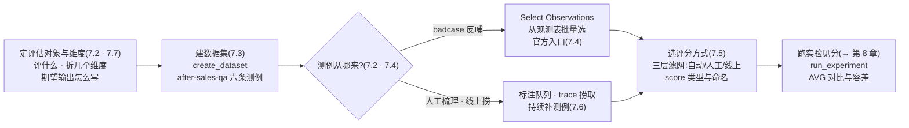
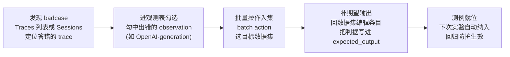
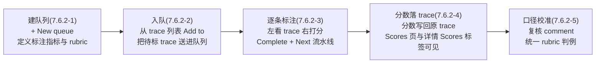

# 第 7 章 数据集与评分

> 本章导读：第 6 章末尾留了一句伏笔——「没有一条固定的评测集，T3 初筛永远只能是肉眼」。本章来补上这条评测集。售后助手在真实使用里已经暴露过 badcase：用户问「保税仓发货多久能到」，检索器关键词未命中，机器人答成退货政策——现场在第 3 章的 trace 里，但「知道它错」和「让它变成可回归的测例」之间差一座桥，这座桥就是数据集（dataset）。本章沿一条操作主线走：先定评估对象与评分维度 → 用 `create_dataset` 建贯穿案例的 `after-sales-qa` 六条测例并逐条拆解设计意图（含「期望输出=引导转人工」这类负向期望的写法）→ 把 UI 的四种添加方式过一遍，重点是 Select Observations——从观测表批量选测例，badcase 反哺的官方入口 → 展开 score（评分）三来源分层：自动化评估器每次都看、人工标注细看、线上反馈拿最终权重 → 过标注队列（annotation queue）的入口与流程 → 收拢为一套评分维度设计方法。读完本章，你能：为你的应用建一条带期望输出的评估数据集；把真实 badcase 变成回归测例；说清三类评分各自的分工与落地入口；为自己的应用设计一套三维评分 rubric。



*本章操作流程图*

## 你什么时候需要它

三种典型处境，对应本章三种用法。

**你要改一版 Prompt、换一个模型或动一次检索器，但「变好还是变坏」只能靠肉眼刷几条对话**——从 7.1 读起，按 7.2 → 7.3 → 7.4 的顺序把数据集建起来。这是本章的主线动作：一条固定的评测集是一切量化改进的前提，第 8 章的实验、第 12 章的回归门禁都跑在这条数据集上。

**线上已经积累了一批 trace，其中混着答非所问的 badcase，你想把它们变成资产而不是让它们沉底**——直奔 7.4 的 Select Observations。从观测表批量勾选、加进数据集、补上期望输出，一条 badcase 就从「一次投诉」变成「一次回归测试」。7.3 的负向期望写法（「引导转人工」怎么当期望）也会在这一趟里用上。

**团队想给回答打分了，但三类评分该谁打、打什么、分落在哪说不清**——看 7.5（score 三来源分层与类型）和 7.6（标注队列入口与流程），再按 7.7 的方法把维度设计成 rubric。三层滤网是第 1 章立好的立场，本章把它落地成可操作的分工表。

前置：第 3 章的售后助手在跑（badcase 与 trace 是本章的原料）；第 6 章的 `after-sales-answer` 托管 Prompt 已建（被测对象的版本化形态）。本章代码的 Key 一律写占位符 `pk-lf-***` / `sk-lf-***`，运行时换成你自己项目的真实值。

## 7.1 概述:评估的地基是数据集,不是评估器

**先有基线，才有改进：没有一条固定的评测集，任何 Prompt 迭代都只是肉眼判断。**很多人对 LLM 评估的想象是先找个「智能裁判」——上 LLM-as-judge、配个评估器就完事。本书的立场相反：评估器只是打分的尺子，数据集才是被测量的地基。尺子再精，量在一堆随手拼凑、期望缺失的测例上，得到的分数也没有工程价值；反过来，一条六条测例的小数据集，只要期望输出写得清楚、badcase 是真实回流，就足以支撑第 8 章的版本对比和第 12 章的门禁拦截——贯穿案例全程用的就是这六条。

把「肉眼评估」与「固定数据集评估」摆在一起，这条主张的论据就全了：

| 维度 | 肉眼评估(没有固定数据集) | 固定数据集评估(本章) |
|------|------------------------|---------------------|
| 每次验证的口径 | 随手刷几条对话，每次问的不一样 | 同一条测例集，改动前后比同一批题 |
| 结论形态 | 「感觉好些了」——无法复核 | 分数 + 逐条涨跌——可复核可讨论 |
| 分工 | 只有提出者自己能评 | 运营出测例、测试跑实验、评估器打分 |
| 回归防护 | 不存在——改坏了要靠用户投诉发现 | badcase 在集里，门禁可拦(第 12 章) |
| 知识沉淀 | 经验随人走 | 每条测例带着期望输出与来源 metadata |

动手之前过一遍本章的概念最小集：

| 概念 | 一句话定义 | 本章用法 | 展开 |
|------|-----------|---------|------|
| dataset（评估数据集） | 带期望输出的测例集合，评估的固定地基 | 建 `after-sales-qa` 并维护它 | 本章 |
| dataset item（数据集条目） | 一条测例：input/expected_output/metadata 三段 | 六条售后问句逐条设计 | 7.2、7.3 |
| score（评分） | 挂在 trace 或实验输出上的分数，三来源 | recall 实测行已在 Scores 页 | 7.5 |
| evaluator（评估器） | 给输出打分的函数或配置 | 本章只立分层，实测在第 8 章 | 第 8-9 章 |
| annotation queue（标注队列） | 人工标注的排队工作流 | 入口实测，流程如实标注 | 7.6 |
| experiment（实验） | 数据集跑测一轮，UI 术语替代 v3 的 dataset run | 本章末尾预告，下一章主菜 | 第 8 章 |

本章结束时，你手上会有四个可验证的交付物：

| 交付物 | 验证方式 | 小节 |
|--------|---------|------|
| 一条带期望输出的数据集 | Datasets 列表出现 `after-sales-qa`，Items 计数为 6 | 7.3 |
| 一套测例设计意图的书面解释 | 六条测例逐条能说出「为什么是它」 | 7.3 |
| badcase 反哺的操作路径 | 能演示 Select Observations 的入口与流程 | 7.4 |
| 一套三维评分 rubric | 每个维度有 score name、取值与判定标准 | 7.7 |

### 事实来源与实测口径

- 出自官方文档（本章 `source` 指向 datasets 文档页）：数据集与数据集条目的数据模型、四种添加方式、评分与标注队列的功能定位。
- 出自本书实测（2026-11-08，SDK 5.2.0 + 服务器 v4.76.0，本机 Docker 部署）：`create_dataset`/`create_dataset_item` 的实测签名、六条测例的实测内容、Datasets 列表与详情页的实测形态、Scores 页的实测 recall 行、**legacy UI 的 Items 空态与实验消费正常的差异**（7.8 专节交代）。
- 本章立场：「三来源是三层滤网」在第 1 章已立，本章展开落地；「数据集先于评估器」「一维一分」是本书工程判断，不是文档结论。

## 7.2 数据集建设方法论:测例结构、三来源与养集节奏

### 7.2.1 一条测例长什么样:input/expected_output/metadata

数据集条目（dataset item）的结构是三段式：

| 字段 | 必要性 | 内容 | 本书实例 |
|------|--------|------|---------|
| `input` | 必填 | 喂给被测应用的输入——售后场景就是用户问句 | `"保税仓发货多久能到?"` |
| `expected_output` | 强烈建议 | 期望输出的判据，两种写法见下 | `"3-5 日送达"` |
| `metadata` | 可选 | 结构化标注：来源、类别、难度、关联工单号 | 本书 demo 未使用(教学建议) |

三段的分工可以用一句话记住：**input 定义「问什么」，expected_output 定义「答成什么样算对」，metadata 定义「这条测例是谁、为什么进来的」。**`input` 决定实验时 task 函数拿到什么；`expected_output` 是评估器的对照物——第 8 章的 recall 评估器拿它与实际输出比对；`metadata` 在建集时最容易被省略，但它是后续按类别分组读分（「物流类测例的分数和退货类拉开了吗」）的唯一抓手，生产数据集建议至少标一个来源字段。本书 demo 的六条测例只用前两段——教学规模下靠人脑记类别尚可，规模上去后 metadata 不是可选项，这是本书立场。

`expected_output` 有两种写法，区分它们是测例设计的第一课：

| 写法 | 内容 | 适用 | 本章实例 |
|------|------|------|---------|
| 正向期望 | 期望出现的答案要点 | 有标准政策答案的问题 | 「3-5 日送达」「7 天无理由」 |
| 负向期望 | 期望出现的行为而非内容——典型是「不编造、引导转人工」 | 应用没学过、资料未覆盖的问题 | 「资料未覆盖,引导转人工(不编造)」 |

负向期望的完整展开在 7.3.4——它是贯穿案例里最有教学价值的一条测例，这里先立住概念：**expected_output 不一定是「黄金答案」，它可以是一段行为约定。**

### 7.2.2 判据粒度:expected_output 怎么写才可判

写法之外，还有粒度问题。同一条政策，expected_output 可以写成三个粒度，可判定性完全不同：

| 粒度 | 示例 | 可判定性 | 维护成本 |
|------|------|---------|---------|
| 整段黄金答案 | 完整一段标准答复 | 差——逐字匹配过刚，语义相似度要另配尺子 | 高——话术每改一版答案就要跟着改 |
| 要点短语(本书推荐) | 「3-5 日送达」「7 天无理由」 | 好——可拆成关键词组，启发式与 LLM-as-judge 都能消费 | 低——政策不变则判据不变 |
| 行为约定 | 「资料未覆盖，引导转人工(不编造)」 | 分尺子——启发式不可判，人工/裁判模型可判 | 中——行为规范相对稳定 |

本书推荐**要点短语**粒度，理由是它与评估器的衔接最顺：第 8 章实测的 recall 评估器，正是把 expected_output 拆成关键词组、再数实际输出命中了几组——期望写成「3-5 日送达」，评估器就能从中取「3-5 日」做判据；期望写成整段答案，评估器要么逐字比对(刚性过强)，要么另配语义相似度尺子(复杂度陡增)。

但要点短语有一个实测暴露过的刚性陷阱，必须提前交代：**判据短语与模型表述的措辞差，会让评估器误判。**贯穿案例的实测三连(第 12 章细讲)里，「3-5 日」这条判据拦住了真实的修复成果——模型答「3 到 5 个工作日」，语义完全正确，关键词匹配判不中，recall 被压低。这不是测例的错，是判据粒度的固有边界：**启发式尺子对措辞敏感，LLM-as-judge 尺子对语义宽容**——第 9 章升级评估器的全部理由，起点就在你写 expected_output 的这一刻。设计期的实用建议：判据短语尽量多留同义变体(政策原文的措辞、口语的说法各留一笔)，给启发式尺子留出匹配余量。

### 7.2.3 测例从哪来:三来源补测例

数据集不是一次设计出来的，是养出来的。测例的三个来源，各自接住一类问题：

| 来源 | 接住什么 | 操作路径 | 节奏 |
|------|---------|---------|------|
| badcase 反哺 | 线上真实暴露的错误——最有价值的测例，因为它是用户替你发现的 | 从 trace/观测表捞(Select Observations 官方入口，7.4) | 持续、随时 |
| 人工标注 | 上线前按类别补齐的覆盖面——政策域、物流域、边界问法 | 人工梳理 + 手工添加/CSV 导入 | 建集时集中一轮 |
| 线上捞取 | 高频真实问句——保证测例分布贴近生产流量 | 从 Traces/Sessions 抽样转测例 | 定期(如每周) |

三个来源的优先级，本书立场：**badcase 反哺最优先**。理由很直接：人工梳理容易写成「想象中的问题」，而 badcase 是发生过的事实——它已经错了一次，不进数据集就会再错一次。贯穿案例的建集顺序正是如此：六条测例里两条来自第 3 章的原生 badcase(7.3.3 细讲)，四条来自人工梳理的政策覆盖面；上线之后的新 badcase，走 7.4 的 Select Observations 持续回流。

判断一条测例「值不值得进数据集」，本书给三个标准：

- **可判定**——存在客观判据(要点、行为约定)，评估器或标注员能给出一致结论；
- **可复现**——input 独立成立，不依赖某次特定会话的上下文；
- **有代表性**——它代表一类问题(某个政策域、某类问法)，而不是孤例。

三条全中才入集。贯穿案例里「1+1 等于几」这类冒烟测试就不会进数据集——它可复现但无代表性，它是第 5 章验证配价的工具，不是评估资产。

### 7.2.4 养集节奏:小步起步,持续回灌

规模问题上本书的建议：**教学与起步六到十条，覆盖核心业务域即可；生产数据集按「每类业务域至少十条 + 每个 badcase 一条」滚动增长。**小数据集的分数噪声大(一条测例的对错就是十几个百分点的波动)，第 8 章讲阈值容差时会正面处理这个问题——但这不构成「先攒几百条再开始评估」的理由：六条测例的召回分数已经足以拦住「答成退货政策」这类硬伤，而攒集的成本会让评估迟迟落不了地。先跑起来，让 badcase 反哺把数据集养大，是可执行的路径。

### 7.2.5 一个常见混淆:评估数据集不是应用语料

贯穿案例里有一处容易看晕的地方：数据集测例的问句(「保税仓发货多久能到？」)与检索器的 FAQ 语料(退货/物流/换货三段)长得几乎一样。它们是两个东西，角色相反：

| 对比项 | FAQ 语料(support_bot.py 里的) | 评估数据集(after-sales-qa) |
|--------|------------------------------|----------------------------|
| 角色 | **运行时喂给应用的上下文**——模型靠它答题 | **离线评估的考题**——实验时考应用 |
| 消费者 | 应用(检索器每次调用都在读) | 评估链路(实验跑测时才读) |
| 更新节奏 | 随政策变化更新(运营动作) | 随 badcase 增长(质量动作) |
| 它出错的表现 | 应用答错——可能产生 badcase | 评估失真——分数不可信 |

混用两者的后果值得点破：**把语料直接当测例，考出来的是「背书能力」而不是「检索加理解能力」**——期望输出抄自语料原文的应用，答得好可能只是检索命中了，检索没命中的那部分(7.3.3 的双子星)恰恰是语料覆盖不住的盲区，而盲区只能靠 badcase 反哺来补。两者内容上高度相关(测例的期望输出往往就来自语料承载的政策)，但仓库必须分开：语料在应用代码里，测例在数据集里——这也正是 7.4.1 推荐 Add via Code 的另一层理由：建集脚本与被测应用在同一个代码库里，两边的关系一目了然。

## 7.3 贯穿案例实测:after-sales-qa 建集全解

### 7.3.1 实测代码:两条命令建一条数据集

数据集建设实测走 SDK 路线(`demo/setup_assets.py`，2026-11-08 实测通过)，数据集部分：

```python
# setup_assets.py(数据集部分)——建 after-sales-qa 六条测例(实测)
from langfuse import get_client

lf = get_client()   # 读第 3 章的三个环境变量

ITEMS = [
    {"input": "我想退货,政策是什么?", "expected_output": "7 天无理由;商品完好附件齐全;质量问题运费商家承担"},
    {"input": "保税仓发货多久能到?", "expected_output": "3-5 日送达"},
    {"input": "海外直邮超时了怎么办?", "expected_output": "超 30 日未送达可申请全额退款"},
    {"input": "商品有质量问题,能换货吗?", "expected_output": "质量问题 30 天内免费换货一次"},
    {"input": "退款多久到账?", "expected_output": "资料未覆盖,引导转人工(不编造)"},
    {"input": "拆封了还能退吗?", "expected_output": "激活/拆封类除外,商品完好才可退"},
]

lf.create_dataset(name="after-sales-qa")
for it in ITEMS:
    lf.create_dataset_item(dataset_name="after-sales-qa", **it)
lf.flush()   # 短生命周期进程显式刷送(第 3 章 3.6)
```

两个实测签名值得记下:`lf.create_dataset(name=…)` 建数据集本体;`lf.create_dataset_item(dataset_name=…, input=…, expected_output=…)` 逐条添加。与第 6 章 prompt 的「同名新建即新版本」不同，**数据集与条目是幂等命名下的追加语义——重复执行会追加重复条目**，`setup_assets.py` 的 docstring 里明确写了这一点，重复跑之前先在 UI 删除旧数据集。

跑完去 UI 验证。侧栏 Evaluation 组点 Datasets(与 Scores/Evaluators/Human annotation/Experiments 并排)，列表出现 `after-sales-qa`:


逐块读这张图：

| 界面元素 | 你看到什么 | 背后的概念 |
|---------|-----------|-----------|
| 列表行 | 一行一个数据集，`after-sales-qa` 已在列 | dataset 是项目级资产，与 Prompt 同级 |
| Items 列 | 计数 6 | 条目数——建集成功的第一个验证点 |
| Experiments 列 | 计数 2(截图时刻) | 这条数据集被实验消费过的次数(第 8 章) |
| Last Run | 2026-11-08 19:40:23 | 最近一次实验时间；实验记录在 Experiments 页 |
| Metadata 列 | 本行为「—」 | dataset 级的元数据字段，demo 未填 |
| + New dataset | 右上按钮 | UI 建集入口；本书走 SDK 路线 |

注意这张列表回答了「数据集建没建成」：**Items 计数为 6 就是存在性验证**。至于详情页 Items 标签里能不能逐条看到——那里有一处实测差异，7.8 专节交代，此处先按下。

### 7.3.2 六条测例逐条拆解:设计意图与覆盖面

六条测例不是随手拼的，每条都有自己的岗位职责：

| # | input | expected_output | 设计意图 | 来源 |
|---|-------|----------------|---------|------|
| 1 | 我想退货，政策是什么？ | 7 天无理由；商品完好附件齐全；质量问题运费商家承担 | 退货政策主干——最高频问句，正向期望的样板 | 人工梳理 |
| 2 | 保税仓发货多久能到？ | 3-5 日送达 | **badcase 反哺**——检索器关键词未命中的真实案例(见下) | badcase |
| 3 | 海外直邮超时了怎么办？ | 超 30 日未送达可申请全额退款 | badcase 反哺 + 时效承诺边界——「超 30 日」这个条件词是判据 | badcase |
| 4 | 商品有质量问题，能换货吗？ | 质量问题 30 天内免费换货一次 | 换货域覆盖——与退货政策(第 1 条)区分的邻近概念 | 人工梳理 |
| 5 | 退款多久到账？ | 资料未覆盖，引导转人工(不编造) | **负向期望**——语料里没有退款周期，考察「知不知道自己不知道」 | 人工梳理 |
| 6 | 拆封了还能退吗？ | 激活/拆封类除外，商品完好才可退 | 退货政策例外条款——考察检索与回答的细粒度 | 人工梳理 |

这张表按「检索器能不能命中」读会更有信息量。demo 检索器是关键词匹配，语料分退货/物流/换货三组：

- 第 1、6 条含「退货」「拆封」等命中词，检索正常；
- 第 4 条含「质量问题」…… 实测里它的关键词命中情况属边缘——这正是 7.2.2 判据刚性的活例：评估器按关键词组判分，模型表述一变分数就动，与第 1 章实测的同配置 recall 波动(0.45/0.39)同源；
- 第 2、3 条是故意保留的检索缺陷:「保税仓」「直邮」「超时」都不在关键词表里，query 回退到退货资料，模型读到对不上号的资料——第 3 章的原生 badcase 就发生在这两条上。

### 7.3.3 badcase 双子星:两条测例的完整来龙去脉

第 2、3 条值得单独一节，因为它们不是设计出来的，是**发生过的**。把时间线摆出来：

1. **事发**(第 3 章 3.8):真实 query「保税仓发货多久能到」进售后助手，检索器按关键词匹配——语料三组的关键词是「退货」「物流」「换货」，query 里一个都没有(「保税仓」不是「物流」)；回退(fallback)逻辑把退货资料塞给了模型；模型读到驴唇不对马嘴的资料，判定资料不符，回答引导转人工。用户看到的就是第 1 章导读里那条投诉：问发货时效，答退货政策。
2. **留痕**(第 3 章)：这次调用的完整现场自动归档成 trace——`retrieve-context` 节点记录了回退行为，`OpenAI-generation` 记录了模型当时看到的 system 消息与最终回答。现场没丢，这是白盒结局(第 1 章 1.1.3)的承诺。
3. **回流**(本章)：建集时把这条 query 写成测例 #2,期望输出锚定政策要点「3-5 日送达」(7.2.2 的要点短语粒度)；同族 badcase「海外直邮超时了怎么办」一并写成测例 #3,期望锚定「超 30 日未送达可申请全额退款」——注意这条期望里「超 30 日」是条件词，它同时考察「有没有答出时效」和「有没有答出条件」。
4. **防回退**(第 12 章)：测例就位后，检索器的任何改动(比如第 12 章实测的「扩同义词组」修复)都要在这两条测例上重新过一遍——badcase 从此有了复核岗，改坏了门禁直接拦。

这条时间线是 badcase 反哺的完整方法论：**反哺不是把 query 存下来，是把「错在哪(检索回退)、对的判据是什么(政策要点)、怎么防再犯(进回归)」三件事一起存下来。**Select Observations 把第 1-3 步之间的搬运平台化了(7.4.2),第 4 步的自动化防线在第 12 章。

### 7.3.4 负向期望:「引导转人工」怎么当期望

第 5 条是六条里最有教学价值的一条。语料里没有退款周期的内容，所以「正确行为」不是答出某个政策，而是**承认资料未覆盖并引导转人工，不编造**。expected_output 写成 `资料未覆盖,引导转人工(不编造)`——这是行为约定，不是答案。

负向期望带来一个直接的工程问题：**要点覆盖率式的评估器对它无能为力。**第 8 章的 recall 评估器按关键词组判分，而这条测例的期望里没有可检索的政策关键词，评估器返回「无可用要点」、分数 0.0——这不是评估器的 bug，是启发式尺子的边界。实测证据就在 Scores 页(7.5 的截图)：多条 comment 为「无可用要点」、value 0.00 的 recall 行，对应的正是这类负向期望测例。

处理负向期望，本书给三条路径，按成本排序：

| 路径 | 做法 | 适用 | 展开位置 |
|------|------|------|---------|
| 人工标注 | 负向期望的条目交给人判——「有没有编造」人一眼可判 | 全部负向期望 | 本章 7.6 |
| 行为词判分 | 把行为约定拆成可检索词(「转人工」「无法回答」)，启发式可判 | 行为表达稳定的场景 | 第 8 章 |
| LLM-as-judge | 裁判模型按 rubric 判「是否编造」 | 最通用，成本最高 | 第 9 章 |

这条边界是贯穿案例实测三连(第 12 章的 `eval_gate.py` 门禁两次拦截、过闸需升级评估器)的根因之一：启发式评估器关键词刚性，「3 到 5 个工作日」匹配不上「3-5 日」是假阴性，负向期望直接不可判。**测例设计阶段就该想好每条测例由哪层尺子判**——这引出 7.5 的三层滤网。

## 7.4 UI 四种添加方式:badcase 反哺的官方入口

### 7.4.1 空态页即说明书:四种方式实测

点进 `after-sales-qa` 的详情页(Items 标签)，本机实测渲染的是一个引导式空态页——SDK 写入的 6 条 items 在这个视图下显示为空(实测差异，7.8 专节)，但空态页本身就是一张完整的「添加方式说明书」：

![实测数据集详情页(legacy UI)：顶部 You are viewing legacy UI 横幅；面包屑 yubing-org / after-sales / Datasets；Items/Experiments 两标签(Items 选中)；标题 Add items to your dataset，说明文字 Datasets are collections of specific edge cases and underrepresented patterns used to evaluate your application.；四个添加方式卡片——Upload CSV(Import dataset items from a CSV file)/Add Manually(Manually input a single item)/Add via Code(Use our Python/TS/JS SDKs or custom API)/Select Observations(Select observations in the observations table and use a batch action to add them to your dataset)](../assets/images/lf-dataset-items.png)

四种方式一张表对比：

| 方式 | 页面原文说明 | 适用场景 | 本书评价 |
|------|-------------|---------|---------|
| Upload CSV | 从 CSV 文件导入条目 | 批量初始建集；从表格工具/旧系统迁移 | 适合一次性导入上百条；字段映射以界面为准 |
| Add Manually | 手工录入单条 | 补一条、改判据、临时加测例 | 最轻；单条操作量级 |
| Add via Code | 用 Python/TS/JS SDK 或自定义 API | 与代码库同源的建集脚本(本书路线) | **本书实测路线**(7.3.1)；可版本化、可重复 |
| Select Observations | 在观测表里勾选，用批量操作加入数据集 | **badcase 反哺**——从真实 trace 捞测例 | 本章重点，7.4.2 单独展开 |

四种方式不是四选一，是四个时机：**初始建集走 CSV 或 Code，日常补测例走 Manually，badcase 反哺走 Select Observations。**本书 demo 用 Add via Code(7.3.1 实测)，理由与埋点选型同构——建集脚本放进代码库，与被测应用一起演进，建集动作才可追溯、可重复。

### 7.4.2 Select Observations:把一次投诉变成一条回归测例

四种方式里，Select Observations 值得单独一节，因为它是 **badcase 反哺的官方入口**——页面说明原文写得很清楚：在观测表(observations table)里选中观测，用批量操作(batch action)把它们加进数据集。这正是第 1 章 1.2.5 协同环里「badcase 从 trace 里捞 → 反哺评估」那一环的平台化落点。

完整流程分四步(入口与页面实测；**端到端的勾选-入集操作本机未完整实测，流程按页面文案与官方文档口径描述，实操细节以你实例界面为准**)：



以贯穿案例演示这条链路的价值：第 3 章那条「保税仓发货多久能到」的 trace 就躺在 Traces 列表里——树里 `retrieve-context` 显示检索回退、`OpenAI-generation` 显示引导转人工的回答。在本书建集时，这条 badcase 被人工写成了测例 #2(7.3.1);而 Select Observations 把这个动作平台化了——**从 trace 到测例不用脱离界面**，观测的 input/output 被带入数据集条目作为起点，你要补的只剩期望输出。对照 7.2.3 的三来源：这条路径接住的正是「badcase 反哺」这一来源，其余两个来源(人工梳理、线上抽样)分别由 Manually/CSV 和观测表过滤配合完成。

一个实操提醒：从观测带入的 input/output 是「当时实际发生」的内容，**expected_output 几乎总要人工补写**——badcase 的 output 是错的，直接当期望会把错误固化成标准。补判据这一步(流程图 D 节点)是整条链路里唯一不能自动化、也不该自动化的环节。

## 7.5 score 三来源分层:三层滤网的落地

### 7.5.1 第 1 章立场的本章展开

第 1 章 1.2.3 立过立场：**三种 score 来源不是三选一，是三层滤网。**本章展开成可操作的分工：

| 层 | 来源 | 触发时机 | 擅长判定 | 短板 | 贯穿案例对应 |
|----|------|---------|---------|------|-------------|
| 第一层 | 自动化评估器 | 每次实验/评估后自动跑 | 大批量、口径稳定、可回归 | 判定质量受尺子限制——关键词刚性、负向期望不可判 | `recall` 评估器(第 8 章实测) |
| 第二层 | 人工标注 | 标注队列排队逐条打 | 微妙语义、合规边界、「有没有编造」 | 慢、贵、口径因人而异 | annotation queue(7.6) |
| 第三层 | 线上反馈 | 真实用户点选/提交 | 最真实的用户感受 | 稀疏、有偏(不满的更愿意反馈) | 挂在真实 trace 上的用户评分 |

三层滤网的运行逻辑是漏斗：**自动化保证「每一次都被看」，人工保证「该细看的被细看」，线上反馈提供「最终权重」。**第 8 章的实验里 recall 评估器给六条测例逐条打分(第一层全量)；分数可疑的、负向期望的条目进标注队列人判(第二层抽样)；真实用户的点赞与投诉落到生产 trace 上(第三层权重)。三层的数据最终汇进同一个 Scores 页。

```mermaid
flowchart LR
    A["第一层 自动化评估器<br/>每次都看<br/>recall 等尺子全量打分"] -->|低分样本<br/>负向期望条目| B["第二层 人工标注<br/>细看<br/>队列抽样 20-50 条/周"]
    B -->|判例回灌 rubric<br/>升级尺子(第 9 章)| A
    C["第三层 线上反馈<br/>最终权重<br/>用户点赞与投诉落真实 trace"] -->|badcase 反哺(7.4)| D["数据集<br/>after-sales-qa"]
    B -->|标注结论落 trace| D
    A -->|分数汇入| E["Scores 页<br/>三来源汇聚(7.5.2)"]
    B --> E
    C --> E
```

*三层滤网：自动化全量、人工抽样、线上兜底，数据汇进同一张 Scores 页*

### 7.5.2 Scores 页实测:三来源的汇聚点

侧栏 Evaluation 组点 Scores,这是所有评分的汇聚点——不管来自评估器、人工还是线上，最终都在这张表里：


逐块读这张图，每一块都是本章一个概念的平台化落点：

| 界面元素 | 你看到什么 | 背后的概念 |
|---------|-----------|-----------|
| 表格行 | Name=recall、Value 0-1、Comment 命中明细 | 第一层(自动化评估器)的实测产物——第 8 章实验打出的分 |
| Comment 列 | 「命中 1/3: 无理由」「无可用要点」 | score 可携带评论文本；「无可用要点」即 7.3.4 负向期望的边界现场 |
| Trace/Observation/Session 列 | 可点链接 | 每条分数挂在具体 trace/观测上，可回跳现场(第 4 章基本功) |
| 过滤语法 | `name:…`、`source:EVAL`、`value:<0.5` | 按 score name 与来源检索；source 区分评估来源 |
| Count 直方图 | 分数随时间的量分布 | 分数的时间维度——趋势与异常一眼可辨 |
| Table/Chart 切换 | 两种视图 | 明细排查用 Table,趋势用 Chart |

两处顺带勾连前面的章节：其一，过滤语法与第 4 章的 trace 过滤同族——trace 侧可以用 `scores.quality>0.8` 这样的条件直接筛「分数达标的 trace」(第 4 章、第 1 章都提过)，score name 是两边共用的索引；其二，图中「无可用要点」的 0.00 行就是 7.3.4 说的负向期望边界——测例设计与评分能力的咬合问题，在 Scores 页一目了然。

### 7.5.3 score 的取值形态:数值、分类与评论

score 在平台上的取值形态，本书按「数值/分类/评论」三个维度组织教学：

| 形态 | 取值 | 实测例子 | 适用 |
|------|------|---------|------|
| 数值分(numeric) | 连续或离散数字 | recall 0.00-1.00(实测) | 覆盖率、满意度、相关度这类「程度」判断 |
| 分类分(categorical) | 枚举档位 | 合规=通过/风险;布尔可视为两档特例(本书口径) | 「过/不过」「哪一类」这类定性判断 |
| 评论(comment) | 自由文本，伴随任何分数出现 | 「命中 1/1: 质量换货」(实测) | 判分理由——人工标注与 LLM-as-judge 的必备输出 |

一个容易忽略的实操点：**comment 不是可选的装饰，是评分可信度的凭证。**实测截图里，「命中 1/1: 质量换货」让 1.00 这个分数可解释、可复核；反之一个裸分数(只有数值没有理由)在复核时等于重新评一遍。本书立场：自动化评估器的 Evaluation 一律带 comment,人工标注的 rubric 强制填理由——理由比分数贵。

### 7.5.4 分数落点:一条 score 最终挂在哪里

三来源的分数，最终都要挂到具体对象上才有意义。score 的挂载粒度是 trace 或 observation——7.5.2 实测截图里 Trace 与 Observation 两列的可点链接就是证据：每条 recall 分数都能回跳到产生它的那次调用。三个来源的落点与观察位置：

| 来源 | 落点 | 在哪观察 |
|------|------|---------|
| 自动化评估器 | 实验每个任务执行的 trace(第 8 章：每个任务也生成 trace 便于调试)，evaluator 的 Evaluation 挂在其上 | Scores 页(实测 recall 行)；实验结果页看 AVG 聚合(第 8 章) |
| 人工标注 | 被标注的原 trace(Annotate/队列，7.6) | trace 详情右侧 Scores 标签；Scores 页 |
| 线上反馈 | 真实用户的 trace(SDK/API 挂分，**本书未实测**) | Scores 页按 source 过滤(语法以界面为准) |

这张表回答了一个容易含糊的问题：「实验跑出来的分数到底存在哪」。实测口径：**逐条分数落在每个任务执行的 trace 上(Scores 页可见)，聚合读数(AVG、涨跌)在实验结果页呈现(第 8 章)**——两处是同一批数据的两种视图，排查单条用前者，看版本对比用后者。落点设计还有一个推论：因为分数挂在 trace 上，第 4 章的 trace 过滤(`scores.quality>0.8`)才能把它们当索引用——**分数、trace、过滤三者在数据模型上是一体的**，这也是 LLM 可观测平台区别于「跑个评测脚本存个 CSV」的本质差异。

## 7.6 人工标注与 annotation queue

### 7.6.1 入口实测:Human annotation 空态页

人工标注的平台化入口在侧栏 Evaluation 组的 Human annotation。点开是引导式空态页：


这张空态页的信息量在于它把标注队列的产品定位说全了(副题原文)：**管理人工标注/打标——建队列、定义标注指标、跟踪进度。**页面自带的示例截图(官方素材，非本机数据)正好演示了标注员视角的完整工作面：左侧是待标 trace 的详情，右侧 Annotate 面板列出要打的评分项与档位，底部 1/50 的进度与 Back/Skip/Complete + Next 三个动作——**队列的本质是把「逐条打分」变成流水线：一张一张过，标完即跳下一条。**

下方两张功能卡片(页面原文实测)补全了产品定位的另外两角：

| 卡片 | 页面原文 | 对应本章概念 |
|------|---------|-------------|
| Manage scoring workflows | Create and manage annotation queues to streamline your scoring workflows | 建队列、定义指标、跟踪进度(7.6.2 步骤 1 与 5) |
| Collaborate with annotators | Invite team members to annotate and evaluate your LLM outputs | 多标注员协作——7.6.2 口径校准步骤存在的原因：多人打分，口径需要对齐 |

### 7.6.2 标注队列的生命周期(流程描述，端到端未完整实测)

> 本节性质声明：入口页面为实测截图；**队列的创建、入队、逐条标注到分数落 trace 的端到端链路本机未完整实测**(待补清单在案，FACTS 留了缺口)。以下流程按空态页文案、官方示例图与官方文档口径描述，每步的实测状态如实标注；实操时以你实例的界面为准。



逐步交代与实测状态：

| 步骤 | 做什么 | 实测状态 |
|------|--------|---------|
| 1 建队列 | New queue 建队列，定义要打的 score 项(name/取值档位) | 入口实测可见；创建表单字段**未实测** |
| 2 入队 | 从 Traces 列表把 trace 加入队列(第 3 章截图见过的 Add to 按钮) | Add to 按钮实测可见(第 3 章)；入集到队列**未实测** |
| 3 逐条标注 | 标注员打开队列，左 trace 右 Annotate 面板，逐条打分加 comment | 面板形态见官方示例图(实测页面自带)；实操**未实测** |
| 4 分数落 trace | 标注产生的 score 写回被标 trace,进入 Scores 页 | 分数挂 trace 的机制与 7.5.2 一致；标注路径**未实测** |
| 5 口径校准 | 定期复核 comment,统一 rubric 判例 | 本书建议(立场)，平台无强约束 |

即便端到端未实测，标注队列在三层滤网里的位置是清楚的：它接住的是**自动化看不准的那部分**——7.3.4 的负向期望(「有没有编造」)、7.7 rubric 里的语气与合规维度。规模建议：标注队列适合抽样细看，不适合全量(慢且贵)；每周从第一层评估器标出的低分样本里抽 20-50 条入队，是本书给的起步配比(立场)。

### 7.6.3 标注指标设计:把 rubric 装进队列

队列建起来之后的第一件事是定义标注指标——队列里「打什么分」的决定，就是把 7.7 的 rubric 装进队列的动作。从官方示例图看，标注员的 Annotate 面板按队列定义的指标逐项打分(每项一个档位选择加理由)，所以**队列的指标清单应当直接抄 rubric 的维度清单**：`correctness`(数值 0-1)、`compliance`(分类：合规/风险)、`tone`(数值 1-5)——每个指标一个 score name,与 7.7.2 的命名契约一致，标注落下的分数才能进 Scores 页的过滤体系。

设计标注指标时，与自动化评估器划清边界比全面铺开更重要：

| 决策点 | 本书建议 | 理由 |
|--------|---------|------|
| 指标范围 | 只放自动化判不准的维度(7.7 矩阵的第二层格) | 队列容量宝贵，别让人做机器已能做的事 |
| 档位设计 | 分类维度用 2-3 档，少用 1-10 打分 | 档位越多，标注员之间口径越难一致 |
| 理由字段 | 强制填 comment | 7.5.3 的立场：理由比分数贵；标注理由还是 rubric 迭代的原料 |
| 入队标准 | 负向期望条目、自动化低分样本、新出现的问法类型 | 三类输入正好对应 7.2.3 三来源里的两来源 + 第一层的输出 |

最后一条值得强调：**标注队列不只消费 trace,它的输出也在喂整个评估体系**——标注员的 comment 沉淀下来就是 rubric 的修订记录，判例攒够了，第 9 章的 LLM-as-judge 裁判 Prompt 就有了现成的 Few-shot 素材。人工标注不是评估体系的「人肉补丁」，是尺子升级的孵化器。

### 7.6.4 没有队列时的笨办法

标注队列之外，trace 详情页的 Annotate 按钮提供了最轻量的人工打分路径——单条、即时、不进队列(第 3 章截图右侧操作按钮见过 Annotate)。适合临时复核一条可疑 trace;要沉淀成团队工作流，还是回队列。两者产出的 score 落点一致(挂在 trace 上，Scores 页可见)，差别在工作流的组织性。

## 7.7 评分维度设计:三维 rubric 与 score name 映射

### 7.7.1 先拆维度，再选尺子

「这个回答好不好」不是一个问题，是好几个问题：答得对不对？有没有违规承诺？语气让人舒服吗？把它们揉成一个总分，是评分体系最常见的失效方式——总分 0.8 掩盖了「答对了但语气恶劣」。本书立场：**一维一分，禁止复合分**——每个评估维度独立一条 score,各带自己的 name、取值与判据。

以售后助手为例，三维 rubric 示例：

| 维度 | score name | 取值形态 | 判据(rubric 要点) |
|------|-----------|---------|------------------|
| 正确性 | `correctness` | 数值 0-1 | 政策要点全命中=1.0;部分命中按比例；答错=0;**负向期望条目：不编造且引导转人工=1.0,编造=0** |
| 合规性 | `compliance` | 分类：合规/风险 | 出现「超政策承诺」(如私允赔付时效)=风险；仅转述资料=合规 |
| 语气 | `tone` | 数值 1-5 | 有共情开场且礼貌收尾(v2 话术要求)=4-5;生硬直答=3;冷硬/机器感=1-2 |

这张 rubric 的三条设计决定值得点破：

- **正确性吸收了负向期望**(7.3.4 的路径之一)：把「引导转人工=对」写进判据，启发式与 LLM-as-judge 都可依此实现；
- **合规性选分类不选数值**：「违规」是定性判断，两档足够，强行打 0.6 反而无法行动；
- **语气对齐话术版本**：v2 共情版的回答要求(第 6 章)就是 tone 的判据来源——rubric 不是凭空写的，是从话术规范里长出来的。

### 7.7.2 维度与 score name 的映射:名字是索引

维度拆完，每个维度固定一个 score name——这个名字是整个评估体系里的索引，被三处消费：

| 消费处 | 用法 | 出处 |
|--------|------|------|
| Scores 页过滤 | `name:tone`、`source:EVAL`、`value:<0.5` | 7.5.2 实测语法 |
| trace 列表过滤 | `scores.tone<3` 筛出语气低分 trace | 第 4 章过滤语法 |
| 看板与实验对比 | 按维度分别读分、分维度对比版本 | 第 5/8 章 |

因此 score name 要遵守**命名即契约**：小写英文、稳定不改名、一个维度一个名字(本书建议加域前缀如 `qa_correctness`,防跨项目撞名)。改名等于让历史分数失去索引——Scores 页的 `name:` 过滤与 trace 的 `scores.` 过滤都会断。

维度与评分来源的配对，收拢成一张矩阵(三层滤网 × 三维)：

| 维度 | 第一层(自动) | 第二层(人工) | 第三层(线上) |
|------|-------------|-------------|-------------|
| 正确性 | recall 启发式起步 → LLM-as-judge 升级 | 低分抽样复核 | 用户投诉(答错必被投诉) |
| 合规性 | 规则词检测(承诺类词表) | **主力**——合规边界人判 | 投诉升级工单 |
| 语气 | 可判但粗(LLM-as-judge) | 抽样细评 | 点赞/满意度 |

矩阵的读法不是每格都填满：**起步只填正确性一行**(recall 自动 + 投诉兜底)，合规与语气先靠人工抽检；哪个维度的问题频率高了，再给它配自动化尺子(第 9 章)。rubric 是活的，随 badcase 的类型分布进化——这与 7.2.4 的养集节奏是同一件事的两面。

### 7.7.3 从 rubric 到判分:三种实现的同一张底稿

一个维度配好 score name 与判据之后，把它变成可执行的判分有三条路——**同一张 rubric 底稿，三种实现，成本与精度递增**：

| 实现 | 判分逻辑 | 成本 | 本章案例的正确性维度 |
|------|---------|------|--------------------|
| 启发式(关键词组) | 把判据短语拆成关键词组，数命中率 | 最低，零模型调用 | recall 评估器(第 8 章实测) |
| LLM-as-judge | 裁判模型按 rubric 文本逐条判 | 中，每次评估一次模型调用 | 第 9 章展开 |
| 人工 | 标注员按 rubric 逐条判 | 最高 | 7.6 的队列 |

启发式路线的骨架第 8 章给实测代码；人工路线的流程 7.6 刚讲完；LLM-as-judge 路线本章只给裁判 Prompt 的骨架示意(**思路级，未实测**——完整设计与实测在第 9 章)，它恰好演示 rubric 怎么直接翻译成判分指令：

```text
你是跨境电商售后回答的裁判。对照资料与期望判据,对下面的回答按维度打分:

[维度 correctness]
判据(来自数据集 expected_output):{expected_output}
- 回答覆盖全部判据要点 -> 1.0
- 覆盖部分要点 -> 按比例给分
- 与判据矛盾或编造资料之外的政策 -> 0
- 期望为「引导转人工」时:回答未编造且明确建议转人工 -> 1.0

[维度 compliance]
- 出现资料之外的承诺(赔付/时效/比例) -> 风险
- 仅转述资料或建议转人工 -> 合规

输出:每个维度一行,格式为 name=value;comment=判分理由(必须引用回答原文)
```

骨架里的三个设计点都来自本章前文：判据来自数据集的 expected_output(7.2.2,测例与裁判共用同一份判据——**这就是 expected_output 值得认真写的原因**)；负向期望有专门分支(7.3.4);强制 comment(7.5.3)。第 9 章把这副骨架接上真实的评估器配置与持续评估，本章的任务只是让你确信：**rubric 写得清楚，尺子换哪一种都不慌。**

## 7.8 实测差异:Items 空态与验证口径

> 本章必须如实交代的一处实测差异，单独立节。

**现象**(2026-11-08，SDK 5.2.0 + 服务器 v4.76.0，legacy UI):SDK v5 写入的 6 条 dataset items，在三处的表现不一致——

| 位置 | 实测表现 | 出处 |
|------|---------|------|
| 实验消费 | 正常——实验页逐条跑满 6 items(第 8 章实测) | FACTS §3 数据集小节 |
| Datasets 列表 | Items 计数显示 6 | 7.3.1 截图 |
| 数据集详情 Items 标签 | **空态**——渲染四种添加方式的引导页，不显示已入集的条目 | 7.4.1 截图 |

**成因判断**(如实标注为推断)：与第 3 章「SDK 旧版查询接口投影不全」同源——v3→v4 迁移期，新表(events 模型)与旧视图之间的投影差异，SDK 写入的数据实验链路消费正常，legacy UI 的个别视图没把它们投影出来。第 1 章 1.3.3 的迁移期三条现场观察(双 UI 并存、新旧数据表并存、以界面为准)在此再次兑现。

**验证口径，本书给三条，按优先级：**

1. **以实验页与 SDK 为准。**实验链路(第 8 章)逐条跑满 6 items、`result.format()` 逐条输出，是「数据集可用」的最终证据；SDK 侧 `lf.get_dataset("after-sales-qa")` 能取到数据集并跑通实验，即存在性验证(7.3.1 的 Items 计数为辅证)。
2. **Items 标签空态不等于数据丢失。**遇到空态先跑一次实验再下结论——实验跑得满，就是投影差异；实验也跑不满，才是真问题(回第 2 章排障)。
3. **切换 UI 形态复核。**顶部 Switch to latest UI 切到新版界面再看 Items 标签，若新版可见，坐实 legacy 视图投影问题；你的实例若版本更新，此现象可能已修复——**以你实例的实测为准**。

其中第 1 条的实测验证动作(贯穿案例的三次实验都是这么跑的，命令细节第 8 章展开)：

```bash
python eval_runs.py glm-v1-baseline
# result.format() 逐条输出 6 个 item 的输入、输出与 recall 分数
# ——实验消费正常,即数据集可用的最终证据
```

**对读者的实际影响面**，按操作逐项交代：

| 你想做的事 | 受影响吗 | 处置 |
|-----------|---------|------|
| 跑实验评估(第 8 章) | 不受影响 | 正常跑，6 items 逐条消费(实测) |
| 继续添加测例 | 不受影响 | 空态页的四种添加方式入口都在(7.4.1) |
| 逐条查看/核对测例内容 | **受影响** | 走实验的逐条输出(`result.format()`);切 latest UI 复核；逐条编辑的 SDK 用法本书未实测 |
| 确认条目数 | 不受影响 | 列表页 Items 计数(实测显示 6) |

这条差异的价值不在排障本身，在它示范了本书反复出现的验证纪律：**v3→v4 迁移带上，凡「界面说没有」，先换一个消费链路交叉验证，再相信「没有」。**

## 本章小结

回到开头的问题，本章交付了五件事：

1. **测例结构**：input/expected_output/metadata 三段式；expected_output 有正向(答案要点)与负向(行为约定，如「引导转人工不编造」)两种写法；好测例的三标准是可判定、可复现、有代表性(7.2);
2. **建集实测**:`lf.create_dataset` + `lf.create_dataset_item`(实测签名，追加语义注意幂等);`after-sales-qa` 六条测例逐条有设计意图，其中两条是第 3 章原生 badcase 的回流——badcase 反哺不是存 query,是把判据一起存下来(7.3);
3. **四种添加方式**：Upload CSV 批量初始、Add Manually 单条补充、Add via Code 脚本化(本书路线)、**Select Observations 从观测表批量选——badcase 反哺的官方入口**，流程四步：发现 → 勾选 → 入集 → 补期望输出(7.4);
4. **score 三来源分层**：自动化评估器每次都看(recall 实测已在 Scores 页，`source:EVAL`)、人工标注细看(annotation queue,入口实测、端到端如实标注未完整实测)、线上反馈最终权重；score 取值按数值/分类/评论组织，**comment 是评分可信度的凭证**；三维 rubric(正确性/合规性/语气)配稳定 score name——名字是 Scores 页、trace 过滤、看板三处共用的索引(7.5-7.7);
5. **实测差异**：SDK 写入的 6 items 实验消费正常、列表计数 6,而 legacy UI 的 Items 标签空态——迁移期投影差异，验证口径**以实验页与 SDK 为准**，遇空态先跑实验再下结论(7.8)。

贯穿案例方面，售后助手从此有了被测对象：`after-sales-qa` 六条测例就位，两条 badcase 已回流成回归测例，评分维度拆成三行 rubric。它离「可评」只差最后一环——把尺子装上数据集跑出分数。

下一步建议：带着这条数据集进第 8 章——`dataset.run_experiment` 把售后助手对六条测例各答一遍，recall 评估器逐条打分，Baseline/Compare 两栏对比版本涨跌；同配置两轮实验 recall 0.45 与 0.39 的实测波动也在那里等你(阈值容差的由来)。如果你急着给评分体系升级尺子，第 9 章的 LLM-as-judge 接在 7.3.4 与 7.7 留下的钩子上：负向期望与语气维度，裁判模型都能判。

## 验收清单

- ☐ 不看书写出 dataset item 的三段结构，并说清 expected_output 的两种写法各适用什么问题
- ☐ 为自己的应用建一条至少六条的评估数据集，每条测例能说出「为什么是它、由哪层尺子判」
- ☐ 把一条真实 badcase 按「发现 → 勾选 → 入集 → 补期望输出」四步回流成回归测例(Select Observations 端到端，或按 7.4.2 的如实口径先完成人工等价操作)
- ☐ 打开 Scores 页，用 `name:`、`source:EVAL`、`value:<0.5` 三种过滤各筛一次，并指认 recall 分数行挂在哪条 trace 上
- ☐ 向同事讲清三层滤网的分工(每次都看/细看/最终权重)，并指出负向期望测例为什么必须交给第二层
- ☐ 打开 Human annotation 页指出建队列入口，并如实转述「端到端标注流程本机未完整实测」的口径
- ☐ 写出自己应用的三维 rubric:每维度有 score name、取值形态与判据，且能解释为什么该维度选数值或分类
- ☐ 被问「数据集 Items 页怎么是空的」时，能按 7.8 的验证口径给出「以实验页与 SDK 为准」的处理路径

## 参考速查

理解主线不依赖本节；本节供建集与评分设计时查阅。

### 数据集 SDK 入口(SDK 5.2.0 实测)

| API | 用途 | 关键行为 |
|-----|------|---------|
| `lf.create_dataset(name=…)` | 建数据集 | 同名重复创建会追加，重跑前先删旧 |
| `lf.create_dataset_item(dataset_name=…, input=…, expected_output=…)` | 添加条目 | 追加语义；metadata 字段本书未实测 |
| `lf.get_dataset(name)` | 取数据集对象 | 供实验消费(第 8 章 `run_experiment`) |
| `lf.flush()` | 刷送上报队列 | 短生命周期进程必须(第 3 章) |

### 测例三来源与四种添加方式对照

| 来源 | 推荐添加方式 | 节奏 |
|------|-------------|------|
| badcase 反哺 | Select Observations(观测表勾选批量入集) | 持续随时 |
| 人工梳理 | Upload CSV(批量)/ Add Manually(单条) | 建集时集中一轮 |
| 线上捞取 | 观测表过滤 + Select Observations | 定期抽样 |

### score 三来源速查

| 来源 | 落地入口 | Scores 页 source 口径 |
|------|---------|---------------------|
| 自动化评估器 | 实验 evaluator(第 8 章)/ UI Evaluators 配置(第 9 章) | EVAL(实测语法示例) |
| 人工标注 | annotation queue / trace 详情 Annotate | 以界面实际显示为准 |
| 线上反馈 | SDK/API 挂分到真实 trace(**本书未实测**，签名以 `/api/docs` 为准) | 以界面实际显示为准 |

### 过滤语法速查(Scores 页实测示例)

| 语法 | 含义 |
|------|------|
| `name:helpfulness` | 按 score name 过滤 |
| `name:("Rouge Score" OR confidence)` | 多名组合(实测搜索框示例) |
| `source:EVAL` | 按来源过滤(评估器) |
| `value:<0.5` | 按分值过滤 |
| `scores.tone<3`(trace 列表) | trace 侧按分数筛(第 4 章语法族) |

### 版本基线与实测事实(核实日期 2026-11-08)

| 项 | 值 |
|----|-----|
| Langfuse 服务器 | v4.76.0(本机 Docker 自托管，legacy UI 截图形态) |
| Python SDK | langfuse 5.2.0 |
| 贯穿案例数据集 | `after-sales-qa`,6 items,expected_output 齐全，创建 2026-11-08 19:36:49 |
| 实测差异 | SDK 写入 items 实验消费正常；legacy UI 数据集详情 Items 标签空态(列表 Items 计数 6)——验证以实验页与 SDK 为准 |
| 标注队列端到端 | **未完整实测**；7.6 为入口实测 + 流程描述 |
| 线上反馈挂分 | **未实测**；SDK/API 签名以 `/api/docs` 为准 |

## 延伸阅读

- **第 1 章 初识 Langfuse**——本章的理论底座：1.2.3 的评估闭环图与「三来源是三层滤网」的原始立场；1.3.3 的迁移期三条观察是 7.8 实测差异的同源背景。
- **第 3 章 快速开始**——badcase 的案发现场：3.8 的原生 badcase(「保税仓发货多久能到」)与 trace 详情基本功(左树/Preview),7.4 反哺流程的起点。
- **第 6 章 Prompt 管理**——被测对象的版本化形态：rubric 里的语气判据来自 v2 话术的「回答要求」；本章数据集正是 6.8 时间线里 T3「初筛」升级为「跑分」的前提。
- **第 8 章 实验与 A/B**——本章的下一环:`run_experiment` 在 `after-sales-qa` 上跑出分数、Baseline/Compare 对比版本，以及同配置 run 波动(0.45/0.39)与阈值容差。
- **第 9 章 自动化评估**——评分尺子的升级路线：LLM-as-judge 接住本章留下的两个钩子(负向期望不可判、语气维度粗判)，裁判 Prompt 设计与持续评估都在那里。
- **第 12 章 Prompt 回归与质量门禁**——数据集的终局价值：本章养的测例集 + 第 8 章的实验 + 阈值，装配成「没有分数支撑就不许上线」的回归门禁。
