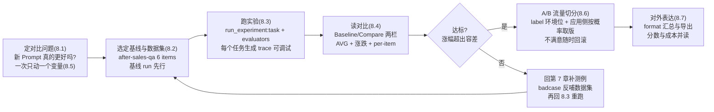
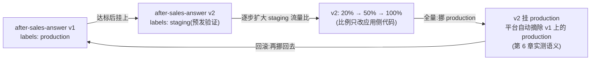

# 第 8 章 实验与 A/B

> 本章导读：第 7 章把售后助手的评估素材备齐了——数据集 `after-sales-qa` 六条测例、score 三来源、标注队列；但你手上还差最关键的一步：**「新版本真的比旧版本好吗」这个问题，用什么流程回答？**逐条手工跑测例再肉眼比答案，既不可复现也留不下记录。本章把这件事工程化：用 SDK v5 的 `dataset.run_experiment` 一次跑完整个数据集并自动打分，在 Experiments 页读 Baseline/Compare 两栏对比；再用贯穿案例的三次真实实验（`glm-v1-baseline` 跑了两轮、`glm-v2-prompt` 一轮）回答一个更深刻的问题——**同样的配置跑两轮，分数为什么不一样？**LLM 非确定性由此从抽象概念变成你自己的数据，阈值容差方法论由此落地。最后把达标的改动推进生产：A/B 流量切分的思路与版本回滚。读完本章，你能：独立跑一次实验并读懂结果页的每个数字；说出「多次采样与阈值容差」的依据；设计一次只动一个变量的对比实验；给出从实验达标到按概率放量、再到秒级回滚的完整路径。



*本章操作流程图*

## 你什么时候需要它

三种典型处境，对应本章三种用法。

**你要改 Prompt（或检索器、模型），想知道改了到底是变好还是变坏**——这是本章的主入场姿势，走 8.2 → 8.3 → 8.4 的完整链路：把改前改后各跑一次 experiment，在结果页读 AVG 对比与 per-item 涨跌。第 6 章你已经把话术变成了版本化资产，本章补上「每次版本迭代先过数据集」的验证动作。

**两次实验分数有差，你犹豫要不要下结论**——直奔 8.3 的核心教学点：本书实测同一配置跑两轮 `glm-v1-baseline`，recall 一次 0.39 一次 0.45。同配置两轮分数不同 = LLM 非确定性的直接证据，由此推出「多次采样与阈值容差」方法论——读不懂这一点，所有对比实验的结论都可能是在给噪声画像。

**改动达标了，要推给真实用户但不敢一刀切**——看 8.6：prompt label 机制（第 6 章）+ 应用侧按概率取 label 的实现思路，配合秒级回滚；以及 8.7 的对外表达——把实验结果讲给团队听时，分数与成本（第 5 章）要一起读。

前置：第 7 章的数据集 `after-sales-qa`（6 items，expected_output 齐全）已建好；第 3 章的售后助手 `support_bot.py` 可运行；第 5 章的模型配价已生效（8.7 的成本并读要用）。本章代码基于 SDK 5.2.0 + 服务器 v4.76.0（2026-11-08 实测）。

## 8.1 概述:从「dataset run」到「experiment」

### v4 的术语更名

一个术语先行更正，避免你在旧资料里迷路：**v3 时代叫 dataset run（数据集运行），v4 的 UI 与 API 统一叫 experiment（实验）**。侧栏 Evaluation 组里的入口就叫 Experiments，API 端点是 `/api/public/experiments`（替代 v3 的 dataset-run-items）。你在旧教程里看到的「dataset run」与本章的「experiment」是同一件事的两代名字；SDK v5 则更进一步——移除了 v4 时期的 `dataset.run()` helpers（升级指南 python-v4-to-v5 明确记载），只保留 `run_experiment` 一条路。

实验要回答的问题永远是同一个：**这套配置（Prompt 版本 × 检索器 × 模型）在这批测例上的整体表现，与基线比是涨了还是跌了？**Langfuse 把它拆成四个要素：

| 要素 | 是什么 | 本书贯穿案例的取值 | 来源 |
|------|--------|------------------|------|
| 数据集(dataset) | 测例集合,每条含 input 与 expected_output | `after-sales-qa`,6 items | 第 7 章 |
| 任务(task) | 对每条测例执行的应用逻辑,输出答案 | `support_bot.answer`(检索→Prompt→LLM) | 第 3 章 |
| 评估器(evaluator) | 对比输出与期望,产出分数 | `recall_evaluator`(要点覆盖率) | 本章 8.2 |
| 实验(experiment) | 一次「数据集 × 任务 × 评估器」的运行记录 | `glm-v1-baseline` 等三个 run | 本章 |

### 本章的四个交付物

| 交付物 | 验证方式 | 小节 |
|--------|---------|------|
| 一次可复现的实验运行 | Experiments 页出现你的 run,6 items 全绿(Error Count 0) | 8.2 |
| 一份对比读数 | Baseline/Compare 两栏 + per-item 涨跌说得清 | 8.4 |
| 一条容差结论 | 同配置两轮的分数差值,写进你的阈值 | 8.3 |
| 一条放量路径 | 按概率取 label 的代码骨架 + 回滚动作 | 8.6 |

### 事实来源与实测口径

- 出自官方文档(本章 `source` 指向 experiments-via-sdk):`run_experiment` 的调用形态、task/evaluator 的签名约定、实验替代 dataset run 的术语。
- 出自本书实测(2026-11-08，SDK 5.2.0 + 服务器 v4.76.0):三个 run 的真实分数(0.39/0.45/0.33)、run 名自动追加时间戳、结果页两栏布局与涨跌箭头、实验行 Total Cost 显示 not recorded、每个任务执行生成独立 trace。
- 出自本书实测的 A/B 相关边界：label 挪动与自动摘除语义（第 6 章探针实测）为实测；**8.6 的应用侧分流代码为思路示例，未端到端实测**，如实标注。

## 8.2 实验模型:dataset.run_experiment 实测

### 问题:逐条手工测,既慢又不留痕

第 7 章你建好了 `after-sales-qa`,但验证一个改动最笨的办法是：逐条把 input 粘进 `support_bot.py` 跑一遍、肉眼看答案、心里打分——六条测例跑一轮要手工交互六次，而且**什么都没留下**：分数没有落库，两周后的第三次改动没法与今天这次比较。实验机制要同时解决两件事：**批量执行**(一次跑完整个数据集)与**持久化**(每次运行成为平台上一条可追溯、可对比的记录)。

### 实测代码:eval_runs.py 全解

本书的实验脚本 `eval_runs.py`(实测可运行)完整展示了四要素如何组装：

```python
"""数据集实验(SDK v5 run_experiment):对 after-sales-qa 跑实验并逐条打分。

- recall 评估器:expected_output 的关键要点覆盖率(启发式,教学用)
- 延迟/成本由 SDK 自动记录,Experiments 视图直接对比

运行前环境变量同 support_bot.py。可传实验名参数:
  python eval_runs.py glm-v1-baseline
"""
import os
import re
import sys

from langfuse import get_client, Evaluation

sys.path.insert(0, os.path.dirname(os.path.abspath(__file__)))
from support_bot import answer, lf  # noqa: E402

RUN_NAME = sys.argv[1] if len(sys.argv) > 1 else "glm-v1-baseline"

# 期望答案 -> 用于召回性判断的关键词组(每组命中任一即视为该要点覆盖)
KEY_POINTS = {
    "7": ["7 天", "七天"],
    "无理由": ["无理由"],
    "质量换货": ["30 天内免费换货", "质量问题"],
    "保税仓时效": ["3-5 日"],
    "直邮时效": ["7-15 日"],
    "超期退款": ["30 日未送达", "全额退款"],
    "拆封除外": ["拆封"],
}


def recall_evaluator(*, input, output, expected_output, metadata, **kwargs) -> Evaluation:
    """要点覆盖率 0-1:期望中的关键词组有多少组在输出中命中。"""
    expected = expected_output or ""
    text = re.sub(r"\s", "", output)
    keys = [k for k, pats in KEY_POINTS.items() if any(p in expected for p in pats)]
    if not keys:
        return Evaluation(name="recall", value=0.0, comment="无可用要点")
    hit = [k for k in keys if any(p in text for p in KEY_POINTS[k])]
    return Evaluation(
        name="recall",
        value=round(len(hit) / len(keys), 2),
        comment=f"命中 {len(hit)}/{len(keys)}: {','.join(hit) or '无'}",
    )


def main() -> None:
    dataset = lf.get_dataset("after-sales-qa")
    result = dataset.run_experiment(
        name=RUN_NAME,
        description="售后助手启发式召回性实验(教学演示)",
        task=lambda *, item, **kwargs: answer(item.input, session_id=f"eval-{RUN_NAME}"),
        evaluators=[recall_evaluator],
    )
    print(result.format())
    lf.flush()
```

逐块拆解，三处签名值得背下来：

**其一，task 的签名是 `(*, item, **kwargs)`，纯关键字参数。**`item` 是数据集条目，带 `input` 与 `expected_output` 两个属性(第 7 章建条目时写入的字段)。task 的返回值就是应用的答案，SDK 会把它连同评估器分数一起记到这条实验条目上。本书的 task 是一行 lambda，直接调第 3 章的 `answer()`——**实验任务不是新写的测试代码，而是生产应用本体**，这是实验结论可信的前提：你测的就是要上线的那条链路。

**其二，evaluator 的签名与返回值。**评估器收到的也是关键字参数，本书实测用到 `input`(测例输入)、`output`(task 的返回)、`expected_output`(期望答案)，其余以 `**kwargs` 兜住——SDK 的回调参数集随版本演进，写宽签名是防御姿势。返回一个 `Evaluation(name=..., value=..., comment=...)`：`name` 是分数名(结果页的列名)，`value` 是数值，`comment` 写判分依据——它会出现在结果页 per-item 详情里，是排查「这个 0.39 是怎么算出来的」的第一线索。

**其三，task 里传了 `session_id=f"eval-{RUN_NAME}"`。**这个看似随意的小设计是 8.7 成本并读的伏笔：实验的每次任务执行都会生成一条独立的 trace(便于调试，下一小节展开)，统一挂到 `eval-<run 名>` 这个 session 下，第 4 章的 session 视图就能把这批实验 trace 一网打尽，第 5 章的成本读法也能按 session 聚合。

### 每个任务执行都生成 trace:实验的调试出口

run_experiment 跑批时，每个 task 调用都是一次真实的应用执行，SDK 为它生成一条完整的 trace——与生产 trace 结构完全一致(根 span → retrieve-context → llm-call → OpenAI-generation)。这条设计给了实验两个重要性质：

| 性质 | 含义 | 用法 |
|------|------|------|
| 可调试 | 某条测例得了 0 分,点进它的 trace 看检索命中几条、LLM 答了什么 | 8.4 读 per-item 低分行时,trace 是下钻入口 |
| 可成本核算 | trace 里有 generation 的 model/usage,配价后金额照常入账 | 8.7 分数与成本并读的数据来源 |

实验跑了六条测例，平台上就多了六条 trace——它们不是垃圾数据，而是实验的「原始凭证」。本书实测中这批 trace 挂在 `eval-<run 名>` session 下(8.2 的 lambda 设计)；如果你的 task 不传 session_id，trace 依然生成，只是聚合入口弱一些。

### 评估器在实验里扮演什么角色

task 负责「跑出答案」，evaluator 负责「给答案打分」——但它在实验体系里的角色值得单独说透，因为**评估器的性质直接决定实验结论的可信度**：

| 评估器性质 | 对实验的影响 | 本书案例的表现 |
|-----------|-------------|---------------|
| 确定性(同输入同分数) | 分数波动只能来自应用侧,归因干净 | recall 关键词匹配是确定性的——同一答案永远同一分 |
| 客观性(不依赖模型) | 跑多少轮评估器自身不引入噪声 | 启发式 recall 不调 LLM,零评估噪声;代价是刚性(假阴性,8.3) |
| 可解释(comment) | 低分条目能回答「为什么低」 | comment 如「命中 2/7: 7,无理由」——8.4 下钻的入口 |
| 可复用于多轮 | 基线与实验组用同一评估器,分数才可比 | 8.5 的纪律:评估器变更 = 分数口径变更 = 基线重立 |

`evaluators` 参数是列表——你可以同时挂多个评估器(比如 recall 之外再挂一个「答案长度」或第 9 章将讲的 LLM-as-judge)，结果页会为每个分数名各出一列。本书贯穿案例只用一个 recall，让教学主线保持干净；等你读到第 9 章，会看到评估器本身如何升级。

还有一个写作此章时反复确认过的细节：**评估器的 comment 字段不是装饰**。8.4 截图里 per-item 行展开后的判分依据全部来自它——你写的每一句 comment，都是两周后排查「这轮为什么跌」的自己留给自己的线索。

### 跑一次

```bash
python eval_runs.py glm-v1-baseline
```

终端输出(实测摘录，2026-11-08)：

```text
[retrieve] 命中 0 条
[retrieve] 命中 0 条
[retrieve] 命中 1 条
[retrieve] 命中 0 条
[retrieve] 命中 0 条
[retrieve] 命中 1 条
Individual Results: Hidden (6 items)
💡 Set include_item_results=True to view them

──────────────────────────────────────────────────
🧪 Experiment: glm-v1-baseline
📋 Run name: glm-v1-baseline - 2026-11-08T11:40:23.673992Z - 售后助手启发式召回性实验(教学演示)
6 items
Evaluations:
  • recall

Average Scores:
  • recall: 0.388

🔗 Experiment:
   http://localhost:3000/project/cmw7qtne20005or4o5fhknr8z/experiments/results?baseline=14fca2cad2de6878
```

五个观察点。**一，`result.format()` 输出终端摘要**：实验名、run 名、条目数、平均分、结果页链接——CI 里贴日志够用(第 12 章的门禁脚本就靠它)。**二，run 名被自动追加了时间戳与描述**：你传的是 `glm-v1-baseline`，落库的是 `glm-v1-baseline - 2026-11-08T11:40:23.673992Z - 售后助手启发式召回性实验(教学演示)`——SDK 的实测行为，8.5 命名规范里会用到。**三，六条 `[retrieve] 命中` 日志**：这正是第 7 章埋的教学梗——六条里四条命中 0 条，检索器把「海外直邮超时」「保税仓发货多久能到」这类问句 fallback 到退货语料，这些测例注定低分。**四，Individual Results 默认隐藏**，`include_item_results=True` 可展开逐条结果。**五，平均分 0.388**——记住这个数，8.3 它会变成 0.39，然后变成 0.45。

## 8.3 贯穿案例实验全解:三次 run 与一个深刻的问题

### 三个 run 的实测记录

本书在数据集 `after-sales-qa` 上共跑了三次实验(2026-11-08 实测，全程同一份代码、同一模型 glm-5.3-flash、同一 temperature 0.3)：

| run | 配置差异 | recall 平均分 | 时间(UTC) | 意图 |
|-----|---------|--------------|-----------|------|
| `glm-v1-baseline` 第 1 轮 | 无——基线 | **0.45** | 11:37:47 | 立基线 |
| `glm-v1-baseline` 第 2 轮 | **无——与第 1 轮完全相同** | **0.39** | 11:40:23 | 验证波动 |
| `glm-v2-prompt` | Prompt 换 v2 共情版 | **0.33** | 11:48:24 | 测 v2 话术 |

第二行是全章的题眼：**第 2 轮与第 1 轮的配置一模一样**——同代码、同 Prompt、同模型、同参数，唯一变量是「又跑了一遍」。结果 recall 从 0.45 变成 0.39，差 0.06。这就是 **LLM 非确定性**：temperature 0.3 不是 0，模型对同一输入可能产出不同措辞，而措辞变化恰好会撞上(或错过)启发式评估器的关键词——「3-5 日」写成「3 到 5 个工作日」，要点就算没覆盖。

把这件事上升到方法论：

### 波动的三个来源:先定位,再定容差

跑出两个不一样的分数后，别急着写进容差——先弄清波动从哪来。实验链路上有三个可能的波动源，本书案例可以逐一定位：

| 波动源 | 机理 | 本书案例的实测判定 |
|--------|------|------------------|
| 模型采样措辞 | temperature > 0 时,同输入可能产出不同措辞 | **主因**——两轮基线的答案措辞有差异,命中/错过的关键词随之摇摆 |
| 评估器刚性 | 关键词匹配对措辞零容忍:「3-5 日」≠「3 到 5 个工作日」 | **放大器**——措辞差异本无关质量,刚性匹配把它放大成分数差异(第 9 章解) |
| 检索命中不稳定 | 检索器本身不确定时,上下文都不同,分数自然散 | **排除**——三轮 run 的 `[retrieve] 命中` 日志完全一致(0,0,1,0,0,1),关键词检索是确定性的 |

定位的方法就藏在 8.2 的运行日志里：三轮实验的检索命中序列一模一样——说明波动不在检索层；评估器是确定性代码——说明波动不在评估层；剩下的唯一变量是 LLM 的采样输出。**一层层排除后，波动被干净地归因到「LLM 措辞 × 关键词匹配」的交互上**——这个归因过程本身就是一套可复用的实验素养：先分层排除，再谈容差。

顺带一条工程启示：如果哪天你的波动源定位到了检索层(比如向量检索的 top-k 结果不稳定)，容差逻辑同样成立，但修复方向变成「固定检索种子/固化上下文快照」——波动源在哪层，控制变量的手就伸到哪层。

### 方法论:多次采样与阈值容差

非确定性意味着**单轮实验的分数是一个采样值，不是真值**。对比实验的判读规则由此改写：

1. **关键对比跑多轮**。基线至少两轮，先测出你这套配置自己的波动幅度——本书实测 glm-5.3-flash + 启发式 recall 的波动是 0.06(0.45→0.39，两轮采样)；你的配置要用自己的数据说话。
2. **判读阈值要大于波动幅度**。改动带来的涨幅若小于容差，结论只能是「无法区分于噪声」，不能宣布胜利。本书的教学口径：波动 ±0.06 的系统里，涨 0.03 不算涨。
3. **真值用多轮均值近似**。预算允许时，每个配置跑 3-5 轮取均值再比；预算紧张时，至少保证「涨幅 > 单轮波动上限」才下结论。

一条务实的折衷也给出：非确定性的另一个消解办法是把 temperature 降到 0 或用结构化约束——但 0 温度不是确定性保证(提供商侧仍可能有扰动)，容差思维不能省。第 12 章的回归门禁会把这条容差写进代码：`eval_gate.py` 比对平均分与阈值时，容差是显式参数。

### 第 3 轮 run 怎么读:v2-prompt 的 0.33 说明什么

`glm-v2-prompt`(共情版话术)得了 0.33，比两轮基线都低。**现在，用本章的方法论克制一下结论欲**——0.33 < 0.39 < 0.45 能推出「v2 更差」吗？还不能，原因有二：

- **波动嫌疑**：单轮采样，0.33 与 0.39 的差(0.06)恰好等于基线自身波动幅度——在容差判定下，v2 与 v1 第 2 轮的差异**不足以区分于噪声**；
- **评估器嫌疑**：recall 是关键词刚性匹配的启发式评估器(第 9 章会展开)，共情版话术把「3-5 日」写成「一般来说 3 到 5 个工作日就能到」，分数跌的可能不是质量而是措辞——**假阴性**。

正确的下一步不是下结论，而是下钻：点开 v2 run 的 per-item 低分条目(8.4)，看它 trace 里的真实答案与 evaluator 的 comment——答案如果真好，跌的是评估器；答案真差，跌的才是应用。这个「分数先怀疑评估器、再看答案」的次序，是第 9 章 LLM-as-judge 升级的引子，也是第 7 章 badcase 反哺的回访：四条检索未命中的测例在三个 run 里稳定贡献 0 分(8.4 的 per-item 行会印证)，它们才是当前最大的失分项——**修检索器比修 Prompt 话术的优先级更高，这不是直觉，是 per-item 数据的结论。**

## 8.4 结果页读法:Experiments 列表与 Baseline/Compare 对比

### Experiments 列表页

侧栏 Evaluation 组 → **Experiments**。本书实测(2026-11-08，跑完三次实验后)：


逐块读：

| 界面元素 | 实测表现 | 读法 |
|---------|---------|------|
| recall 折线图 | 两个 run 的分数连成线，0.45 → 0.39 | 列表页按当前列出的 run 自动画的分数趋势；基线两轮的波动一眼可见 |
| Filters → Dataset | 勾选 after-sales-qa 后列表只剩该数据集的 run | 实验多了以后的入口；搜索框支持 `dataset:…`、`name:…`、`scores.…>0.8` 语法 |
| Item Count / Error Count | 均 6 / 均 0 | 条目数核对数据集没跑漏；Error Count 非 0 说明有 task 抛异常,先修应用再谈分数 |
| Start Time | 19:40:23 / 19:37:47 | **本地时区显示**；run 名内嵌的是 UTC 时间戳(11:40:23Z)——同一条 run 相差 8 小时是时区,不是异常 |
| Latency (s) | ∅ 22.7928s / ∅ 21.8453s | 六条测例的平均端到端耗时；对比实验的延迟维度看这列 |
| Total Cost | **not recorded(实测)** | 实验行不直接汇总成本——成本要从 trace 维度读,8.7 展开 |
| Run experiment 按钮 | 右上角 | UI 侧的实验入口(关联 Prompt 等场景);本书走 SDK 路线(8.2),两条路线产物都落在本页 |

### Baseline/Compare 对比页:两栏与涨跌

列表里点任一 run 进入结果页，URL 形如 `/experiments/results?baseline=<id>`。再把另一个 run 加进 Compare 栏(实测操作：顶部 Compare 输入框选择对比 run)。本书把两个基线 run 互相对比(2026-11-08 实测截图)：


这张图就是 8.3 方法论的视觉证据，三处读法：

**SUMMARY 行(页面级汇总)**：Baseline 0.39 AVG、Compare 0.45、差值 **+0.06**、涨跌箭头 **↑1 ↓0**——六个测例里 1 条涨、0 条跌，其余持平。涨跌箭头是 per-item 维度的计票，比单一 AVG 更有信息量：AVG 涨可能靠一条大涨撑起来(其余全跌)，箭头计数能立刻戳穿这种「平均数陷阱」。

**per-item 行**：每一行是一条测例，Input 列显示测例输入，两栏各自显示该 run 的分数。实测图里可见的三条——「海外直邮超时了怎么办？」「退款多久到账？」「保税仓发货多久能到？」——**两栏都是 0.00**：第 7 章埋的四条检索未命中 badcase 在两轮基线里稳定得 0 分，波动的是另外两条。这印证了 8.3 的结论：当前失分大盘在检索器，不在 LLM 措辞。

**下钻动作**：per-item 行可展开看 evaluator 的 comment(如「命中 2/7: 7,无理由」)与该条目的 trace——0 分是检索没命中还是 LLM 答偏了，树上一目了然(8.2 的调试出口)。

### per-item 判读三步法

把上面的读法收敛成一套固定动作，对着任何一次对比都能用：

| 步骤 | 看什么 | 得出什么 | 本案例的对应结论 |
|------|--------|---------|----------------|
| 第 1 步:看箭头计数 | ↑n ↓m 的票型 | 涨跌是普遍的还是个别的——↑3 ↓1 与 ↑1 ↓0 + AVG 相同,含义完全不同 | ↑1 ↓0:涨幅来自单条,不是全面改善 |
| 第 2 步:看稳定 0 分行 | 两个 run 都为 0 的条目 | 与改动无关的**结构性失分**——它们压低 AVG,却不是本次改动的功过 | 四条检索未命中测例:换 Prompt 救不了它们 |
| 第 3 步:下钻波动行 | 两栏分数不同的条目 | 非确定性落在了哪几条;trace + comment 定性 | 措辞摇摆撞上关键词匹配的条目(8.3 波动归因) |

这套三步法的价值在于**把「为什么跌」从猜测变成定位**：第 2 步筛出的结构性失分直接改写优先级(修检索器 > 改话术，本案例的最终结论)；第 3 步筛出的波动条目则校准你对容差的信心。对照第 7 章的 badcase 反哺：第 2 步的产物正是要回补数据集、进标注队列的那批测例——结果页与第 7 章的素材闭环在这里接上。

### 结果页的过滤语法

对比页搜索框与 Traces 页同一套过滤语法(实测占位文本 `level:ERROR, scores.quality>0.8`)——比如 `scores.recall<0.5` 只看低分测例。My Views 保存常用视图，与第 4 章的用法完全一致，不赘述。

## 8.5 对比实验的正确姿势:单变量与命名

### 一次只动一个变量:三轴模型

对比实验的统计效度来自**控制变量**。LLM 应用的配置空间可以整理成三根轴：

| 轴 | 典型改动 | 本书案例的例子 | 证据链 |
|----|---------|--------------|--------|
| Prompt 版本轴 | v1 直答版 ↔ v2 共情版 | `glm-v2-prompt` vs 基线 | 第 6 章版本资产 |
| 检索器轴 | 关键词匹配 ↔ 同义词组 ↔ 外部知识库 | 第 12 章修复检索器前后(0.333→0.388) | 第 10 章 ragflow 联动 |
| 模型轴 | glm-5.3-flash ↔ 其他模型 | 本书未展开(方法相同) | 8.7 成本并读 |

铁律：**每次实验只动一根轴**。Prompt 和检索器同时改，涨了不知道该谢谁，跌了不知道该修谁——两轮实验才能回答的问题被一次实验污染成无解。本书自己的实验记录就是正面示范：三轮 run 里，第 2 轮动的是「时间」(无配置变量，纯测波动)，第 3 轮动的只有 Prompt 版本一根轴。

单轴不等于单次——多轴 curiosity 的正确打开方式是**实验矩阵**：把想验证的变量排成计划，逐轴逐轮跑，而不是一次全上：

| 轮次 | Prompt 版本 | 检索器 | 模型 | 回答的问题 |
|------|------------|--------|------|-----------|
| R0(基线×2) | v1 | 关键词 | glm-5.3-flash | 基线真值与自身波动(容差) |
| R1 | **v2** | 关键词 | glm-5.3-flash | v2 话术值不值(轴:Prompt) |
| R2 | v1 | **同义词组** | glm-5.3-flash | 修检索器值不值(轴:检索器) |
| R3 | v2 | **同义词组** | glm-5.3-flash | 两者叠加有无交互增益 |

矩阵读法：R1 对 R0 只比 Prompt；R2 对 R0 只比检索器；R3 对 R1 只比检索器、对 R2 只比 Prompt——每一步都是单变量对照，叠加收益从差额里读出来。本书实测走完了 R0 与 R1(结论：v2 冻结)；R2 已由第 12 章的门禁叙事预先剧透(修复检索器 0.333→0.388，涨幅 5.5 个点，恰在容差边缘——又一次容差判定实战)。矩阵不必一次跑完：**哪根轴的预期收益大，先动哪根**；本书案例的 per-item 数据(检索未命中稳定 0 分)已经指出 R2 的优先级高于 R1。

配套纪律：**基线与实验组共享一切其他配置**——同一个数据集、同一个评估器、同一批测例。评估器换了，分数与上一轮不可比(8.3 的「评估器嫌疑」)；数据集加了测例，AVG 与历史 run 也不可比(Item Count 列就是干这个用的)。

### run name 命名规范:让列表页可读

SDK 会自动给 run 名追加时间戳与描述(8.2 实测)，所以你传入的 `name` 是前缀——它是你唯一的自由命名空间。列表页的 run 会越积越多，前缀规范直接决定半年后你能否看懂列表：

| 场景 | 好的 name | 差的 name |
|------|----------|----------|
| 基线 | `glm-v1-baseline` | `test1`、`run` |
| 单变量改动 | `glm-v2-prompt` | `新版本`、`v2-final-真final` |
| 组合实验 | `v2-prompt-+syn-retriever` | `abcd` |

本书约定(实测采用)：**「模型/组件-变量-意图」**三段式前缀，把改动的轴写进名字;描述字段(description)写实验意图一句话。时间戳由 SDK 补，不用你管。配合列表页的 `name:…` 过滤语法,任何一轮历史实验都能秒查。

### 基线的选择策略

流程图里「选基线」画在跑实验之前，这里补一句策略：**基线是当前生产配置的 run**——第 6 章里 production label 指向的那版 Prompt、在用的检索器与模型，跑一轮留档，它就是此后所有改动的 Compare 参照物。改 Prompt 时以它为基线；换检索器时同样以它为基线(此时检索器是唯一变量)。基线 run 不必每次重跑——但它受非确定性影响，**大版本升级或评估器变更后，基线要重立**(旧基线的分数与新口径不可比)。

## 8.6 A/B 流量切分:从实验达标到按概率放量

### 先划清边界:Langfuse 给什么,不给什么

实验达标(涨幅超出 8.3 的容差)后，下一步是把新版本推给真实用户。先划清机制边界：**Langfuse 提供「版本与 label」这套发布语义，但流量切分的决策逻辑在应用侧**——平台不做按百分比自动分流的内置功能。你要的 A/B 三件事分别落在：

| A/B 需要的能力 | 落在哪 | 机制 |
|---------------|--------|------|
| 两个版本并存可取 | Langfuse(第 6 章) | prompt 版本 + label;任意 label 可拉取 |
| 按比例分配用户 | **你的应用** | 本章的应用侧代码(思路示例) |
| 观察两版真实表现 | Langfuse(第 3、4 章) | generation 关联 prompt 版本号,trace 按 prompt_name/prompt_version 可查 |

第三条是闭环的关键：第 6 章实测了 `propagate_attributes(prompt=…)` 显式关联后，generation 上有 promptName/promptVersion/promptId 三字段——**线上流量里每一版 Prompt 各接了多少请求、分数如何，按 prompt_version 分组就能读出来**，A/B 的观测侧天然成立。

### label 环境位:放量就是挂标签

第 6 章 6.4 的 label 语义直接复用。三档环境位在 A/B 场景的分工：



放量路径三步：**v2 先挂 staging** 预发验证 → **应用侧按概率**把一部分流量引到 staging 版(比例在代码里，逐步调大)→ **全量**时把 production 标签挪到 v2——第 6 章实测的关键语义在此生效:`lf.api.prompt_version.update(name, version, new_labels=["production"])` 一次调用完成挪标，**平台自动摘除其他版本上的同名 label**,发布与回滚都是秒级单动作。

### 应用侧按概率取 label:思路示例

以下是分流的路由骨架——**思路示例，未端到端实测**(lab 环境没有真实用户流量可分；函数体内的 Langfuse 调用均为第 6 章实测过的 API，组合逻辑未经线上验证)：

```python
# ab_router.py —— 思路示例(未端到端实测):按概率把用户分到 Prompt 变体
import hashlib

def pick_label(user_id: str, staging_ratio: float = 0.2) -> str:
    """稳定哈希分流:同一用户永远命中同一变体(体验一致性)。

    - bucket 取 0-99;staging_ratio=0.2 时,约 20% 用户进 staging 版
    - 用 user_id 哈希而非随机数:同一用户每次请求走同一版,避免体验跳跃
    """
    bucket = int(hashlib.md5(user_id.encode()).hexdigest()[:8], 16) % 100
    return "staging" if bucket < staging_ratio * 100 else "production"


def answer_ab(query: str, user_id: str) -> str:
    label = pick_label(user_id, staging_ratio=0.2)
    prompt = lf.get_prompt("after-sales-answer", label=label)  # 按 label 取版(第 6 章)
    system_text = prompt.compile(context=retrieve(query), query=query)
    # ……后续与第 3 章 answer() 相同;propagate_attributes(prompt=prompt)
    # 保证 generation 带 promptVersion,8.6 的观测闭环由此成立
```

三个设计点值得强调：

- **稳定哈希优于随机数**：随机分流会让同一用户一轮对话里一会儿 v1 一会儿 v2；按 `user_id` 哈希分桶，用户视角的体验是自洽的，观测数据也才能按用户归因。
- **比例是应用侧参数**：`staging_ratio` 从 0.2 调到 1.0 就是逐步放量，改配置不改平台状态；出问题改回 0 即「停止放量」，不用动 Langfuse 的标签。
- **回滚是平台动作**：已全量后发现质量问题，回滚走 label——把 production 挪回 v1(第 6 章实测的挪标语义)，下一秒所有 `get_prompt` 拿回 v1。**放量的开关在应用侧，回滚的开关在平台上**，两条独立的保险丝。

分流策略本身也有选择空间，三种常见做法的取舍：

| 策略 | 做法 | 优点 | 缺点 | 适用 |
|------|------|------|------|------|
| 随机分流 | 每次请求掷硬币 | 实现最简 | 同一用户两版横跳,体验割裂、归因混乱 | 无用户体系的纯工具调用 |
| 稳定哈希(本书推荐) | user_id 哈希分桶 | 体验自洽、按用户归因干净 | 各桶用户构成可能有偶然差异 | 有稳定 user_id 的产品 |
| 按属性分层 | 新用户进 v2、老用户留 v1 | 可做定向验证(如只对新手放量) | 层间本身不可比,需分层读数 | 灰度发布惯例场景 |

无论哪种策略，观测侧的读法都一样(下一小节)——因为归因的锚点是 generation 上的 promptVersion，而不是分流方式本身。

### 观测闭环:两版表现怎么读

放量期间与放量后，在 Langfuse 里回答「v2 在真实流量上表现如何」：

1. **流量占比**：generation 按 promptVersion 分组计数(observations API 或 UI 过滤)，核对实际分流比例与 `staging_ratio` 是否吻合；
2. **质量分数**：生产 trace 上的 score(第 7 章三来源：LLM-as-judge、人工标注、线上反馈)按 promptVersion 分组比对——注意这是**线上 A/B 读数**，与本章的数据集实验读数互补：实验管「改前改后在固定测例上的差」，A/B 管「真实流量分布上的差」；
3. **成本与延迟**(第 5 章)：两版的 token 用量与耗时按 promptVersion 并读——共情版话术更长，output tokens 大概率更多，8.7 的账要算在这里。

放量节奏上，本书给一条务实建议(立场，非文档规范)：**小比例起步，每档留观察窗**——

| 档位 | staging_ratio | 观察窗内看什么 | 进下一档的条件 |
|------|---------------|---------------|---------------|
| 试水 | 0.1 | 线上报错率、用户负反馈、promptVersion 分布是否吻合 | 无异常信号 |
| 半量 | 0.5 | 质量分数两版对比(第 7 章线上 score)、成本并读 | 分数不回退、成本可接受 |
| 全量 | 挪 production 标签 | 全量后的回归指标进入第 12 章门禁看护 | —— |

每档观察窗的长度没有标准答案，取决于流量密度：日请求千级的系统，一档观察窗可能几小时就够；日请求几十条的 demo，攒够样本要按周计。**样本量不足时宁可多等——A/B 读数同样服从 8.3 的采样逻辑，线上流量的「一轮」就是观察窗，窗口太短的结论一样是在给噪声画像。**

## 8.7 结果的对外表达:format、导出与成本并读

### 终端与平台两个出口

实验结果的消费出口有三层：

| 出口 | 内容 | 场景 |
|------|------|------|
| `result.format()` | 终端摘要:run 名、条目数、平均分、结果页链接 | 本地调试、CI 日志(第 12 章门禁的输出) |
| Experiments 页 | 列表 + 两栏对比 + per-item 下钻 | 团队评审、人机共读的「报表」 |
| trace/session 维度 | 每条测例的完整执行凭证 | 深挖与成本核算(本节) |

对外汇报的一条实用建议：**先给箭头再给均值**——「↑1 ↓0、+0.06 但容差也是 0.06」比「平均 0.42」信息量大得多；结果页的 SUMMARY 行可以直接截图进评审文档，per-item 行是讨论的具体素材。

### 与第 5 章并读:分数涨了,成本呢

第 5 章的降本闭环第三步说过「实验验证质量不回退」，本章补全另一半：**质量验证通过 ≠ 可以上线，还要看代价**。三处实测事实支撑这个并读：

- **实验行 Total Cost 显示 not recorded**(8.4 截图实测)——实验行不汇总成本,别在列表页找钱；
- **但每个任务执行都生成 trace**(8.2),trace 上的 generation 带 model/usage,配价后金额照常入账——钱在 trace 维度，不在实验行；
- **8.2 的 lambda 把实验 trace 挂到 `eval-<run 名>` session**——按 session 过滤 Traces(第 4 章)，一轮实验的成本与延迟立刻聚合可见。

于是「分数涨了成本呢」有了可操作的答案：

1. 在 Traces 页按 `session=eval-glm-v2-prompt` 过滤(或用 session 视图)，读这轮实验 trace 的成本汇总与平均延迟；
2. 与基线 run 的同口径数字并读：v2 共情版话术更长 → output tokens 更多 → 单次成本更高；8.4 实测的列表 Latency 列(∅ 22.8s vs 21.8s)提示 v2 也不占优；
3. 决策公式一句话：**收益 = 分数涨幅；代价 = 单次成本 × 流量 + 延迟体验；涨幅在容差边缘、成本还涨了的改动，默认不上。**

以本书实测数字做一个教学判例：`glm-v2-prompt` 相对基线的 recall 差异(0.33 vs 0.39/0.45)在容差内无法区分于噪声，延迟与成本还不占优——**三个维度没有一个支持放量，v2 冻结**。这个判例演示的是决策路径，真实项目里把三个维度各自的数字填进去，同一套流程。

### 一条完整的决策记录

把本章流程走完一遍后，建议把结论固化成一条决策记录(进团队文档或第 12 章的门禁配置)：

```text
实验记录 2026-11-08 —— after-sales-qa × 6 items × recall(启发式)
- 基线波动:glm-v1-baseline 两轮 0.45/0.39,容差取 ±0.06
- 候选 v2:0.33,与基线差在容差内 → 不放量
- per-item:四条检索未命中测例稳定 0 分 → 下一步修检索器(优先级高于改话术)
- 复核口径:评估器升级(第 9 章 LLM-as-judge)后,基线重立、全量重跑
```

这段记录同时是第 12 章回归门禁的输入：阈值取「基线均值 − 容差」，数据集沿用，叙事接续。

## 本章小结

回到导读的问题，本章交付了四件事：

1. **实验模型**：v4 把 dataset run 更名 experiment(UI 与 API `/api/public/experiments`);SDK v5 只留 `dataset.run_experiment(name, description, task, evaluators)` 一条路——task 签名 `(*, item, **kwargs)`、evaluator 返回 `Evaluation(name, value, comment)`、每个任务执行生成独立 trace 可调试(8.1、8.2);
2. **贯穿案例三 run 与非确定性**：同配置两轮 baseline recall 0.45/0.39(波动 0.06),`glm-v2-prompt` 单轮 0.33 在容差内无法下结论——单轮分数是采样值不是真值，关键对比多轮采样、判读阈值必须大于波动幅度(8.3);
3. **读数与姿势**：结果页 SUMMARY 行(AVG + 涨跌箭头)+ per-item 行定位失分大盘(四条检索未命中测例稳定 0 分);对比实验一次只动一根轴(Prompt 版本/检索器/模型)，run name 用「组件-变量-意图」前缀,SDK 自动补时间戳(8.4、8.5);
4. **放量与表达**：Langfuse 给版本与 label 语义、不做分流决策——放量比例在应用侧(稳定哈希按概率取 label,思路示例未端到端实测)，回滚在平台(挪 production 标签，秒级)；对外表达先给箭头再给均值，实验行 Total Cost not recorded,成本从 `eval-<run>` session 的 trace 维度并读——分数、成本、延迟三维度齐了才允许放量(8.6、8.7)。

贯穿案例方面，售后助手从此有了完整的验证流程：任何改动先过 `after-sales-qa` 实验再谈上线；本轮结论是 v2 冻结、检索器升级提上日程——四条稳定 0 分的测例(直邮超时/保税仓/退款周期)指向的修复动作，将在第 12 章以门禁叙事落地。本章操作流程图的「达标 → 放量 / 不达标 → 补测例」分流，此后就是这本书主线推进的标准循环——每一次迭代都在这个圈上走一圈，圈圈留痕。

下一步建议：启发式 recall 评估器的假阴性(「3 到 5 个工作日」不匹配「3-5 日」)已经两次搅局——第 9 章用 LLM-as-judge 升级评估器，让分数长出语义理解；数据集与实验的完整组合再进第 12 章的回归门禁，成为 CI 里的常驻护栏。

## 验收清单

- ☐ 向同事说清 experiment 与 v3 dataset run 的关系，并在侧栏指出 Experiments 入口与 API 端点
- ☐ 独立跑一次 `eval_runs.py`,说出 task 与 evaluator 各自的签名约定，以及为什么 task 里调的是生产应用本体
- ☐ 点开一个 0 分 per-item 条目，沿 trace 下钻定位失分原因(检索未命中还是 LLM 答偏)
- ☐ 用本书两个 baseline run 的数据(0.45/0.39)向团队解释 LLM 非确定性，并给出你项目的容差取法
- ☐ 设计一个三轴实验矩阵，演示「一次只动一个变量」在 Prompt/检索器/模型三轴上的具体排期
- ☐ 解释放量开关在应用侧、回滚开关在平台的分工，并演示一次 `lf.api.prompt_version.update` 挪标回滚
- ☐ 在 Traces 页按 `eval-<run 名>` session 找出一轮实验的成本与延迟，回答「分数涨了成本呢」
- ☐ 说出实验行 Total Cost 显示 not recorded 时，成本数据的正确读取路径

## 参考速查

理解主线不依赖本节；本节供跑实验时查阅。

### run_experiment 速查(SDK 5.2.0 实测签名)

| 参数/返回 | 实测取值 | 说明 |
|-----------|---------|------|
| `name` | `glm-v1-baseline` | run 名前缀;SDK 自动追加 UTC 时间戳与 description |
| `description` | 一句实验意图 | 显示在 run 名尾,当变更日志读 |
| `task` | `lambda *, item, **kwargs: answer(item.input, …)` | 关键字参数签名;item 带 input/expected_output;返回应用答案 |
| `evaluators` | `[recall_evaluator]` | 回调收 input/output/expected_output 等关键字参数;返回 `Evaluation(name, value, comment)` |
| `result.format()` | 终端摘要 + 结果页链接 | `include_item_results=True` 展开逐条结果 |

### 实验记录速查(2026-11-08 实测)

| run | recall | 备注 |
|-----|--------|------|
| glm-v1-baseline(11:37:47 UTC) | 0.45 | 基线第 1 轮 |
| glm-v1-baseline(11:40:23 UTC) | 0.39(落库 0.388) | 基线第 2 轮,同配置——波动证据 |
| glm-v2-prompt(11:48:24 UTC) | 0.333 | 单轴改动:Prompt v2;容差内不可判 |

### A/B 机制分工

| 能力 | 归属 | 机制 |
|------|------|------|
| 版本并存与取用 | Langfuse | prompt 版本 + label;`get_prompt(name, label=…)` |
| 流量比例 | 应用侧 | 稳定哈希分桶(思路示例,未端到端实测) |
| 版本观测 | Langfuse | generation 的 promptName/promptVersion/promptId(需显式 `propagate_attributes(prompt=…)` ,第 6 章) |
| 发布/回滚 | Langfuse | `lf.api.prompt_version.update` 挪 production 标签,平台自动摘除其他版本同名 label(第 6 章实测) |

### 决策公式(8.7)

收益 = 分数涨幅(须大于容差);代价 = 单次成本 × 流量 + 延迟体验;三个维度没有一个支持放量时,默认冻结。

### 版本基线(核实日期 2026-11-08)

| 项 | 值 |
|----|-----|
| Langfuse 服务器 | v4.76.0(本机 Docker 自托管，legacy UI 形态截图) |
| Python SDK | langfuse 5.2.0(`dataset.run()` helpers 已移除，仅 run_experiment) |
| 模型 | 智谱 OpenAI 兼容端点，`glm-5.3-flash`，temperature 0.3 |
| 评估器 | 启发式 recall(7 组关键词要点覆盖率) |
| A/B 应用侧代码 | **思路示例，未端到端实测** |

## 延伸阅读

- **第 6 章 Prompt 管理**——8.6 一切放量动作的地基：版本资产、label 环境位、挪标签发布与回滚、generation 的 prompt 三字段关联。
- **第 7 章 数据集与评分**——本章流程的上游：`after-sales-qa` 六条测例与 badcase 反哺入口；四条稳定 0 分测例的出处。
- **第 9 章 评估器与持续评估**——8.3「评估器嫌疑」的解法：LLM-as-judge 让分数长出语义理解，终结关键词刚性匹配的假阴性。
- **第 5 章 成本与性能监控**——8.7 并读的另一半：配价、usage 明细、看板；「收益公式」里的成本与延迟数字都出自它的读法。
- **第 12 章 Prompt 回归与质量门禁**——本章流程的固化形态：基线 + 实验 + 阈值容差写进 `eval_gate.py`,8.7 的决策记录就是门禁配置的雏形。
