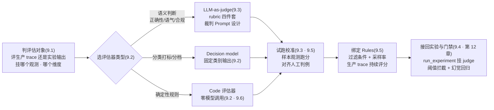
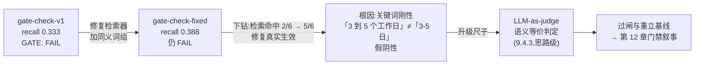
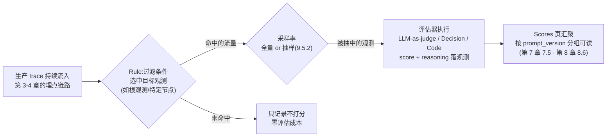

# 第 9 章 自动化评估

> 本章导读：第 8 章结尾留了两处悬念——启发式 recall 评估器的假阴性两次搅局（「3 到 5 个工作日」匹配不上「3-5 日」），以及「评估器升级后基线要重立」的复核口径。本章正面解决它：把打分的尺子从「关键词组」升级为「模型裁判」（LLM-as-judge）。本章沿评估器装配的完整流程走：先在 Evaluators 页实测三类评估器（LLM-as-a-judge / Decision model / Code）与推荐模板 → 展开本章核心的裁判 Prompt 设计方法：rubric 四件套、参照对比与绝对打分、裁判漂移与校准 → 用贯穿案例的门禁实测三连（0.333 FAIL → 修复检索器 0.388 仍 FAIL）做活教材，解剖启发式假阴性的机理与升级路径 → 讲线上持续评估的 Rules 触发与采样策略 → 以幻觉检测入门收尾，为第 12 章的幻觉回归备料。读完本章，你能：为自己的应用选对评估器类型；写出一套结构完整、可校准的裁判 rubric；向团队解释启发式评估器为什么会拦住真实的修复成果；给出生产 trace 持续评估的采样方案。



*本章操作流程图*

## 你什么时候需要它

三种典型处境，对应本章三种用法。

**第 7/8 章的启发式评估器开始误伤你——修复明明生效了，分数却不动**——直奔 9.4。这一节用贯穿案例的门禁实测三连（gate-check-v1 0.333 FAIL → 修复检索器后 gate-check-fixed 0.388 仍 FAIL）把假阴性的机理解剖到代码级，并给出升级到 LLM-as-judge 的改进路径。这是本章的题眼，也是第 12 章门禁叙事的前情。

**你要给评估体系配上真正的自动化尺子——正确性之外还想判语气、合规、幻觉**——按 9.2 → 9.3 的顺序走：Evaluators 页实测三类评估器与模板入口，然后展开裁判 Prompt 的 rubric 设计方法（四件套结构、参照对比 vs 绝对打分、score 类型、漂移与校准）。第 7 章 7.7.3 留下的那副裁判 Prompt 骨架，在这一节接上平台配置。

**应用上线了，你希望每一条生产 trace 都被自动打分，而不是等用户投诉**——看 9.5 的 Rules 机制与采样策略：评估器（怎么打分）与规则（对哪些 trace 打分）的分工、全量与抽样的取舍、成本估算。幻觉检测（9.6）是持续评估的第一个高价值落点——售后助手这种 RAG 形态的应用，最该自动盯防的就是无据编造。

前置：第 7 章的数据集 `after-sales-qa` 与第 8 章的三次实验已就位（启发式 recall 的分数是本章的对照物）；第 6 章的 LLM Connections 概念已建立（裁判模型也要靠它调）。本章的界面事实基于服务器 v4.76.0（legacy UI）实测，核实日期 2026-11-08；**本机未端到端配置 evaluator，界面入口实测、配置步骤给到入口级并如实标注**——凡未实测处，正文逐处声明。

## 9.1 概述:评估器是把 rubric 变成分数的尺子

**第 7 章讲清了「评什么」（rubric 与 score name），第 8 章讲清了「在哪儿评」（数据集与实验），本章补上最后一环：「用什么评」——评估器（evaluator）。**评估器是一段可执行的判分逻辑：输入是应用的输出（连同输入、期望输出、检索上下文等参照物），输出是一条带 comment 的 score。它可以是三个东西之一：一段关键词匹配代码（第 8 章实测的 recall 评估器）、一个按 rubric 打分的模型调用（LLM-as-judge），或一个输出固定类别的判别模型（Decision model）。尺子怎么选、怎么造、怎么校准，就是本章的全部内容。

先把贯穿案例的处境摆上桌。到第 8 章为止，售后助手的评估体系长这样：数据集 `after-sales-qa` 六条测例、启发式 recall 评估器（7 组关键词要点覆盖率）、三次实验的实测分数（0.45/0.39/0.33）、以及一条已经写进 8.7 决策记录的复核口径——「评估器升级（第 9 章 LLM-as-judge）后，基线重立、全量重跑」。这条口径不是客套：第 8 章的读数已经两次被启发式尺子的刚性污染（v2 的 0.33 有假阴性嫌疑；第 12 章的门禁三连里它将第三次搅局），**评估器自身的精度，已经是这套评估体系里最短的板。**

动手之前，把本章的概念最小集过一遍：

| 概念 | 一句话定义 | 本章用法 | 展开 |
|------|-----------|---------|------|
| evaluator（评估器） | 把 rubric 变成分数的可执行判分逻辑 | 三类选型 + 裁判 Prompt 设计 | 9.2、9.3 |
| LLM-as-judge（模型裁判） | 用一个 LLM 按 rubric 给输出打分 | 本章核心；接第 7 章留下的钩子 | 9.3、9.4 |
| rubric（评分标尺） | 定义「什么算好」的判分标准文本 | 裁判 Prompt 的四件套之一 | 9.3 |
| rule（规则） | 决定「对哪些 trace 打分」的触发配置：过滤 + 采样 | 线上持续评估 | 9.5 |
| 幻觉（hallucination） | 回答中无据或与依据矛盾的内容 | 依据核查型 judge 的第一个落点 | 9.6 |
| 假阴性（false negative） | 质量达标却被判不达标——本章贯穿案例的实证 | 门禁实测三连的根因 | 9.4 |

本章结束时，你手上会有四个可验证的交付物：

| 交付物 | 验证方式 | 小节 |
|--------|---------|------|
| 三类评估器的选型判断 | 能对着自己的评估维度说出「该用哪类、为什么」 | 9.2 |
| 一套结构完整的裁判 rubric | 四件套齐全，判据可追溯到 expected_output 或话术规范 | 9.3 |
| 假阴性的机理与升级路径 | 能用门禁三连的数据向团队解释「为什么 0.388 仍 FAIL」 | 9.4 |
| 持续评估与幻觉检测方案 | 采样策略有数；依据核查型 judge 的 rubric 成稿 | 9.5、9.6 |

### 事实来源与实测口径

- 出自官方文档（本章 `source` 指向 evaluation-methods 的 LLM-as-judge 文档页；核实日期 2026-11-08）：评估器三类型、裁判 Prompt 的四件套结构与消息角色、score 三类型、变量映射规则、Rules 的过滤+采样模型、校准方法（Cohen's Kappa）、幻觉检测的分类法与 rubric 设计建议。
- 出自本书实测（2026-11-08，SDK 5.2.0 + 服务器 v4.76.0，本机 Docker 部署）：Evaluators 页空态与三类模板的界面形态（9.2 截图）、侧栏入口、`eval_gate.py` 门禁实测三连的真实数据（0.333/0.388、检索命中序列、阈值 0.4）、本机 LLM Connections 未配置态。
- **未实测项（正文逐处标注）**：evaluator 的端到端配置与试跑（New evaluator 弹窗之后的表单字段）、Rules 的创建与线上触发、裁判 Prompt 的实测调优——本机 LLM Connections 处于无 Key 未配置态（第 2 章部署时的 ai-gateway 形态），裁判类评估器无法实跑，相关内容按官方文档口径描述并标注「思路级/入口级」。
- 本书立场：「先校准再信任裁判」「评估器升级即基线重立」「幻觉检测按预筛→裁判→人工的分层装配」是本书工程判断，不是文档结论。

本章的未实测项收拢成一张清单，动笔实测时按此逐项核销（编写规范第 7 节的要求）：

| 未实测项 | 卡在哪里 | 实测前提 |
|---------|---------|---------|
| evaluator 端到端配置（9.2.4 六步） | New evaluator 弹窗之后的表单未走通 | 配置 LLM Connections（裁判模型可调） |
| 裁判 Prompt 试跑与迭代（9.3） | 无裁判模型可调 | 同上；另需一条样本充足的观测集 |
| Rule 创建与线上触发（9.5） | 依赖 evaluator 配置完成 | 同上；另需生产流量或回放数据 |
| 批量评估补打存量 trace（9.5.2） | 入口与配额未验证 | 同上 |
| 两份 rubric（正确性/依据核查）的实跑调优 | 思路级代码，未经模型执行验证 | 同上；判例回灌后还需一轮校准 |


## 9.2 Evaluators 页实测:三类评估器与推荐模板

### 9.2.1 空态页即产品定位:Turn traces into quality signals

侧栏 Evaluation 组点 Evaluators（与 Scores/Human annotation/Datasets/Experiments 并排，第 7 章 7.3.1 首次路过时见过）。本机未配置任何 evaluator，页面渲染为引导式空态——与第 7 章的数据集空态页、标注队列空态页同一设计语言：**空态页本身就是一张产品说明书**：

![实测项目 Evaluators 页空态（legacy UI）：顶部 You are viewing legacy UI 横幅；标题 Evaluators 带帮助图标，右上 + New evaluator 按钮；Evaluators/Rules 两标签（Evaluators 选中）；居中大标题 Turn traces into quality signals，副题 Score production traces and dataset runs with an LLM-as-a-judge, decision model, or code.，其下 How evaluators work 文档链接；Recommended starting points 三张模板卡片——Assign Input Topic（示意 topic: billing，标注 Decision model）、Check Correctness（示意 correctness: True，标注 LLM-as-a-judge）、Rate Customer Frustration（示意 customer_frustration: 1.12，标注 Decision model）；底部 Browse all templates or start from scratch 链接](../assets/images/lf-evals.png)

逐块读这张图，每一块都是本章一节的内容锚点：

| 界面元素 | 你看到什么 | 背后的概念 |
|---------|-----------|-----------|
| 大标题 | Turn traces into quality signals | 评估器的定位：把 trace 从「观测记录」变成「质量信号」——第 1 章白盒化的收益兑现点 |
| 副题原文 | Score production traces and dataset runs with… | 评估器的两个消费场景：生产 trace（9.5 的 Rules）与数据集实验（第 8 章的 `evaluators` 参数）——**一条评估器配置，两处复用** |
| 三类名 | LLM-as-a-judge / decision model / code | 评估器的三种实现路线（9.2.2） |
| 模板卡 ×3 | Assign Input Topic / Check Correctness / Rate Customer Frustration | 推荐起步模板（9.2.3），每张卡右下角标注各自的类型 |
| + New evaluator | 右上按钮 | 配置入口——**按钮存在即入口事实**；弹窗之后的表单本机未实测（9.2.4） |
| Rules 标签 | 与 Evaluators 并排 | 触发配置的入口（9.5 概念级展开） |

副题那句话值得单独点破：**Score production traces and dataset runs**——它宣告了评估器的双场景属性。你在 Evaluators 页配好一条 LLM-as-judge，既可以绑上 Rules 在生产 trace 上持续触发（9.5），也可以在 SDK 的 `run_experiment(evaluators=…)` 里消费（第 8 章）——后者是 SDK 侧的 Python 回调，前者是平台侧的配置资产，两者产物都落进同一个 Scores 页（第 7 章 7.5.2 的三来源汇聚点）。第 7 章 7.5.3 说「rubric 是同一张底稿的三种实现」，平台评估器就是其中「平台配置」这条路的落点。

### 9.2.2 三类评估器:按判分性质选型

三类评估器的分工，按「判分性质」选：

| 类型 | 判分逻辑 | 输出形态 | 成本 | 适用维度（贯穿案例） |
|------|---------|---------|------|-------------------|
| LLM-as-a-judge（模型裁判） | 裁判模型按 rubric 文本逐条判 | 数值/分类/布尔 + reasoning | 高（每次评估一次模型调用） | 正确性（语义等价）、语气、合规、「是否编造」——需要语义理解的判断 |
| Decision model（决策模型） | 判别模型输出固定类别/分档 | 预定义标签或分值 | 中 | 输入打标（问句归到退货/物流/换货类）、用户情绪分档——类别体系固定的快速判定 |
| Code（代码评估器） | 确定性代码逻辑 | 自定义数值/布尔 | 零（无模型调用） | 关键词覆盖率（第 8 章的 recall）、长度与格式校验、引用缺失预筛（9.6） |

选型的第一问不是「哪个高级」，而是**「这个判断需要语义理解吗」**：需要——LLM-as-judge（「3 到 5 个工作日」和「3-5 日」是不是同一个意思，关键词代码判不了，模型判得了）；不需要——Code（命中几个关键词组是纯字符串操作，调模型纯属浪费）；介于两者、且类别体系固定——Decision model（把「输入属于哪个业务域」做成打标器，比让裁判模型每次重读 rubric 更稳更省）。本书立场：**三类是性能梯度上的三档，Code 是缺省起点，LLM-as-judge 是语义升级，Decision model 是两者的折衷——按维度选，不按潮流选。**

第 8 章的 recall 评估器在 SDK 侧就是一版 Code 评估器（关键词匹配的 Python 回调）；本章 9.4 将用它做反面教材，9.6 会再请 Code 出场做幻觉预筛——零成本这一点，让它在分层装配里永远有一席之地。

### 9.2.3 推荐模板:三个起步模板的岗位

空态页的 Recommended starting points 给了三个模板，它们不是随意展示，恰好各占一个类型与一个评估场景：

| 模板 | 卡片示意输出 | 类型 | 官方说明（页面原文大意） | 对应本章概念 |
|------|-------------|------|------------------------|-------------|
| Assign Input Topic | `topic: billing` | Decision model | 把输入归到预定义主题之一，按校准概率输出 | 分类型评估——7.7 rubric 里「问句业务域」这类输入侧维度 |
| Check Correctness | `correctness: True` | LLM-as-a-judge | 检查实际输出是否在**实质含义**（material meaning）上匹配期望输出 | 参照对比型裁判——正是贯穿案例 recall 评估器的升级形态（9.4.3） |
| Rate Customer Frustration | `customer_frustration: 1.12` | Decision model | 按你描述的档位给用户的沮丧程度打分，从平静到准备拂袖而去 | 分档型评估——用户情绪监控，线上持续评估（9.5）的高价值维度 |

三个模板的共同点是**每个都自带一份现成 rubric**——Check Correctness 的「material meaning（实质含义）」尤其值得注意：它就是 9.4 要讲的「语义等价判定」的官方表述，关键词刚性问题的平台级答案。模板之外，底部链接「Browse all templates or start from scratch」进入完整模板库或空白配置——本机未继续点入实测，模板库清单以你实例的界面为准。

### 9.2.4 配置步骤给到入口级:New evaluator 之后的事（如实标注）

> 本节性质声明：**New evaluator 按钮存在即入口事实（截图实测）；弹窗之后的配置流程本机未端到端实测**，以下步骤按官方文档口径给出入口级描述，每步的实测状态如实标注。原因如实交代：裁判类评估器的配置页需要项目先配好 LLM Connections（9.3.1），而本机实例的 ai-gateway 处于无 Key 未配置态（第 2 章部署形态），实跑链路走不通——界面入口与文档流程给到你能自行接手的程度。

按官方文档，配置一条 LLM-as-judge 评估器分六步：

| 步骤 | 做什么 | 实测状态 |
|------|--------|---------|
| 1 前置 | 配置 LLM Connections（项目 Settings → LLM Connections，第 6 章 Playground 的同款依赖） | 依赖关系为文档口径；本机未配置（黄条形态见第 6 章 Playground 截图） |
| 2 起配 | Evaluators 页 + New evaluator → 模板库选 LLM-as-a-Judge 或模板 | **按钮入口实测**；弹窗内表单未实测 |
| 3 定义 | 选裁判模型；写 Prompt（用 `{{input}}`/`{{output}}`/`{{ground_truth}}` 等 `{{variables}}` 占位）；选 score 类型 | 文档口径；Prompt 设计方法 9.3 展开 |
| 4 映射 | 把 Prompt 变量映射到观测数据（input/output/metadata/工具调用）；实验场景还可映射 Expected Output 与条目 metadata | 文档口径 |
| 5 试跑 | 过滤选出有代表性的样本观测，跑一次评估，检查 score 与 reasoning，迭代模型/Prompt/score 定义/映射 | 文档口径；本机未实跑 |
| 6 保存 | 保存时用试跑的过滤条件创建一条 Rule、挂到已有 Rule、或暂不绑 Rule（供批量评估/实验使用） | 文档口径；Rules 机制 9.5 展开 |

两处边界如实标注。其一，**self-host 的功能边界**：Evaluators 与 Rules 入口在本机 OSS v4.76.0 上可见（截图为证），表单与触发链路未逐项验证是否与 Cloud 完全一致——以界面上实际可见/可用为准，这是 FACTS 一贯的口径。其二，**保存时的结构化输出校验**：官方文档记载，保存裁判评估器时平台会发一次测试请求，模型不支持结构化输出会导致保存失败（报错「Model configuration not valid for evaluation」）——选裁判模型时把它当成硬性筛选条件（9.3.4）。

## 9.3 LLM-as-judge 设计方法(本章核心)

### 9.3.1 LLM Connections 前置:裁判也要有模型可调

LLM-as-judge 的本质是**平台替你发起一次模型调用**——裁判模型的 Key 与端点，走的是第 6 章 Playground 已经用过的同一配置面：项目 Settings → LLM Connections。第 6 章实测过 Playgrount 运行前的黄条「No LLM Connection Configured」引导配置——**评估器对它的依赖同源**：没有 Connection，裁判没有模型可调，配置链路在第一步就停住（这正是 9.2.4 本机止步于入口级的原因）。

| 配置事项 | 说明 | 与第 6 章的关系 |
|---------|------|----------------|
| 配置位置 | 项目 Settings → LLM Connections | Playground 同款依赖，同一次配置两处受益 |
| 裁判模型的选择口径 | 支持结构化输出为硬条件；推理与指令遵循能力强者为宜 | 文档口径；本机未实测逐模型差异 |
| 模型来源 | 项目默认模型，或按评估器单独指定专用模型 | 文档口径：改默认模型自动作用于使用它的评估器 |

裁判模型与被评模型的关系值得一条立场：**裁判可以用与被评应用相同的模型，但要对「同族盲区」保持警惕**——同一模型家族的模型可能共享同样的知识盲点与偏见（官方文档口径），裁判看不见的错误，被评者多半也看不见。条件允许时，裁判与被评者异族是更稳的装配（本书立场，未实测对比数据）。

### 9.3.2 裁判 Prompt 的 rubric 四件套

裁判 Prompt 不是「帮我打个分」一句话，它是一份结构化的判分文书。按官方文档，一份完整的裁判 Prompt 由四件套构成：

| 组件 | 内容 | 贯穿案例的取值 |
|------|------|--------------|
| 评估标准（rubric） | 定义「什么算好」的判分标尺——分档条件、语义等价的判定口径 | 7.7 三维 rubric 的 correctness 判据：要点覆盖给分、负向期望分支、矛盾或编造给零 |
| 输入上下文 | 原始用户输入 | `{{input}}`——测例问句或生产 trace 的用户消息 |
| 待评输出 | 被评的应用回答 | `{{output}}`——task 的返回值或观测的 output |
| 可选参照 | 期望输出或 ground truth | `{{ground_truth}}`——数据集的 expected_output（「3-5 日送达」） |

消息角色上，官方文档给出三段式的装配约定：**System 消息放稳定的评估器指令——rubric 与约束，每次评估都一样，且必须是第一条消息；User 消息放本次任务与映射进来的变量**（如 `对照 {{ground_truth}} 评估 {{output}}`）；**Assistant 消息放 Few-shot 示例**——几组「输入+输出+应有判分」的示范。三段不必齐全：简单评估器一条 User 消息就够；但 rubric 稳定放 System、样本多变放 User 的分层原则不变——**变与不变分开存放，rubric 的迭代才不会每次都动整条 Prompt。**

第 7 章 7.7.3 留下过一副裁判 Prompt 骨架（text 块，标注思路级未实测），现在把它升级为四件套齐全的版本——**仍为思路级代码，标注未实测**，判据全部来自第 7 章已写成的 rubric：

```text
# 裁判 Prompt(思路级,未实测)——四件套装配示范
[System]
你是跨境电商售后回答的裁判,按以下 rubric 打分,不使用你自己的政策知识:

[维度 correctness](数值 0-1)
- 逐条对照判据,判定回答是否在语义上覆盖该要点:
  语义等价即命中,不要求字面匹配(「3 到 5 个工作日」与「3-5 日」同为命中);
- 覆盖全部判据 -> 1.0;部分覆盖 -> 按比例;与判据矛盾或编造资料之外的政策 -> 0;
- 期望为「引导转人工」时:回答未编造且明确建议转人工 -> 1.0。

[维度 compliance](分类:合规/风险)
- 出现资料之外的承诺(赔付/时效/比例) -> 风险;仅转述资料或建议转人工 -> 合规。

输出:每个维度一行,格式 name=value;comment=判分理由(必须引用回答原文)。

[User]
用户问题:{{input}}
回答:{{output}}
期望判据:{{ground_truth}}
```

与 7.7.3 的骨架相比，这版的关键增量在 correctness 维度的第一行：**「语义等价即命中，不要求字面匹配」被写成了 rubric 明文**——这正是 9.4 要解剖的假阴性的直接解法。rubric 的三条设计纪律，从第 7 章继承而来，此处收拢成裁判 Prompt 的写作守则：

- **判据来自业务事实，不来自裁判模型的常识**——System 里那句「不使用你自己的政策知识」不是装饰：让裁判用自己的知识判政策，等于把评分基准交给一个你无法版本化的东西；判据锚定在 expected_output 与话术规范（第 6 章版本资产）上，分数才可追溯。
- **一维一分（7.7.1）**——correctness 与 compliance 分开输出，复合分掩盖问题。
- **强制 comment（7.5.3）**——「理由必须引用回答原文」，低分条目的复核与裁判校准（9.3.5）全靠它。

Few-shot 示例（Assistant 角色）值得单独交代，因为它是校准裁判口径的第一杠杆。给裁判看几组「判好了的案例」，比在 rubric 里多写三行描述都有效——**判例就是把抽象标尺具象化的样张**。贯穿案例的 correctness 维度，三个示例恰好覆盖三种典型判例（思路级示意）：

| 示例角色 | 输入与回答要点 | 应有判分 | 教给裁判什么 |
|---------|--------------|---------|-------------|
| 语义等价正例 | 问保税仓时效，答「一般来说 3 到 5 个工作日就能到」 | 该要点命中 | 措辞不同、语义相同——判命中（假阴性的解药） |
| 实错负例 | 问直邮超时，答「7 天内未到可退款」 | 该要点判 0（正确条件是超 30 日） | 条件词错也算错——防止裁判被「答了但答错」骗过 |
| 行为约定正例 | 问退款周期，答「资料未覆盖，建议联系人工客服」 | 1.0（负向期望达成） | 「承认不知道」也是正确——负向期望的判法（7.3.4） |

判例从哪来？从第 7 章的标注队列里挑（7.6.3 说过：标注理由攒够了就是裁判的 Few-shot 素材），从历史实验的低分条目里挑，从 9.4.3 的并行对齐轮里挑——**人工判例喂给裁判，裁判判例再喂给新一轮标注复核，校准循环就转起来了。**示例数量起步三到五组即可，贵在覆盖典型分歧，不在多。

### 9.3.3 参照对比 vs 绝对打分:两种判分范式与各自的边界

四件套的第四件（可选参照）引出裁判设计的第一个方法论分岔：**参照对比型（reference-based）与绝对打分型（absolute/rubric-based）**。

| 范式 | 判什么 | 依据 | 适用场景 | 关键约束 |
|------|--------|------|---------|---------|
| 参照对比型 | 输出与期望是否实质一致 | `{{ground_truth}}`（数据集 expected_output） | 离线评估：数据集实验、回归门禁（第 8/12 章） | **Expected Output 只在 prompt experiments 场景可映射**（官方文档口径）——线上 trace 没有期望可对照 |
| 绝对打分型 | 输出自身的好坏 | rubric 内化的判分标尺（如「事实错误=1 分，准确且有据=5 分」） | 线上持续评估：语气、合规、幻觉（无期望可依） | rubric 必须自带完整标尺，判分口径全靠 Prompt 质量 |

分岔的根源是**参照物的可得性**：离线评估有数据集兜底，每条测例带 expected_output，裁判做的是「对答案」；线上生产 trace 没有标准答案，裁判只能按 rubric 绝对打分。这条约束直接决定装配策略——**正确性这类「对答案」维度放离线（实验与门禁），语气、合规、幻觉这类「本身即标准」的维度才适合上线上**。9.5 的持续评估方案将按这条边界排布。

贯穿案例的映射也依此展开：`after-sales-qa` 的六条测例全部带 expected_output，正确性评估走参照对比型；而「退款多久到账」那条负向期望（「资料未覆盖，引导转人工」）在参照对比范式下依然可判——期望本身是一段行为约定（7.2.2 的第二种写法），裁判判的是「行为是否达成」，不是「答案是否一致」——**7.3.4 留下的「启发式对负向期望不可判」的缺口，参照对比型裁判正好接住。**

### 9.3.4 score 类型与结构化输出:分数怎么落下来

裁判的判分结论要变成 score 落进平台，靠的是 score 类型定义与结构化输出。三类型按第 7 章 7.5.3 的口径对号入座：

| score 类型 | 取值 | 官方文档口径的示例 | 第 7 章 rubric 的对应 |
|-----------|------|------------------|---------------------|
| Numeric（数值） | 连续或离散数字，可设上下界 | helpfulness 0-1 | correctness 0-1、tone 1-5 |
| Categorical（分类） | 预定义标签枚举，可允许多选 | correct / partially_correct / incorrect | compliance 合规/风险 |
| Boolean（布尔） | 真/假二值 | 「用户是否在反驳」「是否违反政策」 | 幻觉核查的幻觉/非幻觉（9.6） |

两处工程细节值得记下。其一，**分类标签比数字档位更抗歧义**：让裁判输出 `partially_correct` 比输出 0.6 的语义明确得多——分类枚举把「0.5 算部分对还是勉强及格」这类边界争议消灭在定义期；数值型留给真正连续的程度判断。其二，**结构化输出是裁判模型的硬性筛选条件**（9.2.4 已提）：裁判的结论要被平台可靠解析，模型必须支持结构化输出（structured output）——选型时先验证这一点，再比推理质量。

### 9.3.5 裁判漂移、温度与校准:先校准,再信任

LLM-as-judge 解决了启发式的刚性，但付出了一样第 8 章反复强调的东西：**评估器自身变成了非确定性系统**。三个必须管理的风险：

**其一，采样噪声。**裁判模型 temperature > 0 时，同一份答卷两次判分可能不同——第 8 章 8.3 的波动三源表里，「评估器刚性」的位置将换成「评估器采样噪声」。本书立场：**裁判 Prompt 用低 temperature（0 附近的设置）**，把判分的随机性压到最低；注意这不是确定性保证（提供商侧仍可能有扰动），与第 8 章对被评模型的提醒同源。

**其二，裁判漂移（judge drift）。**比采样噪声更隐蔽：裁判模型本身会被提供商更新、被你更换版本，判分口径随之悄然移动——上个月 0.8 的回答这个月判 0.75，你以为应用退步了，其实是尺子变了。**模型即尺子，尺子随模型漂**，这是 LLM-as-judge 相对 Code 评估器的结构性代价。缓解办法是把「评估器变更 = 口径变更」写进流程：换裁判模型、改 rubric、调 Prompt，三者任一发生，基线重立、历史分数不可直比（第 8 章 8.5 的纪律在评估器维度的延伸）。

**其三，口径偏差。**裁判的判分口径与人的口径未必一致——它的「正确」未必是你的「正确」。解法是校准（calibration），官方文档给的方法：

| 校准动作 | 做法 | 产出 |
|---------|------|------|
| 对照标注判例 | 把裁判分数与第 7 章标注队列的人工分数（7.6）逐条比对 | 分歧条目回灌 rubric，补 Few-shot 示例 |
| Score Analytics 读一致性 | 在分数分析里看裁判与人工的一致性度量（官方文档提及 Cohen's Kappa 与混淆矩阵） | 一致性数值——校准是否达标的量化依据 |
| 达标线 | 官方文档口径：强裁判在许多维度上可达与人工 80-90% 的一致 | 未达标的维度先别接自动化，留在人工层 |

校准不是一次性的验收，是一个有固定节奏的循环——把它排进团队流程，裁判的口径才能跟住业务的变化：

| 环节 | 时机 | 动作 |
|------|------|------|
| 初校准 | 裁判第一次上线前 | 对照第 7 章的存量人工标注跑一轮比对，分歧条目回灌 rubric |
| 例行抽检 | 每周（或每个迭代） | 从裁判分数里抽 20-50 条进标注队列（7.6 的起步配比）复核 |
| 触发式重校准 | 换裁判模型/改 rubric/业务话术大改 | 三个触发任一发生即重跑初校准，并执行基线重立 |

校准循环与 9.5 的采样方案咬合：例行抽检的样本直接复用持续评估打出的分数——**裁判在一线打分，人工在后方抽检，抽检结论又喂回 rubric**——这条循环与第 7 章 7.5.1 三层滤网图里「判例回灌 rubric，升级尺子」那条回流线是同一条。

官方文档同时给了一条清醒剂，值得原文级记住：**裁判的可靠度足以看趋势（trend on）与做路由（route with），不足以把每一次判分当真相（treat every verdict as truth）。**落到贯穿案例：LLM-as-judge 的分数可以接进第 12 章的门禁做趋势判读与拦截路由，但拦截后的复核动作（人工看 per-item 与 trace）不可省——**裁判升级的是「每一次都被看」的能力（第一层滤网），不是「永远正确」的幻觉。**

## 9.4 为什么启发式会假阴性:贯穿案例的活教材

### 9.4.1 门禁实测三连:0.333 FAIL → 0.388 仍 FAIL

现在进入本章的题眼。第 12 章将正式装配回归门禁——`eval_gate.py` 跑实验、平均分低于阈值则以非零退出（CI 里拦截合并）。装配期为了让门禁先跑起来，用的是现成的启发式 recall 评估器、阈值 0.4。2026-11-08 的实测三连（完整数据在 `shot/gate-result.txt` 与 `gate-result-fixed.txt`，第 12 章引用同一份）：

| 轮次 | run 名 | recall 均分 | 门禁判定 | 检索命中序列 | 意图 |
|------|--------|------------|---------|-------------|------|
| 第 1 轮 | `gate-check-v1` | **0.333** | FAIL（低于 0.4，禁止合并） | 0,0,1,0,0,1（命中 2/6） | 立门禁，先测基线 |
| 修复 | （检索器加同义词组） | —— | —— | —— | 针对 0.333 的失分大盘修检索器 |
| 第 2 轮 | `gate-check-fixed` | **0.388** | **仍 FAIL** | 0,1,1,1,1,1（命中 5/6） | 验证修复效果 |



*门禁实测三连：修复真实生效，尺子看不见——假阴性的完整现场*

先读懂这组数据里最重要的一组对比：**检索命中序列从 2/6 涨到 5/6**——六条测例里五条的检索从「回退退货资料」变成「命中正确语料」（0,0,1,0,0,1 → 0,1,1,1,1,1）。修复是真实生效的，而且幅度不小；但 recall 只从 0.333 涨到 0.388（5.5 个点），仍然低于 0.4 的阈值，门禁第二次拦截。**检索器变好了，分数几乎没动，门禁把一个成功的修复拦在了门外——这就是假阴性的完整现场。**

### 9.4.2 机理:关键词刚性怎么吃掉真实修复

把 0.388 这个数字拆开，假阴性的机理就显形了。以测例 #2「保税仓发货多久能到？」为例（期望输出「3-5 日送达」，对应 KEY_POINTS 的「保税仓时效」组，判据模式为字面量 `3-5 日`）：

- 修复前：检索回退退货资料，模型读到对不上号的资料，答不出时效——判据未命中，该组记 0 分。**这次拦的是真错，门禁拦截为真。**
- 修复后：检索命中物流语料，模型拿到了「保税仓发货订单 3-5 日送达」的正确资料，回答在语义上完全正确——但措辞是「3 到 5 个工作日」这一类的自然表述，字面量 `3-5 日` 匹配不上，该组仍然记 0 分。**这次拦的是假错，门禁拦截为假。**

同一把尺子，两轮都拦，一半是真一半是假——**这就是启发式评估器的结构性缺陷：它判的是「措辞匹配」，不是「语义正确」。**recall 评估器的判分函数（第 8 章 8.2 实测代码）里，`p in text` 是纯字符串包含判断；只要模型的表述与判据字面量有出入——多个「个」、把「日」说成「个工作日」、数字换写法——语义再对也是零分。而 LLM 的 temperature 0.3 恰恰保证它**每次都会换措辞**（第 8 章的非确定性），于是「语义正确但措辞漂移」的回答在启发式尺子下成了系统性的假阴性来源，不是偶发噪声。

三连数据还贡献了一个重要的对照结论：**门禁两次拦截里，「拦住真错」的价值是实打实的**——第 1 轮 0.333 的低分里，四条检索未命中测例贡献了主要失分，修复优先级正是从 per-item 数据里读出来的（第 8 章 8.4 的三步法）。所以本书对启发式评估器的定性与第 7 章一致但更精确了：**它不是没用的尺子，是一把「宁可错杀」的粗尺**——拦真错在行，证真对无能。它适合当看门的第一道粗筛，不适合当终审。

把两次拦截的真伪判定摆成一张表，这套「拦截审计」动作本身就是值得养成的习惯：

| 拦截 | 表面读数 | 审计动作 | 审计结论 |
|------|---------|---------|---------|
| 第 1 轮（0.333） | 低于阈值 0.4 | per-item 下钻 + 检索命中序列（0,0,1,0,0,1）+ trace 回放 | **真拦截**——四条测例检索回退，模型拿错资料答不出要点，失分与质量一致 |
| 第 2 轮（0.388） | 仍低于 0.4 | 同上（0,1,1,1,1,1）+ 逐条核对答案语义 | **假拦截**——检索命中 5/6、要点在语义上已覆盖，失分来自措辞漂移撞上字面匹配 |

两次拦截一真一假，而表面读数（FAIL 字样）完全相同——**门禁输出不会替你做真伪判定，审计动作才是闸门可信度的来源。**这个习惯在第 12 章会被写成门禁流程的固定环节：每次 FAIL 必须附一条人工判读（真错 / 假阴性 / 待查），CI 日志里的 FAIL 不允许未经审计就被当成结论。

### 9.4.3 升级到 LLM-as-judge 的改进路径(思路级,未实测)

解法在 9.3 已经备好，此处按门禁场景组装。**以下为思路级方案，本机未实测**——裁判评估器的端到端配置依赖 LLM Connections（9.2.4 如实标注的原因），方案给出后，实跑与调优留给你的实例。

**第一步，换尺。**正确性维度从关键词覆盖率换成参照对比型裁判（9.3.3）——rubric 用 9.3.2 的四件套版本，核心条款就是那条「语义等价即命中，不要求字面匹配」。score 类型选 Numeric 0-1，保持与 recall 同为 0-1 的量纲，历史对比的直觉可以平移（但口径已变，见第三步）。

**第二步，并行跑一轮对齐。**换尺不等于直接信任：新旧两把尺子在 `after-sales-qa` 上各跑一轮，逐条对比判分——启发式判 0、裁判判 1 的条目（预期集中在「3-5 日」类措辞漂移条目），就是假阴性被修正的直接证据；裁判判 0、启发式判 1 的条目则要警惕（核对是不是裁判误判）。这一轮的对齐数据同时是 9.3.5 校准的起点判例。

**第三步，重立基线，改写门禁配置。**评估器变更 = 分数口径变更（第 8 章 8.5 的纪律）：旧 recall 的 0.45/0.39 与新裁判分数不可直比，基线重立；门禁阈值按新尺的基线波动重新取容差（第 8 章 8.3 的方法论原样适用）。**同时把裁判自身的采样噪声计进容差**——评估器从确定性代码变成模型调用后，波动三源表里要新添一行「裁判采样噪声」，容差取法相应放宽一档（本书立场）。

三条路径的成本收益，收拢成一张表（贯穿案例的正确性维度）：

| 尺子 | 语义宽容 | 判分噪声 | 成本 | 门禁场景的适配 |
|------|---------|---------|------|--------------|
| 启发式关键词（现状） | 无——措辞漂移即假阴性 | 零（确定性代码） | 零 | 拦真错有效，证真对无能（实测三连的结论） |
| LLM-as-judge（升级方案） | 有——rubric 明文语义等价 | 有——采样噪声 + 漂移，需校准 | 每次评估一次模型调用 | 过闸能力与误拦风险的交换，靠校准与容差管理 |
| 人工标注（第 7 章队列） | 最强 | 因人而异，需口径校准（7.6.2） | 最高 | 只适合抽样式终审，不适合门禁自动化 |

**升级不是替换而是分层**：本书立场是保留启发式做零成本预筛（它拦真错的能力继续值岗），LLM-as-judge 做语义终审，两者分数分名共存（如 `recall` 与 `correctness_judge`，7.7.2 的命名契约）——预算紧张时门禁只看裁判分，排查时两把尺的 comment 互为线索。

### 9.4.4 门禁叙事的下一步:第 12 章的前情

把本章的活教材摆回全书主线：门禁实测三连的完整叙事——**0.333 FAIL 是真拦截（检索器确实有病）→ 修复生效 → 0.388 仍 FAIL 是假拦截（尺子有刚性）→ 升级评估器、重立基线 → 门禁才真正具备「拦真错、放过真修复」的能力**——是第 12 章 Prompt 回归与质量门禁的叙事骨架，FACTS 已把这条叙事线定为第 12 章的写法。本章交付的是其中「诊断与升级」两环：机理（9.4.2）与方案（9.4.3）；第 12 章接手的是装配（阈值、CI、拦截动作）与幻觉回归（9.6 的落点）。

对读者的直接启示有一条：**如果你的门禁也用启发式尺子起步，请把「尺子精度」当成门禁系统自己的第一号被评对象**——门禁拦下的每一次，都值得花一分钟判真伪（per-item 下钻 + trace 回放，第 8 章的基本功）；假阴性攒多了，团队对门禁的信任就会耗尽，那条防线形同虚设。**门禁最贵的不是误报的成本，是狼来了之后没人再看的成本。**

## 9.5 线上持续评估:Rules 与采样

### 9.5.1 evaluator 与 rule 的分工:怎么打分,与对谁打分

评估器回答「怎么打分」，生产场景还有另一半问题：**「对哪些 trace 打分、什么时候打」**——这是 Rules（规则）的职责。按官方文档，一条 Rule 由三部分组成：**过滤条件**（选中目标观测，如按观测名、trace 字段过滤；支持 Is Root Observation 这样的定位条件）+ **采样率**（命中流量里按比例触发）+ **评估器指派**（命中者交给哪个评估器打分，可带映射覆盖）。三者的关系可以这样记：**评估器是尺子，规则是安排这把尺子上岗的排班表。**



*Rule 的装配与触发：过滤选中目标，采样控制成本，评估器产出分数*

> 实测状态声明：**Rule 的创建与线上触发本机未实测**（依赖 evaluator 端到端配置，9.2.4 已交代）；9.2.1 截图里 Rules 标签存在是入口事实。本节机制按官方文档口径描述，界面细节以你实例为准。

9.2.4 的保存流程里有一处设计值得回味：保存评估器时可以用「试跑时的过滤条件」一键生成 Rule——**你用来挑测试样本的那组过滤，天然就是 Rule 的过滤条件雏形**。样本从哪来、规则就往哪打，试跑与上线用同一套筛选语言，避免了「测试一套口径、上线另一套口径」的错位。

Rule 与评估器的分工还有一个数据视角：**变量映射决定裁判能看到什么**（9.2.4 的第 4 步）。平台把观测的 input/output/metadata/工具调用映射进裁判 Prompt 的 `{{variables}}`，映射方案在 Rule 层还可以按场景覆盖——同一把尺子，在不同的触发场景里喂不同的数据。贯穿案例的两个映射方案示意（思路级）：

| 场景 | 映射方案 | 裁判看到什么 |
|------|---------|-------------|
| 离线实验（第 8 章） | `{{ground_truth}}` ← 数据集 expected_output；`{{output}}` ← task 返回值 | 参照对比型打分（9.3.3 的离线范式） |
| 线上 Rules | `{{output}}` ← 观测 output；无期望可映射 | 绝对打分型——rubric 自带标尺 |

线上映射少了 `{{ground_truth}}` 不是配置缺憾，是 9.3.3 那条边界（Expected Output 仅 prompt experiments 可映射）的直接体现——**映射方案与判分范式必须配套选择**：给线上裁判配了一份引用期望输出的 Prompt，它在运行时会拿到空变量，判分整体失真。

### 9.5.2 采样策略:全量 vs 抽样

采样率是持续评估的成本旋钮，也是判定质量的旋钮。两种策略的取舍：

| 策略 | 做法 | 优点 | 代价 | 适用 |
|------|------|------|------|------|
| 全量（sampling 100%） | 每条命中 trace 都评估 | 无盲区；badcase 必被捕获 | 成本随流量线性增长；LLM 裁判按次计费 | Code 类零成本评估器（9.6 的预筛）；低流量高价值链路 |
| 抽样（sampling < 100%） | 按比例触发（如 10%） | 成本可控；趋势读数依然成立 | 单条 badcase 可能漏网；样本小则噪声大 | LLM-as-judge 的生产常态；流量大的链路 |

三条实操依据，来自官方文档口径与本书立场：

- **成本可估**：给 LLM-as-a-judge 配 Rule 时，平台按过去 7 天的命中量给出预估成本（官方文档口径）——调采样率前先读这个数，别拍脑袋；
- **抽样先高后降**：新评估器上线初期用高采样（甚至全量）积累校准判例（9.3.5），一致性达标后再降采样省钱——**校准期是唯一值得全量跑裁判的阶段**；
- **历史数据补评**：Rules 只对触达的新 trace 生效，存量 trace 用批量评估（batch evaluation，官方文档口径）补打——本机未实测，入口与配额以界面为准。

贯穿案例的采样方案示范（立场，按第 7 章三层滤网排布）：售后助手日流量为教学量级，**Code 预筛全量、LLM-as-judge 抽 20%、人工标注每周抽 20-50 条（7.6 的起步配比）**——三层各管一段，总成本的大头压在零成本层与抽样层。流量上来后先降裁判采样、再谈换更便宜的裁判模型。

### 9.5.3 接回三层滤网:评估器是第一层的平台化

第 7 章 7.5 立的三层滤网，在本章之后终于三环齐备：第一层「自动化评估器每次都看」此前只有 SDK 侧的实验评估器（第 8 章），现在补上了平台侧的 Rules 持续触发——**生产 trace 也进入了「每次都看（或按采样看）」的覆盖范围**。滤网的运转逻辑不变：自动化层产出的低分样本流向标注队列（第二层细看），badcase 反哺数据集（7.4），线上反馈兜底（第三层）。

第 8 章 8.6 的 A/B 观测闭环在此也接上了最后一环：放量期间两版 Prompt 的 generation 各带 promptVersion（第 6 章实测的三字段），**Rules 打出的质量分数按 promptVersion 分组，就是线上 A/B 的质量读数**——8.6 观测闭环清单里「质量分数」那一项，本章之前只有人工标注与用户反馈两个来源，现在有了第三个：自动裁判的持续评分。至此，实验读数（离线）、A/B 读数（线上）、门禁读数（CI）三者共用同一套 score 资产——这就是「把 trace 变成 quality signals」的完整含义。

## 9.6 幻觉检测入门

### 9.6.1 有据幻觉 vs 无据幻觉:先分类,再定法

幻觉（hallucination）是 LLM 应用的头号质量风险，但「幻觉」不是一个单一问题——按官方文档的分类法拆开，检测方法完全不同：

| 分类轴 | 类型 | 定义 | 检测方式 |
|--------|------|------|---------|
| 按与依据的关系 | 内在矛盾（intrinsic） | 回答**与依据矛盾**——资料说 3-5 日，回答说 7 日 | 有据可查：对照检索上下文逐条核对 |
| | 无据添加（extrinsic） | 回答**添加了依据里没有的内容**——编造政策、虚构承诺 | 有据可查：逐条找「无出处的主张」 |
| 按场景 | 有据场景（grounded） | RAG、工具结果、给定资料——回答应当以依据为准绳 | **对照型检测**——依据就在 trace 里，裁判做比对 |
| | 开放域（open-domain） | 无资料可依的通用问答 | 只能靠裁判世界知识、离线参照答案或自洽性检查——可靠性显著更弱 |

两条分类结论直接决定装配。其一，**贯穿案例是有据场景**——售后助手的 system 消息明确要求「仅依据以下资料回答」（第 3 章 3.8），幻觉检测应做**依据核查（groundedness/faithfulness）**：回答的每条主张是否被检索上下文支持。其二，**开放域幻觉检测不在本章范围**：没有依据可比对的场景，裁判只能动用自己的知识判真伪，而裁判自己的知识就可能是错的——这类场景需要离线参照答案或人工终审，先把它划出自动化范围（官方文档口径同此）。

用贯穿案例把四类幻觉具象化，「什么该被拦」就一目了然了：

| 类型 | 售后助手场景的实例 | 谁来拦 |
|------|------------------|--------|
| 内在矛盾 | 上下文写「保税仓 3-5 日送达」，回答说「保税仓 7-15 日」 | 依据核查 judge（contradicted 主张） |
| 无据添加 | 上下文没提赔付，回答说「超时可申请全额赔付」 | 依据核查 judge（unsupported 主张）——这正是测例 #5 负向期望防的行为 |
| 有据场景的边界模糊 | 上下文说「节假日期间时效顺延」，回答说「节假日可能慢一些」——合理的同义改写，无据数字也未出现 | 不拦——rubric 须容忍忠实改写，否则误报淹没真信号 |
| 开放域编造 | 用户闲聊问「你们公司在美国有仓吗」，无检索上下文，模型凭常识作答 | 预筛层标记「零上下文应答」，终审靠人工——自动化不覆盖 |

第三行值得强调：**rubric 的误报防线与漏报防线同样重要**——把一切改写都判成幻觉的裁判会制造警报疲劳，最终和 9.4 的假阴性一样耗尽团队信任。所以 9.6.2 的 rubric 里「只判是否有据、不作上下文之外的常识推断」两条约束，本质是在给裁判画「不判什么」的边界。

另一个必须建立的区分：**依据核查（faithfulness）与答题相关（relevance）是两个独立指标**——回答可能完全忠实于资料但答非所问（检索回退时正是如此：忠实于退货资料，无关物流问题），也可能切题却夹带编造。两者独立失败，需要独立的评估器各管一个（官方文档口径）——这就是 9.3.2 「一维一分」在幻觉场景的具体化。

### 9.6.2 依据核查型 judge 的 rubric 设计:主张级核查,答案级判定

依据核查的裁判 rubric 有一条核心设计原则（官方文档口径）：**主张级核查（claim-level checking）、答案级判定（answer-level verdicts）**——让裁判先把回答拆成逐条事实主张，逐条对照检索上下文判「有据/无据/矛盾」，再汇总出答案级的判定。

```text
# 依据核查裁判 Prompt(思路级,未实测)——主张级核查示范
[System]
你是依据核查裁判。对照检索上下文,核查回答中的每一条事实主张:
- 每条主张独立判定:supported(上下文支持)/unsupported(上下文无据)/contradicted(与上下文矛盾);
- 只判「是否有据」,不判「是否好听」;不作上下文之外的常识推断;
- 任一主张为 unsupported 或 contradicted,则整体判定 hallucinated=true。
[User]
用户问题:{{input}}
检索上下文:{{context}}
回答:{{output}}
输出 JSON:
{"claims":[{"claim":"…","verdict":"supported|unsupported|contradicted"}],
 "hallucinated": true|false,
 "comment":"列出无据或矛盾的主张原文"}
```

三条设计决定值得逐一说明：

- **布尔分，不打 1-5**：官方文档的口径很硬——「一条编造的主张就是失败，无论回答其余部分多好」。售后场景里一句私允赔付的编造，抵得上一整段正确答复的全部价值；幻觉分只能是幻觉/非幻觉（Boolean score type，9.3.4）。
- **主张清单进 comment**：把无据主张的原文列在 comment 里，被标记的 trace 才可复核（第 7 章 7.5.3 的「理由比分数贵」在幻觉场景的落点），主张级的判例也是裁判校准（9.3.5）与人工复核的最小单元。
- **输出须引用检索片段**：rubric 里「supported 的判定须指出依据出自上下文哪一段」——**引用即证据链**：没有引用的 supported 判定与无据主张同样可疑。这条约束同时把裁判幻觉自身（判分理由凭空捏造）的风险压到最低。

装配上有一个贯穿案例特有的坑要提前指认：**观测级评估器只能看到被选观测上的数据**（官方文档口径）。售后助手的检索上下文记录在 `retrieve-context` span 的 output 里（第 3 章埋点），最终回答在根 trace——想让裁判同时看到两者，Rule 的过滤条件要指向**根观测（Is Root Observation）**，因为上下文同时出现在根 trace 的 system 消息里；或者按观测粒度分别配核查。**裁判看不见的数据，判不了**——评估器上线前，先确认你要它对照的每一项数据都真的落在了它看得见的观测上。

### 9.6.3 分层装配:预筛、裁判与人工的升级路径

幻觉检测不必一步上 LLM 裁判——官方文档给出的分层装配模式，与 9.4.3 的「升级不是替换而是分层」同构：


*幻觉检测的分层装配：零成本层拦大头，裁判层做主张级核查，人工层终审并校准*

| 层 | 评估器 | 覆盖 | 拦什么 | 官方文档口径的依据 |
|----|--------|------|--------|------------------|
| 预筛 | Code（引用缺失核查） | 全量、零成本 | **有据回答但零引用**——读起来再通顺也是幻觉风险信号；**上下文里不存在的数字** | 确定性、可全量跑；预期有误报（换算值/改写日期），当路由筛不用当终审 |
| 核查 | LLM-as-judge | 被预筛标记的 + 干净流量抽样 | 主张级无据/矛盾 | 布尔分 + 主张清单进 comment（9.6.2） |
| 终审 | 人工标注队列 | 高风险流程 + 校准需求 | 逐条裁决 | 人工判定同时是校准数据与离线参照答案的来源 |

贯穿案例里预筛层的价值可以立即具象化：第 3 章那个 badcase 里，模型在资料不符时**没有编造**、而是引导转人工——预筛层会放它过（引用缺失但也没有无据主张，争议标记交上层）；而假如哪天模型开始「编一个退款周期」（数据集测例 #5 防的就是这个），「退款」相关的数字主张在上下文里找不到出处，预筛层直接标记——**测例 #5 的负向期望在数据集里防离线回归，预筛层防线上发生，第 12 章的幻觉回归把两者串成闭环。**

最后一条工程边界，官方文档口径，值得原文级记住：**评估器的分数是应答发出后异步产出的——它能告诉你是哪条回答出了问题，不能在请求时刻拦住那条坏回答**；请求时刻的拦截要靠应用侧的护栏（guardrail）实现。落到本书主线：第 12 章的幻觉回归是**事后**的离线门禁（拦的是「带病的版本进主干」），不是**事前**的运行时防护（拦的是「这条回答发给用户」）——两件事都该做，别混为一谈。

### 9.6.4 幻觉回归:第 12 章门禁的接线方式

幻觉检测在离线侧的落点，就是把依据核查型 judge 挂进第 8 章的实验链路——`run_experiment(evaluators=[…])` 里加一条幻觉评估器，六条测例各答一遍、各判一次，产出一条名为 `hallucinated` 的布尔分数（9.3.4 的 Boolean 类型）。单条的布尔分不便跨 run 对比，实验级要的是聚合口径：**幻觉率（hallucination rate）= 判幻觉的条目数 / 总条目数**——官方文档口径，run 级聚合出的单一数值才适合进 CI 门禁做对比。

第 12 章的幻觉回归将按这条接线展开，本章先把三件组件备齐：

| 组件 | 内容 | 备齐位置 |
|------|------|---------|
| 裁判 rubric | 主张级核查 + 布尔判定 + 引用即证据链（9.6.2 的思路级 Prompt） | 本章 |
| 对抗测例 | 数据集里防编造的负向期望条目——测例 #5「退款多久到账」防的正是「编一个退款周期」 | 第 7 章（已在集内） |
| 门禁阈值 | 幻觉率的容忍上限——布尔风险的门禁口径与 0-1 分数不同：**幻觉率非零即高危**（教学口径，阈值是否留余量看业务） | 第 12 章 |

与 9.4 的正确性门禁并读，一套门禁两个指标：正确性管「答得好不好」（连续分 + 容差），幻觉管「有没有编造」（布尔率 + 非零告警）——两个指标独立失败（9.6.1 的结论），门禁独立判读，任何一条不过都不放行。第 12 章装配时，评估器从启发式 recall 换成本章的裁判 rubric，`eval_gate.py` 的叙事（0.333 → 0.388 → 换尺）就有了完整的解决方案。


## 本章小结

回到导读的问题，本章交付了四件事：

1. **评估器选型**：三类评估器按判分性质选——需要语义理解的维度上 LLM-as-judge，类别固定的快速判定用 Decision model，确定性规则用 Code（零成本，永远有岗位）；Evaluators 页空态实测（「Turn traces into quality signals」、三类模板、Evaluators/Rules 两标签），New evaluator 入口实测、配置六步给到入口级并如实标注未实测（9.2）；
2. **裁判 Prompt 设计**：LLM Connections 前置（第 6 章同款依赖）；rubric 四件套（评估标准/输入/输出/可选参照），System 放不变的标准、User 放本次变量、Assistant 放 Few-shot；参照对比型（离线对答案，Expected Output 仅实验场景可映射）与绝对打分型（线上无答案可对）按参照物可得性分野；score 三类型与结构化输出硬条件；裁判漂移与采样噪声靠低温度、基线重立、校准（Cohen's Kappa，强裁判 80-90% 人工一致）管理——**裁判可靠到足以看趋势与路由，不足以当真相**（9.3）；
3. **假阴性活教材**：门禁实测三连（0.333 FAIL → 修复检索器、命中 2/6→5/6 → 0.388 仍 FAIL）证明修复真实生效而启发式尺子看不见——关键词刚性判措辞不判语义，「3 到 5 个工作日」≠「3-5 日」；升级路径为换尺（语义等价 rubric）→ 并行对齐 → 重立基线并把裁判噪声计进容差；**门禁两次拦截一真一假，尺子精度是门禁系统的第一号被评对象**（9.4，第 12 章叙事的前情）；
4. **持续评估与幻觉检测**：Rule = 过滤 + 采样 + 评估器指派（概念级，未实测）；采样按成本旋钮操作——预估成本先读、校准期全量、常态抽样；幻觉检测按有据/无据分野，依据核查用主张级核查 + 布尔判定 + 引用即证据链的 rubric，装配按 Code 预筛（全量）→ 裁判（可疑 + 抽样）→ 人工（终审）分层；评估器分数异步产出，是事后门禁不是事前护栏（9.5、9.6）。

贯穿案例方面，售后助手的评估体系补齐了最后一块：正确性维度有了语义级的升级方案（待 LLM Connections 配置后落地），幻觉预筛的 rubric 成稿，Rules 采样方案排定——第 7 章的三层滤网三环齐备，第 8 章的 A/B 观测闭环接上了自动评分的最后一环。

下一步建议：带着 9.4 的诊断结论进第 12 章——`eval_gate.py` 的完整装配、阈值与 CI 集成、幻觉回归都在那里，门禁实测三连将作为叙事骨架展开；如果你的实例还没配 LLM Connections，先按第 6 章配好（裁判模型与 Playground 共用），再回 9.2.4 把评估器端到端跑通——**本章所有「思路级」标注的地方，都是你动手实测的清单。**评估器的对抗性用法（红队视角、防御性 rubric）在第 13 章。

## 验收清单

- ☐ 打开 Evaluators 页，指认三类评估器与三张推荐模板，并对自己应用的一个评估维度说出「该用哪类、为什么」
- ☐ 写出一份四件套齐全的裁判 Prompt：rubric 在 System、变量映射清楚、判据可追溯到 expected_output 或话术规范，且包含「语义等价即命中」条款
- ☐ 用第 7 章标注队列的人工分数对一次裁判输出做校准比对，说清你的达标线与分歧处理动作
- ☐ 用门禁三连的数据（0.333 → 0.388、检索命中 2/6 → 5/6）向同事解释假阴性的机理，并给出升级路径的三步动作
- ☐ 设计一条生产 trace 的持续评估方案：选过滤条件、定采样率、说出成本预估从哪里读
- ☐ 写一份依据核查型 judge 的 rubric：主张级核查、布尔判定、comment 列无据主张原文、supported 须引用上下文
- ☐ 被问「裁判分数能不能当运行时拦截」时，能按「异步产出、事后门禁、事前靠护栏」的边界作答

## 参考速查

理解主线不依赖本节；本节供设计评估器与持续评估方案时查阅。

### 三类评估器速查

| 类型 | 判分性质 | 输出 | 成本 | 贯穿案例岗位 |
|------|---------|------|------|-------------|
| LLM-as-a-judge | 语义判断（rubric 驱动） | 数值/分类/布尔 + reasoning | 每次评估一次模型调用 | 正确性升级尺（9.4.3）、幻觉核查（9.6） |
| Decision model | 固定类别/分档 | 预定义标签或分值 | 中 | 问句打标、情绪分档（模板 Assign Input Topic / Rate Customer Frustration） |
| Code | 确定性代码逻辑 | 自定义 | 零 | recall 现状（第 8 章）、幻觉预筛（9.6.3） |

### 裁判 Prompt 设计守则

| 决策点 | 本书立场/文档口径 | 出处 |
|--------|-----------------|------|
| rubric 结构 | 四件套：评估标准/输入/输出/可选参照；System（标准）→ User（变量）→ Assistant（Few-shot），System 必须第一条 | 官方文档 |
| 判据来源 | 锚定 expected_output 与话术规范，禁止裁判用自己的政策知识 | 本书立场 |
| 语义等价条款 | rubric 明文「语义等价即命中，不要求字面匹配」——假阴性的直接解法 | 本书立场（9.4 实证） |
| 参照对比 vs 绝对打分 | 有期望走参照（离线），无期望走绝对标尺（线上）；Expected Output 仅 prompt experiments 可映射 | 官方文档 |
| score 类型 | 分类标签抗歧义，数值留连续判断，布尔留给「一条即失败」的判断；裁判模型须支持结构化输出 | 官方文档 |
| 温度 | 裁判用低温度（0 附近），非确定性保证，容差思维不可省 | 本书立场 |
| 校准 | 对照人工判例 + Score Analytics 一致性（Cohen's Kappa/混淆矩阵）；强裁判 80-90% 人工一致；达标前不接自动化 | 官方文档 |
| 漂移 | 换裁判模型/改 rubric/调 Prompt 任一发生 = 口径变更 = 基线重立 | 本书立场（延伸 8.5） |

### Rule 装配速查(官方文档口径,本机未实测)

| 组成 | 内容 | 备注 |
|------|------|------|
| 过滤条件 | 选中目标观测；支持 Is Root Observation 定位 | 试跑的样本过滤可直接生成 Rule |
| 采样率 | 命中流量的触发比例 | LLM 裁判配 Rule 时平台给 7 天命中量预估成本 |
| 评估器指派 | 命中者交给哪个评估器（可带映射覆盖） | 可多条 Rule 指派同一评估器 |
| 存量数据 | Rules 只对新 trace 生效；历史用批量评估补 | 入口与配额以界面为准，本机未实测 |

### 依据核查 rubric 速查(9.6.2)

| 要素 | 取值 | 理由 |
|------|------|------|
| score 类型 | Boolean（hallucinated 真/假） | 一条编造即失败，不打程度分 |
| 核查粒度 | 主张级（claim-level），答案级汇总 | 逐条可复核、逐条可校准 |
| comment | 列出无据/矛盾主张原文 | 复核与校准的最小单元 |
| 引用约束 | supported 判定须指出依据出处 | 引用即证据链，压裁判自身幻觉风险 |
| 数据前提 | 裁判要对照的数据必须落在被选观测上 | 观测级评估器只见被选观测；上下文核查指向根观测 |
| 时机边界 | 分数异步产出——事后门禁，非事前护栏 | 请求时刻拦截靠应用侧 guardrail |

### 版本基线与实测事实(核实日期 2026-11-08)

| 项 | 值 |
|----|-----|
| Langfuse 服务器 | v4.76.0(本机 Docker 自托管,legacy UI 截图形态) |
| Python SDK | langfuse 5.2.0 |
| Evaluators 页 | 空态实测：三类模板 + New evaluator 按钮 + Evaluators/Rules 两标签 |
| 端到端配置 | **未实测**——LLM Connections 未配置态；配置步骤为文档口径的入口级描述 |
| 门禁三连 | gate-check-v1 0.333 FAIL → gate-check-fixed 0.388 仍 FAIL(阈值 0.4;检索命中 2/6→5/6);数据在 shot/gate-result*.txt |
| 裁判 Prompt | 本章两份 rubric(正确性/依据核查)均为**思路级，未实测** |
| Rules | 机制为文档口径(概念级);Rules 标签入口实测可见 |

## 延伸阅读

- **第 7 章 数据集与评分**——本章的地基与钩子来源：7.7 的三维 rubric 是裁判 Prompt 的底稿，7.3.4 的负向期望缺口与 7.7.3 的裁判骨架都在本章接住；三层滤网（7.5）在本章三环齐备。
- **第 8 章 实验与 A/B**——评估器的第一个消费场景：`run_experiment(evaluators=…)` 与 8.3 的波动归因；9.4.3 换尺后的「基线重立」执行的就是 8.5 的纪律。
- **第 12 章 Prompt 回归与质量门禁**——9.4 活教材的终章：门禁装配、阈值与 CI、幻觉回归；gate-check 三连的完整叙事按本章的机理分析展开。
- **第 6 章 Prompt 管理**——LLM Connections 的配置入口与 Playground 黄条实测：裁判模型的 Key 与第 6 章同源，没配它本章的「试跑」就停在第 2 步。
- **第 13 章 红队评估**——评估器的对抗性用法：防御性 rubric、越狱与注入类对抗测例，把本章的裁判方法用到安全维度上。
