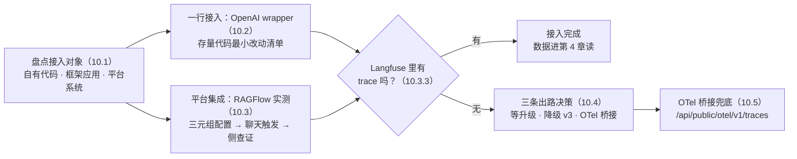
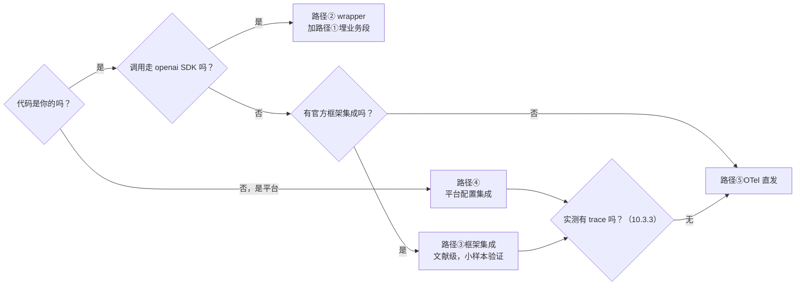
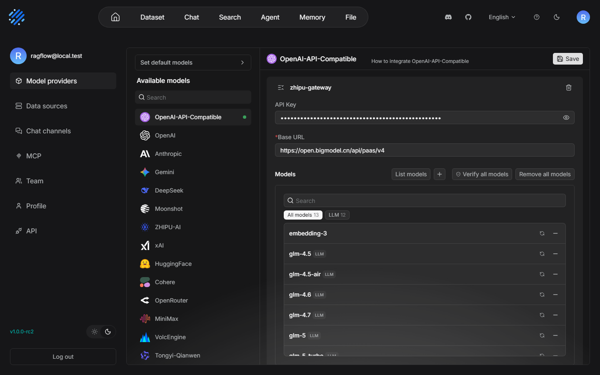
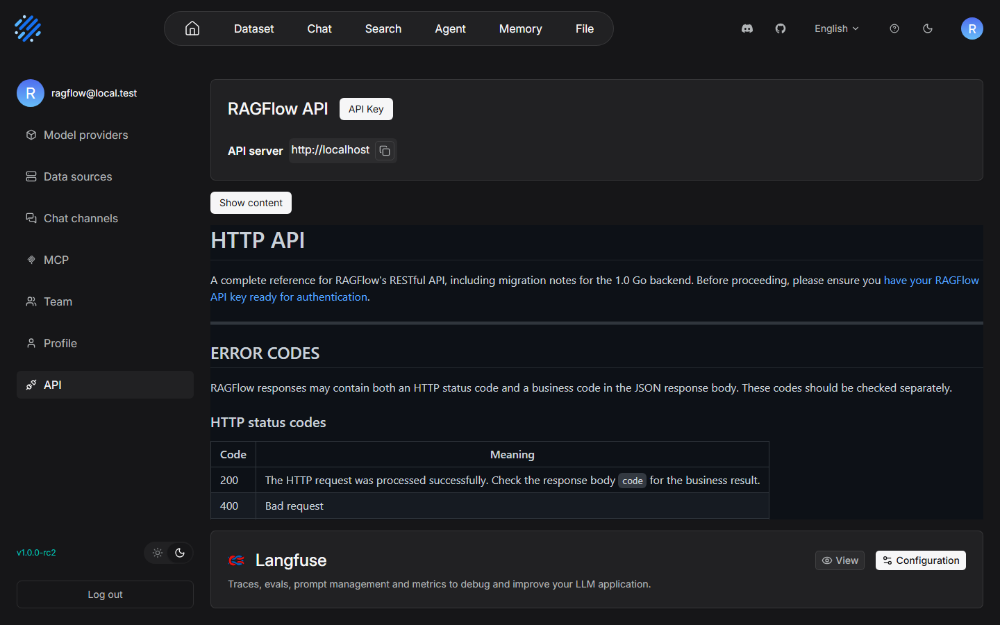
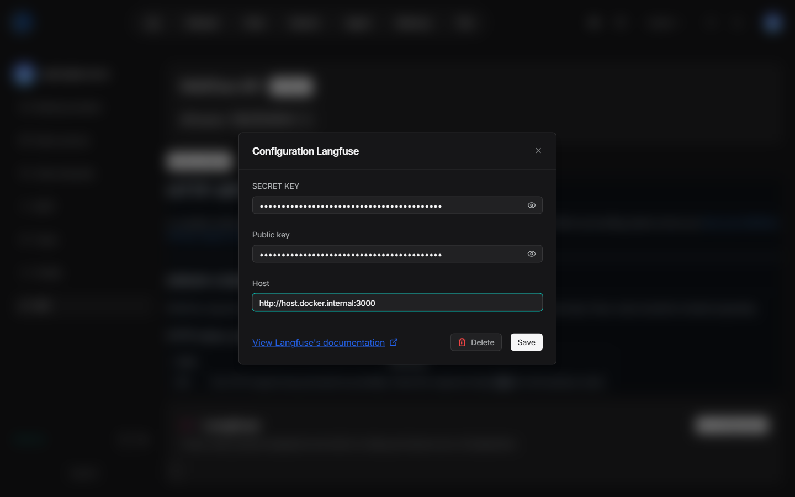
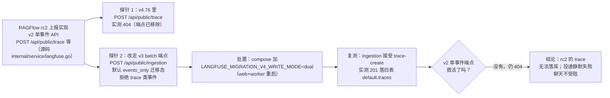
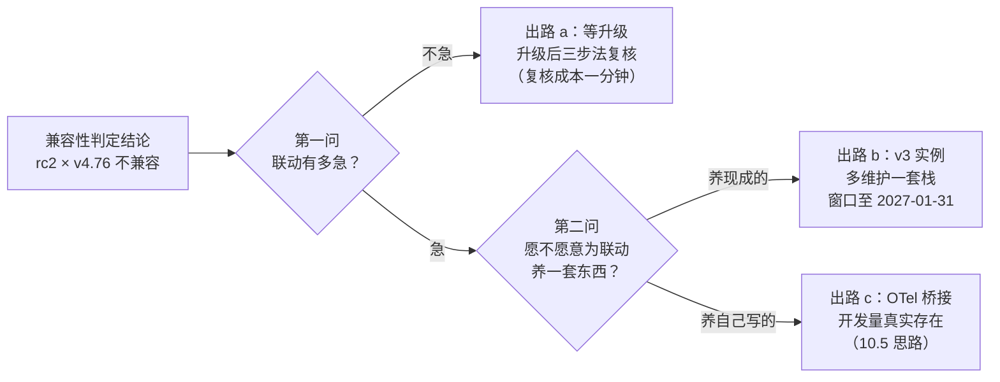
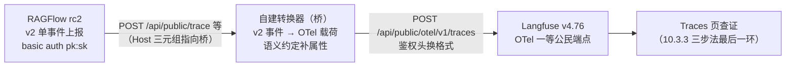

# 第 10 章 接入已有系统

> 本章导读：前九章的一切实测都发生在同一个应用里——我们自己写的售后助手，埋点从第一行代码就计划好了。但真实世界里更常见的处境是反过来的：系统已经在跑（RAGFlow 上的知识库问答、Dify 编排的应用、一段一直在产出的 openai 调用代码），Langfuse 是后来者，谁迁就谁是个现实问题。本章回答「接入已有系统」的三个问题：五条接入路径怎么选（10.1）；能改代码的存量项目，最小改动是什么（10.2）；不能改代码的平台怎么接——用全书唯一一次「两个书架平台正面相撞」的实测作答：RAGFlow v1.0.0-rc2 联动 Langfuse v4.76.0，从配置、触发到查证全程实测，结论如实写——不兼容（10.3），随后给出三条出路的决策表（10.4）与 OTel 桥接兜底（10.5），最后交代多栈并存的部署纪律（10.6）。读完本章，你能：为任何已有系统选对接入路径；完成一次带兼容性判定的平台集成；在集成失败时按根因链定位到具体环节，并从三条出路中做出有依据的决策。



*本章操作流程图*

## 你什么时候需要它

三种典型处境，对应本章三种用法。

**手里有一段自研代码，一直在调 OpenAI 或任意 OpenAI 兼容端点**——主路是 10.1 的选型表加 10.2 的最小改动清单。这类「能改代码、但不想大改」的项目是 wrapper 的主场：一行换 import，generation 自动长出 model 与 usage。第 3 章讲的是 wrapper「怎么用」，本章讲的是「存量代码怎么以最小代价换上去」。

**手里是一个不能（或不想）改代码的平台，RAGFlow、Dify、n8n 这类**——主路是 10.3 的 RAGFlow 联动实测。这是本章的主线，也是全书唯一一次「两个书架平台正面相撞」的实测：配置怎么填、聊天怎么触发、trace 到底落没落库，三步全部本机验证，兼容性结论如实给出。哪怕你联动的不是 RAGFlow，10.3.3 的「侧查证方法」与 10.4 的出路决策也是可复用的方法论。

**两套自托管栈要并存（或正在并存），部署时端口报错、容器起不来**——直奔 10.6。Langfuse 六容器与 RAGFlow 栈同机部署的三起端口冲突实录（含一个 Windows 保留段「隐形占用」的教训）都在那里，「谁后装谁让路」的纪律能帮你少走一遍弯路。

前置：Langfuse 侧沿用第 2 章的六容器实例（v4.76.0，项目 `after-sales`）；RAGFlow 侧来自书架的 ragflow-local 部署（RAGFlow v1.0.0-rc2，Web 80、API 9380，账号 `ragflow@local.test`），其模型渠道、知识库与聊天助手已于 2026-11-08 重建就绪。本章一切版本事实的核实日期均为 2026-11-08。

本章的事实口径沿用全书纪律（1.3.3 三条）：界面与端点行为是实测事实层（附核实日期与取证方式）；「本书立场」的判断句是立场层；文献级条目（框架集成清单、官方 ragflow 集成页的说法）只列官方文档承认的内容并逐一标注，不替它们背书。差异与不兼容如实写进正文，第 10.3.4 的兼容性结论就是本章最大的一处「如实」。

## 10.1 概述：接入路径全景与选型

**「接入已有系统」不是一个动作，是一个选型问题：先按「你能改什么」把系统分类，再从五条路径里挑一条。**分类的依据不是技术偏好，而是你对该系统的控制力——这决定了改动量的上限。

| 路径 | 典型对象 | 改动量 | 本机实测状态 | 官方文档路径（langfuse.com） |
|------|---------|--------|-------------|------------------------------|
| ① SDK 手动埋点 | 自有代码里的任意函数 | 中：逐函数加 `@observe` | 第 3 章实测 | `/docs/observability/sdk`（第 3 章 `source`） |
| ② OpenAI wrapper | 自有代码里走 openai SDK 的调用 | 极小：一行换 import | 第 3 章实测 | `/integrations/model-providers/openai-py` |
| ③ 框架集成 | LangChain/LlamaIndex/OpenAI Agents SDK/CrewAI/AutoGen/Pydantic AI 等框架应用 | 小：装回调包、初始化 | **文献级，本机未逐一实测** | `/integrations/frameworks/<框架名>` |
| ④ 平台自带 Langfuse 集成 | RAGFlow/Dify/n8n/Flowise/Langflow/OpenWebUI 等平台 | 极小：界面填配置，零代码 | RAGFlow 本机实测（10.3，结论：不兼容） | `/integrations/no-code/<平台名>` |
| ⑤ OTel 直发 | 任何能产出 OTel 载荷的系统 | 中：自建转换与发送管线 | SDK 走此端点为第 3 章实测事实；自建桥未实测 | `/integrations/native/opentelemetry` |

两点口径说明。**其一**，③④ 两类的清单来自官方集成索引（langfuse.com/integrations，其机器可读全文在 llms-integrations.txt；核实日期 2026-11-08）——框架类目下收录四十余项，无代码类目下收录 dify、n8n、flowise、langflow、openwebui、ragflow 等十余项。本书对文献级条目的纪律与全书一致：**只列官方文档承认存在的路径，不替它们打包票**，你选定某一项后以该页文档加你自己的小样本实测为准。**其二**，⑤ 与 SDK 的关系值得点破：Python SDK 5.2.0 的摄取端点就是 OTel 端点 `/api/public/otel/v1/traces`（第 3 章的基线事实）——也就是说路径①②本质上「搭了⑤的车」，SDK 替你完成了 OTel 载荷的组装；⑤ 单列出来，指的是「不用 SDK、自己产 OTel 载荷直发」的路线。

**本书立场：能改代码的自有系统优先②（走 openai SDK 的部分）加①（业务段），这是全书代码示例的公共底座；不能改代码的平台走④，但必须像 10.3 那样做兼容性判定，不能配完就假设通了；④不通或语义不够时，⑤是最后的兜底。**三条「不能一次到位」的情形（不走 openai SDK 的自研 HTTP 客户端、平台集成不兼容、框架无官方集成）最终都汇到⑤，这就是本章末尾要展开的 OTel 桥接。

本章与第 1 章 1.4 的书架交接面预告是一一兑现的关系：那张图里「ragflow 书 → 本书第 10 章对接实测」的箭头，本章用整节实测把它画实——预告过的结论（不兼容、ragflow 书 12.3 需回改）逐条坐实；「mcp 书 trace 形态互见」的箭头则是 10.5 的伏笔，OTel 语义下工具调用链路的表达方式与第 4 章的数据模型同源。第一章那句「知识库与编排平台负责把答案造出来，Langfuse 负责证明这一次造得怎么样」，本章回答的是两句话中间省略号里的动作：答案怎么从造它的系统流进证明它的系统——以及流不动的时候，工程上有哪几条路。

### 10.1.1 选型的三步判定

把上面的立场整理成三问，动手前问完就能定路径：



*五条路径的三步判定；「实测有 trace 吗」一问的完整方法见 10.3.3*

### 10.1.2 五条路径逐条细读：各自的适用与雷区

三步判定给的是骨架，把五条路各自的适用场景与常见雷区补全，选型时逐条对照即可：

**路径① SDK 手动埋点。**适用：自有代码、埋点粒度想自己说了算的项目——检索段、业务段、数据加工段用 `@observe` 定名定型，观测树与业务结构一一对应（第 3 章的 `retrieve-context`/`llm-call` 就是这条路的产物）。雷区：给 LLM 调用单独用它字段残缺（无 model/usage，第 3 章实测），LLM 调用须配 wrapper 或手动补字段；逐函数装饰的改动量在五条路里最大，存量代码要评估铺开面。

**路径② OpenAI wrapper。**适用：走 openai SDK 的自有代码，尤其是「能改一行、不敢大改」的存量系统（10.2 整节都在讲它）。雷区：只拦 openai SDK 一个挂点——httpx 自拼请求、其他官方 SDK 都拦不到（10.2.3 的边界表）；另外它只负责 generation 节点，session、user、Prompt 版本关联这些属性层面的事仍要 SDK 的属性机制配合（第 3/6 章口径）。

**路径③ 框架集成。**适用：应用整体建在某个框架上（LangChain/LlamaIndex/OpenAI Agents SDK 等），框架自身的回调/追踪钩子能把整棵执行树交出来，比自己逐函数埋点省力。雷区有二：**集成质量因框架而异**（回调能记到多细取决于框架暴露多少，文档承诺与实际字段常有出入）；**本条目本机未逐一实测**（文献级），选定后先跑小样本、按 10.3.3 的查证法确认再铺开。

**路径④ 平台自带集成。**适用：不能改代码的平台——配置面在平台设置里，三元组填完即接入，改动量与路径②同级甚至更小。雷区：**集成实现在平台代码里，你既改不了也未必读得透**，平台版本与 Langfuse 服务器版本的兼容性没人替你保证——官方集成文档常常只写平台侧要求（10.3 的官方 ragflow 页连 Langfuse 侧版本要求都没标），版本错位的坑只能靠实测排。10.3 整节就是这一条路的实测记。

**路径⑤ OTel 直发。**适用：前三条都不通时的兜底——自研 HTTP 客户端、不发 OTel 的老平台、以及想绕开 SDK 自建管线的团队；OTel 是开放标准，接入方不绑定任何 Langfuse SDK。雷区：工程量在五条路里最大（载荷组装、语义约定、鉴权、失败重试全自己扛），且通用 OTel span 与 LLM 语义之间的映射要靠 OpenInference/OpenLLMetry 一类约定补齐，不按约定填属性，UI 里的观测就长不成第 4 章教的样子。10.5 展开其思路。

五条路还有一个共同的隐性约束值得点破：**无论走哪条，数据最终都落在「Key 指向的项目」里。**路径①②的三变量、路径④的三元组、路径⑤的鉴权头，本质都是一对项目级 API Key（第 2 章）——拿错项目的 Key，五条路都通，数据只是落错了地方。多系统接入时「哪个系统用哪个项目的 Key」的治理问题，第 11 章展开。

## 10.2 一行接入：OpenAI wrapper 与存量代码改造

### 10.2.1 回顾：wrapper 为什么是存量项目的最优解

第 3 章已经把 wrapper 的机制讲透：`from langfuse.openai import OpenAI` 替换 import 来源后，wrapper 拦截 openai SDK 的 `chat.completions.create`，在调用之下自动挂一个名为 `OpenAI-generation` 的 generation 节点，model、prompt/completion token 用量、延迟从响应对象里自动取齐，配价后成本自动入账（第 5 章）。它对端点不挑食——凡是走 openai 客户端的调用都拦得住，本书的智谱兼容端点（`https://open.bigmodel.cn/api/paas/v4`）实测可用。

站在「接入已有系统」的视角，这些机制恰好命中存量项目的三个约束：**不敢大改**（一行 import 换完即回滚）、**没人手重埋**（观测代码不进业务函数）、**排查要快**（改动小，引入新问题的面就小）。对一直在跑的生产代码，这三个约束比「观测粒度可调」重要得多——这是 wrapper 在本章选型表里排自有代码第一位的理由。换句话说，第 3 章把 wrapper 讲成「两种埋点风格之一」，本章把它讲成「存量改造的工程决策」——同一个机制，换了决策语境，权重排序完全不同。

### 10.2.2 存量代码最小改动清单

把改造动作拆成八步，前三步零代码改动，唯一的代码改动只有第 4 步：

| 步骤 | 动作 | 说明 |
|------|------|------|
| 1 盘点 import | 确认存量代码的 LLM 调用是否 `from openai import OpenAI` | 决定 wrapper 适用性；httpx 自拼请求或其他 SDK 则 wrapper 拦不到（10.2.3） |
| 2 装依赖 | `pip install "langfuse>=5.2"` | openai 依赖存量代码已有，无需动 |
| 3 注入三环境变量 | `LANGFUSE_HOST` / `LANGFUSE_PUBLIC_KEY` / `LANGFUSE_SECRET_KEY` | 第 2 章的 Key；本机调试加 `NO_PROXY=localhost,127.0.0.1`（第 3 章实测坑） |
| 4 换 import | `from openai import OpenAI` → `from langfuse.openai import OpenAI` | **唯一的代码改动**；实例化参数不动 |
| 5 短进程 flush | 进程退出前 `lf.flush()` | 跑完就退的脚本必须；常驻服务不需要（第 3 章 3.6） |
| 6 串会话（可选） | `propagate_attributes(session_id=…, user_id=…)` | 存量代码有会话键就带上；没有可后补，不阻塞第一步上线 |
| 7 配价（可选） | 项目 Settings → Model Definitions 建模型单价 | 成本字段才会算出钱；配价只对新摄取生效（第 5 章） |
| 8 UI 验证 | Traces 页确认 `OpenAI-generation` 节点 model/usage 齐全 | 验证以 UI 为准（第 3 章口径） |

改造前后对照，让「最小改动」看得见：

```python
# 改造前：存量代码
from openai import OpenAI

client = OpenAI(
    base_url="https://open.bigmodel.cn/api/paas/v4",
    api_key=os.environ["ZHIPU_API_KEY"],
)
```

```python
# 改造后：唯一的代码改动是 import 来源，其余一行不动
from langfuse.openai import OpenAI

client = OpenAI(
    base_url="https://open.bigmodel.cn/api/paas/v4",
    api_key=os.environ["ZHIPU_API_KEY"],
)
```

运行一次，UI 里这条调用的 trace 树上就多出 `OpenAI-generation` 节点——改造宣告完成。**上线节奏建议灰着走**：先在非生产环境换 import 验证一轮（SDK 版本、代理、Key 三处都可能出环境差异），再推生产；wrapper 是进程内拦截，理论上零行为差异，但「理论上零风险」和「验证过零风险」在存量系统上是两回事——这是本书立场，不是文档要求。

改动虽小，交付验证不能省。把「改造完成」的定义落成一张可勾选的表：

| 验证点 | 位置 | 预期 |
|--------|------|------|
| 调用行为不变 | 业务侧 | 回答内容、延迟与改造前一致——wrapper 只旁路记录，不改请求 |
| generation 出现 | trace 详情左树 | `OpenAI-generation` 节点挂在调用点之下 |
| 字段齐全 | generation 节点 Preview | model=`<你的模型名>`，usage 含 prompt/completion tokens |
| 成本入账（若做了第 7 步） | 节点与 trace 头部 | 按 Model Definitions 单价折算出金额 |
| flush 无缺（若为短进程） | Traces 页 | 脚本退出后 trace 稳定出现，不再时有时无 |

一个常见追问：**wrapper 上了，还要不要路径①的手动埋点？**要——两者是分工不是替代。wrapper 只补「模型调用」这一类节点；检索、工具执行、业务分支这些段 wrapper 管不着。第 3 章 3.8 的售后助手就是组合式：`retrieve-context` 与 `llm-call` 是手动 span，`OpenAI-generation` 是 wrapper 自动补的 generation。存量系统改造时按同一思路推进：先换 import 拿到 generation（一天），再逐步给关键业务段补 `@observe`（按迭代排期），观测覆盖率从「只有模型调用」渐进到「整棵业务树」。

把「八步清单走完之后的样子」收拢成一个完整可运行的脚本——一个典型的存量 LLM 调用脚本（直接调 openai 客户端、跑完就退），改造后的全貌如下，可与第 3 章 3.8 的售后助手对照着看（结构与 demo 一致，只是抽掉了业务逻辑）：

```python
# legacy_after.py —— 存量脚本改造后全貌(可运行,与第 3 章 demo 同构)
import os

from langfuse.openai import OpenAI            # 步骤 4:唯一的代码改动
from langfuse import get_client, propagate_attributes

lf = get_client()                             # 步骤 2/3:读三个环境变量
client = OpenAI(                              # 实例化参数与改造前完全一致
    base_url="https://open.bigmodel.cn/api/paas/v4",
    api_key=os.environ["ZHIPU_API_KEY"],
)

def answer(query: str, session_id: str | None = None) -> str:
    # 步骤 6(可选):有会话键就串上;没有可整段先不写,不阻塞上线
    with propagate_attributes(session_id=session_id, user_id="legacy-user"):
        resp = client.chat.completions.create(
            model="glm-5.3-flash",
            messages=[{"role": "user", "content": query}],
            temperature=0.3,
        )                                     # wrapper 在此自动挂 OpenAI-generation
        return resp.choices[0].message.content

if __name__ == "__main__":
    print(answer("退货政策是什么？", session_id="legacy-session-001"))
    lf.flush()                                # 步骤 5:跑完就退的进程必须
```

对照八步清单看这份代码：步骤 1（盘点）在动笔前完成，步骤 7（配价）在平台侧完成，其余六步全部体现在代码里且只占四处——**这就是「一行接入」的真实含义：代码改动一行，纪律分布在配置与流程里。**

### 10.2.3 边界：wrapper 拦不到的三类调用

wrapper 的能力边界由「拦截点」决定，它只挂在 openai SDK 上。三类调用它无能为力：

| 调用形态 | 为什么拦不到 | 去处 |
|---------|-------------|------|
| httpx/requests 自拼 HTTP 请求 | 不经 openai SDK，wrapper 无挂点 | SDK 手动埋点（路径①）并手动补 model/usage 字段 |
| 其他官方 SDK（anthropic 等） | wrapper 只适配 openai 客户端 | 官方另有对应 wrapper（`/integrations/model-providers/anthropic` 等，文献级） |
| 平台内部调用（RAGFlow/Dify 发出的） | 你改不了平台代码 | 平台集成（路径④，10.3）或 OTel 直发（路径⑤，10.5） |

判定手头存量代码属于哪一类，花五分钟做一次调用点盘点即可：全库搜 `from openai import` 与 `OpenAI(` 的实例化位置，逐个标记「能换 import（走 openai SDK）」还是「不能换（自拼请求/其他 SDK）」——前者归②，后者按量决定走①（量小）还是⑤（量大且形态统一）。这张盘点结果就是存量改造的施工图，10.2.2 的八步清单按图逐点执行。

第三类正是下一节的主角：平台代码不动、观测数据想进来，只能指望平台「自己开口」。

## 10.3 平台集成实测：RAGFlow 联动（本章主线）

### 10.3.1 实测环境与 RAGFlow 侧配置

本节开始，全书唯一一处两个书架平台正面相撞的实测正式上场。实测双方的底细：

| 项 | Langfuse 侧 | RAGFlow 侧 |
|----|-------------|------------|
| 版本 | v4.76.0（自托管六容器，Web 3000） | v1.0.0-rc2（书架 ragflow-local，Web 80、API 9380） |
| 项目/账号 | 项目 `after-sales`（`yubing-org`） | `ragflow@local.test` |
| 已就绪资产 | API Key 一对（第 2 章） | 模型渠道 zhipu-gateway（glm-5.3-flash + embedding-3）、知识库 after-sales-kb（3 份样本解析完成）、聊天助手「售后助手」 |

官方集成文档（langfuse.com/integrations/no-code/ragflow，核实日期 2026-11-08）对此集成的写法是：要求 RAGFlow ≥ 0.3.0，配置入口在 RAGFlow 的 API 设置页底部，前提是先在 RAGFlow 设置里配好 LLM——**对 Langfuse 服务器一侧的版本要求，官方文档一个字没提**。请记住这个「没提」，10.3.3 的结论会让它变得意味深长。

第一步，确认 RAGFlow 侧前提就绪：模型渠道已配好并保存。渠道走的是与第 3 章 demo 相同的智谱 OpenAI 兼容端点：



*渠道页里 glm-5.3-flash 与 embedding-3 双双在列——这就是 10.3.2 聊天触发要用的模型底座*

第二步，找到配置入口。设置页左栏点 API（URL `/user-setting/api`），页面往下拉到底，HTTP API 与错误码文档之后是 Langfuse 区块——官方那句自我介绍（第 1 章 1.2 引用过同源文字）就印在这里，右侧两个按钮 View 与 Configuration：



*配置入口在 API 设置页底部——官方文档说的 scroll to bottom 就是字面意思*

第三步，点开 Configuration 弹窗，填三元组。**字段顺序是 SECRET KEY 在上、Public key 居中、Host 在下**——与 Langfuse 侧「公钥在前」的习惯相反，第一笔容易填反；Host 一栏填 `http://host.docker.internal:3000`，因为 RAGFlow 容器要访问宿主机上的 Langfuse，`localhost` 在容器里指容器自己。三元组取值全部来自第 2 章项目 `after-sales` 的 API Key：



*三元组弹窗：字段序 SECRET KEY/Public key/Host；Host 指 RAGFlow 容器视角下的宿机 Langfuse*

Save 之后配置落 RAGFlow 的 MySQL——实测查证落库表为 `tenant_langfuse`（租户级配置，一个租户一套三元组）。到这里，RAGFlow 侧的所有动作完成，全程零代码改动，与 10.1 选型表对路径④「极小」的标注一致。

Langfuse 侧的准备其实只有一项，且早在第 2 章就绪：一对项目级 API Key（pk-/sk- 成对）。值得点破的是这对 Key 在联动里的双重身份——对 RAGFlow 来说它是「三元组的两员」，对 Langfuse 来说它是「数据归属的判据」：无论数据从哪条路径来（SDK、wrapper、平台上报、OTel），Langfuse 一律按 Key 把数据落进对应项目。本次实测用 `after-sales` 项目的 Key，意味着若集成成功，RAGFlow 的 trace 会与自有应用的观测同项目共存——**要不要给平台联动的数据单开一个项目，是接入前值得想清楚的决定**（隔离方案第 11 章展开，本次实测为了与第 1 章 1.4 预告的对接形态一致，沿用 `after-sales`）。

### 10.3.2 聊天触发：UI 聊天与 OpenAI 兼容入口

配置存好了，触发两条链路验证「上报是否发生」。先说清这两个入口各自是什么：**UI 聊天**是平台自己的对话界面，人在页面上提问，链路（检索 → 生成 → 回答）在 RAGFlow 内部走完；**OpenAI 兼容入口**是平台对外暴露的程序化调用面——外部应用把 RAGFlow 知识库问答当成一个「OpenAI 格式的模型」来调，请求格式与第 3 章 demo 的 messages 结构完全同构。选两个入口都测，是因为它们的触发路径不同（UI 走平台内部会话，API 走外部调用），若集成实现只钩住了其中一条链路，只测一条就会漏判。RAGFlow 侧可触发 trace 的入口就是这两个，本节都实测：

**入口一：UI 聊天。**Chat 页选中「售后助手」对话，问「退货政策是什么？」——回答正常返回，带知识库引用标记（[2][4][5] 等）与引用文档缩略图，检索、生成全链路在 RAGFlow 侧工作正常：

![RAGFlow Chat 页实测：提问「退货政策是什么？」，回答含退货时限表格（普通商品 7 天、大件家电 15 天、食品生鲜签收 24 小时内）与其他重要说明四条，各句带 [2][4][5] 等知识库引用角标，下方两张 after-sal… 引用文档缩略图；左栏 Conversations 列表两条同问会话](../assets/images/lf-ragflow-chat-answer.png)

*UI 聊天实测可答、引用齐全——RAGFlow 侧业务功能一切正常，问题只可能出在观测上报*

**入口二：OpenAI 兼容 API。**供程序化调用的端点 `POST /api/v1/openai/{chat_id}/chat/completions`，注意 model 参数要填**全名**（模型@渠道@类型三段式），本机实测取值 `glm-5.3-flash@zhipu-gateway@OpenAI-API-Compatible`：

```bash
curl --noproxy '*' -X POST http://localhost:9380/api/v1/openai/<chat_id>/chat/completions \
  -H "Authorization: Bearer <RAGFLOW_API_KEY>" \
  -H "Content-Type: application/json" \
  --data-binary @chat.json
```

请求体 `chat.json` 便是标准的 OpenAI messages 格式（示意，注意 model 取全名）：

```json
{
  "model": "glm-5.3-flash@zhipu-gateway@OpenAI-API-Compatible",
  "messages": [
    {"role": "user", "content": "退货政策是什么？"}
  ],
  "stream": false
}
```

这里有一个 Windows 下的实测细节：**命令行内嵌中文 JSON 经 bash 传参会编码损坏，须用 `--data-binary @file.json`（文件存 UTF-8）绕过**——同一条经验在第 2 章排障实录里出现过，凡 curl 发中文一律如此。该入口实测同样可答，回答引用知识库正常。

两个入口、多次触发，RAGFlow 侧的表现分毫不差：聊天功能完好。接下来是本章最关键的一步——去 Langfuse 侧查证，这些调用的 trace 到底落没落。

### 10.3.3 Langfuse 侧查证：trace 去哪了（根因链）

**查证方法本身先讲清楚，它比结论更可复用。**判定「平台集成是否真的通了」，唯一作数的是到 Langfuse UI 的 Traces 页按时间过滤看有没有新 trace——不是看 RAGFlow 配置页「已保存」，也不是看有没有报错弹窗。观测链路的失败默认是静默的（第 1 章 1.1.2 的底线：采集失败不阻塞业务），RAGFlow 侧没喊疼不代表数据到了。实测结果：**触发多次后，Traces 页查无任何新 trace**。

trace 消失在哪一环？沿上报链路逐段查证（RAGFlow 是开源的，可以直接读它的上报实现；Langfuse 侧则用端点探针逐个试），四步查出一个完整的根因链：



*根因链：两次端点探针加一次迁移模式处置，把「trace 去哪了」定位到端点代际错位*

逐段拆解这条链，每一段都有实测凭据：

1. **rc2 的上报实现走 v2 单事件 API。**读 RAGFlow rc2 源码 `internal/service/langfuse.go`：上报不是批量，而是逐个 `POST {host}/api/public/trace`、`/api/public/span`、`/api/public/generation`，basic auth 用 pk:sk 一对 Key。这是 Langfuse v2 时代的公开端点协议。
2. **Langfuse v4.76 里该端点 404。**对部署实例直接探针 `POST /api/public/trace`，返回 404——v4 已移除 v2 单事件端点（v4 的摄取走 OTel 端点与 v3 batch 端点，见 10.5 与本节第 3 段）。
3. **改试 v3 batch 端点，默认迁移态拒绝 trace 类事件。**v4 保留了 v3 的批量端点 `POST /api/public/ingestion`，但 v4.76.0 默认处于 `events_only` 迁移写模式（第 1 章 1.3.3 挂过号：v4 迁移期写模式 events_only/dual/legacy 由管理员可配）——该模式下它只接受 OTel 语义的事件，v3 风格的 trace 类事件被拒。
4. **切 dual 模式后，batch 端点复活，但单事件端点没有。**compose 加环境变量 `LANGFUSE_MIGRATION_V4_WRITE_MODE=dual`（web 与 worker 两个服务都要加）重启后复测：`ingestion` 接受 `trace-create` 事件，返回 201，数据落旧表 `default.traces`（ClickHouse）——**但这只救活了 v3 batch API；rc2 用的 v2 单事件端点依然 404，救不活**。端点代际错位才是根子，写模式只是 batch 端点这一层的状态开关。

把查证过程整理成证据链表，每一行的「实测结果」都是可复现的操作（探针与复测的 curl 写法沿用 10.3.2 的 `--noproxy` 与 `--data-binary` 纪律）：

| # | 查证动作 | 取证位置 | 实测结果 |
|---|---------|---------|---------|
| 1 | 读 rc2 上报实现 | RAGFlow 源码 `internal/service/langfuse.go` | v2 单事件 API（POST /api/public/trace 等，basic auth pk:sk） |
| 2 | 探针 v2 单事件端点 | `POST {langfuse}/api/public/trace` | **404**（v4 已移除） |
| 3 | 探针 v3 batch 端点 | `POST {langfuse}/api/public/ingestion` | 默认 events_only 模式拒绝 trace 类事件 |
| 4 | 加 `LANGFUSE_MIGRATION_V4_WRITE_MODE=dual`（web+worker）重启 | compose 配置 | ingestion 接受 trace-create，**201 落旧表 default.traces** |
| 5 | RAGFlow 侧再触发（UI 聊天 + API 入口），回 Langfuse Traces 页查证 | Langfuse UI | **仍零 trace**——v2 单事件端点未复活，rc2 上报无解 |
| 6 | 观察聊天业务侧 | RAGFlow UI / API | 全程正常可答，无报错无减速——投递静默失败 |

第 5、6 两行放在一起读，就是本次实测最值得带走的一课：**业务侧一切正常、观测侧颗粒无收，两侧都「没毛病」时，毛病只可能在中间的协议对接上。**这种时候不要在两侧反复重试（重试永远不会让 404 变 200），要像本节这样沿链路逐段取证——端点代际错位四个字，是取证取出来的，不是猜出来的。

还有一个与第 1 章底线互证的实测观察：整个过程里 RAGFlow 聊天从未报错、从未变慢——LangfuseClientFromTenant 的构造条件满足，上报投递失败是静默的，聊天不受任何阻塞。ragflow 书 12.3 写过「投递失败不阻塞聊天」，这次实测正面验证了那句话，但代价是：**静默也意味着你不主动查证，就永远不会发现集成没通。**

顺带交代 dual 模式在 UI 上的管理位：v4 迁移期的写模式不只是 compose 环境变量——项目 Settings 侧栏有 V4 migration 外链入口（第 1 章 1.3.3 挂过号），迁移态与 UI 切换策略在那一页可见可管。本机实测用的是环境变量方式（compose override，改动可版本化、可随栈复制），两处配置面的关系与取舍在第 11 章的管理话题里一并展开。

### 10.3.4 兼容性结论与回改标注

把四步查证收敛成一句话结论，如实写进书里：

> **RAGFlow v1.0.0-rc2 × Langfuse v4.76.0 不兼容。**rc2 的 trace 上报走 v2 单事件端点，该端点在 v4 已移除（404）；v3 batch 端点经 dual 写模式可恢复接受 trace 事件，但对 rc2 的单事件协议无效；UI 聊天与 OpenAI 兼容入口的调用全部正常回答，但 Langfuse 侧零 trace 落库。

这个结论反衬出官方文档那个「没提」的分量：官方集成页只要求 RAGFlow ≥ 0.3.0，对 Langfuse 服务器版本只字未提——本机 rc2 远超 0.3.0，却仍不兼容 v4.76。第 1 章 1.3.3 说过「报端点与服务器版本要配套看，兼容性问题多半出在两侧版本错位」，这里就是活例：**满足官方文档写明的版本要求 ≠ 集成可用，没写的字段往往才是坑。**平台集成的判定纪律因此值得固化成三步：配置（10.3.1）→ 触发（10.3.2）→ 侧查证（10.3.3），三步缺一不可，查证永远以 Langfuse UI 为准。

三步之外，把「为什么这次集成没通」收敛成五个自查问题——你在联动**任何**平台时遇到「配置存了、聊天正常、就是没 trace」，都按这五问走一遍，多数能直接命中：

1. **平台往哪个端点上报？**——能读源码读源码（10.3.3 的第 1 步最省），读不了就抓平台的出站请求；端点路径里的代际（v2 单事件/v3 batch/OTel）是第一线索。
2. **端点在服务器上活着吗？**——直接探针，404 就是答案；不要信文档，信状态码。
3. **活着的端点现在处于什么模式？**——v4 的 batch 端点有迁移写模式，默认 events_only 会拒掉旧语义事件（本节实测）；模式可配，配了就能过，见参考速查表。
4. **模式的开关救的是哪一代客户端？**——dual 救 v3 batch，救不了 v2 单事件；处置后必须回到平台侧再触发一次做端到端复测（本节第 5 行证据）。
5. **平台侧对上报失败静默吗？**——多数平台静默（观测不阻塞业务的设计底线），所以「平台没报错」永远不是「上报成功」的证据，UI 才是。

两处连带交代。**其一**，ragflow 书 12.3 节的 trace 上报结构表描述的是 v2/v3 端点时代的行为，对 v4 服务器不成立，需要回改标注——第 1 章已预告这笔回改，实测结论在此坐实。**其二**，写模式处置（dual）虽然救不活本次集成，但它不是白做的：dual 是官方迁移机制，对仍在用 v3 协议上报的其他客户端有效；本书实例保留 dual 配置，10.5 的桥接方案也会用到迁移态的知识。写模式三种取值的速查在本章末参考速查表。

## 10.4 三条出路决策

兼容性结论落地，接下来是决策：联动需求还在，路往哪走？实测信息给出来三条出路，各自的代价与适用画成一张决策表——**这张表与 10.1 的选型表是本章的两根承重柱**：

| 出路 | 做法 | 代价 | 适用 |
|------|------|------|------|
| a 等 RAGFlow 升级 | 跟进 RAGFlow 新版本（main 分支已重写可观测实现 observability），升级后按 10.3 三步法重新实测 | 零额外设施与开发量；但时间表不由你定，且新版本仍需重新走一遍兼容性判定 | 联动需求不急、无自建工程能力的团队——**多数人的默认解** |
| b 联动场景降级 Langfuse v3 实例 | 另起一套 v3 自托管实例（端口与现有 v4 错开，10.6 的纪律直接适用），RAGFlow 三元组指向 v3 | 多维护一套栈；v3 自托管安全维护期到 2027-01-31（第 1 章），窗口有限；数据分散在两套实例 | 联动需求明确且急、接受旧版与维护成本的团队 |
| c OTel 桥接自建转换 | 自建小服务：把 RAGFlow 的上报（或其内部事件）转成 OTel 载荷，直发 v4 的 OTel 端点（10.5 展开） | 有真实开发量：吃透两侧行为、字段映射、凭据转换、失败排查都自己扛；**本机未实测** | 长期方案；工程能力强、联动是硬需求、且不想被版本窗口绑架的团队 |

决策的读法按两个问题走，画成图就是一条二叉的决策路径：



*两条出路决策：两问定出路；「什么都不做」等价于放弃联动线*

**第一问：联动有多急？**不急，选 a，把兼容性复核写进 RAGFlow 升级的验收清单（升级后触发一次聊天、到 Traces 页查证即可，成本一分钟）；急，进第二问。**第二问：愿不愿意为联动养一套东西？**养一套现成但会过期的（b，v3 实例），还是养一套自己写的、跟着你走的（c，桥接服务）。没有第四条路——「什么都不做」等价于放弃这条联动线，ragflow 书 12.3 预留的评估对接也就落不了地。

**本书立场：以 a 为主线（零成本、方向正确），b 作为有明确 deadline 时的过渡，c 留给把它当练手项目的读者**——下一节的桥接思路对任何「平台不发 OTel」的场景都通用，学会了不止服务 RAGFlow 一个案例。

### 10.4.1 出路 a 的落地要点：升级复核清单

三条出路不是互斥的三选一，可以打组合：**a+c 并行**（等升级的同时把桥接当练手项目，桥成了就提前通、平台升级了就弃桥）、**b→a 过渡**（deadline 前用 v3 顶上，平台升级后迁回 v4，v3 实例按期下线）。唯一的反模式是 b+c 并行——为同一个联动场景同时养两套东西，维护成本翻倍而收益为零。

选 a 不是「什么都不做」，是「把等待变成有验收的等待」。RAGFlow 升级到包含可观测重写的版本那天，按这张清单复核（全套动作不超过十分钟）：

| 复核项 | 动作 | 通过标准 |
|--------|------|---------|
| 上报协议 | 读新版上报实现（或官方 changelog） | 确认不再走 v2 单事件端点——理想情况走 OTel 或 v3 batch |
| 端点探针 | 触发一次聊天后探针平台所用端点 | 非 404 |
| 端到端查证 | Langfuse Traces 页按时间过滤 | 出现 RAGFlow 的 trace |
| 字段质量 | 点开 trace 看层级与字段 | 检索/生成节点可读，generation 带 model/usage |
| 回改两书 | 核对 ragflow 书 12.3 与本章结论 | 两处口径同步更新 |

### 10.4.2 出路 b 的落地要点：v3 实例的临时部署纪律

选 b 就是在现有 v4 旁边再起一套 Langfuse v3（专用 RAGFlow 联动场景），要点三条：**其一，端口全线错开**——v4 栈占 3000/3030/3031 等端口，v3 实例的 web 端口与三个存储端口都要另取（10.6 的「谁后装谁让路」与避保留段纪律直接适用）；**其二，版本锁死**——v3 取一个已知的稳定 tag 并锁住（v3 自托管安全维护至 2027-01-31，届时联动场景必须迁回 v4 或等到出路 a 落地，这个 deadline 请写进运维日历）；**其三，数据隔离想清楚**——RAGFlow 的 trace 落 v3 实例，与 v4 实例上自有应用的观测天然分开，联动场景的评估（数据集/实验，第 7-9 章）若要在此实例上做，账号、项目与 Key 都要在这套 v3 里重建。三条代价里最重的是时间窗——它是三条出路里唯一自带「过期日期」的方案，这也是本书把它定位为过渡而不是终态的原因。还有一个部署提醒：v3 与 v4 的镜像、卷名、网络名都要完全分开（两套独立的 compose 项目），切勿共用卷或网络——版本不同数据目录的 schema 不同，共卷等于给迁移埋雷。

## 10.5 OTel 桥接兜底

### 10.5.1 v4 的 OTel 端点：所有兜底路线的共同出口

Langfuse v4 的观测摄取有两条公开通道：v3 兼容的 batch 端点 `POST /api/public/ingestion`（10.3 已验明其迁移态行为），与 OTel 标准端点 `POST /api/public/otel/v1/traces`。后者是 v4 的一等公民——Python SDK 5.2.0 内部走的就是它（第 3 章基线事实），官方文档把它单列为 OpenTelemetry Endpoint（`/integrations/native/opentelemetry`，任意语言可用）。**这句话翻过来读就是兜底的依据：任何能产出 OTel 载荷、把它 POST 到这个端点的系统，都能进 Langfuse v4——不经过 SDK，也不经过任何「平台集成」。**

v4 架构上为什么把 OTel 立为一等公民，值得一句话交代：v4 的观测数据模型本身就是事件化的（第 1 章 1.3.3 提过 events 模型与新旧表并存），OTel 的 span/event 载荷与它的天然对齐——SDK 与平台集成的上报最终都以 OTel 形态进摄取队列，直发 OTel 等于走的是「所有人的最后一段路」，协议不会因客户端代际而歧视。这一节开头的兼容性僵局（v2/v3 代际错位）在 OTel 端点上不存在：它没有「旧版本」可言，标准即协议。

动手前交代三个实操前提，全部沿用全书已建立的口径：**鉴权**用项目 API Key 对（basic auth 或请求头，与 SDK 三变量同源，第 2 章）；**载荷**按 OTel 规范组装（resource、span、时间戳、parent trace id 的层级关系自己负责——SDK 平时替你做的组包工作，这里回到你手上）；**验证**仍以 Langfuse UI 为准。第一段的语义约定决定数据长得像不像 LLM 观测，是本节真正的技术重心。

OTel 侧还配好了语义生态：通用的 OTel span 只是一段时间与若干属性，要让 Langfuse 把它认成 trace/generation 这类 LLM 语义，靠的是社区语义约定——官方集成索引的 Other 类目里列有 OpenInference 与 OpenLLMetry 两个约定库（文献级），它们定义了「什么样的 span 属性对应一次模型调用」。自己造载荷时按这类约定填属性，UI 里的层级与字段才长得像第 4 章教的样子。

### 10.5.2 RAGFlow 场景的自建转换器思路（未实测）

把兜底落到本章的案例上：出路 c 的桥接服务要做什么事。先把四个环节的拓扑画出来——桥坐在 RAGFlow 与 Langfuse 中间，两侧各说各的协议：



*出路 c 的桥接拓扑：桥把 v2 单事件协议翻译成 OTel；Host 三元组一行配置完成流量改道*

**思路（明确标注：未实测，是设计推演不是实测记录）**：

1. **截获**：在 RAGFlow 与 Langfuse 之间放一个小服务，把 rc2 发往 `{host}/api/public/trace|span|generation` 的 v2 单事件请求指到桥上（改 RAGFlow 三元组的 Host 即可，配置面 10.3.1 已经见过）；
2. **转换**：桥把 v2 事件体翻译成 OTel 载荷——trace 事件映射为根 span，generation 事件映射为带模型语义属性的子 span，basic auth（pk:sk）换成 OTel 端点的鉴权头；
3. **直发**：按 OpenInference/OpenLLMetry 语义约定填属性，POST 到 `/api/public/otel/v1/traces`；
4. **查证**：触发一次 RAGFlow 聊天，到 Traces 页验证（10.3.3 的三步法最后一环，永远不变）。

四个环节里，1、4 是「接线」，真正的工程量在 2、3 的字段映射。转换环节的骨架长什么样，给一段设计示意（**伪代码，未实测，仅为说明工程量所在**）：

```python
# bridge.py(设计示意,未实测)——v2 单事件 → OTel 载荷的转换骨架
# 依 10.3.3 实测:rc2 逐个 POST /api/public/trace|span|generation,basic auth pk:sk
# 目标:翻译成 OTel 载荷 POST /api/public/otel/v1/traces

@app.post("/api/public/trace")          # 环节 1:复刻 v2 路由,接住 rc2 上报
def on_trace(event: dict):
    span = to_otel_span(                # 环节 2:trace 事件映射为根 span
        name=event.get("name", "ragflow-trace"),
        trace_id=event["id"],
        attributes={                    # 环节 3:按语义约定填属性
            "session.id": event.get("sessionId", ""),
            "user.id": event.get("userId", ""),
        },
    )
    otel_client.export([span])          # 环节 3:直发 v4 OTel 端点
    return {"status": "accepted"}       # 语义与 10.3.3 证据链第 6 行呼应:
                                        # 上报失败不阻塞 RAGFlow 业务
```

字段对应关系要逐个核（v2 事件体与 OTel 语义约定的属性名并非一一对应）、错误处理与重试要自己写、rc2 升级后协议变了还得跟着改——这正是 10.4 把 c 标为「工程能力强」专属的原因。**如果你决定做这个转换器，建议把它做成通用件**：市面上「不发 OTel 的老平台」不止 RAGFlow 一个，桥接管线换个事件解析器就能服务下一个平台——这是兜底路线藏着的长期价值，也是本书把它叫「兜底」而不是「绕路」的原因。

顺带一个版本提示：官方文档在 OTel 类目下还挂着一页「Migration to v4」（`/integrations/native/opentelemetry/migration-to-v4`），讲的是 v3→v4 迁移期客户端的迁移指引——如果你的存量客户端恰好在 v2/v3 协议带，这一页文献值得先读（文献级，本书未展开）。

收尾给一个反向的判定，防止兜底被滥用：**OTel 桥接是兜底，不是默认。**三条信号出现时自建桥才算值得——平台短期不会升级（出路 a 无期）、联动是硬需求（业务等着评估数据落地）、且字段映射的范围可控（只需要 trace/generation 两级，不需要复刻平台的全部观测树）。反过来，平台下一版就换协议的话，桥的生命周期比它服务的集成还短——那种局面下出路 a 的「等」才是正解。兜底的存在意义是让决策不封死：本章从选型（10.1）到兼容性判定（10.3）到出路（10.4）到兜底（10.5），整条链路的每一环都有下一个出口，这才配得上「接入已有系统」这个现实问题应有的工程态度。

## 10.6 多栈并存的部署纪律：谁后装谁让路

RAGFlow 联动实测还有一段前传没有讲——让两套自托管栈在同一台 Windows 机器上活下来。Langfuse 六容器（第 2 章）先到，RAGFlow 栈后装，结果三天端口冲突排障实录（DEPLOY 实录 #7），每一单都值得抄进你的部署手册：

| 冲突 | 现象 | 处置 |
|------|------|------|
| NATS 4222 | RAGFlow 栈的 NATS 起不来；4222 看似无人占用——被 Windows 保留端口段 4202-4301 吞掉，`netstat` 查不到占用者 | compose override 把 NATS 端口改 14222 |
| Kvrocks 6379 | 与 Langfuse 的 redis（6379）相撞 | 改 16379 |
| MinIO 9000 | 与 Langfuse 的 clickhouse（9000，原生协议端口）相撞 | RAGFlow `.env` 里 `MINIO_PORT=19000` |

三单冲突里，前两单是「端口已被占」的常规戏码，第三单本来也该是常规戏码——直到 NATS 那一单教育了我们：**端口冲突不总是「谁占了」，还有「保留段隐形占用」这种查不到占用者的形态**。Windows 会保留一段端口（本机 4202-4301）供系统使用，落在段里的端口 `netstat` 显示空闲，绑定时却失败——这类问题查占用三小时，查文档三分钟。所以部署纪律的完整版是五条：

冲突的背景值得一句交代：RAGFlow 栈不是单容器，它自带一组基础设施组件——消息队列 NATS、存储 kvrocks 与 MinIO 等——每个组件都带着自己的默认端口，与 Langfuse 栈那七个容器（web/worker/gateway/clickhouse/minio/redis/postgres，第 2 章）的端口面叠在一起，同机并存的冲突面自然不小。两张栈的端口表先列全（检查单第 1 项），冲突项就无处遁形：

1. **谁后装谁让路。**先到的栈保持不动（它可能已在生产跑着，改动风险不对称），后装的一方全线改端口——三单冲突的处置全部落在 RAGFlow 侧，正是这条纪律的执行。
2. **盘点先行。**动手前把两套栈的端口清单列全（`docker ps` 看映射 + 各自 compose 文件过一遍），已知相撞的直接在 override 里改掉，别等容器报错。
3. **改 override，不改原 compose。**端口让路一律走 `docker-compose.override.yml`（或平台自己的 `.env`），原 compose 文件保持官方原样——升级镜像时你不会想合并一份被改得面目全非的官方文件。
4. **避开的段要含保留段。**改端口别只避开已占用端口，顺手避开系统保留段（Windows 上 `netsh interface ipv4 show excludedportrange protocol=tcp` 可查）；14222、16379、19000 的取值都在避开「常见默认段」。
5. **改完验证到 healthy。**端口让路后逐个确认容器 healthy、健康检查端点可答（`GET /api/public/health` 第 2 章的探针），才算收工。

多栈并存还有一层和本章主线相扣：RAGFlow 容器要访问宿机上的 Langfuse，Host 填 `http://host.docker.internal:3000`（10.3.1）——**并存不只是端口错开，还有跨栈寻址**；两套栈互相访问一律走 `host.docker.internal` 加对方对外端口，不共享 docker 网络（保持隔离，冲突面更小）。等 RAGFlow 升级后真把 trace 送进来那天（出路 a），这套并存的底座就直接复用了。

### 10.6.1 并存部署检查单

把本节纪律收敛成一张动手前过一遍的检查单——每一行都能在部署前完成，不必等容器报错才回头：

| # | 检查项 | 动作 | 通过标准 |
|---|--------|------|---------|
| 1 | 端口清单 | 列全两套栈的对外端口（`docker ps` + 各自 compose 过一遍） | 无已知相撞项 |
| 2 | 保留段 | `netsh interface ipv4 show excludedportrange protocol=tcp` 查排除段 | 新选端口不在排除段（如 4222 落在 4202-4301 内必翻车） |
| 3 | 让路方向 | 确认哪套栈后装/非生产 | 后装方全线改端口，先到方不动 |
| 4 | 改动落点 | 端口改动全部进 override 或 `.env` | 原 compose 文件与官方一致 |
| 5 | 跨栈寻址 | 平台侧访问另一栈的地址 | 一律 `host.docker.internal` + 对方对外端口，不共享网络 |
| 6 | 收工验证 | 逐容器看 healthy + 健康检查端点（如 `GET /api/public/health`） | 全部通过，业务功能实测一次 |

这张检查单与本章的兼容性三步法（10.3）是一对：检查单管「两套栈先活下来」，三步法管「集成后真通了」——并存部署的完整生命周期，两张表就够。多栈并存的终点状态，本机实测的验收口径是：Langfuse 七容器全 healthy、`/api/public/health` 应答正常；RAGFlow 栈全容器正常、Web 可登录、API 应答；两栈互访（10.3.1 的 Host 三元组）可达；`docker ps` 一屏能看清两栈全部端口的归属——四项全过，并存才算收工，10.3 的集成实测才能在这块稳定的底座上开工。

## 本章小结

1. **接入是选型问题**：按「你能改什么」把系统分类，五条路径各就各位——SDK 手动埋点（①）、OpenAI wrapper（②）、框架集成（③，文献级）、平台自带集成（④）、OTel 直发（⑤）；能改代码的自有系统②+① 组合，不能改代码的平台走④并做兼容性判定，不通则⑤兜底（10.1）。
2. **存量代码的最小改动是一行**：import 来源从 `openai` 换成 `langfuse.openai`，其余七步（依赖、三变量、flush、session、配价、验证）都在代码之外（10.2）。
3. **平台集成必须三步判定**：配置 → 触发 → Langfuse 侧查证，查证以 Traces 页为准——观测失败默认静默，配置页的「已保存」不作数（10.3.1-10.3.3）。
4. **兼容性结论（实测）**：RAGFlow v1.0.0-rc2 × Langfuse v4.76.0 不兼容——rc2 走 v2 单事件端点（v4 已移除 404），dual 写模式只救活 v3 batch 端点救不活 v2；聊天功能全程正常但零 trace 落库；ragflow 书 12.3 的上报结构表需回改标注（10.3.3-10.3.4）。
5. **三条出路**：等升级（默认解，升级后重新实测）、降级 v3 实例（有窗口期的过渡）、OTel 桥接自建（长期方案，未实测）——按「联动多急」与「愿不愿意养一套东西」两问决策（10.4）。
6. **OTel 端点是所有兜底的共同出口**：`/api/public/otel/v1/traces` 对任何能产 OTel 载荷的系统开放，语义约定（OpenInference/OpenLLMetry）决定 UI 里长得像不像 LLM 观测（10.5）。
7. **多栈并存的纪律**：谁后装谁让路；盘点先行；改 override 不改原 compose；避开 Windows 保留段这种隐形占用；验证到 healthy——跨栈访问走 `host.docker.internal`（10.6）。
8. **一条方法论贯穿本章**：兼容性三步法（配置 → 触发 → 侧查证）加证据链取证（每步有操作、有预期、有实测结果）——「集成没通」这类问题从不在两侧反复重试，沿链路逐段取证，404 就是 404，取证取出来的结论才可复现。

下一步建议：接入完成（或选定出路）之后，数据怎么读回到第 4 章——trace 层级、session 会话视图、过滤语法；如果多项目多团队接入正在你的路线上，第 11 章的组织/项目隔离与 API Key 治理是接入路径的治理续篇；ragflow 侧的升级动态值得放进你的观察清单，升级后用 10.3 的三步法复核一遍，本章的实测表就能更新成「兼容」。若你选了出路 b，联动场景的数据集与实验（第 7-8 章）直接在那套 v3 实例上做即可——评估方法论不挑服务器版本，这正是它的可迁移性。

## 验收清单

读到这里，你应该能：

- ☐ 说出五条接入路径各自的对象、改动量与实测状态，并按「三步判定」为手头的某个真实系统选定路径；
- ☐ 把一个走 openai SDK 的存量脚本按八步清单改成 wrapper 埋点，并在 UI 里验证 `OpenAI-generation` 节点的 model 与 usage 字段；
- ☐ 在 RAGFlow 设置页完成 Langfuse 三元组配置，并说清字段序的坑与 Host 为何填 `host.docker.internal:3000`；
- ☐ 复述 rc2 × v4.76.0 不兼容的根因链（v2 单事件端点 404 → v3 batch 默认拒 → dual 救活 batch 救不活 v2），并向同事解释为什么「聊天正常」不等于「集成通了」；
- ☐ 用「联动多急、愿不愿意养一套东西」两问，为自己的联动需求从三条出路中选定一条并给出代价分析；
- ☐ 说出多栈并存的五条部署纪律，并实际盘点自己机器上两套 Docker 栈的端口占用与保留段；
- ☐ 对任何「文档说可行」的平台集成，按配置 → 触发 → 侧查证三步设计自己的验证方案；
- ☐ 读一段平台的上报源码，说出它走的是 v2 单事件、v3 batch 还是 OTel 端点，并预判它与 Langfuse v4 的兼容前景；
- ☐ 为两套自托管栈的同机并存写一份端口让路方案：列出相撞端口、让路值与保留段检查结果。

## 参考速查

理解主线不依赖本节；本节供接入与排障时查阅。

### 摄取端点与 v4 迁移写模式（核实日期 2026-11-08，v4.76.0 实测）

| 端点 | 代际 | v4.76 行为 |
|------|------|-----------|
| `POST /api/public/trace`（及 span/generation 单事件） | v2 | 已移除，实测 404 |
| `POST /api/public/ingestion`（批量） | v3 | 保留；默认 events_only 拒 trace 类；`LANGFUSE_MIGRATION_V4_WRITE_MODE=dual` 后接受 trace-create（201 落旧表 `default.traces`） |
| `POST /api/public/otel/v1/traces` | v4 | 一等公民；SDK 5.2.0 与一切 OTel 客户端的正门 |

### RAGFlow 联动配置速查（本机实测取值）

| 项 | 值 | 备注 |
|----|-----|------|
| 配置入口 | RAGFlow 设置页 API 标签（`/user-setting/api`）底部 Langfuse 区 | Configuration 按钮 |
| 字段序 | SECRET KEY / Public key / Host | 与 Langfuse 侧习惯相反，别填反 |
| Host | `http://host.docker.internal:3000` | RAGFlow 容器访问宿机 Langfuse |
| 配置落库 | RAGFlow MySQL `tenant_langfuse` 表 | 租户级 |
| OpenAI 兼容入口 | `POST /api/v1/openai/{chat_id}/chat/completions` | model 填全名，如 `glm-5.3-flash@zhipu-gateway@OpenAI-API-Compatible` |
| 中文 curl | `--data-binary @file.json`（UTF-8） | 命令行内嵌中文经 bash 会编码损坏 |
| dual 写模式变量 | `LANGFUSE_MIGRATION_V4_WRITE_MODE=dual` | web 与 worker 两个服务都要加；UI 的 V4 migration 页可见迁移态 |
| 实测结论 | rc2 × v4.76 不兼容，零 trace 落库 | UI 聊天与 OpenAI 兼容入口均实测；三条出路见 10.4 |

### 官方集成文档路径速查（文献级，langfuse.com，核实日期 2026-11-08）

| 类目 | 路径 | 代表条目 |
|------|------|---------|
| 全索引 | `/integrations`（机器可读：llms-integrations.txt） | 五大类目全文清单 |
| 框架 | `/integrations/frameworks/<框架名>` | langchain、llamaindex、openai-agents、crewai、autogen、pydantic-ai、vercel-ai-sdk 等 |
| 无代码平台 | `/integrations/no-code/<平台名>` | ragflow、dify、n8n、flowise、langflow、openwebui 等 |
| OTel | `/integrations/native/opentelemetry`（迁移指引：`…/migration-to-v4`） | OTel Endpoint 与语义约定入口 |

### 本章用到的探针与命令（实测口径，本机 Windows bash）

| 命令 | 用途 | 实测结果 |
|------|------|---------|
| `curl --noproxy '*' -X POST http://localhost:3000/api/public/trace -u pk-lf-***:sk-lf-***` | 探针 v2 单事件端点 | 404（端点已移除） |
| `curl --noproxy '*' -X POST http://localhost:3000/api/public/ingestion -u pk-lf-***:sk-lf-*** -H "Content-Type: application/json" --data-binary @event.json` | 探针 v3 batch 端点 | events_only 下拒 trace 类；dual 后 trace-create 返回 201 |
| `curl --noproxy '*' http://localhost:3000/api/public/health` | 服务器存活探针 | `{"status":"OK","version":"4.76.0"}` |
| `netsh interface ipv4 show excludedportrange protocol=tcp` | 查 Windows 保留端口段 | 本机含 4202-4301（吞 4222） |
| `docker compose -f docker-compose.yml -f docker-compose.override.yml up -d` | 端口让路/写模式改动后重启 | 容器逐个回到 healthy |

（探针命令里的 Key 一律占位 `pk-lf-***:sk-lf-***`，运行时换你自己项目的真实值——与全书一致，真实凭据不进书稿；探针失败时的第一自查项是 Key 是否复制完整，第 2 章的老坑。本地调试仍须 `--noproxy '*'` 或 `NO_PROXY=localhost` 防系统代理劫持，第 3 章的同一条纪律。）

## 延伸阅读

- **第 3 章（快速开始）**——②号路径的完整机制版：wrapper 的拦截原理、三变量注入、flush 边界与两种埋点风格选型；本章 10.2 是它的存量改造视角续篇。
- **第 4 章（Trace 模型与链路追踪）**——接入成功之后数据怎么读：trace→observation 层级、session 会话视图、过滤语法；OTel 桥接产出的载荷最终也落成同一套模型。
- **第 11 章（多项目与团队管理）**——多系统接入的治理面：每个系统该不该给独立项目与独立 Key、组织与项目的隔离设计；10.1 的选型表在这里补上「数据归哪个项目」的维度。
- **（→ ragflow 书）第 12.3 节**——对面视角的原著：RAGFlow 侧的 Langfuse 预留配置与上报结构表（需按本章结论回改标注）；两书对照读，「文档说可行」与「实测可复现」的缝隙一目了然。
- **官方文档 langfuse.com/integrations 与 /integrations/no-code/ragflow**——本章 `source` 指向的集成索引与 RAGFlow 集成页原文；框架/平台清单以官方索引为准，你的每一次真实接入仍按 10.3 三步法自验。
- **官方文档 langfuse.com/docs/compatibility**——v3/v4 兼容矩阵与维护窗口的原始出处（第 1 章已引）；出路 b 的 2027-01-31 deadline 与 SDK 配套要求以这页为准。
- **官方文档 langfuse.com/integrations/native/opentelemetry**——⑤号路径与出路 c 的文档原点：OTel Endpoint 用法、语义约定链接与 v3→v4 迁移指引；自建桥接动工前先通读，本章 10.5 只画了骨架。
