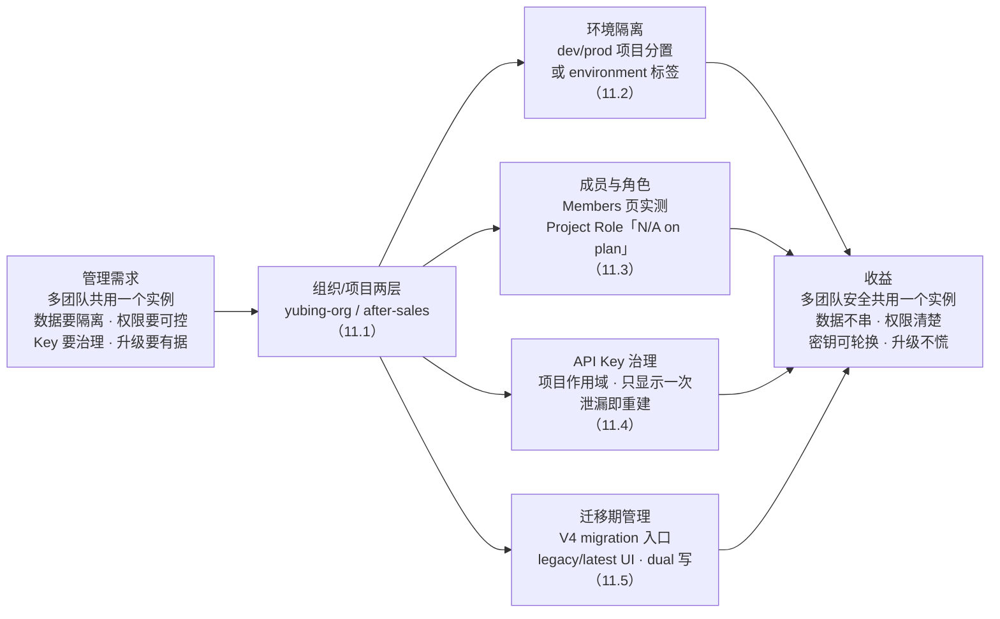
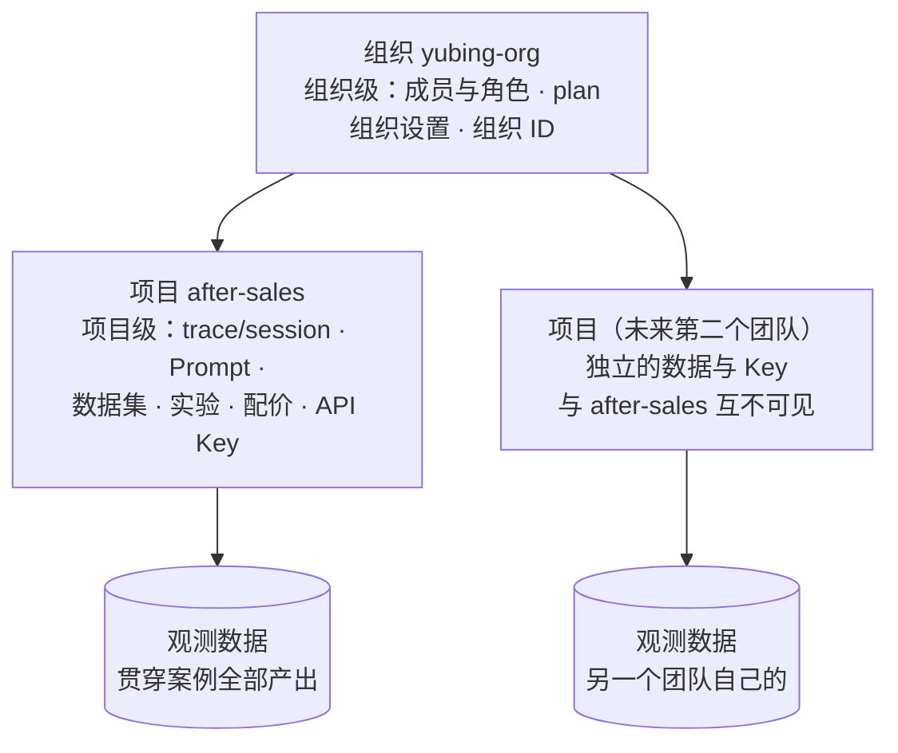
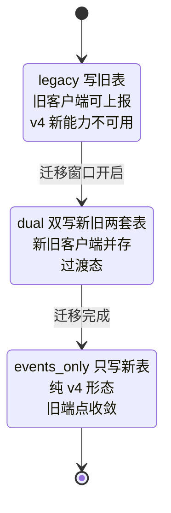

# 第 11 章 多项目与团队管理

> 本章导读：第 2 章建组织 `yubing-org` 与项目 `after-sales` 时，我们只点了两下按钮，没有解释「为什么要分两层」。当售后助手从一个人的 demo 长成一条业务线——测试要跑实验、运维要看成本、运营要改 Prompt，甚至再来一个团队想把他们的应用也接进来——这两层就不再是形式，而是隔离、权限、密钥与升级节奏的承重结构。本章是管理员视角的薄章：走完组织/项目两层模型与隔离边界；比较 dev/prod 环境隔离的两种方案；实测项目 Members 页——你会看到 Project Role 一栏显示「N/A on plan」，这是第 1 章 1.3 那套「以界面自证 EE 边界」自查法的正式兑现；给出 API Key 的治理纪律；最后讲管理员在 v3→v4 版本交替期的职责：V4 migration 入口、legacy/latest 双 UI、dual 写模式（第 10 章的 RAGFlow 联动实测靠它才通）。读完本章，你能：为你的团队画出两层模型上的资源归属图，选定环境隔离方案，说清哪些管理动作是 OSS 版做不了的，并拿稳迁移期的管理员清单。



*本章导览图*

## 你什么时候需要它

三种典型处境，对应本章三种用法。

**第二个团队要上同一个实例**——先读 11.1 建立两层模型与隔离边界：谁的数据归谁、Key 作用到哪、成员挂在哪一层。答案都在「项目」这一层，11.1 一张表给全。

**要区分测试环境与生产环境的 trace**——两条路：项目分置还是标签区分，11.2 给对比表和选型立场。贯穿案例的 session 命名里已经埋了环境意识的种子，这一节把它明确成方案。

**你是这个实例的管理员**——11.3 到 11.5 是你的日常：加成员、管 Key、盯迁移期。特别是正在 v3→v4 交替期的实例（本书基线就是），11.5 的迁移写模式直接决定第 10 章那类老客户端上报能不能落库。

前置：已完成第 2 章的部署与初始化（有组织、有项目、有一对 Key）。本章操作全部在界面上完成，不需要写代码；概念层面只需要第 1 章的两层模型印象与 1.3 的 EE 边界纪律。

按第 1 章的读者路线图，本章是运维工程师的主场章节之一（第 1 章 1.5 原话：「第 11 章的组织、项目与环境隔离是你在多团队落地的抓手」），测试与运营读者可以只精读 11.2（环境隔离影响你们的实验口径）与 11.3.3（EE 边界影响你们的权限预期），11.4 与 11.5 留给管理员——但验收清单建议不分角色各做一遍，管理面的事故从来不分角色。

## 11.1 概述：组织与项目两层模型

### 11.1.1 首页即组织列表

登录后看到的第一个页面不是 trace，而是组织（organization）列表——这个设计本身就在声明 Langfuse 的资源模型：**一切资源都挂在组织之下，组织之下再分项目**。


这张截图摄于列表为空的时刻（第 2 章 2.4.2 的建组织动作就发生在这张页面上），但有两句话在空态下已经说清了管理模型的半边：卡片里的「Create an organization to get started」，以及那句更值得注意的「Alternatively, ask your organization admin to invite you」——**组织是有管理员这个角色的**，不是人人都能建组织、拉成员。谁有权做什么，正是本章的主线，空态页面已经先打了招呼。

落到贯穿案例：本书只有一个组织 `yubing-org`，其下一个项目 `after-sales`。项目 ID `cmw7qtne20005or4o5fhknr8z`——你在第 2 章之后每一章的 URL 里都见过它（`http://localhost:3000/project/cmw7qtne20005or4o5fhknr8z/...`），所有 trace、Prompt、数据集、实验都落在这个项目里。

为什么第一层必须是组织而不是直接一层项目？看两个真实诉求就明白了。**诉求一：隔离的隔离**——两个团队不但数据要分开（项目层解决），连「谁有权把人拉进哪个项目」也要分开（项目层解决不了，需要更高一层做成员与 plan 的归属）；**诉求二：成本与计划的结算单位**——云版的计费、自托管场景下的「这个实例归哪个部门」，都需要一个比项目更大的归口。组织层就是为这两件事存在的：它是**成员、角色与计划的容器**，项目层是**数据与密钥的容器**——两层各管一摊，谁也不重复谁。

### 11.1.2 隔离边界：什么在组织级，什么在项目级

两层不是嵌套的文件夹，而是**两条隔离边界**。判断一个问题归哪层管，用这张表：

| 维度 | 组织级 | 项目级 | 实测依据 |
|------|--------|--------|---------|
| 成员与角色 | 成员挂组织，组织角色（Organization Role）在组织层授予 | 项目角色（Project Role）按项目授予——OSS 版显示 N/A on plan，EE 功能（11.3） | Members 页两列角色 |
| API Key | 组织级 Key 属 EE，本机未验证不写 | `pk-lf-`/`sk-lf-` 作用域为项目 | 第 2 章 2.4.3 实测 |
| 观测数据 | 不在组织层直接存取 | trace/session/Prompt/数据集/实验全部归属项目 | 贯穿案例全部数据在 after-sales |
| 配置 | 组织设置（Organization Settings 外链入口） | 配价（Model Definitions）、LLM Connections、通知、导出各自独立 | 项目 Settings 侧栏 |
| 计费与计划 | plan 挂在组织上（「N/A on plan」的「plan」即指它） | — | 11.3 界面实锤 |

一句话版本：**成员在组织级管理，数据与密钥在项目级隔离**。这解释了第 2 章留下的伏笔——Key 的作用域是项目，`after-sales` 的 Key 读不到别的项目的 trace（第 2 章 2.4.3 原话）；也解释了为什么多团队共用实例的正确姿势是「同组织下各开项目」或「各建组织」，而不是共用一把 Key。

把边界画成图，两层各管各的资源池：



*组织/项目两层与隔离边界：成员向下贯通，数据与 Key 按项目隔离*

这张图还预告了一个多团队落地的关键性质：第二个项目建起来后，它的数据、Prompt、Key 与 `after-sales` 完全互不可见——**隔离不是配置出来的，是模型自带的**。你要做的只是在 11.2 决定「第二个团队的项目怎么建」，在 11.3 决定「谁能进哪个项目」。

### 11.1.3 项目设置总览：管理员的一屏地图

项目 Settings 的 General 页是管理员最常落的一屏，顺带把整个设置侧栏认全：

![实测项目 after-sales 的 Settings → General 页：主区 Host Name 卡片显示「When connecting to Langfuse, use this hostname / baseurl.」与 http://localhost:3000 输入框；Project Name 卡片显示「Your Project is currently named "after-sales".」与名称输入框及 Save 按钮；Debug Information 卡片的 Metadata JSON 展开，project 节点显示 name: "after-sales" 与 id: "cmw7qtne20005or4o5fhknr8z"，org 节点显示 name: "yubing-org" 与 id；底部 Danger Zone 的 Transfer ownership 区露出红色 Transfer Project 按钮；左侧 Settings 侧栏依次为 General、API Keys、MCP & CLI、LLM Connections、Model Definitions、Scores Configs、Members、Integrations、Exports、Batch Actions、Audit Logs、Notifications，以及 Organization Settings 与 V4 migration 两个外链项](../assets/images/lf-project-settings.png)

这一屏有三块值得管理员逐个看：

**Host Name**——「连 Langfuse 用这个地址」，即第 3 章 demo 注入的 `LANGFUSE_BASE_URL` 的权威出处。改过端口（第 2 章 2.3.3 的 3001 预案）时，先来这里核对界面自知的地址是否同步。

**Project Name 与 Debug Information**——改名入口，以及一坨元数据 JSON：project 与 org 的名称和 ID 都在里面。本书引用的项目 ID `cmw7qtne20005or4o5fhknr8z` 就是从这里抄的（实测核实日期 2026-11-08）。排查「SDK 连不上、Key 对不对」时，这坨 JSON 是确认「你操作的项目是不是你以为的那个」的锚点。

**Danger Zone**——红色区，Transfer ownership（转移项目所有权），把项目挪到另一个组织。本书未执行转移操作，按钮行为不展开，如实记录入口存在即可。

左侧侧栏顺便串一遍全书地图：API Keys（11.4）、Members（11.3）、Model Definitions（第 5 章配价）、LLM Connections（第 6 章 Playground 的前置）、Notifications（第 5 章告警）；Organization Settings 与 **V4 migration** 两个带外链箭头的项，后者是 11.5 的主角。侧栏里还有一个本机实测可见的 Scores Configs 项（第 7 章 score 配置的入口）。另有一条如实的边界：Audit Logs 页面入口可见，但细粒度审计增强属 EE 范畴（第 1 章 1.3 的清单），本机未深入实测，不展开。

### 11.1.4 管理动作 → 界面入口速查

管理员日常的每个动作在界面上的落点，先给一张总表（「实测状态」列如实标注：凡本书点过的动作标「已实测」，只见入口未点过的标「入口可见」）：

| 管理动作 | 界面入口 | 展开位置 | 实测状态 |
|---------|---------|---------|---------|
| 建组织 | 首页 → New Organization | 第 2 章 2.4.2 | 已实测 |
| 建项目 | 组织内 New Project（与建组织同页流转） | 第 2 章 2.4.2 | 已实测 |
| 项目改名 | 项目 Settings → General → Project Name | 11.1.3 | 入口可见（未改名） |
| 查项目/组织 ID | 项目 Settings → General → Debug Information | 11.1.3 | 已实测 |
| 拉成员进项目 | 项目 Settings → Members → Add new member | 11.3.4 | 入口可见（单成员实例未走过流程） |
| 切换成员组织角色 | 项目 Settings → Members → Organization Role 下拉 | 11.3.2 | 已实测（可见可操作） |
| 建/轮换 API Key | 项目 Settings → API Keys → Create new API keys | 11.4 | 已实测（第 2 章 2.4.3） |
| 项目配价 | 项目 Settings → Model Definitions | 第 5 章 | 已实测（glm-5.3-flash 手工建价） |
| 转移项目所有权 | 项目 Settings → General → Danger Zone | 11.1.3 | 入口可见（未执行） |
| 迁移写模式管理 | 项目 Settings → V4 migration 外链 | 11.5 | 入口已实测；写模式经 compose 变量实测（第 10 章） |
| legacy/latest UI 切换 | 页面顶部横幅 Switch to latest UI | 11.5.1 | 已实测（横幅可见，本书截图均 legacy） |

这张表兼作本章的「复习索引」：每一行都能回指到已展开的实测小节，评审与读者复核都从它出发。

## 11.2 环境隔离：项目分置与 environment 标签

### 11.2.1 为什么环境隔离要先想清楚

第 4 章讲采集规范时有一条命名纪律，第 8 章的实验反复在改 Prompt、第 12 章还要拿这些数据当回归基线——如果测试环境的调试 trace 和生产 trace 混在一张列表里，回归基线会被调试数据污染，成本看板会把测试调用的 token 算进生产账单。环境隔离不是洁癖，是**数据口径的保质期**。

Langfuse 上有两种主流做法，都是实测可行的路径，区别在隔离强度与维护成本的取舍。

先把「不隔离」的代价算清楚，方案才有说服力。成本口径被污染的例子第 5 章给过前提：trace 头部按 token 折算成本汇总，看板按数据聚合——混进来的调试数据会直接改写这些读数，而改写是静默的，没人会在看板旁标注「本周含 200 条测试调用」。回归基线被污染的例子更重：第 12 章的门禁拿数据集与实验分数做上线判据，若实验时混入了调试环境的不同配置数据，「分数不达标」的判定本身就不可信。两种代价都不报警，等发现时口径已经不可信——这就是 11.2.1 说的「数据口径的保质期」。

### 11.2.2 方案 A：dev/prod 各建一个项目

在同一个组织下再建一个项目（首页 → New Project，动作与第 2 章 2.4.2 建项目完全相同），dev 应用与 prod 应用各用各的项目 Key。每个项目天然拥有独立的 trace 数据、独立的 Prompt 生产位、独立的配价与实验——**隔离强度是两层模型原生的，不需要任何纪律来维持**。

代价也在这里：dev 和 prod 是两个项目，意味着 Prompt 要在两边各建一套版本（或只在 prod 建通过 API 同步）、配价要配两遍、看板要各看各的。对多套环境的团队，项目数量会随环境数线性增长。

动手路径与第 2 章 2.4.2 完全同构，三步：组织内 New Project 起名（如 `after-sales-dev`）→ 落进新项目的 Settings → API Keys 建这对环境的 Key → dev 应用注入新 Key 对。新项目从第一秒起就是空的——dev 的调试 trace 进来，prod 的口径保持干净。唯一要记住的纪律是**别把两对 Key 发混**：Key 命名（11.4.3）与应用侧 `.env` 分文件保管（11.4.3 末尾的代码块）就是为这步准备的。

### 11.2.3 方案 B：单项目 + environment 标签

只在生产口径上建一个项目，采集时按第 4 章的 tags/metadata 字段给每条 trace 打环境标记（如 `tags: ["env:dev"]`），之后靠第 4 章的过滤语法与保存视图（My Views）分区查看。贯穿案例已经隐含这个意识——session 命名 `demo-session-001` 本身就是「这是我自己的演示环境数据」的声明，只是没有把它变成结构化标记。

方案 B 的优点是零额外维护：一个项目一套 Prompt、一份配价、一张看板。缺点是隔离靠纪律维持——漏打一个标记，调试数据就混进生产口径；且所有环境共享同一把项目 Key，dev 侧泄漏即 prod 侧失守。

方案 B 的采集动作落在第 4 章讲过的 tags 字段上——给 trace 挂环境标记。思路示意（沿用贯穿案例的属性传递风格；具体 SDK 参数名以第 3/4 章实测代码为准）：

```python
# 方案 B 的采集纪律：每条 trace 按所处环境挂标签
# 贯穿案例的调用发生在本机学习环境，故 env:dev
with lf.propagate_attributes(
    session_id="demo-session-001",
    user_id="demo-user",
    tags=["env:dev"],          # 环境标记：dev / prod
):
    answer = support_bot.answer(query)
```

标记打上之后，第 4 章的过滤语法与保存视图（My Views）就是你的「虚拟环境分区」：把常用条件存成视图，dev 与 prod 的数据在一套项目里也能各看各的。**但请记住这个方案的软肋——标记是埋点侧的责任，平台无法替你补打**；采集侧漏一次，生产口径就混进一条调试数据，且混进去之后只能靠人工清洗。

### 11.2.4 选型对比与本书立场

| 维度 | 方案 A：项目分置 | 方案 B：单项目 + 标签 |
|------|----------------|---------------------|
| 隔离强度 | 原生隔离：数据/Key/Prompt/配价全独立 | 靠采集纪律，漏标即混 |
| Key 治理 | 每环境一对独立 Key，泄漏爆炸半径小 | 全环境共用一把，泄漏即全线失守 |
| Prompt 与配价 | 两套，改动要同步 | 一套，dev 先验证 label 再挪 production（第 8 章 A/B 同机制） |
| 看板与成本口径 | 天然分开 | 靠过滤视图拆分 |
| 适用 | 多环境、多团队、要上生产 | 个人学习、单环境小流量 |

**本书立场：学习与演示用方案 B 足够（贯穿案例即如此），一旦要接真实用户流量，切方案 A——生产数据值得一个独立项目。** 两案并非互斥：常见落法是 prod 独立项目（方案 A）+ 项目内再用标签区分更细的口径（方案 B 缩小版），按隔离需求逐级加码。

### 11.2.5 贯穿案例的环境意识：从命名到结构

回看贯穿案例，环境意识其实一路都在，只是从「命名习惯」逐步走向「结构化隔离」：session 叫 `demo-session-001`——编号 `001` 就在暗示这是演示批次而非全量生产流；实验命名 `glm-v1-baseline`/`glm-v2-prompt`——版本号前缀把「测什么配置」写进了名字；Prompt 的 label（production/staging/experimental，第 6 章）本身就是平台内置的「发布环境位」——v2 先落 experimental 再挪 production 的动作，与 11.2.4 说的「dev 先验证再上 prod」是同一个思想。

这些习惯的共同局限是：它们是**命名约定**，靠人脑遵守。11.2 给出的两条路径——项目分置与 tags 标记——是把命名约定升级为结构化机制。当你的数据量涨到「翻列表找东西」变成「过滤视图救我」时（第 4 章的过滤语法），就该做这个升级了；判断信号很朴素：**当你开始在过滤框里反复输入同一个环境条件时，就该把它结构化了**。

## 11.3 成员与角色：Members 页与 EE 边界实锤

### 11.3.1 Members 页实测

成员管理在项目 Settings → Members：


一行成员、五列信息，把本章要讲的三件事全部摆在了同一张表上：Organization Role 列显示 **Owner**（下拉可切换）——这是组织级角色管理（11.3.2）；Project Role 列显示 **「N/A on plan」**——这是 EE 边界的界面实锤（11.3.3）；SSO Provider 列显示「—」——本地账号没有经 SSO 登录，SSO 本身也是 EE 范畴的功能（第 1 章 1.3 清单里的 SCIM 同理）。页面顶部的 legacy UI 横幅是 v4 迁移期双 UI 体验的现场证据，11.5 展开讲。

### 11.3.2 组织级角色管理：Owner 是什么、能做什么

贯穿案例的管理员 `yubing@local.dev` 的 Organization Role 是 Owner——首任注册账号默认就是它（第 2 章注册即建组织，建组织者持 Owner）。Owner 在界面上能做的管理动作，本章已实测的包括：拉成员进项目（Add new member 按钮）、切换成员角色（角色下拉可见可操作）、组织设置（侧栏 Organization Settings 外链）与项目层全套 Settings。

组织级角色的完整档位（如 Admin、Member 等细分）与权限矩阵，官方文档有更细的表，本机单成员实例无法实测角色间差异——**按本书纪律，只写实测到的：Owner 可见可操作，角色下拉存在**。你给第二个成员授角色时，以界面上下拉里实际出现的档位为准。

把 Owner 的位置说得更具体些：它是**这个组织在 Langfuse 内的最后一责任人**。全实例只有一个组织、一个成员时，Owner 的三个动作最常发生——加人（Add new member，11.3.4）、授权（Organization Role 下拉）、管 Key（11.4 的台账与轮换）。组织多起来之后，Owner 还多一件容易被忽视的职责：**为每个组织指定不止一个 Owner 或管理角色**——单点管理员的实例，管理员账号出问题时（口令遗失、人员离职），恢复路径会很尴尬；给至少两个人发管理权限，是比任何技术配置都便宜的高可用。这条是本书立场的通用工程判断，Langfuse 平台层面的账号恢复机制未实测，不展开。

### 11.3.3 「N/A on plan」：项目级 RBAC 的 EE 实锤

Project Role 一栏的「N/A on plan」值得单独一节，因为它兑现了第 1 章 1.3.2 立下的自查法——**判断一个功能是不是 EE，最可靠的方式不是翻文档，而是打开对应页面看它是否存在、是否可操作**。

读这一行字：plan（计划/套餐）挂在组织上，开源计划（OSS）下项目级角色不可用，界面直接把原因写在格子里。这意味着：**在 OSS 自托管实例上，你能控制「谁是不是 Owner」，但控制不了「谁能读、谁能写、谁只能标注」这种项目内细分权限**——所有人都按组织角色获得项目访问能力。项目级 RBAC（基于角色的访问控制，Role-Based Access Control）与 SCIM、审计增强、数据保留策略同在 EE 清单里（第 1 章 1.3 的表格）。

对多数读者的实际含义：小团队用 OSS 版不痛（都当 Owner 或都信任）；一旦团队大到需要「外包标注员只能进标注队列、不能碰 API Keys」这类细粒度控制，就是 EE license 的付费理由——决策依据现在有了界面级的实锤，而不是销售话术。

向团队解释这条边界时，建议用一句话版本：「我们能管谁进组织，管不了组织里的人按项目细分配权——前者是 OSS，后者是 EE。」第 11.3.5 节按场景给了 OSS 版的替代做法；这里补一句对边界的正确心态：**EE 不是 OSS 的缺陷清单，是两档产品定位**——本实例（v4.76.0 OSS，第 1 章 1.3.1 的版本标识锚点）的界面上，这行「N/A on plan」就是两档之间的国境线，写得清清楚楚。

### 11.3.4 加一个成员的最短路径

实测可见的入口是 Members 页右上 **Add new member**。本机实例从未加过第二个成员，邀请流程的弹窗细节未实测——不展开。可以确定的是：成员挂在组织上、以项目为单位出现在 Members 页（11.1.2 的边界表），第二个成员进来后，你在 Organization Role 列给他授角色，他的 Project Role 大概率同样显示 N/A on plan（plan 没变）。

### 11.3.5 OSS 版权限模型的常见场景与替代做法

「控制不了项目内细分权限」听起来抽象，落到团队日常就是几个具体场景。OSS 版做不了的时候，各有一条务实替代（均为本书立场，非平台功能）：

| 权限需求场景 | OSS 版的现实 | 替代做法（管理动作，非功能） |
|-------------|-------------|---------------------------|
| 外包标注员只能进标注队列 | 项目级 RBAC 不可用（N/A on plan） | 用独立的标注环境：给标注员单独的项目（方案 A 分置），或走人工导出、事后由正式成员录入 score（第 7 章三来源） |
| 实习生可看 trace 但不能改 Prompt | 改动权限不可细分 | Prompt 变更走 label 流程（第 6/8 章），改动留版本历史可审计——事后追责代替事前拦截 |
| 客户/外部方只看自己项目 | 数据天然按项目隔离（11.1.2） | 为外部方单开项目 + 只发那个项目的 Key；不给他们登录账号则彻底不涉 UI 权限问题 |
| 谁动过生产 Prompt | 审计增强属 EE，界面 Audit Logs 入口可见但能力边界未实测 | 依赖 Prompt 版本历史（每版记录创建者）与变更纪律（第 6 章版本机制） |

这张表的共同主题：**OSS 版用「隔离 + 版本历史 + 流程纪律」顶住大部分需求，真正的细粒度拦截留给 EE**。小团队照表执行即可把管理成本压到最低；需求长到表里的替代做法开始吃力（比如标注外包常态化），就是重新评估 EE license 的时机——判断依据与 11.3.3 一样，是界面实锤加业务规模，不是文档承诺。

## 11.4 API Key 治理：作用域、只显示一次与泄漏处置

### 11.4.1 作用域与创建动作

Key 的两层事实第 2 章已经立好，本章从管理员治理视角收拢：**作用域是项目**——`pk-lf-`/`sk-lf-` 只对创建它的那个项目生效；**创建动作在项目 Settings → API Keys**，弹窗三项 Name（必填）/ Expiration（默认 No expiration）/ Permissions（默认 Full access，附「View 84 permissions」细目链接）；**sk 只在创建成功的弹窗里完整显示一次**，关掉即永别。

作用域是项目这一条，治理含义值得展开一层：**项目边界就是安全边界**。11.2 的环境隔离方案之所以能成立，前提就是 Key 认项目——dev 项目泄漏的 Key 在 prod 项目面前一文不值（方案 A）；反过来，方案 B 的单项目下这层保护不存在，Key 一把走天下。这也解释了 11.1.2 隔离边界表里「API Key 归项目级」的分量：它不只是个归属声明，是整套多项目安全设计的支点。创建时的 Permissions 默认 Full access——细粒度权限（那只 View 84 permissions 链接背后的世界）与项目级 RBAC 同属 EE 语境，本机以默认值实测，不展开。

### 11.4.2 泄漏处置：重建，而不是寻找

sk 等同于该项目内全部读写权限的口令。进了 git、出现在截图或日志里，处置动作只有一条路径：**立刻在 API Keys 页 Create new API keys 建一对新 Key → 应用侧切换到新 Key → 旧 Key 弃用**。没有「找回」，也没有「撤销某一次泄漏」——Key 的安全性建立在「只显示一次 + 泄漏即重建」的反应速度上。

这也反过来解释了两条第 2 章立过的纪律的分量：sk 不进 git、不出现在截图与日志（本书 demo 一律从环境变量读取）；Expiration 生产实例建议设有效期——到期自动失效，给忘了轮换的 Key 一道兜底闸。本地学习实例可保持 No expiration，但要明白这是 convenience 换 security 的取舍。

泄漏处置写成管理员剧本，五步按序执行、不跳步：

1. **确认泄漏范围**：sk 出现在哪里（git 历史、聊天记录、日志聚合）？哪个环境在用这把 Key（对照 11.4.3 台账）？
2. **建新 Key**：API Keys → Create new API keys，命名带 `rotated-<日期>` 后缀以示区分，当场落盘（只显示一次的规矩没有豁免）；
3. **切换应用**：所有持有旧 Key 的应用/CI 改环境变量并重启——先切最敏感的生产侧；
4. **弃用旧 Key**：确认新 Key 全量生效（trace 还在正常上报，第 1 章 1.1.2 的「采集静默失败」提醒你这一步不能省）后，旧 Key 按界面 Keys 列表的操作项处理；本书未实测过删除入口的按钮细节，以界面实际提供的操作为准；
5. **复盘泄漏源**：git 历史清洗、日志脱敏规则补漏——不修源头，下一把 Key 照样漏。

第 4 步如实标注了一条本书没走过的路：贯穿实例从未删除过 Key。剧本的其余四步与「只显示一次」机制都是实测支撑的；删除动作的界面细节留给你的实例自证。

### 11.4.3 多环境多 Key 的命名纪律

Name 必填这个防呆（第 2 章实录 #4）其实在提示一件正经事：**Key 是要命名的资产，命名服务于「半年后你还认得出谁在用哪把」**。配合 11.2 的环境方案，本书纪律：

| 环境/用途 | Key 命名 | 配套 |
|-----------|---------|------|
| 本机学习 | `local-dev` | No expiration（贯穿案例即此） |
| 生产应用 | `after-sales-prod-server` | 设 Expiration，登记到期日 |
| CI/实验脚本 | `after-sales-ci` | 设 Expiration，最小化存活期 |

三条衍生命令：一环境一把 Key，不复用（泄漏时不连坐）；团队内登记一张「Key 名 → 持有者 → 到期日」的台账（放你的密码管理工具，不放 wiki）；轮换按「建新 → 切换 → 弃旧」的顺序，中间不删新 Key 的记录。这些不是 Langfuse 的功能，是管理员自己的功夫——Langfuse 提供的作用域与只显示一次机制是地基，纪律是房子。

多环境分置（方案 A）落地后，应用侧的环境变量按项目成对隔离，互不混用（变量名即第 2 章 2.4.3 的三元组，值处一律占位符）：

```bash
# 生产应用侧 .env（项目 after-sales 的生产 Key 对）
LANGFUSE_PUBLIC_KEY=pk-lf-<prod 项目 Key>
LANGFUSE_SECRET_KEY=sk-lf-<prod 项目 Key>
LANGFUSE_BASE_URL=http://localhost:3000

# dev 应用侧 .env（若走方案 B 单项目，则与上面同对 Key；
# 若走方案 A 分置项目，这里是 dev 项目自己的 Key 对）
LANGFUSE_PUBLIC_KEY=pk-lf-<dev 项目 Key>
LANGFUSE_SECRET_KEY=sk-lf-<dev 项目 Key>
```

这组占位符里藏着方案 A 与方案 B 的另一处分野：**方案 B 两段配置的 Key 对完全相同**（同一项目），隔离只剩 tags 一层；**方案 A 两段不同**，泄漏爆炸半径天然小一半。读代码评审时看一眼 `.env` 的 Key 对是否分置，就知道环境隔离落到了哪一档。

## 11.5 迁移期管理：V4 migration 与 legacy/latest UI

### 11.5.1 管理员视角的版本交替期

第 1 章 1.3.3 说过你正处在 v3→v4 的版本交替期，第 10 章的 RAGFlow 联动实测正面撞上了它的兼容性代价。这一节收拢管理员在交替期的职责——前面各章零散出现的迁移期现象，这里给一个统一的视角。

界面上有三个迁移期的现场锚点，全部实测可见：

1. **项目 Settings 侧栏的 V4 migration 外链**（11.1.3 截图可见）——v4 迁移管理页的入口，写模式等迁移期机制从这里管理；
2. **legacy UI 横幅**——「You are viewing legacy UI / Why do I need to switch?」加右上角 Switch to latest UI 按钮，v4 迁移期允许用户在旧版与新版界面间切换（11.3.1 截图顶部就是它）；
3. **写模式环境变量**——`LANGFUSE_MIGRATION_V4_WRITE_MODE`，决定旧协议事件落旧表、新表还是双写。

三个锚点恰好对应管理员的三个动作面：**迁移机制在 V4 migration 页管理**（机制面）、**团队看到的界面形态由切换按钮决定**（体验面）、**老客户端能不能上报由写模式决定**（兼容面）。三者互相独立但常被混为一谈——比如「点了 Switch to latest UI」与「改写模式」毫无关系：前者只影响你眼前这一屏长什么样，后者决定摄取链路往哪套表写数据。分清三个动作面，迁移期的管理决策就不会互相牵扯。

本书全部截图来自 legacy UI——不是偏好，是如实：实测时页面顶部就挂着这个横幅。你的实例若已切到 latest UI，布局会有差异，但概念、数据与本章的管理逻辑一致。

### 11.5.2 写模式：legacy / dual / events_only

v4 迁移期的核心机制是摄取写模式——旧协议的事件往哪套表里写：



*v4 摄取写模式的迁移路径（模式名与语义出处 langfuse.com/docs/compatibility，dual 实测见第 10 章）*

第 10 章的实测值得在这里复述一遍，因为它是「管理员为什么要在乎写模式」的活案例：RAGFlow v1.0.0-rc2 按 v3 时代的 v2 单事件端点上报，Langfuse v4.76 默认的 events_only 模式下 `POST /api/public/trace` 直接 404；在 compose 给 web 与 worker 加上 `LANGFUSE_MIGRATION_V4_WRITE_MODE=dual` 后，v3 批量摄取端点开始接受 `trace-create` 事件（201，落旧表 `default.traces`）——**写模式是管理员手里唯一能让老客户端「暂时活下去」的开关**。

开启动作本身是第 2 章 2.2 讲过的 `.env` + 重建套路（改动必须落在 web 与 worker 两侧，缺一不可——摄取入口在 web、落库在 worker）：

```bash
# .env（与 docker-compose.yml 同目录）追加一行
LANGFUSE_MIGRATION_V4_WRITE_MODE=dual

# 重建生效：restart 不重读环境文件，必须 up -d（第 2 章 2.3.2 的规矩）
docker compose up -d
```

admin 视角的三条守则：默认态（events_only）最干净但有兼容代价；dual 是给存量客户端留的过渡桥，别当永久态；每一次升级（第 2 章 2.5.3 的换 tag 流程）都要核对写模式变量的语义是否变化。

### 11.5.3 交替期管理员清单

收拢成本章最后一表，每条都指向已展开的章节：

| 职责 | 动作 | 出处 |
|------|------|------|
| 锁版本 | `.env` 里 `LANGFUSE_IMAGE_TAG` 锁具体版本，不跟浮动 tag | 第 2 章 2.2.3 |
| 升级前备份 | 卷快照或逻辑备份，降级唯一正解是回滚备份 | 第 2 章 2.5.2-2.5.3 |
| 写模式选型 | 存量旧客户端在，用 dual 过渡；升级时核对该变量语义 | 本章 11.5.2、第 10 章实测 |
| 双 UI 说明 | 团队内声明截图可能来自 legacy/latest 两种 UI，概念一致 | 本章 11.5.1 |
| 升级后巡检 | 七容器 healthy → 健康检查版本号 → 首页版本标识 | 第 2 章 2.5.3 |
| EE 边界自查 | 「文档说有、界面没有」先怀疑版本或迁移态，再怀疑自己 | 第 1 章 1.3.2、本章 11.3.3 |

这张表就是「管理员在版本交替期不慌」的全部秘密——每一条都是前面章节实测过的动作，本章只是把它们按管理员的时间轴串起来。

把时间轴展开说一遍，它是这张表的正确读法。**升级前**：锁版本（不跟浮动 tag）、做备份、核对存量客户端清单——有哪些还在按 v3 协议上报？第 10 章的 RAGFlow rc2 就是典型，它们的死活由 11.5.2 的写模式决定。**升级中**：换 tag、`docker compose pull && docker compose up -d`、等启动期迁移跑完（第 2 章 2.5.3）。**升级后**：三步巡检（容器 healthy → 健康检查版本号 → 首页版本标识），再补两件本章新增的事——看一眼 legacy/latest 横幅确认 UI 形态，核对写模式变量语义没变。**平时**：盯 Members 页的成员变动、按台账轮换 Key、用 11.3.3 的自查法回答团队里「这个功能是不是 EE」的问题。

管理员的职责说到底只有一句话：**让实例的版本、数据与权限都处在「说得清」的状态**——版本说得清（锁 tag + 巡检）、数据说得清（隔离 + 备份）、权限说得清（角色 + Key 台账）。本章五章内容，都是这句话的分账。

### 11.5.4 双 UI 与本书截图的口径说明

最后交代一个贯穿全书的事实口径。本书所有截图摄于 legacy UI（页面顶部横幅「You are viewing legacy UI」为证，11.3.1 截图顶部可见），这是一条会影响读者观感的差异：你若点了 Switch to latest UI，布局、配色与个别页面的组织方式会有明显不同——比如 v4 新版会话视图把每条 trace 折叠成对话式消息对（第 4 章实测过的新体验）。

管理面受影响最大的差异在**入口位置**：本章引用的侧栏项（Members、API Keys、V4 migration）在新版 UI 中可能换了分组或名称。给管理员的建议与第 1 章的漂移纪律一致：**概念与数据跨 UI 一致，入口位置以你屏幕上的实际为准**；找入口时优先用左上角的 Go to... 快速跳转（Ctrl+K，两张 Settings 截图的侧栏顶部都可见）——它比记住某个菜单层级更能抵抗 UI 改版。

## 本章小结

1. Langfuse 资源模型是组织/项目两层，首页即组织列表；隔离边界一句话：**成员与角色在组织级管理，数据与 API Key 在项目级隔离**——trace/Prompt/数据集/配价全归属项目，plan 与组织角色挂组织。
2. 项目 Settings 是管理员的一屏地图：Host Name（`LANGFUSE_BASE_URL` 的权威出处）、Debug Information（org/project ID 锚点）、Danger Zone（转移所有权，未实测展开）；侧栏从 API Keys 到 V4 migration 的每一项都在前文各章有自己的故事。
3. 环境隔离两案：项目分置（原生隔离，维护双份）与单项目 + environment 标签（零维护，靠纪律）；**本书立场：学习用标签，接真实流量切项目分置**；贯穿案例的 session 命名已隐含环境意识。
4. Members 页五列实测：Organization Role=Owner 可操作（组织级角色管理），**Project Role=「N/A on plan」是项目级 RBAC 属 EE 的界面实锤**——第 1 章 1.3 自查法的正式兑现；SSO Provider 空值与 SSO/SCIM 属 EE 同理。
5. API Key 治理三纪律：作用域即项目、sk 只显示一次故「泄漏即重建」（建新 → 切换 → 弃旧）、多环境多 Key 命名登记（`local-dev`/`after-sales-prod-server`/`after-sales-ci` 式命名 + 台账）。
6. 迁移期三锚点实测：V4 migration 外链入口、legacy/latest 双 UI 横幅（本书截图均 legacy）、写模式 `LANGFUSE_MIGRATION_V4_WRITE_MODE`（legacy → dual → events_only 路径；dual 让第 10 章的老客户端上报落库，是过渡桥不是永久态）。
7. 管理员的全部动作在交替期收拢为一张清单：锁版本、升级前备份、写模式选型、双 UI 说明、升级后巡检、EE 边界自查——每条都是前文章节的实测动作，本章按管理员时间轴串起。

下一步：管理面收拢完毕，第 12 章回到质量主线——把第 7-8 章的数据集与实验装配成回归门禁：Prompt 改动没有分数支撑就不许上线，`eval_gate.py` 的实测三连（0.333 FAIL → 修复 0.388 仍 FAIL → 根因启发式刚性）将在那里展开。

## 验收清单

读到这里，你应该能：

- ☐ 画出组织/项目两层模型，并用一句话说清隔离边界（成员在组织级、数据与 Key 在项目级），各举一个贯穿案例中的真实对象；
- ☐ 在项目 Settings 的 Debug Information 里找到 org/project 的名称与 ID，并说出 Host Name 与第 3 章 `LANGFUSE_BASE_URL` 的关系；
- ☐ 为你的团队选定环境隔离方案（项目分置或 environment 标签），并用泄漏爆炸半径与维护成本两条标准说明理由；
- ☐ 打开 Members 页指出「N/A on plan」在哪一列，并复述它对第 1 章 EE 自查法的兑现逻辑；
- ☐ 说出 sk 泄漏后的处置三步（建新 → 切换 → 弃旧），以及为什么「找回」不存在；
- ☐ 给你的三套环境各写出一个合规的 Key 命名，并说出哪一套该设 Expiration；
- ☐ 说清 legacy/dual/events_only 三种写模式的迁移路径，以及 dual 为什么是过渡桥不是永久态（引用第 10 章的 201 落库实测）；
- ☐ 用 11.1.4 的速查表向同事指出「切换成员角色」「转移项目」「改写模式」三个动作各自的界面入口，并说出哪几个是本书未实测展开的（对照复核清单）。

## 参考速查

理解主线不依赖本节；这里把本章依赖的实测事实收拢成一页，供复核与回查（核实日期均为 2026-11-08，实例 v4.76.0 OSS）：

| # | 实测事实 | 出处截图/章节 |
|---|---------|-------------|
| 1 | 首页即组织列表；空态卡片含「ask your organization admin to invite you」字样 | lf-home-orgs.png（11.1.1） |
| 2 | 项目 Settings 侧栏项：General/API Keys/MCP & CLI/LLM Connections/Model Definitions/Scores Configs/Members/Integrations/Exports/Batch Actions/Audit Logs/Notifications + Organization Settings 外链 + V4 migration 外链 | lf-project-settings.png（11.1.3） |
| 3 | Debug Information 显示 project name=after-sales、id=cmw7qtne20005or4o5fhknr8z 与 org name=yubing-org 及其 ID | lf-project-settings.png（11.1.3） |
| 4 | General 页含 Host Name（http://localhost:3000）、Project Name 改名卡、Danger Zone → Transfer ownership（Transfer Project 红色按钮） | lf-project-settings.png（11.1.3） |
| 5 | Members 页五列：Name/Email/SSO Provider/Organization Role/Project Role；唯一成员 yubing（yubing@local.dev），SSO Provider=「—」，Organization Role=Owner 下拉可操作，**Project Role=「N/A on plan」**；右上 Add new member、All roles 过滤 | lf-members.png（11.3.1） |
| 6 | Members 页顶部 legacy UI 横幅与 Switch to latest UI 按钮（v4 迁移期双 UI） | lf-members.png（11.5.1） |
| 7 | 写模式变量 `LANGFUSE_MIGRATION_V4_WRITE_MODE=dual`（web+worker）使 v3 批量摄取端点接受 trace-create 事件（201，落 default.traces）；v2 单事件端点在 v4 仍 404 | 第 10 章实测（11.5.2） |
| 8 | API Key 创建弹窗三项 Name（必填）/Expiration（默认 No expiration）/Permissions（默认 Full access，View 84 permissions）；pk-/sk- 只显示一次 | 第 2 章 2.4.3（11.4.1） |

## 延伸阅读

- **第 2 章（本地部署）**——本章一切管理动作的底座：组织与项目在 2.4.2 创建、Key 在 2.4.3 创建、升级与备份流程在 2.5，11.5 的管理员清单逐条回指。
- **第 10 章（接入已有系统）**——dual 写模式的完整实测现场：RAGFlow rc2 上报 404 → 加 `LANGFUSE_MIGRATION_V4_WRITE_MODE=dual` → trace-create 事件 201 落旧表，与本章 11.5.2 对照读。
- **第 1 章 1.3 节**——EE 边界纪律与 v3→v4 大背景的原产地，本章 11.3.3 的「N/A on plan」是那里承诺的自查法兑现。
- **第 5 章（成本与性能监控）与第 7 章（数据集与评分）**——多项目落地后每个项目独立配价、独立看板、独立 score 配置（Model Definitions、Dashboards、Scores Configs 入口都在本章 11.1.3 的侧栏地图上）。
- **官方文档 docs/organisations/overview.mdx**——本章 `source` 指向的组织与项目管理文档；角色档位与权限矩阵的官方口径以它为准，本书只展开实测过的部分。

## 复核清单（发布前）

- [x] 三张截图（lf-members / lf-project-settings / lf-home-orgs）均摄于本机 v4.76.0 实例（2026-11-08）， Members 页「N/A on plan」与侧栏 V4 migration 入口在截图内可见；
- [x] 组织/项目两层模型、Members 五列、Key 作用域与只显示一次、写模式 dual 实测结论均对照 FACTS.md §3 管理小节与第 2/10 章成稿；
- [x] Add new member 邀请流程、成员角色切换的实际保存行为、Danger Zone 转移项目、旧 Key 删除入口、Audit Logs 页面内容——均未实测，正文已如实标注「入口可见」而非展开操作；
- [ ] 方案 B 的 tags 采集代码为思路示意（贯穿案例未实际传 tags 参数），复审时可按 SDK v5 文档核对参数名后实跑一次；
- [ ] 多环境分置（方案 A）的第二个项目本机未实际创建，相关表述基于 11.1 的两层模型推导，复审时可补一次建项目实测。
