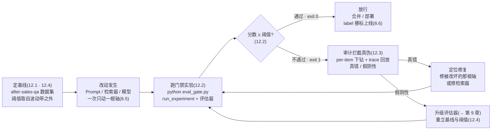
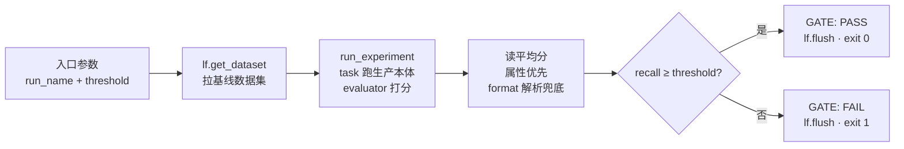
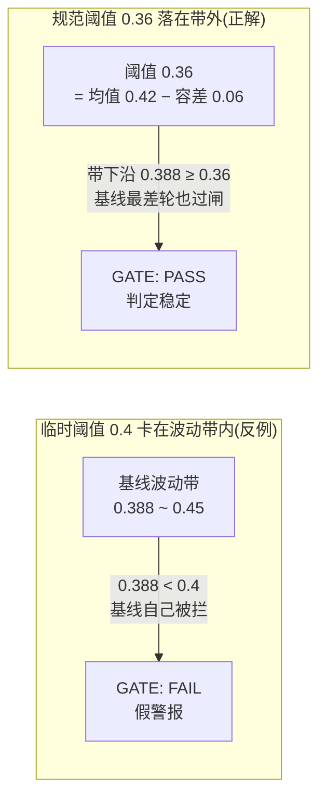

# 第 12 章 Prompt 回归与质量门禁

> 本章导读：第 9 章结尾留了一个明确的交接——`eval_gate.py` 的完整装配、阈值与 CI 集成、幻觉回归都在本章展开，门禁实测三连将作为叙事骨架。现在兑现。到此为止你已经有了评估的全套零件：数据集（第 7 章）、实验机制（第 8 章）、评估器与假阴性诊断（第 9 章）——但它们还只是「能用来测」，不是「用来把关」。本章把它们装配成一条工程规则：**改动想进主干，先过数据集实验，分数不达标就拦截**——这就是回归（regression）门禁（quality gate）。本章的主线是贯穿案例的实测三连：门禁第一次拦截（0.333）拦住了有病的检索器，门禁工作了；修复检索器后第二次拦截（0.388 仍 FAIL）暴露的不是应用问题而是尺子问题——两次拦截在门禁层面都是真拦截，过闸的正解不是改阈值迁就，而是升级评估器。围绕这条主线，本章交付：门禁脚本逐行全解、阈值从历史分布的取法、CI 集成思路、幻觉回归的接线方式，最后用一张表回收全书的回归故事线。读完本章，你能：把「基线数据集 + 实验 + 阈值」装配成可执行的门禁脚本；说出阈值为什么不能卡在波动带内并给出你项目的取法；解释门禁两次拦截各自的真伪判定与对应的修复动作；画出质量门禁在 CI 流水线中的三个落点。



*本章操作流程图*

## 你什么时候需要它

三种典型处境，对应本章三种用法。

**你（或同事）改了 Prompt、检索器或模型，改动要合并进主干，想知道凭什么放行**——直奔 12.1 与 12.2：把基线数据集、实验机制、阈值三者装配成门禁脚本 `eval_gate.py`，跑一遍，exit code 0 才放行。这是本章的主入场姿势，也是第 7-9 章全部零件的总装。

**门禁 FAIL 了，但改动的作者坚信改动是好的**——直奔 12.3：贯穿案例的实测三连就是这种处境的完整现场。第一次 FAIL 拦住了真有病的检索器；第二次 FAIL 拦住了一个修复成功的检索器——失败原因不在应用而在评估器的关键词刚性。你会学到固定的审计动作：per-item 下钻 + trace 回放，先判拦截真伪，再决定是修代码还是升级尺子。

**你想把这套流程搬进 CI，让「没有分数支撑就不许上线」成为流水线里的自动规则**——看 12.5：GitHub Actions 的 workflow 思路示例（如实标注：本机未端到端实测），以及门禁在流水线中的三个落点——PR 检查、部署前闸门、定时回归。

另有一类处境独立于正确性：**你担心某次改动或模型供应商的悄悄更新会让模型开始编造**——12.6 的幻觉回归把第 9 章的依据核查裁判接进门禁，与正确性指标独立判读。

前置：第 7 章的数据集 `after-sales-qa`（6 items）、第 8 章的实验机制与波动数据（0.45/0.39/0.33）、第 9 章的假阴性诊断都已就位；第 3 章的售后助手 `support_bot.py` 可运行。本章代码基于 SDK 5.2.0 + 服务器 v4.76.0（2026-11-08 实测）。

## 12.1 概述:回归三件套——基线、实验、阈值

### 先回答一个问题:「感觉变好了」为什么不够

LLM 应用的每一次改动——换一句 Prompt、扩一组检索关键词、换一个模型——都伴随同一个问题：**变好了还是变坏了？**没有回归体系时，这个问题的回答方式通常是：改的人自己试问几句，感觉顺了，合并上线。这种「感觉工程」有三个结构性缺陷：

| 缺陷 | 机理 | 后果 |
|------|------|------|
| 不可复现 | 试问哪几句、判什么标准,全在改的人脑子里 | 同一改动,两个人试出两个结论;三周后没人说得清当时测过什么 |
| 不可比较 | 没有「改前」的留痕,「变好了」失去参照系 | 「感觉变好了」可能只是措辞变了;真实退化被同一句感觉话掩盖 |
| 不可守护 | 改动上线后,没人再回头看旧场景 | 第 3 章的原生 badcase(直邮超时问句检索回退)就是「没人回头看」的直接产物 |

回归门禁把这三个缺陷各对上一个机制：**留痕**靠数据集与实验（每次运行都是平台上一条可追溯记录）、**对照**靠基线（改动前后跑同一数据集、同一评估器）、**守护**靠阈值（分数不达标，exit code 非 0，流水线拦截合并）。三者合起来，就是本章标题的另一半——**回归三件套**。

### 三件套的工程语义

第 7、8 章已经分别建好了前两件，本章补上第三件并把三者装配成一个整体。三件各自承担的工程语义值得单独说清——因为它们是**分工关系，缺一件整个体系就塌一角**：

| 组件 | 工程语义 | 缺了它会怎样 | 出处 |
|------|---------|-------------|------|
| 基线数据集 `after-sales-qa` | **被测量的地基**——固定的一批测例与期望输出,保证每次测量量的是同一批东西 | 「分数」失去意义:每次测的都不是同一套题,涨跌无从谈起 | 第 7 章 |
| 实验机制 `run_experiment` | **测量动作的标准化**——批量执行 + 逐条打分 + 落库留痕,每次运行可复现、可对比 | 有题无卷:改前改后的表现没有记录,对照变成回忆 | 第 8 章 |
| 阈值 threshold | **测量结果的判读规则**——低于它的版本不许进主干,把分数从「参考信息」变成「放行条件」 | 有卷无判:分数再低也照样合并,评估体系沦为汇报素材 | 本章 |

三者还有一个隐含的第四要素——**评估器**（第 9 章）。它决定「分数」本身可不可信：贯穿案例的实测三连将证明，尺子不合格时，阈值与流程再规范，量出来的也可能是假阴性。所以本章的完整口径是：**回归门禁 = 数据集 × 实验机制 × 评估器 × 阈值，四件缺一不可；评估器的精度是整个体系的第一号被评对象**（第 9 章 9.4 的结论，本章实测再验证一次）。

### LLM 应用的回归,与传统软件回归差在哪

写过单元测试的读者会把「回归测试」套到 LLM 应用上——直觉方向对，但四个差异必须先认清，否则照搬传统做法处处碰壁：

| 差异轴 | 传统软件回归 | LLM 应用回归 | 门禁的应对 |
|--------|-------------|-------------|-----------|
| 被测对象的构成 | 代码——改了才变 | 代码 + Prompt 文本 + 检索语料 + **模型本身**——仓库外的三样都会自己动 | 门禁触发面覆盖非代码资产(12.5 的 paths 过滤);定时回归抓供应商侧漂移 |
| 输出确定性 | 确定——同输入同输出,断言精确匹配 | 非确定——同输入措辞可漂移,断言只能判「语义达标」 | 断言换成「分数 ≥ 阈值」;容差吸收波动(12.4) |
| 判定通过的标准 | 断言全绿即通过 | 分数是一个采样值,「通过」是统计判定不是布尔事实 | 阈值从历史分布取,不卡单轮读数(12.4) |
| 测试本身的可靠性 | 测试代码是确定性的,失败基本 = 代码错 | **评估器自己可能是模型调用**——失败可能是尺子的错 | 拦截审计环节:每次 FAIL 先判真伪(12.3) |

第四行是 LLM 回归独有的、也是贯穿案例实测三连要现场教学的一条：传统软件里「测试失败 → 修代码」几乎总是对的；LLM 应用里「门禁 FAIL → 修代码」可能恰恰修错方向——该修的是尺子。**这个差异决定了本章的叙事结构：脚本装配（12.2）只占一半篇幅，拦截判读（12.3）与阈值口径（12.4）占另一半。**

### 贯穿案例的现状:门禁装配前的清单

动笔装配前，把已有的资产盘一遍——这份清单同时也是你为自己的项目做门禁装配时的对照表：

| 资产 | 现状(2026-11-08 实测) | 在门禁中的角色 |
|------|----------------------|---------------|
| 数据集 `after-sales-qa` | 6 items,expected_output 齐全,含一条负向期望测例(见 12.6) | 基线测题 |
| 应用本体 `support_bot.py` | 三层埋点,production Prompt 托管,检索器待修复 | 门禁的被测对象(生产链路本体) |
| 实验记录 | `glm-v1-baseline` ×2(0.45/0.39)、`glm-v2-prompt`(0.33) | 阈值取值的历史分布依据(12.4) |
| 评估器 | 启发式 recall(7 组关键词要点覆盖率,第 8 章 8.2) | 门禁的尺子(已知有刚性,12.3 实测) |
| 波动数据 | 同配置两轮差 0.06 | 阈值容差的取值依据(12.4) |

这份清单里最显眼的一条：**检索器是已知带病的**——四条测例的问句检索不命中、回退退货资料（第 7 章 badcase 反哺的出处，见第 8 章 8.4 per-item 稳定 0 分行）。这不是装配门禁的障碍，恰是门禁的第一个猎物：**门禁装好后的第一次拦截，就应该拦住它**。

## 12.2 门禁脚本 eval_gate.py 全解

### 脚本要回答的问题

门禁脚本的职责可以用一句话框定：**跑一次实验，把平均分与阈值比对，输出一个进程退出码（exit code）**。它不做任何新的事情——数据集、实验、评估器全是第 7-9 章的既有零件——它做的事情只有一件：**把「分数」翻译成「0 或非 0」**。这一个翻译动作，就是评估体系从「人看的报表」变成「机器执行的规则」的全部距离。

脚本内部的控制流六步走完，没有多余分支：



本书的实测门禁脚本 `eval_gate.py`（2026-11-08 实测通过，全程贴合引用）：

```python
"""回归门禁(第 12 章素材):对 after-sales-qa 跑实验,平均分低于阈值则非零退出。

用法:
  python eval_gate.py <run_name> [threshold]

退出码:0 = 通过(>= threshold);1 = 不通过;2 = 运行异常。
CI 集成思路:流水线里跑本脚本,非零退出即拦截合并(第 12 章详述)。
"""
import os
import re
import sys

from langfuse import get_client, Evaluation

sys.path.insert(0, os.path.dirname(os.path.abspath(__file__)))
from support_bot import answer, lf  # noqa: E402

RUN_NAME = sys.argv[1] if len(sys.argv) > 1 else "gate-check"
THRESHOLD = float(sys.argv[2]) if len(sys.argv) > 2 else 0.4

KEY_POINTS = {
    "7": ["7 天", "七天"],
    "无理由": ["无理由"],
    "质量换货": ["30 天内免费换货", "质量问题"],
    "保税仓时效": ["3-5 日"],
    "直邮时效": ["7-15 日"],
    "超期退款": ["30 日未送达", "全额退款"],
    "拆封除外": ["拆封"],
}


def recall_evaluator(*, input, output, expected_output, metadata, **kwargs) -> Evaluation:
    expected = expected_output or ""
    text = re.sub(r"\s", "", output)
    keys = [k for k, pats in KEY_POINTS.items() if any(p in expected for p in pats)]
    if not keys:
        return Evaluation(name="recall", value=0.0, comment="无可用要点")
    hit = [k for k in keys if any(p in text for p in KEY_POINTS[k])]
    return Evaluation(name="recall", value=round(len(hit) / len(keys), 2),
                      comment=f"命中 {len(hit)}/{len(keys)}")


def main() -> int:
    dataset = lf.get_dataset("after-sales-qa")
    result = dataset.run_experiment(
        name=RUN_NAME,
        description=f"回归门禁(阈值 {THRESHOLD})",
        task=lambda *, item, **kwargs: answer(item.input, session_id=f"gate-{RUN_NAME}"),
        evaluators=[recall_evaluator],
    )
    avg = result.format()  # 打印给人看
    print(avg)
    # 从结果对象取平均分;SDK v5 结果结构以实测为准
    scores = getattr(result, "average_scores", None) or {}
    recall = scores.get("recall") if isinstance(scores, dict) else None
    if recall is None:
        # 兜底:从 format 文本解析
        m = re.search(r"recall:\s*([\d.]+)", avg)
        recall = float(m.group(1)) if m else 0.0
    print(f"THRESHOLD={THRESHOLD} recall={recall}")
    if recall >= THRESHOLD:
        print("GATE: PASS")
        lf.flush()
        return 0
    print("GATE: FAIL (低于阈值,禁止合并)")
    lf.flush()
    return 1


if __name__ == "__main__":
    sys.exit(main())
```

### 逐块拆解:五个设计决定

**其一，被测对象是生产应用本体，不是另写的测试版。**`from support_bot import answer` 直接导入第 3 章的应用入口——与第 8 章 8.2 的实验纪律完全同源：**门禁测的就是要上线的那条链路**。测试版与生产版的任何差异（埋点、参数、Prompt 解析路径）都会让门禁结论失真，这一条没有讨价还价的空间。

**其二，评估器与第 8 章共享同一把尺。**`recall_evaluator` 与 `eval_runs.py` 的评估器是同一份逻辑（7 组关键词要点覆盖率）——这不是偷懒，是**口径纪律**：基线 run 与门禁 run 必须用同一把尺，分数才可比（第 8 章 8.5 的「基线与实验组共享一切其他配置」）。哪天评估器升级了，基线与阈值一起重立（12.4）。

**其三，run 名与 description 是门禁的自报家门。**`name=RUN_NAME`（命令行传入，如 `gate-check-v1`）、`description=f"回归门禁(阈值 {THRESHOLD})"`——第 8 章的命名规范在这里落地：半年后在 Experiments 列表里，你得能一眼认出哪条 run 是哪次门禁、当时用的什么阈值。实验 trace 统一挂 `gate-<run 名>` session，与第 8 章 `eval-` 前缀的用意相同（成本与调试聚合入口，第 4/5 章的读法直接适用）。

**其四，平均分的读取走了双路径防御。**先尝试从结果对象取属性（`average_scores`），取不到再从 `result.format()` 的文本里正则解析——SDK v5 的结果对象结构随版本演进，脚本作者显式注释「SDK v5 结果结构以实测为准」并留了兜底路径。两行兜底换来的鲁棒性很划算：**门禁脚本宁可解析得笨，也不能在 CI 里莫名崩掉**——崩掉的门禁比松的门禁更糟（它会以「运行异常」的名义把所有改动拦死或放空）。

**其五，退出码是脚本对外的唯一契约。**这是整个脚本最重要的一行设计——

### 退出码契约:0/1/2 与「非零即拦」

脚本 docstring 声明的退出码契约：

| 退出码 | 语义 | 谁消费它 |
|--------|------|---------|
| `0` | PASS——平均分 ≥ 阈值 | CI 放行,允许合并 |
| `1` | FAIL——平均分低于阈值 | CI 拦截合并,进入 12.3 的审计流程 |
| `2` | 运行异常——脚本自己没跑起来(Key 拉取失败、数据集不存在等) | CI 拦截并标记为**基础设施故障**,与质量 FAIL 分开处理 |

CI 侧的消费规则只有一条：**非零即拦**（12.5 的 workflow 示例正是这样写的）。那为什么还要区分 1 和 2？因为拦截之后的处置路径完全不同：exit 1 走「审计真伪 → 修代码或修尺子」（12.3）；exit 2 走「检查环境 → 重跑」（Key 过期、网络不通、数据集被误删都是这个分支）。混在「非零」里，排障的第一步就迷失方向。

一条诚实的实现注记（以实测代码为准）：脚本 docstring 约定了退出码 2，但 `main()` 的实测版只显式返回 0/1——异常路径未包 try/except，未捕获的异常会让 Python 以默认非零退出码结束。**对「非零即拦」的 CI 规则而言，效果一致**；显式区分 1/2 的价值在于日志里人能一眼分清「分数不够」还是「没跑起来」。给你的项目补上这一条只需在入口包一层：捕获异常、打印明确的 `GATE: ERROR` 行、`sys.exit(2)`——思路级改进，本书实测版未做，如实标注。

还有两处短进程纪律的呼应：`lf.flush()` 在 return 之前显式调用——第 3 章的老规矩，短生命周期进程的 trace 可能不落库，门禁 run 的实验记录丢了，这次拦截就没了凭证。`print(f"THRESHOLD=… recall=…")` 那行则是给 CI 日志的：**人审日志时，第一眼要能同时看到「标尺刻度」与「实测分数」**——12.3 的两轮实测输出里，正是这一行让 FAIL 的解读有了直接依据。

## 12.3 实测三连:两次拦截、一次修复与一把刚性尺

### 三连全记录

现在是本章的主线剧情。2026-11-08，门禁脚本在贯穿案例上跑了两轮（阈值取装配期临时值 0.4），中间夹着一次检索器修复。完整实测记录（原始终端输出存于 `shot/gate-result.txt` 与 `gate-result-fixed.txt`）：

| 轮次 | run 名(落库时间 UTC) | recall 均分 | 阈值 | 门禁判定 | 检索命中序列 | 意图 |
|------|---------------------|------------|------|---------|-------------|------|
| 第 1 轮 | `gate-check-v1`(14:27:19) | **0.333** | 0.4 | **FAIL** | 0,0,1,0,0,1(命中 2/6) | 立门禁,测当前配置 |
| 修复 | —— | —— | —— | —— | —— | 检索器:单关键词 → 同义词组 |
| 第 2 轮 | `gate-check-fixed`(14:31:20) | **0.388** | 0.4 | **仍 FAIL** | 0,1,1,1,1,1(命中 5/6) | 验证修复效果 |

把两轮的门禁输出核心行并排放一张对照表（文字表格，转自终端实测记录；实验对比图见第 8 章）：

| 输出行 | 第 1 轮 gate-check-v1 | 第 2 轮 gate-check-fixed |
|--------|----------------------|------------------------|
| `Average Scores` | recall: 0.333 | recall: 0.388 |
| `[retrieve] 命中` 序列 | 0,0,1,0,0,1(2/6) | 0,1,1,1,1,1(5/6) |
| `THRESHOLD=0.4 recall=…` | THRESHOLD=0.4 recall=0.333 | THRESHOLD=0.4 recall=0.388 |
| 门禁结论 | `GATE: FAIL (低于阈值,禁止合并)` | `GATE: FAIL (低于阈值,禁止合并)` |
| 进程退出码 | 1 | 1 |
| 结果页 | experiments/results?baseline=d522b471… | experiments/results?baseline=10d56dde… |

两轮的表面读数完全一样：FAIL、退出码 1、禁止合并。**但两次 FAIL 的内容天差地别**——这正是本章要教的核心判读能力。

### 第 1 轮拦截:门禁拦住了有病的检索器——门禁工作了

第 1 轮 0.333 的失分大盘在哪，第 8 章早已给出答案：四条检索未命中测例（直邮超时/保税仓/退款周期/拆封的问句）在 `glm-v1-baseline` 两轮里稳定贡献 0 分，`[retrieve] 命中 0 条` 的日志序列（0,0,1,0,0,1）就是它们的指纹。检索器把「海外直邮超时了怎么办？」的上下文回退成退货资料，模型拿着对不上号的资料答不出时效要点——**失分与真实质量一致，这次拦截是实打实的真拦截**。

值得停留一秒的是这件事的含义：**门禁上岗第一天，就拦下了一个早已存在、却没人处理的结构性缺陷**。这个检索器缺陷从第 3 章的 badcase 留痕（第 7 章反哺进数据集）到被门禁拦下，中间隔了整整九章——不是没人发现，是没有一个**机制**强制它被处理。回归门禁的价值首先在这里：**它把「已知问题」从备忘录里的条目，变成了合并请求上的路障。**

### 修复检索器:单关键词 → 同义词组

针对 0.333 的失分大盘，修复动作落在检索器的关键词表上。修复前后两版对比（修复后形态即当前 `support_bot.py` 的实测代码；修复前形态依据其注释「原版仅单关键词」还原）：

```python
# 修复前(还原):每个语料键只挂一个关键词
# 「保税仓发货多久能到」「海外直邮超时」等真实问法全部漏配
KEYWORDS = {
    "物流": ["物流"],
    "退货": ["退货"],
    "换货": ["换货"],
}

# 修复后(实测代码):同义词组,任一命中即召回该条语料
KEYWORDS = {
    "物流": ["物流", "保税仓", "直邮", "发货", "到货", "多久能到", "超时"],
    "退货": ["退货", "退款", "退回"],
    "换货": ["换货", "更换"],
}
```

修复逻辑直白：把用户真实问法里的词（「保税仓」「直邮」「超时」「退款」）补进对应语料键的同义词组，任一词命中即召回。检索效果立竿见影——命中序列从 2/6 涨到 5/6（第 7 章 badcase 反哺的那几条测例，正是靠这几组同义词救回来的）。

### 第 2 轮拦截:修复真实生效,门禁仍然说 FAIL

第 2 轮的数据放在一起看，矛盾就浮出水面了：

- **检索层**：命中 2/6 → 5/6,修复幅度显著且真实;
- **分数层**：recall 0.333 → 0.388，只涨 5.5 个点，仍低于阈值 0.4，门禁第二次拦截。

检索器变好了这么多，分数为什么几乎不动？逐条下钻（per-item 展开 + trace 回放，第 8 章的基本功）给出的答案在评估器身上：以测例「保税仓发货多久能到？」为例，修复后检索命中物流语料，模型拿到了「保税仓发货订单 3-5 日送达」的正确资料，回答在语义上完全正确——但措辞是「**3 到 5 个工作日**」一类的自然表述，而评估器的判据是字面量 `3-5 日`，纯字符串包含判断匹配不上，该要点组仍然记 0 分。**失分的大头不是应用答错，是尺子不认——假阴性（false negative），第 9 章 9.4 已把这套机理解剖到代码级，此处不赘。**

### 修复效果的分层核验:三层读数各自说出了什么

第 2 轮的判读之所以容易迷惑，是因为它同时动了两个层面——**修复在检索层见效，分数在评估层被压住**。把两轮数据按层拆开，每层各自的读数互不干扰：

| 层 | 读数来源 | 第 1 轮 | 第 2 轮 | 该层结论 |
|----|---------|--------|--------|---------|
| 检索层 | `[retrieve] 命中` 日志序列 | 0,0,1,0,0,1(2/6) | 0,1,1,1,1,1(5/6) | 修复真实生效——第 7 章反哺的 badcase 测例被同义词组救回 |
| 语义层 | per-item 展开看回答原文 + trace 回放 | 回答拿错资料,要点缺失 | 回答拿到正确资料,要点**语义上已覆盖** | 应用质量实质提升——「3 到 5 个工作日」在语义上完全正确 |
| 分数层 | recall 均分 | 0.333 | 0.388(仍 < 0.4) | 尺子看不见语义层的变化——分数层读数滞后于真实质量 |

分层核验的判读规则一句话：**当检索层与语义层同向改善、而分数层不动时，嫌疑自动落在评估器**——这正是第 8 章 8.3「波动三源分层排除」方法的门禁版复用：一层层读数对完，归因自己浮出来。反之，若检索层不动而分数层动了，波动来自模型采样（第 8 章的归因）；若检索层自己都不稳定（命中序列轮轮不同），先固定检索层再谈分数。**门禁数据的分层读法 = 实验读法，只是叠加了「拦截该归给谁」这层问题。**

### 两次拦截的真伪判定:都是真拦截

应用层的失分一真一假（第 1 轮真错、第 2 轮假阴性），但本书对这两次拦截的定性是：**在门禁层面，两次都是真拦截**。这个看似拧巴的说法值得展开，因为它定义了「门禁」这个词的完整含义：

**门禁量的是「整套体系（含尺子）是否达标」，不只是「应用代码是否达标」。**第 1 轮，应用有病，体系不达标，拦——真。第 2 轮，应用修好了，但**这套评估体系（刚性尺子 + 临时阈值）没有能力证明它修好了**——一个给不出「合格证明」的体系，放行就是失职，拦——也真。门禁的职责边界由此清晰：它不是「判断改动好坏」的黑盒法官，它是「要求改动拿出达标证明」的流程关卡；**拿不出证明时拦下，是关卡的本分**。

顺着这个定性，过闸的正解也就唯一了：

| 应对动作 | 判定 | 理由 |
|---------|------|------|
| 把阈值从 0.4 降到 0.388 以下,让修复版过闸 | **错——迁就** | 阈值跟着 FAIL 数字走,门禁就退化成「always pass」的橡皮图章;下次真退化也拦不住 |
| 无视 FAIL,人工拍板合并 | **错——绕闸** | 绕过一次,门禁的权威性就归零;第 9 章说的「狼来了之后没人再看」从这一刻开始 |
| **升级评估器(→ 第 9 章 LLM-as-judge),重立基线与阈值** | **对——修尺子** | 失分的根因在尺子;尺子换了口径,基线与阈值按新口径重新取(12.4) |

这就是 FACTS 定为本章叙事骨架的那条结论：**门禁两次拦截都是真拦截，过闸需要的不是改阈值迁就，而是升级评估器**——第 9 章 9.4.3 给出了完整的升级路径（换语义等价 rubric → 新旧尺并行对齐 → 重立基线、把裁判噪声计进容差），本章 12.4 接手其中的阈值部分。升级完成前，修复版就停在这个状态：**代码可以留着，合并等尺子**——这不是官僚主义，是「没有分数支撑就不许上线」的字面执行。

### 拦截审计:门禁流程的固定环节

把两轮的审计动作固化成门禁流程的固定环节（第 9 章 9.4 的口径，本章收编进流程）：**每次 FAIL 必须附一条人工判读——真错 / 假阴性 / 待查——CI 日志里的 FAIL 不允许未经审计就被当成结论**。审计动作本身有固定套路：

| 审计步骤 | 动作 | 数据来源 | 判定依据 |
|---------|------|---------|---------|
| 1. 看检索命中序列 | 对比本轮与前轮的 `[retrieve] 命中` 日志 | 门禁输出 | 检索层有无变化——两轮序列相同则失分与检索无关 |
| 2. 下钻低分条目 | per-item 展开看 evaluator comment 与回答原文 | 结果页(见第 8 章) | 回答语义对而判据没匹配上 = 假阴性嫌疑 |
| 3. 回放 trace | 树上核对检索上下文与 LLM 输入输出 | trace 详情(第 4 章) | 失分归到哪一层:检索 / Prompt / 模型 / 尺子 |
| 4. 写判读结论 | 在合并请求或团队文档里留一行审计记录 | —— | 真错 → 修代码;假阴性 → 升级尺子;待查 → 复跑采样 |

第 9 章的一句话值得在这里原文级重复：**门禁最贵的不是误报的成本，是狼来了之后没人再看的成本。**审计环节就是防止「狼来了」的那道人工闸——它花的是每人每次一分钟，省下的是整条防线的信用。

### 一个插曲:重复出现的数字

对照三连数据与第 8 章的实验记录，会发现两组巧合：`gate-check-v1` 的 0.333 与 `glm-v2-prompt` 的 0.333 一模一样；`gate-check-fixed` 的 0.388 与 `glm-v1-baseline` 第 2 轮落库的 0.388 一模一样。**纯属巧合**——LLM 采样波动让分数落在同一个两位小数上并不奇怪——但它恰好演示了一条实操纪律：**识别一条 run 靠的是 run 名 + 时间戳（SDK 自动追加），不是分数值**。Experiments 列表里两个 0.388 是两条完全不同的 run、两种不同的配置；凭分数认 run，早晚会认错。

## 12.4 阈值怎么定:从历史分布取,不卡进波动带

### 装配期临时值的教训:0.4 卡在了波动带里

三连实测用的阈值 0.4 是装配期临时值——为了让门禁先跑起来随手定的。现在用它自己的数据审判它：**基线配置自己的两轮分数是 0.45 与 0.388（第 8 章实测），0.4 正好落在基线波动带 [0.388, 0.45] 的中间**。推论立刻成立：

> 如果用当前配置（基线配置本身）直接跑这道门禁，第 1 轮基线 0.45 过闸，第 2 轮基线 0.388 **被拦**——同一份没改过任何东西的代码，两次门禁一过一拦。

这就是阈值设置的头号错误：**阈值卡在波动带内**。卡在带内的阈值让门禁变成掷硬币——健康版本随机被拦（假警报，消耗团队信任），带病版本随机放行（漏警报，防线失效）。LLM 应用的分数天然波动（第 8 章的非确定性），**阈值的意义不是「绝对质量线」，而是「波动带的下沿之外」**：健康配置在最差的采样轮次里也必须能过闸。两个阈值的位置关系一图看清：



*阈值位置的两案对照：卡在带内的阈值连基线都拦，带外阈值才是回归门禁*

### 正规取法:基线均值 − 容差

阈值的工程取法一句话：**先测出你自己这套配置的波动，再从基线分布的下沿往外退一步**。分三步：

| 步骤 | 动作 | 本书贯穿案例的实测数据 |
|------|------|----------------------|
| 1. 基线多轮采样 | 当前生产配置跑 3-5 轮实验(至少 2 轮),记录分数分布 | 0.45 / 0.388(两轮,均值 ≈ 0.42,极差 0.062) |
| 2. 定容差 | 容差 ≥ 已观测的最大波动;只有两轮样本时,按第 8 章的口径保守外推 | 容差取 0.06(实测波动),样本仅两轮,留出保守余量 |
| 3. 阈值 = 均值 − 容差 | 按当前评估器口径计算,写进门禁配置 | 0.42 − 0.06 ≈ **0.36**(教学口径) |

按 0.36 复算三连与第 8 章的全部 run：

| run | recall | 对阈值 0.36 的判定 | 合理性 |
|-----|--------|------------------|--------|
| glm-v1-baseline 第 1 轮 | 0.45 | PASS | 基线过闸 ✓ |
| glm-v1-baseline 第 2 轮 | 0.388 | PASS | 基线最差轮也过闸 ✓(阈值在带外) |
| glm-v2-prompt | 0.333 | FAIL | 低于基线波动带下沿,拦截合理 ✓ |
| gate-check-v1 | 0.333 | FAIL | 检索器带病,真拦截 ✓ |
| gate-check-fixed | 0.388 | **PASS** | 与基线最差轮持平——修复版过闸,但分数口径仍被尺子压低(见下) |

这张复算表里有两条必须读出来的东西。**其一，阈值 0.36 下门禁的判读全部与质量事实一致**——基线全过、带病的拦、v2(容差内不可判优于基线,第 8 章结论)拦——这验证了取法本身。**其二，gate-check-fixed 过闸 ≠ 案子结了**：0.388 是在刚性尺子口径下的分数，尺子的盲区(「3 到 5 个工作日」不认)意味着**门禁对「答得好」的测量是不完整的**——今天过闸的是修复版，明天某次真实退化若恰好落在尺子盲区里（比如模型开始给出错误的时效数字但措辞恰好躲开全部关键词），门禁照样放行。**阈值解决「多差算差」，评估器决定「好与差能不能被看见」**——两件事独立成立，这就是 12.3 的结论（升级评估器）与 12.4 的结论（阈值从分布取）必须同时执行的原因。

### 多次采样:门禁跑一轮还是多轮

阈值从容差推出后，还有一个执行层的开关：**门禁每次触发跑几轮实验**。三种策略的取舍：

| 策略 | 做法 | 优点 | 代价 | 适用 |
|------|------|------|------|------|
| 单轮 + 带外阈值 | 门禁跑 1 轮,阈值取波动带下沿 | 最快最省(本书实测形态,6 条测例约 2 分钟) | 单轮采样可能异常偏低,偶发假警报 | 测例少、波动已摸清、CI 时间敏感 |
| 多轮取均值 | 连跑 2-3 轮取均分比对阈值 | 压掉单轮噪声,判定稳 | CI 时长与 LLM 成本翻倍 | 关键链路、波动较大的配置 |
| 多轮取最差 | 连跑 2-3 轮取最低分比对阈值 | 最保守——最差轮也过闸才放行 | 最贵;对噪声零容忍会拖慢迭代 | 上线前闸门(部署前最后一道) |

本书实测走的是第一种（单轮 + 阈值参数化：`python eval_gate.py <run_name> [threshold]`，阈值随调用传入）；另两种是同一脚本的调用层编排（循环调用取均值/最差），思路级，未实测。注意无论哪种策略，**容差思维不能省**——第 8 章的提醒在门禁场景原文适用：temperature 降到 0 也不是确定性保证。

### 口径变更:阈值跟着评估器走

最后一条纪律，第 8 章 8.5 与第 9 章各说过一半，本章合拢：**评估器变更 = 分数口径变更 = 基线重立 + 阈值重取**。贯穿案例的既定路线（第 9 章 9.4.3）正是示范：从启发式 recall 换到 LLM-as-judge 后，旧尺的 0.45/0.39 与新尺分数不可直比，要用新尺重跑基线多轮、按新尺的波动（含裁判自身采样噪声，容差放宽一档）重新取阈值。**阈值不是一个永久常数，是当前评估口径的一个属性**——口径变了还沿用旧阈值，等于用摄氏刻度读华氏温度计。落实为工程习惯：阈值与评估器版本一起记录在门禁配置里（12.5 的 workflow 里阈值是显式参数，就是为了这份可追溯性）。

## 12.5 CI 集成思路:GitHub Actions 流水线中的门禁

### 先划边界:思路示例,本机未端到端实测

先回答一个装配前必须想清楚的问题：**Langfuse 平台自己为什么不直接内置这道闸？**因为它给不了——平台能给的与流水线要补的分工如下：

| 能力 | 归属 | 机制 |
|------|------|------|
| 数据集、实验、分数的落库与对比 | Langfuse(第 7-8 章) | run_experiment → Experiments 页 |
| 分数 → 「过/不过」的判定 | **你的门禁脚本** | `eval_gate.py`:阈值比对 + exit code |
| 退出码 → 合并的拦截 | **CI 流水线** | required check / 部署编排 |
| FAIL 后的审计与处置 | **你的团队流程** | 12.3 的判读环节 |

Langfuse 是测量与留痕的平台，**判定与拦截是流水线侧的工程动作**——SDK 把分数取出来，剩下的用你熟悉的 CI 工具拼装。这也是官方文档把 CI/CD 集成写成「思路指南」而非平台功能的原因：门槛故意留给了使用者的技术栈选择。

本节的 workflow 示例是**思路示例，本机未端到端实测**——如实交代两个原因：其一，贯穿案例的 Langfuse 部署在本机 Docker（`localhost:3000`），GitHub 托管的 runner 网络上不可达，端到端跑通需要把实例暴露到 runner 可达的网络、或改用 self-hosted runner，本书实验环境未做此步；其二，门禁脚本的依赖（Langfuse Key、智谱 Key）需要以仓库 Secrets 形式注入，涉及真实凭据管理，教学环境以占位符演示。**脚本本身（eval_gate.py）是实测过的——未实测的只是 CI 的编排层**：workflow 语法、checkout/pip 的常规步骤均为标准做法，风险集中在网络可达性与凭据注入两处，你落地时按自己环境验证。

### workflow 示例

```yaml
# .github/workflows/prompt-gate.yml —— 思路示例(本机未端到端实测)
name: prompt-quality-gate

on:
  pull_request:
    paths:
      - "demo/support_bot.py"    # 应用/Prompt/检索器改动触发门禁
      - "demo/eval_gate.py"      # 门禁脚本自身改动也触发(尺子变更须重验)

jobs:
  gate:
    runs-on: ubuntu-latest       # 实操注意:Langfuse 需 runner 可达,见上文边界说明
    steps:
      - uses: actions/checkout@v4

      - uses: actions/setup-python@v5
        with:
          python-version: "3.12"

      - name: Install dependencies
        run: pip install -r demo/requirements.txt

      - name: Run quality gate
        env:
          LANGFUSE_HOST: ${{ secrets.LANGFUSE_HOST }}
          LANGFUSE_PUBLIC_KEY: ${{ secrets.LANGFUSE_PUBLIC_KEY }}
          LANGFUSE_SECRET_KEY: ${{ secrets.LANGFUSE_SECRET_KEY }}
          ZHIPU_API_KEY: ${{ secrets.ZHIPU_API_KEY }}
        run: |
          cd demo
          python eval_gate.py gate-pr-${{ github.event.pull_request.number }} 0.36
```

消费这条 workflow 的配套动作（GitHub 侧配置，非本书实测范围）：

- **分支保护规则**把 `gate` job 设为 required check——非零退出（FAIL 或异常）自动阻断合并，**「没有分数支撑就不许上线」从此是流水线的机械行为，不是团队公约**；
- run 名用 PR 号拼前缀（`gate-pr-<n>`），SDK 再补时间戳与描述——Experiments 列表里每条门禁 run 可回溯到具体哪次合并请求；
- 门禁输出（`result.format()` 摘要 + `THRESHOLD=… recall=…` + `GATE: PASS/FAIL`）原样进 job 日志——审计环节（12.3）的判读结论就写在这条日志对应的合并请求讨论里。

### 门禁在流水线中的三个落点

CI 集成的完整图景不止 PR 检查一个位置。按触发时机，质量门禁在流水线中有三个落点，各拦各的事：

| 落点 | 触发时机 | 拦什么 | 与本书机制的对应 |
|------|---------|--------|----------------|
| **PR 检查** | 每次改动发起合并 | 改动引入的退化——Prompt/检索器/模型的每次变更先过数据集 | 本章主线:`eval_gate.py` + required check |
| **部署前闸门** | 发布流程的最后一步 | 合并后到部署前窗口期的意外(环境差异、配置漂移) | 多轮取最差策略(12.4),过了才放行部署 |
| **定时回归** | 每周/每晚定时跑 | **无任何代码改动也会发生的变化**——模型供应商侧更新导致的行为漂移 | 同一脚本按 schedule 触发,分数对比历史带 |

第三个落点值得单独强调，因为它拦的问题前两个都拦不住：**你的代码一行没改，供应商把模型悄悄更新了**——第 9 章 9.3 的「裁判漂移」说的是尺子，被评对象自身同样会漂。定时回归是唯一能系统性抓住这类漂移的机制：分数带着与历史波动带不符的位移出现，就是「环境变了」的信号，与代码改动无关。LLM 应用的「回归」比传统软件多出这一维，**被测对象在仓库之外，且会自己动**。

### 治理:门禁失败 ≠ 代码错误

流水线把门禁变成机械行为后，一条治理规则必须同步成文（12.3 审计环节的组织化落点）：**门禁 FAIL 不自动等于「改动有问题」**——三连实测已经证明，FAIL 可能是尺子的问题、阈值的问题、甚至环境的问题（exit 2 的分支）。配套的治理约定：

- 每次 FAIL 必须有审计判读（真错 / 假阴性 / 待查），结论写在合并请求里，不许静默重跑冲绿；
- **禁止用重跑「刷绿」**——非确定性带来的偶发波动正是容差与带外阈值要吸收的;若单轮门禁假警报频发，正解是回到 12.4 调整采样策略或阈值，不是让团队习惯性点 retry;
- 阈值调整是团队决策,留痕(调整前后值 + 依据的波动数据),不是改动作者的单方行为——12.3 说过,迁就式调阈值是橡皮图章的第一步。

## 12.6 幻觉回归与负向期望:门禁的第二道指标

### 一套门禁,两个指标

到 12.3 为止，门禁只看一个指标：正确性（recall/要点覆盖，连续分 + 容差判读）。但售后助手这类应用还有一个独立的质量维度——**有没有编造**。第 9 章 9.6 已把组件备齐：依据核查型 judge（主张级核查 + 布尔判定）、幻觉率（hallucination rate）聚合口径、以及一条明确的接线说明——**幻觉回归接进实验链路的方式，是在 `run_experiment(evaluators=[…])` 里加一条幻觉评估器**，六条测例各答一遍、各判一次，run 级聚合出幻觉率。

两个指标的门禁口径不同，不能套同一套判读规则：

| 指标 | 分数形态 | 门禁判读 | 容差适用性 |
|------|---------|---------|-----------|
| 正确性(recall / judge 分) | 连续 0-1 | 分数 ≥ 阈值放行;阈值 = 基线均值 − 容差 | **适用**——采样波动在容差内吸收 |
| 幻觉率 | 条目级布尔 → run 级比率 | 幻觉率非零即高危,默认拦截 | **基本不适用**——一条编造就是失败,无论其余多好(第 9 章官方口径) |

差别来自风险的形态：正确性差一点是「答得不够好」，幻觉是「答错了还带着自信」——售后场景里一句编造的退款承诺，抵得上一整段正确答复的全部价值。所以本书的教学口径（第 9 章 9.6.4 已立）：**幻觉率非零即拦**；是否给业务留余量（比如容忍某类改写被判幻觉的误报），由你按自己业务的代价结构决定，但余量的调整同样要留痕、要走团队决策——与阈值同一纪律。

接线后的门禁判读逻辑（思路级，评估器端到端依赖第 9 章 9.2.4 如实标注的 LLM Connections 配置）：

```text
门禁判读(双指标版,思路级):
  correctness >= threshold_correctness   →  正确性 PASS
  hallucination_rate == 0                →  幻觉 PASS
  两者皆过                                →  exit 0
  任一不过                                →  exit 1(日志标明哪条指标FAIL,审计走对应分支)
```

两个指标**独立失败、独立判读**（第 9 章 9.6.1 的结论）：正确性满分不能豁免一条幻觉；幻觉为零也不能豁免正确性不达标。`eval_gate.py` 装配双指标只需在 `evaluators` 列表里追加幻觉评估器、退出逻辑里各判一次——脚本骨架不变。

### 负向期望测例的回归处理

数据集 `after-sales-qa` 里有一条特殊测例——第 5 条「退款多久到账？」，期望输出是「**资料未覆盖，引导转人工（不编造）**」。它防的不是「答出某个要点」，而是「**不发生某个行为**」——这就是负向期望（negative expectation）：期望答案里没有的内容，模型编不出来才算赢。第 7 章已经指出，负向期望对启发式尺子**直接不可判**（要点覆盖率算的是「期望中的关键词在输出里命中几组」，而负向期望的关键词恰恰**不应该**出现）。回归场景怎么处理它，按负向期望的两个子诉求拆开：

| 子诉求 | 判定方式 | 可自动化性 |
|--------|---------|-----------|
| **引导转人工**——输出应包含转人工指引 | 关键词**存在性**检查(「人工」「客服」等在输出中出现) | **高——确定性 Code 评估器即可**。「应该出现的东西没出现」用存在性判断,与要点覆盖同构,零成本零噪声 |
| **不编造**——输出不得含资料外的承诺(如编一个退款周期) | 主张级核查:输出的事实主张是否被检索上下文支持 | **需依据核查 judge**(第 9 章 9.6.2 的 rubric)或人工终审——「不该出现的东西出现了」是语义判断,关键词刚性尺子在这里会假阴性也会假阳性 |

这条拆分给回归数据集的测例设计立了一条通用规则：**每条测例按「正向要点 / 负向存在 / 负向编造」三型标注，各配各的尺子**——正向要点给启发式或 judge，负向存在给 Code 评估器（确定性、零成本、永远可进门禁），负向编造给依据核查 judge（幻觉回归的测例来源）。贯穿案例的六条测例恰好覆盖三型：五条正向要点、一条负向期望（兼具「引导转人工」与「不编造」两个子诉求）——小数据集也能把三型配齐，第 7 章「六条测例支撑全书」的底气在这里再证一次。

### 边界:离线门禁不是运行时护栏

第 9 章 9.6.3 的工程边界在此收编进流程口径：**幻觉回归拦的是「带病的版本进主干」（事后、离线、批量），不是「这条编造的回答发给用户」（事前、运行时、单条）**。评估器分数异步产出，等门禁拦下时，本地开发环境的那些编造回答只存在于实验 trace 里——真用户没被波及，这正是离线门禁的价值；但已经部署上线的版本若开始编造，门禁来不及。运行时刻的防护是应用侧护栏（guardrail）的职责——两件事都该做，别混为一谈。全书的分工线：**离线侧本章 + 第 9 章，运行时护栏属应用工程，本书点到边界为止。**

## 12.7 全书回收:售后助手回归体系一张表

### 从一条 badcase 到一道闸门

本书第 3 章留过一条原生 badcase：用户问「海外直邮超时了怎么办？」，关键词检索器没命中，回退退货资料，模型引导转人工。当时它是 trace 详情页里的一条记录。到本章，它走完了完整的生命周期——**留痕 → 反哺 → 测量 → 归因 → 拦截 → 修复 → 守护**。整条故事线收拢成一张表，这也是全书主线的一次总回收：

| 阶段 | 章节 | 事件 | 实测数据/产物 | 沉淀的机制 |
|------|------|------|--------------|-----------|
| 留痕 | 第 3 章 | 原生 badcase 如实记录,不掩盖 | trace 详情(`lf-trace-detail.png`) | 采集与埋点纪律 |
| 反哺 | 第 7 章 | badcase 进数据集,期望输出写清判据 | `after-sales-qa` 6 items | 基线数据集 + badcase 反哺入口 |
| 测量 | 第 8 章 | 三次实验:基线×2 + v2×1 | 0.45 / 0.39 / 0.33;波动 0.06 | 实验机制 + 容差方法论 |
| 归因 | 第 9 章 | 假阴性机理解剖,升级路径立 | 检索命中 2/6 → 5/6 而 recall 几乎不动 | 「尺子是第一号被评对象」 |
| **拦截** | **本章 12.2-12.3** | **门禁三连:0.333 FAIL → 修复 → 0.388 仍 FAIL** | `gate-check-v1` / `gate-check-fixed`,exit 1 ×2 | **回归门禁 + 审计流程** |
| 修复 | 本章 12.3 | 检索器:单关键词 → 同义词组 | 命中 2/6 → 5/6;recall 0.333 → 0.388 | 同义词组检索器(实测形态) |
| 守护 | 本章 12.4-12.6 | 阈值取法 + CI 编排 + 幻觉回归 | 阈值 0.36(教学口径) | 带外阈值 + 流水线落点 |
| 对抗 | 第 13 章 | 防御性红队:安全维度回归 | 未加固 0.8/0.8 → 加固版 0.6/0.8(实测四轮) | 安全边界进数据集,同一套门禁思路 |

### 这套体系教会我们的三件事

回收不是罗列。整条故事线沉淀下来的，是三条比任何单个脚本都持久的经验：

**其一，回归体系的价值在第一轮拦截就兑现。**门禁上岗第一天拦下的不是假想敌，是从第 3 章就存在、被反复讨论、却始终没有一个机制强制处理的结构性缺陷。评估体系的每一环（数据集、实验、阈值）单独看都像「汇报素材」，**装配成门禁的那一刻，它们才从「知道」变成「必须」**。

**其二，拦截之后的判读比拦截本身更考验工程判断。**两次 FAIL 表面相同，内容一真一假（应用层）；处置各异——真错修代码、假阴性修尺子，而**修尺子的动作（升级评估器）本身又要触发基线重立与阈值重取**。回归体系不是一条直线，是一个带自检回路的环——本章操作流程图里「审计真伪」那个菱形分支，就是整个体系最见功力的地方。

**其三，门禁的信用比门禁的严格更值钱。**迁就式调阈值、绕闸合并、静默重跑刷绿——每一次都在消耗团队对这道闸的信任；信任耗尽，防线形同虚设（第 9 章的「狼来了」）。反过来，带外阈值让健康版本稳定过闸、审计环节让每次 FAIL 有真伪结论、口径变更留痕让阈值调整可追溯——**信用是一点一点挣出来的，被一次迁就花光**。

贯穿案例方面，售后助手至此有了完整的质量防线：改动过门禁（本章）、上线看 A/B（第 8 章 8.6）、线上持续评估（第 9 章 9.5）、安全维度红队回归（第 13 章）。检索器修复版停在「代码可留、合并等尺」的状态——等你按第 9 章 9.4.3 配好 LLM Connections、换上语义等价裁判、重立基线，它就能带着一个诚实的分数过闸。

## 本章小结

回到导读的问题，本章交付了四件事：

1. **回归三件套的装配**：基线数据集（被测量的地基）× 实验机制（测量动作的标准化）× 阈值（分数 → 放行条件的判读规则），加上第四要素评估器——`eval_gate.py` 把四件装进一个脚本：复用生产应用本体与既有评估器、run_experiment 落库留痕、平均分双路径读取、退出码契约 0/1/2,「非零即拦」是 CI 消费的唯一规则（12.1、12.2）；
2. **实测三连与拦截审计**：gate-check-v1 0.333 FAIL 拦住带病检索器（真拦截，门禁工作了）→ 修复检索器（单关键词 → 同义词组，命中 2/6 → 5/6）→ gate-check-fixed 0.388 仍 FAIL——应用层失分一真一假（假阴性：「3 到 5 个工作日」不匹配「3-5 日」），门禁层两次都是真拦截；过闸正解唯一：升级评估器（→ 第 9 章）而非改阈值迁就；每次 FAIL 附人工判读（真错/假阴性/待查）是固定环节（12.3）；
3. **阈值与 CI**：阈值从基线历史分布取（均值 − 容差），必须落在波动带之外——临时值 0.4 卡在带内是反面教材（基线自己都会被随机拦）；贯穿案例教学口径 0.36；评估器变更则基线重立、阈值重取；CI 落点三个——PR 检查（required check）、部署前闸门（多轮取最差）、定时回归（抓模型供应商侧漂移），workflow 示例为思路级、未端到端实测（网络可达性与凭据注入两处需按环境验证）（12.4、12.5）；
4. **幻觉回归与全书回收**：门禁双指标独立判读——正确性连续分 + 容差，幻觉率非零即拦；负向期望按三型配尺——正向要点给启发式/judge、负向存在（转人工指引）给 Code 评估器、负向编造给依据核查 judge；全书故事线一张表回收：badcase 留痕 → 反哺 → 测量 → 归因 → 拦截 → 修复 → 守护 → 对抗（第 13 章）（12.6、12.7）。

下一步建议：按第 9 章 9.4.3 完成评估器升级（LLM Connections 配置 → 语义等价 rubric → 新旧尺并行对齐），然后回到本章 12.4 重立基线、重取阈值——修复版检索器就能带着诚实的分数过闸，门禁从此具备「拦真错、放过真修复」的完整能力。第 13 章把同一套门禁思路推向对抗面：红队数据集、防御性 rubric、安全分数——质量防线的最后一层。

## 验收清单

- ☐ 向同事说出回归三件套各自的工程语义，并指出你的项目里三件各自缺什么
- ☐ 独立跑一次 `python eval_gate.py <run_name> <threshold>`,解释退出码 0/1/2 各自的语义与 CI 消费规则
- ☐ 复盘实测三连:对两次 FAIL 各写出审计判读（真错/假阴性）与对应处置动作,并解释为什么「降阈值过闸」是错解
- ☐ 用本书基线数据(0.45/0.388)演算阈值取法,说明为什么 0.4 是坏阈值、0.36 的依据是什么
- ☐ 画出质量门禁在流水线中的三个落点,并说出定时回归能拦而 PR 检查拦不住的那类问题
- ☐ 对数据集里的负向期望测例,指出「引导转人工」与「不编造」两个子诉求各自该配哪类评估器
- ☐ 指出门禁 FAIL 后「重跑刷绿」为什么被禁止,以及假警报频发时的正解路径

## 参考速查

理解主线不依赖本节；本节供装配门禁时查阅。

### eval_gate.py 速查(2026-11-08 实测)

| 项 | 值 | 说明 |
|----|-----|------|
| 用法 | `python eval_gate.py <run_name> [threshold]` | 阈值缺省 0.4(装配期临时值,规范取法见 12.4) |
| 退出码 | 0 = PASS;1 = FAIL;2 = 运行异常(docstring 约定) | 实测版异常路径未显式包装,以「非零即拦」兜底 |
| 被测对象 | `support_bot.answer`(生产本体) | session 挂 `gate-<run 名>` |
| 评估器 | 启发式 recall(与 eval_runs.py 同一把尺) | 7 组关键词要点覆盖率 |
| 平均分读取 | `average_scores` 属性优先,format 文本正则兜底 | 双路径防御 |
| 落库 | run_experiment + Experiments 页可查 | run 名自动追加 UTC 时间戳 |

### 贯穿案例全部 run 记录(2026-11-08 实测,同一评估器口径)

| run | recall | 备注 |
|-----|--------|------|
| glm-v1-baseline(11:37:47) | 0.45 | 基线第 1 轮 |
| glm-v1-baseline(11:40:23) | 0.388 | 基线第 2 轮,同配置——波动证据 |
| glm-v2-prompt(11:48:24) | 0.333 | Prompt v2 单轴实验,容差内冻结 |
| gate-check-v1(14:27:19) | 0.333 | 门禁第 1 轮,拦截带病检索器(真拦截) |
| gate-check-fixed(14:31:20) | 0.388 | 门禁第 2 轮,修复后仍 FAIL(尺子刚性,假阴性) |

### 阈值取法公式(12.4)

```text
阈值 = 基线均值 − 容差        容差 ≥ 已观测最大波动(样本不足时保守外推)
约束:阈值 < 基线波动带下沿    即:基线最差采样轮也必须 PASS
口径变更(评估器/裁判模型/rubric):基线重立 → 阈值重取 → 旧分数不可直比
```

### 门禁判读口径(双指标)

| 指标 | 形态 | 判读 | 容差 |
|------|------|------|------|
| 正确性 | 连续 0-1 | ≥ 阈值放行 | 适用(均值 − 容差) |
| 幻觉率 | 条目布尔 → run 级比率 | 非零即高危(教学口径) | 基本不适用 |

### 版本基线(核实日期 2026-11-08)

| 项 | 值 |
|----|-----|
| Langfuse 服务器 | v4.76.0(本机 Docker 自托管) |
| Python SDK | langfuse 5.2.0(run_experiment 路线) |
| 模型 | 智谱 OpenAI 兼容端点,`glm-5.3-flash`,temperature 0.3 |
| 评估器 | 启发式 recall(升级方案见第 9 章 9.4.3,未实测) |
| CI workflow | **思路示例,本机未端到端实测** |
| 阈值 0.36 | 教学口径(两轮基线样本,保守外推) |

## 延伸阅读

- **第 9 章 评估器与持续评估**——本章叙事的另一半:9.4 的假阴性机理与升级路径是 12.3 结论的技术底座,9.6 的幻觉 rubric 是 12.6 接线的组件来源。
- **第 8 章 实验与 A/B**——门禁的全部机制零件:run_experiment 签名、per-item 三步法、波动与容差方法论;12.4 的阈值取法直接引用它的实测数据。
- **第 7 章 数据集与评分**——回归的地基:badcase 反哺流程、负向期望测例的出处、以及「判据粒度」设计期的刚性陷阱预告(7.4 的第 4 步防回退在本章落地)。
- **第 13 章 红队与安全评估**——门禁思路的对抗面延伸:安全维度的回归数据集与防御性 rubric,与本章共用「数据集 + 实验 + 阈值」的三件套骨架。
- **第 6 章 Prompt 管理**——门禁通过后的发布动作：label 挪标上线与秒级回滚（12.5 流水线里「放行」之后的第一站）。
