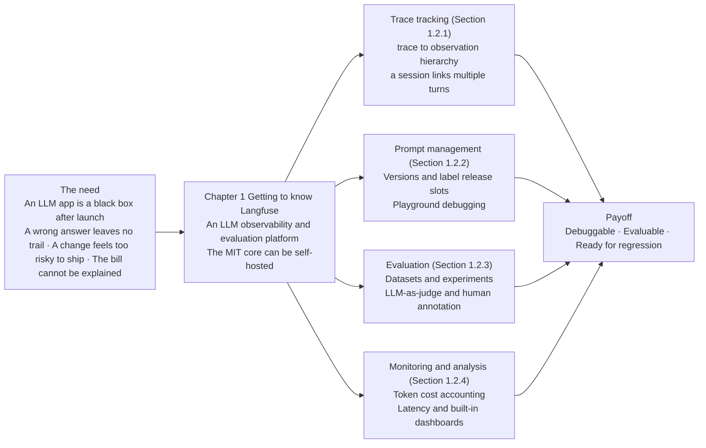
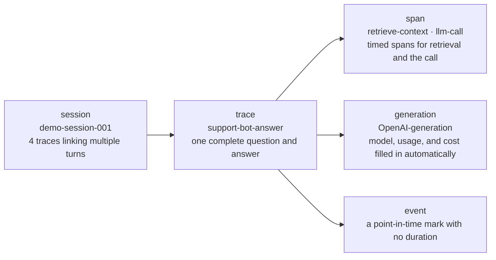
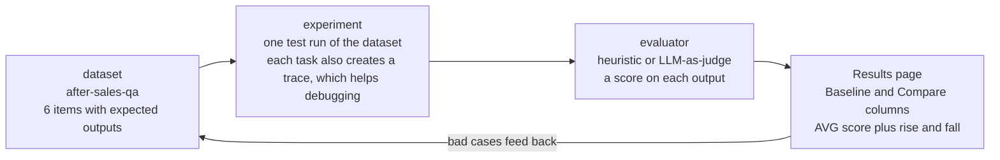
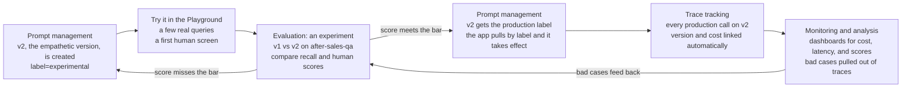
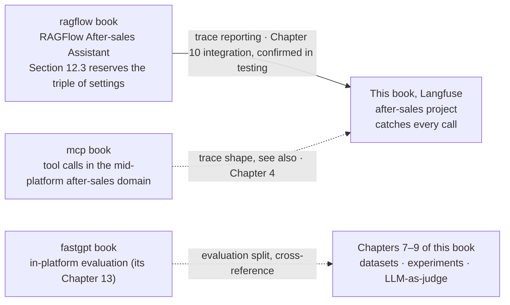

# Chapter 1 Getting to know Langfuse

> Chapter guide: In the third week after "售后助手" ("After-sales Assistant") went live, support forwarded a complaint. The user asked "保税仓发货多久能到" ("How long does bonded-warehouse shipping take?"), and the bot answered with a pile of return policy. The only way to investigate was to dig through service logs, and the logs could not answer: what was the full input of that call? Which Prompt version was running in production? How many tokens did this answer spend? Once an LLM application is live, it is a black box: the output is uncertain, cost accumulates by the token, and each Prompt edit throws away the history of the previous one. This chapter writes no code. It only lays the foundation of the book. Langfuse turns the black box white again with four capability surfaces: Trace tracking, Prompt management, evaluation, and monitoring and analysis. It also sets out where the boundary sits between the MIT-licensed open-source core and the enterprise edition (EE), and what the v3→v4 version change means for you. By the end of this chapter, you can match each kind of black-box pain to a capability surface and the chapters that develop it, and choose a path into the book that fits your situation.

*Overview figure for this chapter*

## When you need it

Three typical situations, and three paths into the book. You can choose one when you finish this chapter.

**Situation one: the application is live, the user says "它答错了" ("it answered wrong"), and you cannot find any record of that call.** This is the pain of investigating a black box. The main line is Chapters 3–4. Chapter 3 installs the Python SDK on the application and produces the first trace. Chapter 4 covers the chain hierarchy, linking traces into a session, and filtered views. In this chapter, read Section 1.1 and Section 1.2.1 first, and build an expectation of what one request looks like inside Langfuse.

**Situation two: you changed a Prompt (for example, you turned a direct answer into empathetic wording) and you do not know whether it got better or worse.** This is the pain of evaluation. The main line is Chapters 6–9. Chapter 6 puts the Prompt under version management. Chapter 7 builds an evaluation dataset. Chapter 8 runs experiments for comparison. Chapter 9 adds automated evaluation. In this chapter, read Section 1.2.2 and Section 1.2.3 first.

**Situation three: the model bill went up at the end of the month, and you cannot say which project or which kind of call the money went to.** This is the pain of cost. The main line is Chapter 5: model pricing, cost accounting, dashboards, and latency analysis. In this chapter, read Section 1.2.4 first.

Outside these three situations, if you do not yet have a Langfuse instance, the six-container Docker Compose deployment in Chapter 2 is the prerequisite for every hands-on part. Every hands-on check of our running example in this book happened on that instance (the version baseline is in Section 1.3). This chapter itself has no prerequisite. When you finish it, you can decide whether to bring Langfuse in.

## Overview

Langfuse's official self-introduction is one sentence: "Traces, evals, prompt management and metrics to debug and improve your LLM application." That means traces, evaluation, Prompt management, and metrics, used to debug and improve your LLM application. This English sentence appears in the Langfuse area of the RAGFlow settings page. It was confirmed in testing on a local machine on 2026-11-04, and it is the same source material as Section 12.3 of the ragflow book. **This book's one-sentence summary: Langfuse is an open-source platform for LLM observability and evaluation. It puts the record of every call, the Prompt of every version, the score of every round of change, and where every cent went into the same UI.**

It has two forms you can take it in. One is self-hosting (this book's path: six containers with Docker Compose, the MIT-licensed core). The other is Langfuse Cloud hosting (v4-only from 2026-11-16; see Section 1.3). This book stays on self-hosting the whole way. The reason is direct: an observability platform has to catch the application's real traffic. Our recommendation: keeping the data on your own machine is the line most teams will not cross.

Readers, and the capability surface each of them uses most:

| Reader | Capability surface they use most | Main-line chapters in this book |
|------|-------------|----------------|
| Test engineer | Evaluation: building datasets, a scoring system, Prompt regression, and quality engineering | Chapters 7–9 and 12–13 |
| Operations engineer | Trace tracking and monitoring analysis: collection, cost, latency, dashboards | Chapters 3–5 and 11 |
| Operations staff | Prompt management and evaluation: versions, A/B experiments, badcase operations | Chapters 6–8 |

Concepts that come back through the next twelve chapters are introduced in one table, so they are familiar before you need them. The English terms are set down here, and later chapters use them directly. Every row names the chapters that develop it. This table is the dictionary page of the whole book:

| Concept | English | One-sentence definition | Object in our running example | Chapters |
|------|------|-----------|----------------|---------|
| trace | trace | The complete chain of one request; the root of every observation | `support-bot-answer`: one complete question and answer | Chapters 3–4 |
| observation | observation | A node on the chain, in one of three kinds: span, generation, or event | Several nodes under each trace | Chapter 4 |
| span | span | An observation with a start and an end that wraps a piece of work | `retrieve-context`, `llm-call` | Chapter 4 |
| generation | generation | The observation of one model call, including model, usage, and cost | `OpenAI-generation` (created automatically by the wrapper) | Chapter 4 |
| event | event | A point-in-time mark with no duration | Chapter 4 gives an example | Chapter 4 |
| session | session | A session that links multiple traces across multiple turns for the same user | `demo-session-001` (4 traces) | Chapter 4 |
| score | score | A score attached to a trace or an observation, from three sources | The recall score on an experiment task | Chapter 7 |
| dataset | dataset | A set of test cases with expected outputs | `after-sales-qa` (6 items) | Chapter 7 |
| experiment | experiment | The v4 UI name for "one run of a dataset"; it replaces the v3 dataset run | `glm-v1-baseline`, `glm-v2-prompt` | Chapter 8 |
| evaluator | evaluator | A function or configuration that scores an output | `recall_evaluator` (heuristic) | Chapters 8–9 |
| LLM-as-judge | LLM-as-judge | An evaluation method that uses a model to score an output | The configuration on the Evaluators page | Chapter 9 |
| annotation queue | annotation queue | A queued workflow for human annotation | The Human annotation page | Chapter 7 |
| prompt label | prompt label | Three release slots: production, staging, and experimental | `after-sales-answer`, current production=v2 | Chapter 6 |
| playground | playground | The Prompt debugging entry that has its own sidebar column | The Playground page | Chapter 6 |
| API Key | API Key | Public keys start with pk- and secret keys start with sk-. The scope is the project, and the value is shown only once at creation | A pair of keys for the after-sales project | Chapter 2 |
| OTel | OTel | The OpenTelemetry standard. The SDK ingests traces through its endpoint | `/api/public/otel/v1/traces` | Chapter 3 |

You do not need to memorize this table now. **The four capability surfaces are the main line. The concept table is the dictionary.** The chapter guide at the start of each chapter comes back to the few concepts that chapter needs. When you forget one, turn back here.

## 1.1 Why an LLM application needs its own observability

Go back to the complaint in our running example. The retriever in "售后助手" ("After-sales Assistant") is keyword matching. The query "保税仓发货多久能到" ("How long does bonded-warehouse shipping take?") did not hit a keyword in the logistics corpus, and the retriever fell back to the return-policy material. The model read a passage that did not match the question, decided "资料不足以回答" ("the material is not enough to answer"), and guided the user to a human. What the user saw was an answer that missed the question. The full explanatory chain for this kind of problem (which retrieval step missed, what the model saw at the time, and which Prompt version was directing it) is scattered across application logs, the model response, and the code repository. No one of those three can answer alone.

This bind is not unique to the After-sales Assistant. Traditional observability (APM, application performance monitoring, and log platforms) was designed for deterministic software. An LLM application breaks four of its default assumptions, and it adds a cost structure that did not exist before:

| Dimension | Traditional APM and logs | An LLM application (needs a platform such as Langfuse) |
|------|--------------|--------------------------------|
| Output determinism | The same input gives the same output, and an assertion can be reproduced | Two experiments with the same configuration get different scores (in our running example, recall 0.45 and 0.39, confirmed in testing) |
| Unit of measurement | Duration, error rate, QPS | Plus a token dimension: each call is converted to cost at the model's unit price, and missing or wrong pricing distorts the figure quietly |
| What changes | Code and configuration, traceable with the release | The Prompt is the change that happens most often. Left in code, each edit throws away the previous history, and nobody can say which version is running in production |
| How quality is judged | A metric threshold is enough to judge (an error rate over the line is an incident) | "Was the answer good?" needs a score system. Automated evaluators, human annotation, and online feedback are three sources that close the evaluation loop |
| Where you start an investigation | Log search plus a call stack | A trace tree: retrieval, generation, and scoring inside one request expand layer by layer |

Of the five dimensions, the fourth is the hardest one for traditional tools to fill in. An error rate can tell you how many calls failed, but an answer that misses the question is not a failure. The HTTP status is 200, tokens are billed normally, and the user was simply guided to a human. **Our recommendation: observability for an LLM application is a new engineering surface, and it is not an add-on feature of APM. The evaluation loop is what sets it apart from traditional monitoring.**

### 1.1.1 Nondeterminism is not a bug; it is an object of measurement

Our running example already gave one hands-on lesson. The same configuration and the same dataset, two consecutive runs of the `glm-v1-baseline` experiment, and the recall score was 0.45 in one run and 0.39 in the other. Nondeterminism of LLM output means "the same configuration" does not mean "the same score". That brings two direct consequences. An evaluation conclusion needs repeated samples or a tolerance (a threshold cannot be pinned to one digit after the decimal). A regression comparison has to separate a real regression from ordinary fluctuation. Those two consequences land in Chapter 8 (run fluctuation leads to a threshold tolerance) and Chapter 12 (the regression gate).

### 1.1.2 One baseline: observability does not change behavior

Instrumentation data is reported through asynchronous ingestion. A collection failure does not block the business. If the observability platform is down, the application still answers. This baseline has a reverse side: a silent collection failure is also something nobody notices. A short-lived process therefore has to flush explicitly (SDK details are in Chapter 3), and the platform's own health has to be watched on the platform side (Chapter 11).

### 1.1.3 Two investigations side by side: a black-box outcome and a white-box outcome

Put the complaint from the chapter guide in front of two teams, and watch two outcomes of the same problem. **The black-box outcome:** support forwards a complaint, "保税仓发货多久能到被答成了退货政策" ("How long does bonded-warehouse shipping take? was answered with the return policy"). The engineer digs through application logs first. The logs have request parameters and response text, but they do not have the "为什么" ("why"). Next the engineer checks the Prompt repository. Git history shows a system template was changed last week, but nobody can say whether production is actually running that version. Finally someone guesses "是不是模型变了" ("did the model change?"), while the model service's call records are scattered in the vendor console, and the token counts and version numbers match no local record. After all three places have been turned over, the conclusion can only be written as "疑似检索问题，待复现" ("suspected retrieval problem, pending reproduction"). It cannot be reproduced, because the record of that request is already gone.

**The white-box outcome:** the same complaint, and the other team's After-sales Assistant is connected to Langfuse. On the Traces page, filter by user and time, and the trace is located in 30 seconds. In the tree, the `retrieve-context` span shows 0 retrieval hits (the keyword "保税仓" ("bonded warehouse") is not in the corpus keyword table, so retrieval fell back to the return-policy material). Expand the generation under `llm-call`, and the Input area shows the full system message the model saw at the time: that same return-policy passage that did not match. The prompt version field associated with the trace states that `after-sales-answer` v1 was in effect. A conclusion in three minutes: the retrieval keyword table is missing a synonymous phrasing, and the model's behavior was correct (when the material does not match, guide the user to a human). The fix is concrete as well. Extend the keyword table, and put this query into the evaluation dataset `after-sales-qa` as a regression case (badcase feedback in Chapter 7).

What separates the two outcomes is whether the record was kept in full. The engineer's level is not the dividing line. In the first outcome, the investigation material disappears when the request ends. In the second, every call is archived automatically into a structured record that can be searched, expanded, and linked. What the next thirteen chapters of this book do, put plainly, is one thing: **put every LLM call of yours in the white-box outcome column.**

## 1.2 A tour of Langfuse's four capability surfaces

The four nouns in that official sentence — traces, evals, prompt management, and metrics — are the four capability surfaces. Each surface catches one kind of black-box pain:

| Black-box pain | Capability surface | Core objects | Chapters |
|---------|--------|---------|---------|
| The record cannot be inspected: a wrong answer, and nobody knows what happened at the time | Trace tracking | trace / observation / session | Chapters 3–4 |
| The Prompt has no version: nobody can say which version is running in production | Prompt management | version / prompt label / playground | Chapter 6 |
| A change has no evaluation: better or worse is a feeling | Evaluation | dataset / experiment / score | Chapters 7–9 |
| Cost is invisible: the bill does not say where the money went | Monitoring and analysis | pricing / dashboards / latency | Chapter 5 |

### 1.2.1 Trace tracking: keep the full record of one request

A trace is the root. One trace has multiple observations hanging under it. An observation is one of three kinds. A span wraps a piece of work that has a duration. A generation records one model call (model, token usage, and cost). An event is a point-in-time mark with no duration. A session then strings the multiple traces of the same user into a complete conversation. One question and answer of "售后助手" ("After-sales Assistant"), our running example, looks like this in the model:

*The data model of one question and answer in the After-sales Assistant. The hierarchy and the collection rules are developed in full in Chapter 4*

What you can see in the UI: the Traces list supports filter syntax such as `level:ERROR, scores.quality>0.8`, and conditions you use often can be saved as My Views. The header of the trace detail page gives the traceId, the duration, the cost total, the token count, the session link, and the user, all in one row. The tree on the left offers Tree, Timeline, and Graph views. The detail pane on the right has Preview, Metadata, Scores, and Log View tabs, and Formatted and Raw switch with one click. All of the above are UI facts confirmed in testing on v4.76.0, verification date 2026-11-08. In v4 the Sessions page was redesigned as a conversational view: each trace folds into a group of user messages and assistant messages, and a multi-turn session can be read at a glance.

Instrumentation has two entries. A manual decorator gives you control of the grain and lets you name the nodes yourself. An OpenAI SDK wrapper is one line of integration, and the generation automatically carries model, usage, and cost. Comparing the two styles and choosing between them is the main line of Chapter 3. **Our recommendation: prefer the wrapper for demos and for quick integration, and use decorators to settle production instrumentation.**

The full journey of one trace is worth walking once. It explains why the six containers in Chapter 2 are each required:

1. **Instrumentation side:** in application code, the SDK wraps the call as an OTel (OpenTelemetry) payload. The trace, the spans, and the generation each carry a name, timestamps, input, output, and metadata.
2. **Ingest side:** the payload is sent to the public endpoint of the web container. The web container enqueues it and returns immediately. **Instrumentation does not block the business** (this is where the baseline of Section 1.1.2 lands in the architecture). The worker consumes asynchronously and writes the data into the observation store.
3. **Storage side:** observation data lands in ClickHouse (high-frequency writes and aggregate queries). Transactional data (organization, project, and keys) lands in PostgreSQL. Raw payloads and media land in object storage.
4. **Consumption side:** you read the data from three entries, the Traces list, the Sessions conversation view, and the Dashboards page. Evaluation experiments also run on this same batch of data.

This journey gives an investigation rule: **when a trace does not appear, ask along the four stages of the journey.** Did instrumentation send it (SDK Debug mode, Chapter 3)? Did ingest enqueue it (is the worker healthy, troubleshooting in Chapter 2)? Did storage persist it? Did the UI filter it out (time range and project selection)? The troubleshooting section of Chapter 4 is organized along these four stages.

A pitfall already stepped on: the legacy query API of the SDK returns incomplete observation fields (model and usage may be None), while the UI and the underlying data have values. When you verify data, the UI is the authority. Chapters 3 and 4 will remind you again.

### 1.2.2 Prompt management: treat the Prompt as a versioned asset

A Prompt scattered in code is three risks. Each edit throws away the previous history. Nobody can say who is running which version in production. Trying a new wording means editing code and releasing again. Langfuse turns the Prompt into a versioned asset on the platform:

- **Version:** creating the same name again creates a new version. Every historical version is kept, and you can look at the diff at any time.
- **prompt label:** three release slots, production, staging, and experimental. The application pulls by label. "发上线" ("ship it live") changes from editing code to changing a label.
- **playground:** the debugging entry that has its own sidebar column. Pick a version, fill in a few variables, and try the effect immediately.
- **trace association:** the observation of each model call records prompt_id, prompt_name, and prompt_version. "现场是哪版 Prompt 在指挥" ("which Prompt version was in charge of that call") is then something you can check.

`after-sales-answer` in our running example took this path. v1 is the direct-answer version, v2 is the empathetic version, and production currently points at v2. The A/B experiment in Chapter 8 uses this set of labels to split traffic. The full mechanism of versions, labels, compilation, cache, and fallback is in Chapter 6.

The release meaning of a label is worth stating once up front. It is the shared foundation of Chapter 6 and Chapter 8. **A label is an "环境位" ("environment slot"), not a "版本号" ("version number").** Which version the production label points at can be moved (attach v2, detach v1). The application always asks only "which version is production?". The release action therefore shrinks from "edit the code and deploy again" to "move a label on the platform". Rollback is the same: move the label back to the old version and it takes effect within seconds. **In engineering terms: a label postpones release of the Prompt from build time to runtime.**

The release meaning of a label is worth stating once here as well. It is the shared foundation of Chapter 6 and Chapter 8. **A label is an "环境位" ("environment slot"), not a "版本号" ("version number").** Which version this production label points at can be moved (attach v2, detach v1). The application always asks only "which version is production?". The release action therefore shrinks from "edit the code and deploy again" to "move a label on the platform". Rollback is the same: move the label back to the old version, and it takes effect within seconds. Labels on the same version can also coexist (one version carries both production and staging, for a canary look). A/B traffic splitting (Chapter 8) is a percentage split on this meaning. **In engineering terms: a label postpones "发布" ("release") of the Prompt from build time to runtime.**

### 1.2.3 Evaluation: from "感觉变好了" ("it feels better") to "分数说话" ("the scores decide")

The question evaluation answers is: is this Prompt (or this model, or this retrieval setup) actually better than the previous one? The Evaluation group in the sidebar gives five entries: Scores, Evaluators, Human annotation, Datasets, and Experiments. Strung together, the mechanism is one loop:

*The evaluation loop: dataset, then experiment, then score, then comparison. Bad cases flow back into the dataset (Chapter 7)*

Three sources can all produce a score. An automated evaluator (a heuristic or a model judge that runs inside an experiment). Human annotation (an annotation queue, scoring item by item). Online feedback (attached to a real trace). Our running example used the six test cases in `after-sales-qa` (returns, bonded-warehouse timing, direct-mail overtime, quality-issue exchange, refund cycle, and unsealing) to run two groups of experiments. The Baseline and Compare columns on the results page give the AVG score and the rise or fall of each item. How to read an experiment, A/B traffic splitting, and version rollback are in Chapter 8. Designing the judge Prompt for LLM-as-judge, and continuous evaluation, are in Chapter 9. The human annotation queue is in Chapter 7.

An honest boundary: some advanced functions of Evaluators and Human annotation belong to the enterprise edition (EE). On a self-hosted instance, go by what the UI actually shows. Chapter 9 follows the UI on a local machine as it actually appears, and does not promise features ahead of that.

Each of the three score sources has a job it is good at. You can use this table when you choose (the concrete design of scoring dimensions is developed in Chapter 7):

| Source | When it fires | What it is good at judging | Shortcoming | Match in our running example |
|------|---------|---------|------|-------------|
| Automated evaluator | Runs automatically after each experiment or production call | Large volume, a stable basis, usable in regression | Judgment quality is limited by the rubric and by the level of the judge model | The `recall` heuristic evaluator (coverage of keyword points) |
| Human annotation | Scores item by item in a queued annotation queue | Subtle meaning, tone, compliance boundaries | Slow, expensive, and the basis varies by person | The Human annotation queue (Chapter 7) |
| Online feedback | A real user clicks or submits | The most real sense of the user | Sparse, and biased (people who are unhappy are more willing to click) | A user score attached to a real trace |

**Our recommendation: the three sources are three layers of a filter, and they are not a pick-one choice.** The automated evaluator is responsible for "每一次都看" ("looking every time"). Human annotation is responsible for "自动化看不准的细看" ("a closer look where automation cannot judge"). Online feedback is responsible for "最终权重" ("the final weight"). Chapter 7 gives the full method for designing scoring dimensions along this layering.

### 1.2.4 Monitoring and analysis: cost, latency, and dashboards

Cost starts from pricing. In Model Definitions under project Settings, you set a unit price for each model (the API can do it too). After that, the header of each trace shows a cost total, and each generation node in the tree shows its own cost. In our running example, node-level precision of `$0.000007` was seen in testing. Two practical points up front. The built-in price table does not include Zhipu models, so glm-5.3-flash needs a price entered by hand (a teaching value; Chapter 5 gives the steps). **Pricing applies only to newly ingested traces. Changing a price does not reach back into history.**

Dashboards: the Dashboards page comes with built-in dashboards. Day-to-day inspection of trace volume, cost, and latency starts here. Latency analysis is mainly from a P95 point of view (Chapter 5). The metrics API in v4 provides a v2 endpoint (self-hosted v3 has only v1; the difference in basis is at langfuse.com/docs/compatibility). Alerting (for example a webhook notification) is the last link on this surface. Chapter 5 records the availability status confirmed in testing on a local machine. This book does not promise it ahead of that.

### 1.2.5 How the four capability surfaces work together: one complete workflow

The four capability surfaces are not four islands. A daily workflow strings them into one loop. Walk the whole flow with the example "operations wants to switch to a more empathetic after-sales wording":

*The joint loop of the four capability surfaces: change the Prompt, try it, test it, ship it, watch it, and feed it back*

Three roles each take what they need from this loop. Operations edits the Prompt and looks at the Playground. Testing runs experiments and looks at scores. Operations engineering watches cost and latency on the dashboards. **The same data (the trace) serves three roles. That is the ground under "三个角色共用一本手册" ("three roles share one manual").** The chapters of the book are laid out along this loop. Chapters 3–4 get traces flowing. Chapter 5 lights up cost. Chapter 6 moves the Prompt into the loop. Chapters 7–9 make the "test" step solid. Chapter 12 turns this loop into an automated quality gate. Chapter 13 adds adversarial checking.

This loop also has two modes of running, matching how mature the team is:

- **Human-driven (Chapters 3–9):** a person walks the loop. Edit the Prompt, click the experiment, look at the score, and publish by hand. This fits the starting period. Every stop on the loop is a UI operation, and a reader of this chapter can walk the whole loop within ten chapters.
- **Gate-driven (Chapters 12–13):** the loop turns on its own. A change triggers an experiment, a score that is not high enough is blocked automatically, and a red-team dataset regresses on a schedule. This fits a team after the quality system has matured, and it frees human attention from "running the process" to "setting the standard".

The two modes are the front half and the back half of the same book. They are not a tradeoff you pick between. **Walk every stop by hand, and only then are you in a position to hand one stop to automation.** The three-part gate check in Chapter 12, confirmed in testing, shows the real bends on this path, including how to tell "门禁拦对了" ("the gate blocked the right change") from "评估器误报" ("the evaluator raised a false alarm").

### 1.2.6 Self-hosting or Cloud: a one-minute choice

Langfuse has two ways to get it. Cloud (hosted by the vendor, usable as soon as you register) and self-hosting (the MIT core, a stack started with Docker). A one-minute selection table:

| Concern | Cloud | Self-hosting (this book's path) |
|--------|-------|------------------|
| Speed to a first result | Usable as soon as you register, and the first trace in ten minutes | You need to deploy the six containers of Chapter 2 (the first image pull is 4-8GB) |
| Where the data lives | Outside your own network boundary | All of it lands in your own volumes (postgres, clickhouse, minio) |
| Version control | The vendor upgrades everyone together | Lock `LANGFUSE_IMAGE_TAG`, and you set the upgrade pace |
| How deep you can operate | You can change only what is on the UI | Configuration, backups, volume management, and source-level troubleshooting are all available |
| Cost | The free tier has a quota, and usage is billed | Machine resources (about 4-6GB of memory in use, confirmed in testing on a local machine) |

**Our recommendation: self-host for learning and for production evaluation.** Every hands-on book on the shelf (fastgpt, ragflow) is built on a real instance on your own machine, and Langfuse is the same. The operations feel of editing configuration, backing up volumes, locking a version, and reading startup logs is something Cloud cannot give you. Cloud is a fit for spending ten minutes on the concepts, then coming back to self-hosting to study them in depth.

## 1.3 Open source and the enterprise edition: the boundary of the MIT core, and the v3→v4 background

### 1.3.1 The MIT core: self-hosting is enough to run all four capability surfaces

The Langfuse core is open source under the MIT license. Self-hosting covers the four capability surfaces without a license. The baseline of this book is v4.76.0 (released 2026-11-05, deployment verified on a local machine on 2026-11-08, image `docker.langfuse.com/langfuse/langfuse:4.76.0`). Docker Compose on a local machine is six containers plus an optional gateway: web (3000), worker (3030), ai-gateway (3031, unconfigured when there is no key), clickhouse, minio, redis, and postgres. Chapter 2 covers the division of responsibility one by one. After login, the version badge on the organization list shows `v4.76.0 OSS`. The health check `GET /api/public/health` returns `{"status":"OK","version":"4.76.0"}`. Both are hands-on anchors for checking "你跑的是哪个版本" ("which version you are running").

Every fact in our running example (the full chain of trace, session, Prompt, dataset, experiment, and cost) was produced on this self-hosted instance. **The self-hosted form of the MIT core is enough to carry the main line of all thirteen chapters of this book.**

### 1.3.2 The EE boundary: go by what the UI actually shows

Enterprise edition (EE, Enterprise Edition) features need a commercial license, and they are not visible by default on a self-hosted install. This book set two rules while it was being written. **Write steps only for functions that are visible and operable on the UI. EE functions that are not visible on the UI are marked "EE" as they are, and this book does not invent steps from the docs.**

| Feature | Where it belongs | How this book treats it |
|--------|------|-----------|
| Two-level isolation of organization and project, member management, project-level API keys | Self-hosted core, visible on the UI | Developed normally in Chapter 11 |
| Fine-grained RBAC roles, SCIM, stronger audit, data retention policy | EE, not visible on the self-hosted UI | Marked EE as it is. This book says only what it solves, and does not give steps |
| Organization-level API key | EE, not verified on a local machine | Not written |

The EE boundary also has a hard observation on the UI. On the project Members page, the role column lets you operate an organization-level role (Owner) normally, while the project-level role column shows "N/A on plan". Under the open-source plan, project-level RBAC is unavailable. The vendor uses the UI to declare the EE boundary to you (the screenshot and the reading are in Chapter 11). This way of checking, letting the UI prove the boundary, is worth spreading. **The most reliable way to judge whether a function is EE is to open the page and see whether it exists and whether it can be operated, rather than to dig through the docs.** Every EE judgment in this book was checked this way, confirmed in testing.

### 1.3.3 v3→v4: you are in the middle of a version changeover

Langfuse is going through a major version changeover (source: langfuse.com/docs/compatibility, verification date 2026-11-08). Three facts make up the backdrop:

| Fact | Content | What it means for the reader |
|------|------|-------------|
| v3 self-hosted maintenance window | Security maintenance through 2027-01-31 | Do not start v3 for a new deployment. The upgrade window for an existing v3 install is limited |
| Cloud version switch | v4-only from 2026-11-16 | Teams on Cloud have already been pushed to v4 |
| SDK compatibility matrix | Python SDK v5 requires a self-hosted server ≥4.59.0. This book uses SDK 5.2.0 | Check the server version before you upgrade the SDK. Upgrade the two as a pair |

The baseline of this book (v4.76.0 plus Python SDK 5.2.0) sits on the v4 side. The version changeover has one practical effect that Chapter 10 runs into head-on. An old client reports to a v4 server using a v3-era endpoint and can get a 404 directly. The hands-on integration of RAGFlow v1.0.0-rc2 with Langfuse v4.76 (conclusion: incompatible) is a live example. The reporting protocol (the v4 ingest write modes events_only, dual, and legacy) is developed in Chapter 10. Here you only need to remember: **look at the reporting endpoint and the server version as a pair. Compatibility problems mostly come from the two sides being on mismatched versions.**

The version changeover also has three observations from the running instance you will run into as soon as you open the UI (confirmed in testing on 2026-11-08; later chapters that cite them do not repeat the source):

1. **Two UI experiences exist side by side.** The top of the page has a "You are viewing legacy UI" banner and a "Switch to latest UI" button. During the v4 migration, users can switch between the old UI and the new UI. Every screenshot in this book comes from the legacy UI view. If your UI has already switched to the new one, the layout will differ, but the concepts and the data are the same.
2. **Old and new data tables exist side by side.** v4 observation data lands in the new tables (the events model). The migration write mode decides whether events from the old API flow to the new tables or the old tables. That produces a phenomenon confirmed in testing: data written by the SDK is visible on the experiment page, but individual fields from the legacy query API do not read back in full. **When you verify data, the UI is the authority** (the practical reminder in Chapters 3 and 4).
3. **Migration management has a UI entry.** The project settings sidebar has a V4 migration external link. The write mode (events_only/dual/legacy) is the official migration mechanism an administrator can configure. The RAGFlow integration confirmed in testing in Chapter 10 actually uses dual mode. Flag that here.

One sentence for how to survive the version changeover: **lock your server version (v4.76.0 in this book), check the compatibility matrix before you upgrade the SDK, and when you hit "文档说有、界面没有" ("the docs say it exists, the UI does not"), suspect the version or the migration state first, and yourself second.**

Version drift is a greater threat to a technical book than it is to you. Langfuse ships 1-2 releases a day, and by the time you read this book the UI may have changed again. This book uses three rules to keep the damage of drift as small as it can. They are also a template you can copy later when you maintain internal docs of your own:

1. **Lock a baseline and state the verification date.** Every version fact in the book hangs on "v4.76.0, verification date 2026-11-08". What the reader gets is not a vague "latest". It is a time anchor that can be rechecked and reproduced. If your instance version is newer, go by what the UI actually shows.
2. **Keep facts and stance apart.** UI behavior (a screenshot plus a reading) is the hands-on fact layer. Judgment sentences marked "Our recommendation:" (for example, prefer the wrapper) are the stance layer. Version drift hits the fact layer first. The stance layer mostly still holds. Writing the two layers apart gives a revision a clear boundary.
3. **Mark differences as they are, in the open.** Places where hands-on results and the official docs disagree (the incomplete SDK projection in Chapter 3, the empty list state in Chapter 7, and the incompatibility in Chapter 10) are all written into the matching chapter as they are. The record of the difference is itself the value this book adds beyond the official docs.

## 1.4 Where Langfuse sits on the shelf

This book is not isolated. Three books on the shelf have a clear handoff with it. **Stance sentence: Langfuse does not replace any of those platforms. It stands beside them and catches every call they produce.**

*The handoff between this book and the three books on the shelf*

| Facing book | Handoff point | Where this book picks it up |
|--------|--------|-------------|
| Section 12.3 of the ragflow book, "可观测：tracing 进 Langfuse" ("Observability: tracing into Langfuse") | On the RAGFlow side, a tenant-level triple of Host and a key pair is configured, and a pointer is reserved: "trace 的内部结构、评估与多租户数据分析属于 Langfuse 一侧的功夫（→ langfuse 书）" ("the internal structure of a trace, evaluation, and multi-tenant data analysis are work on the Langfuse side (→ the langfuse book)") | Chapter 4 picks up trace structure. Chapters 7–9 pick up evaluation. Chapter 10 finishes the rc2 × v4 integration confirmed in testing, and gives the compatibility conclusion as it is (incompatible; the reporting-behavior table in Section 12.3 of the ragflow book needs a revision note) |
| Chapter 13 of the fastgpt book, "对话运营与评测" ("Conversation operations and evaluation") | The same path of hands-on checks on a local deployment. FastGPT's evaluation is inside the platform | Cross-reference with Chapters 7–9 of this book: the split and the tradeoff between evaluation built inside a platform and Langfuse evaluation outside the platform |
| The mcp book (the mid-platform after-sales domain: 20 interfaces → 6 tools → Gateway) | The tool-call chain of an Agent | When Chapter 4 of this book covers trace collection, the trace shape of a tool-call chain and the after-sales-domain view of the mcp book are read against each other |

One sentence for the split of work: **the knowledge-base and orchestration platforms are responsible for "把答案造出来" ("producing the answer"), and Langfuse is responsible for "证明这一次造得怎么样" ("proving how well this one was produced").**

The ragflow-book row deserves its own preview, because it is the only place in the book where two platforms on the shelf collide head-on, confirmed in testing. The integration path that Section 12.3 of the ragflow book reserved at the time (on the RAGFlow side, fill in the triple of Host and a key pair) is run for real on a local machine in Chapter 10. The configuration on the RAGFlow v1.0.0-rc2 side, triggering a chat, and checking on the Langfuse side: all three steps were confirmed in testing. The conclusion is given as it is. **This reporting path from the v3 era does not go through on Langfuse v4** (the old ingest endpoint used by rc2 has been removed in v4; the hands-on detail and three ways out are developed in Chapter 10), and the reporting-behavior table in Section 12.3 of the ragflow book needs a revision note. Laying open the gap between "文档说可行" ("the docs say it works") and "实测可复现" ("testing can reproduce it") is the best footnote to this book's rule that "一切以实测为准" ("hands-on results are the standard").

Draw the boundary while we are here. What this book **does not do**:

- **It does not replace APM and log platforms.** System-level observation such as process memory, connection pools, and JVM metrics still belongs to your APM. Langfuse only takes the LLM call chain. The two sit side by side. One does not replace the other.
- **It does not survey how to choose a model gateway.** Langfuse v4 ships with ai-gateway (beta; Chapter 2 has already seen it), but the main line of this book is the simplest path, "the application connects straight to the model vendor, and Langfuse observes". Advanced gateway use is not developed.
- **It does not promise operation steps for EE features.** Section 1.3 set the rule: write steps only when the UI shows the function, and for an EE item say only what it solves.
- **It does not translate the official docs.** This book is a reorganization of "official docs plus hands-on checks on a local machine". The structure and the examples are this book's. The facts and the sources are the vendor's. When the two conflict, hands-on results are the standard, and the conflict is marked as it is.

Naming for "售后助手" ("After-sales Assistant"), our running example, is consistent across the whole book (do not invent names). The lookup table comes first, and later chapters reuse it directly:

## 1.5 A roadmap of the book: which chapters match your situation

The thirteen chapters of the book are four parts (the part division is this book's arrangement):

| Part | Chapters | One sentence of content |
|------|------|-----------|
| Foundations | Chapters 1–3 | Concepts (this chapter), local deployment (Chapter 2: six containers, initialization, and a record of upgrade and troubleshooting), quick start (Chapter 3: SDK integration, the first trace, and two instrumentation styles) |
| Observability | Chapters 4–5 | The trace model and chain tracing (Chapter 4: hierarchy, session, collection rules, and filtered views), cost and performance monitoring (Chapter 5: pricing, cost accounting, dashboards, latency, and alerting) |
| Prompt and evaluation | Chapters 6–9 | Prompt management (Chapter 6: versions and labels, compilation, Playground, and trace association), datasets and scores (Chapter 7), experiments and A/B (Chapter 8), automated evaluation (Chapter 9: model judges, continuous evaluation, and an introduction to hallucination detection) |
| Engineering | Chapters 10–13 | Connecting an existing system (Chapter 10: a hands-on RAGFlow integration and compatibility, plus an integration list), multiple projects and team management (Chapter 11), Prompt regression and quality gates (Chapter 12), red team and security evaluation (Chapter 13) |

Choose a path by the situation you entered the book with. Investigating quality starts at Chapter 3. Evaluating a change starts at Chapter 6. Cost dashboards start at Chapter 5. All three paths pass through the deployment prerequisite in Chapter 2.

The routes of three typical readers can be more concrete:

- **Test engineer:** your home ground is the third part. After Chapter 2 is deployed, jump straight to Chapter 6 and look at the Prompt version mechanism (it is the first form of the object under test). Then Chapter 7 builds an evaluation dataset such as `after-sales-qa`, Chapter 8 runs experiments for comparison, and Chapter 9 brings in a model judge. Chapter 12 assembles all of this into a regression gate. A Prompt change with no score behind it is not allowed to go live. That is the end-state weapon of the testing role.
- **Operations engineer:** your home ground is the second part plus Chapter 2. The six-container architecture, persistence, and troubleshooting record in Chapter 2 are the daily work. The trace collection rules in Chapter 4 decide the long-term quality of production data. Cost accounting and the latency dashboards in Chapter 5 are the main field of inspection. Organization, project, and environment isolation in Chapter 11 are your handle when you roll this out across several teams.
- **Operations staff:** you can write almost no code. After the Chapter 2 deployment (copy the commands), the Playground in Chapter 6 is your daily work. Change the wording, fill in variables, and try the effect immediately. Versions and labels turn "shipping a new wording" into changing a label. A/B traffic splitting in Chapter 8 lets you decide whether the old or the new version stays by data rather than by intuition. The annotation queue in Chapter 7 and the badcase loop in Chapter 13 turn every bad case you have accumulated into an asset of the team.

Whichever path you take, Chapter 3 is worth reading straight through once. Choosing between the two instrumentation styles (settle the shape with a decorator, or integrate with a wrapper) is the shared base of the code examples in the whole book. Once you understand it, the code in later chapters will not surprise you.

"售后助手" ("After-sales Assistant"), our running example, is not a fixed backdrop. It grows three times as the chapters advance, and each growth is one capability surface arriving in place:

- **First growth: from black box to white box (Chapters 3–4).** The minimal After-sales Assistant is connected to the SDK. One question and answer becomes a visible trace tree (retrieval span, then the call, then an automatic generation). Linking a session turns multiple turns into a complete conversation. At this point it already sits in the white-box outcome column (Section 1.1.3). The record is no longer lost.
- **Second growth: from usable to evaluable (Chapters 6–9).** The system template moves into Langfuse hosting (the version and label mechanism takes over release). Six real after-sales questions, together with expected outputs, become the dataset `after-sales-qa`. The real badcase where the retriever's keywords missed ("保税仓发货多久能到" ("How long does bonded-warehouse shipping take?") was answered as return policy) flows back in as a regression case. Experiment comparison scores every change.
- **Third growth: from evaluable to trustworthy (Chapters 10–13).** The After-sales Assistant on a RAGFlow instance tries to send traces into the same Langfuse. The integration confirmed in testing hits version compatibility, and the conclusion is recorded as it is. A regression gate means a Prompt change with no score behind it does not go live. A red-team dataset adds adversarial checking to the assistant.

The three stages of growth match three hard rules of engineering: **there is no investigation until there is a record, no regression until there is a baseline, and no claim of trust until there is an adversary.** That is also the inner logic of this book's four-part chapter grouping. It is a sequence of stages in quality engineering, and it is not a classification of knowledge. When you read the later chapters, look back at which stage the After-sales Assistant has grown to, and which stage the application in your hands has reached.

Naming for "售后助手" ("After-sales Assistant"), our running example, is consistent across the whole book (do not invent names). The lookup table comes first, and later chapters reuse it directly:

| Object | Name | Note |
|------|------|------|
| Organization | `yubing-org` | The management unit of the organization / project pair |
| Project | `after-sales` | Every trace, Prompt, and dataset lands in this project |
| Demo application | "售后助手" ("After-sales Assistant") (`support_bot.py`) | Keyword retrieval, then a hosted Prompt, then an answer from glm-5.3-flash |
| Root trace | `support-bot-answer` | Three layers of instrumentation: root span, then retrieval, then the call, then an automatic generation |
| Prompt | `after-sales-answer` | v1 direct-answer version / v2 empathetic version, current production=v2 |
| Dataset | `after-sales-qa` | 6 test cases, expected outputs complete |
| session | `demo-session-001` | A multi-turn session of 4 linked traces |
| Experiment | `glm-v1-baseline` ×2, `glm-v2-prompt` | The teaching point that recall fluctuates (0.45/0.39) under the same configuration |

Three environment rules at the end, in force for the whole book. The model goes through Zhipu's OpenAI-compatible endpoint (`https://open.bigmodel.cn/api/paas/v4`, model `glm-5.3-flash`). Every key in the manuscript code is a placeholder, and real credentials do not appear. Every UI fact is taken from the v4.76.0 instance on a local machine (verification date 2026-11-08). If your instance is on a newer version, what is actually visible on the UI is the authority.

Three questions first-time readers ask most often, answered ahead of time:

**"Langfuse 和 LangSmith 是一类东西吗？" ("Are Langfuse and LangSmith the same kind of thing?")** The positioning is the same category (an LLM observability and evaluation platform). The difference is openness. The Langfuse core is open source and can be self-hosted, and the data lands on your own machine. A selection comparison is a commercial topic, and this book does not develop it. The engineering reason "only self-hosting can carry the hands-on chapters of this book" is already given in Section 1.2.6.

**"我的应用已经打了 APM 埋点，还需要重复埋一遍吗？" ("My application is already instrumented for APM. Do I have to instrument it again?")** You do, and it is not a repeat of the same labor. The instrumentation model of an APM cannot hold the key facts of an LLM call (model, Prompt version, tokens, scores). The Langfuse SDK and wrapper are designed for this kind of call. One instrumentation pass buys every capability in Chapters 4–9. The two sets of instrumentation sit side by side and do not interfere with each other (the boundary stated in Section 1.1).

**"先部署还是先看概念？" ("Deploy first, or read the concepts first?")** This book's answer is concepts first, deployment right after. This chapter finishes the concept map, Chapter 2 deploys by the commands, and Chapter 3 writes the first line of code. If you prefer to start by doing, jumping straight to Chapter 2 also holds. Every chapter opens with a guide that reconnects you.

## Chapter summary

1. The black-box pain after an LLM application goes live has four kinds: the record cannot be inspected, the Prompt has no version, a change has no evaluation, and cost is invisible. They are caught by the four capability surfaces of Trace tracking, Prompt management, evaluation, and monitoring and analysis. That is the territory of the thirteen maps of the book.
2. Traditional APM cannot fill this in. Output nondeterminism (the hands-on fluctuation of recall 0.45 and 0.39 under the same configuration), the token cost dimension, the Prompt version dimension, and the evaluation loop are four new objects of measurement for LLM observability.
3. The core concepts are one tree. A session links traces. A trace has observations hanging under it (three kinds: span, generation, and event). On the evaluation side, dataset, then experiment, then score, closes a loop in three steps. On the Prompt side, version, label, and playground are a set of three.
4. The version background: the baseline of this book is v4.76.0 plus Python SDK 5.2.0. Self-hosted v3 has security maintenance through 2027-01-31. Cloud is v4-only from 2026-11-16. Python SDK v5 requires a server ≥4.59.0 (source: langfuse.com/docs/compatibility, verified 2026-11-08).
5. Self-hosting the MIT core covers the four capability surfaces. The treatment rule for EE items (fine-grained RBAC, SCIM, stronger audit, and data retention policy) is: develop the steps only when the UI shows the function, and when it is not visible, mark EE as it is.
6. Next step: Chapter 2 deploys this platform onto your own machine. Docker Compose with six containers, initialization, and a record of upgrade and troubleshooting. After the deployment is done, Chapter 3 produces your first trace.
7. One methodological baseline runs through the whole book: **every UI fact is confirmed in testing and states a verification date; when the docs and the hands-on result conflict, the hands-on result is the standard and the conflict is marked as it is.** In Chapters 3, 7, and 10 you will see this rule play out three times.

## Acceptance checklist

By the time you reach here, you should be able to:

- ☐ Without looking back at the book, sketch the four kinds of black-box pain after an LLM application goes live, and for each kind name the matching Langfuse capability surface and the chapters that develop it.
- ☐ State how trace, observation (span, generation, and event), and session divide the work, and give one real object name from our running example for each.
- ☐ State what the three prompt-label release slots (production, staging, and experimental) are for, and say which version production currently points at in our running example.
- ☐ In one minute, tell a colleague the four reasons traditional APM cannot fill in LLM observability, and cite the hands-on data that experiment scores fluctuate under the same configuration.
- ☐ State the boundary between the MIT self-hosted core and EE features, and repeat the two rules this book uses when it treats EE features.
- ☐ Match your own situation (investigating quality, evaluating a change, or cost dashboards) to a chapter path into the book, and write down your first action.
- ☐ Name the three growth stages of "售后助手" ("After-sales Assistant"), our running example (black box to white box, usable to evaluable, evaluable to trustworthy), and say which chapters carry each stage.
- ☐ Repeat the release meaning of a label (an environment slot, not a version number), and in one sentence tell a colleague what "release is postponed from build time to runtime" means.

## Further reading

- **Chapter 2 (Local deployment)**: the first hands-on action after the concepts are in place. Self-host v4.76.0 with six Docker Compose containers, initialization, and a record of upgrade and troubleshooting. The base under every hands-on check.
- **Chapter 3 (Quick start)**: the first line of instrumentation code. Integrating Python SDK 5.2.0, a ten-minute chain to the first trace, and choosing between two instrumentation styles. The record in Section 1.2.1.
- **Chapter 4 (The trace model and chain tracing)**: the full development of the three-layer concepts in Section 1.2.1. Hierarchy, linking a session, collection rules, filter syntax, and saved views.
- **(→ the ragflow book) Section 12.3**: the view from the other side. How the RAGFlow side sends traces into Langfuse. Chapter 10 of this book gives the compatibility conclusion for rc2 × v4, confirmed in testing. Read the two against each other.
- **Official docs `docs/index.mdx` and langfuse.com/docs/compatibility**: the official-doc path that this chapter's `source` points at, and the original version-compatibility matrix. Every statement about versions follows the official matrix.
- **(→ the fastgpt book) Chapter 13**: the comparison surface for in-platform evaluation. FastGPT does evaluation inside the platform. Chapters 7–9 of this book do evaluation beside the call chain. Reading the two forms against each other, for the split of work and the tradeoff, is where the gain is.
- **(→ the mcp book)**: the trace shape of a tool-call chain, read against this book (the development of the handoff table in Section 1.4). When your Agent is connected to several tools, what the trace tree of one request grows into is complete only when the two books are put together.
