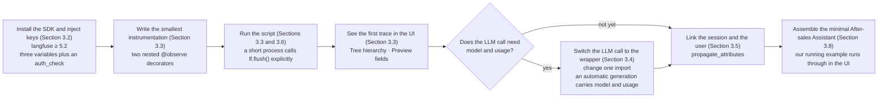

# Chapter 3 Quick start

> Chapter guide: Chapter 2 got Langfuse running on a local machine, and the project `after-sales` is created. Until the first trace lands in the UI, it is only an empty table to you. This chapter solves integration. Install the Python SDK, inject three environment variables, and walk the first trace through in ten minutes. Then handle two pitfalls you will step on immediately, both confirmed in testing: the LLM node is missing model and usage (the difference between the two instrumentation styles), and a short script finishes without the trace being stored (a missing flush). Then use `propagate_attributes` to string scattered traces into a session. Finally, run the minimal version of our running example, "售后助手" ("After-sales Assistant"). By the end of this chapter, you can finish SDK integration and a connectivity check on your own; choose an instrumentation style for one LLM call and say why; read the hierarchy and the fields of one trace in the UI; run the minimal After-sales Assistant through, and see its data on the Traces page and the Sessions page.



*Flow of the operations in this chapter*

## When you need it

Three typical situations, and three ways to use this chapter.

**You just finished the Chapter 2 deployment, and the project Traces page is still empty.** Walk Section 3.2 (install and keys), then Section 3.3 (the first trace), in order. The whole trip is on the order of ten minutes. This trip puts SDK installation, injection of the three variables, the connectivity check, and UI verification through in one pass. Every later chapter is built on this chain.

**You are already instrumenting, but the LLM node has only input and output, and the cost page cannot compute money.** Go straight to Section 3.4. This is the most important hands-on lesson of the chapter. Marking a function `as_type="generation"` does not make model and usage fields grow on it. To make an LLM call carry the model name, token usage, and cost, the right path is to change one import and use the wrapper from `langfuse.openai`.

**The application can run, but you have to answer "what happened inside one session of some user", or the script finished and the UI has no such trace.** The first looks at Section 3.5 (linking a session, and the user id). The second looks at Section 3.6 (flush). The ways to investigate the various cases of "it will not connect, it cannot be seen, a field is missing" are gathered in Section 3.7.

Prerequisite: Chapter 2 has finished deployment, and you can log in to the UI. The project API key has been created. The pk- and sk- keys are used as a pair, and **they are shown only once after creation**. If you lose them, you can only create them again (Chapter 2). Keys in the code of this chapter are written as the placeholders `pk-lf-***` and `sk-lf-***`. At runtime, replace them with the real values of your own project. Do not commit real keys into the code repository.

## 3.1 Overview: what the SDK is doing, and what this chapter delivers

**The Python SDK is the default path into Langfuse. Decorate a function, or change one import, and the application's behavior stays the same while the observation data is already on its way.** It is a poor fit if you treat it as a "logging framework". Your business code does not need to splice log text, and it does not need to decide "what level to record". The SDK collects observation points inside the process and, through an OpenTelemetry (OTel) pipeline, sends them in batches to the server's ingestion endpoint `/api/public/otel/v1/traces`. The hands-on baseline of this book: Python SDK 5.2.0 (the latest on PyPI, requiring a server ≥4.59.0), server v4.76.0, verification date 2026-11-08.

Before you start, pass once through the smallest set of concepts this chapter uses. The complete data model (the trace-to-observation hierarchy, the fields, and the filter syntax) is the subject of Chapter 4. This chapter takes only the subset that is enough:

| Concept | One-sentence definition | Use in this chapter | Developed in |
|------|-----------|---------|------|
| trace | The complete chain of one request; the root of the hierarchy tree | One run of a script equals one trace | Chapter 4 |
| observation | A node on the chain, under the parent trace | Each decorated function equals one node | Chapter 4 |
| span | One kind of observation: a piece of work with a start and an end | The default result of a decorator. Use it for retrieval and for business spans | Chapter 4 |
| generation | One kind of observation: one model call | The LLM-call node. Ideally it contains model and usage | Section 3.4 of this chapter |
| session | An identifier that strings multiple traces into one session | Injected with `propagate_attributes` (Section 3.5) | Chapter 4 |

When this chapter ends, you will have four deliverables you can verify:

| Deliverable | How to verify it | Section |
|--------|---------|------|
| An SDK environment that can connect | `auth_check()` returns True | 3.2 |
| A first trace visible in the UI | Open the detail from the Traces page, and the hierarchy tree is readable | 3.3 |
| A generation node that carries model and usage | The generation fields are complete on the detail page | 3.4 |
| The minimal After-sales Assistant runs through | Demo data appears on the Traces and Sessions pages | 3.8 |

Our running example, "售后助手" ("After-sales Assistant"), starts growing in this chapter. Section 3.8 lands its minimal version (a keyword-retrieval placeholder plus an LLM answer). Later chapters add to it step by step. Chapter 4 links a session and looks at the conversation view. Chapter 6 replaces the built-in prompt template with a Prompt hosted in Langfuse. Chapters 7–9 move into datasets and experiments. Chapter 12 turns it into a regression gate.

### Sources and what was confirmed in testing

- From the official docs (this chapter's `source` points at the SDK overview): the install method, the three environment variables, and the public usage of `@observe` and the wrapper.
- From hands-on checks for this book (2026-11-08, SDK 5.2.0 plus server v4.76.0, Docker deployment on a local machine): a manual `as_type="generation"` is missing model and usage; the wrapper's automatic node is named `OpenAI-generation`; the legacy query API projection is incomplete; the atexit fallback is not reliable for a short-lived process; a system proxy hijacks localhost and causes a 502.
- Our recommendation: "use the wrapper for every LLM call, and manual `@observe` for every business span" is an engineering judgment, and it is not a conclusion of the docs. Hands-on observations are recorded as they are, and they are not stretched into an official promise.

## 3.2 Install the SDK and inject the keys: three variables plus one check

### Install

A Python environment of 3.10 or above is recommended. The dependencies of the demo in this book are two lines (versions confirmed in testing: langfuse 5.2.0, openai ≥1.50):

```bash
pip install "langfuse>=5.2" "openai>=1.50"
```

langfuse is the SDK itself. openai is needed only when your application calls OpenAI directly, or any OpenAI-compatible endpoint. The wrapper instrumentation in Section 3.4 and the After-sales Assistant in Section 3.8 both take this path, so install them together. The LLM of the instance in this book is Zhipu's OpenAI-compatible endpoint (`https://open.bigmodel.cn/api/paas/v4`, model `glm-5.3-flash`). To the SDK, it is an openai client with a different `base_url`.

### The three environment variables

The SDK reads connection information from environment variables. All three have to be present:

| Environment variable | Meaning | Value on the instance in this book |
|---------|------|-------------|
| `LANGFUSE_HOST` | The server address. For a local deployment it is the same origin as the UI | `http://localhost:3000` |
| `LANGFUSE_PUBLIC_KEY` | The project public key, starting with `pk-lf-` | `pk-lf-***` (placeholder) |
| `LANGFUSE_SECRET_KEY` | The project secret key, starting with `sk-lf-` | `sk-lf-***` (placeholder) |

The three keys come from the project Settings → API Keys page in Chapter 2. Name is required in the create dialog (if you do not fill it in, the button is disabled). After creation, pk- and sk- are **shown only once**. Write them into `.env` on the spot. The scope of a key is the project. A key of the `after-sales` project sends data only into `after-sales`. Governance of isolation across projects is in Chapter 11. The `.env` under the demo directory of the instance in this book looks like this:

```bash
# .env — every key is a placeholder; at runtime, replace them with the real values of your own project
LANGFUSE_HOST=http://localhost:3000
LANGFUSE_PUBLIC_KEY=pk-lf-***
LANGFUSE_SECRET_KEY=sk-lf-***
ZHIPU_API_KEY=***
NO_PROXY=localhost,127.0.0.1
```

Note the last two lines for later. `ZHIPU_API_KEY` is used only when the LLM calls of Sections 3.4 and 3.8 run. `NO_PROXY` is a pitfall stepped on in testing on a local machine. **If your system has an HTTP(S)_PROXY proxy set, a request sent to `localhost:3000` is hijacked into the proxy and returns 502.** Debugging a local deployment always sets `NO_PROXY=localhost,127.0.0.1` (the equivalent on the curl side is `--noproxy '*'`). This is not a Langfuse problem, but it is enough to make a completely correct integration "look like a failure".

### Connectivity check: auth_check

With the three variables set, spend ten seconds confirming that the chain is open before you start writing instrumentation:

```python
# check_conn.py — a connectivity check
from langfuse import get_client

lf = get_client()        # reads the three environment variables and returns the global client
print(lf.auth_check())   # True = the server is reachable and the key is valid
```

```bash
python check_conn.py
# True
```

Continue only when the hands-on output is `True`. If it raises 401 or a connection error, treat it from the troubleshooting table in Section 3.7. Most cases are a key that was copied incompletely (the leftover of "shown only once") or a proxy hijack (the `NO_PROXY` above).

There is also a lower-level probe on the server side. The health-check endpoint does not require authentication, and it can confirm that "the server is alive":

```bash
curl --noproxy '*' http://localhost:3000/api/public/health
# {"status":"OK","version":"4.76.0"}
```

`auth_check` answers "is the key right?". The health check answers "is the server there?". The two probes together are enough to locate which layer "cannot connect" happens on.

### Scope of the keys: why the three variables are project-scoped

What the three variables inject is a **project-level** identity. A key of `after-sales` sends data only into `after-sales`. That means two things. First, at the integration stage, a "where did the data go?" question starts by checking the key. A key from the wrong project still stores the data. It just stores it in another project, and the investigation easily heads the wrong way. Second, the plainest way to "keep development data and production data apart" is two projects and two sets of keys, each with its own `.env` (the full isolation plan for environments and multiple projects is in Chapter 11).

## 3.3 The first trace in ten minutes

### The smallest instrumentation: two nested @observe decorators

The `@observe` decorator is the smallest entry of the SDK. When the function is called, the SDK hangs an observation on the current chain, and the function's arguments and return value are recorded automatically as the input and output of that node. Nested calls become a tree on their own. When a decorated function calls another decorated function inside it, the latter becomes a child of the former. Write a script of a dozen lines or so:

```python
# hello_trace.py — the first trace: two nested @observe decorators
from langfuse import get_client, observe

lf = get_client()

@observe(name="hello-parent")
def pipeline() -> str:
    return worker()

@observe(name="hello-child")
def worker() -> str:
    return "ok"

if __name__ == "__main__":
    print(pipeline())
    lf.flush()   # a short-lived process flushes explicitly, or the trace may not be stored (Section 3.6)
```

Two points. First, the `name` parameter decides the name the node shows in the UI. If you omit it, the function name is the default. This book recommends naming it explicitly, because the collection rules in Chapter 4 require "a node name that is readable and stable". Second, copy the last line `lf.flush()` for now. Its principle and its boundary are developed in Section 3.6.

### What @observe records for you

Without writing any observation code, the decorator has already recorded three things:

| Recorded item | Source | Value in hello_trace.py |
|--------|------|------------------------|
| name | The decorator parameter; if it is missing, the function name | `hello-parent` / `hello-child` |
| input | The function arguments, serialized as args and kwargs | `pipeline()` has no arguments, so args is empty |
| output | The function return value, serialized | `"ok"` |

Plus the timestamps, the duration, and the parent-child hierarchy that the SDK fills in automatically. What it does **not** record matters just as much. There is no model, no usage, and no cost. Those semantic fields are something only a model call can talk about (the subject of the next section), and an ordinary business span really does not need them. If you also want to attach structured information to a node (an order number, a tenant, and the like), that is what metadata and tags are for, and that too is developed in Chapter 4.

### Before you run: what the empty UI looks like

Before you run the script, go to the UI and confirm the starting point. After login, enter the project (the organization and project of the instance in this book are `yubing-org` / `after-sales`). In the Observability group of the sidebar, click Tracing. The URL has the shape `http://localhost:3000/project/<your project id>/traces`. A project that has never been connected to the SDK shows an empty-state page on this screen that "guides you to instrument":


This empty-state page is itself the official "quick start". The three steps correspond one for one with the structure of this chapter. **Create API keys** corresponds to Chapter 2 and to Section 3.2 of this chapter (the Create new API key button on the page goes straight there). **Add tracing with your coding agent** is a recommended path added in v4: copy a prompt and give it to a coding agent so the agent instruments for you. The path this book takes is the manual path in Sections 3.3 and 3.4 (the "or follow our docs to set up tracing manually" link below is the official docs). The **Run your app** line sets the expectation. "Once your app makes an LLM call, traces show up within seconds": a trace appears within a few seconds after the call. The line "it only takes a minute" in the title has a bit of marketing in it. Confirmed in testing, once installing dependencies and setting environment variables are included, an expectation on the order of ten minutes is reasonable.

### Run and verify: the first row appears on the Traces page

Run the script:

```bash
python hello_trace.py
# ok
```

Go back to the Tracing page and refresh. The list shows one trace named `hello-parent`. The name is taken from the `name` of the root node's decorator. The columns of a list row (name, duration, time, session, user, and so on) can be configured with Display and Columns. The filter search box supports syntax such as `level:ERROR`. The full use of the list (saving a view as My Views, and the filter syntax) is developed in Chapter 4. This chapter only needs you to be able to click a row and enter the detail.

Open this trace, and you will see the most important screen of the chapter:


This screenshot was taken on 2026-11-08 from the After-sales Assistant in Section 3.8. The hierarchy is richer than `hello_trace.py`, which is exactly why you can see every UI element. Read it block by block:

| UI element | What you see | The concept behind it |
|---------|-----------|-----------|
| Header traceId | A hexadecimal string such as `801b333d98742686143dcf7c8a3b1c85`, one string per trace | The unique identifier of the trace, the "ticket number" when you troubleshoot |
| Header summary | Duration 10.35s, a session link, and `user: demo-user` | The session and user identifiers (injected in Section 3.5). The cost and tokens totals are also in the header row. After model prices are set, they display at the real price (Chapter 5) |
| Three views of the left tree | Tree, Timeline, and Graph can be switched. Tree is the default | Three drawings of the same hierarchy tree: an indented tree, a timeline, and a graph |
| Tree nodes | Under the root hang child nodes such as `retrieve-context` and `llm-call`, each with a duration | The observation hierarchy. Type icons distinguish a span from a generation (Chapter 4) |
| Tabs on the right | Preview, Metadata, Scores, and Log View. Preview is the default | Preview shows Input and Output. Scores is the entry for scoring (Chapter 7) |
| Formatted and Raw | Switch between pretty JSON and raw JSON | Switch to Raw when you are investigating field details. It is the more honest view |
| Action buttons | + Add to, Annotate, and Comment | Add to a set, human annotation, and comments. Entries on the evaluation side (Chapters 7 and 9) |

This section only needs you to remember one action. **"Click the row in the list, read the hierarchy in the left tree, and read the inputs and outputs in Preview."** This three-step action is the basic skill for verifying instrumentation throughout the book. The scenarios where Tree, Timeline, and Graph each fit, and the full field set of an observation, are developed in Chapter 4.

## 3.4 Two instrumentation styles: manual observe and the OpenAI wrapper (the focus of this chapter)

### The problem: why the generation node is missing model and usage

The `hello_trace.py` of Section 3.3 does not involve an LLM. Now instrument an LLM call. The intuitive approach is to mark the decorator as a generation type. `as_type="generation"` marks the node as "one model call", and the type icon in the UI changes with it. Confirmed in testing for this book (2026-11-08, SDK 5.2.0):

```python
# Style 1: mark a generation with a manual decorator — hands-on result is input and output only
import os
from openai import OpenAI
from langfuse import observe

zhipu = OpenAI(
    base_url="https://open.bigmodel.cn/api/paas/v4",
    api_key=os.environ["ZHIPU_API_KEY"],
)

@observe(name="llm-call", as_type="generation")
def llm_call(messages: list) -> str:
    resp = zhipu.chat.completions.create(
        model="glm-5.3-flash",
        messages=messages,
        temperature=0.3,
    )
    return resp.choices[0].message.content
```

Run it once, and the UI does gain an `llm-call` node of generation type. Open Preview, and you will see that the fields are only input and output. **There is no model, and there is no usage (token usage), so cost cannot be computed either.** This is not a missed configuration. It follows from the mechanism. A decorator can see only the arguments and the return value of a Python function. The model name and the token counts are hidden inside the SDK response object (`resp.model` and `resp.usage`), and the decorator cannot reach them. In theory you could manually move these fields into observation attributes at every call site, but that means writing boilerplate at every LLM call, and the instrumentation code takes over the business code.

### The approach: change one import, and the wrapper records the generation automatically

The SDK prepares a wrapper for the official openai client. **Change the import source from `openai` to `langfuse.openai`, and leave the rest of the code alone.** When `chat.completions.create` runs, it automatically hangs a generation child node. Confirmed in testing, the node name is `OpenAI-generation`, and the model name, prompt and completion token usage, and latency are complete. Combined with a model unit-price definition, the cost field is then booked (pricing is in Chapter 5):

```python
# Style 2: the wrapper, one import change — a chat call hangs a generation automatically (confirmed in testing)
import os
from langfuse.openai import OpenAI   # the only change: the import source

zhipu = OpenAI(
    base_url="https://open.bigmodel.cn/api/paas/v4",   # any OpenAI-compatible endpoint
    api_key=os.environ["ZHIPU_API_KEY"],
)

@observe(name="llm-call")
def llm_call(messages: list) -> str:
    resp = zhipu.chat.completions.create(
        model="glm-5.3-flash",
        messages=messages,
        temperature=0.3,
    )
    return resp.choices[0].message.content
```

Here `llm-call` goes back to an ordinary span (what it records is "where in the business flow this LLM call happened"), and the wrapper automatically adds an `OpenAI-generation` node under it to fill in the semantic fields. What the wrapper intercepts is the openai SDK call itself, so whether the endpoint is official OpenAI does not matter. Any call that goes through the openai client can be intercepted. Zhipu's compatible endpoint in this book is usable, confirmed in testing. `resp.model` and `resp.usage` are standard fields of an OpenAI-compatible response. The wrapper takes the values from the response, and you do not provide any extra configuration.

### Compare the two styles and choose

| Dimension | Style 1: manual `@observe(as_type="generation")` | Style 2: the `langfuse.openai` wrapper |
|------|----------------------------------------------|----------------------------------|
| How much you change | Add a decorator parameter to the function | Change one import |
| What is recorded | Only input and output (confirmed in testing) | model, usage, and latency are complete (confirmed in testing) |
| Cost accounting | Cannot be computed, because model and usage are missing | Booked automatically after pricing (Chapter 5) |
| Node name | Set by the decorator `name` parameter | Named automatically as `OpenAI-generation` |
| Where it applies | Any Python function or business span | Only calls that go through the openai SDK |
| Where the fields come from | Function arguments and return value | The openai response object, taken by the wrapper itself |
| Hands-on conclusion | Using it alone to instrument an LLM call means incomplete fields | The first choice for instrumenting an LLM call |

**Our recommendation: use the wrapper for every LLM call, and manual `@observe` for every business span. Combine the two.** The wrapper is responsible for the class of nodes whose meaning is a model call. Business spans such as retrieval, data processing, and tool execution are outside what the wrapper can cover, and `@observe` still records them. The After-sales Assistant in Section 3.8 is exactly this combination. `retrieve-context` and `llm-call` are manual spans, and `OpenAI-generation` is the generation the wrapper adds automatically. If your LLM call does not go through the openai SDK (a homegrown HTTP client, or another SDK), the wrapper cannot help. Fall back to the manual path and fill in the fields by hand, or switch to a framework integration (the integration list in Chapter 10 covers paths such as LangChain and LlamaIndex).

One point that is easy to mix up, cleared up in passing. `as_type="generation"` is not useless. It decides the **type** of the node. What the wrapper decides is the **richness of the fields**. The two act on different dimensions. This book does not recommend using "mark the type by hand" as a stand-in for "the wrapper takes the fields", because the latter is something the former cannot do.

## 3.5 Linking a session and a user id: propagate_attributes

### The problem: traces in the list are scattered

Traces produced by following Sections 3.3 and 3.4 each sit on their own in the list. Consecutive questions from the same user, and several attempts in the same round of troubleshooting, have no way to be grouped in the UI. A session is what fills that in. Give related traces the same `session_id`, and the Sessions page of the UI aggregates them into one session. `user_id` works the same way. Hang a user identifier on the trace, and the Users page aggregates by user.

### The approach: inject once with a context manager

The SDK v5 usage is the `propagate_attributes` context manager. On entering the scope it hangs the attributes on the current context, and every trace created inside the scope carries them:

```python
# Continuing from Section 3.4: string one answer's trace into a session
from langfuse import observe, propagate_attributes

@observe(name="support-bot-answer")
def answer(query: str, session_id: str | None = None) -> str:
    with propagate_attributes(session_id=session_id, user_id="demo-user"):
        # traces and child nodes created inside the scope all carry session and user
        ...  # retrieval and the LLM call, assembled in Section 3.8
```

Three practical points. **First, put it at as high a level as you can.** Wrap the whole answer function, and the root trace and every observation under it can inherit. If you wrap only the innermost layer, the root node does not get them. **Second, use a session key your business already has for session_id** (a front-end session id, or a dialogue-turn group id). Do not invent a new numbering scheme for instrumentation. The demo in Section 3.8 demonstrates the injection with the environment variable `DEMO_SESSION_ID`, defaulting to `demo-session-001`. **Third, user_id is a business identifier, and it is not a credential.** Do not use personal information such as a phone number or an email address directly as user_id (the sensitive-field principle in the collection rules, Chapter 4).

Verification is still the basic skill from Section 3.3. Run two traces in the same session, open the detail page, and the session link in the header is clickable and lands on the Sessions page. In the instance of this book, `demo-session-001` strings 4 traces, and the user is `demo-user`. The conversation view (v4 folds each trace into a conversational message pair) is a sight of Chapter 4. This chapter only needs to confirm that "the traces have been grouped".

## 3.6 A short-lived process must call lf.flush()

### The problem: the script finished, and the trace is not in the UI

SDK reporting is asynchronous. The record from `@observe` first enters an in-process queue, and a background thread batches it to the ingestion endpoint. For a long-running service that is a performance benefit. For a script that "exits when it finishes" it is a trap. **When the process exits, the SDK does have an atexit fallback, but it is not reliable for a short-lived process.** Confirmed in testing (2026-11-08), a short script that does not flush sometimes has a trace and sometimes does not. That is a typical race: occasionally you can see it, most of the time you cannot, and the faster the script, the easier it is to lose.

### The approach: flush explicitly before exit

```python
lf = get_client()
# ... business logic and instrumentation ...
lf.flush()   # block until the queue is empty, so the trace is stored
```

`lf.flush()` blocks and waits until every record in the queue has been sent. One line solves it. The last line of the demo in this book (`support_bot.py`) is that call.

Draw the boundary clearly. **Every process that "exits when it finishes" must flush.** Command-line scripts, scheduled jobs, and evaluation scripts in CI (the experiment scripts in Chapters 8 and 12 all belong to this class). **A long-running web service, or a long-running worker, can skip the explicit flush.** The process does not exit, and the queue is sent continuously by the background thread. There is only one criterion: will the process exit immediately after instrumentation? That one extra line buys the removal of mysterious failures of the "the trace is not in the UI" kind. The other way around: if you are sure you added flush and data is still missing, then it is not a flush problem. Go to Section 3.7 and investigate by the table.

## 3.7 Debug and verification: the UI is the authority

### The troubleshooting entry: two probes and one table

Problems at the integration stage concentrate in three classes: "cannot connect", "cannot see it", and "a field is missing". The first two classes are located with the two probes from Section 3.2. `auth_check()` answers the key and connectivity. The health-check endpoint answers the server status. For "cannot see it", suspect flush (Section 3.6) and the proxy (`NO_PROXY`) first. A quick table of common symptoms:

| Symptom | The usual cause | What to do |
|------|---------|------|
| `auth_check()` raises 401 or 403 | The key is wrong, or pk and sk are mixed across projects | Create the key again (Chapter 2). Confirm that pk and sk are from the same batch and belong to the target project |
| Connection error or 502 (deployment on a local machine) | A system proxy hijacks localhost | Set `NO_PROXY=localhost,127.0.0.1`. Add `--noproxy '*'` to curl |
| The script finishes and the UI has no data | A short process did not flush | `lf.flush()` (Section 3.6) |
| The trace appears, but the generation is missing model and usage | The LLM was instrumented with a manual `as_type="generation"` | Switch to the wrapper (Section 3.4) |
| The session and user columns are blank | They were not injected, or the injection level is too low | Wrap the answer entry with `propagate_attributes` (Section 3.5) |

### Hands-on observation: the legacy query API projection is incomplete; verify against the UI

When you investigate further, you will want to query the data you just wrote from code. There is one hands-on observation that has to be stated as it is. The legacy query API kept by SDK 5.2.0, `lf.api.observations.get_many`, **has an incomplete projection. The model and usage fields it returns are None**, while the same batch of data has values in the UI, and the server-side ClickHouse table `events_core` has values too. That is, the data is perfectly well on the server. This old API simply did not project the new fields out:

```python
# Hands-on observation (2026-11-08, SDK 5.2.0): model and usage print as None, and the data is not missing
obs = lf.api.observations.get_many()
for o in obs.data:
    print(o.name, o.type, o.model, o.usage)
```

Two version notes in passing. SDK v5 has removed the v4-era `lf.api.trace.list` (for a trace query, use the UI or the server API). The `dataset.run()` family in old tutorials on the web has also been removed (Chapter 8 replaces it with `run_experiment`). Copying old code fails immediately with AttributeError.

**Our recommendation: when you verify an instrumentation result, the UI is the authority.** A query on the code side only checks existence, "did the data arrive?". Whether the fields are complete, and whether cost was booked, is confirmed on the detail page of the UI. This is not a tidy ending, but it is accurate. The toolchain is on the v3-to-v4 migration belt, and the UI is the only window that stays consistent with the stored data. Chapter 5 runs into a problem of the same family when it covers cost (pricing applies only to newly ingested data), and the basis is the same.

## 3.8 Our running example lands: the minimal After-sales Assistant

### From fragments to a complete application

The fragments of the previous sections are ready to be put together. The minimal version of our running example, "售后助手" ("After-sales Assistant"): a keyword retriever (a placeholder, mentioned in one sentence) plus an LLM call instrumented with the wrapper, plus session injection, plus flush. The retriever is extremely simple. Three after-sales FAQ entries are hit by keyword, and a miss falls back to the returns material. In production, replacing it with vector retrieval or a knowledge base (→ the ragflow book) is fine either way. Langfuse does not care how the retriever is implemented. It only records that it ran, how long it ran, what went in, and what came out. The complete chain (multi-turn sessions, retrieval quality, and hosted Prompts) is developed chapter by chapter from Chapter 4 on.

```python
# support_bot.py (the minimal version in this chapter) — After-sales Assistant: a retrieval placeholder plus an LLM answer, instrumented with Langfuse the whole way
import os
import sys

from langfuse.openai import OpenAI   # wrapper: a chat call is recorded automatically as a generation (Section 3.4)
from langfuse import get_client, observe, propagate_attributes

lf = get_client()
zhipu = OpenAI(
    base_url="https://open.bigmodel.cn/api/paas/v4",   # Zhipu's OpenAI-compatible endpoint
    api_key=os.environ["ZHIPU_API_KEY"],
)

# Retriever placeholder: a keyword hit on three after-sales FAQ entries; on a miss, fall back to the returns material (replace with vector retrieval or a knowledge base in production)
FAQ = {
    "退货": (
        "跨境商品支持签收后 7 天无理由退货(激活/拆封类商品除外);"
        "退货需商品完好、附件齐全,运费由买家承担(质量问题除外)。"
    ),
    "物流": (
        "保税仓发货订单 3-5 日送达;海外直邮订单 7-15 日送达;"
        "节假日期间时效顺延,超 30 日未送达可申请全额退款。"
    ),
    "换货": (
        "质量问题支持签收后 30 天内免费换货一次;"
        "非质量问题换货需商品未拆封,运费自理。"
    ),
}

@observe(name="retrieve-context")
def retrieve(query: str) -> str:
    hits = [v for k, v in FAQ.items() if k in query]
    return "\n".join(hits) if hits else FAQ["退货"]

@observe(name="llm-call")
def llm_call(messages: list) -> str:
    resp = zhipu.chat.completions.create(
        model="glm-5.3-flash",
        messages=messages,
        temperature=0.3,
    )
    return resp.choices[0].message.content

@observe(name="support-bot-answer")
def answer(query: str, session_id: str | None = None) -> str:
    """一次售后应答 = 一条 trace;检索与 LLM 是它的两个 observation。"""
    with propagate_attributes(session_id=session_id, user_id="demo-user"):
        context = retrieve(query)
        system_text = (
            "你是跨境电商售后助手,仅依据以下资料回答,资料之外请引导转人工:\n"
            f"{context}"
        )
        messages = [
            {"role": "system", "content": system_text},
            {"role": "user", "content": query},
        ]
        return llm_call(messages)

if __name__ == "__main__":
    query = sys.argv[1] if len(sys.argv) > 1 else "我想退货,政策是什么?"
    session = os.environ.get("DEMO_SESSION_ID", "demo-session-001")
    print(f"Q: {query}")
    print(f"A: {answer(query, session_id=session)}")
    lf.flush()   # a short-lived process flushes explicitly (Section 3.6)
```

The prompt above is kept in Chinese because the corpus is Chinese. English gloss: the docstring says one after-sales answer equals one trace, and retrieval and the LLM are its two observations. The FAQ keys are "退货" ("returns"), "物流" ("logistics"), and "换货" ("exchange"). The returns text says cross-border goods support no-reason returns within 7 days of receipt (activated or unsealed goods are excluded); the return requires the goods to be intact with all accessories, and the buyer pays shipping (quality issues are excluded). The logistics text says bonded-warehouse orders arrive in 3-5 days; overseas direct-mail orders arrive in 7-15 days; during holidays the timing is extended, and a full refund can be requested if delivery has not happened after 30 days. The exchange text says quality issues support one free exchange within 30 days of receipt; an exchange that is not a quality issue requires the goods to be unopened, and the buyer pays shipping. The system prompt is "你是跨境电商售后助手,仅依据以下资料回答,资料之外请引导转人工:" ("You are a cross-border e-commerce after-sales assistant. Answer only from the material below. If the question is outside the material, guide the user to a human:"). The default user question is "我想退货,政策是什么?" ("I want to return this; what is the policy?").

This minimal version deliberately keeps two gaps from the `support_bot.py` in the hands-on repository, left as interfaces for later chapters. The hands-on version also pulls a Prompt from Langfuse hosting (`get_prompt("after-sales-answer")`, falling back to the built-in template on failure). This chapter uses the built-in system template first, and hosting is in Chapter 6. The retriever comments and the corpus maintenance in the hands-on version are also more complete. The topic of retrieval quality is picked up in Chapter 7. **The example grows with the chapters, and the code of every chapter can be run. That is the convention of the whole book.**

### Run it and verify it in the UI

```bash
python support_bot.py                                    # the default question, kept in the script in Chinese
python support_bot.py "换货流程是什么"                     # a custom question
DEMO_SESSION_ID=demo-session-002 python support_bot.py   # run one more trace under another session id
```

The questions in the commands above are kept in Chinese because the corpus is Chinese. English gloss: the default question inside the script is "我想退货,政策是什么?" ("I want to return this; what is the policy?"). The custom question is "换货流程是什么" ("What is the exchange process?").

Run one or two, then accept them item by item with the basic skill learned in this chapter:

| Check | Where | Expected |
|--------|------|------|
| The trace appears | The Tracing page | A trace named `support-bot-answer`, visible within a few seconds |
| A three-layer structure | The left tree of the detail page (Tree view) | `retrieve-context` and `llm-call` hang under the root, each with a duration |
| Generation fields | `OpenAI-generation` under `llm-call` | model=`glm-5.3-flash`, and usage contains prompt and completion tokens |
| Session grouping | The session link in the detail header, then the Sessions page | Traces with the same `session_id` gather into one group, and user=`demo-user` |
| Inputs and outputs | Preview of the root node | Input contains the query and the session_id, and Output is the final answer |

The detail screenshot in Section 3.3 (`lf-trace-detail.png`) is exactly the hands-on product of this demo. Note that the question it answers is "海外直邮超时了怎么办？" ("What should I do if overseas direct mail is overdue?"). The retriever's keywords did not hit "物流" ("logistics") (the query does not contain that word), so it fell back to the returns material. The LLM decided the material did not match, and the answer guided the user to a human. **This is a native badcase.** This book does not intend to cover it up. It is a live case of "badcase feedback" in the dataset building of Chapter 7, and it is also the best footnote to the value of regression testing in Chapter 12. Record the problem truthfully first, and only then is there something to say about improvement and about preventing a regression.

At this point the minimal loop of our running example is complete. The application is running, traces are landing, and the UI shows the hierarchy, the model, and the usage. It does not yet have a cost number (model pricing, Chapter 5), a hosted Prompt (Chapter 6), or evaluation (Chapters 7–9). The following chapters fill those in one by one.

## Chapter summary

Back to the question at the start, this chapter delivered four things:

1. **Integration:** install `langfuse>=5.2`, inject the three variables `LANGFUSE_HOST`, `LANGFUSE_PUBLIC_KEY`, and `LANGFUSE_SECRET_KEY`, and `auth_check()` passes the check (Section 3.2).
2. **The first trace:** `@observe` nests into a tree. After it runs, read the data in the UI in three steps, "click the row in the list, read the hierarchy in the left tree, and read the inputs and outputs in Preview" (Section 3.3).
3. **Choosing the instrumentation:** for an LLM call, use the `langfuse.openai` wrapper, change one import, and get model, usage, and latency automatically. Manual `@observe(as_type="generation")` has only input and output. Use the two together (Section 3.4).
4. **Three engineering items:** `propagate_attributes` strings the session and the user (Section 3.5), a short-lived process calls `lf.flush()` (Section 3.6), and verification of instrumentation takes the UI as the authority (Section 3.7).

On our running example, the minimal After-sales Assistant now runs through on your machine. In the UI you can find its trace, its hierarchy, and its generation fields. The "海外直邮超时" ("overseas direct mail is overdue") badcase has also been stored as it is, waiting for Chapter 7 to take it back.

Suggested next step: take the data produced by Section 3.8 into Chapter 4. The data model of trace and observation, the session conversation view, the collection rules (naming conventions, sensitive fields, and sampling), and the list filter syntax are all developed there. If you care more about "how these usage numbers become money", you can read the model pricing and cost dashboards of Chapter 5 first.

## Acceptance checklist

- ☐ Without looking at the book, write the names of the three environment variables, and say why pk- and sk- are created as a pair and why they are shown only once after creation
- ☐ Go from `pip install` to seeing a trace of your own in the UI, in no more than ten minutes end to end
- ☐ Open one trace, and say what question each of the Tree, Timeline, and Graph views answers, and what question each of the Preview, Metadata, and Scores tabs answers
- ☐ Change one LLM call from a manual `as_type="generation"` to wrapper instrumentation, and point out in the UI how the model and usage fields changed
- ☐ Use `propagate_attributes` to string two traces into the same session, and find them on the Sessions page
- ☐ Explain why a short script must call `lf.flush()` while a long-running service can skip it, and check which class your own application belongs to
- ☐ When asked "why are model and usage None in the query API?", give a handling path along "verify against the UI as the authority"

## Quick reference

Understanding the main line does not depend on this section. This section is for lookup during integration and troubleshooting.

### Environment variables

| Variable | Required | Note |
|------|------|------|
| `LANGFUSE_HOST` | Yes | The server address. For a local deployment it is `http://localhost:3000` |
| `LANGFUSE_PUBLIC_KEY` | Yes | The project public key, starting with `pk-lf-`, scoped to the project |
| `LANGFUSE_SECRET_KEY` | Yes | The project secret key, starting with `sk-lf-`, created in the same batch as the public key |
| `NO_PROXY` | Suggested when debugging on a local machine | Set `localhost,127.0.0.1`, to keep a system proxy from hijacking the request |
| `ZHIPU_API_KEY` (the example application's own) | Needed by the demo in this chapter | The LLM provider key. It has nothing to do with Langfuse |

### SDK entries used in this chapter (SDK 5.2.0)

| API | Purpose | Note |
|-----|------|------|
| `get_client()` | Get the global client, which reads the three environment variables | The shared entry of the demos in the whole book |
| `@observe(name=…, as_type=…)` | Instrument a function. The default is a span | `as_type="generation"` only sets the type. It does not add fields |
| `from langfuse.openai import OpenAI` | The wrapper. An LLM call becomes a generation automatically | Node name `OpenAI-generation`, with model, usage, and latency |
| `propagate_attributes(session_id=…, user_id=…)` | A context manager that injects the session and the user | Wrap the level of the answer entry |
| `lf.flush()` | Block and flush the reporting queue | Required for a short-lived process |
| `lf.auth_check()` | A check of connectivity and of the key | Continue only when it returns True |
| `lf.api.observations.get_many()` | The legacy query (incomplete projection) | model and usage return None. Verify against the UI as the authority |

### Version baseline (verification date 2026-11-08)

| Item | Value |
|----|-----|
| Langfuse server | v4.76.0 (self-hosted with Docker on a local machine) |
| Python SDK | langfuse 5.2.0 (requires a server ≥4.59.0) |
| Ingestion endpoint | `/api/public/otel/v1/traces` (OTel) |
| LLM (the example application) | Zhipu's OpenAI-compatible endpoint, `glm-5.3-flash` |

## Further reading

- **Chapter 2 Local deployment**: where the three variables and the keys of this chapter come from. The full flow of creating a project and generating an API key that is "shown only once", plus day-to-day start, stop, and troubleshooting of the six-container stack.
- **Chapter 4 The trace model and chain tracing**: the full data model of the nodes in the left tree of this chapter. The trace-to-observation hierarchy, the session conversation view, collection rules such as naming and sensitive fields, filter syntax, and saved views.
- **Chapter 5 Cost and performance monitoring**: how the usage inside `OpenAI-generation` becomes a cost number. Model pricing (the built-in price table has no Zhipu model, so you create one by hand), the cost basis, dashboards, and latency analysis.
- **Chapter 6 Prompt management**: replace the built-in system template in the minimal version of Section 3.8 with a Prompt hosted in Langfuse (`after-sales-answer`). Versions, labels, and trace association.
- **Chapter 10 Connecting an existing system**: the full picture of integration paths beyond the wrapper. The framework integration list, including LangChain and LlamaIndex, and the compatibility conclusion of the RAGFlow joint check, confirmed in testing.
