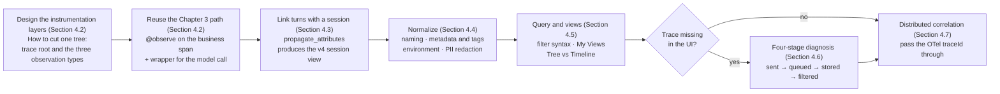
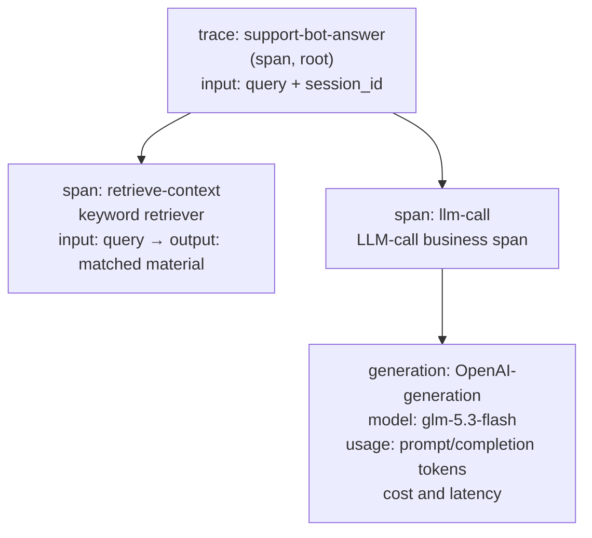
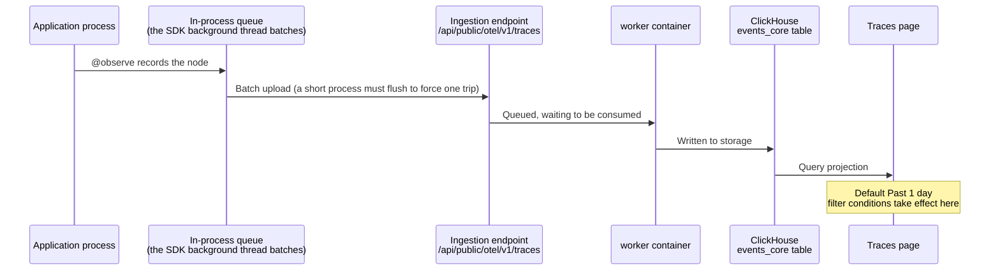
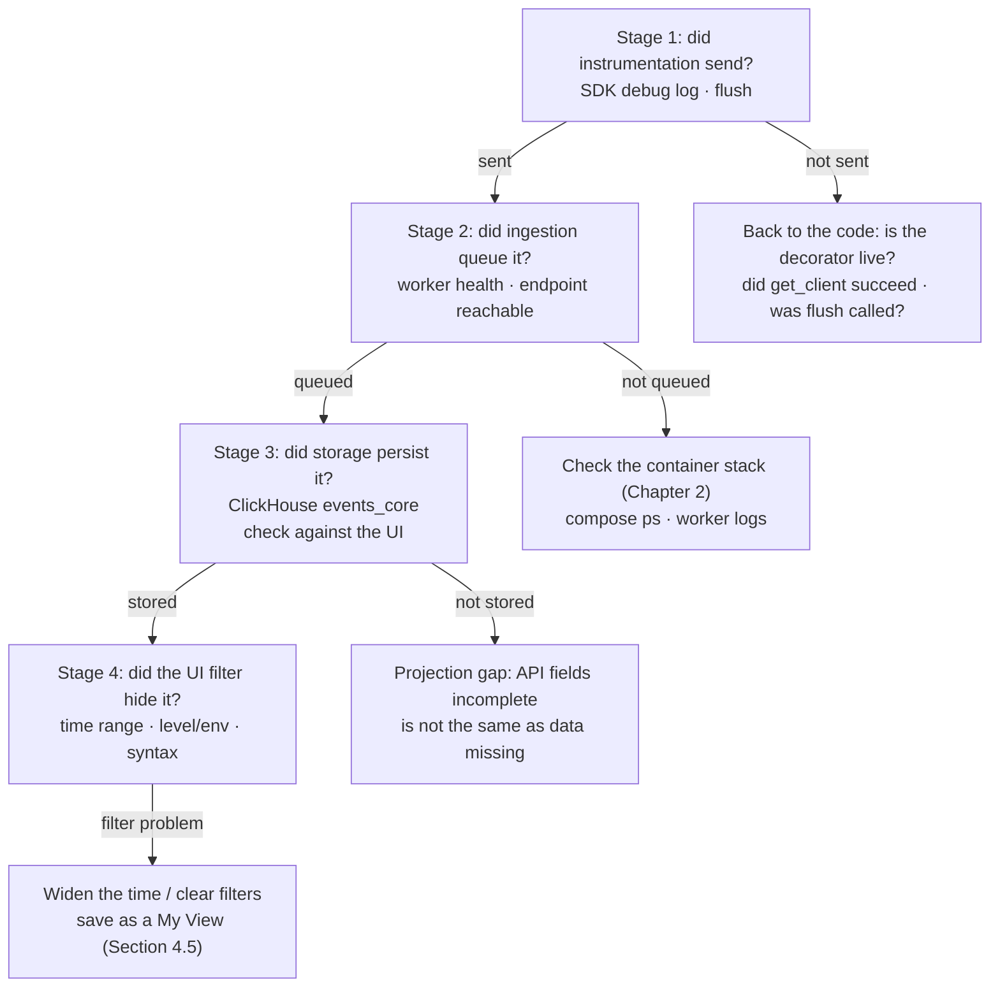

# Chapter 4 The trace model and tracing

> Guide to this chapter: Chapter 3 got the integration path working, and the trace for "售后助手" ("After-sales Assistant") is already in the UI. Between "you can see it" and "you can read it and keep it under control" there is still one layer: what each node in the hierarchy tree is, where each field comes from, how several traces are strung into one session, how a badly chosen name is unreadable to you three months later, and what to do when a user's phone number lands in input. This chapter covers the data model and the collection rules in one pass: the full field set of a trace and an observation, how the three observation types divide the work, how a session links traces and how the session view reads, the collection discipline for names and sensitive fields, filter syntax and saved views, and finally a four-stage method for the case "the UI has no such trace". After this chapter you can: draw one trace tree for your own application and name the three layers of nodes; use `propagate_attributes` to string a multi-turn session and read the v4 session view; set a naming and redaction standard for the project; use filter syntax and a saved view to find a target among a few hundred traces; and locate the stage where a trace was dropped, using the four-stage method.



*Flowchart for this chapter*

## When you need it

Three typical situations, matching three uses of this chapter.

**The application is already instrumented, but the rows in the list are visible and still unusable.** Node names were chosen on the fly, there is no session to string them together, and you cannot see where the money went. Go straight to Sections 4.2 and 4.4. The first gives you the full field set, so you know what each slot is for. The second is the methodological core of this chapter: naming conventions, the boundary between metadata and tags, environment isolation, and redaction of sensitive fields. These are rules that are extremely expensive to retrofit after the instrumentation is written, and they are worth fixing now.

**You need to answer "what happened in this user's session", or a product colleague wants to read the record as a conversation.** See Section 4.3. A session strings scattered traces into one conversation. The redesigned v4 session view folds each trace into a conversational message pair, which is the form that suits a non-engineer. In testing there is a folding oddity, "JSON-only message", and it connects directly to the naming rules in Section 4.4. This chapter covers that as well.

**The trace was instrumented, and the list still cannot find it or filter it out.** Start with Section 4.5 (filter syntax and the time range; often the filter itself is wrong), then narrow stage by stage with the four-stage method in Section 4.6: whether the instrumentation sent, whether ingestion queued, whether storage persisted, and whether the UI filter caught it.

Prerequisite: the integration path from Chapter 3 (the three variables, `@observe`, the wrapper, and flush) is usable, and the minimal After-sales Assistant has run at least once. This chapter adds no new dependency. The code evolves on `support_bot.py` from Section 3.8.

## 4.1 Overview: one tree and two jobs

Langfuse's observability model compresses into one sentence: **a trace is the complete path of one business execution, and under it hangs an observation tree; this book has two jobs to get right around that tree, cutting the tree correctly (the data model) and filling the data correctly (the collection rules).** Chapter 3 already uses this model (decorating a function hangs one node). This chapter unfolds it into a set you can look up and carry out.

| Concept | One-sentence definition | Key fields | Where it is developed |
|------|-----------|---------|------|
| trace | The complete path of one request, the root of the tree | traceId, name, session_id, user_id, tags, environment | Section 4.2.1 |
| observation | A node on the tree, one of three types | name, level, input/output, start and end time | Section 4.2.2 |
| span | A stretch of work with a start and an end | startTime/endTime, duration | Section 4.2.2 |
| generation | A specialized span: one model call | model, usage, cost | Section 4.2.2 |
| event | A point-in-time mark with no duration | a single timestamp | Section 4.2.2 |
| session | The group of traces that share one session_id | injected by `propagate_attributes` | Section 4.3 |
| score | An evaluation hung on a trace or an observation | three sources (human / evaluator / user) | Chapters 7–9 |

By the end of this chapter you will have four deliverables you can check:

| Deliverable | How to verify | Section |
|--------|---------|------|
| A design of your own trace tree (the three layers of nodes each in place) | You can point at the Tree view in the UI and say the type and the field source of each node | Section 4.2 |
| A multi-turn session such as `demo-session-001` | The conversational view on the Sessions page is readable | Section 4.3 |
| A written collection standard (naming / metadata / tags / redaction) | New instrumentation code can be checked against it directly | Section 4.4 |
| One saved view (My View) plus one four-stage diagnosis drill | The filter syntax hits the target trace; you can say which stage a lost trace stuck on | Sections 4.5 and 4.6 |

The split with Chapter 3 should be clear as well. Chapter 3 answers "how to connect". This chapter answers "how to connect well". All of the code from Chapter 3 (the minimal `support_bot.py`) is reused here as it stands, with no new dependency. What you do is read the data it produces thoroughly, then go back and change two or three instrumentation sites to match the rules in Section 4.4.

This chapter also states what it does not do: it does not cover where cost numbers come from (Chapter 5), it does not build an evaluation dataset (Chapter 7), it does not cover capacity and data-retention governance on the deployment side (Chapter 11), and it does not walk through cross-service propagation (Section 4.7 only establishes the concept; Chapter 10 does the hands-on work). The boundary of this chapter's ambition is "one tree plus one set of rules". The tree is the shape of your own application. The rules are the discipline that keeps it usable three months later.

### Sources and the hands-on baseline

- From the official data-model concepts (this chapter's `source` points at the traces concept document): the trace-to-observation hierarchy, the three types span / generation / event, and field semantics.
- From hands-on testing for this book (2026-11-08, SDK 5.2.0 + server v4.76.0, Docker deployment on a local machine): the shape of the filter syntax and the session view, the legal `as_type` values of `@observe`, the debug switch and the mask hook in SDK 5.2.0 (checked against the SDK source installed on a local machine), and the incomplete projection of the old query API.
- Our recommendation: "the data model is fixed by the documentation, and the collection rules are a team agreement". Use the former as the docs write it. The latter has to be set explicitly and written into the code-review checklist. Section 4.4 is a draft of that agreement, written out for you in advance.

## 4.2 The full data model: the trace root and the three observation types

### 4.2.1 The trace root: the registry of one path

The trace is the root of the tree, and it is also one row on the list page. The official data model gives it the following full field set (source: the official traces concept document; hands-on additions follow the UI of 2026-11-08):

| Field | Type | Meaning | Who fills it | Value in our running example |
|------|------|------|--------|-------------|
| traceId | 32-character hexadecimal string | Unique identifier, the "ticket number" when diagnosing | Generated by the SDK; an external id can also be supplied for distributed correlation (Section 4.7) | values such as `0589ef46fe82f7d7dc4b164d5bf917a5` |
| name | string | Trace name, taken from the root node name; the main dimension for the list and for filters | The instrumenting side (naming rules in Section 4.4) | `support-bot-answer` |
| timestamp | timestamp | Trace start time | Automatic, from the SDK | — |
| input / output | any JSON | The inputs of this execution and the final output | `@observe` records the function's inputs and outputs automatically | the query and the final answer |

Two boundaries for how input and output are filled, set down first. **First, keep the payload restrained.** "Any JSON" is not a license to stuff anything in. In a multimodal scenario the input can carry media such as images, and the right shape is a reference (an object-storage key, a URL) rather than the whole file body. The constraint that a metadata value is at most 200 characters (Section 4.2.4) also hints at the scale of this path. Stuffing several megabytes of raw context into every trace makes the list page and the export heavier along with it. **Second, shape the payload for the downstream view.** The conversational session view that Section 4.3 will show recognizes only input that has a message structure. That point is developed there.

| session_id | string | Session membership; traces that share an id form a group | Injected by `propagate_attributes` (Section 4.3) | `demo-session-001` |
| user_id | string | Identifier of the user who triggered the execution | Same as above | `demo-user` |
| metadata | JSON object | Structured notes: order number, channel, tenant, and so on | The instrumenting side (the usage boundary is in Section 4.4) | — |
| tags | array of strings | Filterable category labels | The instrumenting side (the split with metadata is in Section 4.4) | — |
| version | string | The application version this trace corresponds to | The instrumenting side | — |
| environment | string | Environment identifier; the default is `default` (confirmed in testing) | The instrumenting side | not set explicitly; stored as `default` |
| release | string | Deployment-version identifier (a data-model field; the current attribute list of the v5 Python SDK is mainly version / tags / environment, recorded here as it stands) | The instrumenting side | — |
Two hands-on additions. First, the summary row in the trace header (duration, cost, tokens) is a derived value computed by the server. It is not among the fields you write. Open one trace and you can see it:

![This screenshot was taken on 2026-11-08. Trace detail header and cost fields: traceId 0589ef46fe82f7d7dc4b164d5bf917a5; the header row shows duration 2.08s, $0.00, and 85 tokens; the left tree has only one OpenAI-generation node, with 2.08s and $0.000007 on the row; the right-hand detail shows the timestamp, 2.08s, $0.00, 85 tokens, and model glm-5.3-flash; Preview shows a User ("只回答1+1=?" ("Answer only: what is 1+1?")) and Assistant (2) message pair; tabs Preview / Metadata / Scores / Log View, and a Formatted / Raw switch](../assets/images/lf-trace-cost.png)

This figure answers "where did the usage fields go". The generation node row and the detail pane on the right both carry tokens and cost, and the model name is clickable. These fields are taken by the wrapper from Chapter 3 out of the model response (Section 3.4), then converted into an amount with the model unit price (pricing is in Chapter 5). Notice one display detail: **the header summary shows `$0.00`, while the node row shows `$0.000007`**. Our reading: the amount is still there. The header summary is rounded to two decimal places, and a teaching-scale small amount is rounded away to zero. To judge whether cost was booked, look at the node row and the dashboards in Chapter 5. Do not stare only at the two decimal places in the header. The top of this screenshot also has a "You are viewing legacy UI" banner. Testing sat in the dual-UI shape of the v4 migration period (Chapter 2 already covered this). The screenshots below are the same, and this note is not repeated on each one.

Arrange that header row into a quick-read table. When you open any trace, a scan from top to bottom finishes the basic checkup:

| Header element | What to read at a glance | Where to go when it looks wrong |
|---------|---------|-------------|
| traceId | The ticket number; copy it into the ticket and the diagnosis record | — |
| Duration | Total time of this execution; compare it with node durations to find the largest piece | Timeline view (Section 4.5) |
| Cost and tokens | Aggregated amount and usage | Missing numbers → check the generation fields (Section 3.4) and pricing (Chapter 5) |
| session link | Whether the session membership is right | Jump to the Sessions page (Section 4.3) |
| user | Whether the user identifier is right | Blank → the injection layer (Section 3.5) and Section 4.4.4 |

Second, the default value of environment can be checked directly in the UI. The list filter panel in Section 4.5 has an Environment facet. All four traces in this book landed on `default`, and the panel carries the hint "See docs on how to add environments to your observations-events". How to configure environment isolation, and why, is developed in Section 4.4.3 and Chapter 11.

### 4.2.2 Three observation types: span, generation, and event

Every node under the root is called an observation. There are three types. The difference is the time dimension and the semantic specialization:

| Type | Meaning | Time dimension | Fields of its own | Node in our running example |
|------|------|---------|---------|----------------|
| span | A stretch of work with a start and an end: retrieval, tool execution, a business span | startTime → endTime, with a duration | duration, level | `retrieve-context`, `llm-call` |
| generation | A semantic specialization of a span: one model call | Same as span | model, model parameters, usage (prompt / completion tokens), cost, latency | `OpenAI-generation` |
| event | A point-in-time mark with no duration | A single timestamp | No start or end | Unused in this demo; commonly the landing point of data from framework integrations and the OTel bridge |

Outside the three types, an observation also has a set of common fields. They are worth one pass, the same way as the trace fields, so that when you instrument you know who fills each slot:

| Common field | Meaning | Who fills it |
|---------|------|--------|
| name | Node name | The decorator's `name` argument; the default is the function name (Section 4.4.1) |
| input / output | Function inputs and outputs | Automatic, from `@observe` |
| metadata | Structured notes, under the same rules as the same-named field on the trace | The instrumenting side (Section 4.4.2) |
| level | The four values DEBUG / DEFAULT / WARNING / ERROR | The SDK marks it from an exception automatically; it can also be marked by hand |
| statusMessage | Status description; on error, it holds the exception summary | Automatic from the SDK, or by hand |
| startTime / endTime | Start and end time; duration is derived from the two | Automatic, from the SDK |

**level is worth a sentence of its own.** The values are `DEBUG` / `DEFAULT` / `WARNING` / `ERROR` (verified hands-on: the SDK 5.2.0 type `SpanLevel` is exactly these four values). It is the data source of the list filter syntax `level:ERROR` (Section 4.5), and it is also the basis on which the UI marks an error node in red. When a function decorated with `@observe` raises, the SDK marks the node ERROR and records the exception. A failed trace is the first entry for diagnosis and for feeding bad cases back (Chapter 7).

A boundary recorded as it stands, confirmed in testing: **the `@observe` decorator in SDK 5.2.0 does not offer an event type.** The legal values of `as_type`, confirmed in testing, are `span`, `agent`, `tool`, `chain`, `retriever`, `evaluator`, `guardrail`, `generation`, and `embedding`. Writing `as_type="event"` falls back to span and logs a warning. event exists in the data model, and its creation entry is aimed mainly at data from framework integrations and the OTel bridge (Chapter 10). For hand-written instrumentation, our recommendation: **span and generation are enough. There is no need to hunt for an event entry just to record a point in time.** A span that finishes within seconds can express the same thing.

The pair most easily mixed up among the three is span and generation. Beyond the difference in type, **the richness of what gets recorded also differs.** This restates, at the data-model layer, the hands-on conclusion of Section 3.4 in Chapter 3:

| Item | span | generation |
|--------|------|-----------|
| What is recorded | input / output, duration | All of the above, plus model, plus usage (tokens), plus cost |
| Field source | Function inputs and outputs visible to the decorator | The model response object, taken by the wrapper or the integration |
| Can manual annotation fill in model / usage | Not the relevant question | It cannot. The decorator cannot reach the response object (confirmed in testing in Section 3.4) |
| List statistics | Duration-type statistics | The data source of the cost and token dashboards (Chapter 5) |

Remember where this row lands: **the criterion for "do I create a generation node on its own" is "do I want it to carry model, usage, and cost".** It is not "did I call a model". If you do, use the wrapper and let the node grow on its own. If you do not, an ordinary span is enough.

In passing: the `as_type` values such as `agent` / `tool` / `chain` / `retriever` change the node's type icon and semantic category. They do not change how rich the recorded content is. Richness of fields is the job of the wrapper and the integration. The conclusion of Section 3.4 lines up here, on the data-model side.

### 4.2.3 Parent and child: one tree in our running example

The hierarchy is decided by the call stack. Nested `@observe` calls become a tree on their own, and the wrapper adds one more generation under the innermost LLM call. The complete tree of one reply in our running example, the After-sales Assistant:



*The observation tree of one After-sales Assistant reply (data from hands-on testing; the screenshot is in Section 3.3 of Chapter 3)*

Read this tree against the UI. Pull the same tree up in the UI and look. This screenshot from testing already appeared in Chapter 3. This section rereads it from the data-model point of view:


Compare layer by layer with the field table in Section 4.2.2. The root node is a span (it carries the inputs and outputs of the business action). Two business spans hang under the root. The generation is a leaf. **The type icon is the distinction among the three types in Section 4.2.2.** Duration comes from startTime and endTime. The generation's model and usage are visible when you open Preview. Three design decisions are worth reviewing. They are what "cut the tree correctly", at the start of Section 4.2, refers to:

| Node | Why it is cut this way | Counterexample |
|------|-------------|------|
| Decorate the reply entry with `@observe` for the root trace | One business action = one trace. The root name is the name of the business action | Treat the whole process as one trace, and dozens of replies are crammed into one tree |
| Make retrieval its own span | Retrieval quality and latency need to be attributed on their own (feeding bad cases back in Chapter 7 depends on it) | Fold retrieval into the root function, and when something goes wrong you cannot tell "nothing was found" from "the answer was poor" |
| `llm-call` is a span, and model detail is left to the wrapper's generation | The business span stays a business span. Model semantics stay with the wrapper. The two layers each record their own | Instrument the LLM by hand with `as_type="generation"`, and the fields come out incomplete (confirmed in testing in Section 3.4) |
| A tool call and an external API call each become their own span | A tool is the first place diagnosis looks in an Agent application (one node per tool) | Several tools share one "call-tools" node, and slowness and errors have nowhere to be attributed |
| Constant configuration and template assembly do not become nodes on their own | Recording them belongs in metadata, or they are not recorded, so the tree stays quiet | One span per line of code. The tree is more complicated than the business, and nobody reads it again |

**Our recommendation: draw the instrumentation hierarchy before you write the code. Cut the tree wrong, and every later filter, attribution, and evaluation turns at the wrong granularity.** The rule of thumb for cutting the tree: any piece of work for which you separately want the answers "did it run, how long did it run, and what went in and out" deserves a node of its own. Trivial steps that exist only for debugging can stay in metadata.

### 4.2.4 Filling the fields in: the attribute-injection surface of SDK v5

The field tables are done. How do you write the code that fills the slots whose "who fills it" column says metadata, tags, and environment? The SDK v5 answer converges on one place: **trace-level attributes all go through `propagate_attributes`.** It is the session injector that Section 4.3 will cover, and it is also the injector for version, tags, environment, and metadata. Confirmed in testing against the SDK 5.2.0 source, the full parameter surface it accepts is:

| Parameter | Type | What it fills | Constraint (from the source, confirmed in testing) |
|------|------|--------|-----------------|
| `session_id` | string | Session membership | Must be US-ASCII, ≤200 characters |
| `user_id` | string | User identifier | Same as above |
| `metadata` | dict | Structured notes | After JSON encoding, a value is ≤200 characters. The docs say explicitly to avoid large objects |
| `tags` | list of strings | Filterable categories | — |
| `version` | string | Application version | — |
| `trace_name` | string | Override the root trace name | — |
| `environment` | string | Environment identifier | Lowercase letters and digits, plus hyphen or underscore, ≤40 characters, and it must not start with `langfuse` (confirmed in testing: a non-compliant value is discarded by the SDK, and a warning is logged) |
| `prompt` | Prompt object | Link a managed Prompt version | The main subject of Chapter 6. Here, only note that the slot exists |

The full way to add these fields on the After-sales Assistant (incremental on the minimal version in Section 3.8):

```python
# Injection point in support_bot.py; fill in trace-level attributes to this chapter's rules
with propagate_attributes(
    session_id=session_id,          # business session key (Section 4.3)
    user_id="demo-user",            # business identifier, not a credential (Section 4.4.4)
    metadata={"retriever": "keyword-v1"},   # structured fact: retriever version
    tags=["after-sales", "demo"],           # a few stable categories
    version="v0.1",                         # application version
    environment="dev",                      # environment identifier (Section 4.4.3)
):
    ...  # every node created by retrieval and the LLM call inherits the attributes above
```

Two version notes, both pitfalls already stepped through for the reader. **First**, the `update_current_trace` / `update_current_observation` family from v2/v3 tutorials, the style that writes the current trace's attributes back one call at a time, can no longer be found in the SDK 5.2.0 source on a local machine (confirmed in testing). The v5 injection surface converges on `propagate_attributes` alone. Copying the old code raises AttributeError. **Second**, `propagate_attributes` takes effect only for nodes created **after** the scope is entered. The source documentation's own sentence is "Pre-existing spans will NOT be retroactively updated". That is the principle behind "put the injection point as high and as early as you can". Aggregate queries (cost by user, grouping by session) count only nodes that carry the attributes. Inject late, and nodes created earlier leak out of the statistics.

## 4.3 Linking a session: from scattered traces to one conversation

### The problem: traces in the list are scattered, and a session is connected

At the end of Chapter 3, `propagate_attributes` strung traces into `demo-session-001`. This section explains that thoroughly and looks at the v4 session view. From the business point of view, one consultation by a user is "four turns of question and answer". From the trace point of view it is "four independent paths". A session is the bridge between the two. Stamp the related traces with the same session_id, and the Sessions page in the UI aggregates them. user_id works the same way. The Users page aggregates by user.

The three aggregation dimensions each answer a question at a different granularity. Keep them separate:

| Dimension | Granularity | The question it answers | Where it lands in the UI |
|------|------|-----------|--------|
| trace | One business action | What happened in this turn of question and answer | One row on the Traces page |
| session | A group of related traces | The overall course of this consultation or session | The Sessions page |
| user | One user | This user's cost and behavior profile | The Users page |

### Hands-on: run a multi-turn session

The injection in Section 4.2.4 already includes session_id. To produce "one session, several traces", run the same session several times in a row. The demo in Section 3.8 already supports changing the session through an environment variable:

```bash
# Four questions in a row on the same session -> demo-session-001 strings together 4 traces (this is what this book did in testing)
python support_bot.py "我想退货,政策是什么?"
python support_bot.py "保税仓发货多久能到?"
python support_bot.py "海外直邮超时了怎么办?"
python support_bot.py "商品质量问题能换货吗?"
```

The prompt above is kept in Chinese because the corpus is Chinese. English gloss: "我想退货,政策是什么?" ("I want to return the item; what is the policy?"); "保税仓发货多久能到?" ("How long does bonded-warehouse shipping take to arrive?"); "海外直邮超时了怎么办?" ("The overseas direct-mail shipment is overdue; what should I do?"); "商品质量问题能换货吗?" ("Can I exchange the item for a quality problem?").

### The approach: inject once with propagate_attributes at the entry layer (SDK v5)

```python
# Continuing Section 3.8: the injection point in support_bot.py (confirmed in testing)
@observe(name="support-bot-answer")
def answer(query: str, session_id: str | None = None) -> str:
    with propagate_attributes(session_id=session_id, user_id="demo-user"):
        context = retrieve(query)
        ...  # every node created by retrieval and the LLM call inherits session and user
```

Three hands-on points (Section 3.5 of Chapter 3 already gave them; here they are gathered into the collection rules). **Put the injection point as high as you can.** Wrap the reply entry, so the root trace and every child node can hang on. **Use a session key the business already has for session_id.** Do not mint a new number for the sake of instrumentation. **user_id is a business identifier, and it is not a credential.** Phone numbers and email addresses stay out of this field (Section 4.4.4). `propagate_attributes` in SDK v5 is a context manager. Every trace created inside the scope carries the attributes. That is the style difference between v5 and the old habit of passing parameters on every call. The pattern in old tutorials online, "pass session_id by hand on every trace", can be upgraded.

### Confirmed in testing: demo-session-001 and the redesigned v4 session view

In this book's example, `demo-session-001` strings together 4 `support-bot-answer` traces, with a total duration of 2m08s and user `demo-user`. Open this session on the Sessions page:

![This screenshot was taken on 2026-11-08. The redesigned v4 session view: header demo-session-001, 4 traces, 2m 08s, and a user: demo-user link; a yellow banner at the top, We redesigned the session view (Learn more / Give feedback); on the left, four support-bot-answer entries, each folded into a User message row and an Assistant message row; on the right, the dialogue stream: the first item's collapsed bar JSON-only message detected (19:32:26) and a long answer about the return policy, and the start of the second item, where the bonded-warehouse timing question receives the answer "建议转接人工客服" ("We suggest transferring you to a human agent")](../assets/images/lf-session-detail.png)

This redesigned v4 session view is the form meant for a non-engineer to read. **Each trace is folded into a User message / Assistant message pair.** The page reads as a chat log. Product and operations colleagues can understand one session without understanding the hierarchy tree. The header row (N traces · total duration · user) gives a session-level summary. The banner at the top marks, as it stands, that this is the new view after the redesign. A session has two entries. The list under Sessions in the sidebar first aggregates by session (identifier, trace count, latest activity), and clicking in leads to the conversational detail. Or, after you open a trace from the Traces list, click the session link in the header and jump straight in (the path used when reading the figure in Section 3.3). For diagnosis, take the latter along the way. When you demonstrate to a product colleague, take the former.

There is an honest oddity in the figure worth stopping for. The "user message" of the first item shows as a collapsed bar, **JSON-only message detected**, and the chat text is absent. The reason is the shape of the data. The root span input of our demo is the function arguments (the JSON of args and kwargs), and it is not a `{role, content}` message structure. The session view cannot recognize a message pair, so it can only show a collapse. This is exactly where the rules in Section 4.4 earn their keep: **the shape of instrumentation data decides how much a downstream view can express.** Our recommendation: **a conversational application should keep the root node's input close to a message structure (or at least put the user's original text into input), so the session view can render it as a conversation.** The naming and field rules in Section 4.4 are, at root, an investment in the person who queries three months later, and in the downstream views.

Look at the same batch of data through another entry, and there is another layer of comparison. In the Traces list these 4 items are 4 independent rows (see the screenshot in Section 4.5; each row carries its own Start Time and Input / Output). In the Sessions view they are 4 stretches of dialogue. **The same data, two ways of reading.** Engineers who want the path go to Traces. People who are not engineers and want the process go to Sessions. Write this split straight into the team document.

### Three decisions in session design

Stamping a session_id is the start of the work, and it is not the end of it. Think through three design decisions before you begin, or the session data gets mixed across the wrong boundaries:

| Decision | Options and consequences | This book's suggestion |
|------|-----------|---------|
| Granularity: what counts as one session | Open a session per turn of dialogue (sessions too fine) / per the user's whole consultation cycle, including a follow-up the next day (sessions too coarse) / per the frontend session key (aligned with the business) | **Use a session key the business already has.** Do not mint a new number. Several turns of dialogue on the frontend are one session |
| Lifetime: when a session opens a new one | Cut by a fixed duration / triggered by a business event (a new ticket, a new order) | Driven by business events. Time is only the fallback |
| Naming: what a session_id looks like | The business key as it stands / a prefix to distinguish the channel | Add a prefix (`web-`, `api-`) so filtering is easier. Note the SDK constraint: session_id must be US-ASCII and at most 200 characters (verified hands-on in Section 4.2.4). Transcode a Chinese session key first |

Hidden in the third decision is a hard constraint verified hands-on: **session_id and user_id must be US-ASCII strings.** Transcode a Chinese nickname or a Chinese order number before using it as an identifier, or the SDK side runs into trouble. This constraint also echoes Section 4.4.4 again. Any idea that anything in the business can serve as an id should be narrowed at the instrumentation layer.

One last boundary question: which traces should stay out of the same session? Requests that cross users must never share a session. Different lines of business for the same user (a pre-sales consultation and an after-sales ticket) should be split. A session is the boundary of one complete process. Draw the boundary too wide, and the session view becomes a jumble, and the header summary (N traces · total duration) also loses its use as a reading. When you are unsure, use a business event as the knife: a new ticket, a new order, a return visit the next day, each opens a new session.

## 4.4 Collection rules: naming, metadata, environment, and redaction (the methodological core of this chapter)

The instrumentation API can be learned in ten minutes. The hard part is what to record, what to call it, and what to leave out. This section extracts the practices already in use in our running example into a set of rules that can be written down. Each rule comes with a positive example and a counterexample. **Our recommendation: the four rules below are a team agreement, and they are not a documentation requirement. Copy them as they stand into your code-review checklist.**

The reason the rules have to be set in the first moment after integration is an iron law of observation data: **wrong instrumentation can be fixed in code, and the history cannot.** Section 3.7 of Chapter 3 already saw that pricing takes effect only for newly ingested data. The fields in Section 4.2 behave the same way. Change a name, and old traces still carry the old name. Add a field, and past data does not grow it. Because observation history cannot be migrated, the engineering order is fixed: **collection rules come before traffic.** Going back to normalize after traffic is up means the statistics forever carry a batch of non-compliant historical data.

### 4.4.1 Naming: a verb phrase or a component name, and each of the three layers keeps its place

The node name is the primary key, three months later, for you and for every filter and aggregation. Mess up the names, and the data might as well be absent. This book's convention:

| Layer | Convention | Our running example | Counterexample |
|----|------|---------|------|
| Root trace | A verb phrase, so the business action is obvious at a glance | `support-bot-answer` | `main`, `run`, `test123` |
| Business span | component_action, or action_object, matching the code module | `retrieve-context`, `llm-call` | `func1`; folding a whole stretch of business into one name on the root node |
| generation | A semantic name for the model call | `OpenAI-generation` (named automatically by the wrapper: integration name, then action) | Renaming by hand loses the clue that the wrapper recorded this node |

The convention has only two hard rules. **Names are readable and stable.** The same action always has the same name, or filtering and aggregation have nothing to hold onto. **Dynamic values stay out of the name.** A user id and an order number go into metadata. Put them in the name, and aggregation by name is destroyed. "How many replies per day, by trace name" fails at once. The wrapper's automatic name `OpenAI-generation` is the name the official integration gives it. Keep it as it stands. It already carries the meaning "recorded by the openai integration".

Naming is a team agreement. Before it is written down, here is a self-check. Before new instrumentation is merged, ask five questions:

1. Is the root trace name a verb phrase, so someone else can guess the business action without reading the code?
2. Does the same action have exactly the same name in test and in production? Section 4.4.3 uses environment to distinguish environments, and the name distinguishes actions. Do not give one of them the other's job.
3. Is a dynamic value spliced into the name (an id, a timestamp, a random number)?
4. Do the three layers of names share a style (root = action, business span = component_action, generation = the official name), or does each layer go its own way?
5. Are they lowercase English with hyphens? That is easy to type in the filter syntax. A Chinese name, or a name with spaces, gets in the way in the search box.

A common question on Chinese-speaking teams is whether a node name can be Chinese. It can. Chinese in input and output is recorded as usual, and the name field does not reject Chinese either. Our recommendation is **node names in lowercase English with hyphens, and the business meaning left in metadata.** In filter syntax, in exported data, and in cross-team work, an English identifier has the least friction. This is the same discipline as "identifiers in English" in code review, extended one step.

### 4.4.2 metadata, tags, and level: three slots, each recording its own thing

Three slots for free-form recording, each with a clear job. Mixing them is a common ailment:

| Slot | Type | Suited to recording | Counterexample of misuse |
|------|------|--------|---------|
| metadata | JSON object | Structured notes: order number, tenant, channel, retrieval hit count | Dump the whole business context in (a large JSON of several thousand bytes); stuff PII in (see Section 4.4.4) |
| tags | array of strings | A few filterable categories: channel, experiment group, a canary mark | Four or five casual free-text tags, which amounts to having no tags; using tags to record a dynamic value |
| level | A four-value enumeration | Node health: DEBUG / DEFAULT / WARNING / ERROR | Mark WARNING by hand everywhere, and drown the nodes that actually errored |

Hold the split in one sentence. **Structured facts you want to query go into metadata. A few categories you want to filter go into tags. Health state goes into level. Large text inputs and outputs stay in their home, input and output. Explanations for a human to read go into the annotations and comments of Chapter 9.** A ready-made counterexample from our running example: record "how many pieces of material retrieval hit" in tags (`tags=["hit-2"]`), and filtering by hit count has to do string matching. Record it in metadata (`metadata={"hit_count": 2}`), and both numeric filtering and aggregation are straightforward. That convenience shows up again when Chapter 5 builds dashboards and Chapter 7 builds datasets, and it is worth deciding in advance.

The value of metadata pays off as "write one extra field today, and write ten fewer lines of analysis script tomorrow". Two examples you can use at once. **Retriever version**, `metadata={"retriever": "keyword-v1"}`. After Chapter 7 swaps the retriever for a vector implementation, group by this field and compare the bad-case rate of the two generations of retriever. Without the field you cannot say which version contributed the score. **Request source**, `metadata={"source": "web"}` or `api`. Grouped statistics on the Chapter 5 dashboards, such as how the cost splits between web and api, take their numbers from this field. The other direction of the same point: the largest misuse of metadata is stuffing notes meant for a human into it. Note-like content goes to Comment on the detail page (the human annotation system in Chapter 9). metadata takes only structured facts a machine can query.

### 4.4.3 environment: a wall between development and production

The trace field environment defaults to `default` (confirmed in testing; visible on the filter panel in the Section 4.5 screenshot). Its value is isolation: **experimental dirty data from dev stays out of the statistics and dashboards of prod.** Every example in this book landed on `default`, because the teaching scenario has only one environment. When you take this to production, the minimal practice this book recommends is:

- Use a small fixed enumeration for the environment id (`dev` / `staging` / `prod`). Leave free invention out of it. This is a hard constraint, verified hands-on, that SDK 5.2.0 places on the environment value: lowercase letters and digits plus hyphen or underscore, at most 40 characters, and it must not start with `langfuse`. A non-compliant value is discarded quietly and a warning is logged (Section 4.2.4).
- Each environment's deployment injects its own environment (for example, mapped through the environment variable `APP_ENV`), and the SDK sends it along with `propagate_attributes`.
- How the two isolation layers, environment and project, relate. Isolation inside an environment relies on the environment field. Physical isolation relies on multiple projects and multiple keys (the key scope in Section 3.2 of Chapter 3). Full multi-project governance and member permissions are developed in Chapter 11. Set the rule here first: **any environment whose cost and quality statistics you will look at should be distinguished with environment from day one. Migrating the data afterward cannot be done.**

### 4.4.4 Redacting sensitive fields: keeping PII out of the trace is discipline, and it is not optional

A trace records input and output as they stand, by default. A phone number or a national identity number that a user types into the dialog is stored character for character. **Our recommendation: keeping PII (personally identifiable information) out of the trace is discipline, and it is not a suggestion.** The access surface of observation data (the list, the detail page, export) is far larger than the business database, and the leak surface grows with it. Set the defenses in layers:

| Defense | Practice | When |
|------|------|------|
| Discipline at the source | user_id uses a business identifier, and it does not use a phone number or an email address. Redact a field that has to be kept before it enters the message | While writing the code |
| SDK mask hook | Pass a `mask` function when constructing the client. The SDK calls it synchronously while generating attributes, and replaces a value that hits a sensitive pattern | In process, before the data leaves the application |
| Hook before export | SDK 5.2.0 also has an export-level hook, `mask_otel_spans`, which can delete or replace by OTel span attribute (recorded as it stands: the mechanism was checked against the SDK source; the example was not verified hands-on) | The last step before export |

An approach Example for `mask` (recursively replace string values that hit the pattern; **not verified hands-on**, written to the `MaskFunction` protocol of SDK 5.2.0: the keyword argument is `data`, and the return value must be JSON-serializable):

```python
# mask_demo.py (approach Example, not verified hands-on) — sensitive values are replaced before they leave the application
import re
from langfuse import Langfuse

PHONE = re.compile(r"1[3-9]\d{9}")

def mask(*, data):
    if isinstance(data, str):
        return PHONE.sub("[REDACTED]", data)
    if isinstance(data, dict):
        return {k: mask(data=v) for k, v in data.items()}
    if isinstance(data, list):
        return [mask(data=v) for v in data]
    return data

lf = Langfuse(mask=mask)   # attach it when the client is created; the get_client() global singleton has to be configured on first creation
```

A common follow-up question: is it acceptable to instrument first, and delete the sensitive data from the store once you notice it? Our recommendation: **redaction has to be finished before the write.** Once observation data is stored, it enters the flow of query, export, and dashboards, and the leak window is open from the moment of the write. Deleting afterward is also constrained by the append-style write model of the observation store, and by exports that have already happened. This is also why both defenses, discipline at the source and an in-process hook, sit on the application side up front. The closer the defense sits to the data, the smaller the leak surface.

Two reminders that go with it. First, mask only covers data that passes through the SDK. The discipline layer, refusing to write it at the source, is the main defense. The hook is a fuse, and it is not a wall. Second, the redaction function itself has to pass tests. If correct data is turned into `[REDACTED]` by mistake, the observation data is ruined as well.

### 4.4.5 Sampling and cutting volume: the tradeoff in a high-traffic scenario (concept level)

On a single-machine demo, one reply is one trace, and recording everything has no pressure. At a million calls a day, the storage and query cost of full instrumentation becomes the problem. This book does not expand into hands-on steps (our running example does not need them). It only gives three concept-level directions, so you have them in mind before traffic rises:

| Direction | Idea | What it costs |
|------|------|------|
| Head sampling | Record only a proportion of requests (for example 10%) | Cost and quality statistics are distorted, and have to be scaled up when you read them |
| Differentiated sampling | Sample normal traffic; record errors (level ERROR) and slow requests in full | A bit more work to implement; the information kept is the most balanced of the three |
| Cut the payload | Record every request, and keep only a summary of input and output. Large text stays out of the trace | A single trace carries less, and replay diagnosis gets harder |

The SDK has a matching hook. The 5.2.0 source shows a `should_export_span` filter (the export-level hook in the mask subsection runs at the stage after the SDK has already filtered by `should_export_span`). Custom conditions decide which spans are exported, and differentiated sampling can be done at this layer (**the approach was checked against the source, and it was not verified hands-on**). Our recommendation: **record in full first, and cut volume later.** Let the data speak first. When storage cost actually pinches, choose from the table above. Sample from the first day, and you will mix "the data is missing" with "the data is sparse", and diagnosis gets twice as hard.
## 4.5 Query and views: filter syntax, saved views, and how the three views divide the work

### The list page and the filter syntax

The Traces list is a table, and it is also a search box. The filter box at the top supports **field syntax**, usable as confirmed in testing (2026-11-08):

```
level:ERROR, scores.quality>0.8
```

A comma separates several conditions. `level:` filters by node level (the four-value enumeration in Section 4.2.2). `scores.<name>` filters by score. Scores themselves are the subject of Chapters 7–9; remember the syntax path here. The left side of the list page also has a structured filter panel. Open one condition and you can check it:

![This screenshot was taken on 2026-11-08. The Traces list and its filters: the search box contains isRootObservation:true; shortcut buttons at the top, Quality / Slow / Cost, My Views (0), a Table / Chart switch, and Columns 16/34; the Filters panel on the left is expanded, with the facets Is Root Observation (True 4 / False 8), Name (support-bot-answer 4), Type (SPAN 4), and Environment (default 4); the table has 4 rows of support-bot-answer, columns Start Time / Type / Name / Trace Name / Input / Output, Total 4 at the bottom, and the time-range selector at the upper right shows 1d Past 1 day](../assets/images/lf-traces-list.png)

Read four query points out of this figure. **First**, the filter panel turns common fields into clickable facets (Name, Type, Environment, Trace Name, Metadata, Session ID, and others). If you would rather not memorize the syntax, click. The selected condition is written back into the search box at the top. In the figure, `isRootObservation:true` is that write-back: root traces only, and child-node rows are excluded. **Second**, the three shortcut views Quality, Slow, and Cost at the top are preset filters (slow queries, high cost). Chapter 5 revisits them from the cost side. **Third**, the time-range selector at the upper right defaults to `Past 1 day`. **The most common reason for "I instrumented it and the list still cannot find it" is the time window, and the data is still there.** When you diagnose, widen to a longer range first. **Fourth**, Columns (16/34) can configure the list columns. Promote a key fact out of metadata into a column, and scanning gets faster at once.

Learn the syntax, and do not rely only on clicking facets, because the syntax is **copyable**. Write the filter into a diagnosis document, a code-review comment, or an on-call manual, and a colleague reproduces it by pasting. The mouse path of a facet click cannot be handed over. The "widen the time and clear the filters" action in stage 4 of the four-stage method in Section 4.6 also lands, in the end, as one pasteable empty condition or one wide condition. Syntax and facets are two ways to type the same filter. After you save a My View, the two paths arrive at the same place.

The user dimension belongs in the same picture. Beside the list and the filters, the sidebar has a Users page, which aggregates every trace by user_id. "How much did this user use today, and how much did they spend" is then one click away. The premise is that the user_id injection rules of Section 4.3 are actually carried out. A missing identifier, or an identifier that is PII (Section 4.4.4), discounts the value of that page.

**My Views.** After you tune a set of filter conditions, save them as a named view. The number on the button is how many are already saved (confirmed in testing as 0, the initial state with nothing saved). This book recommends that every project save at least three: `prod-errors` (`level:ERROR` plus `environment:prod`), `slow-traces` (a duration threshold), and `today-badcase` (today's cases waiting to be filed; the "Select Observations" feed-back in Chapter 7 takes its data from here). A saved view turns "rebuild the filter on every diagnosis" into "one click".

Walk through one complete "filter, then save" operation, as the hands-on list of this section. It is UI work throughout, on the order of two minutes:

1. **Widen the time.** First set the time range at the upper right so it covers the target period. The default is `Past 1 day`. When you look up historical data, widen first. That is the lesson of Section 4.6.
2. **Write the filter.** Type `level:ERROR` in the search box (or click a facet first and let it write the condition back). Append a second condition such as `, scores.quality>0.8` when you need it.
3. **Check the result.** Look at the Total row count and the Input / Output columns, and confirm the hits are the traces you wanted. If the columns are wrong, click Columns and adjust them.
4. **Save.** Click My Views and save a named view (for example `errors-last-week`). Next time, one click reproduces it.
5. **Revise the rules.** If this filter was meant to find which kind of node is erroring, write the conclusion back into the naming and metadata rules of Section 4.4. The way a query feels is a check on the collection rules. That is the loop between the two sections.

Two other list features, mentioned and left there. **The Table / Chart switch** aggregates the current filter result by time into a bar chart. It is easier to read than a table when the question is whether errors are scattered or arrive in a batch. The **Ask AI** button at the upper right is a natural-language query entry added in v4. This book has not confirmed its behavior in testing, and does not expand on it. Follow the discipline of Section 4.6, and take the UI's actual behavior as the authority.

### Three views on the detail page: how Tree, Timeline, and Graph divide the work

Open a trace, and the left side is three drawings of the same hierarchy tree:

| View | The question it answers | When to use it |
|------|-------------|-----------|
| Tree (the default) | Who is whose child; hierarchy and belonging | Everyday reading of the tree, and finding a node. The default view of the whole book |
| Timeline | How the nodes sit on a time axis; who comes after whom; what is concurrent and what is serial | Latency attribution: which stretch is slow (the P95 view in Chapter 5 takes its numbers here) |
| Graph | A graphical drawing of the tree | The view-switch bar has a Graph tab (in this book's screenshot from testing the tab is greyed out; no usable figure was captured; the detail is left as a gap, and nothing is invented) |

The Timeline view, as seen in testing:

![This screenshot was taken on 2026-11-08. The Timeline view: the top is still trace 0589ef46fe82f7d7dc4b164d5bf917a5; the view switch is Tree / Timeline / Graph, and the Graph tab is greyed out; the timeline panel on the left has a Show labels switch and a 0ms origin tick; this example is a single node, and the bar is extremely short against the origin; the right side follows the selection and shows the selected OpenAI-generation node's timestamp 2026-11-08 19:58:40.862 and env: default; Preview shows a User / Assistant message pair](../assets/images/lf-trace-timeline.png)

The value of Timeline shows up on a multi-node tree. On a three-layer tree like the After-sales Assistant, the order of retrieval and the LLM call, and the time each one took, are visible at a glance. This example happens to be a minimal single-node trace. The bar sits against 0ms, which itself shows that **the granularity of the tree decides how much information the view holds.** That returns once more to "cut the tree correctly" in Section 4.2.3. The detail pane on the right follows the node selected on the left. `env: default` beside the timestamp is the environment field of Section 4.4.3, landing on the node.

A concrete way to read latency attribution: after you enter Timeline, start from the longest bar. That bar is the largest piece of latency in this execution. Then look sideways at whether it and its sibling nodes are serial or parallel. Every link on a serial chain adds to the total duration. The performance dashboards in Chapter 5 upgrade this action from "reading one trace's figure by hand" to "P95 statistics over a batch of traces". The intuition from a single figure is what makes the later reading correct.

## 4.6 Four-stage trace diagnosis: four gates between "instrumented" and "visible"

"The code clearly instruments it, and the UI simply does not have it" is the most frequent problem of the integration period, and the answer can sit in four different stages. Section 3.7 of Chapter 3 gave a symptom lookup table. This chapter promotes it into a method with **a fixed order that narrows one stage at a time**. The point of the four stages is to keep you from opening the database at stage 1, and from discovering only at the last stage that the time range was never widened.

### The data's journey first: one trace from the process to the list

Each stage of the four-stage method is one stop on the data's journey. Draw the route first (the responsibility table of the deployment components is in Chapter 2):



*The write journey of one trace: the four-stage method checks the ticket at each stop along the way*

Against this figure, each stage has a clear place to land. Stage 1 checks App to Q (did the record enter the queue). Stage 2 checks Q to Ing to W (upload and consumption). Stage 3 checks W to CH (persistence). Stage 4 checks CH to UI (projection and filtering). A lost trace is one of those stops putting the passenger off the train.



*Four-stage trace diagnosis: narrow one stage at a time, client first and server after*

Stage by stage (deployment facts such as ports and container names are in Chapter 2; the health-check endpoint is in Section 3.2):

| Stage | What it decides | Means and criterion |
|----|---------|-----------|
| 1 Did instrumentation send | Did the data leave the process | Turn on the SDK debug log: the environment variable `LANGFUSE_DEBUG=true` (or the constructor argument `debug=True`; verified hands-on: the SDK 5.2.0 source is exactly this switch; once it is on, the logger rises to DEBUG, and batch sends show up in the log). For a short process, confirm `lf.flush()` before exit (Section 3.6). Check that the decorator really wrapped the target function |
| 2 Did ingestion queue it | Did the server accept it | The ingestion endpoint `/api/public/otel/v1/traces` is reachable (on a local machine, watch `NO_PROXY`, Section 3.2). The worker container is healthy: `docker compose ps` shows all six containers, and `logs worker` has no continuous errors. The worker is the consuming end of the ingestion pipeline (the six-container responsibility table in Chapter 2) |
| 3 Did storage persist it | Is it in the observation store | Observation data lands in ClickHouse (the `events_core` table, Chapter 2). **The old query API of the SDK projects an incomplete row.** Section 3.7 confirmed in testing that `lf.api.observations.get_many` returns model and usage as None, while the UI and ClickHouse have the values. The check in this stage takes the UI as the authority |
| 4 Did the UI filter catch it | Is a filter condition hiding it | Widen the time range (the default is Past 1 day, Section 4.5). Clear filters and facets. Check the Columns configuration. After a hit, save a view as in Section 4.5 |

**Our recommendation: when you verify instrumentation, take the UI as the authority.** The toolchain sits on the v3-to-v4 migration belt (dual-write mode, a legacy UI and a latest UI, and the old API's projection lagging behind). The UI is currently the only window that stays consistent with the stored data. A query from code only checks existence: did the data arrive. The sign that the four stages have been run through once, smoothly: faced with "no such trace", you can say within two minutes which stage it stuck on, and which switch to move next.

### A stage-by-stage review of three faults from testing

The four-stage method is a procedure that has already been used, and it is not a paper flowchart. Three faults actually hit during this book's deployment and integration, and each one stuck on a different stage. Review them once. The full record of each fault is in Chapters 2 and 3:

| Fault | Symptom | Which stage it stuck on | How it was found, and the fix |
|------|------|---------|-----------|
| The system proxy hijacks localhost | The SDK reports a connection error or a 502, while the service is clearly running | Stage 2 (ingestion): the endpoint was not reachable | The request was taken by HTTP(S)_PROXY. Set `NO_PROXY=localhost,127.0.0.1` (Section 3.2) |
| A short script's trace is sometimes there and sometimes absent | The script finishes normally, and most of the time the UI has no such trace | Stage 1 (send): the process exited before the upload | A race. The atexit fallback is unreliable for a short process. Call `lf.flush()` before exit (Section 3.6) |
| Query API fields are None | `observations.get_many` returns model and usage as None, which looks like lost data | Stage 3 (persistence): a false alarm | The values are present in both the UI and ClickHouse. Only the old API projection is incomplete. Take the UI as the authority (Section 3.7) |

The shared pattern is worth saying once. **None of the three faults is "the instrumentation code was written wrong".** The decorator, the wrapper, and the injection were all correct. The problem sat on the conveyor of the path: the proxy, the process lifetime, and the API projection. That is why the four stages are ordered client first and server after. Your instrumentation code is checked at stage 1. The later three stages inspect infrastructure. There is no need to go back and doubt every line you wrote.

The server-side view of stage 2, filled in here. The ingestion pipeline of the deployment on a local machine spans the container stack. web receives the request, the Redis queue buffers, and the worker consumes and writes ClickHouse (the six-container responsibility table in Chapter 2). "Did ingestion queue it" can therefore stick in any of four places: the endpoint is unreachable (web), the queue is blocked (Redis), the worker has crashed (the worker container), or the write failed (ClickHouse). One glance over the six containers with `docker compose ps`, plus a stretch of log from `logs worker`, is the standard action of this stage. Digging into each container is left to the governance topic of Chapter 11.

### Make the four stages a habit: four questions at review time

Diagnosis is an after-the-fact action. The better practice is to move the four stages forward into the instrumentation review. Before new instrumentation is merged, ask four questions. Was flush called before the process exits (stage 1)? Can the target environment's network reach the ingestion endpoint directly (stage 2)? Were the fields of the first batch of data checked in the UI (stage 3)? Given this instrumentation's name and environment, can the filter be written down (stage 4)? When all four are green, this instrumentation is unlikely to enter the diagnosis flow again.

## 4.7 Distributed trace correlation: passing the OTel traceId through

Every trace so far was born in a single process. In a real system, one user request often crosses several processes: a gateway, a business service, a retrieval service. **Gathering observation points that are scattered across processes onto one trace depends on passing through the traceId of the OTel (OpenTelemetry) standard.** The start of the path generates a traceId (a 32-character hexadecimal string; verified hands-on: the type definition in SDK 5.2.0 describes the OTel trace id this way). It travels hop by hop in a request header such as `traceparent`. Each service hangs its observation points under the same traceId. Langfuse, as an OTel backend, gathers them by id into the same tree. This also explains the "an external id can be specified" note on traceId in the field table of Section 4.2.1. When the upstream system already has a path id, build the trace with that id, and the ticket numbers on both sides connect.

Our running example is a single-process application, so the hands-on steps are left out. The mechanism of propagation is sketched in three lines of pseudocode. The standard HTTP header `traceparent` carries the traceId and the current span id. This is a concept sketch, and it was not verified hands-on:

```text
Service A (entry)  ->  generate a traceId, and write the header on the call: traceparent: 00-<traceId>-<spanId>-01
Service B (retrieval)  ->  read traceparent, and hang the observation points on the same traceId
Langfuse      ->  gather by traceId; the nodes of both services merge into one tree
```

Two landing points on the application side, written down first. **First**, in a multi-service system you build yourself, pass the OTel headers through on the HTTP client. The SDK and the OTel bridge continue the trace on their own. Bridge configuration and the compatibility check are in Chapter 10, including the conclusion that the RAGFlow integration goes through the v2 single-event API. **Second**, for a system that cannot pass the id through yet, the fallback is to write the business number (an order number, a session key) into metadata on both sides, and to correlate by hand with that number. It is an awkward fallback, and it saves a diagnosis:

```python
# Fallback shape: write the business number on both sides, for manual correlation across systems
with propagate_attributes(
    session_id=f"web-{order_no}",            # session key (the prefix convention in Section 4.3)
    metadata={"order_no": order_no},         # business number; the other system records it too
):
    ...  # observations in both systems can be searched by order_no
```

A further step is to make both sides use exactly the same number. That is the moment the "an external id can be specified" use of traceId, in the field table of Section 4.2.1, plays out. When the upstream system already has a path id, build the trace with it, and diagnosis connects in one lookup. Rank the three routes by engineering cost: pass the OTel header (the straight route), then build the trace with the same number, then write the business number into metadata on both sides (the easiest fallback).

## Chapter summary

Back to the question at the start. This chapter delivered five things:

1. **The data model.** The full field set of the trace root (traceId / name / session_id / user_id / metadata / tags / version / environment / release), how the three observation types divide the work (a span has a duration, a generation carries model semantics, an event is a point-in-time mark), and the three-layer tree of our running example (Section 4.2).
2. **Session linking.** `propagate_attributes` injects session and user at the entry layer. The redesigned v4 session view folds a trace into a conversational message pair. The "JSON-only message" oddity is a reminder that the shape of the data decides what the view can express (Section 4.3).
3. **Collection rules.** The three-layer naming convention (root = a verb phrase, business span = component_action, generation keeps the wrapper's name), the split and the counterexamples for metadata / tags / level, environment isolation, the discipline that PII stays out of the trace, and the SDK mask hook (Section 4.4).
4. **Query and diagnosis.** Filter syntax (`level:ERROR, scores.quality>0.8`), My Views, the Tree / Timeline split, and the four stages "sent, then queued, then stored, then filtered", with "take the UI as the authority" the whole way (Sections 4.5 and 4.6).
5. **Distributed correlation.** The concept of passing an OTel traceId through, and two landing points on the application side. The hands-on work waits for Chapter 10 (Section 4.7).

On our running example, the After-sales Assistant's tree, the session (`demo-session-001`), and the naming rules are in place. The "root input is not a message structure" problem found in Section 4.3, like the bad case "海外直邮超时" ("overseas direct-mail overdue"), is left hanging as it stands, to be picked up in a later chapter.

A suggested next step: take the tree in Section 4.2.3 and recheck your own application. Once the hierarchy and the names are right, the cost and latency analysis in Chapter 5 has a clean dimension to group by. If you want to see first how a usage number becomes money, the model pricing in Chapter 5 can follow directly after the cost fields in Section 4.2.1.

## Acceptance checklist

- ☐ Draw a trace tree for your own application: a root trace, at least two business spans, and a generation, each in its place, and be able to say where each node's fields come from (recorded automatically by the decorator, or taken by the wrapper)
- ☐ Use `propagate_attributes` to string 3 or more traces of the same business into one session, and read a session-level summary on the Sessions page (N traces · total duration · user)
- ☐ Say how metadata, tags, and level divide the work, and find one place in your own instrumentation where they are mixed, and fix it
- ☐ Explain why user_id cannot be a phone number, and describe out loud where the `mask` hook sits in the data flow (in process, before the data leaves the application)
- ☐ On the Traces list, hit a group of traces with the filter syntax (at least one `level:` or `scores.` condition), and save it as a My View
- ☐ Looking at the four-stage flowchart, say what each stage checks when the UI has no such trace, and explain why the check at stage 3 takes the UI as the authority
- ☐ Say the two uses of traceId in a distributed scenario: OTel propagation gathers one tree, and an external system's ticket number connects across the boundary

## Quick reference

Understanding the main line does not depend on this section. This section is for lookup during an instrumentation review and during diagnosis.

### A crib of trace fields

| What you are looking up | Where | Note |
|--------|------|------|
| The unique identifier of a path | traceId (32 hexadecimal characters) | Copyable in the header; an external id can be specified |
| One session | session_id → the Sessions page | The v4 conversational view |
| Every path of one user | user_id → the Users page | A business identifier, and not a credential |
| Structured notes | metadata (JSON) | Numeric filtering beats tags |
| A category filter | tags (an array of strings) | Few, and stable |
| Environment | environment | The default is `default` |
| Health | level (DEBUG / DEFAULT / WARNING / ERROR) | Filter with `level:ERROR` |

### SDK entries added in this chapter (SDK 5.2.0, confirmed in testing)

| API or switch | Use | Note |
|-----------|------|------|
| `propagate_attributes(session_id=…, user_id=…)` | A context manager that injects session, user, and attributes | SDK v5 style; wrap the reply entry |
| `LANGFUSE_DEBUG=true` or `debug=True` | SDK debug log (stage 1 of diagnosis) | Verified hands-on: the source file `client.py` is exactly this switch |
| `Langfuse(mask=…)` | Redact synchronously while attributes are generated | The `MaskFunction` protocol: keyword `data`; the return value must be JSON-serializable |
| `Langfuse(mask_otel_spans=…)` | Redact OTel span attributes at export time | The mechanism was checked against the source; the example was not verified hands-on |
| Legal values of `@observe(as_type=…)` | span / agent / tool / chain / retriever / evaluator / guardrail / generation / embedding | There is no event. Writing event falls back to span (confirmed in testing) |
| `lf.api.observations.get_many()` | The old query (incomplete projection) | model and usage are None. Check against the UI |

### A crib of the filter syntax

```
level:ERROR                    # by node level
scores.quality>0.8             # by score (Chapters 7–9)
isRootObservation:true         # root traces only
level:ERROR, scores.quality>0.8   # a comma joins several conditions
```

### A pocket card for the four stages

On a diagnosis, follow this order. One sentence decides each stage:

| Stage | One-sentence decision | Action |
|----|-----------|------|
| 1 Sent | Is there an upload batch in the log (`LANGFUSE_DEBUG=true`)? | Turn debug on; check flush |
| 2 Queued | Is the worker still alive? Does the endpoint connect directly? | `compose ps`; `NO_PROXY` |
| 3 Stored | Is it in the UI (leave the old API's projection aside)? | Check with the UI as the authority |
| 4 Filtered | Is the time range or a condition hiding it? | Widen the time; clear the facets; save a My View |

### What was confirmed in testing, and what was not

- Confirmed in testing (2026-11-08, SDK 5.2.0 + server v4.76.0): the filter syntax and the session view, the Environment facet, the cost and usage fields in the header, the legal `as_type` values of `@observe`, the mechanisms of `LANGFUSE_DEBUG`, `mask`, and `mask_otel_spans` (checked against the SDK source), and the incomplete projection of the old query API.
- Not verified hands-on (approach Examples): the `mask` redaction example in Section 4.4.4; the cross-service OTel traceId propagation in Section 4.7. Before you adopt either one, verify it yourself on the version you use.

### Where the documentation and testing differ

Where "what the docs and the data model say" and "what testing saw" in this chapter do not fully agree. Testing is the authority in each row, and the check date is noted:

| Item | What the docs or the data model say | What testing saw (2026-11-08) |
|----|------------------|------------------|
| observation types | Three types: span / generation / event | `@observe` does not accept event. Writing event falls back to span and logs a warning |
| Injecting trace attributes | (v2/v3 tutorials) the `update_current_trace` family | SDK 5.2.0 has no such family. Everything goes through `propagate_attributes` |
| environment values | A free string | Lowercase letters and digits plus hyphen or underscore, at most 40 characters, and it must not start with `langfuse` |
| session id and user id | An identifier string | Must be US-ASCII and at most 200 characters |
| Query API | Observation data can be queried from code | The old `observations.get_many` has an incomplete projection. Check against the UI |
| Graph view | One of the three views on the detail page | The tab is greyed out in the screenshot from testing. No usable figure was captured. Left as a gap |

## Further reading

- **Chapter 3 Quick start.** The source of every hands-on data point in this chapter: three-variable integration, the combination of the wrapper and `@observe`, and the flush discipline. The tree in Section 4.2 is what the code in Section 3.8 produced.
- **Chapter 5 Cost and performance monitoring.** The full reading of the `$` amounts and the tokens in the header of Section 4.2.1: model pricing (the built-in price table has no Zhipu model, so you create one by hand), the cost dashboards, and latency at P95. The Slow and Cost shortcut views of Section 4.5 are developed there.
- **Chapter 7 Evaluation datasets.** Where the collection rules of Section 4.4 pay off. A trace whose name and metadata are in order can be fed back, through Select Observations, into a dataset item. The bad case "海外直邮超时" ("overseas direct-mail overdue") is picked up here.
- **Chapter 10 Integrating an existing system.** The hands-on companion of Section 4.7: the OTel bridge, the list of framework integrations, and the compatibility conclusion from the RAGFlow integration (the compatibility issue between the v2 single-event API and v4).
- **Chapter 11 Deployment and governance.** The full context of environment in Section 4.4.3: physical isolation with multiple projects and multiple keys, member roles, and API key governance.
