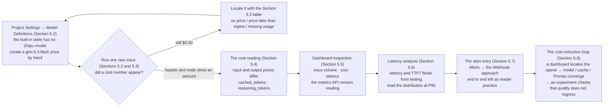
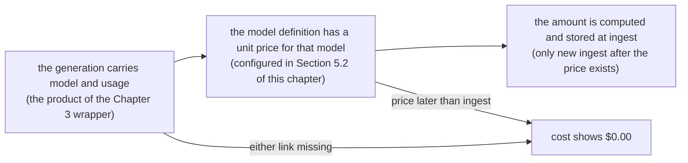
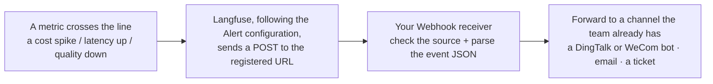
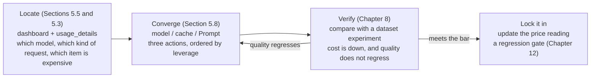

# Chapter 5 Cost and performance monitoring

> Guide to this chapter: the end of Chapter 3 left a loose end. The trace for "售后助手" ("After-sales Assistant") already has model and usage, and it still has no cost number. This chapter delivers on that. Cost does not appear on its own. Langfuse does not know what you pay for one token of your model. Model Definitions, the model price list, is where everything starts. Once a price is in place, a `$` amount grows on the trace header and on the node, and the preset dashboards have a cost curve to look at. This chapter follows one line of work: create a price by hand for glm-5.3-flash, confirm that cost is visible on the trace and on the dashboards, understand the cost reading (input, output, cache, and reasoning tokens), do latency analysis from a P95 point of view, learn the alert entry (the Webhook approach; the end-to-end path is left as reader practice), and close it into a "locate, then converge, then verify" loop for cutting cost. After this chapter you can: create a price by hand for a model that is absent from the built-in price table, and state the boundary that a price applies only to newly ingested traces; read the trace header, the node-level amount, and the three usage figures in usage_details; use the preset dashboards to answer where the money went and where the slowness is; and give a cost-cutting path from a dashboard location, through to an experiment that checks it.



*Flowchart for this chapter*

## When you need it

Three typical situations, matching three uses of this chapter.

**The generation in the trace already has model and usage, and every cost field is $0.00.** This is the most typical way into the chapter. Go straight to Section 5.2. Langfuse's built-in price table covers mainstream models such as OpenAI and Anthropic, and it does not include a domestic endpoint such as Zhipu. Create a model definition by hand for glm-5.3-flash, and cost starts to be booked. Note the key boundary in Section 5.2: a price applies only to newly ingested traces. Historical data is not recomputed backward.

**Cost is already booked, and you need to answer where this month's money went, and which kind of request is the most expensive.** See Section 5.3 (how to read the cost of a single trace) and Section 5.5 (inspecting the preset dashboards). A single trace tells you what one call cost. A dashboard tells you the trend and the makeup after aggregation. The two together take you from "I know the unit price" to "I can read the bill".

**You need to answer where the slowness is, or you want a cost anomaly to become an active notification.** The first is Section 5.6 (latency, time to first token, TTFT, and the P95 point of view). The second is Section 5.7 (the Alerts entry and the Webhook approach). Section 5.7 has to say this first: end-to-end alerting was not completed on a local machine. That section is the UI entry plus the approach, and it is not a record of a completed test.

Prerequisite: the After-sales Assistant from Chapter 3 is running, and the `OpenAI-generation` node in the trace contains model and usage. That is the data premise of every cost calculation in this chapter (without usage there is no cost; Section 5.3 has a lookup table). The project `after-sales` and the administrator account from Chapter 2 are available. This chapter introduces no new dependency. Every operation is done in the UI and in the Python environment you already have.

## 5.1 Overview: cost and latency are the business reading of observation data

Chapters 3 and 4 answer "what happened": the path, the hierarchy, the inputs and outputs. This chapter answers "does this business pay for itself". Read the same batch of trace data again from two points of view. **The cost point of view** multiplies usage (token counts) by a unit price and gets an amount. **The performance point of view** turns timestamps into a latency distribution. Langfuse builds both points of view into the same data surface. After a price is configured, the amount appears on the trace and on the dashboards on its own. You do not write any more instrumentation code.

Before you start, pass once over the smallest set of concepts in this chapter:
| Concept | One-sentence definition | Use in this chapter | Where it is developed |
|------|-----------|---------|------|
| Model Definitions | A price record from a model name to a unit price, scoped to the project | Create one price for glm-5.3-flash, with an input price and an output price | Section 5.2 |
| usage details | The token-usage fields on a generation. The starting three are input, output, and total | The raw data of the cost calculation | Section 5.3 |
| cached tokens | Tokens that hit the provider-side prompt cache. The count appears as a key inside usage_details | An approximate item in the cost reading | Section 5.4 |
| reasoning tokens | Output-side tokens a reasoning model spends while it thinks | A large piece of the cost reading that is easy to miss | Section 5.4 |
| dashboard | An aggregated view of metric cards. Five are preset | Inspect trace volume, cost, and latency | Section 5.5 |
| TTFT | Time to first token: from the moment the request is sent until the first token arrives | The core metric of a streaming experience | Section 5.6 |
| alert | A notification sent to an external channel when a metric crosses a line | Four kinds of channel, among them Slack and Webhook | Section 5.7 |

By the end of this chapter you will have four deliverables you can check:

| Deliverable | How to verify | Section |
|--------|---------|------|
| A price record for glm-5.3-flash | The Model Definitions list shows a row marked User | Section 5.2 |
| A cost amount on a new trace | The trace header and the node show a `$` amount | Section 5.3 |
| A dashboard-inspection conclusion | The two preset dashboards, Cost and Latency, can be read for a trend | Section 5.5 |
| A written cost-reduction path | The three steps "where it is expensive, the converging action, the experiment that checks it" each have an answer | Section 5.8 |

### Sources and the hands-on baseline

- From the official documentation (this chapter's `source` points at the token-cost feature page): what a model definition is for, and the mechanism by which a price drives the cost calculation.
- From hands-on testing for this book (2026-11-08, SDK 5.2.0 + server v4.76.0, Docker deployment on a local machine): the built-in price table has no Zhipu model, the signature of `lf.api.models.create` as confirmed in testing, prices do not reach backward into history, the precision of cost on the trace header and on the node, the presence in testing of `cached_tokens` inside usage_details and of `reasoning_tokens` inside completion_tokens_details, and the `latency` and `time_to_first_token` fields on a generation.
- From the published compatibility note (langfuse.com/docs/compatibility, checked on 2026-11-08): the version difference of the metrics API. Self-hosted v3 has only the v1 endpoint, and v4 adds a v2 endpoint. This item was not checked endpoint by endpoint. Section 5.5 marks that as it stands.
- Every price in this chapter is a **teaching value**, and it is not Zhipu's official price. The alert in Section 5.7 is an **approach that was not verified hands-on**. The full split between the fact layer and the recommendation layer is in the text of each section.

## 5.2 Cost starts from a price: Model Definitions

### The problem: why every cost is $0.00

After Chapter 3 got the After-sales Assistant running, the `OpenAI-generation` node in the trace already had model=`glm-5.3-flash` and usage numbers, and the cost column did not move. The trace header shows `$0.00`. This is the mechanism, and it is how the product is built: **Langfuse cost is computed, and it arrives as a computation rather than as a number the SDK uploads.** The SDK uploads token usage. Amount = usage × unit price, and the unit price lives only in a model definition. A project that was just created has only Langfuse's built-in price table, and that table does not contain a Zhipu model. Usage is present, the unit price is absent, and the amount is zero.

Hold this causal chain. Every later investigation of "the cost is zero" is a variant of it:



### The UI path: project Settings, then Model Definitions

The price entry is in the project settings. The path is **project `after-sales`, then the Settings group in the left sidebar, then Model Definitions**. What opens is a list of price definitions:

![This screenshot was taken on 2026-11-08. The Model Definitions page under project Settings: Model Definitions is selected in the Settings sidebar on the left; the explanatory text on the right reads "A configuration that stores pricing information for an LLM model…"; the table columns are Model Name / Match Pattern / Prices per unit / Tokenizer / Last used; the first row is glm-5.3-flash with a blue User mark, Match Pattern (?i)glm-5\.3-flash, and Prices per unit showing input $0.0000002; rows below, such as babbage-002 and chat-bison, are built-in definitions with a green Langfu mark; at the top are the buttons Test Model Match and + Add Model Definition; the banner You are viewing legacy UI is the dual-UI shape of the v4 migration period](../assets/images/lf-model-definitions.png)

Read the figure block by block:

| UI element | What you see | The mechanism behind it |
|---------|-----------|-----------|
| Built-in definitions (the Langfu mark) | A large set of preset rows, such as babbage-002, chat-bison, and chatgpt-4o-latest, shown with paging (Page 1 of 4, confirmed in testing) | The mainstream-model price table Langfuse ships with the version. **Testing found no Zhipu model in it** |
| User definitions (the User mark) | The first row, glm-5.3-flash, with a User mark | A price created by hand. When the names match, **a user definition takes priority over the built-in table** |
| Match Pattern | A regular expression such as `(?i)glm-5\.3-flash` | At ingest it is matched against the model string the generation uploaded. `(?i)` means case-insensitive |
| Prices per unit | `input $0.0000002` (a teaching value in this book) | The unit price per token. Input and output are priced in separate columns |
| Tokenizer column | Some rows have a tokenizer configuration. The glm-5.3-flash row is empty ("—") | Used for a local token estimate when no usage is uploaded. Once the wrapper has uploaded usage, it is unused |
| Test Model Match | Type a model name and see at once whether the regular expression hits | A self-check before you rely on the pattern. Use it as soon as the pattern is saved |

### Creating it through the API: lf.api.models.create (signature confirmed in testing)

Outside the UI, the SDK can create a model definition too. The call signature confirmed in testing for this book (2026-11-08, SDK 5.2.0):

```python
# create_model_price.py — create a price by hand for glm-5.3-flash (runs; confirmed in testing)
from langfuse import get_client

lf = get_client()   # reads the three environment variables from Chapter 3

lf.api.models.create(
    model_name="glm-5.3-flash",            # display name, the Model Name column in the list
    match_pattern="(?i)glm-5\\.3-flash",   # regular expression, matched against the generation's model string
    unit="TOKENS",                          # pricing unit: per token
    input_price=0.0000002,                  # 2e-07 USD/token — a teaching value, not an official price
    output_price=0.0000007,                 # 7e-07 USD/token — a teaching value, not an official price
)
print("model definition created")
```

```bash
python create_model_price.py
# model definition created
```

Refresh the Model Definitions page after it runs, and the first row of the list is `glm-5.3-flash` with a User mark, matching the screenshot. Three details are worth a stop.

**First, match_pattern is a regular expression, and it is not an exact name.** Whatever the uploading side writes (for example a full name with a gateway prefix), the regular expression has to be able to match it. If you are unsure, verify it first with Test Model Match on the page, or write the pattern a bit loosely, such as `(?i).*glm-5\.3-flash.*`. In the RAGFlow integration of Chapter 10, the model name becomes a full name like `glm-5.3-flash@zhipu-gateway@OpenAI-API-Compatible`. The same model uploads under different names on different integration routes, and that is the point where pricing most often goes wrong.

**Second, the price unit is US dollars per token.** `input_price=0.0000002` is 0.0000002 dollars per token (2e-07). The "0.2 dollars per million tokens" figure that is common in official docs converts to exactly 2e-07 dollars per token. Both values in this book are **teaching values, chosen so the arithmetic can be demonstrated, and they are not Zhipu's official price.** When you connect a real project, replace them with the figures on the official price page of the model you use.

**Third, unit is TOKENS.** Langfuse also supports pricing per request, and other unit scenarios such as CHARACTERS. The standard posture for usage-based LLM billing is TOKENS plus an input price and an output price. Testing for this book covers only the TOKENS route.

### The key boundary: a price applies only to new ingest, and it does not reach backward into history

This is the most important boundary testing produced in this chapter (2026-11-08). **A trace ingested before the price existed keeps the amount `$0.00` forever. A trace ingested after the price exists is the one that starts to have an amount.** Langfuse does not go back and recompute historical usage at the new unit price.

The direct consequence for our running example: the batch of After-sales Assistant traces that Chapter 3 produced (the 4 traces of `demo-session-001`) is still `$0.00` after the price is created. When they were ingested, the unit price did not exist yet. To verify that a price has taken effect, you have to **run a new one**:

```bash
python support_bot.py "1+1 等于几?"    # a trace newly ingested after the price exists
```

The prompt above is kept in Chinese because the corpus is Chinese. English gloss: "1+1 等于几?" ("What is 1+1?").

An amount appears on the header and on the node of this new trace (the next section reads it in detail). In engineering terms the boundary means this: **treat the price as an item on the go-live checklist, finished in the same batch as the instrumentation.** Run traffic first and add the price later, and the cost data inside that window is missing for good. This agrees with the Chapter 3 rule that verification takes the UI as the authority. Whatever the data looked like at the moment it was stored is what it is.

### Pricing several models, and priority: User overrides the built-in table

A real project has more than one model. The two kinds of mark in the screenshot are exactly the operating rules of the pricing system:

| Mark | Source | Priority |
|------|------|--------|
| Langfu (built in) | The price table preset with the Langfuse version | Low. It is the fallback |
| User (a user definition) | A model definition you create in the UI or through the API | **High. On a same-name match it overrides the built-in row** |

That priority has a practical scenario. The built-in table already has some mainstream model, and the vendor has cut the price, or the price you were given is a discounted one. Create a User definition and lay it on top. There is no need to wait for Langfuse to update the built-in table. When several models coexist, create one definition per uploaded name. The companion action is to write "which models this project uses, and whether each one has a price" into the go-live checklist, joined to the naming convention in the collection rules of Chapter 4. **Keep the model string stable, and the regular expression keeps hitting year after year.** If the upstream side changes the uploaded model name (for example the gateway prefix changes) and the price pattern does not follow, new data falls back to `$0.00` with no noise. That is the most common kind of silent failure in cost monitoring.

## 5.3 Where to read the cost: the trace header, the node amount, and usage_details

### The amount on the trace header and on the node (precision confirmed in testing)

After the price takes effect, run one new trace and open the detail page. The screenshot from testing for this book (2026-11-08):


Two observations about precision, confirmed in testing, are hidden in this figure and worth stating on their own:

| Place | What testing showed | How to read it |
|------|---------|------|
| The trace header summary | `$0.00` | **The header amount is displayed truncated to two decimal places (cents).** The $0.000007 computed for one small call is `$0.00` in the header. The cost is present. The display precision is what you are looking at |
| The amount on the node row | `$0.000007` | **The node level is exact to six digits after the decimal** (confirmed in testing). The real amount of a single call is here |
| Header tokens | `85 tokens` | The token total of the whole trace. This one is a very small smoke test (the question "只回答1+1=?" ("Answer only: what is 1+1?")) |

So the right way to read cost is this: **the header is for magnitude and trend, and the node is for the exact value of one call.** The header's `$0.00` is a display. To judge whether cost was actually computed, look for an amount like `$0.000007` on the node row, or switch to the dashboard in Section 5.5 and look at the aggregated curve.

### usage_details: the three items input, output, and total

The raw basis of the amount is the usage detail on the generation. On the detail node, switch to the Raw view (Chapter 3 already said that Raw is the more honest view when you are chasing field detail). Inside `usage_details`, testing shows a structure that starts with three items:

```json
{
  "usageDetails": {
    "input": 21,
    "output": 4,
    "total": 25,
    "cached_tokens": 0
  }
}
```

(The numbers are a structural sketch from testing. In this book's example that call had a total of 85 tokens, including the system prompt and the retrieval context. The numbers here are simplified so the explanation stays easy to follow. The field keys and the nesting are what testing showed.) The meaning of the three items, and their role in the cost formula:

| Field | Meaning | Role in the cost formula |
|------|------|----------------|
| `input` | Prompt-side tokens sent into the model (including system, context, and history) | × input_price |
| `output` | Completion-side tokens the model generated | × output_price |
| `total` | The sum of input and output | It does not enter the price directly. It is the aggregate shown on screen |
| `cached_tokens` | The count of tokens that hit the provider cache (the key name confirmed in testing) | An approximate item of the reading. Developed in Section 5.4 |

The cost formula in one line:

```text
cost = input × input_price + output × output_price
```

A **teaching example** with this book's teaching values (the numbers are assumed, so the magnitude has something to attach to). One After-sales Assistant reply has input of 1200 tokens (the system prompt, plus the retrieved FAQ context, plus the user question) and output of 150 tokens. Then:

```text
1200 × 0.0000002 + 150 × 0.0000007 = 0.00024 + 0.000105 ≈ 0.000345 USD
```

One call is about $0.00035, and ten thousand calls are about $3.45. The example also exposes a structural fact along the way: **input is usually far larger than output.** Every character of retrieval context stuffed into the prompt is billed at the input price. That is the economic starting point of the two actions "Prompt convergence" and "cache" in the cost-reduction loop of Section 5.8.

### The premise of what the wrapper records automatically (echoing Chapter 3)

Every way of reading cost in this section has one premise, the instrumentation choice in Section 3.4 of Chapter 3: **the generation node must have model and usage.** Recall how the two instrumentation routes differ on the cost chain:

| Instrumentation | model | usage | Can a price compute a cost afterward |
|---------|-------|-------|------------------|
| The `langfuse.openai` wrapper (the node name confirmed in testing is `OpenAI-generation`) | Present (confirmed in testing) | Present (confirmed in testing) | **Yes.** The amount appears on its own |
| A manual `@observe(as_type="generation")` | Absent (confirmed in testing) | Absent (confirmed in testing) | **No.** There is no usage, so the unit price has nothing to multiply |

If one of your LLM calls took the manual route, it is still $0.00 after the price exists. The fault is in the instrumentation, and the price is fine. Switching to the wrapper is the straight path (Section 3.4 of Chapter 3). For an integration route that genuinely cannot use the wrapper, the fallback is to write model and usage into the observation attributes by hand, or to wait for the framework-integration route in Chapter 10.

### A lookup table for "the cost is $0.00"

Compress the mechanism of Sections 5.2 and 5.3 into one lookup table, ordered by how often each row hits:

| Symptom | The usual cause | What to do |
|------|---------|------|
| Every trace is $0.00 | The built-in table does not have your model, and a price was never created | Create a model definition by hand, Section 5.2 |
| Old traces are $0.00, and new traces have an amount | The price is later than the ingest. **History is not recomputed** (a boundary confirmed in testing) | Expected. Verify the price with a new trace |
| One node is $0.00, and the rest have amounts | That call used a manual `as_type="generation"` and has no usage | Switch to the wrapper (Section 3.4 of Chapter 3) |
| A new trace is also $0.00 | The model string was not hit by match_pattern | Verify the regular expression with Test Model Match. Check the full model name that was uploaded |
| The header is $0.00 and the node has an amount | Display precision: the header is truncated to cents (confirmed in testing) | Expected. Look at the node and at the dashboard |

### Three granularities for reading cost: one call, a session, and a project

The amount on a single trace is only the start. The business point of view has three granularities, and each has its own entry:

| Granularity | The question it answers | Entry | Where this chapter covers it |
|------|-----------|------|---------|
| One call | What one call cost | The node amount on the trace detail | Section 5.3 |
| A session | What one user session (several turns of question and answer) adds up to | The session link in the trace header, then the Sessions page. The session view aggregates duration and usage | The session view in Chapter 4 |
| A project | How large the total is over a period, and what it is made of | Dashboards (Section 5.5) and the metrics API | Sections 5.5 and 5.8 |

In our running example: one reply is about $0.00035 (the teaching example in Section 5.3). The 4 traces of `demo-session-001` together are the cost of one consultation session. "How much did the After-sales Assistant spend in its first month online, and which model is the largest share" is a project-granularity question. The coarser the granularity, the more you depend on dashboards and the API, and the less you depend on opening traces one by one. Cost aggregation at session granularity follows what the Sessions page in the UI displays (the same rule as "take the UI as the authority" in Chapter 3).

## 5.4 The cost reading: input, output, cache, and reasoning tokens

### Reading one: input and output have different unit prices

The first principle of LLM pricing: **the output unit price is generally higher than the input unit price.** Generating costs more than understanding. This book's teaching values are input 2e-07 and output 7e-07. The output side is 3.5 times the input side, and that multiple is ordinary on a real price list. It leads directly to two pieces of engineering common sense:

- **Compressing output is high-leverage cost cutting.** Making the model say less filler (output-length control, structured output) saves the price gap more than compressing input does.
- **Look at the usage distribution first.** If your input is dozens of times the output, which is ordinary in a retrieval-augmented scenario (see the example in Section 5.3), compressing input is the large piece of the total. **Where the leverage is comes from the actual distribution in usage_details, and the price multiple does not decide it on its own.** That is why the dashboard in Section 5.5 comes before intuition.

### Reading two: cached tokens, cached_tokens

Testing (2026-11-08) can see a `cached_tokens` field among the keys of usage_details. It comes from cache-hit information that the upstream model endpoint returns along with usage, and the wrapper passes it through into Langfuse as it stands (the key name is what testing showed; the pass-through mechanism is a reading of how it works). The mechanism of the cache, prompt caching: the provider caches a prompt prefix that keeps recurring (usually a long system prompt, or a fixed context) on the server side, and the next hit is handled at a lower price, or at a higher speed.

For the cost reading, this book gives an **interpretive frame** (a recommendation, and not a conclusion from the docs). Langfuse computes the amount as the input and output items of usage_details, each multiplied by its unit price. `cached_tokens` is a finer label inside input. Langfuse does **not** automatically recompute the cache-hit portion at a discounted price, because the discount ratio is a pricing policy on the provider side, and a Langfuse model definition has only one input price and one output price. The practical conclusions:

- When your provider has a separate price for cached tokens, the cost Langfuse displays is **an approximation on a full-price input reading.** It is enough for a budget. An exact reconciliation uses the provider's bill.
- The value of the cache is still visible inside Langfuse. The `cached_tokens` key is present, so the hit information entered the observation data, and dashboards and filters can use it for an application-level check of an optimization (for example, confirming that the hit rate rose after the system-prompt structure changed).
- If you want the cache discount computed exactly, you can fold it in yourself at the model-definition layer (fill in an equivalent unit price after the discount). That is your own choice of reading, and it is not a promise from Langfuse.

### Reading three: reasoning tokens, reasoning_tokens

glm-5.3-flash is a model with a reasoning capability. Before the answer there is a stretch of "thinking", and the tokens that stretch consumes are priced as output. Testing (2026-11-08) can see a `reasoning_tokens` field inside the generation's `completion_tokens_details`. It counts the part the model "thought away" beyond the final answer:

```json
{
  "usageDetails": {
    "input": 21,
    "output": 4,
    "total": 25
  },
  "completionTokensDetails": {
    "reasoning_tokens": 3
  }
}
```

(The key nesting is what testing showed. The numbers are on the scale of the smoke test in this book's example.) For the cost reading, this book's **interpretive frame** is: reasoning_tokens is already included in the output usage (it is a breakdown of the completion, and it is not an extra item), so **it is billed at the output price.** The large piece of a reasoning model's bill is often "how long it thought", and it is often not "how long the answer is". A minimal question such as "只回答1+1=?" ("Answer only: what is 1+1?") can still have a thinking cost on the same scale as the answer itself. The engineering implication:

- **For a simple task, pick a non-reasoning model, or turn deep thinking off** (when the provider supports that). In the reasoning era this is the most direct cost-cutting path.
- Inside Langfuse, `completion_tokens_details.reasoning_tokens` turns "the cost of thinking" from a black box into a field you can observe. You can compare reasoning cost across models and parameters on the strength of it (the cost dimension of the experiment comparison in Chapter 8).

### A summary table of the readings

| Reading | Where testing found it | How the price is understood (this book's frame) | What kind of source |
|--------|---------|---------------------|---------|
| input | usage_details.input | × input_price, including system, context, and history | Testing, plus the documented mechanism |
| output | usage_details.output | × output_price, including reasoning_tokens | Testing, plus the documented mechanism |
| cached_tokens | usage_details.cached_tokens (the key confirmed in testing) | A finer label inside input. Langfuse does not recompute a discount on its own | The key from testing, plus this book's reading frame |
| reasoning_tokens | completion_tokens_details.reasoning_tokens (the key confirmed in testing) | Already inside output, priced at the output price | The key from testing, plus this book's reading frame |

One sentence is enough if the table will not stay in memory: **Langfuse multiplies the input and output items of usage_details by the unit prices. Cache and reasoning are finer readings on the provider side. Langfuse makes them visible, and the discount and the pricing rules follow the provider.**
## 5.5 Dashboards: inspecting the preset boards, and the metrics API

### Preset dashboards: five, ready to open

The cost of a single trace is a microscope. A dashboard is a telescope. Click **Dashboards** in the sidebar. Langfuse presets five dashboards, ready to open:

![This screenshot was taken on 2026-11-08. The project Dashboards page: two tabs, Dashboards and Widgets; five preset dashboards — Langfuse Agent Dashboard (2 months ago), Langfuse Home (Overview of traces, costs, scores, usage, and latencies…, 4 months ago), Langfuse Cost Dashboard (Review your LLM costs), Langfuse Latency Dashboard (Monitor latency metrics across traces and generations…), Langfuse Usage Management (Track usage metrics across traces, observations, and scores…); Owner is a Langfuse mark on every row; the button + New dashboard is at the upper right](../assets/images/lf-dashboards.png)

| Preset dashboard | Description (original text on the page, as seen in testing) | What this chapter uses it for |
|---------|---------------------|-------------|
| Langfuse Home | An overview of traces, costs, scores, usage, and latencies | The first look when the day opens: anomalies on the three curves of volume, money, and speed |
| Langfuse Cost Dashboard | Review your LLM costs | The starting point for locating spend in the cost-reduction loop of Section 5.8: where the money went |
| Langfuse Latency Dashboard | Monitor latency metrics across traces and generations | The visual landing point of the latency analysis in Section 5.6 |
| Langfuse Usage Management | Track usage metrics across traces， observations， and scores | The token-usage total: the input / output distribution |
| Langfuse Agent Dashboard | Monitor agent tool usage: total tool calls, most-called tools… | Tool-call observation for an Agent scenario (this book's example does not cover it yet) |

Inspect in the order "volume, then money, then speed". Look at Usage first (did the usage total move oddly, for example input doubling on some day, which is usually retrieval context swelling). Then look at Cost (how money moves with volume, and the makeup by model). Then look at Latency (whether the distribution has shifted right as a whole). The cards (widgets) inside each dashboard can be filtered by time window, and a dashboard itself can be copied and then changed into your own. The Widgets tab on the page manages every card. **+ New dashboard** starts from a blank board.

### A hands-on inspection: one question per card

An inspection does not have to read every card closely. This book gives a minimal routine. Take one question into each dashboard, and dig only when the answer looks wrong:

| Dashboard | The question you bring in | The signal that something is off | Where to dig when it is off |
|------|-------------|---------|---------------|
| Usage Management | Is the usage total steady? | input or output rises sharply day by day, or drops sharply | Filter the Traces list by time range, and sample usage_details |
| Cost Dashboard | Where did the money go? | One model's share changes suddenly; total cost and usage come apart (volume steady, price up) | Sort Traces by cost, and check the model and the price (Section 5.2) |
| Latency Dashboard | Has speed degraded? | P95 shifts right (Section 5.6); the error rate lifts its head | Filter slow requests and Error, and open the trace to see the layered time |

For our running example, the expected reading of this inspection: on the Usage card, input should be clearly larger than output (retrieval context is holding it up; the conclusion of reading one in Section 5.4). On the Cost card, glm-5.3-flash is the only model (only that one price was configured). On the Latency card, if P95 is clearly higher than P50, there is a long tail of slow requests, and you break it down along the path in Section 5.6. A dashboard always gives you "where something feels wrong". The move that locates a specific trace still goes back to the list filters and the detail-page basics of Chapter 4.

### The metrics API: the version reading of v2 and v1

If you want your own chart or report system to consume the metrics, outside the dashboards, you go through the metrics API. One version reading has to be stated as it stands (source: langfuse.com/docs/compatibility, checked on 2026-11-08; **this book did not test endpoint by endpoint**):

- **Self-hosted v3 has only the v1 metrics endpoint.**
- **v4 adds a v2 endpoint.** The v4.76.0 confirmed in testing for this book belongs to that generation.

What that means in practice: a metrics call path in an online tutorial or in old integration code should be checked against the generation of your server before you use it. A v3 instance calling a v2 path returns 404. In the other direction, the fields and the aggregation reading of v2 cannot be assumed to hold on v1. Before you build an export integration, take the path confirmed on your instance's API docs page (`/api/docs`) as the authority. This is the same family of problem as "the old query API of the SDK projects an incomplete row" in Chapter 3. **On the v3-to-v4 migration belt, any API behavior takes what your instance shows in testing as the authority, and a tutorial is not that authority.**

## 5.6 Latency analysis: latency, TTFT, and P95

### The latency fields on a generation (confirmed in testing)

Beside cost, performance is the other half of monitoring. Testing (2026-11-08) shows two latency fields on a generation node:

| Field | Meaning | What testing showed |
|------|------|---------|
| `latency` | The total time of that model call | The `2.08s` in the Section 5.3 screenshot. The wrapper records it automatically. Nothing to configure |
| `time_to_first_token` | The time from sending the request until the first token arrives | The field is present, confirmed in testing. **Under a non-streaming call it has no meaning of its own** (see below) |

latency is a common field that every observation layer has (trace and observation). TTFT is a semantic field particular to a generation. It has a real business meaning only under a streaming call.

### Why look at P95, and leave the average aside

On dashboards and during diagnosis, our recommendation: **read latency as a distribution, and leave the mean aside.** The reason is that the latency distribution of LLM requests has a long tail by nature. Most requests take a few hundred milliseconds to two seconds. A few requests (long context, long reasoning, provider jitter) drag out to more than ten seconds. The mean is quietly lifted by the long tail, or diluted by a large batch of fast requests, and what users complain about is exactly the long tail:

| Point of view | The question it answers | The blind spot |
|------|-----------|------|
| The average | How long one call takes on average | The long tail is diluted. It looks good in an operations report, and it is useless for diagnosis |
| P50 | The experience of a typical request | Slow requests are invisible |
| **P95** | 95% of requests are faster than this; how slow the slowest 5% are | **The default point of view this book recommends.** It is an upper bound a user can feel, and a single extreme case (a timeout at 1 in 1000) does not drag it off course |
| The maximum | That one slowest call | Held hostage by a single network anomaly. The fluctuation has no meaning |

The concrete move: on a latency card of the Langfuse Latency Dashboard, switch the aggregation to p95 (a dashboard card supports a choice of aggregation), and then use the filter syntax from Chapter 4 (`level:ERROR`, a duration filter) to pull those 5% of slow requests out of the Traces list. Open them one by one and look at the tree to see which layer is slow. Is the retriever slow, or is the model slow. The Timeline view of a trace (Chapter 4) shows it at a glance.

### Break latency down inside the trace: slow in retrieval, or slow in the model

P95 tells you "slow requests exist". The layered time of a trace tells you "which stretch is slow". Take the After-sales Assistant. A trace's tree has three nodes that carry a duration, and breaking latency down is reading them:

| Node | What it records | What the latency means |
|------|---------|---------|
| `support-bot-answer` (the root span) | The whole reply | End-to-end total time. The number the user feels |
| `retrieve-context` (a span) | The keyword retriever | Application-side overhead. This book's demo is an in-memory match, on the order of microseconds. In production, once this is replaced by vector retrieval or a knowledge base, this stretch is often where latency lives |
| `llm-call` and the `OpenAI-generation` under it | The LLM call | Model-side overhead. The latency field is the model's total time. TTFT adds the streaming first-token point of view |

The reading logic of the breakdown, in one sentence: **the root node's total time is about the application stretch plus the model stretch. Whichever share is larger, optimize that one first.** In the shape confirmed in testing for this book's demo, the model call is the overwhelming share (the retriever is an in-memory keyword match), so the first lever of latency optimization is on the model side: a faster model, a shorter output, streaming upstream to improve TTFT. Once the retriever is upgraded to real vector retrieval or an external knowledge base (the RAGFlow book), the `retrieve-context` stretch deserves a card of its own. That is the value of layered observation: **latency attribution does not have to be a guess. The numbers on the tree speak for themselves.**

### Streaming and non-streaming: where TTFT applies (concept level)

What follows is concept-level, to help a choice. It is not a comparison this book ran in testing:

- **Non-streaming.** One request, and the complete answer returns once. latency is the whole of the user's wait. TTFT is about equal to latency, and it carries no information of its own.
- **Streaming.** The answer is pushed token by token. What the user feels is two stretches. **TTFT** (how long until the first character appears, which decides whether the response feels fast) and the rate of characters after the first one (which decides whether the reading feels smooth). The same total latency, with TTFT at 0.5s or TTFT at 3s, is a very different product experience.

So quality monitoring for a streaming application puts TTFT on a dashboard of its own, as a first-class metric. A non-streaming application can look at the latency distribution and stop there. The evidence from testing for the fields in this section is the table at the start of the section. The per-token observation detail of a streaming scenario was not expanded in testing for this book. When you connect streaming, take the wrapper docs and your own testing as the authority.

## 5.7 Alerts: the Alerts entry and the Webhook approach (not verified hands-on, marked as it stands)

> A statement of what this section is. The UI entry of the Alerts page is a screenshot from testing for this book (2026-11-08). **The end-to-end alert path (create a channel, then an event fires, then the notification arrives) was not completed on a local machine.** This section is a tour of the UI and an introduction of the approach. It does not invent a test result. The end-to-end practice is left for the reader to do. When you operate, take your instance's UI and the official docs as the authority.

### The UI entry: Alerts in the sidebar

In the Observability group of the sidebar, Alerts sits beside Tracing, Sessions, and Users. Opening it shows a guided empty state:


This guided page splits alert configuration into two steps, matching the approach in this section one for one:

| Step | Original text on the page | Meaning |
|------|---------|------|
| Step 1 | Choose where alerts should go | Where the notification goes: four kinds of channel, Slack, Webhooks, GitHub Actions, and PagerDuty (visible in testing) |
| Step 2 | Decide what to monitor | What is monitored: key metrics such as cost, quality, and latency crossing a line (the subtitle's reading, as seen in testing) |

### The Webhook approach: the most general channel for a self-hosted install

Of the four channels, Slack and PagerDuty depend on the matching SaaS. GitHub Actions is aimed at the automation of "an alert triggers one workflow". **For a local deployment and for an environment inside China, Webhooks is the most general entry.** It depends on no particular SaaS, and the approach is the most direct:



Turning this approach into a system that can run takes four things. An HTTP endpoint that can receive a POST from the public network (or at least from a network the containers can reach). A check of where the request came from, and protection against replay. Notification copy assembled from the metric fields inside the event JSON. Idempotency and rate limiting on the receiver itself. No single step is hard, and together they are a small project. **That is why this book leaves it as practice: what was not done is not written up as "passed in testing".**

### Boundaries, stated as they stand

The known boundaries of this section, gathered as they stand:

- **Confirmed in testing:** the Alerts sidebar entry and the guided page exist. The four channel buttons and the Create Alert button are visible (the screenshot is the evidence).
- **Not verified hands-on:** the channel-creation flow, the list of events that can be subscribed, the structure and fields of the Webhook event JSON, and how quickly a trigger fires. None of these were checked.
- **This book's reading:** Section 5.7 is content at the level of "UI entry plus approach". After reading it you can find the entry, and you know the rough shape of a Webhook. You cannot assert from this section that alerting on your instance works the moment you open it.

A practical alternative, given in passing. Until the end-to-end alert path is running, **dashboard inspection plus a scheduled export** covers most of the need "someone should know when cost looks wrong". Pull numbers on a schedule with the metrics API from Section 5.5, judge a threshold in a script of your own, and then notify. It is the plain way of taking the alert logic back into your own hands, and every step can be tested and kept under control. A skeleton follows (**a sketch of the approach, not verified hands-on**. The metrics endpoint path follows `/api/docs` on your instance. Replace the notification stretch with your team's bot):

```python
# cost_watchdog.py — a sketch of the approach (not verified hands-on): pull metrics on a schedule, judge a threshold, notify
# The endpoint path and the auth details follow /api/docs on your instance, confirmed there. This only expresses the skeleton of "taking the alert logic back"
import os
import requests

resp = requests.get(
    f"{os.environ['LANGFUSE_HOST']}/api/public/metrics/...",   # the path follows /api/docs
    auth=(os.environ["LANGFUSE_PUBLIC_KEY"], os.environ["LANGFUSE_SECRET_KEY"]),
)
daily_cost = parse(resp.json())        # the parsing reading likewise follows the structure the call actually returns
if daily_cost > THRESHOLD:             # the threshold is your own business decision
    notify_dingtalk(f"售后助手昨日成本 {daily_cost:.2f} USD,超过阈值 {THRESHOLD}")
```

The prompt above is kept in Chinese because the corpus is Chinese. English gloss: "售后助手昨日成本 {amount} USD,超过阈值 {threshold}" ("After-sales Assistant cost yesterday was {amount} USD, over the threshold {threshold}").

This is the same family of idea as the "gate script" in Chapter 12. Write the threshold and the action into code you maintain yourself, rather than depending on a black-box notification.

## 5.8 The cost-reduction loop: from the dashboard to an experiment

### The three steps of the loop

The sections above are "see it clearly". This section turns the observation into an action. Cutting cost is not swapping a model on a hunch. It is a loop you can check:



### Step one: locate where it is expensive

Use the Cost Dashboard and Usage Management from Section 5.5 to answer three questions. **Which model** contributes the largest share of the amount (the cost card grouped by model). **Which kind of request** is the most expensive (back to the Traces list, sort by cost or duration and sample, and read their usage_details). **Which usage item** is the lever (is input large, or is output large; the conclusion of reading one in Section 5.4 is that the lever is decided by the usage distribution). The expected reading for our running example: the After-sales Assistant's input is far larger than its output (retrieval context fills the prompt), so the lever is on the input side. The Cost Dashboard should show a usage makeup that bears this out.

### Step two: converge, in three kinds of action

| Action | The concrete practice | Where it takes effect | The tradeoff |
|------|---------|---------|------|
| Model convergence | Simple tasks move to a small model or a non-reasoning model. Route by grade (a simple question goes to a light model, a complex ticket goes to a strong model) | The unit price drops directly | The quality risk is the highest. **It has to pass step three** |
| Cache | Cache high-frequency question-and-answer pairs at the application layer. Use the provider's prompt cache (keep the system prefix stable) | input usage, or the unit price, drops | The hit rate decides the gain. The prompt structure has to be designed so the cache can use it |
| Prompt convergence | Shorten the system prompt. Slim the retrieval context (stuff only the hit entries, and leave the full corpus out) | input usage drops | The coupling with quality is the smallest. Usually the first priority |

This book's example has a ready footnote for "Prompt convergence". The retriever in the minimal version of Section 3.8 stuffs the whole FAQ into the context. Every bit the context gets shorter, the input bill gets thinner. What the context should contain is exactly the subject of retrieval quality and feeding bad cases back in Chapter 7. **Cost optimization and quality optimization share the same batch of data.** That is where an observability platform earns its place.

### A walkthrough on our running example: how one cost-reduction iteration goes

Put the three-step loop on the After-sales Assistant and walk it once (**the numbers are a teaching walkthrough, and they are not a result from testing**. What is demonstrated is the decision path, and it is not a conclusion):

1. **Locate.** The Cost Dashboard shows that almost all of the cost comes from the input of glm-5.3-flash (the Section 5.4 reading: retrieval context inflates input). A sampled trace bears this out. The system prompt has fallback material that was not hit stuffed into it, billed at the input price for nothing.
2. **Converge (first priority: Prompt convergence).** The retriever returns only the FAQ entries that were hit, and it does not return the full corpus. Suppose this cut removes 30% of the input tokens. At the teaching unit price, the cost of one call drops from about $0.00035 to about $0.00026. The magnitude is small, and this is a demonstration of the method. In a real project, scale the amount up by three orders of magnitude, and the decision is the same.
3. **Verify.** Run two experiments on the `after-sales-qa` dataset, one before the convergence and one after (Chapter 8), and compare the recall score. If the movement stays inside tolerance and no new bad case appears, lock it in. If the score on questions of the "bonded-warehouse timing" kind regresses, the context that was cut was necessary. Go back to step 2 and pick a different thing to converge.

The walkthrough also reveals an order that is easy to leave implicit: **Prompt convergence and retrieval quality have to be evaluated together.** Too much context is expensive. Too little context answers wrong. Economics (this chapter) and quality (Chapters 7 and 8) are the two faces of one coin. That is why the whole book puts them on one main line. The result of the iteration is guarded, in the end, by the regression gate in Chapter 12.

### Step three: verify that quality does not regress

Before any converging action goes live, run the dataset `after-sales-qa` once with the experiment mechanism of Chapter 8. The same dataset, one experiment before the convergence and one after, and compare the AVG score (run_experiment in Chapter 8; runs with the same configuration have score fluctuation, confirmed in testing, so the threshold has to leave room). The criterion in one sentence: **the cost went down, and the score did not regress (inside the tolerance), and only then is the action allowed to be locked in.** If it regressed, go back to step two and change the action. After it is locked in, take "cost plus quality" together into the regression gate of Chapter 12. The cost reduction then has a rail against regression.

At this point the flowchart of this chapter has gone around once: a price, then visibility, then the reading, then latency, then alerts, then the loop. It is also one more appearance of the cycle this book keeps returning to: **observe first, and talk about optimization after that; have an experiment first, and touch production after that.**

## Chapter summary

Back to the question in the guide. This chapter delivered five things:

1. **A price.** Cost = usage × unit price, and the unit price comes from project Settings, then Model Definitions. The built-in table has no Zhipu model. Use `lf.api.models.create(model_name, match_pattern, unit="TOKENS", input_price, output_price)` (the signature confirmed in testing) to create a price by hand for glm-5.3-flash (teaching values). **A price applies only to new ingest, and it does not reach backward into history** (Section 5.2).
2. **Visibility.** `$0.00` on the trace header is display precision truncated to cents. `$0.000007` at node level is the exact value of one call. The raw basis of the amount is the three items input, output, and total in usage_details. The premise is that wrapper instrumentation brought model and usage (Section 5.3).
3. **The reading.** input and output are priced separately. cached_tokens and reasoning_tokens are finer readings that testing can see. Langfuse prices the two items input and output. The cache discount and the reasoning price rule follow the provider (Section 5.4).
4. **Dashboards and latency.** Five preset dashboards, inspected in the order "volume, then money, then speed". For the metrics API, self-hosted v3 has only v1, and v4 has v2 (a published reading, not tested endpoint by endpoint). Read latency at P95 and leave the mean aside. `latency` and `time_to_first_token` on a generation are present, confirmed in testing. TTFT has a meaning of its own only under streaming (Sections 5.5 and 5.6).
5. **Alerts and the loop.** The Alerts entry and the four kinds of channel are visible, confirmed in testing. End-to-end alerting was not tested on a local machine, and it is left as reader practice, stated as it stands. Cost reduction follows the loop "a dashboard locates the spend, then model / cache / Prompt converge, then an experiment checks that quality does not regress" (Sections 5.7 and 5.8).

On our running example, the After-sales Assistant now has a cost dimension. The glm-5.3-flash price is in effect, an amount appears on the node of a new trace, and the old traces of `demo-session-001` stay at $0.00 as they stand (a living specimen of "history is not recomputed"). Its cost-reduction lever has been located on the input side. Slimming the retrieval context and the system prompt meets the retrieval-quality subject of Chapter 7 at the same place.

A suggested next step: the first high-leverage action after a price is in place is managed, versioned prompts. Chapter 6 replaces the After-sales Assistant's built-in template with a Langfuse-managed Prompt (`after-sales-answer`), with versions, labels, and a link on the trace. Every iteration of a Prompt has to have its quality checked on a dataset. That is the entry to Chapters 7 and 8. The station where "cost plus quality" enters a gate together is Chapter 12.

## Acceptance checklist

- ☐ On the Model Definitions page, point out the difference between a User mark and a Langfu mark, and say which one wins on a same-name match
- ☐ Use `lf.api.models.create` to create a price for a model the built-in table does not have, and explain why match_pattern is a regular expression and what Test Model Match is for
- ☐ Explain clearly to a colleague why old traces are still $0.00 after a price exists, and demonstrate verifying the price with one new trace
- ☐ Open one trace, point out the precision difference between the header amount and the node amount, and find input, output, and total of usage_details in the Raw view
- ☐ Compute one call's cost for the teaching example "input 1200, output 150", and say why the cost-reduction lever looks at the usage distribution and the price multiple does not decide it on its own
- ☐ On the preset dashboards, say what question the Cost Dashboard answers and what question the Latency Dashboard answers, and switch one latency card to the p95 aggregation
- ☐ Say why P95 is the better default than the average and the maximum, and why TTFT has a meaning of its own only under a streaming call
- ☐ Open the Alerts page, point out the four channel entries, and tell the team, as it stands, that end-to-end alerting has not been verified, and that dashboard inspection plus a scheduled export is the stand-in for now
- ☐ Write down the three cost-reduction steps for the After-sales Assistant: where it is expensive (the usage distribution), the order of converging actions (why Prompt convergence comes first), and what verifies it (a Chapter 8 experiment, plus tolerance)

## Quick reference

Understanding the main line does not depend on this section. This section is for lookup while configuring and while diagnosing.

### Model-definition parameters (lf.api.models.create, signature confirmed in testing)

| Parameter | Value confirmed in testing | Note |
|------|---------|------|
| `model_name` | `glm-5.3-flash` | The display name; the Model Name column of the list |
| `match_pattern` | `(?i)glm-5\.3-flash` | A regular expression. It matches the model string a generation uploads. `(?i)` is case-insensitive |
| `unit` | `TOKENS` | Priced per token (the route confirmed in testing for this book) |
| `input_price` | `0.0000002` (2e-07, a teaching value) | USD per token. **Not an official price** |
| `output_price` | `0.0000007` (7e-07, a teaching value) | USD per token. **Not an official price** |

### A crib of cost fields (on a generation node)

| Field or place | What testing showed | Use |
|----------|---------|------|
| The amount in the trace header | `$0.00` (displayed truncated to cents) | Magnitude and trend |
| The amount on the node row | `$0.000007` (six decimal places) | The exact cost of one call |
| `usage_details.input / output / total` | All three are present | The raw basis of the price |
| `usage_details.cached_tokens` | The key is present, confirmed in testing | A label for a provider cache hit |
| `completion_tokens_details.reasoning_tokens` | The key is present, confirmed in testing | A breakdown of reasoning cost (included in output) |
| `latency` / `time_to_first_token` | The fields are present, confirmed in testing | Total time / time to first token (meaningful under streaming) |

### "The cost is $0.00", a short form of the Section 5.3 table

No price was created, then the price is later than the ingest (history is not recomputed), then usage is missing (a manual generation), then the regular expression did not hit, then the header's display precision.

### Version baseline (checked on 2026-11-08)

| Item | Value |
|----|-----|
| Langfuse server | v4.76.0 (Docker, self-hosted on a local machine) |
| Python SDK | langfuse 5.2.0 |
| Model | Zhipu's OpenAI-compatible endpoint, `glm-5.3-flash` |
| Teaching unit price | input 2e-07 / output 7e-07 USD per token (**a teaching value, and not an official price**) |
| metrics API reading | Self-hosted v3 has only v1; v4 has v2 (source: langfuse.com/docs/compatibility; not tested endpoint by endpoint) |
| End-to-end alerts | **Not verified hands-on.** Section 5.7 is the UI entry plus the approach |

## Further reading

- **Chapter 3 Quick start.** The data premise of every cost in this chapter: how the `langfuse.openai` wrapper makes a generation grow model and usage. The rule "verify with the UI as the authority" holds on the cost side as well.
- **Chapter 4 The trace model and tracing.** The basics used when Section 5.3 reads the Raw view and Section 5.6 pulls out slow requests: the full observation field set, the Timeline view and the filter syntax, and saved views.
- **Chapter 6 Prompt management.** The engineering landing point of "Prompt convergence" in the cost-reduction loop: a managed Prompt, versions, and labels. Every slimming of the system prompt is released from here.
- **Chapter 8 Experiments and A/B.** The verification mechanism of step three of the loop: `run_experiment` compares the quality score before and after convergence, and the threshold tolerance that comes from score fluctuation across runs of the same configuration.
- **Chapter 12 Prompt regression and the quality gate.** Write "cost stays inside the line, and quality does not regress" together into the gate script, so the cost reduction from this chapter has a rail against regression.
