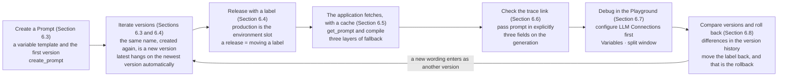
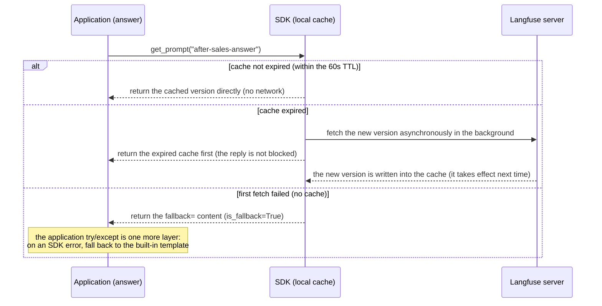

# Chapter 6 Prompt management

> Guide to this chapter: Chapter 3 got the minimal "售后助手" ("After-sales Assistant") running, and its system prompt is still a string hardcoded in `support_bot.py`. Changing one version of the wording means changing code and releasing again. That is the Prompt pain Chapter 1 named when it made its case. This chapter turns that string into a versioned asset on the Langfuse platform. First, `create_prompt` creates the two wordings of `after-sales-answer` in our running example (v1, the direct-answer version, and v2, the empathic version), and you see that creating the same name again is a new version. Then the release semantics of a label are made clear. A release changes from "change the code and deploy again" into "move one label", and a rollback is on the order of seconds. Then the consuming code on the application side: `get_prompt` fetches, a local cache, `compile`, and a fallback on failure. Then the prompt version is linked explicitly to the generation observation, so every trace can answer "which Prompt version was in charge for that call". Last, a pass over the Playground and over comparing versions. After this chapter you can: create, release, and roll back a Prompt on your own; choose a cache and a fallback strategy for the application; and check, inside a trace, which Prompt version any one call used.



*Flowchart for this chapter*

## When you need it

Three typical situations, matching three uses of this chapter.

**The Prompt is still scattered in code. Change one version and a history is lost. Nobody can say which version is running in production.** Start from Section 6.1, then walk `after-sales-answer` from our running example through in the order Section 6.3, then Section 6.4, then Section 6.5. That pass opens the full path of creation, versioning, release, and consumption. It is also the next step of the book's agreement that "the example grows with the chapters": the After-sales Assistant is upgraded from the built-in template of Chapter 3 to a managed Prompt.

**The application already consumes a managed Prompt, and two engineering questions remain. If Langfuse is down, does the application go down with it? Which Prompt version was a given trace using at the time?** The first is the three layers of fallback in Section 6.5 (a local cache, the SDK's built-in fallback, and an application-level try/except). The second is the explicit link in Section 6.6. The answers to both come from testing, including two real pitfalls we stepped on: a variable that was not replaced, and a version that was not linked.

**You want to try a new wording before it is live, compare the difference between two versions, or pull back a version that just went live.** The Playground in Section 6.7 is the place to try things. Section 6.8 is version comparison and rollback. If "try a new wording" is to be upgraded into "let the data speak", that is the subject of the experiments in Chapter 8. This chapter lays the base of the asset first.

Prerequisite: Chapter 2 finished the deployment, and the SDK integration from Chapter 3 is usable (the three variables and `auth_check`). Keys in this chapter's code are written as the placeholders `pk-lf-***` and `sk-lf-***`. At runtime, replace them with the real values of your own project.

## 6.1 Overview: why a Prompt is managed on a platform

**A Prompt is the asset in an LLM application that changes most often, and the one with the least engineering protection.** Chapter 1 named its three risks when it made its case. They are picked up here, one by one. This chapter is the remedy for those three sentences:

| The risk from Chapter 1 | How it shows up | Langfuse's remedy | Section in this chapter |
|--------------|---------|----------------|---------|
| Change one version and a history is lost | The new wording overwrites the old string, and the old version can never be found again | Versions: creating the same name again is a new version, and the whole history is kept | Section 6.3 |
| Nobody can say which version is running in production | A bad case appears, and nobody can answer "which Prompt it was at the time" | A trace link: the generation records prompt_id / prompt_name / prompt_version | Section 6.6 |
| Trying a new wording can only be done by changing code and releasing again | The whole path of development, test, and deploy, only to swap a piece of copy | A prompt label: the environment slots production / staging / experimental. A release is moving a label | Section 6.4 |

String the three remedies together, and you have the loop the flowchart of this chapter draws: **create a Prompt, then iterate versions, then release with a label, then the application fetches with a cache, then check the trace link, then debug in the Playground, then (back to iterating versions).** Every turn of the loop leaves a complete record. What changed (the version), who is using it (the label), and how it performed (from Chapter 8 on).

### Why the alternatives are not enough

Before a Prompt is handed to Langfuse, engineering usually manages it in one of three ways, and each has a real limit. This table is also the basis for deciding when this chapter is actually needed:

| Way of managing it | The practice | The limit |
|------|------|------|
| Hardcoded in the code | The template string is written in the source | All three risks are present: no version isolation, changing the wording means changing code, and the record cannot be looked up |
| Templates as files in git | The template lives in the repository and goes through code review | Losing history is solved. A release still has to go through the deploy path, and "which version is live" is still unclear. A git branch and the running state in production are two different worlds |
| A configuration center | The template lives in a configuration system such as Apollo or Nacos | Changing copy without a restart is solved. A configuration system does not understand an LLM. It has no versioned variable syntax, no Playground to try a run, and it will not write a version number into the trace |

Where Langfuse sits: it is **a configuration and version system that understands an LLM.** Versions, labels, compiling variables, a place to debug, and a trace link are five things designed around the property that "a Prompt is a runtime asset that changes often". A general configuration system does not specialize in that, and git is not enough at runtime. The cost, of course, is one more dependency. That is why the cache and the fallback in Section 6.5 are the engineering center of this chapter.

### The variable template: the {{variable}} placeholder

A managed Prompt is not a dead piece of text. It is a template with variables. Langfuse's variable syntax is **double braces**: `{{variable}}`. At compile time, each name is replaced with the value the caller passed in:

```text
你是跨境电商售后助手。

## 售后资料
{{context}}

## 用户问题
{{query}}
```

The prompt above is kept in Chinese because the corpus is Chinese. English gloss: "你是跨境电商售后助手。" ("You are an after-sales assistant for cross-border commerce.") "售后资料" ("After-sales material") "用户问题" ("User question"), with the placeholders `{{context}}` and `{{query}}`.

Compiling on the application side (the main actor of the next section; a look at the shape first):

```python
prompt = lf.get_prompt("after-sales-answer")
system_text = prompt.compile(context=retrieved_text, query=user_question)
```

Two engineering reasons support moving the template onto the platform. First, **the template is decoupled from the code.** Operations can change the wording without touching the code repository, and after the change, moving a label on the platform is the release. Second, **the template itself is versioned.** Every version of the template is an asset on the platform. It has a creation time, a label pointing at it, and a history that can be walked back.

### Two kinds of Prompt: text and chat

Langfuse supports two kinds of prompt, text and chat:

| Kind | Shape of the content | The scenario it fits | Use in this chapter |
|------|---------|---------|---------|
| text | One string template | A single system prompt, a completion-style call | Our running example uses this |
| chat | A list of messages (role plus content) | A multi-role dialogue template (one stretch each for system, user, and assistant) | Mentioned as a concept |

When you create a chat prompt, the `prompt` argument is a list of messages, and it is not a string. `compile()` on the `ChatPromptClient` the SDK returns replaces variables inside each message by `{{variable}}` in the same way, and returns the compiled list of messages. Our running example needs only one system prompt, so the whole chapter uses the text kind. If your application orchestrates a multi-role dialogue, the chat kind fits more closely, and the mechanism is the same as what this chapter describes.

### Sources and the hands-on baseline

- From the official documentation (this chapter's `source` points at the prompt management overview): the `{{variable}}` variable syntax, the two kinds of prompt, text and chat, and the public semantics of versions and labels.
- From hands-on testing for this book (2026-11-08, SDK 5.2.0 + server v4.76.0, Docker deployment on a local machine): creating the same name again is a new version; the `latest` label hangs on the newest version automatically; **compile replaces only double braces** (the single braces in the demo were not replaced, confirmed in testing; see the note in Section 6.3); **the link between a prompt and a generation is explicit** (`propagate_attributes(prompt=…)`, see the note in Section 6.6); the cache and fallback behavior of get_prompt (see Section 6.5); and the yellow bar when the Playground has no connection configured (see Section 6.7).
- Our recommendation: "a cache plus a fallback is a production necessity for a managed Prompt" is an engineering judgment, and it is not a conclusion from the docs. Observations from testing are recorded as they stand, and they are not stretched into an official promise.

## 6.2 The Prompts page: what the list can show

### Page layout

Under the Context management group in the sidebar there are two items, Prompts and Playground (the layout confirmed in testing on v4.76.0; Skills is the Beta item beside them). Open Prompts, and what you see is not the detail of some one prompt. It is the asset list of every prompt in the project:


Read the table column by column. Each column corresponds to one concept in this chapter:

| Column | Value seen in testing (our running example) | The concept it corresponds to |
|----|---------------------|---------|
| Name | `after-sales-answer` | The asset name. The same name is several versions of one asset |
| Versions | 2 | The version count: v1, the direct-answer version, plus v2, the empathic version (Section 6.3) |
| Type | text | The two kinds, text and chat (Section 6.1) |
| Latest Version Created At | 2026-11-08 19:36:49 | When the newest version was stored |
| Number of Observations (7d) | 0 | How many observations in the last 7 days are linked to this prompt (it rises after Section 6.6 is connected) |
| Tags | (a tag icon) | Tags shared by every version, set by the `tags` argument at creation |
| Actions | Delete | Deletes the whole prompt asset (including every version). Use it with care |

The placeholder text of the search box at the top is a syntax crib in itself: `type:chat, labels:production, version:>1`. Filter by kind, by label, and by version number. Once there are many prompts, this is the fastest entry for locating "which version is hanging on production right now". As on the Traces page, My Views can save a filter view you use often, and Columns can configure which columns are shown.

### What sits around the list page

The row of buttons at the top is visible in the screenshot from testing. A short note of each, by the documented semantics (this book did not test them one by one; marked as the documentation's reading):

| Button | Use | Status in testing |
|------|------|---------|
| New prompt | Create a prompt by hand in the UI (fill in the template, choose the kind, hang a label) | The UI is visible. This book takes the SDK route (Section 6.3). The products of the two routes are equivalent |
| Export / Import | Export prompt assets as JSON, or import them from JSON | The UI is visible. The documented route for moving assets across environments (for example, from a development project into a production project) |
| Automations 0 | The entry for automation rules (the count seen in testing is 0) | The UI is visible. Our running example does not use it. Linking it with evaluation rules belongs to Chapter 9 |
| My Views / Columns | Save a filter view, or configure columns | The same interaction as the Traces page (Chapter 4) |

Export and Import deserve one more sentence. They are the official channel for "moving template assets between two Langfuse environments". Together with the "development project and production project kept apart" of Chapter 11, a template is iterated in the development project first, and once it is settled it is exported, imported into the production project, and then hung on production for release.

### Where the material for our running example comes from

The two versions in the list were not typed by hand in the UI. The test repository's `setup_assets.py` created them. Section 6.3 pastes that code. Two practical agreements first. First, `setup_assets.py` runs after the Chapter 2 deployment is finished, so when you see the list in this chapter the material ought to be there already (if you are reproducing from zero, run the code in Section 6.3 once). Second, **creating a prompt of the same name again does not raise an error. It appends a new version.** That is the mechanism of "version iteration" (developed in Section 6.3). The other face of it: create the same template twice by accident, and Versions becomes 3. The only way back is to accept the extra version (the platform does not offer deleting a single version; it only offers deleting the whole asset).

## 6.3 create_prompt in testing: creating a Prompt and a variable template

### Two versions, in one pass

The code from testing comes from `demo/setup_assets.py`. It creates both wordings of our running example in one go. v1 is the direct-answer version. It only has to get the policy right. v2 is the empathic version, a second wording prepared for the comparison experiment in Chapter 8:

```python
# setup_assets.py (excerpt) — create the managed Prompt of our running example: the same name, created again, is a new version
from langfuse import get_client

lf = get_client()

PROMPT_V1 = (
    "你是跨境电商售后助手。请依据以下售后资料回答用户问题,资料中没有的内容请引导转人工。\n\n"
    "## 售后资料\n{context}\n\n## 用户问题\n{query}\n\n## 回答要求\n"
    "1. 先直接回答政策要点;2. 不编造资料之外的承诺;3. 语气友好,末尾询问是否需要进一步帮助。"
)
PROMPT_V2 = (
    "你是跨境电商售后助手。用户可能带着不满情绪,请先安抚,再依据资料给出准确政策。\n\n"
    "## 售后资料\n{context}\n\n## 用户问题\n{query}\n\n## 回答要求\n"
    "1. 共情一句话开头;2. 直接回答政策要点,不编造资料之外的承诺;"
    "3. 给出下一步动作(申请入口/时效);4. 末尾询问是否需要转人工。"
)

print("== prompt v1 ==")
lf.create_prompt(name="after-sales-answer", type="text", prompt=PROMPT_V1, labels=["production"])
print("== prompt v2 ==")
lf.create_prompt(name="after-sales-answer", type="text", prompt=PROMPT_V2, labels=["production"])
```

The prompt above is kept in Chinese because the corpus is Chinese. English gloss: v1, "你是跨境电商售后助手。请依据以下售后资料回答用户问题,资料中没有的内容请引导转人工。" ("You are an after-sales assistant for cross-border commerce. Answer the user's question from the after-sales material below. If the material does not contain it, guide the user to a human agent.") Then "售后资料" ("After-sales material") `{context}`, "用户问题" ("User question") `{query}`, "回答要求" ("How to answer"): "1. 先直接回答政策要点;2. 不编造资料之外的承诺;3. 语气友好,末尾询问是否需要进一步帮助。" ("1. Answer the policy points directly first; 2. Do not invent promises beyond the material; 3. Keep a friendly tone, and ask at the end whether further help is needed."). v2, "你是跨境电商售后助手。用户可能带着不满情绪,请先安抚,再依据资料给出准确政策。" ("You are an after-sales assistant for cross-border commerce. The user may be upset. Acknowledge that first, then give the accurate policy from the material.") The same two headings, then "1. 共情一句话开头;2. 直接回答政策要点,不编造资料之外的承诺;" ("1. Open with one empathic sentence; 2. Answer the policy points directly, and do not invent promises beyond the material;") "3. 给出下一步动作(申请入口/时效);4. 末尾询问是否需要转人工。" ("3. Give the next action (where to apply / how long it takes); 4. Ask at the end whether they need a human agent."). The placeholders in this corpus are single braces.

Refresh the Prompts page after it runs, and the Versions column goes from 0 to 2. That is "the same name, created again, is a new version": **the platform does not offer "update". It only offers "create, and that creation is a version".** The two calls to `create_prompt` used the same `name`. The platform numbers them v1 and v2 on its own, and both bodies are kept permanently.

The full parameter surface of `create_prompt` (the signature confirmed in testing on SDK 5.2.0):

| Parameter | Type and default | Note |
|------|-----------|------|
| `name` | str, required | The asset name. Calling again with the same name appends a new version |
| `prompt` | str (the text kind) or a list of messages (the chat kind) | The template body. Variables are written `{{variable}}` |
| `labels` | List[str], default `[]` | Labels hung on this version. To be the default resolution target it has to hang `production` explicitly |
| `tags` | List[str], optional | Tags shared by every version (distinct from a label: a label hangs on a single version) |
| `config` | any structured data, optional | Configuration saved with the version (for example a snapshot of the model name and temperature) |
| `commit_message` | str, optional | A note on this change, readable in the version history |
| `type` | `"text"` or `"chat"`, default text | The two kinds of template (Section 6.1) |

Two details worth stressing. First, `labels` defaults to an empty list. **A new version that does not hang `production` will not be resolved by the application side by default.** That keeps "create a new version" and "release" as two actions (the core semantics of Section 6.4). Second, `config` and `commit_message` are metadata of the version asset. Store "the model and the temperature this version used" in config, and write "why it changed" in commit_message, and the version history can be read as a changelog. These are parameters the docs publish. The code confirmed in testing for this book did not use them. Take them as you need them.

### Run it and check it

```bash
python setup_assets.py
# == prompt v1 ==
# == prompt v2 ==
# == dataset ==
#   + 我想退货,政策是什么? ("I want to return the item; what is the policy?")
#   ... (dataset items; the subject of Chapter 7)
# done: prompts x2, dataset items x6
```

The prompt above is kept in Chinese because the corpus is Chinese. English gloss: "我想退货,政策是什么?" ("I want to return the item; what is the policy?").

After it runs, check it in the UI against the table (all of it on the Prompts page that Section 6.2 already read):

| Check | Where | Expected |
|--------|------|------|
| The asset appears | The list on the Prompts page | One row, `after-sales-answer`, Versions = 2, Type = text |
| The time of the newest version | The Latest Version Created At column | Equal to the moment the script just ran |
| The version bodies | Click the asset name to open the detail | Both templates are there, the v1 direct-answer version and the v2 empathic version, with creation times in order |
| Label state | The version detail | production on v2 (v1's production has been moved away by the semantics Section 6.4 will explain) and latest |
| Run it again | Run the script once more | Versions becomes 4. The same name, created again, is a new version. No error, and no overwrite |

The last row is worth a sentence of its own. The idempotency note of `setup_assets.py` says "before running again, delete the old dataset in the UI". The prompt part is "creating again appends a version". **The two assets have different idempotency semantics.** Watch that when you reproduce our running example. On the baseline confirmed in testing on a local machine, `after-sales-answer` was created by running this script. The two wordings were then consumed by support_bot and by the experiment scripts (Chapter 8).

### A note from testing: single braces are not replaced by compile (the first pitfall this chapter stepped on)

In PROMPT_V1 and PROMPT_V2 pasted above, the variables are written with single braces, `{context}` and `{query}`. That is the habit of Python `str.format`, and it is also the real shape in the test repository. **Langfuse's variable syntax is double braces, and compile replaces only `{{variable}}`.** While writing this chapter we ran a local check on purpose (SDK 5.2.0; the template parser is pure local logic):

```python
# Check: single braces and double braces, and what compile does with each
from langfuse.model import TemplateParser

tpl = "资料:{context}\n问题:{{query}}"
print(TemplateParser.compile_template(tpl, {"context": "CTX", "query": "QRY"}))
# 资料:{context}          <- single braces kept as written, not replaced
# 问题:QRY                <- double braces replaced as expected
print(TemplateParser.find_variable_names(tpl))
# ['query']               <- variable detection recognizes only the double-brace one
```

The prompt above is kept in Chinese because the corpus is Chinese. English gloss: "资料:{context}" ("material:{context}") stays, and "问题:{{query}}" ("question:{{query}}") becomes "问题:QRY" ("question:QRY").

Check it again against the real asset. Fetch the live `after-sales-answer`, and look at its variable detection and its compile result:

```python
prompt = lf.get_prompt("after-sales-answer")
print(prompt.version)      # 2
print(prompt.variables)    # [] — a single-brace template; not one variable was recognized
compiled = prompt.compile(context="真实资料", query="真实问题")
# In the compiled text, {context} and {query} remain as literals in the text sent to the model
```

The prompt above is kept in Chinese because the corpus is Chinese. English gloss: `context="真实资料"` ("real material"), `query="真实问题"` ("a real question").

**What is the consequence?** In the system text the model receives, the place for the after-sales material is a literal `{context}`. The material the retriever went to the trouble of assembling never entered the prompt, and the model can only answer from what its parameters remember. This is exactly where Section 6.6 earns its keep. The surface of this problem is "answer quality wanders". The root sits inside the prompt template. The root can be chased only once "which Prompt was in effect for that call, and what the model actually saw after compilation" can be looked up.

**The correct way to write it:** `{{context}}` and `{{query}}` in the template. This book keeps the original shape of the test repository as it stands, and marks the difference here. Later sections, when they refer to compile behavior, take double braces as the rule. When you reproduce the demo, change the two templates to double braces (this is one benefit of hosting the prompt on the platform: change the template without touching code, and Section 6.4 releases it by moving a label).
## 6.4 The release semantics of a label: a release moves a label, and it does not change code

### An environment slot, and it is not a version number

Chapter 1 buried one sentence: "a label is an environment slot, and it is not a version number". This chapter unfolds that into semantics you can operate. Three environment slots, by convention:

| label | Meaning | Behavior on the application side |
|-------|------|-----------|
| `production` | What production is using now | `get_prompt("name")` resolves to it by default |
| `staging` | Under pre-release verification | The application side fetches it explicitly with `label="staging"` |
| `experimental` | Experimental wording | For experiments and canaries (the A/B split in Chapter 8 is done on top of this) |

Three points of the mechanism. **First, a label hangs on a version.** The same `after-sales-answer`: v1 and v2 each have their own set of labels, and they do not affect each other. **Second, a label can move.** Hang production on v2, and take production off v1, and that is one release. The application side only ever asks "which version is production". The release action therefore shrinks from "change the code and deploy again" to "move one label on the platform". **Third, one version can hang several labels at once.** In testing, v2's labels are `['production', 'latest']`. `latest` is a label the platform maintains on its own. It always points at the most recently created version, and it gives you a fixed entry for "ignore the release state, and look only at the newest content".

### How to release and how to roll back

Take "move production from v1 to v2" as the example. Two routes:

**The UI route.** On the Prompts page, click the name to enter the prompt detail. In the version history, each version has a label-editing entry beside it. Add `production` to v2, remove `production` from v1, and saving takes effect. From the next second on, every `get_prompt("after-sales-answer")` receives v2.

**The API route (confirmed in testing on a local machine).** One call to `lf.api.prompt_version.update` completes the move. While writing this chapter we verified its exact semantics with a one-off probe asset (deleted as soon as the test finished; the probe code is in the `probe/` directory of the hands-on area):

```python
# A label move, confirmed in testing (2026-11-08, SDK 5.2.0): probe asset probe-labels, v1 hangs production, v2 has no label
lf.api.prompt_version.update(name="probe-labels", version=2, new_labels=["production"])

p = lf.api.prompts.get("probe-labels")          # resolves production by default
print(p.version, p.labels)                      # 2 ['production', 'latest'] — now points at v2

# The key point: only v2's update was called, and v1's production was removed by the platform on its own
# (a later query by version=1 shows labels as [])
```

This result from testing lands on one sentence of the SDK docs: **"Labels are unique across versions". A label of a given name hangs on only one version at a time.** So a "release" does not need two steps (add, then delete). The moment production is hung on v2, v1 is no longer production. A rollback is the same: one call moves it back. The docs also note that `latest` is a reserved label, maintained by the platform on its own. Assigning it yourself is rejected or ignored.

This semantics also explains a leftover from Section 6.3 in passing. Both `create_prompt` calls in `setup_assets.py` carried `labels=["production"]`. The moment v2 was created, the production on v1's head was removed automatically (we queried by version=1 afterward, and the labels were empty, confirmed in testing). That is, **passing labels to create_prompt and moving a label with update follow the same uniqueness semantics.**

This book's suggestion: day-to-day releases use the UI route (what you see is what you get, and you can look at the version diff while you are there). When a release has to be written into a script or a pipeline (the release-gate idea in Chapter 12), use the API route. One call, in effect atomically, which is exactly the "release automatically after the gate passes" action.

**A rollback is moving the label back to an old version.** After v2 goes live, the empathic wording turns out to be wrong. Move production back to v1, and it takes effect within seconds, with no deploy action of any kind. Set that beside Chapter 1's "change the code and release again", and this is the largest change in behavior that putting it on a platform brings: **a release is postponed from build time to runtime.** Because of this semantics, the A/B experiment in Chapter 8 (two versions of the same asset, with traffic split by label) can be done without touching application code.

### How latest differs from production

One easy confusion found in testing, worth stating on its own. `latest` points automatically at **the most recently created version**, and the release state has nothing to do with it. You just created a v3 that does not hang production, and latest already points at v3, while production is still on v2. So **the application side follows only production** (unless you are deliberately doing a canary). latest is a convenience entry for development and debugging, "I want to see the version I just created". Mixing the two up has the consequence that content which has not been released enters production. What keeps that class of accident outside the door is the discipline from Section 6.3: a new version hangs no label by default.

## 6.5 Consuming it in the application: get_prompt, compile, and a local cache

### The core code: fetch, compile, and fall back

This is the core code of the chapter, from the `answer()` function of `demo/support_bot.py` in the test repository. On every reply of the After-sales Assistant, the system prompt is fetched from Langfuse hosting, and on failure it falls back to the built-in template:

```python
# support_bot.py (excerpt) — the way the application consumes a managed Prompt, as confirmed in testing
@observe(name="support-bot-answer")
def answer(query: str, session_id: str | None = None) -> str:
    """一次售后应答 = 一条 trace;检索 + LLM 为其两个 observation。

    Prompt 从 Langfuse 托管拉取(after-sales-answer,production label),
    trace 自动关联 prompt 版本;SDK 带本地缓存,拉取失败回退内置模板。
    """
    with propagate_attributes(session_id=session_id, user_id="demo-user"):
        context = retrieve(query)
        try:
            prompt = lf.get_prompt("after-sales-answer")
            system_text = prompt.compile(context=context, query=query)
        except Exception:
            system_text = f"你是跨境电商售后助手,仅依据以下资料回答,资料之外请引导转人工:\n{context}"
        messages = [
            {"role": "system", "content": system_text},
            {"role": "user", "content": query},
        ]
        return llm_call(messages)
```

The prompt above is kept in Chinese because the corpus is Chinese. English gloss of the docstring: "一次售后应答 = 一条 trace;检索 + LLM 为其两个 observation。" ("One after-sales reply = one trace; retrieval and the LLM are its two observations.") "Prompt 从 Langfuse 托管拉取(after-sales-answer,production label), trace 自动关联 prompt 版本;SDK 带本地缓存,拉取失败回退内置模板。" ("The Prompt is fetched from Langfuse hosting (after-sales-answer, the production label); the trace links the prompt version automatically; the SDK has a local cache, and a failed fetch falls back to the built-in template.") English gloss of the fallback string: "你是跨境电商售后助手,仅依据以下资料回答,资料之外请引导转人工:" ("You are an after-sales assistant for cross-border commerce. Answer only from the material below. Outside the material, guide the user to a human agent:").

The five lines of try/except are the soul of this stretch. **Hosting is an optimization, and availability is the floor.** If Langfuse is down, or the network jitters, the After-sales Assistant falls back to the built-in template and keeps answering. The wording drops back to an old version, and the service does not stop. The sentence in this docstring, "the trace links the prompt version automatically", does not hold on SDK v5. The note in Section 6.6 develops that on its own. The single-brace template's replacement problem is the note in Section 6.3. Apart from those two places, the stretch above is runnable code from testing, as it stands.

### The parameter surface of get_prompt

| Parameter | Default | Note |
|------|------|------|
| `name` | required | The asset name |
| `version` | none | Fetch a specific version. **Mutually exclusive with `label`** (giving both raises ValueError) |
| `label` | none | Fetch by a specific label. When both are omitted, **`production` is resolved** |
| `type` | `"text"` | The two kinds, text and chat. It has to match the asset's actual kind |
| `cache_ttl_seconds` | 60 | How many seconds the local cache lives. Set 0 to turn the cache off |
| `fallback` | None | Built-in fallback content when the fetch fails (a string for the text kind, and it has to use the double-brace variable syntax) |
| `max_retries` | 2 | How many times a failed fetch is retried, with a cap of 4, and exponential backoff |
| `fetch_timeout_seconds` | 5 | The timeout of a single fetch |

### Three layers of fallback for the cache: the SDK does two of them

A managed Prompt introduces a new dependency. Every reply, the application has to ask Langfuse for the template first. **This dependency must not become an availability risk.** The SDK's design (SDK 5.2.0 source and documented behavior, checked on 2026-11-08) is three layers of fallback, and the first two are built in:

| Layer | Mechanism | When it does not cover you |
|----|------|---------|
| 1. Local cache | The first fetch enters the cache, and inside the TTL the cache is used directly (no network). When the TTL expires, a background refresh runs asynchronously, and the old value keeps being used until the refresh succeeds (a stale-while-revalidate flavor) | The process just started, and a fetch has never succeeded |
| 2. The SDK's built-in fallback | When the first fetch fails, the content given by the `fallback=` argument is returned. The returned object is marked `is_fallback=True` | After the first fetch has succeeded and the cache is still there, this layer no longer takes part (the expired cache holds the line first) |
| 3. An application-level try/except | The demo's way of writing it: wrap the fetch and the compile together, and on failure fall back to the built-in template | Covers what the two layers above do not reach, such as a template compile error, or a missing method on the object |

Layer 1 means this: **inside the TTL, the cost of a managed Prompt is zero network requests.** A service answering a thousand times a second puts pressure on the Langfuse server of only one fetch every 60 seconds (the default TTL is 60s, and it can be changed). The split between layer 2 and layer 3 is worth thinking through. The SDK's `fallback=` takes effect only when "the fetch failed", while the demo's try/except also covers a compile error. **The engineering judgment is that production code keeps the application-level fallback.** Its meaning is more direct (the fallback content sits in the business code, readable and auditable), and it handles "the platform is unavailable" and "the platform returned bad data" as one case. The fallback content of the two layers should agree, so you do not get "v2 wording in ordinary times, and an old wording with a different reading when something fails".

Choosing a TTL is a three-way tradeoff. The default of 60 seconds is a reasonable start for most scenarios:

| TTL | What you gain | What it costs |
|-----|------|------|
| Short (for example 5 to 10 seconds) | A release and a rollback take effect on the application side almost at once | Fetches are frequent. When Langfuse is unavailable, you slide toward the fallback template sooner |
| The default (60 seconds) | The network overhead can be ignored. A release is delayed by at most one minute | There is a cache tail of at most 1 minute before a release is felt |
| Long (for example 10 minutes or more) | Dependence on Langfuse drops very low | After a wrong wording goes out, it takes a long time before the whole fleet picks up the fix |

One operations practice to go with it: **temporarily shorten the TTL around a release window** (controlled by an environment variable or a configuration switch), and keep the default the rest of the time. Make "how fast it takes effect" a parameter of the release action, and keep it from being a standing cost.

The `is_fallback` mark has a practical use. It lets you tell "this content was issued by the platform" from "the fallback template is holding the line". If you want the fallback event itself to become observation data (an alert on the fallback count), record one item in your own except branch.

The order in which the three layers work is easier to see as a sequence diagram. Note that "the expired cache holds the line first", in steps 2 and 3, is done quietly by the SDK. Application code does not see it:



### A self-check script on the consumer side

After the managed Prompt is connected, run a ten-line self-check script to confirm the asset state and the compile behavior. It is the same philosophy as `auth_check` in Section 3.2: check yourself before you go live. What follows is the script run on a local machine, and its output:

```python
# check_prompt.py — a consumer-side self-check: asset metadata plus compile behavior
from langfuse import get_client

lf = get_client()
prompt = lf.get_prompt("after-sales-answer")

print("name    :", prompt.name)
print("version :", prompt.version)
print("labels  :", prompt.labels)
print("variables:", prompt.variables)            # a double-brace template should list every variable name
compiled = prompt.compile(context="测试资料", query="测试问题")
print("compiled ok:", len(compiled) > 0)
```

The prompt above is kept in Chinese because the corpus is Chinese. English gloss: `context="测试资料"` ("test material"), `query="测试问题"` ("a test question").

```bash
python check_prompt.py
# name    : after-sales-answer
# version : 2
# labels  : ['production', 'latest']
# variables: []            <- the value seen in testing: a single-brace template, and not one variable was recognized (the Section 6.3 note)
# compiled ok: True
```

The standard for a self-check that passes: version and labels match the release you intended (production points at the version you want to ship). `variables` lists every variable name in the template. **If it lists fewer than you expected, the template has a placeholder that was not recognized** (the single-brace pitfall in Section 6.3 is exposed by this very line). Put this script into CI or into the release flow, and it is the automated check that "confirms where production points, before the release".

### A diagnosis crib

Common symptoms of consuming a managed Prompt on the application side, grouped by the mechanism of this chapter:

| Symptom | The usual cause | What to do |
|------|---------|------|
| A variable from the template appears as-is in the text sent to the model | Single-brace spelling. compile does not replace it | Change it to `{{var}}`, and check with `prompt.variables` (Section 6.3) |
| The template was changed, and the application's behavior did not change | The cache TTL has not expired (60 seconds by default) | Wait for expiry, or temporarily set `cache_ttl_seconds=0` to verify |
| A version was created, and the application still fetches the old one | The new version does not hang production, or it does and the old version's production was not moved off | Move the label (the uniqueness semantics of Section 6.4 handle the old version on their own) |
| When Langfuse is down the application errors, and it does not fall back | The fetch and the compile are not wrapped in try/except, or the first fetch failed with no fallback | Add the application-level fallback. For the first-fetch case, use the SDK's `fallback=` (Section 6.5) |
| prompt_name on the trace is None | There is no explicit `propagate_attributes(prompt=…)` | Declare the scope (Section 6.6) |
| An unexpectedly old version was fetched | latest was assumed (it points at the newest version, and not at the released version) | The application side follows only production (Section 6.4) |

## 6.6 Linking the trace: which Prompt version was in effect for that call

### The promise from Chapter 1 plays out here

Chapter 1 listed "which Prompt version is in charge for that call" as one pain of the black box, and promised a trace link to solve it. The mechanism: a generation observation can carry three fields. `prompt_id` (the id of that version of the asset), `prompt_name` (the asset name), and `prompt_version` (the version number). With them, the LLM call of any trace can answer "which template was in use at the time". Attributing a bad case, and statistics of a version's effect (Chapter 8 aggregates experiment scores by version), both stand on these three fields.

### A note from testing: linking in SDK v5 is explicit (the second pitfall this chapter stepped on)

The docstring of `support_bot.py` in the test repository says "the trace links the prompt version automatically". When we wrote this chapter we checked the SDK 5.2.0 source and verified it on the instance on a local machine (2026-11-08): **in the v5 SDK, `get_prompt` does not hang the prompt on a later generation on its own. The link has to be declared explicitly.** Pass the prompt object to `propagate_attributes` (Chapter 3 already uses it to pass session and user), and a generation created inside the scope carries the three fields. The correction to the core code in Section 6.5 is only two places: change the template to double braces (the Section 6.3 note), and pass one more `prompt=` to `propagate_attributes`:

```python
# The corrected form: pass prompt into propagate_attributes explicitly (usable, confirmed in testing on SDK 5.2.0)
@observe(name="support-bot-answer")
def answer(query: str, session_id: str | None = None) -> str:
    prompt = lf.get_prompt("after-sales-answer")   # fetch (with a local cache, Section 6.5)
    with propagate_attributes(prompt=prompt, session_id=session_id, user_id="demo-user"):
        context = retrieve(query)
        system_text = prompt.compile(context=context, query=query)   # the template itself uses the {{var}} spelling
        messages = [
            {"role": "system", "content": system_text},
            {"role": "user", "content": query},
        ]
        return llm_call(messages)   # this generation will carry prompt_name, version, and id
```

A probe, confirmed in testing (v4.76.0 on a local machine): after the explicit pass, the observation API shows that generation's `promptName=after-sales-answer`, `promptVersion=2`, and `promptId` has a value. **On the demo's historical traces that did not pass it (including `OpenAI-generation`), all three fields are None.** Set the two beside each other, and the mechanism is clear. The link is not "a fetch hangs it". It is "declaring the scope hangs it":

```python
# Probe (2026-11-08): the smallest reproducible check of the link
prompt = lf.get_prompt("after-sales-answer")

@observe(name="prompt-link-probe", as_type="generation")
def gen():
    return "probe-output"

with propagate_attributes(prompt=prompt, session_id="probe-prompt-link", user_id="probe-user"):
    gen()

lf.flush()
# Query that generation through the observation API (/api/public/observations):
# promptName=after-sales-answer | promptVersion=2 | promptId=1f78a20e-...
```

Two details. First, the docs state clearly that the link acts only on observations of **generation type**. An ordinary span does not hang it. Second, a fallback case (`is_fallback=True`) is **not** linked. A fallback template is not a platform asset, and recording it would be a lie.

### Check it in the UI

The check is still the basic move from Chapter 3. Run one reply in the corrected form, open the trace on the Traces page, expand the generation node of the LLM call, and the detail shows the prompt-link fields. A click jumps to the prompt detail of the corresponding version. The Number of Observations (7d) column on the Prompts list also rises from 0. That number is the aggregate reading of "how many observations used this prompt in the last 7 days".

**Our recommendation for this chapter: passing `prompt=` into `propagate_attributes` should become a fixed action of connecting a managed Prompt**, side by side with passing `session_id`. Forget it, and the application still works, the trace is still stored, and everything looks normal. Only when you want to count effect by version do you find the fields empty, and the historical data from that time can no longer be filled in.

## 6.7 Playground in testing: configure LLM Connections first

### The empty state: a yellow bar stands in the way

Playground is its own item in the sidebar (in the same Context management group as Prompts). The first time you open it, you do not see the "input box plus a run button" you imagined. What testing shows is a full page of debugging-ground skeleton, with a yellow bar across the top:

![This screenshot was taken on 2026-11-08. The Playground page in its empty state: a yellow bar at the top, No LLM Connection Configured — To use the playground, you need to configure a model first. Go to LLM Connection Settings to add an LLM API key and configure your models; under the bar, the Model area has a + Add LLM Connection button; at the upper right, Save as prompt and New split window; a tool row, Tools / Schema / Variables, System and User message rows, an Output area, and a Submit button; Run All at the top is disabled](../assets/images/lf-playground.png)

The yellow bar says it plainly: **for the Playground to actually run a model, Langfuse itself has to be given a model it can call.** That is v4's LLM Connections. The page is project Settings, then LLM Connections. It configures a model connection and a key for Langfuse itself (platform-side features such as the Playground and evaluators). Keep the two key chains completely separate:

| Chain | Where it is configured | Who uses it | Where this book covers it |
|------|--------|--------|---------|
| The project API key (pk- / sk-) | Project Settings, then API Keys | Your application (the SDK uploads data) | Chapters 2 and 3 |
| LLM Connections | Project Settings, then LLM Connections | The Langfuse platform itself (the Playground and evaluators call a model) | This chapter |

**Marked as testing on a local machine stands: our instance has no LLM Connection configured.** The Playground stays in the yellow-bar empty state, and the Run All button is disabled. The configuration steps are omitted, and left as reader practice. The LLM Connection Settings link in the yellow bar goes straight to the configuration page. Fill in the key of your model provider (Zhipu, or OpenAI, for example). After that, the window capabilities inside the Playground are below. The mark is made this way because the principle of this book is that an operation which was not tested is not written up as if it had been tested. The steps are not the reason.

### What the window can do, prepared for trying wording

Even in the empty state, the skeleton of the Playground UI already lays out what it can do:

| UI element | Use | How it relates to the main line of this chapter |
|---------|------|-----------------|
| System / User message rows | Arrange a message template by role | Visual editing of a chat template. text content can be pasted in and tried as well |
| The Variables dropdown | Declare template variables, and fill them | The `{{variable}}` placeholders are filled one by one here. The template syntax of Section 6.3 is tried for effect here |
| Save as prompt | Save the current window's content as a new version of a managed prompt | A good wording worked out in the Playground enters the version store in one click. The loop between debugging and versioning |
| New split window | A split-screen comparison | Two wordings, left and right, run on the same question. The difference is visible by eye (a supplement to Section 6.8) |
| Run All (Ctrl+Enter) | Run every window in a batch | Available after a connection is configured |
| Reset playground | Clear the current layout | Return to the initial state |

Where the Playground sits in the flow of the whole book: **it is the place to try, and it is not the place to prove.** Comparing two answers by eye is fit for a first pass. "Is v2 really better than v1" has to be scored by the experiments of Chapter 8, on the same dataset. The Save as prompt button is worth remembering. It deposits "wording polished in the debugging ground" directly as a new version on the platform, so the product of a try does not scatter into chat logs.

## 6.8 Comparing versions, and rolling back

### Version history: the diff point of view

From the Prompts list, click the asset name to enter the prompt detail. The core area is the version history. Each version is one row, with a creation time, the label state, and the commit_message (if one was written at creation). Select two versions and you can enter a comparison view, and read the template difference line by line. The difference between v1 and v2 (the direct-answer version replaced by the empathic version) is obvious here at a glance.

**Marked as it stands: the version-comparison view on the local machine was not captured** (the FACTS list of items still to be filled is on file). The description below is Inferred from the official docs and from what the list page showed in testing. Take the UI of your own instance as the authority. What the list page shows in testing is solid: the Versions column and the Latest Version Created At column give "how many versions, and when the newest was created". The `lf-prompt-detail.png` above captures the Prompts page in the legacy UI shape. The banner You are viewing legacy UI at the top and Switch to latest UI at the upper right are both present. It is a record of the dual-UI experience of the v4 migration period (the reading Chapter 2 already covered). The list content is the same as Section 6.2:

![This screenshot was taken on 2026-11-08. The Prompts page in the legacy UI shape: a banner at the top, You are viewing legacy UI / Why do I need to switch?, and a Switch to latest UI button at the upper right; the list area matches Section 6.2 — after-sales-answer, 2 versions, Type text, Number of Observations (7d) 0; clicking the asset name enters the version detail and the comparison view (this book did not capture the comparison view itself; see the note in Section 6.8 that records this as it stands)](../assets/images/lf-prompt-detail.png)

### What a version comparison is comparing

Look at two versions side by side, and read the diff in layers. Take v1 to v2 in our running example (the two templates in Section 6.3). The difference lands on four layers, and each layer has a different tool for judging it:

| Layer of the difference | The v1 to v2 instance | Is a comparison by eye enough | The tool you step up to |
|---------|---------------|-------------|---------|
| Wording and structure | The opening adds "先安抚" ("acknowledge the feeling first"). The answer requirements go from 3 items to 4 | Enough. The diff is visible at a glance | The version-comparison view |
| A tendency in behavior | An empathic opening may lengthen the answer and drift off the point | Not enough. You have to see the actual output | Run the same question side by side in the Playground (Section 6.7) |
| Answer quality | Whether the user is more satisfied cannot be judged by eye | Not enough. A fixed evaluation set is required | Score it with a dataset experiment (Chapters 7–8) |
| Cost and latency | Saying more wording means more completion tokens | Not enough. It takes an aggregate statistic | Aggregate by version through the generation link (the reading in Chapter 5) |

The last column of this table strings the later chapters together. The version-comparison view answers "where they differ". The experiments in Chapter 8 answer "how many points the difference is worth". **Versions of the same asset are a natural control group.** That is the ground under Chapter 1 listing "changed a version and cannot tell whether it got better or worse" as the second situation.

### Rollback: move the label back to an old version

Section 6.4 already made the semantics clear (a label is unique across versions, and a move takes effect atomically). Here the operation is laid out as a timeline. The full life cycle from going live to rolling back, and not one line of application code moves the whole way:

```text
T0  create_prompt(v1, labels=["production"])   # v1 is stored; production = v1
T1  the application goes live, and fetching production returns v1
T2  create_prompt(v2)                          # v2 is stored, with no label; latest points at v2 on its own
T3  compare and try them in the Playground (Section 6.7)   # a first pass: the empathic wording looks workable
T4  update(v2, new_labels=["production"])      # the release; v1's production is removed on its own,
                                               # and the application's next fetch (after the cache expires) gets v2
T5  v2 is found to be overly empathic; update(v1, new_labels=["production"])   # roll back; one call, in effect within seconds
T6  revise the v2 wording; create_prompt(v3)   # a new version enters the loop again; latest points at v3
```

Three roles, each doing its own job. `create_prompt` is in charge of "leaving a record". A label is in charge of "pointing at which version is in use". The trace link (Section 6.6) is in charge of "reconciling afterward". Set this against the three risks in Chapter 1, and the timeline settles each one. Every step from T0 to T6 left version history (the lost-history risk is borne out). From T1 on, every trace records a version number (the "cannot say which version" risk is borne out). The release and the rollback at T4 and T5 never touch the code repository (the "change code to release" risk is borne out).

One detail in the timeline, decided by the mechanism of this chapter, is worth stating. **The release at T4 does not take effect everywhere in the same instant. On the application side there is still a cache TTL of at most 60 seconds** (Section 6.5). The label on the platform has already moved, and a process that is running may still be using the old version in its cache for up to a minute. For the great majority of businesses this is not felt. If your scenario requires a release to take effect across the whole fleet within seconds, turn `cache_ttl_seconds` down (the cost is more frequent fetches). This is also part of the full meaning of "release semantics": a label takes effect at once, and what the application perceives has a cache delay.

### The split with experiments

One last boundary with Chapter 8, so "version comparison" is not stretched past its use. **The Playground's split screen and the diff of the version history answer "where they differ". An experiment answers "how large a difference that difference made".** The first is a first pass by eye. The second is a score comparison on the same `after-sales-qa` dataset (in the testing of our running example, the experiment comparison of the v1 baseline and the v2 empathic version is the main course of Chapter 8). The full rhythm of tuning a Prompt is therefore: get a feel for it in the Playground, move a label for a small-scope release (staging or experimental), prove the score with a dataset experiment, then production for everyone. The product of each step is deposited on the platform, and the dataset work of the next chapter takes over from here.

## Chapter summary

Back to the question at the start. This chapter delivered five things:

1. **Why it belongs on a platform.** The three risks from Chapter 1 (lost history, unable to say which version, releasing by changing code) correspond one by one to the three remedies of versions, a trace link, and a label, strung into the loop "create, then iterate, then release, then fetch, then link, then debug, then compare" (Section 6.1).
2. **Creation and versioning.** `create_prompt` with the same name, created again, is a new version. The v1 and v2 wordings are stored. The syntax of a variable template is double braces, `{{variable}}`. A pitfall from testing: single braces are not replaced (Sections 6.2 and 6.3).
3. **Release semantics.** A label is an environment slot (production / staging / experimental), and it is not a version number. A release is moving a label, and a rollback is on the order of seconds. `latest` points at the newest version on its own, and the application does not follow it (Section 6.4).
4. **Consumption and fallback.** `get_prompt` resolves production by default, with a 60-second local cache (an expired cache refreshes in the background). The SDK's built-in `fallback=` plus an application-level try/except are three layers of fallback. Compilation uses `prompt.compile(variables)` (Section 6.5).
5. **Linking and debugging.** The three prompt fields on a generation have to be declared explicitly (`propagate_attributes(prompt=…)`; a pitfall from testing: leave it out and they are None). The Playground is the place to debug. Running a model means configuring LLM Connections first. Save as prompt deposits a wording you tried as a new version (Sections 6.6 and 6.7).

On our running example, the After-sales Assistant's prompt has been moved onto the platform. `after-sales-answer` has two versions there, production points at v2, and the application side consumes it with a cache and a fallback. The two pitfalls testing stepped on in this chapter (single braces, and a link that was not explicit) have both been written back into the example's correction path. In the regression-gate script of Chapter 12, they appear again, as check items.

A suggested next step: take the "versioned asset" into Chapter 7. An evaluation dataset is the next link of this chapter's loop. Without one fixed evaluation set, the "first pass" at T3 in the Section 6.8 timeline can only ever be by eye. If you are in a hurry to see the actual effect of a version comparison, you can also skip ahead to Chapter 8. Traffic splits by label, and experiment comparisons, take the release semantics of this chapter as far as they go.

## Acceptance checklist

- ☐ Without looking anything up, say how the three risks correspond to the three remedies (lost history to versions, unable to say which version to a trace link, releasing by changing code to a label)
- ☐ Rewrite an old template that uses the single-brace habit `{var}` into `{{var}}`, and verify with `prompt.variables` that the variable is recognized
- ☐ Do one hands-on pass of "the same name, created again, is a new version": create v1, create v2, and on the Prompts page point out the change in the Versions column and where latest points
- ☐ Move production from v2 back to v1 and then back again, without touching application code the whole way, and say the time scale on which a rollback takes effect
- ☐ Choose one layer of fallback strategy for your own application (cache TTL, the SDK fallback, or an application-level try/except), and say why one layer on its own is not enough
- ☐ Write consuming code that includes `propagate_attributes(prompt=…)`, and point out the prompt_name and prompt_version fields in a trace detail
- ☐ Open the Playground, say what the yellow bar is asking you to configure (LLM Connections), and what the difference is between that and the project API key

## Quick reference

Understanding the main line does not depend on this section. This section is for lookup while connecting and while diagnosing.

### Prompt SDK entries (SDK 5.2.0, confirmed in testing)

| API | Use | The key behavior |
|-----|------|---------|
| `lf.create_prompt(name=…, prompt=…, labels=[…])` | Create a prompt (the same name means a new version) | A new version with no label will not be resolved by default |
| `lf.get_prompt("name")` | Fetch by label or by version | Resolves production by default. version and label are mutually exclusive |
| `prompt.compile(**vars)` | Compile the template | Replaces only `{{variable}}`. Single braces are kept as written |
| `prompt.variables` | The list of template variable names | Can be used to check the template spelling statically |
| `prompt.is_fallback` | Whether the result is a fallback | A fallback object does not take part in the trace link |
| `propagate_attributes(prompt=…)` | Declare the prompt into the scope | Only generation observations are linked by the backend |
| `lf.api.prompt_version.update(name, version, new_labels=[…])` | Move a label (the API route) | A label name is unique across versions. The old version is removed on its own. latest is a reserved label |
| `lf.api.prompts.get(name)` / `.list(name=…)` / `.delete(name)` | Look up the version resolved by default / look up asset metadata / delete the whole asset | delete removes every version. Use it with care |
| `lf.flush()` | Flush the upload queue | Required for a short-lived process (Chapter 3) |

### get_prompt cache behavior (checked on 2026-11-08)

| Situation | What the SDK does |
|------|---------|
| Fetched again inside the TTL | Use the local cache directly. No network request |
| The TTL has expired | Refresh asynchronously in the background, and return the old value first (the reply is not blocked) |
| The refresh or the first fetch failed, and the cache has an expired value | Return the expired cache |
| The first fetch failed, there is no cache, and `fallback=` was given | Return a fallback object (`is_fallback=True`) |
| `cache_ttl_seconds=0` | The cache is off. Every fetch is a real fetch |

### Version baseline and facts from testing (checked on 2026-11-08)

| Item | Value |
|----|-----|
| Langfuse server | v4.76.0 (Docker, self-hosted on a local machine) |
| Python SDK | langfuse 5.2.0 |
| The prompt in our running example | `after-sales-answer`: v1 the direct-answer version / v2 the empathic version, production = v2, labels seen in testing `['production','latest']` |
| Pitfall one from testing | Single braces `{var}` are not replaced by compile (SDK source, plus a local check, plus a check against the real asset) |
| Pitfall two from testing | In SDK v5 a prompt link has to be an explicit `propagate_attributes(prompt=…)`. On the demo's historical generations, all three fields are None, confirmed in testing |
| Label semantics, confirmed in testing | One call to `prompt_version.update` moves production and takes effect, and the old version is removed on its own (verified with the probe probe-labels, then deleted). Passing labels to create follows the same semantics |
| Playground empty state | The yellow bar No LLM Connection Configured. No connection was configured on the local machine. The configuration steps are omitted (reader practice) |
| Not captured, or Inferred | The version-comparison view was not captured (Inferred from the official docs plus what the list page showed in testing). The UI entry for editing a label was not captured on its own (the list of items still to be filled is on file) |

## Further reading

- **Chapter 1 A first look at Langfuse.** The source of this chapter's case: the original wording of the three risks, and the recommendation that "a label postpones a release from build time to runtime", are both in Section 1.2.2.
- **Chapter 3 Quick start.** The minimal After-sales Assistant in Section 3.8 is the starting point this chapter reworks. The before and after, from a built-in system template to a managed Prompt, sit between those two versions.
- **Chapter 5 Cost and performance monitoring.** Beside the three prompt fields, a generation also has model, usage, and cost. The reading for "how much money each version of the wording burns", counted by version, is filled in there.
- **Chapter 7 Evaluation datasets.** For the "first pass" at T3 in the timeline at the end of this chapter to be upgraded into "a score", the premise is one fixed `after-sales-qa` evaluation set.
- **Chapter 8 Experiments and comparison.** The advanced use of this chapter's release semantics: traffic splits for staging and experimental, experiment scores aggregated by prompt version, and the teaching point from testing that "the same configuration still fluctuates in score".
