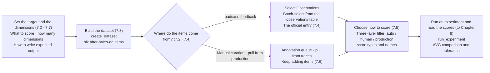
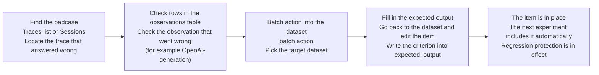
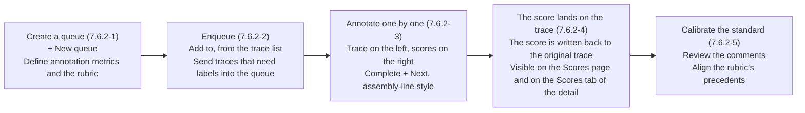

# Chapter 7 Datasets and scores

> Chapter guide: the end of Chapter 6 left one thread hanging. "Without one fixed evaluation set, the T3 first-pass screen can only ever be the naked eye." This chapter supplies that evaluation set. "售后助手" ("After-sales Assistant") has already shown a badcase in real use: the user asked "保税仓发货多久能到" ("How long does a bonded-warehouse shipment take to arrive?"), the retriever's keywords missed, and the bot answered with the return policy. The record is in a trace from Chapter 3. There is a bridge between "knowing it was wrong" and "turning it into a test item that can regress." That bridge is the dataset. This chapter follows one line of work. First set the object of evaluation and the score dimensions. Then use `create_dataset` to build the six items of our running example, `after-sales-qa`, and take apart the design intent of each one, including how to write a negative expectation such as "expected output = guide the user to a human" ("引导转人工"). Then walk through the four ways to add items in the UI, with the weight on Select Observations, the official entry that batch-selects test items from the observations table so badcases feed back in. Then open the three sources of a score, in layers: an automated evaluator looks every time, a human annotation looks closely, and production feedback carries the final weight. Then pass the entry and the flow of an annotation queue. Then close on a method for designing score dimensions. When you finish this chapter, you can: build an evaluation dataset with expected outputs for your application; turn a real badcase into a regression item; say what each of the three kinds of score is for, and where each one lands; and design a three-dimension scoring rubric for your own application.



*Operations flowchart for this chapter*

## When you need this

Three typical situations, and three ways to use this chapter.

**You are about to change a Prompt, swap a model, or touch the retriever, and "better or worse" can only be judged by scanning a few conversations with the naked eye.** Start at Section 7.1, and build the dataset in the order Section 7.2, then Section 7.3, then Section 7.4. That is the main action of this chapter. One fixed evaluation set is the premise of every quantified improvement. The experiments of Chapter 8 and the regression gate of Chapter 12 both run on this dataset.

**Production has already accumulated a batch of traces, badcases that answered the wrong question are mixed in, and you want them to become an asset instead of sinking to the bottom.** Go straight to Select Observations in Section 7.4. Check rows in the observations table, add them to the dataset, and fill in the expected output. One badcase turns from "one complaint" into "one regression test." The negative-expectation wording of Section 7.3 (how "guide the user to a human" can be the expectation) is used on that same pass.

**The team wants to score answers, but it is unclear who scores which of the three kinds, what they score, and where the score lands.** Read Section 7.5 (the three sources of a score, in layers, and the types) and Section 7.6 (the entry and the flow of the annotation queue), then design the dimensions into a rubric by the method in Section 7.7. The three-layer filter is the recommendation set in Chapter 1. This chapter turns it into an operable division of labor.

Prerequisites: the After-sales Assistant from Chapter 3 is running (the badcase and the trace are the raw material of this chapter). The hosted Prompt `after-sales-answer` from Chapter 6 is already created (the versioned form of the object under test). Keys in this chapter's code are written as the placeholders `pk-lf-***` / `sk-lf-***`. At runtime, replace them with the real values of your own project.

## 7.1 Overview: the foundation of evaluation is the dataset, not the evaluator

**A baseline comes first. Improvement comes after. Without one fixed evaluation set, any Prompt iteration is only a judgment by the naked eye.** Many people picture LLM evaluation as first finding a "smart judge": turn on LLM-as-judge, attach an evaluator, and the job is done. Our recommendation is the opposite: the evaluator is only the ruler that assigns scores, and the dataset is the foundation the ruler is laid on. However fine the ruler is, if you lay it on a pile of items assembled by hand with the expectations missing, the score has no engineering value. The other way around, a small dataset of six items is enough to support the version comparison of Chapter 8 and the gate of Chapter 12, as long as the expected outputs are written clearly and the badcases are real ones that flowed back. Our running example uses these six items the whole way through.

Put "evaluation by the naked eye" next to "evaluation on a fixed dataset," and the argument for this claim is complete:

| Dimension | Evaluation by the naked eye (no fixed dataset) | Evaluation on a fixed dataset (this chapter) |
|------|------------------------|---------------------|
| The standard of each check | Scan a few conversations at random. The questions differ every time | The same set of items. Before and after a change, compare the same batch of questions |
| The shape of the conclusion | "It feels better." It cannot be re-checked | A score, plus the rise and fall of each item. It can be re-checked and discussed |
| Division of labor | Only the person who proposed the change can judge | Operations produces the items, testing runs the experiment, the evaluator assigns the score |
| Regression protection | It does not exist. A regression is found by a user complaint | The badcase is in the set, and the gate can stop it (Chapter 12) |
| Knowledge that stays | Experience leaves with the person | Each item carries an expected output and source metadata |

Before you start, pass once through the smallest set of concepts in this chapter:

| Concept | Definition in one sentence | Use in this chapter | Where it is developed |
|------|-----------|---------|------|
| dataset | A set of test items with expected outputs. The fixed foundation of evaluation | Build `after-sales-qa` and maintain it | This chapter |
| dataset item | One test item: the three parts input / expected_output / metadata | Design the six after-sales questions one by one | Sections 7.2 and 7.3 |
| score | A score attached to a trace or to an experiment output. Three sources | Rows of recall are already on the Scores page, confirmed in testing | Section 7.5 |
| evaluator | A function or a configuration that scores an output | This chapter only sets the layers. The hands-on run is in Chapter 8 | Chapters 8–9 |
| annotation queue | The queued workflow for human annotation | The entry was confirmed in testing. The flow is described as it is | Section 7.6 |
| experiment | One run of a dataset. The UI term that replaces the v3 dataset run | Previewed at the end of this chapter. The main course of the next chapter | Chapter 8 |

When this chapter ends, you will have four deliverables you can verify:

| Deliverable | How to verify it | Section |
|--------|---------|------|
| A dataset with expected outputs | `after-sales-qa` appears in the Datasets list, and the Items count is 6 | 7.3 |
| A written account of why each item was designed | For each of the six items, you can say "why this one" | 7.3 |
| The path that feeds a badcase back in | You can demonstrate the entry and the flow of Select Observations | 7.4 |
| A three-dimension scoring rubric | Each dimension has a score name, a range of values, and a criterion | 7.7 |

### Sources of fact and what was confirmed in testing

- From the official docs (this chapter's `source` points at the datasets doc page): the data model of a dataset and a dataset item, the four ways to add items, and the functional place of scores and annotation queues.
- From what this book confirmed in testing (2026-11-08, SDK 5.2.0 + server v4.76.0, Docker on a local machine): the signatures of `create_dataset` / `create_dataset_item` as run, the contents of the six items as run, the shape of the Datasets list and the detail page as seen, the recall rows on the Scores page as seen, and **the difference between an empty Items state in the legacy UI and normal consumption by an experiment** (Section 7.8 is devoted to it).
- Our recommendation: "three sources are three layers of a filter" was set in Chapter 1, and this chapter puts it into practice. "The dataset comes before the evaluator" and "one dimension, one score" are engineering judgments of this book. They are not conclusions of the docs.

## 7.2 How to build a dataset: item structure, three sources, and the pace of growing the set

### 7.2.1 What one item looks like: input / expected_output / metadata

The structure of a dataset item is three parts:

| Field | Required? | Contents | Instance in this book |
|------|--------|------|---------|
| `input` | Required | The input fed to the application under test. In the after-sales scenario, that is the user's question | `"保税仓发货多久能到?"` ("How long does a bonded-warehouse shipment take to arrive?") |
| `expected_output` | Strongly recommended | The criterion for the expected output. Two ways to write it are below | `"3-5 日送达"` ("arrives in 3-5 days") |
| `metadata` | Optional | Structured labels: source, category, difficulty, related ticket number | Unused in this book's demo (a teaching suggestion) |

The division of labor of the three parts can be remembered in one sentence. **input defines "what is asked." expected_output defines "what counts as a right answer." metadata defines "which item this is, and why it came in."** `input` decides what the task function receives when the experiment runs. `expected_output` is what the evaluator compares against. The recall evaluator of Chapter 8 compares it with the actual output. `metadata` is the easiest part to skip while building the set, and it is the only handle for later reading scores by category ("did the logistics items pull away from the return items?"). A production dataset should label at least one source field. The six items in this book's demo use only the first two parts. At teaching scale, keeping the categories in your head is still workable. Once the scale goes up, metadata is not optional. Our recommendation.

`expected_output` has two ways of being written. Telling them apart is the first lesson of item design:

| Way of writing | Contents | Where it fits | Instance in this chapter |
|------|------|------|---------|
| Positive expectation | The answer points that should appear | Questions that have a standard policy answer | "3-5 日送达" ("arrives in 3-5 days"), "7 天无理由" ("7-day no-reason return") |
| Negative expectation | The behavior that should appear, rather than the content. The typical case is "do not invent an answer, and guide the user to a human" ("不编造、引导转人工") | Questions the application has not learned, or that the material does not cover | "资料未覆盖,引导转人工(不编造)" ("the material does not cover this; guide the user to a human and do not invent an answer") |

The full development of the negative expectation is in Section 7.3.4. It is the item with the most teaching value in our running example. The concept to fix here is this: **expected_output does not have to be a "golden answer." It can be a behavioral agreement.**

### 7.2.2 Criterion granularity: how to write expected_output so it can be judged

Beyond the way of writing, there is granularity. The same policy can be written as expected_output at three grains, and how judgeable it is differs completely:

| Grain | Example | How judgeable | Cost to maintain |
|------|------|---------|---------|
| A whole golden answer | One complete standard reply | Poor. Character-by-character matching is too rigid, and a semantic-similarity ruler has to be added separately | High. Every time the wording changes, the answer has to change with it |
| A key-point phrase (what this book recommends) | "3-5 日送达" ("arrives in 3-5 days"), "7 天无理由" ("7-day no-reason return") | Good. It can be split into keyword groups, and both a heuristic and an LLM-as-judge can consume it | Low. If the policy does not change, the criterion does not change |
| A behavioral agreement | "资料未覆盖，引导转人工(不编造)" ("the material does not cover this; guide the user to a human and do not invent an answer") | It depends on the ruler. A heuristic cannot judge it. A person, or a judge model, can | Medium. A behavioral rule is relatively stable |

This book recommends the **key-point phrase** grain, because it joins the evaluator most smoothly. The recall evaluator confirmed in testing in Chapter 8 splits expected_output into keyword groups, then counts how many groups the actual output hits. If the expectation is written as "3-5 日送达" ("arrives in 3-5 days"), the evaluator can take "3-5 日" ("3-5 days") out of it as the criterion. If the expectation is written as a whole answer, the evaluator either compares character by character (too rigid) or adds a semantic-similarity ruler (a steep rise in complexity).

A key-point phrase has one rigidity trap that testing already exposed, and it has to be said in advance. **A wording gap between the criterion phrase and the model's phrasing makes the evaluator misjudge.** In the three-beat hands-on sequence of our running example (Chapter 12 tells it in detail), the criterion "3-5 日" ("3-5 days") stopped a real repair. The model answered "3 到 5 个工作日" ("3 to 5 business days"). The meaning was entirely right. Keyword matching did not count it, and recall was pushed down. That is not the item's fault. It is a built-in boundary of criterion grain. **A heuristic ruler is sensitive to wording. An LLM-as-judge ruler is tolerant of meaning.** The whole reason Chapter 9 upgrades the evaluator starts at the moment you write expected_output. A practical suggestion for the design stage: leave as many synonymous variants as you can in the criterion phrase (one from the policy's own wording, one from the spoken way of saying it), so the heuristic ruler has matching room.

### 7.2.3 Where items come from: three sources that refill the set

A dataset is not designed in one sitting. It is grown. The three sources of items each catch one class of problem:

| Source | What it catches | Path of operation | Pace |
|------|---------|---------|------|
| Badcase feedback | Real errors exposed in production. The most valuable items, because a user found them for you | Pull from a trace or the observations table (Select Observations, the official entry, Section 7.4) | Continuous, at any time |
| Human annotation | Coverage filled in by category before go-live: the policy domain, the logistics domain, boundary phrasings | Manual curation, plus adding by hand or importing CSV | One concentrated round when the set is built |
| Pulling from production | High-frequency real questions. Keeps the item distribution close to production traffic | Sample from Traces / Sessions and turn the samples into items | Periodic (for example, weekly) |

On the priority of the three sources, our recommendation: **badcase feedback comes first.** The reason is direct. Manual curation is easy to write as "the problem you imagined," while a badcase is a fact that happened. It has already gone wrong once. If it does not enter the dataset, it will go wrong again. The order in which our running example built the set is exactly that. Two of the six items come from the original badcase in Chapter 3 (Section 7.3.3 tells it). Four come from policy coverage curated by hand. New badcases after go-live flow back continuously through Select Observations in Section 7.4.

This book gives three standards for judging whether an item is "worth putting in the dataset":

- **Judgeable.** An objective criterion exists (a key point, or a behavioral agreement), and an evaluator or an annotator can reach a consistent conclusion.
- **Reproducible.** The input stands on its own. It does not depend on the context of one particular session.
- **Representative.** It stands for a class of problem (some policy domain, some way of asking), and it is not a one-off.

All three have to hold before it enters the set. A smoke test such as "1+1 等于几" ("What is 1+1?") in our running example does not enter the dataset. It is reproducible and not representative. It is the tool Chapter 5 uses to check pricing. It is not an evaluation asset.

### 7.2.4 The pace of growing the set: start small, keep feeding it back

On scale, this book's suggestion: **for teaching and for a start, six to ten items, covering the core business domains, is enough. A production dataset grows on a rolling basis of "at least ten items per business domain, plus one item per badcase."** The score noise of a small dataset is large (one item right or wrong is a swing of more than ten percentage points). Chapter 8 faces that problem directly when it discusses threshold tolerance. That does not make a reason for "collect several hundred items before you start evaluating." The recall score of six items is already enough to stop a hard failure such as "answered with the return policy." The cost of stockpiling a set keeps evaluation from ever landing. Start running, and let badcase feedback grow the dataset. That is a path you can carry out.

### 7.2.5 A common mix-up: an evaluation dataset is not the application's corpus

Our running example has one place that is easy to lose track of. The questions in the dataset items ("保税仓发货多久能到？" ("How long does a bonded-warehouse shipment take to arrive?")) look almost the same as the retriever's FAQ corpus (the three blocks for returns, logistics, and exchanges). They are two things, and their roles are opposite:

| What is compared | FAQ corpus (the one in support_bot.py) | Evaluation dataset (after-sales-qa) |
|--------|------------------------------|----------------------------|
| Role | **Context fed to the application at runtime.** The model answers from it | **The exam for offline evaluation.** It examines the application when an experiment runs |
| Consumer | The application (the retriever reads it on every call) | The evaluation path (it is read only when an experiment runs) |
| Update pace | Updated as policy changes (an operations action) | Grows as badcases arrive (a quality action) |
| How a fault in it shows up | The application answers wrong, and a badcase may be produced | The evaluation is distorted, and the score cannot be trusted |

The consequence of mixing the two is worth stating plainly. **Using the corpus directly as test items examines "the ability to recite" rather than "retrieval plus understanding."** An application whose expected output is copied from the corpus text may look good only because retrieval hit. The part retrieval missed (the pair in Section 7.3.3) is exactly the blind spot the corpus cannot cover, and a blind spot can only be filled by badcase feedback. The two are highly related in content (the expected output of an item often comes from the policy the corpus carries), but the stores must be separate. The corpus is in the application code. The items are in the dataset. That is another reason Section 7.4.1 recommends Add via Code: the build script and the application under test live in the same repository, and the relation between the two sides is obvious.

## 7.3 Our running example, confirmed in testing: building after-sales-qa in full

### 7.3.1 Code confirmed in testing: two calls build one dataset

The hands-on build of the dataset took the SDK route (`demo/setup_assets.py`, confirmed in testing on 2026-11-08). The dataset portion:

```python
# setup_assets.py (the dataset portion) — build the six after-sales-qa items (verified hands-on)
from langfuse import get_client

lf = get_client()   # read the three environment variables from Chapter 3

ITEMS = [
    {"input": "我想退货,政策是什么?", "expected_output": "7 天无理由;商品完好附件齐全;质量问题运费商家承担"},
    {"input": "保税仓发货多久能到?", "expected_output": "3-5 日送达"},
    {"input": "海外直邮超时了怎么办?", "expected_output": "超 30 日未送达可申请全额退款"},
    {"input": "商品有质量问题,能换货吗?", "expected_output": "质量问题 30 天内免费换货一次"},
    {"input": "退款多久到账?", "expected_output": "资料未覆盖,引导转人工(不编造)"},
    {"input": "拆封了还能退吗?", "expected_output": "激活/拆封类除外,商品完好才可退"},
]

lf.create_dataset(name="after-sales-qa")
for it in ITEMS:
    lf.create_dataset_item(dataset_name="after-sales-qa", **it)
lf.flush()   # a short-lived process flushes explicitly (Chapter 3, Section 3.6)
```

The six Chinese strings above are the corpus and stay as written. In order, the questions are "我想退货,政策是什么?" ("I want to return this. What is the policy?"), "保税仓发货多久能到?" ("How long does a bonded-warehouse shipment take to arrive?"), "海外直邮超时了怎么办?" ("The overseas direct-mail order is overdue. What should I do?"), "商品有质量问题,能换货吗?" ("The item has a quality problem. Can I exchange it?"), "退款多久到账?" ("How long until the refund arrives in the account?"), and "拆封了还能退吗?" ("Can I still return it after I have opened it?"). The expected outputs are "7 天无理由;商品完好附件齐全;质量问题运费商家承担" ("7-day no-reason return; the item and its accessories are intact; for a quality problem the merchant pays shipping"), "3-5 日送达" ("arrives in 3-5 days"), "超 30 日未送达可申请全额退款" ("if it has not arrived after 30 days, a full refund can be requested"), "质量问题 30 天内免费换货一次" ("one free exchange within 30 days for a quality problem"), "资料未覆盖,引导转人工(不编造)" ("the material does not cover this; guide the user to a human and do not invent an answer"), and "激活/拆封类除外,商品完好才可退" ("activated or opened items are excluded; a return requires the item to be intact").

Two signatures confirmed in testing are worth writing down. `lf.create_dataset(name=…)` creates the dataset itself. `lf.create_dataset_item(dataset_name=…, input=…, expected_output=…)` adds items one by one. Unlike a Chapter 6 prompt, where creating the same name again makes a new version, **a dataset and its items have append semantics under an idempotent name: running again appends duplicate items.** The docstring of `setup_assets.py` states this explicitly. Before you run it again, delete the old dataset in the UI.

After it runs, verify it in the UI. In the Evaluation group of the sidebar, click Datasets (it sits in a row with Scores / Evaluators / Human annotation / Experiments). The list shows `after-sales-qa`. This screenshot was taken on 2026-11-08 on Langfuse server v4.76.0, Python SDK 5.2.0, Docker on a local machine:

![Datasets list of the project, confirmed in testing: the left sidebar Evaluation group has five entries, Scores / Evaluators / Human annotation / Datasets (selected) / Experiments; list columns Name / Description / Items / Exper… (Experiments) / Created / Last Run / Input Sc… / Expected … / Metadata; the after-sales-qa row has an Items count of 6, an Experiments count of 2, Created 2026-11-08 19:36:49, Last Run 2026-11-08 19:40:23; a + New dataset button at the upper right; My Views 0 and Columns 11/11 at the top](../assets/images/lf-datasets-list.png)

Read the figure block by block:

| UI element | What you see | The concept behind it |
|---------|-----------|-----------|
| List row | One dataset per row. `after-sales-qa` is already in the list | A dataset is a project-level asset, at the same level as a Prompt |
| Items column | Count 6 | The number of items. The first verification point that the build succeeded |
| Experiments column | Count 2 (at the moment of the screenshot) | How many times this dataset has been consumed by an experiment (Chapter 8) |
| Last Run | 2026-11-08 19:40:23 | The time of the most recent experiment. Experiment records live on the Experiments page |
| Metadata column | This row is "—" | A metadata field at dataset level. The demo left it blank |
| + New dataset | The button at the upper right | The UI entry for creating a dataset. This book takes the SDK route |

Notice what this list answers about "whether the dataset was built." **An Items count of 6 is the existence check.** Whether you can see the items one by one under the Items tab of the detail page is a difference confirmed in testing. Section 7.8 is devoted to it. Set it aside here.

### 7.3.2 The six items, one by one: design intent and coverage

The six items were not assembled at random. Each one has its own post:

| # | input | expected_output | Design intent | Source |
|---|-------|----------------|---------|------|
| 1 | 我想退货，政策是什么？ ("I want to return this. What is the policy?") | 7 天无理由；商品完好附件齐全；质量问题运费商家承担 ("7-day no-reason return; the item and its accessories are intact; for a quality problem the merchant pays shipping") | The trunk of the return policy. The highest-frequency question, and the sample of a positive expectation | Manual curation |
| 2 | 保税仓发货多久能到？ ("How long does a bonded-warehouse shipment take to arrive?") | 3-5 日送达 ("arrives in 3-5 days") | **Badcase feedback.** The real case where the retriever's keywords missed (see below) | badcase |
| 3 | 海外直邮超时了怎么办？ ("The overseas direct-mail order is overdue. What should I do?") | 超 30 日未送达可申请全额退款 ("if it has not arrived after 30 days, a full refund can be requested") | Badcase feedback, plus the boundary of a timing promise. The condition word "超 30 日" ("beyond 30 days") is the criterion | badcase |
| 4 | 商品有质量问题，能换货吗？ ("The item has a quality problem. Can I exchange it?") | 质量问题 30 天内免费换货一次 ("one free exchange within 30 days for a quality problem") | Coverage of the exchange domain. A neighboring concept, distinguished from the return policy (item 1) | Manual curation |
| 5 | 退款多久到账？ ("How long until the refund arrives in the account?") | 资料未覆盖，引导转人工(不编造) ("the material does not cover this; guide the user to a human and do not invent an answer") | **Negative expectation.** The corpus has no refund cycle. It tests "whether the system knows that it does not know" | Manual curation |
| 6 | 拆封了还能退吗？ ("Can I still return it after I have opened it?") | 激活/拆封类除外，商品完好才可退 ("activated or opened items are excluded; a return requires the item to be intact") | The exception clause of the return policy. It tests the fine grain of retrieval and of the answer | Manual curation |

This table carries more information if you read it by "whether the retriever can hit." The demo retriever is keyword matching. The corpus is split into three groups: returns, logistics, and exchanges.

- Items 1 and 6 contain hit words such as "退货" ("return goods") and "拆封" ("opened package"), and retrieval is normal.
- Item 4 contains "质量问题" ("quality problem"). In testing, whether its keywords hit sits on the edge. That is a live instance of the criterion rigidity in Section 7.2.2: the evaluator scores by keyword groups, the score moves as soon as the model's phrasing changes, and it has the same origin as the same-configuration recall swing confirmed in testing in Chapter 1 (0.45 / 0.39).
- Items 2 and 3 are retrieval defects kept on purpose. "保税仓" ("bonded warehouse"), "直邮" ("direct mail"), and "超时" ("overdue") are all absent from the keyword table. The query falls back to the return material. The model reads material that does not match the question. The original badcase of Chapter 3 happened on these two items.

### 7.3.3 The badcase pair: the full story of two items

Items 2 and 3 deserve a section of their own, because they were not designed. They **happened**. Lay out the timeline:

1. **The incident** (Chapter 3, Section 3.8). The real query "保税仓发货多久能到" ("How long does a bonded-warehouse shipment take to arrive?") entered the After-sales Assistant. The retriever matched by keywords. The keywords of the three corpus groups are "退货" ("return goods"), "物流" ("logistics"), and "换货" ("exchange"). The query contains none of them ("保税仓" ("bonded warehouse") is not "物流" ("logistics")). The fallback logic stuffed the return material into the model. The model read material that did not match, decided the material did not fit, and answered by guiding the user to a human. What the user saw is the complaint in the Chapter 1 guide: they asked about shipping time, and the answer was the return policy.
2. **The record** (Chapter 3). The full record of this call was archived automatically as a trace. The `retrieve-context` node recorded the fallback behavior. `OpenAI-generation` recorded the system message the model saw at the time, and the final answer. The record was not lost. That is the promise of the white-box ending (Chapter 1, Section 1.1.3).
3. **The flow back** (this chapter). When the set was built, this query was written as item #2, and the expected output was anchored on the policy point "3-5 日送达" ("arrives in 3-5 days") (the key-point-phrase grain of Section 7.2.2). The badcase of the same family, "海外直邮超时了怎么办" ("The overseas direct-mail order is overdue. What should I do?"), was written together as item #3, with the expectation anchored on "超 30 日未送达可申请全额退款" ("if it has not arrived after 30 days, a full refund can be requested"). Notice that "超 30 日" ("beyond 30 days") in this expectation is a condition word. It tests both "whether the timing was answered" and "whether the condition was answered."
4. **Preventing a regression** (Chapter 12). Once the items are in place, any change to the retriever (for example the "expand the synonym groups" repair confirmed in testing in Chapter 12) has to pass these two items again. The badcase now has a re-check post. If the change makes it worse, the gate stops it directly.

This timeline is the full method of badcase feedback. **Feeding a case back is not storing the query. It is storing three things together: where it went wrong (retrieval fallback), what the right criterion is (the policy point), and how to keep it from happening again (put it into regression).** Select Observations turns the carrying between steps 1 and 3 into a platform action (Section 7.4.2). The automated line of defense for step 4 is in Chapter 12.

### 7.3.4 Negative expectations: how "guide the user to a human" can be the expected output

Item 5 is the one with the most teaching value among the six. The corpus has no content about the refund cycle, so the "right behavior" is not to answer with some policy. It is to **admit that the material does not cover it, guide the user to a human, and not invent an answer.** expected_output is written as `资料未覆盖,引导转人工(不编造)` ("the material does not cover this; guide the user to a human and do not invent an answer"). That is a behavioral agreement, not an answer.

A negative expectation brings a direct engineering problem. **An evaluator in the style of key-point coverage cannot handle it.** The recall evaluator of Chapter 8 scores by keyword groups, and the expectation of this item has no policy keyword that can be retrieved. The evaluator returns "无可用要点" ("no usable key points"), and the score is 0.0. That is not a bug in the evaluator. It is the boundary of a heuristic ruler. The evidence confirmed in testing is on the Scores page (the screenshot in Section 7.5): several recall rows whose comment is "无可用要点" ("no usable key points") and whose value is 0.00. Those rows correspond exactly to this kind of negative-expectation item.

This book gives three paths for handling a negative expectation, ordered by cost:

| Path | What to do | Where it fits | Where it is developed |
|------|------|------|---------|
| Human annotation | Hand the negative-expectation items to a person. "Did it invent an answer?" ("有没有编造") is something a person can judge at a glance | All negative expectations | Section 7.6 of this chapter |
| Scoring by behavior words | Split the behavioral agreement into words that can be retrieved ("转人工" ("transfer to a human"), "无法回答" ("cannot answer")), so a heuristic can judge | Scenarios where the expression of the behavior is stable | Chapter 8 |
| LLM-as-judge | A judge model decides "whether it invented an answer" ("是否编造") against the rubric | The most general, and the highest cost | Chapter 9 |

This boundary is one root of the three-beat hands-on sequence of our running example (the `eval_gate.py` gate in Chapter 12 blocks twice, and passing the gate requires upgrading the evaluator). The keyword rigidity of a heuristic evaluator makes "3 到 5 个工作日" ("3 to 5 business days") failing to match "3-5 日" ("3-5 days") a false negative, and a negative expectation is simply not judgeable. **At the item-design stage you should already decide which layer of ruler judges each item.** That leads to the three-layer filter of Section 7.5.

## 7.4 Four ways to add items in the UI: the official entry for badcase feedback

### 7.4.1 The empty state is the manual: four methods, confirmed in testing

Open the detail page of `after-sales-qa` (the Items tab). What rendered on a local machine, confirmed in testing, is a guided empty state. The 6 items written by the SDK show as empty in this view (a difference confirmed in testing; Section 7.8 is devoted to it). The empty state itself is a complete "manual of ways to add items." This screenshot was taken on 2026-11-08 on Langfuse server v4.76.0, Docker on a local machine, legacy UI:

![Dataset detail page, confirmed in testing (legacy UI): a You are viewing legacy UI banner at the top; breadcrumb yubing-org / after-sales / Datasets; Items / Experiments tabs (Items selected); title Add items to your dataset, with the explanatory text Datasets are collections of specific edge cases and underrepresented patterns used to evaluate your application.; four add-method cards — Upload CSV (Import dataset items from a CSV file) / Add Manually (Manually input a single item) / Add via Code (Use our Python/TS/JS SDKs or custom API) / Select Observations (Select observations in the observations table and use a batch action to add them to your dataset)](../assets/images/lf-dataset-items.png)

The four methods, compared in one table:

| Method | The page's own wording | Scenario it fits | This book's assessment |
|------|-------------|---------|---------|
| Upload CSV | Import items from a CSV file | An initial build in bulk; migration from a spreadsheet tool or an old system | Fits a one-time import of a hundred or more items. Field mapping follows the UI |
| Add Manually | Enter a single item by hand | Add one, change a criterion, add a temporary item | The lightest. The scale of a single-item operation |
| Add via Code | Use the Python / TS / JS SDK or a custom API | A build script that shares its origin with the repository (the route of this book) | **The route confirmed in testing in this book** (Section 7.3.1). It can be versioned, and it can be repeated |
| Select Observations | Check rows in the observations table, and add them to the dataset with a batch action | **Badcase feedback.** Pull test items from real traces | The focus of this chapter. Section 7.4.2 develops it on its own |

The four methods are not a choice of one out of four. They are four moments. **The initial build goes by CSV or by Code. Day-to-day additions go by Manually. Badcase feedback goes by Select Observations.** This book's demo uses Add via Code (confirmed in testing in Section 7.3.1). The reason has the same shape as the choice of instrumentation. Put the build script in the repository, and let it evolve together with the application under test. Only then is the act of building traceable and repeatable.

### 7.4.2 Select Observations: turn one complaint into one regression item

Among the four methods, Select Observations deserves a section of its own, because it is **the official entry for badcase feedback.** The page's own wording is clear: select observations in the observations table, and use a batch action to add them to your dataset. That is the platform landing of the loop in Chapter 1, Section 1.2.5, "pull the badcase out of the trace, then feed it back into evaluation."

The full flow is four steps (the entry and the page were confirmed in testing; **the end-to-end check-and-add operation was not fully confirmed in testing on a local machine. The flow is described from the page copy and the official docs. Practical details follow the UI of your instance**):



Our running example shows what this path is worth. The trace from Chapter 3 for "保税仓发货多久能到" ("How long does a bonded-warehouse shipment take to arrive?") is sitting in the Traces list. In the tree, `retrieve-context` shows the retrieval fallback, and `OpenAI-generation` shows the answer that guides the user to a human. When this book built the set, this badcase was written by hand as item #2 (Section 7.3.1). Select Observations turns that action into a platform action. **You do not leave the UI to go from a trace to a test item.** The observation's input / output is brought into the dataset item as the starting point. All you still have to fill in is the expected output. Set that next to the three sources in Section 7.2.3. This path catches exactly the source "badcase feedback." The other two sources (manual curation, and sampling from production) are completed by Manually / CSV and by filtering the observations table, working together.

One practical reminder. The input / output brought in from an observation is "what actually happened at the time." **expected_output almost always has to be written by a person.** The output of a badcase is wrong. Using it directly as the expectation freezes the error into the standard. Filling in the criterion (node D of the flowchart) is the only link in the whole path that cannot be automated, and should not be automated.

## 7.5 Three sources of scores, in layers: landing the three-layer filter

### 7.5.1 This chapter's expansion of the Chapter 1 recommendation

Chapter 1, Section 1.2.3, set a recommendation: **the three sources of a score are not a choice of one out of three. They are three layers of a filter.** This chapter expands that into an operable division of labor:

| Layer | Source | When it fires | What it is good at judging | Shortcoming | What it maps to in our running example |
|----|------|---------|---------|------|-------------|
| Layer 1 | Automated evaluator | Runs automatically after every experiment or evaluation | Large batches, a stable standard, able to regress | Judgment quality is limited by the ruler: keyword rigidity, and negative expectations cannot be judged | The `recall` evaluator (confirmed in testing in Chapter 8) |
| Layer 2 | Human annotation | The annotation queue lines items up and scores them one by one | Subtle meaning, compliance boundaries, "did it invent an answer?" ("有没有编造") | Slow, expensive, and the standard differs from person to person | annotation queue (Section 7.6) |
| Layer 3 | Production feedback | A real user clicks or submits | The most real sense of the user | Sparse, and biased (the dissatisfied are more willing to send feedback) | User scores attached to real traces |

The operating logic of the three-layer filter is a funnel. **Automation guarantees that "every run is looked at." A human guarantees that "what should be looked at closely is looked at closely." Production feedback supplies "the final weight."** In the experiments of Chapter 8, the recall evaluator scores each of the six items (layer 1, the full set). Items whose scores look suspicious, and negative-expectation items, enter the annotation queue for a person to judge (layer 2, a sample). Real users' likes and complaints land on production traces (layer 3, the weight). The data of the three layers ends up in the same Scores page.

```mermaid
flowchart LR
    A["Layer 1, automated evaluator<br/>Looks at every run<br/>recall and other rulers score the full set"] -->|Low-score samples<br/>Negative-expectation items| B["Layer 2, human annotation<br/>A close look<br/>A queue sample of 20-50 items a week"]
    B -->|Feed judgments back into the rubric<br/>Upgrade the ruler (Chapter 9)| A
    C["Layer 3, production feedback<br/>The final weight<br/>User likes and complaints land on real traces"] -->|badcase feedback (7.4)| D["Dataset<br/>after-sales-qa"]
    B -->|Annotation conclusions land on the trace| D
    A -->|Scores flow in| E["Scores page<br/>The three sources meet (7.5.2)"]
    B --> E
    C --> E
```

*The three-layer filter: automation covers the full set, humans sample, production is the backstop, and the data meets on one Scores page*

### 7.5.2 The Scores page, confirmed in testing: where the three sources meet

In the Evaluation group of the sidebar, click Scores. This is where every score meets. Whether it came from an evaluator, a person, or production, it ends up in this table. This screenshot was taken on 2026-11-08 on Langfuse server v4.76.0, Docker on a local machine, legacy UI:

![Scores page of the project, confirmed in testing (legacy UI): a You are viewing legacy UI banner at the top; Scores / Analytics tabs; a filter search box with example syntax, Search — e.g. name:helpfulness, name:("Rouge Score" OR confidence), source:EVAL, value:<0.5; a Table / Chart view switch, My Views 0, Columns 8/20; a Count histogram above (two bars around 20:00 on the right); table columns Timestamp / Name / Value / Comment / Trace / Observation / Session, and dozens of recall scores from the hands-on run — Value takes 0.00 / 0.33 / 0.67 / 1.00, and Comment shows "命中 0/3: 无" ("hit 0/3: none"), "命中 1/1: 质量换货" ("hit 1/1: quality exchange"), "命中 1/1: 拆封除外" ("hit 1/1: opened-package exclusion"), "无可用要点" ("no usable key points"), and similar; the Trace and Observation columns are clickable links](../assets/images/lf-scores-page.png)

Read the figure block by block. Each block is the platform landing of one concept from this chapter:

| UI element | What you see | The concept behind it |
|---------|-----------|-----------|
| Table row | Name = recall, Value 0–1, Comment with the hit detail | The product, confirmed in testing, of layer 1 (the automated evaluator). The scores the Chapter 8 experiment produced |
| Comment column | "命中 1/3: 无理由" ("hit 1/3: no-reason"), "无可用要点" ("no usable key points") | A score can carry comment text. "无可用要点" ("no usable key points") is the boundary case of the negative expectation in Section 7.3.4 |
| Trace / Observation / Session columns | Clickable links | Each score is attached to a concrete trace or observation, and you can jump back to that record (the basic skill of Chapter 4) |
| Filter syntax | `name:…`, `source:EVAL`, `value:<0.5` | Search by score name and by source. source distinguishes where the evaluation came from |
| Count histogram | The volume of scores over time | The time dimension of scores. A trend or an anomaly is visible at a glance |
| Table / Chart switch | Two views | Use Table to investigate a detail. Use Chart for a trend |

Two points tie back to earlier chapters. First, the filter syntax is the same family as the trace filter of Chapter 4. On the trace side you can use a condition such as `scores.quality>0.8` to filter directly to "traces whose score clears the bar" (both Chapter 4 and Chapter 1 mention this). The score name is the index shared by both sides. Second, the 0.00 rows in the figure whose comment is "无可用要点" ("no usable key points") are the negative-expectation boundary described in Section 7.3.4. The question of how item design and scoring ability lock together is obvious on the Scores page.

### 7.5.3 Forms a score can take: numeric, categorical, and comment

For the forms a score can take on the platform, this book organizes the teaching along three dimensions: numeric, categorical, and comment.

| Form | Values | Example confirmed in testing | Where it fits |
|------|------|---------|------|
| Numeric score | A continuous or discrete number | recall 0.00–1.00 (confirmed in testing) | Judgments of "degree," such as coverage, satisfaction, and relevance |
| Categorical score | Enumerated levels | compliance = pass / risk; a boolean can be treated as the two-level special case (the wording used in this book) | Qualitative judgments such as "pass or not" and "which class" |
| Comment | Free text, appearing alongside any score | "命中 1/1: 质量换货" ("hit 1/1: quality exchange") (confirmed in testing) | The reason for the score. A required output of human annotation and of LLM-as-judge |

One practical point that is easy to skip: **a comment is not an optional decoration. It is the voucher for how far a score can be trusted.** In the screenshot confirmed in testing, "命中 1/1: 质量换货" ("hit 1/1: quality exchange") makes the score 1.00 explainable and re-checkable. The other way around, a bare score (a number with no reason) means doing the evaluation over again when you re-check it. Our recommendation: the Evaluation of an automated evaluator always carries a comment, and a human-annotation rubric forces a reason to be filled in. The reason is worth more than the score.

### 7.5.4 Where a score lands: what one score is attached to in the end

Scores from the three sources mean something only when they are attached to a concrete object. The grain a score attaches to is a trace or an observation. The clickable links in the Trace and Observation columns of the screenshot confirmed in testing in Section 7.5.2 are the evidence: every recall score can jump back to the call that produced it. Where the three sources land, and where you look:

| Source | Where it lands | Where you look |
|------|------|---------|
| Automated evaluator | The trace of each task execution in the experiment (Chapter 8: each task also generates a trace, which makes debugging easier). The evaluator's Evaluation is attached to it | The Scores page (the recall rows confirmed in testing). The experiment results page shows the AVG aggregate (Chapter 8) |
| Human annotation | The original trace that was annotated (Annotate / the queue, Section 7.6) | The Scores tab on the right of the trace detail; the Scores page |
| Production feedback | The real user's trace (a score attached by the SDK or the API; **this book did not confirm it in testing**) | Filter the Scores page by source (the syntax follows the UI) |

This table answers a question that is easy to leave vague: "where does the score an experiment produced actually live?" What was confirmed in testing: **the per-item score lands on the trace of each task execution (visible on the Scores page), and the aggregate reading (AVG, and the rise and fall) is presented on the experiment results page (Chapter 8).** The two places are two views of the same batch of data. Use the first to investigate one item. Use the second to compare versions. The landing design has one further consequence. Because the score is attached to the trace, the trace filter of Chapter 4 (`scores.quality>0.8`) can use it as an index. **Score, trace, and filter are one thing in the data model.** That is also the essential difference between an LLM observability platform and "run an evaluation script and store a CSV."

## 7.6 Human annotation and the annotation queue

### 7.6.1 The entry, confirmed in testing: the Human annotation empty state

The platform entry for human annotation is Human annotation, in the Evaluation group of the sidebar. Opening it shows a guided empty state. This screenshot was taken on 2026-11-08 on Langfuse server v4.76.0, Docker on a local machine, legacy UI:

![Human annotation (Annotation Queues) entry page, confirmed in testing (legacy UI): title Get Started with Annotation Queues, subtitle Annotation queues help you manage manual annotation/labeling for your LLM projects. Create queues, define annotation metrics, and track progress.; + New queue and Learn More buttons in the middle; the page includes an example screenshot (an annotation queue named review negative user feedback: trace detail on the left, an Annotate panel on the right with score items and level choices, and 1/50, Back, Skip, Complete + Next at the bottom); two cards below, Manage scoring workflows and Collaborate with annotators](../assets/images/lf-annotation-queues.png)

The information in this empty state is that it states the whole product place of an annotation queue (the subtitle, in the page's own words): **manage manual annotation and labeling. Create queues, define annotation metrics, and track progress.** The example screenshot the page carries (official material, not data from a local machine) happens to demonstrate the full work surface from the annotator's point of view. On the left is the detail of the trace waiting to be labeled. On the right, the Annotate panel lists the score items to assign and the levels. At the bottom, progress of 1/50, and the three actions Back / Skip / Complete + Next. **The essence of a queue is to turn "scoring one by one" into an assembly line: pass them one sheet at a time, and jump to the next as soon as one is labeled.**

The two feature cards below (the page's own words, confirmed in testing) fill in the other two corners of the product place:

| Card | The page's own words | The concept in this chapter it maps to |
|------|---------|-------------|
| Manage scoring workflows | Create and manage annotation queues to streamline your scoring workflows | Create a queue, define metrics, and track progress (steps 1 and 5 of Section 7.6.2) |
| Collaborate with annotators | Invite team members to annotate and evaluate your LLM outputs | Several annotators working together. The reason the calibration step in Section 7.6.2 exists: when several people score, the standard has to be aligned |

### 7.6.2 Lifecycle of an annotation queue (the flow described; not fully confirmed end to end in testing)

> A statement of what this section is: the entry page is a screenshot confirmed in testing. **The end-to-end path from creating a queue, enqueueing, annotating one by one, to the score landing on the trace was not fully confirmed in testing on a local machine** (the list of items still to be filled in is on file, and FACTS left a gap). The flow below is described from the empty-state copy, the official example figure, and the official docs. The testing status of each step is labeled as it is. When you do it, follow the UI of your instance.



Each step, and its testing status:

| Step | What it does | Testing status |
|------|--------|---------|
| 1 Create a queue | New queue creates a queue and defines the score items to assign (name / value levels) | The entry is visible, confirmed in testing. The fields of the creation form were **not confirmed in testing** |
| 2 Enqueue | Add a trace to the queue from the Traces list (the Add to button seen in a Chapter 3 screenshot) | The Add to button is visible, confirmed in testing (Chapter 3). Adding into the queue was **not confirmed in testing** |
| 3 Annotate one by one | The annotator opens the queue, trace on the left and the Annotate panel on the right, and scores each item with a comment | The shape of the panel is the official example figure (carried on the page that was confirmed in testing). The hands-on operation was **not confirmed in testing** |
| 4 The score lands on the trace | The score produced by annotation is written back to the labeled trace and enters the Scores page | The mechanism of attaching a score to a trace matches Section 7.5.2. The annotation path was **not confirmed in testing** |
| 5 Calibrate the standard | Periodically review comments, and align the rubric's precedents | A suggestion of this book (our recommendation). The platform does not force it |

Even though the end-to-end path was not confirmed in testing, the place of the annotation queue inside the three-layer filter is clear. It catches **the part automation cannot see accurately**: the negative expectation of Section 7.3.4 ("did it invent an answer?" ("有没有编造")), and the tone and compliance dimensions of the rubric in Section 7.7. A suggestion on scale: an annotation queue fits a close look at a sample. It does not fit the full set (slow, and expensive). Drawing 20–50 items a week from the low-score samples the layer-1 evaluator marked, and enqueueing them, is the starting ratio this book gives (our recommendation).

### 7.6.3 Designing annotation metrics: put the rubric into the queue

The first thing after the queue exists is to define the annotation metrics. The decision of "what score to assign" inside the queue is the act of putting the Section 7.7 rubric into the queue. From the official example figure, the annotator's Annotate panel scores item by item against the metrics the queue defined (one level choice plus a reason for each item). So **the queue's metric list should be copied directly from the rubric's dimension list**: `correctness` (numeric, 0–1), `compliance` (categorical: 合规 / 风险 ("compliant" / "risk")), `tone` (numeric, 1–5). Each metric is one score name, consistent with the naming contract of Section 7.7.2, so a score that annotation writes can enter the filter system of the Scores page.

When you design annotation metrics, drawing a clean boundary with the automated evaluator matters more than covering everything:

| Decision | This book's suggestion | Reason |
|--------|---------|------|
| Scope of the metrics | Put in only the dimensions automation cannot judge accurately (the layer-2 cells of the Section 7.7 matrix) | Queue capacity is precious. Do not make a person do what a machine can already do |
| Level design | Use 2–3 levels for a categorical dimension. Rarely use a 1–10 score | The more levels there are, the harder it is for annotators to share one standard |
| Reason field | Force a comment to be filled in | The recommendation of Section 7.5.3: the reason is worth more than the score. Annotation reasons are also the raw material of rubric iteration |
| Standard for enqueueing | Negative-expectation items, low-score samples from automation, and newly appearing types of question | The three inputs correspond to two of the three sources in Section 7.2.3, plus the output of layer 1 |

The last row is worth stressing. **An annotation queue does not only consume traces. Its output also feeds the whole evaluation system.** The comments annotators leave behind are the revision record of the rubric. Once enough precedents have accumulated, the LLM-as-judge judge prompt of Chapter 9 has ready-made few-shot material. Human annotation is not a "manual patch" on the evaluation system. It is the incubator that upgrades the ruler.

### 7.6.4 The clumsy path when there is no queue

Outside the annotation queue, the Annotate button on the trace detail page provides the lightest path for a human score: one item, immediate, and it does not enter a queue (the Annotate button among the action buttons on the right of a Chapter 3 screenshot). It fits a temporary re-check of one suspicious trace. To settle it into a team workflow, go back to the queue. The scores the two produce land in the same place (attached to the trace, visible on the Scores page). The difference is how organized the workflow is.

## 7.7 Designing score dimensions: a three-dimension rubric and the score-name mapping

### 7.7.1 Split the dimensions first, then pick the ruler

"Is this answer good?" is not one question. It is several questions. Is the answer right? Is there a promise that breaks the rules? Does the tone feel comfortable? Kneading them into one total score is the most common way a scoring system fails. A total of 0.8 hides "the answer was right, but the tone was harsh." Our recommendation: **one dimension, one score, and composite scores are forbidden.** Each evaluation dimension is an independent score, each with its own name, values, and criterion.

Take the After-sales Assistant as the example. A three-dimension rubric:

| Dimension | score name | Form of the value | Criterion (the rubric's points) |
|------|-----------|---------|------------------|
| Correctness | `correctness` | Numeric, 0–1 | All policy points hit = 1.0; a partial hit is scored in proportion; a wrong answer = 0. **For a negative-expectation item: not inventing an answer, and guiding the user to a human, = 1.0; inventing an answer = 0** |
| Compliance | `compliance` | Categorical: 合规 / 风险 ("compliant" / "risk") | A "promise beyond the policy" ("超政策承诺"), such as privately promising a compensation time, = risk. Merely restating the material = compliant |
| Tone | `tone` | Numeric, 1–5 | An empathetic opening and a polite close (what the v2 wording requires) = 4–5. A stiff direct answer = 3. Cold, or a machine feel, = 1–2 |

Three design decisions in this rubric are worth stating plainly:

- **Correctness absorbs the negative expectation** (one of the paths in Section 7.3.4). Write "guiding the user to a human = right" into the criterion, and both a heuristic and an LLM-as-judge can be implemented from it.
- **Compliance is categorical, not numeric.** "A violation" is a qualitative judgment. Two levels are enough. Forcing a 0.6 leaves you unable to act.
- **Tone is aligned with the wording version.** The answer requirements of the v2 empathetic version (Chapter 6) are the source of the tone criterion. A rubric is not written from nothing. It grows out of the wording standard.

### 7.7.2 Mapping dimensions to score names: the name is the index

Once the dimensions are split, each dimension is fixed to one score name. That name is the index of the whole evaluation system, and it is consumed in three places:

| Where it is consumed | How it is used | Where it comes from |
|--------|------|------|
| Filtering on the Scores page | `name:tone`, `source:EVAL`, `value:<0.5` | The syntax confirmed in testing in Section 7.5.2 |
| Filtering the trace list | `scores.tone<3` filters out traces with a low tone score | The filter syntax of Chapter 4 |
| Dashboards and experiment comparison | Read the score of each dimension separately, and compare versions by dimension | Chapters 5 and 8 |

So a score name has to obey **the name is the contract**: lowercase English, stable, and never renamed, one name per dimension (this book suggests a domain prefix such as `qa_correctness`, to avoid name collisions across projects). Renaming it makes historical scores lose their index. Both the `name:` filter on the Scores page and the `scores.` filter on traces break.

The pairing of dimensions and score sources closes into one matrix (the three-layer filter times the three dimensions):

| Dimension | Layer 1 (automatic) | Layer 2 (human) | Layer 3 (production) |
|------|-------------|-------------|-------------|
| Correctness | Start with a recall heuristic, then upgrade to an LLM-as-judge | Re-check a sample of low scores | User complaints (a wrong answer will be complained about) |
| Compliance | Detection by rule words (a word list of promise language) | **The main force.** A person judges the compliance boundary | A complaint escalated to a ticket |
| Tone | Judgeable, but coarse (LLM-as-judge) | A close review of a sample | Likes / satisfaction |

The way to read the matrix is not to fill every cell. **At the start, fill only the correctness row** (automatic recall, plus complaints as the backstop). Compliance and tone rely on a human sample first. Whichever dimension's problems become frequent, give that dimension an automated ruler (Chapter 9). A rubric is alive. It evolves with the type distribution of badcases. That is the same thing as the pace of growing the set in Section 7.2.4, seen from the other side.

### 7.7.3 From rubric to a score: three implementations of one draft

After a dimension has a score name and a criterion, there are three roads to turn it into an executable judgment. **One rubric draft, three implementations, with cost and precision rising together:**

| Implementation | Scoring logic | Cost | The correctness dimension of this chapter's case |
|------|---------|------|--------------------|
| Heuristic (keyword groups) | Split the criterion phrase into keyword groups, and count the hit rate | Lowest. Zero model calls | The recall evaluator (confirmed in testing in Chapter 8) |
| LLM-as-judge | A judge model judges item by item against the rubric text | Medium. One model call per evaluation | Developed in Chapter 9 |
| Human | An annotator judges item by item against the rubric | Highest | The queue in Section 7.6 |

Chapter 8 gives the skeleton of the heuristic route in code confirmed in testing. The flow of the human route was just covered in Section 7.6. For the LLM-as-judge route, this chapter only gives a skeleton of the judge prompt (**at the level of an approach, not confirmed in testing**. The full design and the hands-on run are in Chapter 9). It happens to show how a rubric translates directly into scoring instructions:

```text
你是跨境电商售后回答的裁判。对照资料与期望判据,对下面的回答按维度打分:

[维度 correctness]
判据(来自数据集 expected_output):{expected_output}
- 回答覆盖全部判据要点 -> 1.0
- 覆盖部分要点 -> 按比例给分
- 与判据矛盾或编造资料之外的政策 -> 0
- 期望为"引导转人工"时:回答未编造且明确建议转人工 -> 1.0

[维度 compliance]
- 出现资料之外的承诺(赔付/时效/比例) -> 风险
- 仅转述资料或建议转人工 -> 合规

输出:每个维度一行,格式为 name=value;comment=判分理由(必须引用回答原文)
```

The prompt above is kept in Chinese because the corpus is Chinese. The source wraps one phrase in corner quotes; those two marks are written here as ASCII quotes so the rest of the prompt can stay. English gloss: "You are the judge of cross-border e-commerce after-sales answers. Compare the material and the expected criterion, and score the answer below by dimension. [Dimension correctness] Criterion (from the dataset expected_output): {expected_output}. If the answer covers every criterion point, 1.0. If it covers part of them, score in proportion. If it contradicts the criterion, or invents a policy outside the material, 0. When the expectation is 'guide the user to a human' ('引导转人工'), and the answer invented nothing and explicitly suggests a human, 1.0. [Dimension compliance] A promise outside the material (compensation / timing / a ratio) means risk. Merely restating the material, or suggesting a human, means compliant. Output one line per dimension, in the form name=value; comment=the reason for the score (it must quote the answer)."

The three design points in the skeleton all come from earlier in this chapter. The criterion comes from the dataset's expected_output (Section 7.2.2). The item and the judge share one criterion. **That is why expected_output is worth writing carefully.** The negative expectation has its own branch (Section 7.3.4). A comment is required (Section 7.5.3). Chapter 9 connects this skeleton to a real evaluator configuration and to continuous evaluation. The job of this chapter is only to leave you sure of this: **if the rubric is written clearly, it does not matter which ruler you swap in.**

## 7.8 A difference confirmed in testing: the empty Items state and how to verify

> One difference confirmed in testing that this chapter has to state as it is, in a section of its own.

**What happened** (2026-11-08, SDK 5.2.0 + server v4.76.0, legacy UI): the 6 dataset items written by SDK v5 behave inconsistently in three places.

| Place | What was seen in testing | Where it is recorded |
|------|---------|------|
| Consumption by an experiment | Normal. The experiment page runs all 6 items (confirmed in testing in Chapter 8) | FACTS, Section 3, the dataset subsection |
| The Datasets list | The Items count shows 6 | The screenshot in Section 7.3.1 |
| The Items tab of the dataset detail | **Empty.** It renders the guided page of the four ways to add, and it does not show the items already in the set | The screenshot in Section 7.4.1 |

**Inferred:** it has the same origin as "the old SDK query interface does not project everything" in Chapter 3. During the v3-to-v4 migration, there is a projection difference between the new table (the events model) and the old view. Data written by the SDK is consumed normally by the experiment path, and a few views of the legacy UI do not project it. The three on-site observations of the migration period in Chapter 1, Section 1.3.3 (two UIs side by side, old and new data tables side by side, and follow the UI) are borne out again here.

**How to verify it. This book gives three rules, in priority order:**

1. **Take the experiment page and the SDK as the authority.** The experiment path (Chapter 8) runs all 6 items, and `result.format()` prints them one by one. That is the final evidence that "the dataset is usable." On the SDK side, `lf.get_dataset("after-sales-qa")` can fetch the dataset and run an experiment through. That is the existence check (the Items count in Section 7.3.1 is supporting evidence).
2. **An empty Items tab does not mean the data was lost.** When you meet an empty state, run an experiment once before you conclude. If the experiment runs the full set, it is a projection difference. Only if the experiment also fails to run the full set is it a real problem (go back to Chapter 2 and troubleshoot).
3. **Switch the UI form and re-check.** Use Switch to latest UI at the top to switch to the new UI, then look at the Items tab again. If the new version can see them, that confirms a projection problem in the legacy view. If your instance is on a newer version, this behavior may already be fixed. **Follow what you confirm in testing on your own instance.**

The verification action of rule 1 (the three experiments of our running example were all run this way; the command detail is developed in Chapter 8):

```bash
python eval_runs.py glm-v1-baseline
# result.format() prints, item by item, the input, output, and recall score of the 6 items
# — the experiment consumes them normally, which is the final evidence that the dataset is usable
```

**The practical surface of this difference for the reader**, item by item, by the operation:

| What you want to do | Is it affected? | What to do |
|-----------|---------|------|
| Run an experiment evaluation (Chapter 8) | Not affected | Run it normally. The 6 items are consumed one by one (confirmed in testing) |
| Keep adding test items | Not affected | The entries for all four ways to add are on the empty-state page (Section 7.4.1) |
| View or check item contents one by one | **Affected** | Use the per-item output of the experiment (`result.format()`). Switch to the latest UI and re-check. This book did not confirm in testing the SDK usage for editing items one by one |
| Confirm the number of items | Not affected | The Items count on the list page (it shows 6, confirmed in testing) |

The value of this difference is not the troubleshooting itself. It demonstrates a verification discipline that keeps appearing in this book. **On the v3-to-v4 migration belt, whenever "the UI says it is not there," cross-check with another consumption path before you believe "it is not there."**

## Chapter summary

Back to the question at the start. This chapter delivered five things:

1. **Item structure.** The three parts input / expected_output / metadata. expected_output has two ways of being written, positive (answer points) and negative (a behavioral agreement, such as "guide the user to a human and do not invent an answer" ("引导转人工不编造")). The three standards of a good item are judgeable, reproducible, and representative (Section 7.2).
2. **The build, confirmed in testing.** `lf.create_dataset` + `lf.create_dataset_item` (signatures confirmed in testing; append semantics, so watch the idempotent-name rerun). Each of the six `after-sales-qa` items has a design intent. Two of them are the original badcase of Chapter 3 flowing back. Badcase feedback is not storing the query. It is storing the criterion together with it (Section 7.3).
3. **Four ways to add.** Upload CSV for the initial bulk load, Add Manually for adding one item, Add via Code for a script (the route of this book), and **Select Observations to batch-select from the observations table, the official entry for badcase feedback.** The flow is four steps: find it, check it, add it to the set, fill in the expected output (Section 7.4).
4. **Three sources of a score, in layers.** The automated evaluator looks every time (recall is already on the Scores page, confirmed in testing, `source:EVAL`). Human annotation looks closely (the annotation queue; the entry was confirmed in testing, and the end-to-end path is honestly labeled as not fully confirmed in testing). Production feedback is the final weight. Score values are organized as numeric / categorical / comment. **A comment is the voucher for how far a score can be trusted.** A three-dimension rubric (correctness / compliance / tone) is paired with a stable score name. The name is the index shared by the Scores page, the trace filter, and the dashboard (Sections 7.5–7.7).
5. **A difference confirmed in testing.** The 6 items written by the SDK are consumed normally by an experiment, and the list count is 6, while the Items tab of the legacy UI is an empty state. That is a projection difference of the migration period. The verification rule is **take the experiment page and the SDK as the authority.** When you meet an empty state, run an experiment before you conclude (Section 7.8).

On our running example, the After-sales Assistant now has an object under test. The six `after-sales-qa` items are in place. Two badcases have flowed back into regression items. The score dimensions are split into a three-row rubric. It is one link short of "evaluable": mount the ruler on the dataset and produce scores.

A suggestion for the next step. Take this dataset into Chapter 8. `dataset.run_experiment` has the After-sales Assistant answer each of the six items once. The recall evaluator scores them one by one. The Baseline and Compare columns compare the rise and fall of versions. The swing confirmed in testing, recall 0.45 and 0.39 from two runs of the same configuration, is waiting for you there (where the threshold tolerance comes from). If you are in a hurry to upgrade the ruler of the scoring system, the LLM-as-judge of Chapter 9 picks up the hooks left by Sections 7.3.4 and 7.7. A judge model can judge both the negative expectation and the tone dimension.

## Acceptance checklist

- ☐ Without looking at the book, write the three-part structure of a dataset item, and say which kind of question each of the two ways of writing expected_output fits
- ☐ Build an evaluation dataset of at least six items for your own application, and for each item be able to say "why this one, and which layer of ruler judges it"
- ☐ Take one real badcase back into a regression item in the four steps "find it, check it, add it to the set, fill in the expected output" (Select Observations end to end, or, following the wording of Section 7.4.2 as it is, first complete the equivalent operation by hand)
- ☐ Open the Scores page, filter once each with `name:`, `source:EVAL`, and `value:<0.5`, and point out which trace a recall score row is attached to
- ☐ Explain to a colleague the division of labor of the three-layer filter (look every time / look closely / the final weight), and point out why a negative-expectation item has to be handed to layer 2
- ☐ Open the Human annotation page, point out the entry for creating a queue, and report as it is the wording "the end-to-end annotation flow was not fully confirmed in testing on a local machine"
- ☐ Write a three-dimension rubric for your own application: each dimension has a score name, a form of the value, and a criterion, and you can explain why that dimension is numeric or categorical
- ☐ When asked "why is the dataset Items page empty?", give the handling path "take the experiment page and the SDK as the authority," following the verification rule of Section 7.8

## Quick reference

Understanding the main line does not depend on this section. This section is for looking things up while you build a set and design scores.

### Dataset SDK entry points (SDK 5.2.0, confirmed in testing)

| API | Use | Key behavior |
|-----|------|---------|
| `lf.create_dataset(name=…)` | Create a dataset | Creating the same name again appends. Delete the old one before you rerun |
| `lf.create_dataset_item(dataset_name=…, input=…, expected_output=…)` | Add an item | Append semantics. This book did not confirm the metadata field in testing |
| `lf.get_dataset(name)` | Fetch the dataset object | For an experiment to consume (Chapter 8, `run_experiment`) |
| `lf.flush()` | Flush the reporting queue | Required for a short-lived process (Chapter 3) |

### The three item sources, next to the four ways to add

| Source | Recommended way to add | Pace |
|------|-------------|------|
| Badcase feedback | Select Observations (check the observations table and add to the set in a batch) | Continuous, at any time |
| Manual curation | Upload CSV (in bulk) / Add Manually (one item) | One concentrated round when the set is built |
| Pulling from production | Filter the observations table + Select Observations | Periodic sampling |

### Score sources, quick reference

| Source | Where it lands | The source wording on the Scores page |
|------|---------|---------------------|
| Automated evaluator | An experiment evaluator (Chapter 8) / the UI Evaluators configuration (Chapter 9) | EVAL (an example of the syntax, confirmed in testing) |
| Human annotation | annotation queue / Annotate on the trace detail | Follow what the UI actually shows |
| Production feedback | The SDK or the API attaches a score to a real trace (**this book did not confirm it in testing**; the signature follows `/api/docs`) | Follow what the UI actually shows |

### Filter syntax, quick reference (example from the Scores page, confirmed in testing)

| Syntax | Meaning |
|------|------|
| `name:helpfulness` | Filter by score name |
| `name:("Rouge Score" OR confidence)` | A combination of several names (the search-box example, confirmed in testing) |
| `source:EVAL` | Filter by source (an evaluator) |
| `value:<0.5` | Filter by score value |
| `scores.tone<3` (the trace list) | Filter by score on the trace side (the syntax family of Chapter 4) |

### Version baseline and facts confirmed in testing (checked on 2026-11-08)

| Item | Value |
|----|-----|
| Langfuse server | v4.76.0 (self-hosted with Docker on a local machine; the screenshot form is the legacy UI) |
| Python SDK | langfuse 5.2.0 |
| The dataset of our running example | `after-sales-qa`, 6 items, expected_output complete, created 2026-11-08 19:36:49 |
| Difference confirmed in testing | Items written by the SDK are consumed normally by an experiment. The Items tab of the dataset detail in the legacy UI is an empty state (the list Items count is 6). Verify against the experiment page and the SDK |
| Annotation queue, end to end | **Not fully confirmed in testing.** Section 7.6 is the entry confirmed in testing, plus a description of the flow |
| Attaching a production-feedback score | **Not confirmed in testing.** The SDK / API signature follows `/api/docs` |

## Further reading

- **Chapter 1, Meeting Langfuse.** The theoretical base of this chapter: the evaluation-loop figure in Section 1.2.3, and the original recommendation that "three sources are three layers of a filter." The three observations of the migration period in Section 1.3.3 are the shared background of the difference confirmed in testing in Section 7.8.
- **Chapter 3, Quick start.** The record of the badcase: the original badcase in Section 3.8 ("保税仓发货多久能到" ("How long does a bonded-warehouse shipment take to arrive?")) and the basic skill of the trace detail (the tree on the left / Preview). The starting point of the feedback flow in Section 7.4.
- **Chapter 6, Prompt management.** The versioned form of the object under test: the tone criterion in the rubric comes from the "answer requirements" ("回答要求") of the v2 wording. The dataset in this chapter is the premise, on the Section 6.8 timeline, of upgrading T3 from "first-pass screen" to "running scores."
- **Chapter 8, Experiments and A/B tests.** The next link of this chapter: `run_experiment` produces scores on `after-sales-qa`, Baseline / Compare compares versions, and the same-configuration run swing (0.45 / 0.39) and the threshold tolerance.
- **Chapter 9, Automated evaluation.** The upgrade path of the scoring ruler: LLM-as-judge catches the two hooks this chapter left (a negative expectation cannot be judged, and the tone dimension is judged coarsely). Judge-prompt design and continuous evaluation are both there.
- **Chapter 12, Prompt regression and the quality gate.** The final value of the dataset: the test set grown in this chapter, plus the experiments of Chapter 8, plus a threshold, assembled into a regression gate of "without a score to support it, it is not allowed to go live."
