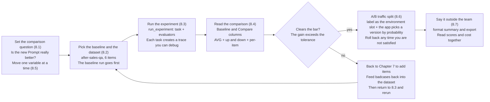
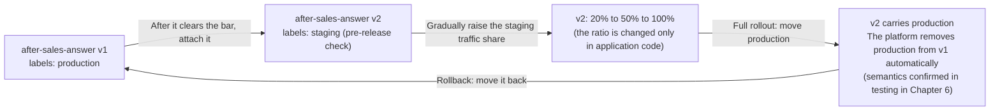

# Chapter 8 Experiments and A/B tests

> Chapter guide: Chapter 7 finished preparing the evaluation material for "售后助手" ("After-sales Assistant"). The dataset `after-sales-qa` has six items, scores have three sources, and there is an annotation queue. What you still lack is the most important step. **What flow answers the question "is the new version really better than the old one?"** Running the items by hand, one by one, and comparing the answers with the naked eye is neither reproducible nor something that leaves a record. This chapter turns that into engineering. Use `dataset.run_experiment` from SDK v5 to run the whole dataset once and score it automatically, and read the Baseline and Compare columns on the Experiments page. Then use the three real experiments of our running example (`glm-v1-baseline` was run twice, `glm-v2-prompt` once) to answer a sharper question. **The configuration is the same, and the run was done twice. Why are the scores different?** LLM nondeterminism stops being an abstract concept and becomes your own data, and the method of a threshold tolerance lands from that. Finally, push a change that cleared the bar into production: the idea of an A/B traffic split, and version rollback. When you finish this chapter, you can: run an experiment on your own and understand every number on the results page; state the basis of "repeated samples and a threshold tolerance"; design a comparison experiment that moves only one variable; and give the full path from clearing the experiment, to releasing by probability, to a rollback in seconds.



*Operations flowchart for this chapter*

## When you need this

Three typical situations, and three ways to use this chapter.

**You are about to change a Prompt (or the retriever, or the model), and you want to know whether the change made things better or worse.** This is the main way into this chapter. Walk the full path of Section 8.2, then Section 8.3, then Section 8.4: run one experiment before the change and one after it, and on the results page read the AVG comparison and the per-item rise and fall. In Chapter 6 you already turned the wording into a versioned asset. This chapter adds the verification action "every version iteration passes the dataset first."

**Two experiments differ in score, and you hesitate to draw a conclusion.** Go straight to the core teaching point of Section 8.3. This book confirmed in testing that the same configuration, run twice as `glm-v1-baseline`, scored recall 0.39 once and 0.45 once. Two rounds of the same configuration with different scores are direct evidence of LLM nondeterminism, and the method of "repeated samples and a threshold tolerance" follows from that. If you cannot read this point, every conclusion of a comparison experiment may be a portrait of the noise.

**The change cleared the bar, you want to push it to real users, and you do not dare to cut over all at once.** Read Section 8.6: the prompt label mechanism (Chapter 6), plus the idea of the application picking a label by probability, together with a rollback in seconds. And Section 8.7, saying it outside the team: when you tell the team the experiment result, read the score together with the cost (Chapter 5).

Prerequisites: the Chapter 7 dataset `after-sales-qa` (6 items, expected_output complete) is already built. The After-sales Assistant `support_bot.py` from Chapter 3 can run. The model pricing from Chapter 5 is in effect (Section 8.7 needs it when cost is read alongside). The code in this chapter is based on SDK 5.2.0 + server v4.76.0 (confirmed in testing on 2026-11-08).

## 8.1 Overview: from "dataset run" to "experiment"

### The v4 rename

One term has to be corrected first, so you do not get lost in old material. **In the v3 era it was called a dataset run. In v4 the UI and the API both call it an experiment.** The entry in the Evaluation group of the sidebar is called Experiments. The API endpoint is `/api/public/experiments` (it replaces the v3 dataset-run-items). The "dataset run" you see in an old tutorial and the "experiment" of this chapter are two generations of names for the same thing. SDK v5 goes one step further. It removed the `dataset.run()` helpers of the v4 period (the upgrade guide python-v4-to-v5 records this explicitly) and keeps only the one road, `run_experiment`.

The question an experiment has to answer is always the same. **On this batch of test items, is the overall behavior of this configuration (Prompt version times retriever times model) up or down compared with the baseline?** Langfuse splits it into four elements:

| Element | What it is | The value in our running example | Source |
|------|--------|------------------|------|
| dataset | The set of test items. Each item contains input and expected_output | `after-sales-qa`, 6 items | Chapter 7 |
| task | The application logic executed for each test item, producing an answer | `support_bot.answer` (retrieve, then Prompt, then LLM) | Chapter 3 |
| evaluator | Compares the output with the expectation, and produces a score | `recall_evaluator` (key-point coverage) | Section 8.2 of this chapter |
| experiment | The record of one run of "dataset times task times evaluator" | Three runs, including `glm-v1-baseline` | This chapter |

### Four deliverables of this chapter

| Deliverable | How to verify it | Section |
|--------|---------|------|
| One reproducible experiment run | Your run appears on the Experiments page, and all 6 items are green (Error Count 0) | 8.2 |
| One comparison reading | You can explain the Baseline and Compare columns, plus the per-item rise and fall | 8.4 |
| One tolerance conclusion | The score difference of two rounds of the same configuration, written into your threshold | 8.3 |
| One release path | A code skeleton that picks a label by probability, plus the rollback action | 8.6 |

### Sources of fact and what was confirmed in testing

- From the official docs (this chapter's `source` points at experiments-via-sdk): the call shape of `run_experiment`, the signature convention of task and evaluator, and the terminology of experiment replacing dataset run.
- From what this book confirmed in testing (2026-11-08, SDK 5.2.0 + server v4.76.0): the real scores of the three runs (0.39 / 0.45 / 0.33), the run name automatically appending a timestamp, the two-column layout of the results page and the up and down arrows, the experiment row showing Total Cost as not recorded, and each task execution generating an independent trace.
- From the A/B boundaries this book confirmed in testing: moving a label, and the semantics of automatic removal, were confirmed in testing (the probe in Chapter 6). **The application-side split code in Section 8.6 is an example of the idea, and it was not confirmed end to end in testing.** It is labeled as it is.

## 8.2 The experiment model: dataset.run_experiment, confirmed in testing

### The problem: testing items by hand is slow and leaves no record

In Chapter 7 you built `after-sales-qa`. The clumsiest way to verify a change is to paste each input into `support_bot.py`, run it once, look at the answer with the naked eye, and score it in your head. One round of six items takes six manual interactions, and **nothing is left behind.** The score is not stored. The third change, two weeks later, cannot be compared with today's. The experiment mechanism has to solve two things at once: **batch execution** (run the whole dataset once) and **persistence** (each run becomes a record on the platform that can be traced and compared).

### Code confirmed in testing: eval_runs.py in full

This book's experiment script `eval_runs.py` (it runs; confirmed in testing) shows in full how the four elements are assembled:

```python
"""数据集实验(SDK v5 run_experiment):对 after-sales-qa 跑实验并逐条打分。

- recall 评估器:expected_output 的关键要点覆盖率(启发式,教学用)
- 延迟/成本由 SDK 自动记录,Experiments 视图直接对比

运行前环境变量同 support_bot.py。可传实验名参数:
  python eval_runs.py glm-v1-baseline
"""
import os
import re
import sys

from langfuse import get_client, Evaluation

sys.path.insert(0, os.path.dirname(os.path.abspath(__file__)))
from support_bot import answer, lf  # noqa: E402

RUN_NAME = sys.argv[1] if len(sys.argv) > 1 else "glm-v1-baseline"

# expected answer -> keyword groups used to judge recall (a group counts as covered if any one pattern hits)
KEY_POINTS = {
    "7": ["7 天", "七天"],
    "无理由": ["无理由"],
    "质量换货": ["30 天内免费换货", "质量问题"],
    "保税仓时效": ["3-5 日"],
    "直邮时效": ["7-15 日"],
    "超期退款": ["30 日未送达", "全额退款"],
    "拆封除外": ["拆封"],
}


def recall_evaluator(*, input, output, expected_output, metadata, **kwargs) -> Evaluation:
    """要点覆盖率 0-1:期望中的关键词组有多少组在输出中命中。"""
    expected = expected_output or ""
    text = re.sub(r"\s", "", output)
    keys = [k for k, pats in KEY_POINTS.items() if any(p in expected for p in pats)]
    if not keys:
        return Evaluation(name="recall", value=0.0, comment="无可用要点")
    hit = [k for k in keys if any(p in text for p in KEY_POINTS[k])]
    return Evaluation(
        name="recall",
        value=round(len(hit) / len(keys), 2),
        comment=f"命中 {len(hit)}/{len(keys)}: {','.join(hit) or '无'}",
    )


def main() -> None:
    dataset = lf.get_dataset("after-sales-qa")
    result = dataset.run_experiment(
        name=RUN_NAME,
        description="售后助手启发式召回性实验(教学演示)",
        task=lambda *, item, **kwargs: answer(item.input, session_id=f"eval-{RUN_NAME}"),
        evaluators=[recall_evaluator],
    )
    print(result.format())
    lf.flush()
```

The docstrings and the Chinese string literals above stay as in the source, because they are the code that was run. English gloss of the module docstring: "Dataset experiment (SDK v5 run_experiment): run an experiment on after-sales-qa and score each item. The recall evaluator is the coverage of key points in expected_output (a heuristic, for teaching). Latency and cost are recorded automatically by the SDK, and the Experiments view compares them directly. The environment variables before running are the same as support_bot.py. You can pass an experiment name: python eval_runs.py glm-v1-baseline." The function docstring says the key-point coverage is 0–1: how many of the keyword groups in the expectation are hit in the output. The comment string "无可用要点" means "no usable key points." The comment template "命中 {n}/{m}: …" means "hit {n}/{m}: …," and the fallback "无" means "none." The description "售后助手启发式召回性实验(教学演示)" means "After-sales Assistant heuristic recall experiment (teaching demo)." The keyword-group names are "7", "无理由" ("no-reason"), "质量换货" ("quality exchange"), "保税仓时效" ("bonded-warehouse timing"), "直邮时效" ("direct-mail timing"), "超期退款" ("overdue refund"), and "拆封除外" ("opened-package exclusion").

Take it apart block by block. Three signatures are worth memorizing.

**First, the signature of task is `(*, item, **kwargs)`, keyword arguments only.** `item` is a dataset item. It carries the two attributes `input` and `expected_output` (the fields written when the item was created in Chapter 7). The return value of task is the application's answer. The SDK records it, together with the evaluator's score, on this experiment item. The task in this book is a one-line lambda that calls `answer()` from Chapter 3 directly. **The experiment task is not newly written test code. It is the production application itself.** That is the premise of trusting the experiment's conclusion: what you test is the path that is going to go live.

**Second, the signature and the return value of the evaluator.** The evaluator also receives keyword arguments. What this book used in testing is `input` (the item input), `output` (the return of task), and `expected_output` (the expected answer). The rest is caught by `**kwargs`. The SDK's callback parameter set evolves with versions, and a wide signature is a defensive posture. It returns an `Evaluation(name=..., value=..., comment=...)`. `name` is the score name (the column name on the results page). `value` is the number. `comment` writes the basis of the score. It appears in the per-item detail on the results page, and it is the first clue when you investigate "how was this 0.39 calculated?"

**Third, task passes `session_id=f"eval-{RUN_NAME}"`.** This small design, which looks casual, is the setup for reading cost alongside in Section 8.7. Every task execution of the experiment generates an independent trace (easier to debug; the next subsection develops it), and they are all hung on the session `eval-<run name>`. The session view of Chapter 4 can then catch this batch of experiment traces in one net, and the cost reading of Chapter 5 can also aggregate by session.

### Every task execution creates a trace: the debug exit of an experiment

When run_experiment runs a batch, each task call is a real execution of the application, and the SDK generates a complete trace for it. The structure is exactly the same as a production trace (root span, then retrieve-context, then llm-call, then OpenAI-generation). This design gives an experiment two important properties:

| Property | What it means | How to use it |
|------|------|------|
| Debuggable | Some item scored 0. Open its trace and see how many retrieval hits there were, and what the LLM answered | When you read a low-score per-item row in Section 8.4, the trace is the drill-down entry |
| Cost can be accounted | The trace has the generation's model and usage. After pricing, the amount is booked as usual | The data source for reading scores and cost together in Section 8.7 |

The experiment ran six items, and the platform gained six traces. They are not junk data. They are the "original vouchers" of the experiment. In this book's testing, this batch of traces hangs on the session `eval-<run name>` (the lambda design of Section 8.2). If your task does not pass session_id, the trace is still generated. The aggregation entry is just weaker.

### What role the evaluator plays inside an experiment

task is responsible for "running out an answer." The evaluator is responsible for "scoring the answer." Its role inside the experiment system is worth saying through on its own, because **the nature of the evaluator directly decides how far the experiment's conclusion can be trusted:**

| Property of the evaluator | Effect on the experiment | How it shows up in this book's case |
|-----------|-------------|---------------|
| Deterministic (the same input, the same score) | Score fluctuation can only come from the application side. Attribution stays clean | recall keyword matching is deterministic. The same answer always gets the same score |
| Objective (it does not depend on a model) | However many rounds you run, the evaluator itself introduces no noise | Heuristic recall does not call an LLM. Zero evaluation noise. The price is rigidity (false negatives, Section 8.3) |
| Explainable (comment) | A low-score item can answer "why is it low?" | A comment such as "命中 2/7: 7,无理由" ("hit 2/7: 7, no-reason") is the drill-down entry of Section 8.4 |
| Reusable across rounds | The baseline and the experiment group use the same evaluator, so the scores can be compared | The discipline of Section 8.5: a change of evaluator means a change of score standard, which means the baseline is set again |

The `evaluators` parameter is a list. You can hang several evaluators at once (for example, besides recall, hang an "answer length," or the LLM-as-judge Chapter 9 will cover). The results page puts out one column per score name. Our running example uses only one recall, so the teaching line stays clean. When you reach Chapter 9, you will see how the evaluator itself is upgraded.

One more detail that was checked again and again while this chapter was written: **the evaluator's comment field is not decoration.** The basis of the score, after a per-item row is expanded in the Section 8.4 screenshot, all comes from it. Every sentence of comment you write is a clue you leave for yourself, two weeks later, when you investigate "why did this round fall?"

### Run it once

```bash
python eval_runs.py glm-v1-baseline
```

Terminal output (an excerpt confirmed in testing, 2026-11-08):

```text
[retrieve] 命中 0 条
[retrieve] 命中 0 条
[retrieve] 命中 1 条
[retrieve] 命中 0 条
[retrieve] 命中 0 条
[retrieve] 命中 1 条
Individual Results: Hidden (6 items)
💡 Set include_item_results=True to view them

──────────────────────────────────────────────────
🧪 Experiment: glm-v1-baseline
📋 Run name: glm-v1-baseline - 2026-11-08T11:40:23.673992Z - 售后助手启发式召回性实验(教学演示)
6 items
Evaluations:
  • recall

Average Scores:
  • recall: 0.388

🔗 Experiment:
   http://localhost:3000/project/cmw7qtne20005or4o5fhknr8z/experiments/results?baseline=14fca2cad2de6878
```

The log lines above are kept as printed. "[retrieve] 命中 0 条" means "[retrieve] 0 hits," and "[retrieve] 命中 1 条" means "[retrieve] 1 hit." The run-name suffix "售后助手启发式召回性实验(教学演示)" means "After-sales Assistant heuristic recall experiment (teaching demo)."

Five observations. **One. `result.format()` prints a terminal summary:** the experiment name, the run name, the item count, the average score, and a link to the results page. Pasting the log in CI is enough (the gate script of Chapter 12 relies on it). **Two. A timestamp and the description were appended to the run name automatically.** What you passed was `glm-v1-baseline`. What was stored is `glm-v1-baseline - 2026-11-08T11:40:23.673992Z - 售后助手启发式召回性实验(教学演示)` ("After-sales Assistant heuristic recall experiment (teaching demo)"). That is SDK behavior confirmed in testing. The naming rule in Section 8.5 uses it. **Three. Six `[retrieve] 命中` ("hit") logs.** This is exactly the teaching point planted in Chapter 7. Four of the six hit 0 items. The retriever falls back, for questions such as "海外直邮超时" ("overseas direct mail is overdue") and "保税仓发货多久能到" ("How long does a bonded-warehouse shipment take to arrive?"), onto the return corpus. Those items are destined for a low score. **Four. Individual Results is hidden by default.** `include_item_results=True` expands the per-item results. **Five. The average score is 0.388.** Remember this number. In Section 8.3 it becomes 0.39, and then it becomes 0.45.

## 8.3 Our running example, the experiments in full: three runs and one sharp question

### The record of three runs, confirmed in testing

This book ran three experiments in all on the dataset `after-sales-qa` (confirmed in testing on 2026-11-08, the same code the whole way, the same model glm-5.3-flash, the same temperature 0.3):

| run | Configuration difference | recall average | Time (UTC) | Intent |
|-----|---------|--------------|-----------|------|
| `glm-v1-baseline`, round 1 | None. The baseline | **0.45** | 11:37:47 | Set the baseline |
| `glm-v1-baseline`, round 2 | **None. Completely the same as round 1** | **0.39** | 11:40:23 | Check the fluctuation |
| `glm-v2-prompt` | The Prompt was swapped for the v2 empathetic wording | **0.33** | 11:48:24 | Test the v2 wording |

The second row is the point the whole chapter turns on. **Round 2 and round 1 have exactly the same configuration.** The same code, the same Prompt, the same model, the same parameters. The only variable is "it was run again." recall went from 0.45 to 0.39, a difference of 0.06. That is **LLM nondeterminism.** temperature 0.3 is not 0. The model may produce different wording for the same input, and a change of wording happens to hit (or miss) a keyword of the heuristic evaluator. "3-5 日" ("3-5 days") written as "3 到 5 个工作日" ("3 to 5 business days") counts as the point not covered.

Raise this to a method:

### Three sources of fluctuation: locate them first, then set the tolerance

After two different scores come out, do not rush to write them into the tolerance. First find out where the fluctuation comes from. There are three possible sources of fluctuation on the experiment path. This book's case can locate them one by one:

| Source of fluctuation | Mechanism | The judgment from this book's testing |
|--------|------|------------------|
| The model's sampled wording | When temperature is greater than 0, the same input may produce different wording | **The main cause.** The two baseline rounds differ in the wording of the answers, and the keywords that hit or miss swing with that |
| Evaluator rigidity | Keyword matching has zero tolerance for wording: "3-5 日" ("3-5 days") is not "3 到 5 个工作日" ("3 to 5 business days") | **The amplifier.** A wording difference has nothing to do with quality. Rigid matching amplifies it into a score difference (Chapter 9 resolves it) |
| Unstable retrieval hits | When the retriever itself is uncertain, the context differs, and the score naturally scatters | **Ruled out.** The `[retrieve] 命中` ("hit") logs of the three runs are completely the same (0, 0, 1, 0, 0, 1). Keyword retrieval is deterministic |

The method of locating it is hidden in the run log of Section 8.2. The retrieval-hit sequences of the three experiments are identical, which says the fluctuation is not in the retrieval layer. The evaluator is deterministic code, which says the fluctuation is not in the evaluation layer. The only variable left is the LLM's sampled output. **After ruling the layers out one by one, the fluctuation is attributed cleanly to the interaction of "LLM wording times keyword matching."** That attribution process is itself a reusable experimental habit: rule the layers out first, and only then talk about tolerance.

One engineering implication along the way. If one day your source of fluctuation is located in the retrieval layer (for example, the top-k results of vector retrieval are unstable), the tolerance logic still holds, but the repair direction becomes "fix the retrieval seed, or freeze a snapshot of the context." Whichever layer the source of fluctuation is in, that is the layer your hand reaches for when you control variables.

### The method: repeated samples and a threshold tolerance

Nondeterminism means **the score of a single round is a sample, not the true value.** The reading rule of a comparison experiment is rewritten from that:

1. **Run the key comparison for several rounds.** The baseline is at least two rounds. First find the fluctuation amplitude of this configuration of yours. What this book confirmed in testing is that glm-5.3-flash plus heuristic recall fluctuates by 0.06 (0.45 to 0.39, two samples). Your configuration has to speak with your own data.
2. **The threshold you read against has to be larger than the fluctuation amplitude.** If the gain a change brings is smaller than the tolerance, the conclusion can only be "it cannot be distinguished from noise." You cannot declare victory. The teaching rule of this book: in a system whose fluctuation is ±0.06, a rise of 0.03 does not count as a rise.
3. **Approximate the true value with the mean of several rounds.** When the budget allows, run each configuration for 3–5 rounds, take the mean, and then compare. When the budget is tight, at least make sure "the gain is greater than the upper bound of a single round's fluctuation" before you conclude.

A pragmatic compromise is also given. Another way to dissolve nondeterminism is to drop temperature to 0, or to use a structured constraint. But a temperature of 0 is not a guarantee of determinism (the provider side can still perturb), and the tolerance habit cannot be skipped. The regression gate of Chapter 12 writes this tolerance into code: when `eval_gate.py` compares the average score with the threshold, the tolerance is an explicit parameter.

### How to read run 3: what the 0.33 of v2-prompt says

`glm-v2-prompt` (the empathetic wording) scored 0.33, lower than both baseline rounds. **Now, use the method of this chapter and hold back the urge to conclude.** Does 0.33 < 0.39 < 0.45 let you infer "v2 is worse"? Not yet. There are two reasons:

- **A fluctuation suspicion.** It is a single sample. The difference between 0.33 and 0.39 (0.06) is exactly the fluctuation amplitude of the baseline itself. Under the tolerance judgment, the difference between v2 and round 2 of v1 **is not enough to distinguish from noise.**
- **An evaluator suspicion.** recall is a heuristic evaluator of rigid keyword matching (Chapter 9 develops it). The empathetic wording writes "3-5 日" ("3-5 days") as "一般来说 3 到 5 个工作日就能到" ("in general it can arrive in 3 to 5 business days"). What fell may not be quality. It may be wording. That is a **false negative.**

The right next step is not to conclude. It is to drill down. Open the low-score per-item entries of the v2 run (Section 8.4), and look at the real answer in its trace and at the evaluator's comment. If the answer is actually good, what fell is the evaluator. If the answer is actually bad, what fell is the application. This order, "suspect the evaluator first, then look at the answer," is the lead-in to the LLM-as-judge upgrade in Chapter 9, and it is also a return visit to the badcase feedback of Chapter 7. The four items whose retrieval missed contribute a stable 0 in all three runs (the per-item rows of Section 8.4 will bear this out). They are the largest loss items right now. **Repairing the retriever has a higher priority than repairing the Prompt wording. That is not intuition. It is the conclusion of the per-item data.**

## 8.4 How to read the results page: the Experiments list and the Baseline / Compare view

### The Experiments list

In the Evaluation group of the sidebar, open **Experiments**. What this book saw (2026-11-08, after the three experiments had been run): this screenshot was taken on 2026-11-08 on Langfuse server v4.76.0, Docker on a local machine, legacy UI.

![Experiments list of the project, confirmed in testing: under the Evaluation group in the left sidebar, Experiments is selected; the Filters panel has the Dataset group with after-sales-qa checked; a Run experiment button at the upper right; a recall line chart at the top shows two points falling from 0.45 to 0.39, and the horizontal axis is the two glm-v1-baseline runs; the table columns below are Name / Item Count / Error Count / Start Time / Dataset / Referenced… / Latency (s) / Total Cost; two rows of glm-v1-baseline - 2026-11-08T…, both with Item Count 6 and Error Count 0, Start Time 19:40:23 and 19:37:47, the Dataset tag after-sales-qa, latency ∅ 22.7928s and ∅ 21.8453s, and Total Cost not recorded on both; the You are viewing legacy UI banner at the top is the form of the v4 migration period](../assets/images/lf-experiments-list.png)

Read it block by block:

| UI element | What was seen in testing | How to read it |
|---------|---------|------|
| recall line chart | The scores of the two runs are connected into a line, 0.45 to 0.39 | The list page automatically draws the score trend of the runs currently listed. The fluctuation of the two baseline rounds is visible at a glance |
| Filters, then Dataset | After after-sales-qa is checked, the list has only the runs of that dataset | The entry once there are many experiments. The search box supports the syntax `dataset:…`, `name:…`, and `scores.…>0.8` |
| Item Count / Error Count | Both 6 / both 0 | The item count checks that the dataset was not run short. An Error Count that is not 0 means some task threw. Fix the application before you talk about the score |
| Start Time | 19:40:23 / 19:37:47 | **Displayed in the local time zone.** The timestamp embedded in the run name is UTC (11:40:23Z). An 8-hour gap on the same run is the time zone. It is not an anomaly |
| Latency (s) | ∅ 22.7928s / ∅ 21.8453s | The average end-to-end time of the six items. The latency dimension of a comparison experiment looks at this column |
| Total Cost | **not recorded (confirmed in testing)** | The experiment row does not aggregate cost directly. Cost has to be read from the trace dimension. Section 8.7 develops it |
| Run experiment button | The upper right corner | The experiment entry on the UI side (scenarios such as associating a Prompt). This book takes the SDK route (Section 8.2). The products of both routes land on this page |

### The Baseline / Compare page: two columns and the up and down marks

Click any run in the list to enter the results page. The URL has the shape `/experiments/results?baseline=<id>`. Then add another run to the Compare column (the operation confirmed in testing: the Compare input at the top selects the run to compare). This book compared the two baseline runs with each other (a screenshot confirmed in testing on 2026-11-08). This screenshot was taken on 2026-11-08:

![Experiment results comparison page, confirmed in testing: the Baseline column at the top is glm-v1-baseline - 2026-11-08T11:40:23 (marked with a black Baseline tag), and the Compare column is glm-v1-baseline - 2026-11-08T11:37:47; the SUMMARY this page (6 items) row shows recall — Baseline 0.39 AVG, Compare 0.45, +0.06, up 1 and down 0; the per-item rows below, with inputs "海外直邮超时了怎么办?" ("The overseas direct-mail order is overdue. What should I do?"), "退款多久到账?" ("How long until the refund arrives in the account?"), and "保税仓发货多久能到?" ("How long does a bonded-warehouse shipment take to arrive?"), each show recall 0.00 in the SCORES of both columns; the Filters panel on the left has Show only active checked](../assets/images/lf-experiment-result.png)

This figure is the visual evidence of the method in Section 8.3. Three ways to read it:

**The SUMMARY row (a page-level aggregate).** Baseline 0.39 AVG, Compare 0.45, a difference of **+0.06**, and the up and down arrows **up 1, down 0.** Of the six items, 1 rose, 0 fell, and the rest held even. The up and down arrows are a vote count at the per-item dimension, and they carry more information than a single AVG. An AVG rise may be propped up by one large rise (with everything else falling). The arrow count punctures that "average trap" immediately.

**The per-item rows.** Each row is one test item. The Input column shows the item input, and the two columns each show that run's score. The three rows visible in the figure confirmed in testing, "海外直邮超时了怎么办?" ("The overseas direct-mail order is overdue. What should I do?"), "退款多久到账?" ("How long until the refund arrives in the account?"), and "保税仓发货多久能到?" ("How long does a bonded-warehouse shipment take to arrive?"), are **0.00 in both columns.** The four retrieval-miss badcases planted in Chapter 7 score a stable 0 across the two baseline rounds. What fluctuates is the other two. This bears out the conclusion of Section 8.3: the current loss board is in the retriever, not in the LLM's wording.

**The drill-down action.** A per-item row can be expanded to see the evaluator's comment (such as "命中 2/7: 7,无理由" ("hit 2/7: 7, no-reason")) and that item's trace. Whether a 0 is a retrieval miss or the LLM answering off to the side is obvious on the tree (the debug exit of Section 8.2).

### Three steps for reading per-item rows

Condense the reading above into a fixed set of actions. It can be used against any comparison:

| Step | What to look at | What you get | The corresponding conclusion of this case |
|------|--------|---------|----------------|
| Step 1: look at the arrow count | The vote shape of up n, down m | Whether the rise and fall is general or individual. Up 3 down 1, and up 1 down 0 with the same AVG, mean completely different things | Up 1, down 0: the gain comes from a single item. It is not an across-the-board improvement |
| Step 2: look at the stable 0 rows | Items that are 0 in both runs | A **structural loss** unrelated to the change. They push the AVG down, and they are not the credit or the fault of this change | The four items whose retrieval missed: changing the Prompt cannot save them |
| Step 3: drill into the fluctuating rows | Items whose scores differ between the two columns | Which items the nondeterminism landed on. The trace plus the comment qualifies it | The items where wording swing collided with keyword matching (the fluctuation attribution of Section 8.3) |

The value of these three steps is that **they turn "why did it fall?" from a guess into a location.** The structural loss screened out in step 2 rewrites the priority directly (repair the retriever, ahead of changing the wording; the final conclusion of this case). The fluctuating items screened out in step 3 calibrate your confidence in the tolerance. Set that next to the badcase feedback of Chapter 7. The product of step 2 is exactly the batch of items that has to be added back to the dataset and enter the annotation queue. The results page and the material of Chapter 7 close the loop here.

### Filter syntax on the results page

The search box on the comparison page and the Traces page share one filter syntax (the placeholder text confirmed in testing is `level:ERROR, scores.quality>0.8`). For example, `scores.recall<0.5` looks only at low-score items. My Views saves a commonly used view. The usage is exactly the same as in Chapter 4, and it is not repeated here.

## 8.5 The right posture for a comparison: one variable, and names

### Move one variable at a time: a three-axis model

The statistical validity of a comparison experiment comes from **controlling variables.** The configuration space of an LLM application can be arranged as three axes:

| Axis | A typical change | The example in this book's case | The chain of evidence |
|----|---------|--------------|--------|
| Prompt version | v1, the direct-answer version, against v2, the empathetic version | `glm-v2-prompt` versus the baseline | The versioned asset of Chapter 6 |
| Retriever | Keyword matching, against synonym groups, against an external knowledge base | Before and after the retriever repair in Chapter 12 (0.333 to 0.388) | The ragflow link in Chapter 10 |
| Model | glm-5.3-flash against another model | Not developed in this book (the method is the same) | Reading cost alongside, Section 8.7 |

The iron rule: **each experiment moves only one axis.** If the Prompt and the retriever change at the same time, a rise does not tell you whom to thank, and a fall does not tell you whom to fix. A question that two rounds of experiment could answer is polluted, by one experiment, into something with no answer. This book's own experiment record is the positive demonstration. Among the three runs, round 2 moved "time" (no configuration variable; it purely tests fluctuation), and round 3 moved only the one axis of Prompt version.

One axis does not mean one run. The right way to open multi-axis curiosity is an **experiment matrix**: line the variables you want to verify up into a plan, and run them axis by axis and round by round, instead of putting everything on at once.

| Round | Prompt version | Retriever | Model | The question it answers |
|------|------------|--------|------|-----------|
| R0 (baseline, times 2) | v1 | Keywords | glm-5.3-flash | The baseline's true value, and its own fluctuation (the tolerance) |
| R1 | **v2** | Keywords | glm-5.3-flash | Whether the v2 wording is worth it (axis: Prompt) |
| R2 | v1 | **Synonym groups** | glm-5.3-flash | Whether repairing the retriever is worth it (axis: retriever) |
| R3 | v2 | **Synonym groups** | glm-5.3-flash | Whether stacking the two has an interaction gain |

How to read the matrix: R1 against R0 compares only the Prompt. R2 against R0 compares only the retriever. R3 against R1 compares only the retriever, and R3 against R2 compares only the Prompt. Every step is a single-variable control, and the stacked gain is read from the difference. What this book confirmed in testing finished R0 and R1 (the conclusion: v2 is frozen). R2 has already been previewed by the gate narrative of Chapter 12 (the retriever repair, 0.333 to 0.388, a gain of 5.5 points, right on the edge of the tolerance, which is another live tolerance judgment). The matrix does not have to be run all at once. **Whichever axis has the larger expected gain, move that one first.** The per-item data of this book's case (retrieval misses score a stable 0) has already pointed out that R2 has a higher priority than R1.

A companion discipline: **the baseline and the experiment group share every other configuration.** The same dataset, the same evaluator, the same batch of items. If the evaluator is swapped, the score cannot be compared with the previous round (the "evaluator suspicion" of Section 8.3). If the dataset gains items, the AVG also cannot be compared with a historical run (the Item Count column is there for exactly this).

### A naming rule for run names: keep the list readable

The SDK automatically appends a timestamp and the description to the run name (confirmed in testing in Section 8.2), so the `name` you pass is a prefix. It is your only free naming space. Runs on the list page accumulate. The prefix rule directly decides whether you can still understand the list half a year later:

| Scenario | A good name | A poor name |
|------|----------|----------|
| Baseline | `glm-v1-baseline` | `test1`, `run` |
| A single-variable change | `glm-v2-prompt` | "新版本" ("new version"), "v2-final-真final" ("v2-final-really-final") |
| A combined experiment | `v2-prompt-+syn-retriever` | `abcd` |

The convention of this book (what was adopted in testing): a three-part prefix, **"model or component, variable, intent,"** and write the axis of the change into the name. The description field writes the experiment's intent in one sentence. The timestamp is filled in by the SDK. You do not manage it. Together with the `name:…` filter syntax on the list page, any historical experiment can be found in a second.

### How to choose the baseline

In the flowchart, "pick the baseline" is drawn before the experiment is run. Add one sentence of strategy here. **The baseline is a run of the current production configuration.** The Prompt version that the production label points at in Chapter 6, and the retriever and model in use, are run once and kept on file. That run is the Compare reference for every change after it. When you change the Prompt, use it as the baseline. When you swap the retriever, use it as the baseline as well (at that point the retriever is the only variable). The baseline run does not have to be rerun every time. But it is affected by nondeterminism. **After a major version upgrade, or after the evaluator changes, the baseline has to be set again** (the old baseline's score cannot be compared with the new standard).

## 8.6 A/B traffic splitting: from clearing the experiment to releasing by probability

### Draw the boundary first: what Langfuse gives, and what it does not

After the experiment clears the bar (the gain exceeds the tolerance of Section 8.3), the next step is to push the new version to real users. Draw the mechanism boundary first. **Langfuse provides the release semantics of "version and label," but the decision logic of the traffic split is on the application side.** The platform does not have a built-in function that splits automatically by percentage. The three things an A/B needs land in three places:

| The capability an A/B needs | Where it lands | Mechanism |
|---------------|--------|------|
| Two versions coexist and can be fetched | Langfuse (Chapter 6) | A prompt version plus a label. Any label can be fetched |
| Assign users by proportion | **Your application** | The application-side code of this chapter (an example of the idea) |
| Observe the real behavior of the two versions | Langfuse (Chapters 3 and 4) | The generation is associated with the prompt version number. Traces can be queried by prompt_name / prompt_version |

The third is the key to the loop. Chapter 6 confirmed in testing that after an explicit association with `propagate_attributes(prompt=…)`, the generation has the three fields promptName / promptVersion / promptId. **How many requests each Prompt version took in production traffic, and what the scores were, can be read by grouping on prompt_version.** The observation side of an A/B holds on its own.

### The label as an environment slot: releasing traffic is attaching a label

Reuse the label semantics of Chapter 6, Section 6.4, directly. The division of labor of the three environment slots in an A/B scenario:



The release path has three steps. **Hang staging on v2 first,** for a pre-release check. Then **the application side, by probability,** sends part of the traffic to the staging version (the ratio is in the code, and it is turned up step by step). Then, **at full rollout,** move the production label to v2. The key semantics confirmed in testing in Chapter 6 take effect here. One call to `lf.api.prompt_version.update(name, version, new_labels=["production"])` finishes moving the label. **The platform automatically removes the same-named label from the other versions.** Release and rollback are both a single action, in seconds.

### The application picks a label by probability: an example of the idea

What follows is the routing skeleton of the split. **An example of the idea, not confirmed end to end in testing** (the lab environment has no real user traffic to split. The Langfuse calls inside the functions are all APIs confirmed in testing in Chapter 6. The combined logic has not been verified on production traffic):

```python
# ab_router.py — an example of the idea (not confirmed end to end in testing): send users to a Prompt variant by probability
import hashlib

def pick_label(user_id: str, staging_ratio: float = 0.2) -> str:
    """稳定哈希分流:同一用户永远命中同一变体(体验一致性)。

    - bucket 取 0-99;staging_ratio=0.2 时,约 20% 用户进 staging 版
    - 用 user_id 哈希而非随机数:同一用户每次请求走同一版,避免体验跳跃
    """
    bucket = int(hashlib.md5(user_id.encode()).hexdigest()[:8], 16) % 100
    return "staging" if bucket < staging_ratio * 100 else "production"


def answer_ab(query: str, user_id: str) -> str:
    label = pick_label(user_id, staging_ratio=0.2)
    prompt = lf.get_prompt("after-sales-answer", label=label)  # fetch the version by label (Chapter 6)
    system_text = prompt.compile(context=retrieve(query), query=query)
    # ... the rest matches answer() in Chapter 3; propagate_attributes(prompt=prompt)
    # so the generation carries promptVersion, and the observation loop of Section 8.6 holds from that
```

The function docstring stays in Chinese, as in the source. English gloss: "Stable-hash split: the same user always hits the same variant (a consistent experience). bucket is taken from 0–99. When staging_ratio is 0.2, about 20% of users enter the staging version. Hash user_id instead of using a random number: the same user takes the same version on every request, so the experience does not jump."

Three design points are worth stressing:

- **A stable hash is better than a random number.** A random split makes the same user see v1 for a while and v2 for a while inside one conversation. Bucketing by a hash of `user_id` makes the experience coherent from the user's point of view, and the observation data can also be attributed by user.
- **The ratio is an application-side parameter.** Turning `staging_ratio` from 0.2 up to 1.0 is a gradual release. You change the configuration and you do not change the platform state. If something goes wrong, changing it back to 0 is "stop the release," and you do not touch the labels in Langfuse.
- **Rollback is a platform action.** If a quality problem is found after the full rollout, rollback goes by the label. Move production back to v1 (the move-label semantics confirmed in testing in Chapter 6), and the next second every `get_prompt` gets v1 back. **The switch for releasing is on the application side. The switch for rolling back is on the platform.** Two independent fuses.

The split strategy itself also has room to choose. The tradeoffs of three common practices:

| Strategy | What it does | Advantage | Disadvantage | Where it fits |
|------|------|------|------|------|
| Random split | Flip a coin on every request | The simplest to implement | The same user jumps between the two versions. The experience is split, and attribution is confused | A pure tool call with no user system |
| Stable hash (what this book recommends) | Bucket by a hash of user_id | The experience is coherent, and attribution by user is clean | The user mix of each bucket may differ by chance | A product with a stable user_id |
| Stratify by attribute | New users enter v2, and old users stay on v1 | You can do a directed check (for example, release only to newcomers) | The strata themselves cannot be compared. You have to read the numbers by stratum | The usual scenario of a gradual release |

Whichever strategy you use, the reading on the observation side is the same (the next subsection), because the anchor of attribution is promptVersion on the generation, and not the split method itself.

### The observation loop: how to read the two versions

During the release, and after it, answer "how does v2 behave on real traffic?" inside Langfuse:

1. **Traffic share.** Count generations grouped by promptVersion (the observations API, or a UI filter), and check whether the actual split ratio matches `staging_ratio`.
2. **Quality score.** Group the scores on production traces (the three sources of Chapter 7: LLM-as-judge, human annotation, and production feedback) by promptVersion and compare them. Note that this is an **online A/B reading.** It complements the dataset-experiment reading of this chapter. The experiment covers "the difference, before and after the change, on a fixed set of items." The A/B covers "the difference on the distribution of real traffic."
3. **Cost and latency** (Chapter 5). Read the token usage and the time of the two versions together, by promptVersion. The empathetic wording is longer, so output tokens are very likely to be more. The account of Section 8.7 is calculated here.

On the pace of the release, this book gives one pragmatic suggestion (our recommendation, not a doc specification): **start with a small proportion, and leave an observation window at each step.**

| Step | staging_ratio | What to look at inside the observation window | The condition for moving to the next step |
|------|---------------|---------------|---------------|
| A trial | 0.1 | The online error rate, negative user feedback, and whether the promptVersion distribution matches | No abnormal signal |
| Half | 0.5 | A comparison of the quality scores of the two versions (the production scores of Chapter 7), read together with cost | The score does not regress, and the cost is acceptable |
| Full | Move the production label | After the full rollout, the regression indicators enter the care of the Chapter 12 gate | — |

There is no standard answer for the length of each observation window. It depends on traffic density. For a system with a thousand requests a day, one window may be enough in a few hours. For a demo with a few dozen requests a day, collecting enough samples is counted in weeks. **When the sample is not large enough, wait longer. An A/B reading obeys the same sampling logic as Section 8.3. One "round" of production traffic is the observation window. A conclusion from a window that is too short is also a portrait of the noise.**

## 8.7 Saying the result outside the team: format, export, and reading cost alongside

### Two exits: the terminal and the platform

There are three layers of exits that consume an experiment result:

| Exit | Contents | Scenario |
|------|------|------|
| `result.format()` | A terminal summary: the run name, the item count, the average score, and a link to the results page | Local debugging, and CI logs (the output of the Chapter 12 gate) |
| The Experiments page | The list, plus the two-column comparison, plus the per-item drill-down | A team review. The "report" that a person and a machine read together |
| The trace / session dimension | The complete execution voucher of each item | A deep dig, and cost accounting (this section) |

One practical suggestion for reporting outward: **give the arrows first, then the mean.** "Up 1, down 0, +0.06, but the tolerance is also 0.06" carries much more information than "an average of 0.42." The SUMMARY row of the results page can be screenshotted straight into a review document. The per-item rows are the concrete material of the discussion.

### Read it with Chapter 5: the score went up; what about cost?

Step 3 of the cost-reduction loop in Chapter 5 said "the experiment verifies that quality does not regress." This chapter completes the other half. **Passing the quality check does not mean it can go live. You also have to look at the price.** Three facts confirmed in testing support reading the two together:

- **The experiment row shows Total Cost as not recorded** (the screenshot in Section 8.4, confirmed in testing). The experiment row does not aggregate cost. Do not look for the money on the list page.
- **But every task execution generates a trace** (Section 8.2). The generation on the trace carries model and usage. After pricing, the amount is booked as usual. The money is in the trace dimension, not on the experiment row.
- **The lambda in Section 8.2 hangs the experiment traces on the session `eval-<run name>`.** Filter Traces by session (Chapter 4), and the cost and latency of one round of experiment aggregate and become visible at once.

So "the score went up; what about the cost?" has an operable answer:

1. On the Traces page, filter by `session=eval-glm-v2-prompt` (or use the session view), and read the cost aggregate and the average latency of this round's experiment traces.
2. Read those numbers on the same standard as the baseline run. The v2 empathetic wording is longer, so output tokens are more, so the cost of one call is higher. The list Latency column confirmed in testing in Section 8.4 (∅ 22.8s versus 21.8s) suggests v2 is not ahead either.
3. The decision formula, in one sentence: **the benefit is the score gain; the price is the cost of one call times the traffic, plus the latency experience; a change whose gain is on the edge of the tolerance, and whose cost also rose, stays off by default.**

Take the numbers this book confirmed in testing and make one teaching precedent. The recall difference of `glm-v2-prompt` against the baseline (0.33 versus 0.39 / 0.45) cannot be distinguished from noise inside the tolerance, and latency and cost are not ahead either. **Not one of the three dimensions supports a release. v2 is frozen.** What this precedent demonstrates is the decision path. In a real project, fill in the number of each of the three dimensions, and the flow is the same.

### One complete decision record

After you have walked the flow of this chapter once, the suggestion is to freeze the conclusion into one decision record (into the team document, or into the gate configuration of Chapter 12):

```text
Experiment record 2026-11-08 — after-sales-qa × 6 items × recall (heuristic)
- Baseline fluctuation: glm-v1-baseline, two rounds, 0.45 / 0.39. The tolerance is taken as ±0.06
- Candidate v2: 0.33. The difference from the baseline is inside the tolerance → do not release
- per-item: four items whose retrieval missed score a stable 0 → next, repair the retriever (higher priority than changing the wording)
- Re-check rule: after the evaluator is upgraded (Chapter 9, LLM-as-judge), set the baseline again and rerun the full set
```

This record is at the same time the input of the regression gate in Chapter 12. The threshold is taken as "the baseline mean minus the tolerance." The dataset is reused. The narrative continues.

## Chapter summary

Back to the question in the guide. This chapter delivered four things:

1. **The experiment model.** v4 renamed dataset run to experiment (the UI, and the API `/api/public/experiments`). SDK v5 keeps only one road, `dataset.run_experiment(name, description, task, evaluators)`. The task signature is `(*, item, **kwargs)`. The evaluator returns `Evaluation(name, value, comment)`. Each task execution generates an independent trace that can be debugged (Sections 8.1 and 8.2).
2. **Three runs of our running example, and nondeterminism.** Two rounds of the same configuration, baseline recall 0.45 / 0.39 (a fluctuation of 0.06). A single round of `glm-v2-prompt` at 0.33 cannot support a conclusion inside the tolerance. A single-round score is a sample, not the true value. Key comparisons sample several rounds, and the threshold you read against must be larger than the fluctuation amplitude (Section 8.3).
3. **The reading, and the posture.** The SUMMARY row of the results page (AVG plus the up and down arrows), plus the per-item rows, locate the loss board (four items whose retrieval missed score a stable 0). A comparison experiment moves only one axis at a time (Prompt version / retriever / model). The run name uses a "component, variable, intent" prefix, and the SDK fills in the timestamp automatically (Sections 8.4 and 8.5).
4. **Release, and how it is said.** Langfuse gives the semantics of version and label, and it does not make the split decision. The release ratio is on the application side (a stable hash picks a label by probability; an example of the idea, not confirmed end to end in testing). Rollback is on the platform (move the production label, in seconds). When you say it outside the team, give the arrows first and the mean after. The experiment row's Total Cost is not recorded. Cost is read alongside from the trace dimension of the `eval-<run>` session. Only when the three dimensions of score, cost, and latency are all present is a release allowed (Sections 8.6 and 8.7).

On our running example, the After-sales Assistant now has a complete verification flow. Any change passes the `after-sales-qa` experiment before anyone talks about going live. The conclusion of this round is that v2 is frozen, and a retriever upgrade is on the schedule. The repair that the four stable-0 items point at (direct-mail overdue / bonded warehouse / refund cycle) will land, in Chapter 12, as the gate narrative. The fork in this chapter's operations flowchart, "clears the bar, then release / does not clear the bar, then add items," is from here on the standard loop that advances the main line of this book. Every iteration walks once around this circle, and every circle leaves a trace.

A suggestion for the next step. The false negative of the heuristic recall evaluator ("3 到 5 个工作日" ("3 to 5 business days") does not match "3-5 日" ("3-5 days")) has already interfered twice. Chapter 9 upgrades the evaluator with an LLM-as-judge, so the score grows semantic understanding. The full combination of dataset and experiment then enters the regression gate of Chapter 12, and becomes a standing guardrail in CI.

## Acceptance checklist

- ☐ Explain to a colleague the relation between experiment and the v3 dataset run, and point out the Experiments entry in the sidebar and the API endpoint
- ☐ Run `eval_runs.py` once on your own, state the signature convention of task and of the evaluator, and say why what task calls is the production application itself
- ☐ Open a per-item entry that scored 0, drill down along the trace, and locate the cause of the loss (a retrieval miss, or the LLM answering off to the side)
- ☐ Use the data of the two baseline runs in this book (0.45 / 0.39) to explain LLM nondeterminism to the team, and give the way your project takes its tolerance
- ☐ Design a three-axis experiment matrix, and demonstrate the concrete schedule of "move only one variable at a time" on the three axes of Prompt, retriever, and model
- ☐ Explain the division of labor in which the release switch is on the application side and the rollback switch is on the platform, and demonstrate one rollback that moves a label with `lf.api.prompt_version.update`
- ☐ On the Traces page, find the cost and latency of one round of experiment by the session `eval-<run name>`, and answer "the score went up; what about the cost?"
- ☐ Say the correct path for reading cost data when the experiment row shows Total Cost as not recorded

## Quick reference

Understanding the main line does not depend on this section. This section is for looking things up while you run an experiment.

### run_experiment quick reference (SDK 5.2.0 signature, confirmed in testing)

| Parameter or return | Value confirmed in testing | Note |
|-----------|---------|------|
| `name` | `glm-v1-baseline` | The run-name prefix. The SDK automatically appends a UTC timestamp and the description |
| `description` | One sentence of experiment intent | Shown at the tail of the run name. Read it as the changelog |
| `task` | `lambda *, item, **kwargs: answer(item.input, …)` | A keyword-argument signature. item carries input / expected_output. It returns the application's answer |
| `evaluators` | `[recall_evaluator]` | The callback receives keyword arguments such as input / output / expected_output. It returns `Evaluation(name, value, comment)` |
| `result.format()` | A terminal summary, plus a link to the results page | `include_item_results=True` expands the per-item results |

### Experiment record quick reference (confirmed in testing on 2026-11-08)

| run | recall | Note |
|-----|--------|------|
| glm-v1-baseline (11:37:47 UTC) | 0.45 | Baseline, round 1 |
| glm-v1-baseline (11:40:23 UTC) | 0.39 (0.388 as stored) | Baseline, round 2, the same configuration. The evidence of fluctuation |
| glm-v2-prompt (11:48:24 UTC) | 0.333 | A single-axis change: Prompt v2. It cannot be judged inside the tolerance |

### How the A/B mechanisms are split

| Capability | Belongs to | Mechanism |
|------|------|------|
| Versions coexisting, and fetching them | Langfuse | A prompt version plus a label. `get_prompt(name, label=…)` |
| The traffic ratio | The application side | Stable-hash bucketing (an example of the idea, not confirmed end to end in testing) |
| Observing the version | Langfuse | The generation's promptName / promptVersion / promptId (requires an explicit `propagate_attributes(prompt=…)`, Chapter 6) |
| Release / rollback | Langfuse | `lf.api.prompt_version.update` moves the production label. The platform automatically removes the same-named label from the other versions (confirmed in testing in Chapter 6) |

### The decision formula (8.7)

The benefit is the score gain (it must be greater than the tolerance). The price is the cost of one call times the traffic, plus the latency experience. When not one of the three dimensions supports a release, freeze by default.

### Version baseline (checked on 2026-11-08)

| Item | Value |
|----|-----|
| Langfuse server | v4.76.0 (self-hosted with Docker on a local machine; the screenshots are in the legacy UI form) |
| Python SDK | langfuse 5.2.0 (the `dataset.run()` helpers have been removed; only run_experiment remains) |
| Model | The Zhipu OpenAI-compatible endpoint, `glm-5.3-flash`, temperature 0.3 |
| Evaluator | Heuristic recall (coverage of 7 groups of keyword points) |
| Application-side A/B code | **An example of the idea, not confirmed end to end in testing** |

## Further reading

- **Chapter 6, Prompt management.** The foundation of every release action in Section 8.6: the versioned asset, the label as an environment slot, publishing and rolling back by moving a label, and the association of the three prompt fields on a generation.
- **Chapter 7, Datasets and scores.** The upstream of this chapter's flow: the six `after-sales-qa` items, and the entry for badcase feedback. The origin of the four items that score a stable 0.
- **Chapter 9, Evaluators and continuous evaluation.** The resolution of the "evaluator suspicion" in Section 8.3: an LLM-as-judge lets the score grow semantic understanding, and it ends the false negatives of rigid keyword matching.
- **Chapter 5, Cost and performance monitoring.** The other half of the side-by-side reading in Section 8.7: pricing, usage detail, and dashboards. The cost and latency numbers in the "benefit formula" both come from its way of reading.
- **Chapter 12, Prompt regression and the quality gate.** The frozen form of this chapter's flow: the baseline, plus the experiment, plus the threshold tolerance, written into `eval_gate.py`. The decision record of Section 8.7 is the embryo of the gate configuration.
